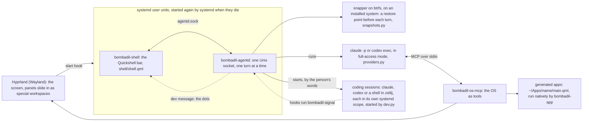

<p align="center">
  <picture>
    <source media="(prefers-color-scheme: dark)" srcset="docs/brand/bombadil-lockup.svg">
    
  </picture>
</p>

A Linux distro whose main interface is an AI agent. You boot it, pick Claude or Codex,
and from then on you talk to the machine: the browser slides in when you ask for it,
apps you describe appear as native windows, and "undo that" takes the system files back to
before the last turn when you restart. The agent runs as you, with full access; on an installed
system the undo is a restore point (a btrfs snapshot) taken before each turn, not a permission
prompt.

## Documentation

The documents live in [`docs/`](docs/README.md), next to the code. Start with
[the principles](docs/principles.md) (the rules the design keeps), then
[the architecture](docs/ARCHITECTURE.md) (the parts and the path of one turn). Each piece has a page
in [`docs/architecture/`](docs/architecture/), the reasoning behind each is in the
[design briefs](docs/design/README.md), and [the decision log](docs/decisions/README.md) and
[the roadmap](docs/roadmap.md) say what was decided and what is built, and [the reference](docs/reference.md)
lists every command, variable, file and unit. To fork it and build on it,
read [making it yours](docs/forking.md) and [CONTRIBUTING.md](CONTRIBUTING.md); AI coding agents
start at [AGENTS.md](AGENTS.md).

## How it fits together



| Piece | What it does |
|---|---|
| `bin/agentd` | The session daemon. Runs as a systemd user service (`bombadil-agentd`, like the bar's `bombadil-shell`) that Hyprland's start hook (`share/hypr/bombadil.lua`) starts; systemd starts it again a second after it dies (`Restart=always`). Takes prompts on `$XDG_RUNTIME_DIR/bombadil/agentd.sock`, takes a restore point where snapper is set up, runs one provider turn, streams events to every connected client, logs the turn. It also keeps the coding sessions' registry (`src/bombadil/dev.py`) and sends the `dev` message that the dots above the pill's left end are drawn from, and it sends the `away` message of the Away card (`src/bombadil/away.py`). It also takes the bar's hello (`bar`, `presence`, `persona`, `persona_skip`, `welcomed`) for Bombadil's voice (`src/bombadil/voice.py`) and keeps what Tips has taught (`src/bombadil/tips.py`); see their rows. It also keeps what waits for the person's press, a reply or a ticket (`src/bombadil/proposals.py`), and turns what the connection service says into notices and cards (see the `bin/bombadil-connect` row). |
| `bin/bombadil-os-mcp` | MCP server both CLIs load. Tools: `show_panel`, `hide_panel`, the app tools (`app_guide`, `create_app`, `check_app`, `open_app`, `show_app`, `hide_app`, `close_app`, `app_status`, `list_apps`, `app_template`), `show_card`, `system_map` (pictures), the mail tools (`mail_search`, `mail_read`, `mail_mark`, `mail_draft`, `mail_show`; none of them sends), `screenshot`, `snapshot`, `list_snapshots`, `rollback`, `notify`, `desk` (arranges the widgets beside the pill and sets each to Keep, When needed or Off, only when the person asked for the desk), `job` (background jobs, watchers and timers for the Watching card), the connection tools (`messages_unread`, `message_thread`, `tasks_waiting`, `connections`, `propose`; none of them sends, posts or replies). |
| `bin/bombadil-app` | Runs a generated app (`~/Apps/<name>/main.qml` + optional `app.py`) in its own slide-in drawer with hot reload; `bombadil-app check` loads one offscreen and returns errors and a screenshot. |
| `bin/bombadil` | Terminal client: `bombadil ask "…"`, `status`, `stop`, `undo`, `provider claude\|codex`, `signin`, `open URL`, `pill` (gives the pill the keyboard; a tap of Super or Alt+Space does that inside the bar, so this is for scripts and for a session without Hyprland), `terminal` (a terminal on the desktop, what Super+Return runs), `watch` (every step of the last turn), `history` (recent turns), `view` (the details drawer's viewer), `dev list|next|why|run` (the coding sessions: what each is doing, the next one waiting for you, the last screen of one that stopped, a session's tool run inside its pane), `remote` (starts Claude Code's remote control in a detached tmux session, so claude.ai/code or the Claude app can steer a session on this computer; `src/bombadil/remote.py`), `snapshot` (a restore point at once), `version` (which Bombadil this is and when it was installed, from two files, so it needs no agentd), `brain …` and `mail …`. Every command is in [the reference](docs/reference.md#commands). |
| `bin/bombadil-browser` | `$BROWSER` and the default browser: a link from anything (a CLI's login, `xdg-open`) opens in the browser panel. |
| `bin/bombadil-shell` | Starts the bar: Quickshell on `shell/shell.qml`, with `share/qml` on its import path so the shell can `import Bombadil`. Every launcher (the `bombadil-shell` unit that Hyprland's start hook starts, `scripts/dev-session.sh`) runs this, never `quickshell` directly. It also sets `QT_WAYLAND_FRAME_CALLBACK_TIMEOUT` to 2000 ms unless the person set it, so that a compositor that draws in software does not keep the bar redrawing itself at rest ([idle cost](docs/architecture/idle-cost.md)). |
| `bin/bombadil-signal` | What the coding tools' hooks run (the managed settings are in `packaging/bombadil/root/etc/claude-code/managed-settings.d/50-bombadil.json`, `packaging/bombadil/root/etc/codex/requirements.toml` and `packaging/bombadil/root/etc/codex/config.toml`). It passes a trimmed message (`dev-signal`) to agentd so the dots above the pill's left end know whose turn it is, never prints and never fails, and skips the machine's own agent. |
| `src/bombadil/dev.py` | The coding sessions: named `claude`, `codex` or `shell` sessions, each in an invisible `zellij` session (`share/zellij/config.kdl`) in its own systemd user scope (where systemd can make one), so closing the window leaves it running and typing the name (`claude acme`, `reviewer`) brings it back. The bar shows one chip per project with a dot per session (`shell/DevState.qml`, `SessionChips.qml`, `SessionPeek.qml`) ([coding sessions](docs/architecture/coding-sessions.md)). |
| `shell/shell.qml` | The Quickshell bar: the pill, the line above it, the session chips above the pill's left end (the empty pill says which coding session waits for you, and Tab walks to it), the desk (its Away card says what happened while the person was gone, and appears when asked for with "show away"; the Widgets card, which the word `widgets` opens, sets each widget to Keep, When needed or Off; the Tips card, `shell/TipsCard.qml`, shows one tip, still, for a new person's first week or while the person keeps it). The pill takes the keyboard on a tap of Super or on Alt+Space, which the bar answers itself (`shell/PillKeys.qml`). The cards of messages, tasks and lists (`shell/MessageFace.qml`, `shell/TaskFace.qml`, `shell/ListFace.qml`) and the bar's own notification server (`shell/Notifications.qml`, which owns the notification name on the session bus in place of a notification daemon) are drawn there too. The line also carries agentd's welcome when the person arrives, and a card above it asks once what to call the person (`shell/PersonaCard.qml`). Its colours, sizes and type are `Theme`'s (`shell/DeskTheme.js` mirrors them for the desk; `tests/test_theme.py` keeps the two equal). |
| `share/qml/Bombadil` | The app kit (`import Bombadil`): `Theme`, the tokens the shell and every app share, the OS look for every Qt Quick control, components (AppWindow, Panel, lists, tables, forms, editor, charts) and native bindings (System, Processes, Store, Vault, Command, ...). Two components are the system's own, and an app the agent writes that uses one does not load: `Stone` (the mark the pill draws) and `TipScene` (what plays a tip). `Theme.reducedMotion` is the one switch for reduced motion: the shell and the app runtime set it from `BOMBADIL_REDUCE_MOTION=1`, and the shell, the desk, the kit and every app read it ([motion](docs/MOTION.md); `tests/test_motion.py` fails an animation in the shell, the kit or the built-in apps that ignores it). |
| `share/skills/bombadil-apps` | The skill both CLIs load to build apps with the kit in one shot, with two example apps. |
| `src/bombadil/voice.py` | Bombadil's voice, the daemon's side, with `persona.py` (the person's name and one of three voices, Merry, Plain or Quiet, in `~/.config/bombadil/persona.toml`), `greet.py` and `greet_sources.py` (the lines and the facts they read) and the words in `share/voice/lines.toml`. A card asks the name and the voice once, after the first sign-in, and the word `voice` brings it back. One true line goes above the pill when the person arrives and when they come back after 30 minutes or more away, and a goodbye is the start text of a shutdown. The lines are local templates: no model, no network, and a table or a source that is missing leaves nothing said ([voice](docs/architecture/voice.md)). |
| `src/bombadil/tips.py` | The data side of Tips: `share/tips/tips.toml` holds twenty one-line tips of what to ask, each with a scene. `tips.py` loads and checks the table, keeps only the tips this machine can back and records which the person has tried in `tips.json`. `agentd` sends a `tips` message that names the tip to show, and the shell draws it as the Tips card on the desk's right rail for a new person's first week or while the person keeps it. `src/bombadil/tip_scene.py` holds the vocabulary of a scene, which the tests use ([tips](docs/architecture/tips.md); the contracts are [TIPS.md](docs/TIPS.md) and [TIP-SCENES.md](docs/TIP-SCENES.md)). |
| `share/apps/tips` | The Tips window, a kit app of the built-in kind: every tip in a list, each played once on a small copy of the screen, and a button that puts the tip's words in the pill without sending them. Opens from the launcher words "tips", "show tips" and "what can I ask" and from a press on the Tips card. |
| `bin/bombadil-mail` | The mail service, a user unit (`bombadil-mail.service`). Owns `$XDG_RUNTIME_DIR/bombadil/mail.sock` and `mail.db` in the state folder, keeps Thunderbird running unseen on the `mail-engine` special workspace as the engine for every account, and answers the Mail window, agentd and `bombadil mail`. Keeps no mail text, and nothing in it sends except a press on Send ([mail](docs/architecture/mail.md); the contract is [MAIL.md](docs/MAIL.md)). `BOMBADIL_MAIL_ENGINE=fake` runs it on sample mailboxes. |
| `bin/bombadil-mail-host` | The native messaging host Thunderbird's Bombadil add-on (`share/mail/extension`) connects to; it relays the add-on's frames to `mail.sock`. |
| `share/apps/mail` | The Mail window, a kit app of the built-in kind: every account in one list, Needs a reply, Drafts, and a reply box whose Send is yours. Opens from the launcher words "mail", "email" and "inbox" and from the Reply and Open chips of a new-mail line. |
| `share/skills/bombadil-mail` | The skill both CLIs load for mail: the `mail_*` tools, the rules (other people's words, no send, drafts wait for a press) and the routines. |
| `bin/bombadil-brain` | The brain, an index of the person's files, pages, turns and packages that nobody writes: a user unit (`bombadil-brain.service`, started at login). Keeps `brain.db` in the state folder, answers on `$XDG_RUNTIME_DIR/bombadil/brain.sock`, and says who made a file and when without a model call ([brain](docs/architecture/brain.md); the contract is [BRAIN.md](docs/BRAIN.md)). |
| `bin/bombadil-brain-watch` | The brain's watcher, a root system unit (`bombadil-brain-watch.service`). Holds one fanotify mark on the btrfs filesystem and streams the saves, creates, deletes and renames under `/home` and `/etc`, with their writers, to the brain on `/run/bombadil-brain/watch.sock`. Where `/home` is not on btrfs (the live image) it stays up, answers `watching: false` and sends no events. |
| `share/apps/brain` | The Brain window (Focus), a kit app of the built-in kind: everything around one file, page, turn or app, and "Find anything". Opens from the launcher word "brain". |
| `bin/bombadil-connect` | The connection service, a system unit (`bombadil-connect.service`) that runs as its own user, `bombadil-connect`. Owns `/run/bombadil-connect/connect.sock` and the token store in `/var/lib/bombadil-connect` (mode 0700), runs the Slack and MCP drivers, keeps a ring of recent messages in memory, and performs a Slack reply, a ticket or a comment only for a press the person made ([connect](docs/architecture/connect.md); the contract is [CONNECT.md](docs/CONNECT.md)). `BOMBADIL_CONNECT_ENGINE=fake` runs it on sample messages and tasks. |
| `bin/bombadil-browserd` | The browser service, a user unit (`bombadil-browserd.service`): one connection to the browser panel's Chromium that opens, reads, points at a button and takes a token off a page into the connection service. It has no hands. |
| `share/skills/bombadil-connect` | The skill both CLIs load for messages and connections: the five tools, the rules (other people's words, no send, no token) and how a service is connected. |
| `packaging/bombadil/` | Bombadil as a pacman package: `PKGBUILD`, the install scriptlet, and `root/`, a mirror of `/` for every file the package puts outside `/usr/share/bombadil`: the systemd units that keep the session's parts alive (`root/usr/lib/systemd/`), the installer and setup commands (`bombadil-install`, `bombadil-setup`, `bombadil-rollback`), greetd autologin, passwordless sudo, the managed settings, `/etc/skel` (with the short `hyprland.lua` that loads Bombadil's part from `share/hypr/bombadil.lua`), and the pacman hook and migrate steps that change files other packages own. `bin/`, `src/`, `shell/`, `share/` and `install/` are installed at `/usr/share/bombadil`, and each command in `bin/` gets a link in `/usr/bin`. `scripts/build-package.sh` builds it. How a file reaches a machine, and how to add one: [installed OS](docs/architecture/installed-os.md#packages-and-updates). |
| `iso/` | The archiso profile of the live stick: the package list (which includes `bombadil`), the boot entries, and the few files only the stick needs (`iso/airootfs/`: the live-only units, the hostname, locale and mirror list). `bombadil-install` writes the system to an encrypted or plain btrfs disk with snapper (a guided install, a plan file and a refresh that keeps the home folder; the layout is in [installed OS](docs/architecture/installed-os.md)). |
| `install/carry.list` | What `bombadil-install` carries from the stick's home folder to the installed disk: the sign-in and the chosen AI, the apps made on the stick, the browser's profile, the desk's places and what Tips has taught. The package installs it at `/usr/share/bombadil/install/carry.list`. |

Switching provider changes one line in `~/.config/bombadil/config.toml`; the OS tools
are the same MCP server either way. The model is set per provider in the same file
(`[models]` with `claude = "..."` and `codex = "..."`); Claude defaults to Sonnet, and Codex
keeps its own default. While Claude is the provider, typing `use opus` in the pill runs the next turns
of a session on Opus, and `use sonnet` goes back.

## Try it

Run the Python parts anywhere:

```sh
python3 -m pip install -e '.[dev]'
pytest
BOMBADIL_PROVIDER=fake bin/agentd &        # echo provider, no snapshots needed
bin/bombadil ask "hello"
```

On an existing Hyprland desktop with `quickshell` and `pyside6` installed:

```sh
scripts/dev-session.sh                     # bar, agentd, Mail on sample mailboxes and the connection service on sample messages and tasks, against this checkout
BOMBADIL_PROVIDER=claude scripts/dev-session.sh   # the fake provider is the default
```

Coding sessions (`claude acme` in the pill, for a folder `~/Projects/acme`) also need `zellij` and `foot` on that desktop; `BOMBADIL_PROJECTS` points at another projects folder.

Build and boot the ISO (an Arch host with `archiso`, `fakeroot`, `binutils` and `npm`, or
`scripts/build-in-container.sh` on any Linux with Docker or Podman; `qemu` to boot it):

```sh
scripts/build-iso.sh         # builds the bombadil package first, then the image that installs it
scripts/run-vm.sh            # live
scripts/run-vm.sh --disk     # then `sudo bombadil-install` inside: it asks which disk and for a password, which is optional
                             # (`sudo bombadil-install /dev/vda` takes a whole disk with no password)
scripts/run-vm.sh --installed   # boot the installed disk
scripts/test-vm.sh           # headless smoke test of the image
MODE=install scripts/test-vm.sh             # also installs to a scratch disk, boots it and tests undo
MODE=install-encrypted scripts/test-vm.sh   # the same with a password, typed once at GRUB
OLD_ISO=old.iso MODE=refresh scripts/test-vm.sh   # installs with an older image, refreshes the disk with this one
MODE=update scripts/test-vm.sh              # installs, builds a newer package, updates the disk with pacman, then undoes it
MODE=installed scripts/test-vm.sh           # boots the disk the last install run left
```

The install modes need an image built with `BOMBADIL_TEST_ENTRIES=1`, which adds the boot entries that run them and
makes the image's package list the VM's host as a place to update from. [The VM test](docs/contributing/vm-testing.md)
says what the smoke test covers.

The image holds Bombadil as a package, so a machine that is installed gets a newer Bombadil by an
update, not by a new image: `scripts/build-package.sh REPO_DIR` builds the package into a pacman
repository directory, and `pacman -Syu` on the machine takes it. [Installed OS](docs/architecture/installed-os.md#building-a-package-and-serving-an-update)
says how to serve it and what an update changes.
An installed disk also takes a newer image without losing its home folder: boot the stick and run
`sudo bombadil-install --refresh /dev/vda` for a disk with no password, or `sudo bombadil-install` with
no arguments for any disk (it asks which disk and, for an encrypted one, its password, and offers to replace
the system and keep the files); the old system is kept aside, and
[installed OS](docs/architecture/installed-os.md) says how to put it back. A disk installed before Bombadil
was a package moves to the package by one such refresh.

On first boot the pill asks which AI should run the computer and signs in to it, with the
provider's page in the browser panel (see [browser and sign-in](docs/architecture/browser-and-signin.md)).

On Windows 11, `scripts\bombadil-vm.cmd` does all of it in one go: it sets up an Arch WSL
distro named `bombadil` with QEMU (KVM works inside WSL), builds the ISO for the commit this
checkout has checked out, installs it onto a VM disk, and opens the VM as a window. Run it again
to boot the same VM. `bombadil-vm update` builds the package from this checkout, serves it to the VM
and boots it: when you say "update" to the agent there, the new Bombadil arrives as a normal pacman
update and the disk, the home folder and the programs on it stay. `bombadil-vm refresh` keeps the disk
(the login, apps and files on it) but replaces the system with the one from this checkout's image, after
a `qemu-img` restore point; `bombadil-vm stop` shuts it down cleanly; `bombadil-vm reinstall` wipes
the disk and asks first; `wsl --unregister bombadil` removes everything. `scripts/vm-tools/` drives a
running VM without a window (keys, a shell, screenshots, the smoke checks, scratch copies to try a
branch on); see its README.

## Status

The first milestone (the session daemon, the OS tools, native apps, the ISO) is built and tested
without a display where it can be, and the pill, the desk (with its Away card, and Your desk: each widget kept, shown when needed or put away), the sign-in, the brain, Mail, messages and connections (Slack and the work tools Notion, Linear, Jira, Todoist and ClickUp, with a reply or a ticket that leaves only on the person's press; tested against fakes, and no real workspace or work tool has been run through it), the app kit and
coding sessions (named sessions of Claude Code, Codex or a shell that outlive their window, with a dot each above the pill's left end; a second Claude or Codex session on a git repository gets its own `git worktree`),
Bombadil's voice (a name, three voices, a greeting and a goodbye) and a reduced-motion switch that the shell, the desk, the kit and every app read
have been added on top of it. Tips (a card on the desk for a new person's first week, and an app that plays each tip on a small copy of the screen) is on `main` too, and so is the installed system: an encrypted or plain btrfs disk, a guided install, a refresh from a newer image that keeps the home folder, the GRUB screen and `bombadil remote`. Bombadil is one pacman package (`packaging/bombadil`), so an installed machine takes a newer Bombadil with `pacman -Syu`; the home follows it through a stub of the Hyprland config and numbered home fixes, and files other packages own change by numbered migrate steps. The desktop is held to a small share of one core when nothing is happening, and a watch in the headless test and the VM smoke fails when a loop that kept it busy comes back ([idle cost](docs/architecture/idle-cost.md)). The install card, the signed public repository, updates as a turn (the agent can run `pacman -Syu`, but no turn of its own checks keys or says what to restart), the rest of the fence (no `sudo`, ports and limits), undo per session, handing words across (`tell`, `give`, `review`) and shipping are only designed.
Which pieces are shipped, in progress and only designed is in
[the roadmap](docs/roadmap.md); what is still broken is in [known issues](docs/known-issues.md).
