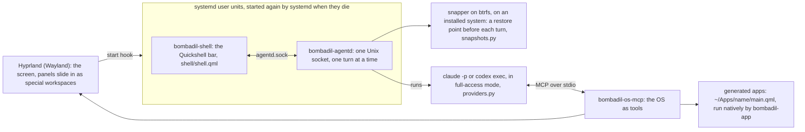

<p align="center">
  <picture>
    <source media="(prefers-color-scheme: dark)" srcset="docs/brand/bombadil-lockup.svg">
    
  </picture>
</p>

A Linux distro whose main interface is an AI agent. You boot it, pick Claude or Codex,
and from then on you talk to the machine: the browser slides in when you ask for it,
apps you describe appear as native windows, and "undo that" takes the system files back to
before the last turn when you restart. The agent runs as you, with full access; on an installed
system the undo is a restore point (a btrfs snapshot) taken before each turn, not a permission
prompt.

## Documentation

The documents live in [`docs/`](docs/README.md), next to the code. Start with
[the principles](docs/principles.md) (the rules the design keeps), then
[the architecture](docs/ARCHITECTURE.md) (the parts and the path of one turn). Each piece has a page
in [`docs/architecture/`](docs/architecture/), the reasoning behind each is in the
[design briefs](docs/design/README.md), and [the decision log](docs/decisions/README.md) and
[the roadmap](docs/roadmap.md) say what was decided and what is built, and [the reference](docs/reference.md)
lists every command, variable, file and unit. To fork it and build on it,
read [making it yours](docs/forking.md) and [CONTRIBUTING.md](CONTRIBUTING.md); AI coding agents
start at [AGENTS.md](AGENTS.md).

## How it fits together



| Piece | What it does |
|---|---|
| `bin/agentd` | The session daemon. Runs as a systemd user service (`bombadil-agentd`, like the bar's `bombadil-shell`) that Hyprland's start hook starts; systemd starts it again a second after it dies (`Restart=always`). Takes prompts on `$XDG_RUNTIME_DIR/bombadil/agentd.sock`, takes a restore point where snapper is set up, runs one provider turn, streams events to every connected client, logs the turn. |
| `bin/bombadil-os-mcp` | MCP server both CLIs load. Tools: `show_panel`, `hide_panel`, the app tools (`app_guide`, `create_app`, `check_app`, `open_app`, `show_app`, `hide_app`, `close_app`, `app_status`, `list_apps`, `app_template`), `show_card`, `system_map` (pictures), the mail tools (`mail_search`, `mail_read`, `mail_mark`, `mail_draft`, `mail_show`; none of them sends), `screenshot`, `snapshot`, `list_snapshots`, `rollback`, `notify`, `desk` (arranges the widgets beside the pill, only when the person asked for the desk), `job` (background jobs, watchers and timers for the Watching card). |
| `bin/bombadil-app` | Runs a generated app (`~/Apps/<name>/main.qml` + optional `app.py`) in its own slide-in drawer with hot reload; `bombadil-app check` loads one offscreen and returns errors and a screenshot. |
| `bin/bombadil` | Terminal client: `bombadil ask "…"`, `status`, `stop`, `undo`, `provider claude\|codex`, `signin`, `open URL`, `pill` (gives the pill the keyboard; Hyprland runs it on a Super tap), `watch` (every step of the last turn), `history` (recent turns), `view` (the details drawer's viewer), `brain …` and `mail …`. Every command is in [the reference](docs/reference.md#commands). |
| `bin/bombadil-browser` | `$BROWSER` and the default browser: a link from anything (a CLI's login, `xdg-open`) opens in the browser panel. |
| `bin/bombadil-shell` | Starts the bar: Quickshell on `shell/shell.qml`, with `share/qml` on its import path so the shell can `import Bombadil`. Every launcher (the `bombadil-shell` unit that Hyprland's start hook starts, `scripts/dev-session.sh`) runs this, never `quickshell` directly. |
| `shell/shell.qml` | The Quickshell bar: the pill, the line above it, the desk. Its colours, sizes and type are `Theme`'s (`shell/DeskTheme.js` mirrors them for the desk; `tests/test_theme.py` keeps the two equal). |
| `share/qml/Bombadil` | The app kit (`import Bombadil`): `Theme`, the tokens the shell and every app share, the OS look for every Qt Quick control, components (AppWindow, Panel, lists, tables, forms, editor, charts) and native bindings (System, Processes, Store, Vault, Command, ...). |
| `share/skills/bombadil-apps` | The skill both CLIs load to build apps with the kit in one shot, with two example apps. |
| `bin/bombadil-mail` | The mail service, a user unit (`bombadil-mail.service`). Owns `$XDG_RUNTIME_DIR/bombadil/mail.sock` and `mail.db` in the state folder, keeps Thunderbird running unseen on the `mail-engine` special workspace as the engine for every account, and answers the Mail window, agentd and `bombadil mail`. Keeps no mail text, and nothing in it sends except a press on Send ([mail](docs/architecture/mail.md)). `BOMBADIL_MAIL_ENGINE=fake` runs it on sample mailboxes. |
| `bin/bombadil-mail-host` | The native messaging host Thunderbird's Bombadil add-on (`share/mail/extension`) connects to; it relays the add-on's frames to `mail.sock`. |
| `share/apps/mail` | The Mail window, a kit app of the built-in kind: every account in one list, Needs a reply, Drafts, and a reply box whose Send is yours. Opens from the launcher words "mail", "email" and "inbox" and from the Reply and Open chips of a new-mail line. |
| `share/skills/bombadil-mail` | The skill both CLIs load for mail: the `mail_*` tools, the rules (other people's words, no send, drafts wait for a press) and the routines. |
| `bin/bombadil-brain` | The brain, an index of the person's files, pages, turns and packages that nobody writes: a user unit (`bombadil-brain.service`, started at login). Keeps `brain.db` in the state folder, answers on `$XDG_RUNTIME_DIR/bombadil/brain.sock`, and says who made a file and when without a model call ([brain](docs/architecture/brain.md)). |
| `bin/bombadil-brain-watch` | The brain's watcher, a root system unit (`bombadil-brain-watch.service`). Holds one fanotify mark on the btrfs filesystem and streams the saves, creates, deletes and renames under `/home` and `/etc`, with their writers, to the brain on `/run/bombadil-brain/watch.sock`. Where `/home` is not on btrfs (the live image) it stays up, answers `watching: false` and sends no events. |
| `share/apps/brain` | The Brain window (Focus), a kit app of the built-in kind: everything around one file, page, turn or app, and "Find anything". Opens from the launcher word "brain". |
| `iso/` | archiso profile: Arch, Hyprland, greetd autologin, passwordless sudo, the systemd units that keep the session's parts alive (`iso/airootfs/etc/systemd/`), first-run setup, `bombadil-install` to a btrfs disk with snapper. |

Switching provider changes one line in `~/.config/bombadil/config.toml`; the OS tools
are the same MCP server either way. The model is set per provider in the same file
(`[models]` with `claude = "..."` and `codex = "..."`); Claude defaults to Sonnet, and Codex
keeps its own default. While Claude is the provider, typing `use opus` in the pill runs the next turns
of a session on Opus, and `use sonnet` goes back.

## Try it

Run the Python parts anywhere:

```sh
python3 -m pip install -e '.[dev]'
pytest
BOMBADIL_PROVIDER=fake bin/agentd &        # echo provider, no snapshots needed
bin/bombadil ask "hello"
```

On an existing Hyprland desktop with `quickshell` and `pyside6` installed:

```sh
scripts/dev-session.sh                     # bar, agentd and Mail on sample mailboxes, against this checkout
BOMBADIL_PROVIDER=claude scripts/dev-session.sh   # the fake provider is the default
```

Build and boot the ISO (an Arch host with `archiso` and `npm`, or `scripts/build-in-container.sh` on any
Linux with Docker or Podman; `qemu` to boot it):

```sh
scripts/build-iso.sh
scripts/run-vm.sh            # live
scripts/run-vm.sh --disk     # then `sudo bombadil-install /dev/vda` inside
scripts/run-vm.sh --installed   # boot the installed disk
scripts/test-vm.sh           # headless smoke test of the image; MODE=install also installs and tests undo, MODE=installed boots that disk again
```

[The VM test](docs/contributing/vm-testing.md) says what the smoke test covers.

On first boot the pill asks which AI should run the computer and signs in to it, with the
provider's page in the browser panel (see [browser and sign-in](docs/architecture/browser-and-signin.md)).

On Windows 11, `scripts\bombadil-vm.cmd` does all of it in one go: it sets up an Arch WSL
distro named `bombadil` with QEMU (KVM works inside WSL), builds the ISO for the commit this
checkout has checked out, installs it onto a VM disk, and opens the VM as a window. Run it again
to boot the same VM. `bombadil-vm refresh` keeps the disk (the login, apps and files on it), takes a
`qemu-img` restore point first and moves the VM to this checkout in place; `bombadil-vm stop` shuts
it down cleanly; `bombadil-vm reinstall` wipes the disk and asks first; `wsl --unregister bombadil`
removes everything. `scripts/vm-tools/` drives a running VM without a window (keys, a shell,
screenshots, the smoke checks, scratch copies to try a branch on); see its README.

## Status

The first milestone (the session daemon, the OS tools, native apps, the ISO) is built and tested
without a display where it can be, and the pill, the desk, the sign-in, the brain, Mail and the app kit have
been added on top of it. Which pieces are shipped, in progress and only designed is in
[the roadmap](docs/roadmap.md); what is still broken is in [known issues](docs/known-issues.md).
