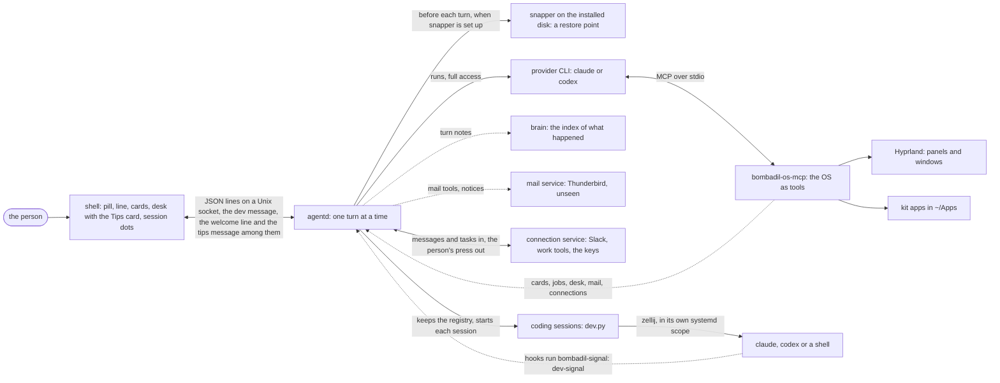
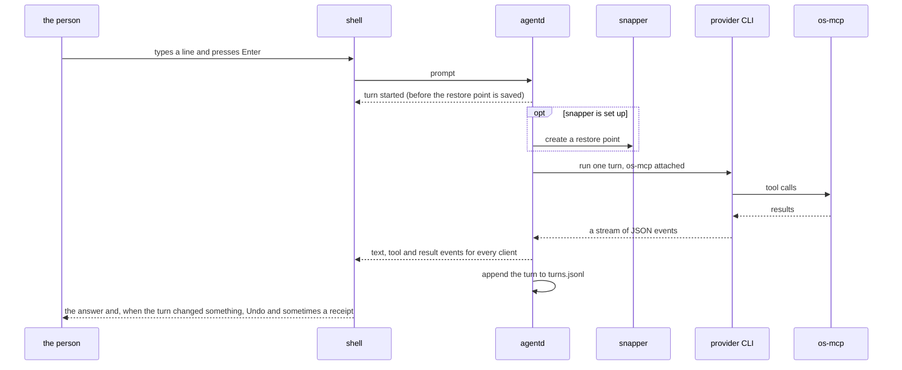

# Architecture

> **Status:** Partly shipped
> **Code:** `bin/`, `src/bombadil/`, `shell/`, `share/`, `packaging/`, `iso/`, `install/`
> **Design:** [Design briefs](design/README.md), [Principles](principles.md)
> **Verified:** 2026-11-12 against `main` at `7d37bc5`, for what changed since `7d17600`, read in the code and not run: the Status column of every row against the Status block of the page it points at (all twenty rows, with the installed OS and idle cost rows added); the desk, tips, installed OS and idle cost rows and the three paragraphs added under the table, against the openings of their pages and the code they name (the `tips` widget and `kept` in `src/bombadil/desk.py`, `TIPS_COMMANDS` and `open_tips` in `src/bombadil/launcher.py`, the Tips comment and `AgentD._tips_open` in `src/bombadil/agentd.py`, `WEEK_DAYS` in `src/bombadil/tips.py`, `summon` in `shell/PillState.qml`, `tipsWanted` in `shell/DeskState.qml`, the layout in the header of `iso/airootfs/usr/local/bin/bombadil-install`, `bombadil-rollback`, and the watch in `tests/desktop/idle.py` and `bombadil-smoke`); the labels of the diagram of the parts; and the rows of the code table for `src/bombadil/`, `shell/`, `share/qml/Bombadil/` (`qmldir`, `INTERNAL_COMPONENTS` in `src/bombadil/appkit/check.py`), `share/apps/`, `share/grub/` (`grub_theme` in `bombadil-install` and `000_bombadil_screen`), `install/` (`carry.list`, `scripts/build-iso.sh`) and `iso/`. A second pass on 2026-11-13 against the same commit read again, and ran nothing, the sentence and the row on idle cost (the limits in `tests/desktop/idle.py` and the pill's clock timer in `shell/shell.qml`). Before that, 2026-11-09 against `main` at `ca7f80a`: the turn below, the diagram of the parts and the desk and coding-sessions rows were read again in `src/bombadil/agentd.py` (`handle`, `_greet`, `_dev_broadcast`, `dev_action`, and every change since `9d5c729`), `src/bombadil/launcher.py` (`_dev_match`, and that no word starts `tell`, `give`, `review` or `ship`), `src/bombadil/dev.py` (`_start`, `_checkout_taken`, `_make_copy`, `_bare`, `session_env`), `src/bombadil/away.py`, `src/bombadil/desk.py` (`WIDGETS`, `ASKABLE`), `bin/bombadil`, `bin/bombadil-signal`, `share/zellij/config.kdl`, `shell/shell.qml` (where the chips row sits and what the bar's zone counts), `shell/DevState.qml` and `shell/DeskState.qml`; the code table against the folders `bin/`, `share/`, `iso/`, `scripts/` and `tests/`, the docstring of `bin/bombadil-mail-host` and the user units and `hyprland.lua` under `iso/airootfs/etc/`; the Status column against the Status block of each page in `architecture/`, and the wording of each row of the parts table against the opening of its page. Read on 2026-11-08 at `9d5c729` and not again, because `git diff 9d5c729 ca7f80a` shows no change in them: `src/bombadil/config.py`, `src/bombadil/snapshots.py`, `src/bombadil/narrate.py`, `src/bombadil/mcp_server.py`, `shell/StatusLine.qml` and `shell/PillState.qml`; `src/bombadil/providers.py` changed only in its limit code, which no sentence here depends on. The foundation table was checked against [the foundation brief](design/foundation-choices.md) and the dates in [the decision log](decisions/foundation-and-stack.md) on 2026-11-08, and its agent-runtime row against the brief again on 2026-11-09. What changed between `ca7f80a` and `f0485c2` was added and checked against `f0485c2`: the voice and tips rows with their Status and the shell row's welcome line and name card (against the openings of their pages), the label on the socket in the diagram of the parts and the paragraph on the voice under it (`src/bombadil/voice.py`), the system prompt in step 3 of the turn (`system_prompt` in `src/bombadil/providers.py` and `note` in `src/bombadil/persona.py`), and the rows of the code table for `src/bombadil/`, `shell/`, `share/qml/Bombadil/`, `share/voice/` and `share/tips/`. What changed between `f0485c2` and `7d17600` was added and checked against `7d17600`: the connect row with its Status and the contract marks on the mail, brain, tips and connect rows (against the Status block and the opening of each page in `architecture/` and the opening of `docs/CONNECT.md`), the Status column of every row (against the Status block of every page in `architecture/`), the desk, shell and session services rows (against the openings of their pages, `src/bombadil/desk.py`, `iso/airootfs/etc/skel/.config/hypr/hyprland.lua` and `iso/packages.x86_64`), the connection service in the diagram of the parts and in the paragraph under the table (`src/bombadil/connect/tools.py`, `src/bombadil/browserd/service.py`, `src/bombadil/cards.py`, `src/bombadil/notifications.py`, the press in `src/bombadil/agentd.py` and `src/bombadil/connect/service.py`, and the unit and the sysusers file of the connection service), step 4 of the turn, and the rows of the code table for `bin/`, `src/bombadil/`, `shell/`, `share/connect/`, `iso/` and `tests/` (against `scripts/build-iso.sh`, the files they name, and the imports of `src/bombadil/connect/`, `src/bombadil/browserd/` and `src/bombadil/ws.py`). The rest of the page was not read again. On 2026-11-13 the sentences about the `bombadil` package (the installed OS row, the paragraph under the table, and the `packaging/`, `iso/`, `install/`, `scripts/` and `tests/` rows) were read against `packaging/bombadil`, `scripts/build-package.sh`, `scripts/build-iso.sh` and `src/bombadil/homefix.py`, and nothing was run.
> **Note, 2026-11-13:** Bombadil is the pacman package `bombadil` (`packaging/bombadil/`), so the files that the "Verified" line above names under `iso/airootfs/` (the installer, `bombadil-rollback`, the user units and the skeleton's `hyprland.lua`) are in `packaging/bombadil/root/` at the path they have on the machine, and Bombadil's part of the Hyprland config is `share/hypr/bombadil.lua`. The paths in that line are as they were when it was written and were not moved.

Bombadil is a Linux distribution whose interface is an AI agent. The person types in one pill at the bottom of the screen; the agent, one of the vendors' own command-line programs running in full-access mode, does the work; and every step it takes is shown on screen. On an installed system a restore point is taken before each turn, so the latest turns can be taken back at the next boot; a step marked "can't be undone" is not covered ([restore points](architecture/restore-points.md)). This page is the map: the parts, the path of one turn through them, where the code lives and how far each piece is built. Each part has a page of its own in [`architecture/`](architecture/), with its interfaces, where its state lives and how to extend it.

## The parts

| Piece | What it is | Status | Page |
|---|---|---|---|
| agentd | The session daemon: one socket, one turn at a time, the queue, Stop, the turn log | Shipped | [agentd](architecture/agentd.md) |
| os-mcp | The MCP server both CLIs load: the OS as typed tools | Shipped | [os-mcp](architecture/os-mcp.md) |
| shell | The Quickshell bar: the pill, the line above it (agentd's welcome shows there), the name card, the stone, the chips (queued asks, setup choices, found things, notices, running apps, coding sessions), the cards of messages and tasks, the Widgets card, the notification server, the wallpaper | Partly shipped | [shell](architecture/shell.md) |
| desk | Cards in two rails and strips beside the pill: Now (the route of a turn), Watching (jobs), Needs you (the coding sessions), Machine (the machine's readings), Away (the turn log and the sessions, shown when asked) and Tips (what to ask, still, in a new person's first week); a card can be dragged to a rail or into the row, and a strip to a rail. A widget shows only while it has something to say unless the person keeps it: each is set to Keep, When needed or Off on the Widgets card, and a kept Machine or Tips stays on the desk at rest | Partly shipped | [desk](architecture/desk.md) |
| app kit | `import Bombadil`: native apps the agent writes, with a runtime, a checker and a skill | Partly shipped | [app kit](architecture/app-kit.md) |
| browser and sign-in | Chromium as a slide-in panel, and provider sign-in that happens in the pill | Partly shipped | [browser and sign-in](architecture/browser-and-signin.md) |
| cards and pictures | Validated diagrams the agent and the machine draw above the pill, and the reasons behind each step | Partly shipped | [cards and pictures](architecture/cards-and-pictures.md) |
| restore points | A btrfs snapshot before each turn on an installed system, and "undo" | Partly shipped | [restore points](architecture/restore-points.md) |
| ISO and install | The archiso image, which installs the `bombadil` package, the installer, the boot and the console | Shipped | [ISO and install](architecture/iso-and-install.md) |
| session services | The units that put the daemon and the bar back when they die and run the brain, Mail, the browser service and the connection service, and the key that restarts the bar | Partly shipped | [session services](architecture/session-services.md) |
| brain | An index that writes itself from what the machine saw, and the Focus window | Partly shipped | [brain](architecture/brain.md), contract [BRAIN.md](BRAIN.md) |
| coding sessions | Named sessions of the vendors' coding tools, or a shell, that outlive their window and come back when the name is typed, with a dot each in a row above the pill's left end. A second Claude or Codex session on a git repository gets its own `git worktree`. The rest of the fence (no `sudo`, ports and limits), undo per session, handing words across (`tell`, `give`, `review`) and shipping are designed | Partly shipped | [coding sessions](architecture/coding-sessions.md) |
| voice | A name for the person, three voices, and one true line when they arrive or leave, built from local templates with no model; the words of empty places are in the table and only `bombadil history` reads them | Partly shipped | [voice](architecture/voice.md) |
| tips | What a person can ask, one line at a time and only what this machine can back: twenty one-line tips, what the person has tried kept by agentd, which sends a `tips` message; the Tips card on the desk shows one in a new person's first week, and the Tips app plays each tip on a small copy of the screen | Shipped | [tips](architecture/tips.md), contracts [TIPS.md](TIPS.md) and [TIP-SCENES.md](TIP-SCENES.md) |
| self-improvement loop | Noticing repeated asks and checking itself | In progress | [loop](architecture/loop.md) |
| mail | Mail in Bombadil's own view, with Thunderbird as the unseen engine | Partly shipped | [mail](architecture/mail.md), contract [MAIL.md](MAIL.md) |
| connect | Slack and the work tools (Notion, Linear, Jira, Todoist, ClickUp): a service with a user of its own that keeps their keys and reads their messages and tasks, one line and one card for what is for the person, a reply or a ticket that waits for the person's press, the browser service that reads a page for the setup, and the bar's own notification server | Shipped | [connect](architecture/connect.md), contract [CONNECT.md](CONNECT.md) |
| poor man switch | What the machine does when the AI's plan runs out | Partly shipped | [poor man switch](architecture/poor-man-switch.md) |
| installed OS | Bombadil installed on a disk, encrypted or plain: a guided, a planned and a whole-disk install, a refresh from a newer image that keeps the home folder, the GRUB screen, `bombadil remote` and `bombadil snapshot`, and Bombadil as one pacman package that an installed machine updates with `pacman -Syu`. The install card, updates as a turn and the rest are designed | Partly shipped | [installed OS](architecture/installed-os.md) |
| idle cost | What the desktop costs when nothing is happening: the bar's timers and animations run only while something needs them, apart from the pill's clock, and a frame count and a CPU limit in the headless desktop test, and a CPU limit in the VM smoke, fail when a loop comes back | Shipped | [idle cost](architecture/idle-cost.md), contract [IDLE-COST.md](IDLE-COST.md) |

Coding sessions run beside the turn, not through it: agentd starts the vendor's tool in a zellij session of its own, the tool's hooks tell agentd what it is doing (`bombadil-signal`), and the shell draws the dots from the `dev` message ([coding sessions](architecture/coding-sessions.md)).

The voice runs beside the turn too: the bar says hello to agentd (`bar`), and agentd answers with the name card the first time and with one welcome line after that, dropped and never queued while a turn runs; a shutdown's start text says goodbye ([the voice](architecture/voice.md)).

Messages and connections run beside the turn as well: `bombadil-connect`, a system service with a user of its own, holds the keys to Slack and the work tools and reads their messages and tasks, and agentd turns what it says into notices and into `message`, `task` and `list` cards. The agent has five tools that read and draft and none that sends: a reply, a ticket or a comment leaves only on the person's press on the button of its card, which agentd and the service both check. `bombadil-browserd`, a user unit, opens a page in the browser panel, points at a button and takes a key off it into the service when a service is being connected, so the model never sees the key. The bar's own notification server replaces a notification daemon ([messages and connections](architecture/connect.md), contract [CONNECT.md](CONNECT.md)).

Tips runs beside the turn too: agentd keeps the table of twenty tips and what the person has tried, counts a tip from what it sees itself with no model, and tells the shell in a `tips` message which tip to show. The Tips card on the desk draws it for a new person's first week or while the person keeps it, and the Tips app, which the word `tips` opens, plays each tip on a small copy of the screen. A press on a tip's button puts its words in the pill and sends nothing: the person's own Enter does that ([Tips](architecture/tips.md), contracts [TIPS.md](TIPS.md) and [TIP-SCENES.md](TIP-SCENES.md)).

The installed system is one layout that `bombadil-install` writes once: a GPT disk with a 1 GiB EFI partition mounted at `/efi` and one btrfs partition, inside LUKS2 when the person gives a password, holding `@` (the root, with the kernel in its `/boot`), `@home`, `@snapshots`, `@log` and `@pkg`. An undo swaps a restore point in under the name `@`, so it takes the kernel back with the system, and a refresh puts a newer image under the home folder that is already there ([installed OS](architecture/installed-os.md)).

Bombadil's own files are one pacman package, `bombadil`, that `scripts/build-package.sh` builds from `packaging/bombadil` and the top-level `bin/`, `src/`, `shell/` and `share/`. The image installs it and carries the repository it was built from, and an installed machine takes a newer build with `pacman -Syu`, so a new Bombadil needs no new image. The tree sits at `/usr/share/bombadil` with a link for each command in `/usr/bin`. A file another package owns (`/etc/pacman.conf`, `/usr/lib/os-release`, `/etc/environment`) changes by a numbered migrate step that a pacman hook runs, and a file in the person's home changes by a numbered homefix step that agentd runs when it starts. The person's `~/.config/hypr/hyprland.lua` is a few lines that load Bombadil's part, `share/hypr/bombadil.lua`, from the package and then the person's own lines, so a fix to Bombadil's part reaches a machine installed long ago ([installed OS, Packages and updates](architecture/installed-os.md#packages-and-updates)).

At rest the desktop is held to a small share of one core: the timers and animations of the bar run only while something needs them (the pill's clock, which changes once a minute, always runs), and a frame count and a CPU limit in the headless desktop test, and a CPU limit in the VM smoke, fail when a loop that kept it busy comes back ([idle cost](architecture/idle-cost.md), contract [IDLE-COST.md](IDLE-COST.md)).

[The roadmap](roadmap.md) says where each piece stands and what is left. [The glossary](glossary.md) explains the project's own words.

## One turn

1. The shell (or `bombadil ask`) writes a `prompt` to the agentd socket. Words that need no model (`undo`, `history`, `open ...`, the picture words, `pause claude`, a coding session's name such as `claude acme` or `end reviewer`, and the like) are matched first by the launcher and answered by agentd itself, so they never reach the provider. `stop` is a message of its own and works while a turn runs. A line that starts with `!` is a turn whose "provider" is the shell: it runs the command and shows what it printed.
2. agentd runs one turn at a time and queues the rest, and it holds asks that need the AI while the AI cannot be asked (not signed in, offline or resting). Before the provider starts it asks snapper for a restore point when snapper is set up (an installed system, not the live image, and not with `snapshots = false`); a snapper that exits with an error costs the turn its restore point and nothing else. An installed system keeps about the newest 30 restore points, and an undo applies at the next boot ([restore points](architecture/restore-points.md)).
3. For the turn it starts the provider's CLI as a fresh process, in full-access mode, with `bombadil-os-mcp` in its tool configuration and Bombadil's system prompt appended (it carries the person's name and voice once they have chosen), and resumes the saved conversation (`session_id`), so the machine has one conversation. Claude is asked for Sonnet unless the config names a model or the session said `use opus` (a launcher word, answered without a turn), and the conversation and that choice survive a restart of `agentd`, not a reboot ([models](architecture/agentd.md#models)).
4. The CLI's stream becomes events, broadcast to every connected client. The shell turns them into the line above the pill, the stone's face, cards and the desk. The OS tools act on Hyprland, on apps, on restore points and on mail, and ask agentd for what it owns (cards, jobs, the desk, the mail view, and what the connection service holds: five tools that read messages and tasks and draft a reply or a ticket, none of which sends).
5. The turn is appended to `~/.local/state/bombadil/turns.jsonl` and the brain is told, never waited for.

The details, exact message names and the edge cases (a stopped turn, a missing provider, a sign-in that expires mid-turn) are in [agentd](architecture/agentd.md), and how each step reaches the screen is in [the UX flows](ux/flows.md).

## Where the code lives

| Path | What is there |
|---|---|
| `bin/` | The commands: `agentd`, `bombadil`, `bombadil-os-mcp`, `bombadil-app`, `bombadil-browser`, `bombadil-shell`, `bombadil-signal` (what a coding tool's hooks run, so the dots know its state), the brain's two services (`bombadil-brain`, `bombadil-brain-watch`), Mail's service (`bombadil-mail`) and the native-messaging host that Thunderbird starts for it (`bombadil-mail-host`), the connection service (`bombadil-connect`) and the browser service (`bombadil-browserd`) |
| `src/bombadil/` | The Python behind them, among it `dev.py` (the coding sessions), `away.py` (the Away card), `voice.py`, `greet.py` and `persona.py` (the voice), `tips.py` (Tips) and `tip_scene.py` (the vocabulary of a tip's scene, which only the tests import), `installplan.py` (the install plan, and the list of disks to install on), `remote.py` (`bombadil remote`), `connect/` (the connection service and its drivers), `browserd/` (the browser service), `proposals.py` (what waits for the person's press) and `notifications.py` (what agentd makes of a notification the bar hands it). Standard library only, apart from the app kit's `PySide6` and `cryptography` and the connection service's `mcp` and `httpx` |
| `shell/` | The Quickshell bar in QML, among it the coding sessions' dots (`DevState.qml`, `SessionChips.qml`, `SessionPeek.qml`), the name card (`PersonaCard.qml`), the Widgets card (`WidgetsCard.qml`), the Tips card (`TipsCard.qml`), the pill's keys (`PillKeys.qml`, which answer a tap of Super and Alt+Space), the faces of the cards of messages, tasks and lists (`MessageFace.qml`, `TaskFace.qml`, `ListFace.qml`) and the notification server (`Notifications.qml`) |
| `share/qml/Bombadil/` | The app kit and the design tokens (`Theme.qml`, with the one switch for reduced motion) the shell and every app read, and two components only the system uses: `Stone.qml` (the mark the pill and the tip scenes draw) and `TipScene.qml` (what plays a tip) |
| `share/skills/bombadil-apps/`, `share/app-template/`, `share/apps/` | The skill that teaches the CLIs to build apps, the template they start from and the built-in apps (the Brain, Mail and Tips windows) |
| `share/skills/bombadil-mail/`, `share/mail/` | The skill for the mail tools and the Thunderbird add-on that Mail's engine loads |
| `share/wallpaper/`, `share/grub/` | The wallpaper picture the bar draws, and the picture of the screen GRUB asks for the disk's password on, which the installer puts on the EFI partition (the `theme.txt` beside it is not used) |
| `share/voice/`, `share/tips/` | The words Bombadil says when the person arrives or leaves (`lines.toml`) and the table of tips (`tips.toml`) |
| `share/connect/`, `share/skills/bombadil-connect/` | The recipes for the five work tools and the client's metadata, and the skill for the five connection tools |
| `share/zellij/` | zellij's settings for the coding sessions' invisible terminal (`config.kdl`: no keys of its own, no frames, no tips; `dev.py` closes zellij's tab and status bars when it starts a session) |
| `packaging/bombadil/` | Bombadil as a pacman package: `PKGBUILD`, the install scriptlet and `root/`, a mirror of `/` for every file the package puts outside `/usr/share/bombadil`: the installer and the rollback it pairs with (`bombadil-install`, `bombadil-rollback`), `bombadil-setup`, GRUB's screen (`bombadil-grub-config`, `etc/grub.d/000_bombadil_screen`), the units (the connection service's system unit and its user among them), greetd's drop-in, passwordless `sudo`, the managed settings that make Claude Code and Codex run `bombadil-signal`, `/etc/skel` with the stub of the Hyprland config, and the pacman hook and migrate steps. `scripts/build-package.sh` builds it |
| `iso/` | The archiso profile of the live stick: the package list (`zellij` among them, and `bombadil` itself), the live-only units (`bombadil-live`, `pacman-init`), the base files the installer copies (hostname, locale, mirror list), the boot menu |
| `install/` | What the installer carries from the stick's home folder to the installed disk (`carry.list`, one path a line), read by `bombadil-install` and `src/bombadil/installplan.py`; the package installs it at `/usr/share/bombadil/install` |
| `scripts/` | Building the package (`build-package.sh`) and the ISO, running it in a VM and testing it there (`test-vm.sh`, with its modes for install, refresh and update), a development session, the VM tools |
| `tests/` | The unit tests, the QML tests, the headless desktop test (`tests/desktop/`), the btrfs kernel VM harness (`tests/vm/`), the mail lab (`tests/mail/`) and the fakes of the connection and browser services (`tests/connect_fakes/`, `tests/browserd_fakes/`). The ISO smoke is `bombadil-smoke` in `packaging/bombadil/root/usr/bin`, run by `scripts/test-vm.sh` |
| `docs/` | Everything you are reading, with [an index](README.md) |

The full map with the conventions the code shows is in [the development guide](contributing/development.md), and every name the system exposes (commands, environment variables, files, units, ports) is in [the reference](reference.md).

## The foundation

These choices were made on 2026-09-27 and are the ground the pieces stand on. The reasons are in [the foundation brief](design/foundation-choices.md) and the full list of decisions is [the decision log](decisions/README.md).

| Choice | Pick | Why |
|---|---|---|
| Base | Arch with btrfs and snapper | Agents know it; a rolling graphics stack; archiso; snapshots are the undo |
| Display | Hyprland first, a custom compositor later (an idea, no code) | Slide-in special workspaces and IPC out of the box; a browser needs a real Wayland server |
| First target | A VM, with an ISO meant to boot hardware too (no boot on hardware is recorded) | A fast loop while the core changes daily |
| Agent runtime | The official Claude Code and Codex CLIs, wrapped by `agentd` | The person's own Claude or ChatGPT login is used; the vendors' tool use is not rebuilt |
| Generated apps | QML through PySide6, in `~/Apps/<name>/` | No build step, hot reload, real windows, no ports |
| Provider switching | One MCP server, `bombadil-os-mcp` | The same OS abilities whichever provider runs |
| Browser | Chromium with remote debugging on | The panel is a real browser the person can watch |

## What every piece keeps

[The principles](principles.md) are the rules the design keeps, and each piece page says which ones it leans on. Four decide most questions:

- **The person is a passenger.** The machine does the work and shows what it did, in plain words and pictures ([the principle](principles.md#the-person-is-a-passenger)).
- **Full access, with undo instead of guard rails.** Nothing asks permission for what a restore point can reverse ([the principle](principles.md#full-access-with-undo)).
- **Something true is on screen within 200 ms.** Nothing waits on a model for what the machine already knows ([the principle](principles.md#something-true-in-200-ms)).
- **Every piece degrades.** A missing part costs its own feature, never the bar ([the principle](principles.md#degrade-and-recover)).

Before you change a piece, read its page and run [the checklist](principles.md#checking-a-change-against-the-principles). What a change must also update is in [documenting your piece](contributing/documenting.md).
