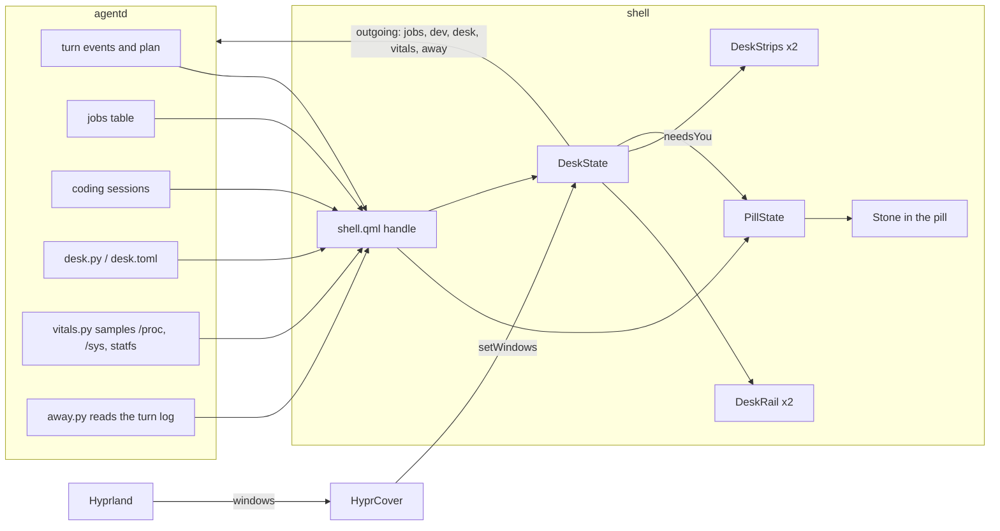
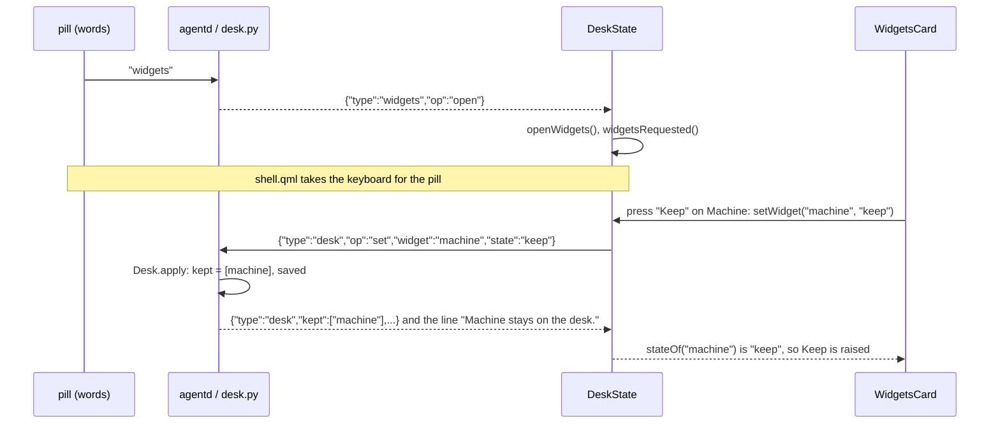
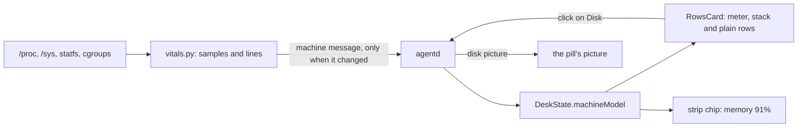
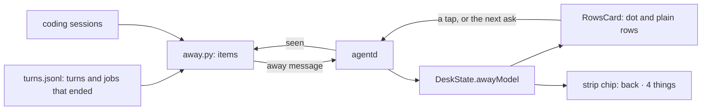

# The desk

The desk is where Bombadil's widgets live around the pill: small cards in two rails at the sides of
the screen, and chips beside the pill when a card has no room. This page is how it is built and how to
extend it. Why it looks and behaves the way it does is in [`design/widgets-brief.md`](design/widgets-brief.md);
read that first for the rules (a widget answers one question a passenger asks, the middle of the screen
belongs to what the AI brings, a widget is present only with something to say, colour says who).
What a person can set, and the Widgets card they set it on, is [Your desk](#your-desk-keep-when-needed-off);
why it is built that way is in [`design/tips-and-desk-defaults-brief.md`](design/tips-and-desk-defaults-brief.md)
("Shaping your desk", question 3b).

## The pieces

| File | What it is |
|---|---|
| `shell/DeskState.qml` | The one object that decides what the desk shows: which widgets are present, each one's face (`full`, `strip`, `hidden`), where its slot is, and what the cards read. Plain Qt Quick with no Quickshell types, so tests drive it offscreen the way they drive `PillState`. |
| `shell/DeskRails.qml`, `shell/DeskRail.qml` | The two rails: one Quickshell `PanelWindow` per side on the Bottom layer (above the wallpaper, under every window), reserving nothing, with an input mask that covers only the cards. |
| `shell/DeskStrips.qml`, `shell/DeskStrip.qml` | The chips beside the pill, in the bar's own window. |
| `shell/DeskDrag.qml` | The handle a card's title and a chip share: a left-button drag that says where the pointer is, in screen coordinates, and when it lets go. |
| `shell/DeskCard.qml`, `shell/NowCard.qml`, `shell/RowsCard.qml` | The faces: the shared card chrome, the route (Now), and a card of rows (Watching, Needs you, Away, Machine; a row is a dot, a meter, a stacked meter or plain text). |
| `shell/WidgetsCard.qml` | The card the word "widgets" opens above the pill, in the AI card's shape: one row per widget with its three-part control (Keep, When needed, Off), and "Reset the desk". It draws what `DeskState` says and changes nothing itself. |
| `shell/DeskTheme.js` | The desk's colours and sizes. Each is a token of the app kit's `Theme.qml`; `tests/test_theme.py` fails when one drifts. |
| `shell/HyprCover.qml` | Where the windows are, from Hyprland, so cards can get out of their way. |
| `src/bombadil/desk.py` | What the desk remembers: folded or not, which widgets are put away, kept on the desk or folded by hand, each widget's rail and place, and which states each widget may take. Kept in `~/.local/state/bombadil/desk.toml`, outside the restore points, so an undo never moves the desk. |
| `src/bombadil/jobs.py` | Watching's table of background jobs. |
| `src/bombadil/away.py` | The Away card's rows: what the turn log and the coding sessions say happened since the person was last seen, in the order they would want it, and the one `away` message built from them. Pure Python; the log's path and the clock are parameters, so the tests hand it rows and a time. |
| `src/bombadil/vitals.py` | The Machine card's readings: memory by who uses it, the disk, the processor and its heat, the network, the lines that raise the card and the sentence that says why, and the calm shape of a Machine the person keeps. Pure Python on the standard library; every file it reads is a parameter, so the tests hand it text. |
| `src/bombadil/agentd.py` | Sends the plan, the jobs table, the coding sessions and the desk's state to the shell, and takes the shell's requests back. |



## What agentd and the shell say to each other

The shell hands every line from agentd to both `PillState` and `DeskState`; each keeps what it knows and
drops the rest.

| Message | Direction | Meaning |
|---|---|---|
| `{"type":"event","kind":"plan",...}` | agentd to shell | The whole step table of the running turn, stamped with the turn. Now draws it. A plan from another turn is dropped. |
| `{"type":"jobs","jobs":[...]}` | agentd to shell | Watching's table, replaced whole each time. |
| `{"type":"dev","sessions":[...],"attention":[...]}` | agentd to shell | The coding sessions, and the keys that want the person, in Tab's order. Needs you is those keys drawn as rows. |
| `{"type":"machine","present":...,"asked":...,"calm":...,"why":...,"strip":{...},"rows":[...]}` | agentd to shell | The Machine card, replaced whole. `present: false` takes it away. `calm: true` is a kept Machine at rest ("The machine is fine"); the shell draws it as it draws every Machine card. See [the Machine card](#the-machine-card). |
| `{"type":"away","since":...,"count":...,"why":...,"rows":[...]}` | agentd to shell | The Away card, replaced whole. `rows: []` takes it away. See [the Away card](#the-away-card). |
| `{"type":"desk","folded":...,"hidden":...,"stripped":...,"kept":...,"rails":...,"order":...,"widgets":[...]}` | agentd to shell | The desk's own state. `stripped` lists the widgets folded by hand, `kept` the ones kept on the desk at rest, and `widgets` the rows of the Widgets card (`{id, title, question, can}`, where `can` lists the states the widget may take). Whatever it leaves out stays as it was. |
| `{"type":"widgets","op":"open"}` | agentd to shell | The person typed "widgets" (or the agent asked): open the Widgets card and take the keyboard for it. Every time, even with the card up. There is no message to close it. |
| `{"type":"desk","op":"fold"\|"unfold"\|"hide"\|"show"\|"move",...}` | shell to agentd | A change. agentd applies it, saves it, and answers with the new `desk` state; the shell never changes its own state first. `fold` with no widget is the word "desk"; with a widget it puts only that card on its strip. |
| `{"type":"desk","op":"set","widget":...,"state":"keep"\|"needed"\|"off"}`, `{"type":"desk","op":"reset"}` | shell to agentd | A press on the Widgets card. Answered with the new `desk` state like any change, and with one sentence on the line above the pill (a `local` event, `phase: "done"`), because a press has no gesture to show what it did: "Machine stays on the desk.", or a refusal ("Needs you cannot be hidden."). |
| `{"type":"jobs","op":"stop"\|"dismiss"\|"why","id":...}`, `{"type":"dev","action":"open","key":...}`, `{"type":"vitals","op":"open","row":"disk"}` | shell to agentd | A press on a row's button or its small x, or on a Machine row that opens something. None of them reaches the model. |
| `{"type":"vitals","op":"get"}` | shell to agentd | Asks for the Machine card again. |
| `{"type":"away","op":"get"\|"seen"}` | shell to agentd | `get` asks for the Away card again; `seen` says the person has looked at it (a tap on it), so it can go. Neither reaches the model. |

## Faces, slots and right of way

A widget is *present* when it has something to say (Now while a plan or a system step runs, Watching
while anything counts, Needs you when two or more sessions wait). A present widget has one of three faces:

- **full**: a card in its rail. Slots stack from the pill outward, nearest first, in the rail's order. A
  card whose full height does not fit the room left, and everything above it, becomes a strip.
- **strip**: a chip beside the pill. Three per side at most, then one counting `+N`. A card the person
  folded by hand stays a strip whatever the room, and holds no slot, so the cards above it slide down.
- **hidden**: nothing (the desk is under a full-screen window, or the widget is not present).

A window over a card's slot, even partly, folds that card to its strip within 150 ms and brings it back
400 ms after the window leaves (`foldMs`, `unfoldDelayMs`), so a window dragged past does not flicker the
rail. The shell asks Hyprland for the window list again every 300 ms while any window is on the stage,
because Hyprland sends no event while a floating window is dragged. The slot a card would take stays
reserved while it is folded, so the cards above it do not slide down.

The pill follows the desk: 900 px at most, less what the strips and a card on each side take, never
under 360 px; 360 px with a window in front; a capsule under a full-screen window. A picture above
the pill (docs/pictures.md) follows the same room but is not narrowed with the pill: beside a window it
may take about 560 px (less when the rails leave less; `DeskState.pictureTarget`).

Under reduced motion the fold, the strips' fade, the pill's width and the wash are instant and the ring holds
still; the timings above (`foldMs`, the 400 ms wait, `pillAnimMs`) stay as they are, and each animation
takes its duration through `Kit.Theme.duration(...)`. [`MOTION.md`](MOTION.md) has the rule, the table and how
a new card honours it.

## The needs-you mark

Something waits for the person when `needsModel` has a row: a coding session asked a question, or
finished or failed and has not been looked at (agentd's `dev` message lists those keys in `attention`).
Until the coding-sessions code that sends `dev` is on the branch you run, nothing feeds the table and the
stone never knocks for it. `DeskState.needsYou` says so, and a `Binding` inside `DeskState`
writes it to `PillState.needsYou`, which turns the pill's stone amber and makes it knock twice every
1.6 seconds (`share/qml/Bombadil/Stone.qml`, the look is in the identity brief).

- **One session or many.** One waiting session is the your-turn line in the pill and no card; two or
  more raise the Needs you card. The stone knocks in both cases.
- **It cannot be put away.** The desk folded with the word "desk", a window over the rail, a narrow
  screen and the capsule under a full-screen window all take the card away; none of them takes the mark.
  Needs you itself cannot be hidden.
- **It outranks a running turn.** While a turn runs and a session also waits, the stone knocks; the pill's
  orange border and the Now card still say that the machine is working. When the last row goes, the stone
  goes back to what the pill says (working, done, rest).
- **It clears** when agentd's `dev` message no longer lists a waiting key, and when the socket drops (the
  desk forgets the table it cannot answer; agentd sends it again on reconnect).
- **Setup keeps its own.** Choosing an AI or signing in again also makes the stone knock; the desk
  clearing its rows never clears that.

At 24 px the knock is a small tilt that moves the stone about one pixel at its centre and two at its
foot, and the glow is a faint halo of one to three pixels, so it is the amber colour that tells you
first. If that proves too quiet on a real screen, the fix is in the kit's `Stone.qml`, not in the desk.

## Your desk: keep, when needed, off

The desk ships quiet: after boot it is the wallpaper and the pill, and a widget comes up only with
something to say. A person can change that for each widget, with words or on the Widgets card, and the choice
is kept in `desk.toml` and so survives every boot. A widget is in one of three states:

| State | The card's name | What it means | In `desk.toml` |
|---|---|---|---|
| keep | Keep | On the desk at rest, after every boot. | `kept = ["machine"]` |
| needed | When needed | The default: there only while it has something to say. | in neither list |
| off | Off | Put away: not on the desk, and it does not raise itself either. | `hidden = [...]` |

**Which widget can be which.** Only a widget with a calm face, one that has something true to show while
nothing is happening, can be kept (`Widget.calm` in `desk.py`). Today that is Machine; Tips will be the second.
Now and Watching have nothing to show at rest, so they offer *When needed* and *Off*. Needs you offers only
*When needed*: it is the one place two sessions' requests can be answered together, so it cannot be put away.
Away offers the same two, now that it has a face. Alive has none yet and is not listed (`Widget.listed`). `desk.can(widget)` says the states a
widget may take, and agentd sends them as `can` on each row, so the shell draws what agentd allows and decides
nothing. A widget is never both kept and put away: one press moves it from one to the other, and of the two a
hand-edited `desk.toml` can say at once, *off* wins. A file from before keeping, with no `kept` line, keeps
nothing.

**Words.** All of them are launcher words (no model, offline), answered by `Desk.apply` with one sentence:

| Typed | Answer | Desk |
|---|---|---|
| `keep machine`, `keep the machine`, `keep machine on the desk`, `keep machine on my desk` | "Machine stays on the desk." (again: "Machine is already kept on the desk."; a hand-folded card is unfolded: "Unfolded Machine.") | Machine kept, and brought back if it was put away |
| `keep watching`, `keep now`, `keep needs you`, `keep away` | "Watching shows only while something counts." (and the like: each widget says when it does show; one that is put away says "Watching is put away. Say show watching to bring it back.") | nothing changes, nothing is saved |
| `hide machine` while it is kept | "Machine is no longer kept. It still comes up when something needs a look." | back to *When needed* |
| `hide machine` again | "Put Machine away." | *Off*; its warnings stop too |
| `show machine` | "Here is the machine." (+ " It is back on the desk." if it was put away) | raises the card for 30 s, as before |
| `widgets` (also `my widgets`, `show widgets`, `open the widgets`) | "Here are the widgets." | opens the Widgets card |
| `keep alive` (no row on the card yet), any longer sentence, any question (`widgets?`) | the agent | the agent's `desk` tool, when the words asked for the desk. Alive ships put away, so it answers "Alive is put away. Say show alive to bring it back." until it is shown |

The pill knows the words too: `launcher.entries()` marks each widget on the card with `keep`, so `keep mach` is
completed with Tab and `keep machine` (or `... on the desk`) shows the same `↵ Machine` hint as `show machine`; an
app's name after `keep` is not a launcher word, and a question (`keep machine?`) is for the agent.

"Hide" on a kept widget is a step, not a leap, so one word cannot silence a warning by accident. The card's
*Off* is the leap, and a press on a part always means exactly that part: `Desk.apply("set", widget, state=...)`
sets the state at once whatever it was ("Put Machine away.", "Put Machine on the desk.", "Machine stays on the
desk.", or, from kept to *When needed*, "Machine is no longer kept. ..."). The same op is on the agent's `desk`
tool, with `keep`, `reset` and `widgets`; the gate is unchanged: it works only in a turn whose own words asked for
the desk, and "keep", "widgets" and "desk" already count. The line above the pill while the tool runs says what it
does ("Keeping Machine on the desk", "Putting Machine away", "Putting the desk back as it came", "Opening the
widgets"), like the other ops, and claims no change: a call can be refused.

**The Widgets card.** The word `widgets` makes agentd send `{"type":"widgets","op":"open"}`, and a card rises
above the pill in the AI card's shape: 360 px wide, the same glass, radius and border, a title with a small ×,
then one row for each widget in `desk.widgets`.

```text
Widgets                                      ×
Machine                      Keep · When needed · Off
Is the machine in trouble?
Now                                  When needed · Off   (Keep drawn faint)
What is it doing, and why?
...
Reset the desk
```

The name is on the first line with the three-part control at the right; the question the widget answers (the
widgets brief's own) is on the second, at the row's full width, cut with an ellipsis rather than overflowing.
The part the desk says the widget is in is raised; the others are muted and brighten on hover. A part the widget
cannot take is drawn faint, with no hover and no press. Nothing on the card is orange: orange is the machine
acting, and this is the person choosing. "Reset the desk" puts every widget, rail and place back as the desk ships
("The desk is back as it came."; the screen the desk lives on stays; on a desk already as it came, "The desk is
already as it came." and nothing is saved).



- **A press never draws its own answer.** `DeskState.setWidget(id, state)` sends only what agentd would take
  (connected, the widget on the card, a state its `can` lists, and not the state it is already in), and returns
  whether it did. The raised part, `kept` and `hidden` change only when agentd's `desk` message says so. A press
  remembers the widget and state under the finger at the press, so a message that reorders the rows before the
  release cannot send the press for another row.
- **The card is open only while the pill holds the keyboard.** One rule in `shell.qml` does most of it: when
  `summonedOn` becomes empty the card closes. So Esc (the pill's Esc handler closes the card first, before it stops a running turn: a launcher word does not wait
  for a turn, so the card can be up while one runs, and the first Esc closes it and a second stops the turn; closing
  gives the keyboard back), a click
  elsewhere (`HyprlandFocusGrab`), a tap on Super, Enter and the drawer taking the keyboard all close it. Typing
  closes it, as it puts the AI card away; opening the AI card closes it, so only one card sits over the pill;
  the small × closes it; and a dropped socket closes it, because a press would reach nobody. Each `widgets/open`
  takes the keyboard again (`takeKeyboard()`, which unlike a tap on Super never toggles it away) on the screen
  that was typed into, else the focused monitor's (the same `focusedScreenName()` the card with a box uses). The pill's idle
  timer, which gives the keyboard back after twenty seconds, is held while the card is shown: it is read at the
  person's pace.
- **It sits in the bar's window,** between the AI card and the pill, in the window's input mask like the AI card.
  It touches nothing in the rails, but a desk message that arrives during a drag is held until the drag ends,
  like every other (the card follows the desk's state and never the press, so it shows the change a moment late
  and never the wrong one). While it is up the picture over the pill steps aside (`suppressed`, as under a
  full-screen window; it is still there after): the picture may take 60% of the screen and the two together would
  push its top off a small one.
- **What the agent is told.** A press is a change at the desk like a drag: the next turn's prompt says "at the
  desk: Machine stays on the desk." and the history keeps the line.

**What a kept Machine is.** The Machine card, with its message arriving at rest. The shell has no new behaviour
for it: `present` and the rows decide, so a kept Machine takes the right rail's slot, folds to its strip under a
window and goes under a full-screen window like every card. agentd keeps `Vitals` in step with the desk
(`vitals.keep(...)` in `_vitals_kick`, which runs when a bar connects and whenever the desk changes), so a kept
Machine is sampled from the first bar after boot. See [A kept Machine at rest](#a-kept-machine-at-rest).

**Known limits.**

- *What only Hyprland shows was not run.* The click-elsewhere close (`HyprlandFocusGrab.onCleared` calls
  `release()`), and a typed "widgets" giving the keyboard back before agentd takes it again, are Hyprland's.
  The offscreen tests cannot load `shell.qml` (Quickshell is not installed there), so its wiring is checked as
  text, the way `tests/test_rest_qml.py` checks the rest wiring; the headless sway run checks the words, the
  card opening, Esc and the line.
- *A double press sends two messages.* agentd answers the second as "already", and what is raised follows its
  answer.
- *Its motion is the design's tokens,* as the AI card's: it fades (`Theme.normal`) and its height eases (`Theme.fast`), so under reduced motion ([MOTION.md](MOTION.md)) it appears and goes at once.
- *Only Machine can be kept today.* Tips will make it two: its widget is declared with `calm=True` and a
  `quiet` and `then` sentence, and its row appears on the card by itself.
- *There is no word for "reset the desk".* It is the card's footer, and the agent's `reset` op.

## The Machine card

The Machine card answers "is the machine all right?" and appears only when it is not: when a line is
crossed, or when the person asks ("show machine", "how's the machine"), or, for a Machine the person keeps,
always ([a kept Machine at rest](#a-kept-machine-at-rest)). It says in one sentence why it is
there, stacks memory by who is using it, and says the disk, the processor and its heat, and the network.
When every reading is back under its line it leaves on its own. `vitals.py` takes the readings and decides;
the shell draws what the one `machine` message says and knows none of the numbers.



**The lines.** The briefs say "memory 91%" and "hot · 82°" as examples and name no numbers, so these are
defaults chosen here and kept as constants at the top of `vitals.py`:

| Line | Raises the card at | Lets it go at | The chip |
|---|---|---|---|
| Coding sessions' ceiling | the sessions' memory reaches 90% of the limit their slice is given | 80% | `sessions 93%` |
| Memory | 90% of the machine's memory in use | 85% | `memory 91%` |
| Disk | the fullest of `/` and `/home` is 90% full | 88% | `disk 94%` |
| Heat | the hottest sensor reads 80° | 72° | `hot · 82°` |

A line has to hold for three samples in a row to raise the card and ten in a row to let it go, and no
sooner than ten seconds after it rose, so a spike never flickers it. The lines are listed worst first. The
sentence names them in that order (`Memory is nearly full · sessions use most`), the chip shows the
worst one, and the chip's dot is amber, or red when the disk is past 97% (the number the disks picture
uses). Memory's meter turns amber with the memory line; the disk's turns amber with the disk line and red
from 97%.

**Who uses the memory.** Three groups, drawn left to right in one meter: *the machine* (the AI's own turns
and its background jobs, which run as systemd units named `bombadil-turn-…`, `bombadil-job-…` and
`bombadil-timer-…`), *coding sessions* (units named `bombadil-dev-…`), and *you* (what is left of what is in
use: the apps you are running, the browser). Apps have no unit of their own, so *you* is the rest. The
clause "sessions use most" (or "the machine uses most", "your apps use most") is added to the memory sentence only when one group holds half of the
used memory or more. Each unit's memory is its cgroup's `memory.current` less the file cache that can be
dropped. Where the cgroup tree is not readable the stack shows one part, *you*, and the sentence leaves out
the "who".

**Cost.** Nothing runs while no shell is connected or while Machine is put away. Otherwise a machine is sampled
at rest too, in the cheapest way, because a line can be crossed while no card is up; keeping Machine changes what
that sample shows, not how often it is taken (see below). A calm sample is a handful of
small reads: `/proc/stat`, `/proc/meminfo`, `/proc/net/dev`, the thermal files, how full `/` and `/home` are
(one `statvfs` each, so a line that counts samples counts readings), and the sessions' slice, re-read from
where the last walk found it. The list of mounts, the list of sensors and the walk of the cgroup tree (at most
four levels, only `.slice` directories) are redone every 30 seconds. A calm machine is sampled every 5
seconds; with a reading within five points of its line (five degrees for heat) every 2 seconds, still
the calm sample. The sample that can raise the card, the card while it is up, and an asked card are taken
every second and walk the cgroup tree each time, so the card's meters are live when it appears. Sensors are
the thermal zones and the processor's own chips (`coretemp`, `k10temp`, ...), and any other chip only
when neither has anything to say. `agentd` runs each sample in a worker thread and Vitals holds its lock
only to read or change its state, never across a read, so a bar connecting during a slow sample is
answered at once. `BOMBADIL_VITALS=0` turns the loop off (the tests set it). The message is sent only
when it differs from the last. An unkept calm machine has no card, so it sends nothing; the figures of a kept
one are rounded and held for that (below).

A bar that connects, or a desk change, wakes the loop for an immediate sample. A wake within half a second
of the last sample (`MIN_GAP`) reads nothing more: a rate over so short a stretch is noise, and a burst of
short-lived connections would count as samples in a row over a line. It says the card as it now is, from the
last reading.

**Asking.** `show machine`, or the whole sentence "how's the machine" (also "how is my computer"), raises
the card for 30 seconds even when nothing is wrong, answers "Here is the machine." (adding "It is back on
the desk." when Machine had been put away, which asking undoes), and sends it with `asked: true`: the
sentence on the card is "The machine is fine" and the chip the reading nearest its line (`heat 52°`,
`disk 36%`), or, when a reading is already over its line, what a raised card would say. The agent's `desk` tool does the same when the person asked for the desk in that turn. A longer
question about the machine goes to the agent as before.

### A kept Machine at rest

A person who keeps Machine (`keep machine`, or *Keep* on the Widgets card) has the card on the desk after every
boot, in a shape that costs little and says little. agentd tells `Vitals` (`Vitals.keep(True)`), which is set up
by the person's choice, not a reading, so `reset()` leaves it alone. Until a line is crossed or the card is asked
for, the one message is the *calm* one (`"calm": true`):

- *Words:* "The machine is fine", the chip the reading nearest its line (`heat 60°`), no dot.
- *Rows:* Memory as one meter (not the stack of who holds it: that needs the walk of the memory groups, and a
  card at rest has nothing to say about who), Disk as a meter that still opens the disks picture, Processor as a
  meter with the heat as its words, Network as plain text (`↓ 1 MB/s   ↑ 40 kB/s`). All in the "you" tone.
- *Figures are rounded and held, so a calm machine says next to nothing:* a meter moves in steps of five points,
  the processor's share in fifths, heat in fives, and a rate to one figure with nothing under 10 kB/s (the
  chatter of an idle machine is not news). A figure moves only when the reading is clearly in the next step (three
  quarters of a step away from the one it shows; a rate when it is more than half as much again as the one it shows,
  or less than two thirds of it), so a reading on the edge between two says nothing, and the chip is made from the
  same held figures. A message goes out only when a shown figure has moved, so an idle machine sends a handful in
  an hour (`tests/test_vitals_calm.py` counts them over a wobbling one), and one whose figures really move says so:
  that is a card telling the truth, not noise. The sizes are rounded with their meter ("6.4 of 16 GB").
- *Cost:* the sample is the cheap one every 5 seconds (2 seconds when a reading is within five points of its
  line). The cgroup tree is walked by the first sample, which reads everything, and again with the lists of mounts
  and sensors every 30 seconds; the rest of the samples do not. A card at rest needs a processor share and
  rates, which take two reads, so the second sample comes a second after the first, once, and the card waits for
  it: it is drawn a second after the bar connects, with everything known, and never as "0%" and dashes.
- *When a line is crossed* it becomes the card it always was: the sentence says why, memory is the stack, the
  chip has its amber dot, sampling is every second. A kept card waits for the line to hold its three samples
  (a spike does not flicker it; its meters say what they read meanwhile). Back under its lower mark for long
  enough, it is calm again, in a message of its own.
- *Asking* ("show machine") gives the live card for 30 seconds as before, and an asked card never says the
  machine is fine over a line that is already crossed. When the 30 seconds pass, a kept Machine is calm again
  and an unkept one leaves.
- *No longer kept:* the next sample says `present: false` and the card goes, unless a line is crossed.

The shell draws a calm model like any other: the meters have no animation, so a calm card whose figures are
updated in place does not wash or move (`tests/test_desk_qml.py` proves the change from the calm kind to the
raised kind and back leaves the card present and its rows updated in place).

**Rows that open something.** A row with an `opens` value is a button. The Disk row asks `agentd` to draw the
disks picture (the one "where did my disk go" draws), and nothing reaches the model.

**What the shell does with the message.** It draws only what it can: a row kind other than `meter`, `stack`
or `plain` is dropped, a tone it does not know is "you", numbers are held to 0..1, a stack's parts are held
to the whole track, at most six rows, and nothing on the card can carry a button, a pulse or a small ×.
A message that says `present: false`, or has no row it can draw, takes the card away; one identical to
the last changes nothing.

**Known limits.**

- *The sessions' ceiling line stays quiet until a ceiling exists.* Nothing sets `MemoryHigh` or `MemoryMax`
  on the coding sessions' slice yet; the card reads the limit and, with none, has no line to cross. The
  sessions' memory is still drawn in the stack.
- *Memory attribution is read from cgroups and was tested on fake trees, not on real hardware.* Whether a
  user service may read the units' `memory.current`, and which thermal zones a laptop exposes, is what the
  first run on a real machine shows; a reading that cannot be read is left out of the card rather than
  guessed.
- *Sizes are decimal* (as in the disks picture), so a 16 GiB machine reads about 16.9 GB. The disk row
  counts used against used plus available, as `df`'s Use% does; the disks picture the row opens counts used
  against the whole size, so on a disk with space kept back for root it reads a few points lower.
- *The disk row opens the disks picture,* because there is no space map yet to open.
- *The card's sentence is cut at the card's width,* so with several lines crossed only the first ones are
  readable; the chip and the meters carry the rest.
- *The first frame after nobody was looking can be a second old.* After Machine is put away and asked for
  again, the processor reads 0% and the network shows dashes until the next sample, a second later. A kept card
  at rest does not have this: it waits for its second sample.

## The Away card

The Away card answers "what happened while I was gone?". It sits on the right rail between Needs you and
Machine, its chip says `back · 4 things`, and it lists what finished, who is waiting, what failed and what
changed, the most urgent first. It leaves once it has been seen: a tap on a row or its header, or the person's next
ask. `away.py` reads the turn log and the sessions and decides; the shell draws what the one `away`
message says and knows nothing about turns or sessions.



**The rows.** Newest first within each kind, at most four, and a plain `and N more` line for the rest. The
chip counts everything found, not the rows shown.

| Kind | It is | Tone | Second line | Button |
| --- | --- | --- | --- | --- |
| failed | a turn that ended in an error or without finishing, a background job that ended failed, or a coding session that failed and was not looked at | red | the first line of what went wrong (a session: the line it last said) | `Why?` on a job that ended in the last day (its output is not kept longer), `Open` on a session |
| waiting | a coding session that has asked something | the sessions' blue | what it asked | `Open` |
| finished | a turn or a job that ended well, or a session that finished and was not looked at | green | when (`at 09:05`, with the weekday when it was not today); for a job or a session, the line it ended with | `Open` on a session |
| changed | a turn that changed files and said what it did | orange | the time | none |

Left out: what the person ran themselves (`!`), what an app asked, a turn or a job they stopped, a turn waiting
for the limit to lift (it has not ended), and anything the log does not make a turn or a job of (an undo, a
change at the desk). A row the card cannot make sense of is dropped; nothing here raises.

**When it is built.** `show away`, or "while you were away" (the word is also a question: `desk.ASKABLE`),
builds it from the person's last typed ask, or from the last time it was seen, or from a day ago when it never
was (never further back than a week), and answers "Here is what happened while you were away." When
nothing did, the card is one line, `Nothing happened`. A card that is up is sent to every bar, to a bar that
connects later, and with `desk get`.

**When it goes.** A tap on a row, on the title or the line under it, or on a button (`seen`, which a button
sends after doing what it says), or the next thing the person types at the pill. An ask from a coding
session (it comes with a name) or from a process inside an agent's turn does not count as the person being
there. agentd remembers when it was last seen in
`~/.local/state/bombadil/away.json`, so a restart does not bring back what was seen.

**What the shell does with the message.** A row kind other than `dot` or `plain` is dropped, as is one with
no key or a key already used; a tone it does not know is "you"; the only buttons are `Open` and `Why?`; nothing
on it pulses or has a small ×; at most six rows. `Open` on `dev:<session>` asks agentd to open that session
(as the same button on Needs you does), `Why?` on `job:<id>` shows what the job said (as it does on Watching),
and either is then a `seen`. A message with no rows takes the card away, and one identical to the last changes
nothing.

**Known limits.**

- *Nothing tells agentd the person came back yet.* The moment of coming back from a break needs the idle
  signal that is still on its own branch; until it lands the card comes when it is asked for, and
  `Away.back(since)` is the call that signal will make. Until then "since" is the person's ask before this
  one, which is a proxy for when they were last there: a turn they started and watched can show as news.
- *Session rows are the dots' own.* `AgentD._away_sessions()` hands over the coding sessions' views from
  `dev.Dev.snapshot()` (the same ones the `dev` message sends), so a question that waited, or a session that
  finished or stopped and has not been looked at, is a row that opens that session. A session that is only
  working is not news. (`docs/dev-sessions.md` has the sessions' side.)
- *No Undo, no Go back, no Time.* The brief's buttons for undoing just one thing and for going back to before
  it, and a tap that opens the Brain's Time view, wait for what they act on; a tap puts the card away.
- *A turn that failed is only as readable as its first line.* The log keeps what the turn said at its end,
  and the card shows the first line of it, cut at the card's width.

## Dragging cards

A card is taken by its title and the line under it (the first 50 px; the rows below keep their buttons
and their small x), a chip by the chip (not the `+N` one). Hold the left button and move about ten
pixels. A tap, or a shorter slide, is still a tap: a click on Now's title still opens the details.

Where it lands depends on where the pointer is when the button goes up:

- **On a rail**: the left column, or the right, from its edge to a little past the card's width. A line
  across the column marks the gap it would take, between the cards on show. The card goes there:
  `{"type":"desk","op":"move","widget":...,"rail":...,"rank":...}`, with `rank` 0 nearest the pill and
  counted in the rail's whole order without the widget (the ones that are away included, as
  `Desk._move` counts). A card dropped where it already is sends nothing. A chip is not in its place (it
  is a chip for the room, a window or a hand fold), so dropping it on a rail is always a move.
- **In the row**, the bottom 64 px: a card folds to its chip, `{"type":"desk","op":"fold","widget":...}`.
  While the pointer is there the chip shows as an outlined ghost past the ones its side already has. A chip
  dropped in the row does nothing.
- **Anywhere else**, or under a window: nothing. The drag ends and nothing is sent.

agentd answers with the new `desk` message, and that is what changes the screen: the shell never moves a
card first. What was dropped stays dimmed where it stands until the message comes, or for 500 ms if none
does. That wait is the only timer a drag starts besides each rail's usual 230 ms wait before it takes its
window down; nothing runs while a card is held and nothing is animated. A widget
agentd lists in `stripped` is a chip whatever the room, takes no slot in its rail (the cards above it
slide down), and can be Needs you, which `hidden` cannot take.

While something is in hand:

- *Desk messages wait.* A changed order would rebuild the rail's cards under the hand that holds one,
  so they are kept and applied in order when the drag ends. A drop applies them first, then sends its own.
- *Both rail windows are up,* an empty rail's too: it draws the mark, and the window the drag began in
  must not go. They go a moment after it ends, as a card's window does.
- *The drag is `DeskState`'s.* A handle (`DeskDrag.qml`) says only where the pointer is, in screen
  coordinates; `DeskState.dropTarget` says what lies there from the desk's own geometry, so the mark follows
  a rail that shifts under the pointer. A layer-shell window cannot ask where it sits, and a grab goes on
  delivering positions beyond its window's edge, so each handle is told its window's top-left: `railX` and
  `railTop` for a rail, the screen's height less the bar's for the strips.
- *It ends by itself* when agentd is lost, when what is in hand stops being what it was (a window folded the
  card, it has nothing to say), and when the grab is taken from the handle for any reason but the button
  going up. Nothing is sent then.

Left out: no key cancels a drag, the pointer keeps its shape, a card does not follow the pointer (it
stays dimmed where it stands), and the input masks are as they were.

`tests/test_desk_qml.py` has the rules (where a drop lands, what waits, what ends a drag), and
`tests/test_desk_drag_qml.py` drives the rails and the bar as three windows with real pointer events, each
position given in the coordinates of the window the press began in, the way a grab delivers them. The
headless run (`tests/desktop/driver.py`, "dragging") does it with a real pointer on a real compositor: see
Testing.

**Known limits.** What only Hyprland shows, and was not run. The headless session (sway, with a virtual
pointer) has dragged a card from a rail to the other rail, to the row and back, with the real agentd and
the real shell, so the first limit below is about Hyprland alone:

- *The grab across surfaces.* That motion and the release keep reaching the window the press began in, far
  outside it: from a rail to the bar and back, with the stage empty and with windows on it. Hyprland has
  been seen to send a release and a leave when a pointer goes off a layer-shell surface on an empty
  workspace; a drop would then land where the pointer last was.
- *The input mask while held.* A rail takes input only where its cards are; whether the grab goes on past
  the mask is the compositor's.
- *The window origins.* They are assumed from the shell's own layout. At 125% scale, with the chips of
  apps above the pill (the bar is taller then), and on a second monitor, a drop could land a few pixels
  off or on the wrong side of a boundary.
- *The pointer's shape.* It is the default over the stage and the rails; whether that reads as "holding
  something" is a matter of seeing it.
- *Enter and leave after a release.* The window under the pointer when the button goes up, and the hover on
  the card or chip it is over, should come back at once.
- *A rail window that appears or goes mid-grab.* The empty rail's window is mapped as the drag starts.
  Offscreen, Qt gives a new window the focus and that ends the other window's grab, so the test windows ask
  for none, as a layer-shell window with no keyboard focus does; whether Hyprland leaves the grab alone is
  the thing to watch.
- *The echo.* A real agentd's `desk` message after a `move` or a `fold` is read by the real shell in the
  offscreen contract tests and in the sway run; what Hyprland adds is how the dimming looks as it goes
  away.
- *Touch.* Nothing here was tried with a finger.

## Adding a widget

1. Add it to `WIDGETS` in `src/bombadil/desk.py` (id, title, launcher words, default rail, and the one
   `question` it answers, which is its row on the Widgets card) and to `widgetIds` and the default `rails` and
   `order` in `DeskState.qml`, so the word "hide machine" and the saved desk know it. Say whether it can be
   kept: `calm=True` only when it has something true to show with nothing happening, with `then` (what it does
   once it is no longer kept: "Machine is no longer kept. It still comes up when something needs a look."), and
   for one that cannot, `quiet` (when it does show: the answer to "keep watching"). A calm widget also needs a
   feed that reads `desk.kept` and says its calm face at rest, as agentd does for Machine (`vitals.keep(...)` in
   `_vitals_kick`); declaring `calm=True` alone puts "Keep" on its row and nothing on the desk. `listed=False`
   keeps a widget with no face yet off the Widgets card. The card, the words and `can` follow from those fields.
2. Give `DeskState` a model for it (`machineModel` and `awayModel` are the examples to copy) filled from one
   agentd message, and say when it is present. A model with no rows is a widget that is not there.
3. Say how tall its full face is in `heightOf`, and give it a strip in `_stripOf`.
4. Draw it: reuse `RowsCard` (rows with a dot or a meter, a button, a small x) or write a card on
   `DeskCard`, and add its component to the loader in `DeskRail.qml`.
5. Test it offscreen in `tests/test_desk_qml.py` (the harness builds the real `PillState`, `DeskState`,
   both rails and both strips in one window) and, for what only a real compositor shows, in
   `tests/desktop/driver.py`.

## Testing

- `pytest tests/test_desk.py tests/test_desk_qml.py tests/test_desk_cards_qml.py`: the desk's state file
  and its words, and the whole desk drawn offscreen (set `BOMBADIL_SCREENS=<dir>` to save pictures).
  They need PySide6 and, in a bare container, the system libraries Qt loads (libEGL, libxkbcommon).
- Your desk: `tests/test_desk_keep.py` (keep, set, reset, the file, a hand-edited `kept`, a random run of
  every op that must leave a consistent desk that round-trips, and threads), `tests/test_launcher_keep.py` (the
  words, and every sentence that must stay the agent's), `tests/test_agentd_desk_keep.py` (a press on the card
  over the real socket, the word "widgets", the agent's tool and its gate, and a kept Machine sampled calm from
  the first bar), `tests/test_vitals_calm.py` (the calm message: rounding, no message for a wobble, cost, a line
  crossed and back, asked and kept), and, offscreen, `tests/test_widgets_card_qml.py` (the card drawn against a
  real `DeskState`: the raised part, a faint part that does nothing, nothing orange, text that fits at 360 px,
  closing) with the `DeskState` rules in `tests/test_desk_qml.py` (what a press sends and refuses, a dropped
  socket, a desk message that leaves `kept` out, a kept Machine in its slot, calm to raised and back).
  `BOMBADIL_SCREENS=<dir>` saves the card's pictures: Machine kept, needed, off, and long text.
- `pytest tests/test_away.py tests/test_agentd_away.py`: the Away card's rows and wording from rows of a log
  and a clock they are handed, and agentd's side of it (who is told, what puts it away).
- `pytest tests/test_desk_drag_qml.py`: dragging, in the three windows (the left rail, the right one and
  the bar) at their real places, each driven by pointer events given in its own coordinates.
- `tests/desktop/run.sh`: the real bar, agentd and the Claude CLI in a headless sway session. The
  desk's checks inject agentd's messages through `quickshell ipc call desk inject` and read what the desk
  shows back from `quickshell ipc call desk state` (the face, the slots, the rows, the stone's face).
  Windows are stood in by `quickshell ipc call desk cover`. The session has no pointer of its own, so the
  dragging section starts `tests/desktop/pointer.py`: a virtual pointer (wlroots' protocol, spoken by hand so
  the image needs nothing more than Python) that takes `move X Y`, `press` and `release` on stdin and
  answers `ok` once the compositor has them.
  The "your desk" section types `widgets`, `keep machine` and `hide machine` into the real pill and checks the
  answers, `desk.toml`, the card opening, Esc closing it, and a calm Machine message drawn in the right rail.
- Not covered anywhere but a real Hyprland session: the rails drawing under floating and special-workspace
  windows, `dim_special` dimming them, a window being dragged past a card, and the Widgets card closing on a
  click elsewhere (the focus grab).
