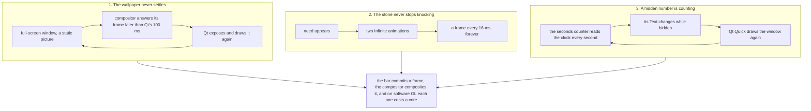

# What the desktop costs when nothing is happening

A machine left alone should cost next to nothing: on a laptop that is battery, in a virtual machine it is
the host's fan, and on a computer whose compositor draws in software it is the difference between a
desktop you can use and one that is always busy. Bombadil's own rule is simple: **when nobody is typing and
nothing is working, the bar, the daemon and the brain together use well under a tenth of a core, and the
bar tells the compositor it drew a new frame only now and then, not sixty times a second.**

This page is how that was lost once, what it took to find it, the three causes, what keeps it from
coming back, and the rules to follow when you add something to the shell.

## What it looked like

The first virtual-machine session after the Hyprland move was slow with nothing on screen: the guest
(TCG, software OpenGL, 1920x1080) had Hyprland at **265%** and the bar at **97%** of a core, together more
than three of its four cores, with no window open and no turn running. The same stack on a headless sway
(which draws in memory) looked idle, at under 1%. Anything that only looks at CPU in that harness misses it,
which is why the watch below counts *frames* as well as CPU.

## How it was found

Two measurements, both short enough to rebuild, and both in `tests/desktop/idle.py` (`ticks()` and
`commits()`):

- **Per-thread CPU from `/proc`.** Take `utime + stime` of every thread of every process twice, 20 s apart,
  and print the busiest as a share of one core. It said the bar's render thread and Hyprland's main thread,
  not Python, not the brain, not a poll.
- **A count of frames.** `WAYLAND_DEBUG=client` on the bar prints every request it sends. Counting
  `wl_surface#N.commit()` per surface over 20 s says exactly how many frames each window of the bar made.
  It does not depend on how fast the compositor is, so the same count means the same thing in a VM, on
  a laptop and in the headless test.

A bar at rest commits a frame every ten seconds at most (0.00 to 0.10 a second in the headless test). Each
cause below was a window committing at a steady rate, and removing the cause moved the rate back to that.

## The three causes



1. **A late frame answer made Qt draw a full-screen window again, forever.** Qt Wayland draws a window
   again when the compositor's answer to its frame arrives later than `QT_WAYLAND_FRAME_CALLBACK_TIMEOUT`,
   100 ms by default. Under a software compositor a full-screen frame takes longer than that (about 350 ms
   at 1920x1080 on llvmpipe over TCG), so the wallpaper, a window that never changes, was exposed and
   drawn again as soon as each frame came back, which gave the compositor another frame to draw. It was
   most of the 265%: with the rest fixed and only the launcher's timeout taken away (`quickshell -p`
   by hand, so Qt's 100 ms again) the same VM went straight back to Hyprland 274% and the bar 76%.
   The timeout is now two seconds: `bin/bombadil-shell` exports it for the bar (a value
   a person already set is kept) and `appkit/engine.py` sets it for every kit app, since an app window is
   as exposed to it as the wallpaper is.
2. **The stone's knock was an animation that never ended.** While anything needed the person, the `needs`
   face of `shell/Stone.qml` ran two animations with `loops: Animation.Infinite`; an animation that runs
   forever makes the window draw a frame every 16 ms for as long as it runs, and a person away from the
   machine for an hour is an hour of sixty frames a second. The knock is now a *cue*: it plays for 9.6 s
   (six beats) when a need appears and rests, with the stone amber and its glow held at 0.45, and comes
   back as a single beat every five minutes while the need stands (one beat a minute cost a third of a core in
   the virtual machine, see the numbers below). A new need knocks again for the full time and
   reduced motion never knocks. (This is a visible change to the stone's design, see
   [`brand/README.md`](brand/README.md); the need is still told by colour at rest.)
3. **A hidden number kept counting.** The status line's `seconds` (the "12 s" beside a turn that is
   working) was bound to a clock that ticks once a second, and the line's `Text` is bound to it. A `Text`
   whose string changes asks its window to be drawn again *even when it is hidden*, so on an idle machine
   with a setup line up the bar committed one frame a second for no reason. The count is now zero unless
   a turn is working (`mode === "working"`), so nothing changes while the machine rests.

The general lesson for the second and third: **in Qt Quick, "not visible" does not mean "not costing".** A
hidden item whose bound value changes still polishes and repaints the window it is in, and an
infinite animation keeps its window drawing as long as it exists.

## What it costs now

Measured in the same kind of guest (the live ISO, TCG, four cores, software OpenGL, 1920x1080, signed out so
a need stands), in ten-second slices, as a share of one core:

| State | Hyprland | the bar | Note |
|---|---|---|---|
| Before the fixes, nothing on screen | 265% | 97% | the three causes together |
| Bar stopped | under 0.2% | | the bare compositor draws nothing, so everything below is the bar's doing |
| At rest, need standing | 1.5 to 2.4% | 7 to 10% | with agentd and the brain, about 12% of one core in all |
| At rest, at the end of the whole smoke (what `idle-cpu` reads) | 0.3 to 4.8% | 3 to 5% | 6.1, 6.0 and 13.2% of one core in three slices, agentd and the brain 1 to 1.6% each |
| One beat of the stone's knock | 80 to 130% for about ten seconds | 25 to 50% | 15 to 20 core-seconds a beat; the slice after it is still 20 to 30% |
| A turn working (the roll, 60 frames a second asked for) | 263 to 275% | 75 to 81% | not an idle state; the compositor is saturated whatever size the bar is |

Three things to read from it. A frame costs seconds of CPU here, because every commit makes the software
compositor composite the whole 1920x1080 output, so an animation costs the compositor's full speed for as long
as it plays, and that is why one beat a minute was a third of a core and one every five minutes is about a
fifteenth. The 7 to 10% the bar itself uses at rest is a main-thread cost that was not traced further, and under
TCG (many times slower than the same code on a real machine) it is a small fraction of that there. And the 10%
limit of the headless test is the one that means something on real hardware; the VM smoke uses 30%, because
under TCG even the resting bar and the compositor's slice of it are above 10%.

### A fixed-height bar costs nothing extra

The bar is a layer surface as tall as what is in it, so a picture or a card that appears resizes it
([`pictures.md`](pictures.md) lists what that does to the pill). Making it a fixed height would never resize
it, at the price of a large transparent surface kept composited. The same measurements with the bar's
`implicitHeight` fixed at 600 px and at the full 1080 px:

| Bar | Hyprland at rest | the bar at rest | Hyprland with a turn working | the bar with a turn working |
|---|---|---|---|---|
| as shipped | 1.7 to 1.8% | 7.7 to 8.8% | 263% | 81% |
| fixed 600 px | 1.4 to 2.1% | 6.8 to 8.8% | 267% | 81% |
| fixed 1080 px (the whole screen) | 1.5 to 1.9% | 7.3 to 8.5% | 275% | 75% |

At rest the three are the same within the noise of the slices, and while a turn works the compositor is
saturated by the roll's frames whatever the surface size, so the transparent area adds nothing that shows. A
software compositor is the worst case for this cost (it composites on the CPU), so a GPU one will not do worse.
The pictures work can fix the height without this cost in its way.

## What keeps it from coming back

| Where | What it checks | Catches |
|---|---|---|
| `tests/test_stone_qml.py` | the knock stops by itself, a new need knocks again, reduced motion never does | cause 2 |
| `tests/test_pill_qml.py` | the seconds counter is zero unless a turn works | cause 3 |
| `tests/test_theme.py`, `tests/test_appkit_runtime.py` | the launcher and the kit export the timeout, and keep a person's own value | cause 1 |
| `tests/desktop/idle.py` (run by `tests/desktop/run.sh`) | the bar's frames per second and the stack's CPU, in three quiet scenes | all three, apart from cause 1's size on a fast compositor |
| `iso/.../bombadil-smoke`, check `idle-cpu` | Hyprland, the bar, the daemon and the brain together, in the real VM, after the whole smoke has run: three 10 s slices, the middle one under 30% of a core | cause 1 and the rest, on the real compositor |

`tests/desktop/idle.py` starts sway, agentd, the brain and the bar (`WAYLAND_DEBUG=client` on the bar),
waits 30 s, and samples 20 s in each of three scenes: the sign-in line alone (what a new machine shows),
something waiting for the person (after the knock's ten seconds), and a job and a window on the stage.
Each sample must show the stack under 10% of a core **and** the bar committing under a quarter of a frame
a second. Measured on the fixed tree: 0.00 to 0.10 frames a second and under 1% of a core. Measured with each
cause put back in: the old stone commits 62 frames a second, the old seconds counter 1.1 a second; both pass the
CPU limit in sway (3% and under 1%), which is why the frame count is the sharper check. Cause 1 does not
show in headless sway at all, because sway answers a frame in microseconds; only the VM smoke can see it.

To run just the watch against a tree, with the test image built by `tests/desktop/run.sh`:

```sh
docker run --rm -v "$PWD:/repo:ro" -v "$PWD/tests/desktop:/e2e:ro" -v /tmp/idle-out:/out "bombadil-desktop-test:$(sha256sum tests/desktop/Dockerfile | cut -c1-12)" \
  bash -c 'id u >/dev/null 2>&1 || useradd -m u; cp /usr/bin/sway /usr/local/bin/sway; chown u /out; \
  cd /home/u && exec sudo -u u -H env HOME=/home/u python3 -u /e2e/idle.py'
```

`IDLE_SETTLE`, `IDLE_WINDOW`, `IDLE_CORE_PERCENT` and `IDLE_COMMITS_PER_SECOND` change the times and limits.
The smoke has `IDLE_CPU_LIMIT` (30) and `IDLE_CPU_SECONDS` (10 a slice). It judges the middle of three slices
because a stone that needs the person plays one beat now and then, which costs a slice a few cores in this
VM; a loop that never ends is in every slice, a beat in one.

## Rules for adding to the shell

- **Nothing animates without an end.** An `Animation` with `Infinite` loops needs a reason for existing
  *and* a condition that stops it (`running:` bound to something that goes false), the way the working roll
  stops with the turn. If a state can last an hour, its animation must not run an hour.
- **Hide with `visible`, and keep hidden items quiet.** A `Text` or `Image` that is not shown should not be
  bound to anything that changes. Bind it to `visible ? value : constant`, or turn the timer behind it off.
- **A timer runs only while something needs it.** The desk's tick and the cards' rings run while a job
  works; `HyprCover` polls the windows 3 times a second only while a window is on the stage. Give a new
  timer a `running:` that is false at rest.
- **Count frames when you change the bar.** Run `tests/desktop/idle.py` (a couple of minutes) after a
  change to anything that moves, ticks or polls. A new idle scene belongs in it when a feature has a
  state that can last (a long job, a waiting question).
