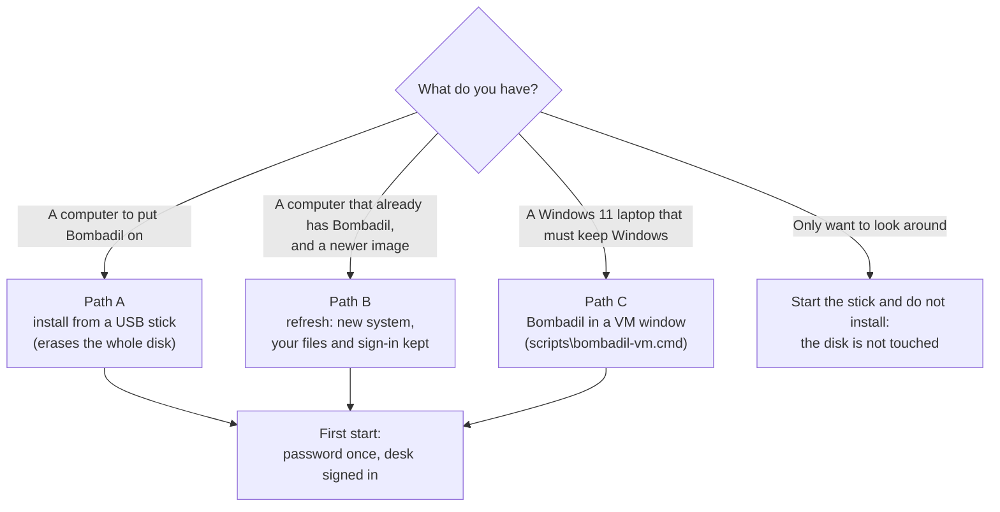
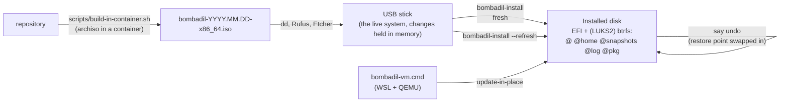

# Installing Bombadil

> **Status:** Shipped. The image, the installer, the refresh and the Windows VM launcher are on `main`. The install card in the pill is not built: the word "install" opens the installer's own questions in a terminal drawer, and this page describes those.
> **Code:** `iso/airootfs/usr/local/bin/bombadil-install`, `iso/airootfs/usr/local/bin/bombadil-rollback`, `src/bombadil/installplan.py`, `src/bombadil/launcher.py` (the words `install`, `wifi`, `remote`), `src/bombadil/remote.py`, `install/carry.list`, `iso/profiledef.sh`, `iso/efiboot/loader/`, `iso/airootfs/etc/skel/.config/hypr/hyprland.lua`, `scripts/build-in-container.sh`, `scripts/build-iso.sh`, `scripts/run-vm.sh`, `scripts/wsl-vm.sh`, `scripts/bombadil-vm.cmd`, `scripts/vm-tools/update-in-place`
> **Design:** [Installed OS](INSTALLED-OS.md) (the principles, the disk and why it is laid out so), [Session services](SESSION-SERVICES.md) (the Super tap and updating a running system), [VM testing](VM-TESTING.md) (what the installer was tested with)
> **Verified:** 2026-11-12 against `main` at `7d37bc5`. Every prompt, message, key and command on this page was read from the code at that commit and checked a second time against it, and the page's links and diagrams were checked with the documentation checker. The installer's own tests ran in a virtual machine: an unencrypted and an encrypted install, one password at the boot screen, an undo across a restart, and a refresh of a disk an older Bombadil installed (the refresh ran before the last merge of `main`). **Nothing on this page has been run on a real computer.** The advanced recipe in [Path C](#path-c-the-windows-laptop-vm) is written from the scripts and was not run, and NVIDIA graphics are unchecked.

This page puts Bombadil on a computer, keeps it up to date, and says what to do when a step goes wrong. It is written to be followed from another device, because the computer you install on is the one you cannot read it on.

## Which path



| I want to... | Go to |
|---|---|
| Install Bombadil on a computer for the first time | [Path A](#path-a-install-on-a-computer) |
| Keep Windows, and try Bombadil in a window | [Path C](#path-c-the-windows-laptop-vm) |
| Look at Bombadil without erasing anything | Do [Path A](#path-a-install-on-a-computer) steps 1 to 5 (and 6 and 7 to try the AI) and stop before step 8. The disk is not touched, and nothing from the visit is kept after power-off. Step 4 changes firmware settings, though (Secure Boot off), so read [Before you start](#before-you-start) first. To go back to the old system: hold the power button until the screen goes dark, take out the stick, put back any firmware setting you changed, and start the computer. |
| Update a computer that already runs Bombadil | [Path B](#path-b-update-an-installed-computer) |
| Fix a problem | [When something goes wrong](#when-something-goes-wrong) |

## Before you start

**Bombadil has been installed only in virtual machines so far, never on a real computer.** The stick may not start on your laptop (NVIDIA graphics and unusual Wi-Fi chips are the likely trouble). Do not install it on a computer you cannot afford to lose or cannot get Windows back on.

The install **erases the whole disk you pick**. There is no dual boot: if Windows or another system is on that disk, it goes, with everything on it, including the recovery partition the maker put there, so "Reset this PC" will not bring Windows back. To go back to Windows later you need Windows installation media made on another computer. If you want to keep Windows, use [Path C](#path-c-the-windows-laptop-vm).

**Do these two things now, while Windows (or the old system) still starts, and before step 4 turns Secure Boot off:**

1. Copy everything you want to keep to another drive or a cloud folder (not the Bombadil stick, which is erased), and open a few files from the copy on another device to check it.
2. On a Windows laptop, find the BitLocker recovery key. On another device, sign in at aka.ms/myrecoverykey with the Microsoft account that is on the laptop, and write the key down. Turning Secure Boot off may make Windows ask for that key at its next start, and without it you cannot open Windows or your files, even to copy them. (A work or school laptop: ask whoever manages it.)

| You need | Detail |
|---|---|
| A computer that starts in UEFI mode, x86_64 | The image has no legacy BIOS boot and no ARM build. The installer stops with "This computer did not start in UEFI mode" if it was started the old way. |
| Secure Boot off, and kept off | The boot loaders on the stick and on the installed disk are not signed. Turning it on again later stops the installed system from starting. |
| A disk of 16 GiB or more that may be erased | 16 GiB is about 17.2 GB as drive makers count, so a drive sold as "16 GB" is too small: use 32 GB or more. A smaller disk is listed as "not offered, it is smaller than 16 GB". |
| A USB stick of 8 GB or more | The image is a few GB (its size is not recorded anywhere; measure yours with `ls -lh` after the build). Everything on the stick is erased. |
| The charger | Keep the laptop plugged in, with the lid open, while the image is written and the whole install runs. A computer that sleeps or loses power in the middle of an install may not start afterwards. |
| A network | Wi-Fi or a cable. Signing in to the AI needs it. |
| An account that can use Claude Code or Codex | Claude Code needs a plan that includes it, and Codex a ChatGPT plan that includes it (a free chat account may not). The install does not check the plan: if the sign-in page says the plan does not include it, the AI will not run. Remote control, if you want it, needs a claude.ai account; an API key does not do. |
| A second device | This page is open on it, since the computer you install on will be wiped. |
| Intel or AMD graphics | What the tests used is a virtual display. NVIDIA is unchecked. |
| 8 GB of memory | The install tests ran with 5 to 8 GB, and the live system with 4 GB. Installing on 4 GB, or on a smaller machine, is untested. |

## Path A: install on a computer

### 1. Get the image

The image is one file, `bombadil-YYYY.MM.DD-x86_64.iso`. There is no download that is always current: **you build it from the repository**, which takes about 30 minutes and needs the network. Pick the route that matches the computer you build on. (If someone hands you a ready-made image, skip to step 2.)

**Build it from a commit that contains the installed-OS work (pull request 35, merged on 2026-11-11).** Images built before it have damaged kernel modules: an option of the image builder wrote zeros over the end of some files, and nothing complained until a driver (a Wi-Fi card, the crypto engine) failed to load months later. Anything built from the current `main` is fine; to be sure of your checkout, `grep -c ztailpacking iso/profiledef.sh` must print `0`. The installer also reads every kernel module back, and stops with "write it again, or try another stick" if one is damaged. An image's date is the date of the commit it was built from, and the fix reached `main` late on 2026-11-11, so a date of 2026.11.12 or later is safe and 2026.11.11 may not be.

**On Linux (or any Linux with Docker or Podman running)**

```sh
git clone <the repository's address, or your fork's> Bombadil
cd Bombadil
scripts/build-in-container.sh        # downloads packages, then builds: about 30 minutes
ls -lh out/                          # bombadil-YYYY.MM.DD-x86_64.iso
```

You need Docker or Podman and permission to run a privileged container (be in the `docker` group, or run the script with `sudo`). With neither installed the script stops without a word. Allow about 10 GB of free disk space for the build files. The result lands in `out/`.

**On Windows, when it is the only computer you have.** The build runs in the WSL distro that `scripts\bombadil-vm.cmd` sets up (no Docker needed). You need:

- **Git for Windows** (git-scm.com).
- **WSL 2.** Open PowerShell as administrator, run `wsl --install`, restart when it asks, then run `wsl --update`.
- **CPU virtualization turned on in the firmware** (usually called "Intel Virtualization Technology" or "SVM Mode"). Task Manager, Performance, CPU says "Virtualization: Enabled" when it is.
- **Tens of GB free on C:.** The build alone writes several GB, and the distro keeps a package cache. (Not measured.)

Then, **in PowerShell**:

```text
git clone <the repository's address, or your fork's> Bombadil
cd Bombadil
scripts\bombadil-vm.cmd build
```

The first run sets up the distro once and builds the VM launcher's own test image, 15 to 30 minutes. You will not use that image for the stick, but the distro and its package cache are what you need. Then, **still in PowerShell**, open the distro's Linux shell (type this one line; the prompt changes to a Linux one):

```text
wsl -d bombadil -u root
```

Now **type these lines in that Linux window**. `C:\path\to\Bombadil` is the Bombadil folder you cloned (in PowerShell, `pwd` prints it while you are inside it), and the last `cp` puts the image into a Windows folder you choose, for example your Downloads folder:

```sh
cd /root/Bombadil
git fetch "$(wslpath 'C:\path\to\Bombadil')" HEAD && git checkout --detach FETCH_HEAD
WORK=/var/tmp/bombadil-work OUT=/root/release SOURCE_DATE_EPOCH=$(git log -1 --format=%ct) scripts/build-iso.sh
rm -rf /var/tmp/bombadil-work                                      # several GB of build files
cp /root/release/bombadil-*.iso "$(wslpath 'C:\path\to\a\folder')"/   # the image, into a Windows folder
exit                                                              # back to PowerShell
```

The `git fetch` line is what the launcher itself does to move its clone to your checkout's commit; run it again after every `git pull`. The build ends with "ISO in /root/release".

**On a Mac** there is no tested way to build the image. Build it on a Linux computer (or a Linux machine with Docker) and copy the `.iso` over. An Apple Silicon Mac cannot build it natively: the image is x86_64.

**Never put an image on a stick that was built with `BOMBADIL_TEST_ENTRIES=1`, and never use the image `scripts\bombadil-vm.cmd` builds for a real computer.** Those have extra boot entries made for the VM tests, which install onto or refresh `/dev/vda` without asking (two of them erase it). The release builds above leave them out, and the two images have the same kind of file name, so keep track of which is which.

### 2. Check the image

An image you built yourself needs no check; go on to step 3. For an image someone handed you with a `.sha256` file beside it, put both in one folder, then:

| System | Command | Right answer |
|---|---|---|
| Linux | `sha256sum -c bombadil-YYYY.MM.DD-x86_64.iso.sha256` | `bombadil-YYYY.MM.DD-x86_64.iso: OK` |
| macOS | `shasum -a 256 -c bombadil-YYYY.MM.DD-x86_64.iso.sha256` | `...: OK` |
| Windows (PowerShell) | `(Get-FileHash .\bombadil-YYYY.MM.DD-x86_64.iso -Algorithm SHA256).Hash` | The same 64 letters and digits as in the `.sha256` file (capitals do not matter) |

The `-c` commands need the file to hold one line, `<64 hex digits>  bombadil-YYYY.MM.DD-x86_64.iso`. If it holds only the 64 digits, run `sha256sum bombadil-YYYY.MM.DD-x86_64.iso` (Linux) or `shasum -a 256 bombadil-YYYY.MM.DD-x86_64.iso` (macOS) and compare by eye. The checksum has to belong to that exact image: one from another build never matches. If they differ, get the file again before going on. The repository does not make a `.sha256` file. A matching checksum proves the file, not the stick: if the installer later says "a copied kernel module is damaged", write the stick again or use another one.

### 3. Write the USB stick

Write the image to the stick as it is. Do not unpack it, and do not copy it onto a stick as a file. Whatever you use must write the image byte for byte. **First take out every other USB drive and SD card** (above all the one holding your backup), so that the stick is the only one connected and nothing else can be picked by mistake.

**On Linux**

```sh
lsblk -o NAME,SIZE,MODEL,TRAN,MOUNTPOINTS      # the stick: TRAN says usb, SIZE is what you expect
sudo umount /dev/sdX?* 2>/dev/null             # unmount whatever the desktop mounted
sudo dd if=bombadil-YYYY.MM.DD-x86_64.iso of=/dev/sdX bs=4M status=progress conv=fsync
sync
```

`/dev/sdX` is the whole stick (`/dev/sdb`, not `/dev/sdb1`). A wrong letter erases that disk instead, so read the `lsblk` line twice. GNOME Disks ("Restore Disk Image") and balenaEtcher do the same job with a picture.

**On macOS**

```sh
diskutil list                                   # the stick: "external, physical" and the right size; note /dev/diskN
diskutil unmountDisk /dev/diskN
sudo dd if=bombadil-YYYY.MM.DD-x86_64.iso of=/dev/rdiskN bs=4m
diskutil eject /dev/diskN
```

macOS prints nothing while `dd` runs (Control+T shows how far it is). When it says "The disk you attached was not readable by this computer", click **Eject**, never Initialize. balenaEtcher works too.

**On Windows**

1. Install [Rufus](https://rufus.ie) (or balenaEtcher, which has no options to get wrong).
2. In Rufus: **Boot selection** is the `.iso` file. **Device** is the stick: check that its size and drive letter are the stick's before you press **Start**, because Rufus erases whatever is selected. Press **Start**.
3. When Rufus asks how to write the image, choose **Write in DD Image mode**, not ISO Image mode. DD mode is the one that matches how the image is written on Linux and macOS. If Rufus never asks and starts writing at once, press **Cancel** and use balenaEtcher instead.
4. Confirm that the stick will be erased and wait for **READY**.
5. Windows may say "You need to format the disk in drive E: before you can use it". Press **Cancel** (never Format). The stick now holds the image's own layout, a disc filesystem and a small boot partition, which Windows does not treat as a normal drive. Use **Safely remove** before unplugging it.

### 4. Set the firmware up

Restart the computer and open its firmware settings (the setup screen). The key to press while it starts is usually F2, F10, F12, Del or Esc. On a Windows computer you can also hold Shift while clicking Restart, then Troubleshoot, Advanced options, **UEFI Firmware Settings**. Write down each value before you change it.

| Setting | Value | Why |
|---|---|---|
| Secure Boot | Off (Disabled) | Bombadil's boot loaders are not signed. It has to stay off after the install. |
| Boot mode | UEFI only. Turn Legacy or CSM off. | The image has no legacy boot, and the installer refuses a legacy start. |
| Storage mode | AHCI, if the installer later shows no internal disk | On some Intel laptops "RAID" or "Intel RST/VMD" mode hides the disk from Linux. While it is set to AHCI an installed Windows may not start, so put the old value back if you stop without installing. |

Save the changes and shut the computer down. Plug the stick in and start it again.

### 5. Start from the stick and see the desk

Open the **one-time boot menu** while the computer starts (usually F12, Esc or F9) and choose the stick. If the stick appears twice, choose the entry marked UEFI. (Some computers list the stick only if it was already plugged in when they were switched on.) You should see:

1. A boot menu whose Bombadil line, **Bombadil**, is chosen by itself after 3 seconds. (Your firmware may add a line of its own, such as "Reboot Into Firmware Interface"; leave it alone.) If you see **more than one Bombadil line**, this is a test image: choose none of them, turn the computer off, take out the stick and write a release image (step 1) instead.
2. A quiet screen in a dark ground colour with no boot text.
3. The desk: a wallpaper and a **pill** (a single input line) at the bottom. There is no login screen and no password on the stick; it signs `user` in by itself.

Give it a minute or two. A slow stick is the usual reason a start is slow. This is the live system: it starts from the stick, what you change while it runs is held in memory, and the computer's disk is not touched. Nothing you do here survives power-off, except what the installer carries to the installed system (step 8).

**Keys.** Tap **Super** (the key with the Windows logo) to type into the pill, or press **Alt+Space**. Tap again to give the keyboard back. **Super+Return** opens a terminal. **Super+Esc** stops whatever the AI is doing. When this page says "say `wifi`" (or `install`, `undo`, `remote`), it means: tap Super, type that word, press Enter. A **drawer** is the panel that slides up over the desk to show a text screen; Esc closes it (after a tap on Super).

**The keyboard is a US layout.** On a laptop with another layout, some keys print other characters than their caps show (for example Z and Y, A and Q, or @ and "). Look at what you type in the Wi-Fi password in step 6 and the e-mail address in step 7, and do not change the layout on the stick: the password you set in step 8 has to be typed the same way at the boot screen, which reads a US keyboard too. To change the layout, do it on the installed system (see [Another keyboard layout](#another-keyboard-layout)).

### 6. Join Wi-Fi (skip it with a cable)

A cable connects by itself. For Wi-Fi: tap Super, type `wifi`, press Enter. A drawer slides up with a list of networks (this is NetworkManager). Move with the arrow keys to your network, press Enter, type its password, press Enter. When it shows as connected, quit the Wi-Fi screen (choose Back or Quit with Tab and Enter), or tap Super and press Esc, and carry on with step 7. If the list is empty, the laptop's Wi-Fi chip needs a driver the image does not have: use a network cable or a USB network adapter. The install itself needs no network.

If you skip this and pick an AI in step 7 with no network, the pill says "No internet. Connect to a network to sign in to Claude." (Codex, if you picked Codex) and offers **Wi-Fi** and **Try again** buttons. Connect, and the sign-in starts by itself a few seconds later; **Try again** starts it at once.

The networks you join on the stick come along to the installed system.

### 7. Sign in to the AI

The pill asks **Which AI should run this computer?** and shows two big buttons, Claude and Codex (typing a name works too). Pick one:

1. The provider's sign-in page opens in the browser panel, which slides in over the desk.
2. Sign in there as you would anywhere. Bombadil does not see your password or token: the AI's own command-line program does the login, and the page is only shown in the panel.
3. The panel slides away and the pill says you are signed in. If the panel was put away, the pill's **Show sign-in** button slides it back; if the page was closed, **Open it again** reopens it. To give up, press the pill's **Cancel** button, or Super+Esc, or tap Super and press **Esc**. A sign-in that nobody finishes gives up after 10 minutes.
4. A small card asks for **Your name** and offers three voices (Merry, Plain, Quiet). Type a name, press Enter. That is the whole setup.

Do this **before** installing if you can: the sign-in, the chosen AI and what the stick learned of your desk are carried to the installed system, so it starts signed in. If you cannot (no network yet, no account yet), you can still say `install`: the installed computer asks the same question at its first start, and needs a network then. A quick check that the AI works: type `hello` in the pill and an answer appears above it.

### 8. Install

Keep the charger in and the lid open, and **take out every USB drive except the Bombadil stick**: the installer lists external drives too, and the disk you pick is erased.

Say `install` in the pill. (Or press Super+Return and run `sudo bombadil-install`; it is the same program.) The installer opens in a terminal drawer and asks one question at a time. The prompts are these, in order:

```text
Bombadil installer

These are the disks in this computer:
  1)  /dev/nvme0n1  512 GB <maker and model>: Windows is on it
      /dev/sda  32 GB <maker and model> (USB): not offered, it is the USB stick Bombadil started from

Which disk? (1-1)
```

- **Which disk?** Type its number. With only one disk offered, Enter picks it. The stick is listed but never offered. A disk that holds Windows says so on its line. A disk that is too small, or in use, is listed with the reason it is not offered. If the installer says "There is no disk here that Bombadil can be put on", the firmware's storage mode is hiding the disk: see [When something goes wrong](#when-something-goes-wrong).
- **If Bombadil is already on that disk,** the installer next asks "Which? (1-2)": 1 is a refresh (see [Path B](#path-b-update-an-installed-computer)), 2 carries on with the questions below and erases the disk.

```text
Choose a password for this computer. It opens the disk when the computer starts, and it unlocks the screen.
Use letters, numbers and ordinary symbols: the boot screen reads a US keyboard.
Password (empty for none):
Again:
```

- **Password.** **Nothing appears on the screen as you type it, not even dots. That is normal.** Type it, press Enter, then type the same thing again at "Again:". It encrypts everything on the disk except the small EFI partition that holds the boot loader. It is asked **once**, at the boot screen, every time the computer starts, and it is also the account's password. Use letters, numbers, symbols and spaces from a US keyboard, at most 254 characters: the boot screen cannot type an accented letter, so the installer refuses one rather than lock you out. If keys on your laptop print different characters than their caps show (for example Y and Z, or @ and "), pick a password made of letters and digits. (The screen is not locked by it yet: no lock screen is built.)
- **An empty password** means **no encryption** and an account with no password. The installer asks "Without a password the disk is not encrypted and anyone holding this computer can read it. Install without one? (yes/no)". Only the full word `yes` goes on; anything else asks for the password again.

```text
Time zone, for example Europe/Lisbon [UTC]:
Name for this computer [<a suggested name>]:
```

- **Time zone.** Type it as `Region/City` with capital letters, for example `Europe/London`, `America/New_York`, `America/Chicago`, `Asia/Kolkata` or `Australia/Sydney` (pick the big city in your zone; the full list is on Wikipedia, "List of tz database time zones"). If it says "That is not a time zone this computer knows." it asks again; nothing is lost. The default in brackets is the stick's own. If you leave it on UTC, Bombadil's greetings leave out "good morning" and the like until a zone is set.
- **Name for this computer.** Lowercase letters, digits and hyphens, starting and ending with a letter or digit, up to 63 characters. The suggestion is the first word of the maker's model name (for example `thinkpad`), or `bombadil-` and four characters when the computer gives no usable model. Press Enter to take it.

The installer does not ask for a keyboard layout. Bombadil starts with a US layout; see [Another keyboard layout](#another-keyboard-layout).

```text
This ERASES everything on /dev/nvme0n1 (512 GB <maker and model>: Windows is on it) and puts Bombadil there, encrypted.
To go on, type the disk's name (/dev/nvme0n1):
```

- **The last question.** Nothing has been changed until you type the disk's name in full (`/dev/nvme0n1`). Anything else stops with "nothing was changed". The checks for UEFI mode, a disk that is too small or in use run when you have answered everything, and they too stop with "nothing was changed".

Then it works, printing a line that starts with `==>` for each stage: checking the disk, partitioning, locking the disk with your password (only if you set one), creating the filesystem, copying the system ("a few minutes"), setting up the system, preparing the home folder, bringing your things along, setting up undo, making it start, checking the result and keeping a record. If you installed programs on the stick, one more stage brings them in after that. **Do not turn the computer off, and leave the stick in until the installer says "Installed. Take out the USB stick":** it copies the system from the stick. Under a virtual machine without hardware acceleration this takes much longer than on real hardware; on real hardware it has not been timed.

**What comes along from the stick:** the sign-in and the chosen AI, the places on your desk and what Tips has taught, the apps made on the stick, the browser's own settings (`~/.config/chromium`; the browser panel's profile, with the sites you signed in to, stays behind), the Wi-Fi networks you joined, and any program you installed on the stick (put in from the packages the stick already downloaded, so no network is needed). **What stays behind:** Bombadil's own log of turns and the pill's conversation. The AI's own folders (`~/.claude`, `~/.codex`) are copied whole, so anything the stick's AI saved there comes along. The home-folder part of this is `install/carry.list`, one line per path; the Wi-Fi networks and the programs are brought by the installer itself.

**The recovery key.** When it is done, if you set a password, the installer prints a **recovery key**, eight groups of eight letters (an install with no password has none):

```text
Your recovery key. If you ever forget the password, this opens the disk. Write it down or take a photo of it now:

    abcdefgh-abcdefgh-abcdefgh-abcdefgh-abcdefgh-abcdefgh-abcdefgh-abcdefgh
```

**Do not press Enter yet. Write the key on paper, or take a photo of the screen, and read it back to check it.** It is shown here once, and it is not in the install log. A copy is also kept in `/var/lib/bombadil/recovery-key` on the new disk (root only, so `sudo cat /var/lib/bombadil/recovery-key` shows it again after the first start). That copy sits inside the encrypted disk, so it cannot help if you have lost the password, and nothing removes or shows it for you yet. Keep the paper away from the computer. Without the password and without this key, the disk cannot be opened by anyone, you included.

Last it says "Installed. Take out the USB stick, then Restart." and, in the terminal, "Take out the USB stick, then press Enter to restart." Pressing Enter restarts the computer at once. Take the stick out and press Enter.

### 9. First start of the installed system

1. At power-on the boot screen shows the mark and **one password line**. Type the password and press Enter. You type it **once**: the system opens the disk a second time by itself. (A disk installed with no password shows no prompt.)
2. The screen goes quiet, then the desk comes up **already signed in**, with a short welcome line from the voice you chose.
3. If you ever need GRUB's menu, press **Esc** right after the password is accepted (on a disk with no password, hold **Esc** at power-on). The menu is hidden for one second and then Bombadil starts.
4. **Leave Secure Boot off.** The installed disk's boot loader is not signed, so turning Secure Boot on again (a firmware update may do it) stops the system from starting. If that happens, open the firmware settings (step 4), turn it off again and restart.

**Check that it is what you installed.** Press Super+Return for a terminal and type these two lines:

```sh
cat /usr/share/bombadil/VERSION       # the image's date and commit
sudo snapper -c root list             # the first restore point: "Bombadil <version>, as installed"
```

**Undo.** From now on every turn of the AI starts with a restore point of the whole system, kernel included. Say `undo` in the pill and the last change is taken back. The newest 30 are kept.

### 10. Optional: control it from another device

`bombadil remote` (or the word `remote` in the pill) starts Claude Code's remote control, so claude.ai/code or the Claude app on another device can steer a session on this computer. It needs a signed-in claude.ai account.

```sh
bombadil remote            # starts it (up to about 25 seconds), or says it is already on, and prints the link
bombadil remote url        # just the link
bombadil remote status     # is it on, and the link
bombadil remote show       # look at it (Ctrl-b then d leaves it running)
bombadil remote stop
```

If `bombadil remote` only says it is starting, run `bombadil remote url` a little later. In claude.ai/code or the Claude app, pick the session named "Bombadil on" and the computer's name.

The session works in `~/Projects/remote`, asks no permission questions, and takes a restore point before every prompt, so `undo` in the pill takes back what a remote session did. It does not start by itself at boot: say `remote` again after a restart.

## Path B: update an installed computer

A **refresh** gives the computer a new system and keeps what is yours. It is how a new image reaches a machine that already runs Bombadil.

| Kept | Replaced |
|---|---|
| Your home folder: files, projects, apps the AI made, the sites you signed in to in the browser panel | The whole system outside home: programs, the kernel, the settings under `/etc` |
| The sign-in and the chosen AI | The boot loader and the EFI partition's contents (the partition itself is emptied, not formatted again) |
| The computer's name, time zone, language and console keyboard layout | The system's restore points: the new system starts with one, "Bombadil <version>, as installed". Undo cannot go back past the refresh; use the rollback below for that. |
| The Wi-Fi networks, the SSH host keys, the machine id, the account's password | |
| The list of programs the old system had and the new image does not (`/var/lib/bombadil/refresh-<time>.txt`; nothing reads it yet, so ask the AI to look at it) | |
| The old system itself, kept aside on the disk. The installer says "kept for 14 days", but nothing removes it yet (the 14 days is not enforced): it stays, and uses disk space, until you delete the subvolumes `@.before-refresh-<time>` and `@snapshots.@.before-refresh-<time>` yourself. | |

The Bombadil filesystem needs about 10 GiB (roughly 10.7 GB) free: the old system is kept beside the new one, and stays there until you remove it, so each refresh needs that room again. A disk that is not a Bombadil disk, or that has Windows on it, is left exactly as it was.

1. **Get and write the new image** (Path A, steps 1 to 3). Back up what you cannot lose: a refresh is built so that stopping at any point loses nothing, because your files and the old system stay on the disk, but if it stops late, or the power goes, the computer may not start until you run the refresh again from the stick, and disks fail.
2. **Start from the stick** (Path A, step 5; the firmware settings from step 4 are already in place). You do not need to sign in on the stick: your sign-in is in your home folder, and what the stick brings never replaces what the home folder already has.
3. **Say `install`.** The list shows your disk as "Bombadil is on it" (and ", encrypted"). Pick it. Then:

   ```text
   Bombadil is already on /dev/nvme0n1.
     1)  Replace the system, keep my files and settings
     2)  Erase the disk and start over
   Which? (1-2)
   ```

   Choose **1**. If the disk is encrypted it asks "The disk's password:". Then it says "This replaces the system on /dev/... with a new one. Your files and settings stay, and the old system is kept for 14 days." Type the disk's name to go on. (Choosing 2 is a fresh install: it erases everything.)
4. Wait for "Installed.", take out the stick, press Enter, and start the computer as in [step 9](#9-first-start-of-the-installed-system).
5. **Copy the new Hyprland lines** if `grep -c 'bombadil:pill-press' ~/.config/hypr/hyprland.lua` prints `0` (the file is from before the Super-tap change): see [Copying the new Hyprland lines](#copying-the-new-hyprland-lines). A refresh keeps your own `~/.config/hypr/hyprland.lua` and adds only files that are missing, so a changed starter file does not reach you by itself.

**If a refresh stops partway.** If it fails before the installer replaces the old boot files (during "Making it start"), it puts the old system straight back and says so. After that point it leaves a marker, and running the refresh again starts over from the old system that is still aside.

**To go back to the old system** while it is still on the disk, start from the stick again and open a terminal (Super+Return). `lsblk -f` shows the disks; the Bombadil partition is the big second one (for example `/dev/nvme0n1p2`). If the disk is not encrypted, run `sudo bombadil-rollback --device /dev/nvme0n1p2 refresh`. If it is encrypted, first run `sudo cryptsetup open /dev/nvme0n1p2 root` and type the disk's password, then `sudo bombadil-rollback --device /dev/mapper/root refresh`. It prints "the system from before the refresh starts next time; the refreshed one is kept as @.after-refresh-<time>". Take out the stick and restart. Your home folder stays as it is now; only the system goes back. [Installed OS](INSTALLED-OS.md) says more about what it does.

## Path C: the Windows laptop VM

On Windows 11, `scripts\bombadil-vm.cmd` builds Bombadil, installs it into a virtual disk and opens it in a window, so Windows stays as it is. It uses QEMU with hardware acceleration inside a WSL 2 distro of its own named `bombadil`, so WSL 2 and CPU virtualization (turned on in the firmware) are needed. The VM disk is a 40 GB file that grows as it fills.

A current WSL is needed: run `wsl --update` first (the launcher installs the distro with `wsl --install archlinux --name bombadil`, which an older WSL may not support). If WSL was not installed at all, the first run installs it; restart Windows when asked and run `scripts\bombadil-vm.cmd` again. If it fails, it only says "Bombadil VM failed; the messages above say where."

**First run.** Open the repository on Windows (a clone, with Git for Windows), run `scripts\bombadil-vm.cmd`, and wait. It sets up the distro once, builds the image for the commit you have checked out (15 to 30 minutes), installs it into the disk without a window, then opens the VM's window. Then sign in as in [step 7](#7-sign-in-to-the-ai).

In the window:

| Key | Does |
|---|---|
| **Alt+Space** | Opens the pill. The Windows key goes to the Windows Start menu, not to the VM. |
| **Ctrl+Alt+F** | Full screen on and off. |

Keys that use Super do not reach the VM for the same reason; say what you want in the pill instead (`terminal` opens the terminal panel).

Do not resize or minimise the window from a script; it can go black. If the window never appears and WSLg's own log, `stderr.log` in the distro's WSLg folder (`wsl -d bombadil -u root -- sh -c "tail -n 20 /mnt/w[s]lg/stderr.log"`), shows `msrdc.exe ... exited` every 31 seconds (the launcher also prints "WSLg's window connection looks stuck"), WSLg's window link is stuck: stop the VM, run `wsl --shutdown` in Windows, start it again.

**Commands** (run from Windows in the repository folder):

| Command | Does |
|---|---|
| `scripts\bombadil-vm.cmd` | Boots the installed VM. The first time, builds and installs it. Says when the checkout is newer than the VM. |
| `scripts\bombadil-vm.cmd refresh` | **Update it, keeping everything** (below). |
| `scripts\bombadil-vm.cmd stop` | Shuts the VM down cleanly. |
| `scripts\bombadil-vm.cmd live` | Boots the live image; the disk is not touched. |
| `scripts\bombadil-vm.cmd reinstall` | Wipes the disk and installs again. It asks first (type `wipe`). The old disk is kept as `/root/Bombadil/out/bombadil.qcow2.before-reinstall` in the distro until the next reinstall, which replaces it. |
| `scripts\bombadil-vm.cmd build` | Only builds the image. |

To remove everything the launcher made: `wsl --unregister bombadil`. This deletes the VM's disk, the saved copy `bombadil.qcow2.before-reinstall` and any image still in `/root/release`, with no question and no undo. Copy out what you want first (for example the image, as in [step 1](#1-get-the-image)).

### Updating the VM

1. In the Windows checkout, get the new Bombadil: `git pull`. The launcher builds and installs whatever commit is checked out.
2. Run `scripts\bombadil-vm.cmd refresh`. It stops the VM, takes a **restore point of the disk** (named `before-refresh-<time>-<commit>`), starts the VM, moves Bombadil's own program files (`bin`, `src`, `shell`, `share`, the smoke script, and a short list of system files: the Chromium policy, `/etc/environment`, the file-type defaults, the browser's launcher entry, the icons, and the `bombadil-setup`, `bombadil-install` and `bombadil-rollback` scripts) to the new commit, and restarts it. The login, apps and files stay.
3. Change the three Hyprland lines in the VM's own file ([below](#copying-the-new-hyprland-lines)). Do not copy `/etc/skel`: the quick update leaves that as it was. The quick update does **not** move packages, GRUB's settings, the pacman mirror list, the starter files under `/etc/skel`, the system services (the systemd user units), or your own files such as `~/.config/hypr/hyprland.lua`.

To go back after a quick update, with the VM off, list the restore points first:

```text
wsl -d bombadil -u root -- qemu-img snapshot -l /root/Bombadil/out/bombadil.qcow2
```

Then put one back, using a name from that list (for example `before-refresh-20261112-101500-7d37bc5`; the commit in the name is the one the update moved to, and the disk is as it was before the update):

```text
wsl -d bombadil -u root -- qemu-img snapshot -a before-refresh-<time>-<commit> /root/Bombadil/out/bombadil.qcow2
```

This puts the disk back to that moment: everything you did in the VM since (files, apps, sign-in) is gone too.

<details>
<summary>Advanced: a new system under the same home, with the installer's refresh (not run by the writer)</summary>

The quick update leaves the VM's packages, kernel and boot loader as they were. When you need a new base system as well, or to bring a VM installed before the installed-OS work to the new disk layout, the installer's refresh does it in the VM as in [Path B](#path-b-update-an-installed-computer). The launcher has no single command for it. What it takes, in WSL as root (`wsl -d bombadil -u root`), with the VM stopped. The chained `&&` makes a failed build stop the rest, so the old test image is never started with the installed disk attached:

```sh
cd /root/Bombadil
qemu-img snapshot -c before-installer-refresh out/bombadil.qcow2     # the way back
git fetch "$(wslpath 'C:\path\to\Bombadil')" HEAD && git checkout --detach FETCH_HEAD   # what the launcher does itself
WORK=/var/tmp/bombadil-work SOURCE_DATE_EPOCH=$(git log -1 --format=%ct) scripts/build-iso.sh && rm -rf /var/tmp/bombadil-work && rm -f out/.iso-key && FORCE=1 GL=0 MEM=5G scripts/run-vm.sh --disk
```

The build takes 15 to 30 minutes and ends with "ISO in /root/Bombadil/out". It must be a release build (no `BOMBADIL_TEST_ENTRIES`): `scripts/run-vm.sh --disk` refuses a disk that already holds a system unless `FORCE=1`, because a test image has a boot entry that erases `/dev/vda`. A same-day build overwrites the launcher's own image of that date in `out/`, which is why the `.iso-key` file is removed, so that the launcher builds its own image next time.

In the window the live image starts: press Alt+Space, say `terminal`, and run:

```sh
sudo env BOMBADIL_INSTALL_CMDLINE='console=tty0 console=ttyS0,115200' bombadil-install --refresh /dev/vda
```

Type `/dev/vda` when it asks. This works on a VM from any earlier Bombadil, including one the pill's `install` list calls "2 partitions, not Bombadil" (the pill's refresh question appears only for a disk that an installed-OS image or later installed). The console argument keeps the VM's serial login, which the launcher's quick `refresh` needs. When it says "Installed. Take out the USB stick, then Restart." the VM does not restart by itself (that is only in the pill's guided form): run `scripts\bombadil-vm.cmd stop`, then start the VM with `scripts\bombadil-vm.cmd`.

If you ran the installer without that argument, the launcher's quick `refresh` will fail on this VM, and every start prints "This checkout has a newer Bombadil" although it was just refreshed. Ignore that line, and do not run `refresh` because of it.

To go back, with the VM off: `qemu-img snapshot -a before-installer-refresh out/bombadil.qcow2` in the distro. Everything done in the VM since is gone too.

</details>

## Copying the new Hyprland lines

Hyprland's settings are a file in your home folder, `~/.config/hypr/hyprland.lua`, copied from the starter file `/etc/skel/.config/hypr/hyprland.lua` once, when the home folder is made. A new image changes the starter file and **not your copy**. A quick update in the Windows VM changes neither: it does not move `/etc/skel`.

**Check whether yours is old.** In a terminal (Super+Return; in the Windows VM, Alt+Space and then say `terminal`):

```sh
grep -c 'bombadil:pill-press' ~/.config/hypr/hyprland.lua      # 0: the old lines, 1: already new
```

Images dated 2026.11.11 can have either, because the change reached `main` during that day, so test the file, not the date. The new starter file has two kinds of changes:

- The tap on **Super** and **Alt+Space** now reach the pill through the bar's own global shortcuts. With the old lines a tap still works, through a slower path (`bombadil pill`), and on a busy machine the first letters you type after it can land in the window underneath.
- The session start hook also starts a `foot` server and the browser service, there are window rules for coding sessions, and Super+Return runs `bombadil terminal`.

**Change the three lines.** This works on any copy of the file, edited or not, and keeps the rest. The image has no text editor, so it uses `sed`, which is there; or ask the AI in the pill to do it.

```sh
cp ~/.config/hypr/hyprland.lua ~/.config/hypr/hyprland.lua.bak
sed -i -e '/SUPER_[LR]"/ s|hl.dsp.exec_cmd("bombadil pill")|hl.dsp.global("bombadil:pill-release")|' \
       -e '/"ALT + space"/ s|hl.dsp.exec_cmd("bombadil pill")|hl.dsp.global("bombadil:pill-press")|' \
       ~/.config/hypr/hyprland.lua
grep -n 'bombadil:pill' ~/.config/hypr/hyprland.lua
```

The last line should print these three:

```lua
hl.bind("SUPER + SUPER_L", hl.dsp.global("bombadil:pill-release"), { release = true })
hl.bind("SUPER + SUPER_R", hl.dsp.global("bombadil:pill-release"), { release = true })
hl.bind("ALT + space", hl.dsp.global("bombadil:pill-press"))
```

These three lines are all the Super tap needs. For the rest, on a machine that a refresh (Path B or the advanced recipe) has updated, `/etc/skel` holds the new starter file: `diff -u ~/.config/hypr/hyprland.lua /etc/skel/.config/hypr/hyprland.lua` shows the difference, and `cp /etc/skel/.config/hypr/hyprland.lua ~/.config/hypr/hyprland.lua` takes the whole file (in the Windows VM, first run `grep 'the VM window' ~/.config/hypr/hyprland.lua.bak >> ~/.config/hypr/hyprland.lua` afterwards to put back the line that pins the screen size to the window).

**Then:** `hyprctl reload` is enough for the three lines. Restart the computer to get the rest, because the `foot` server and the browser service start only when the session starts. Tap Super (in the Windows VM, press Alt+Space): the pill takes the keyboard. If Hyprland shows a configuration error, put your old lines back (the `.bak` copy) because the Hyprland on that machine is older than the new file; a refresh brings the system up to date (Path B; in the Windows VM, the advanced recipe). If nothing happens at all, the bar on this machine is older than the new lines: put the old lines back and update the system first.

## Another keyboard layout

The installer does not ask for a keyboard layout, and the boot screen reads a US keyboard whatever you choose. Do this on the installed system, after the first start, never on the stick before step 8: a layout changed on the stick does not come along, and the password you type in the installer has to be typed the same way at the boot screen. The desk's layout is one line in `~/.config/hypr/hyprland.lua`: `input = { kb_layout = "us", follow_mouse = 1 }`. The image has no text editor, so change it with `sed` in a terminal (replace `de` with your layout), or ask the AI in the pill to change the keyboard layout:

```sh
sed -i 's/kb_layout = "us"/kb_layout = "de"/' ~/.config/hypr/hyprland.lua && hyprctl reload
```

The password you set is typed on a US layout at the boot screen, so choose one whose characters you can find on yours.

## When something goes wrong

| What you see | Why | What to do |
|---|---|---|
| The computer does not offer the stick | The stick was written in a mode the firmware does not boot, or the firmware is in legacy mode | Write it again in DD mode (Rufus) or with `dd`; check the firmware settings in step 4; try another USB port. |
| Windows asks for a BitLocker recovery key | Turning Secure Boot off changed what Windows checks | Type the key from aka.ms/myrecoverykey (see Before you start). |
| "This computer did not start in UEFI mode, which Bombadil needs" | It started the stick through legacy boot | Restart, open the one-time boot menu and choose the entry marked UEFI. |
| A black screen after the boot menu | A graphics driver the image does not carry | Intel and AMD are expected to work; NVIDIA is unchecked. Say what the machine is so it can be looked at. |
| `wifi` shows no networks | The laptop's Wi-Fi chip needs a driver the image does not have | Use a network cable or a USB network adapter. The install itself needs no network. |
| The installer says "There is no disk here that Bombadil can be put on", or the disk is not in its list | A storage mode that hides it, or the disk is the stick | Power off, go back to step 4 and set the storage mode to AHCI, start the stick again, and redo steps 6 and 7: the stick forgets everything at power-off. A disk listed as "not offered" gives its reason on the same line. |
| "`/dev/...` is smaller than 16 GB" or "in use (something on it is mounted)" | Too small, or something from it is mounted | Pick another disk. Nothing was changed. |
| "a copied kernel module is damaged ... write it again, or try another stick" | A bad stick, a bad copy of the image, or an image built before the fix in pull request 35 (see step 1) | Check the checksum (step 2), write the stick again (or use another stick), and run the install again. The installer reads every kernel module back before it writes the boot loader, so a disk that failed this check has no boot loader and is not mistaken for a working install. |
| "the password has characters the boot screen cannot type" | An accented letter, a tab or a character GRUB cannot read | Choose one with letters, numbers and ordinary symbols from a US keyboard. |
| "No internet. Connect to a network to sign in..." | No network | Say `wifi`, or plug in a cable, and press **Try again**. |
| The installer stopped before "Installed." | A power cut, a pulled stick, a damaged image | Start the stick and run it again: a fresh install begins over, and a refresh starts over from the old system that is still aside. Its log is `/tmp/bombadil-install.log` on the stick and `/var/log/bombadil-install.log` on the installed disk (readable by its owner only). |
| The boot screen does not accept the password | The keyboard layout (US at that screen), or a typing slip | Type it on a US layout. If it is lost, the recovery key opens the disk. |
| After the install, a boot error screen and no desk | Secure Boot got turned on again | Open the firmware settings, turn Secure Boot off and restart. |
| The first letters after tapping Super are lost | An old `hyprland.lua` | [Copying the new Hyprland lines](#copying-the-new-hyprland-lines). |
| The tap on Super does nothing in a VM window on Windows | Windows keeps the key | Use Alt+Space. |
| "Bombadil is already installed on this computer" when you say `install` | You are on the installed system, not the stick | The installer runs from the stick only. To update, use Path B. |

## How it is built, and what it keeps to



The steps above follow the rules that [Installed OS](INSTALLED-OS.md) lists, and a change to them has to keep them:

- **One password, typed once.** The disk is encrypted by default and the password is asked a single time, at the boot loader. A recovery key is shown once, by the installer.
- **A stop loses nothing.** Everything that reads comes before anything that writes, and each step that changes a disk is ordered so that stopping partway leaves the old system on the disk or a marker that says the new one is not whole. (After a late stop the computer may not start until the refresh is run again.)
- **The person's files outlive the system.** Home is its own subvolume. A refresh replaces the system and keeps home, the sign-in and the Wi-Fi.
- **Undo covers the whole system, kernel included.** The kernel lives inside the restore point, so an undo starts the kernel that goes with the modules on disk.
- **The terminal form asks nothing the card would not.** The questions are the install card's, in order, so building the card later changes the screen and not the sequence.

Where to change it:

| To change | Edit | Read first |
|---|---|---|
| What the installer asks, or checks | `iso/airootfs/usr/local/bin/bombadil-install` (the `guided` function asks) and `src/bombadil/installplan.py` (the only reader of a plan) | [Installed OS, the plan](INSTALLED-OS.md#the-plan) |
| What comes along from the stick | `install/carry.list`: add a line, not code | [Installed OS, building on it](INSTALLED-OS.md#building-on-it) |
| The boot menu of the stick | `iso/efiboot/loader/` | `iso/profiledef.sh` (UEFI only) |
| The starter Hyprland file | `iso/airootfs/etc/skel/.config/hypr/hyprland.lua` | [Session services](SESSION-SERVICES.md#updating-a-running-system); a change reaches only new home folders, so a change that matters needs an update note like the one above |
| The Windows launcher | `scripts/wsl-vm.sh`, `scripts/bombadil-vm.cmd`, `scripts/vm-tools/` | [VM testing](VM-TESTING.md), `scripts/vm-tools/README.md` |
| Testing an installer change | `tests/test_installer.py`, `tests/test_installplan.py`, then a VM run | [Installed OS, testing a change](INSTALLED-OS.md#testing-a-change) |

## Not built yet

- **The install card.** The pill's "install" opens the installer's questions in a terminal; the card that draws the disks as bars is a later piece, and the terminal form is what it will run.
- **A screen lock.** The installer's text says the password unlocks the screen, but no lock screen is on the image yet; the password opens the disk at power-on.
- **A recovery key card at first start.** The key is shown by the installer, once; a root-only copy stays in `/var/lib/bombadil/recovery-key` and nothing shows or removes it.
- **The cleanup of the old system after a refresh.** The installer says 14 days, but nothing removes it yet. Nothing reads the list of programs the refresh could not bring either.
- **Installing next to another system.** The installer takes a whole disk.
- **Installing on NVIDIA graphics, and on real hardware at all,** are unchecked.
