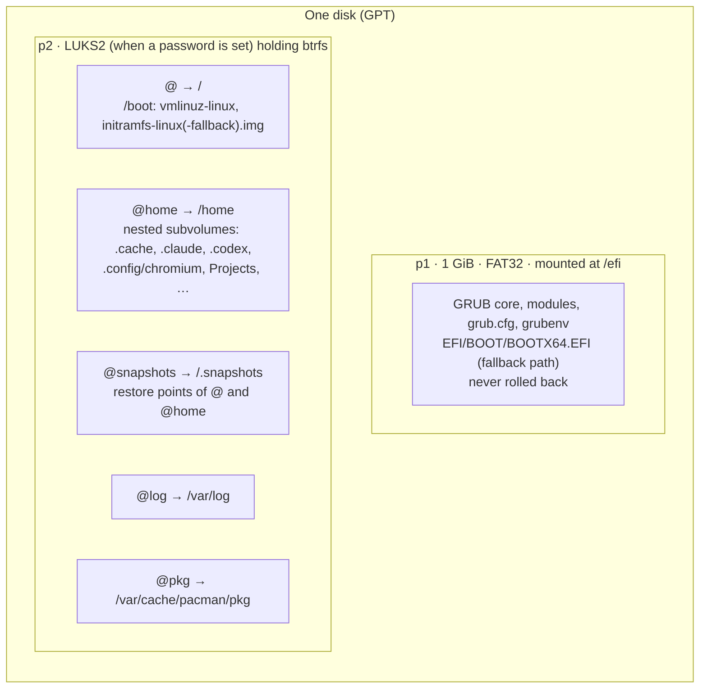
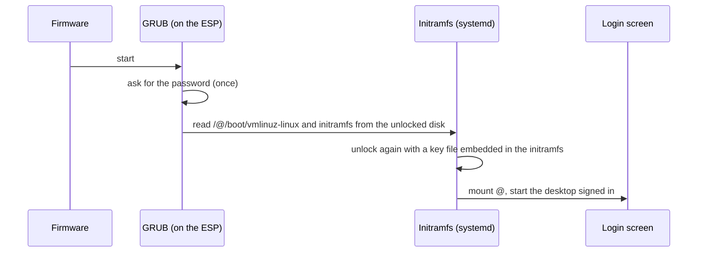
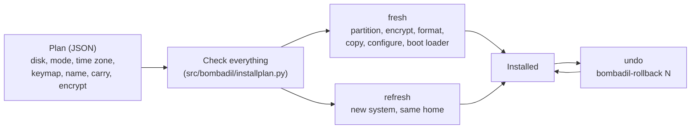
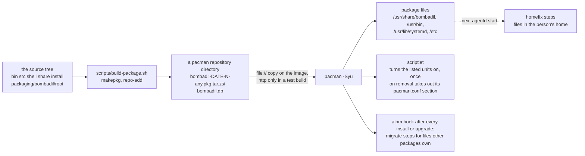

# Bombadil as an installed operating system

Bombadil starts as a USB stick you try, and ends as the system on a computer's disk, the way
Debian or Windows is installed. This page says what the installed system looks like, why it is
built that way, how Bombadil itself is installed and updated as a package ("Packages and updates"),
what you can rely on when you build on it, and how to test a change to it. The
complete reasoning, with the alternatives that were weighed, is in the installed-system design brief
(`docs/design/installed-os-brief.md`, brought in by the repository documentation sweep). The disk
layout in table form is in [ARCHITECTURE.md](ARCHITECTURE.md#the-installed-disk-layout-1).

## Principles

These are the choices every part of the install follows. A change that breaks one of them needs a
reason that is better than the one given here.

1. **The layout is the one thing an update cannot change, so it is right before anyone installs.**
   Packages, units and scripts reach an installed machine by an update. A partition table, an
   encryption header and the place the kernel lives do not. They are written once and recorded
   (`layout` in `/var/lib/bombadil/install.json`); a later layout is a new number with a migration.
2. **Undo covers the whole system, kernel included.** Bombadil takes a btrfs restore point before
   every agent turn, so `/boot` is inside the restore point. An undo then starts the kernel that
   goes with the modules on disk, and never a kernel whose modules were replaced.
3. **The person's files outlive the system.** Home is its own subvolume. Replacing the system
   ("refresh") keeps home, the sign-in, the apps the agent wrote, the computer's name and the
   Wi-Fi networks, and keeps the old system aside for two weeks.
4. **One password, typed once.** The disk is encrypted by default. The password is asked for a
   single time, at the boot loader, and also unlocks the screen. A recovery key is shown once.
5. **A stop is never worse than the state before it.** Every step that changes a disk is ordered
   so that stopping partway leaves either the old system untouched or a marker that tells the
   next run where to resume. Reading and checking always come before writing.
6. **The agent explains in pictures and plain words, not in terminal output.** The install is a
   card in the pill with one button that names the disk; the terminal command exists for tests and
   for people who know what they are doing, and it asks no questions the card did not already ask.

## What is on the disk



Why each piece sits where it does:

| Choice | Reason |
|---|---|
| ESP at `/efi`, not `/boot` | The kernel is inside `@`, so a restore point holds it. GRUB itself stays on the ESP so its modules never disagree with its core after an undo. |
| `@log` and `@pkg` beside `@` | Undo replaces `@`. The logs of a bad start, and what was downloaded since, must survive the undo. |
| Nested subvolumes in `@home` | A restore point of the home folder does not descend into a nested subvolume, so the sign-in, the browser profile and caches are never rolled back by undoing a file change. |
| `/etc/fstab` by UUID, system by subvolume name | A snapshot swapped in under the name `@` mounts exactly like the root it replaced. |
| `btrfs` snapshot swap, not `set-default` | The root is always the subvolume called `@`. Nothing reads the default subvolume, so there is one path to reason about. |

## How the disk is opened



The disk has three key slots: the **password** (argon2id at 256 MiB, which is what GRUB can pay on
firmware that fragments low memory), a **key file** inside the initramfs (cheap to derive, so the
password is not typed a second time), and a **recovery key** (shown once on the first start, kept
in `/var/lib/bombadil/recovery-key`, mode 600, only until it has been shown). The password reaches
`bombadil-install` only on a file descriptor, never in a file, an argument or the log. The
recovery key is printed to the terminal only, never into the install log (the log is copied onto the
new disk, in `/var/log/bombadil-install.log`, readable by its owner alone). The password is limited
to what a US keyboard types at the boot screen: letters, numbers, symbols and spaces, at most 254
characters. An accented letter would be stored on the disk and then could not be typed at GRUB.

### What GRUB shows

GRUB's screen is the one thing a person sees before Bombadil is up, so it is made like the rest of
the desk (`docs/design/identity-brief.md`, "Where the mark goes"): the ground, the mark, and GRUB's
own password line in Inter. The installer puts `background.png` from `share/grub/bombadil/` on the
ESP, because `grub.cfg` is read there before the disk is unlocked, and makes the font
(`inter-16.pf2`) with `grub-mkfont` from the Inter the system has. If that fails it says so and GRUB
keeps its plain screen. Then it writes `/etc/default/grub.d/bombadil.cfg`, which switches GRUB to the
graphical terminal unless something else chose the terminal (the serial line of a test install stays
as it is).

`/etc/grub.d/000_bombadil_screen` (from the bombadil package) is what puts the font and the picture on the screen.
It is a `grub.d` script rather than a GRUB theme for two reasons. GRUB reads the password at the top of
the generated `grub.cfg` (`00_header`'s `cryptomount`), long before it applies a theme, and only when
the menu shows, which on Bombadil is never unless Esc is held; and a theme without menu components
would make that Esc menu empty. The script sorts before `00_header` and does nothing unless the
terminal is the graphical one. GRUB draws its prompt at the top left of the screen; the mark is in the
middle of the picture.

`grub.cfg` is written by `bombadil-grub-config`, never by `grub-mkconfig` directly. GRUB's `10_linux`
echoes "Loading Linux ..." and "Loading initial ramdisk ..." before every kernel and has no switch
for it, so the script runs `grub-mkconfig` in the C locale (the text the cut looks for is the
English one) and deletes those two lines from the result. Anything that regenerates `grub.cfg` runs
the script.

## The three operations



- **Fresh install** erases the chosen disk. It refuses the disk the stick was started from, refuses
  a disk with anything mounted from it, and the terminal form asks for the disk's name typed in full unless `--yes` or a plan from the card says it was already confirmed.
- **Refresh** (`bombadil-install --refresh DISK`) is the way an installed machine gets a new base
  system while keeping everything personal. It reads and checks first; renames the old `@` and
  `@snapshots` aside as `@.before-refresh-<stamp>`; copies the new system in; empties the ESP last
  (not reformatted, so its UUID stays). `bombadil-rollback --device DEV refresh` puts the old
  system back. A refresh that stops before the boot files are replaced puts the old system back by
  itself; one that stops after leaves `var/lib/bombadil/install-incomplete` (the new `@` is marked
  before the first file is copied into it, so a stop nothing can catch, such as lost power, is
  marked too), and running it again resumes from the system that is still aside. Everything about the
  new system that can be checked without GRUB (modules, kernel, initramfs) is checked before the
  old boot files are replaced. A machine installed before Bombadil was a package moves onto the
  package by one refresh (see "An install from before the package").
- **Undo** (`bombadil-rollback N`) swaps restore point `N` in under the name `@` (one atomic
  exchange where the kernel offers it) and keeps the previous root as `@.undone-<stamp>`, so an
  undo can itself be undone.

## Installing on a computer

What you need: a computer that starts in UEFI mode (Secure Boot off), a disk you are willing to
erase (16 GB or more), a USB stick with the Bombadil image, and a network connection (Wi-Fi is set
up from the pill: say "wifi").

1. Write the image to the stick, start the computer from it, and let it open.
2. Sign in to the AI when the pill asks. The sign-in is carried to the installed system (it is on
   `install/carry.list`), so the installed computer is signed in on its first start.
3. Say **install** in the pill (or press Super+Enter for a terminal and run `sudo bombadil-install`).
   It lists the disks and what is on each, then asks, one question at a time: which disk, a
   password, the time zone, a name for the computer. Nothing is changed until the disk's name is
   typed in full. When Bombadil is already on the disk it offers to replace the system and keep the
   files and settings (a refresh) instead.
4. At the end it shows a **recovery key**. Write it down or photograph it: it opens the disk if the
   password is forgotten, and it is shown here once. Then take out the stick and press Enter to
   restart.
5. At power-on the computer asks for the password once. The desktop opens signed in.

## Remote control

`bombadil remote` (or the word **remote** in the pill) starts Claude Code's remote-control server
on the computer, in a detached tmux session, so another device can steer a session here from
claude.ai/code or the Claude app. It needs a claude.ai account (not an API key), which the sign-in
in step 2 gives. `src/bombadil/remote.py` explains the details; in short:

- `bombadil remote` starts it, or says it is already on, and prints the link.
- `bombadil remote status`, `url`, `show` (look at the session; Ctrl-b then d leaves it running)
  and `stop`.
- The session works in `~/Projects/remote`, a folder Bombadil makes. It has no permission
  questions, and a restore point is taken before every prompt, labelled `turn: remote: ...`, so
  "undo" in the pill takes back what a remote session did. A folder you name yourself is left
  exactly as it is.
- Remote control does not start by itself at boot; after a restart, say "remote" in the pill.

## What a user sees

- On the stick: the pill offers "Install on this computer". The card draws the disks as bars with
  one sentence each, leaves out the stick itself, and asks for one thing, a password. Time zone,
  keyboard, computer name and what comes along from the stick each have one line with "change".
  The red button names the disk it will erase.
- At power-on: one plain line asks for the password, then the desktop opens with the conversation
  and apps still there, a welcome line, and the recovery key once.
- Afterwards: undo works from the pill; closing the lid locks behind the same password; an update
  arrives as one restore point so a kernel that goes wrong goes back with undo.

The install card is a later piece. Until it exists the same questions are asked in a terminal
(`bombadil-install` with no arguments, or the word "install" in the pill), and the plan is
written for the person from the answers; `bombadil-install --plan FILE --password-fd N` is what the
card will run.

## The plan

```json
{
  "disk": "/dev/vda",
  "mode": "fresh",
  "timezone": "Europe/Lisbon",
  "timezone_source": "detected",
  "keymap": "us",
  "hostname": "thinkpad",
  "carry": [".claude", ".claude.json", ".codex", ".config/bombadil", "Apps"],
  "encrypt": true,
  "kind": "internal"
}
```

`src/bombadil/installplan.py` is the only reader of a plan. It refuses unknown fields, a disk
outside `/dev`, a time zone the system does not know, a carry path that is not on
`install/carry.list`, and any plan that disagrees with the command line. `install/carry.list` is
the one place to add a home path that should come along from the stick: add a line, not code.

## Packages and updates

Bombadil is one pacman package, `bombadil`. A machine gets Bombadil by installing it and a newer
Bombadil by updating it, the way it gets every other program. This section says what the package
holds, how a file reaches a machine, how to add a file the right way, and how to build and serve
an update.



### What the package owns

Where a file sits in the source tree decides where it lands on a machine. There is no list of files
to keep in step.

| It is | In the source tree | On the machine |
|---|---|---|
| a command | `bin/NAME`, executable in git | `/usr/share/bombadil/bin/NAME`, and `/usr/bin/NAME` is a link to it |
| Python | `src/bombadil/` | `/usr/share/bombadil/src/bombadil/` |
| the bar | `shell/` | `/usr/share/bombadil/shell/` |
| the app kit, skills, apps, tips, the GRUB picture, Bombadil's part of the Hyprland config | `share/` | `/usr/share/bombadil/share/` (beside `shell/`, as in the source tree) |
| the carry list | `install/` | `/usr/share/bombadil/install/` |
| the package list | `iso/packages.x86_64` | `/usr/share/bombadil/packages.x86_64` |
| the version | not in git; the build writes it | `/usr/share/bombadil/VERSION` |
| a unit, a config file, a sudoers file, a hook, an icon, a desktop entry, a sysusers or tmpfiles file, a file for a new home | `packaging/bombadil/root/`, at the path it has on the machine | the same path |
| something only the live stick needs, or the image's own base files | `iso/airootfs/` | the stick; the installer copies the system to the disk without the live-only units |

`packaging/bombadil/` also holds `PKGBUILD` (what the package is: its name, dependencies and the
files pacman keeps the person's edits to) and `bombadil.install` (the scriptlet). The numbered
migrate steps and the hook that runs them are under `root/usr/share/`, and `/usr/bin` also gets
the commands the package ships itself (`bombadil-setup`, `bombadil-install`, `bombadil-rollback`,
`bombadil-smoke`, `bombadil-grub-config`, which live in `root/usr/bin`).

- **`/usr/bin/NAME` is a link, never a copy.** `package()` makes `../share/bombadil/bin/NAME` for every
  file in `bin/`, so a new command needs no list. Each launcher finds `src/` from its own resolved
  path, and `bombadil-shell` reads its own link with `readlink -f`; a copy would look for `src/`
  in `/usr`.
- **Nothing the package ships names `/usr/local`.** It is no package's. (A migrate step names it, to
  fix a line an older install has.)
- **Modes.** Git holds only 644 and 755, and a build user's umask is not to be trusted, so
  `package()` sets them: folders 755 (`etc/sudoers.d` is sudo's own folder, so 750), files readable by
  all and writable by the owner alone, and `etc/sudoers.d/bombadil` 440. The agent runs as the
  person, so a file it cannot read would break every start.
- **`backup=`** lists the files a person may edit and an update must not take back:
  `/etc/bombadil/config.toml`, `/etc/pacman.d/bombadil.conf` and `/etc/sudoers.d/bombadil` (a person
  who tightens a rule there keeps it). When one of them was edited and a new version changes it,
  pacman keeps the person's and writes the new one beside it as `.pacnew`, which sudo skips because
  of the dot in its name. Every other file the package puts in `/etc` is Bombadil's own policy or
  default and is replaced by each update on purpose: the managed settings of Chromium, Claude Code,
  Codex and Thunderbird, `mimeapps.list`, the GRUB drop-in, the GRUB screen script and `/etc/skel`.
  A person's own choices go in their home or in a file of their own. The `.pacnew` round trip is
  pacman's own behaviour and has not been run on a machine with this package yet.
- **`depends`** names only packages that `iso/packages.x86_64` lists, so the image has every one (a
  test checks, and checks that the image lists `bombadil`). A new dependency goes in both.
- **Nothing may be in both `iso/airootfs/` and `packaging/bombadil/root/`.** mkarchiso copies
  `airootfs` first and pacstrap installs the package after, and pacman refuses to overwrite a file it
  does not own ("exists in filesystem"). A test guards it. What stays in `iso/airootfs/` is what no
  package ships: the live stick's own `bombadil-live.service` and `pacman-init.service` with the links
  that start them (the installer leaves these out of an installed system), and the base files the
  installer copies along: the hostname, locale, console and mkinitcpio files, the mirror list, and
  `/etc/environment` (pam owns that one).

### The three ways a file changes

A file on a machine has one of three owners. Each is changed in its own way, and the way is the
first thing to decide when you add a file.

| The file | How a new version changes it | Where that lives | What records it |
|---|---|---|---|
| **Bombadil's own**: anything the package ships | pacman replaces it in the update | the file itself, in the source tree | pacman's database |
| **Another package's**: `/etc/pacman.conf` (pacman), `/usr/lib/os-release` (filesystem), `/etc/environment` (pam) | a numbered **migrate step** that checks the file and edits it if it needs it; an alpm hook runs the steps after every install or upgrade of any package | `packaging/bombadil/root/usr/share/bombadil/migrate/NNN-name.sh` | `/var/log/bombadil-migrate.log` |
| **The person's**, in their home: `~/.config/hypr/hyprland.lua`, the skill links | a numbered **homefix step** that only creates what is missing (the one file it rewrites is `hyprland.lua`, after keeping the old one); agentd runs it at start, before its socket opens | `STEPS` in `src/bombadil/homefix.py` | `~/.local/state/bombadil/home.json` |

**Migrate steps.** pacman does not let two packages own one path, and an upgrade of the owner can
put the original file back. So Bombadil never ships a file another package owns. The hook
`bombadil-migrate.hook` runs `/usr/share/bombadil/migrate/run` once after every transaction that
installs or upgrades any package (one `Package` trigger with `Target = *`), not only one of
`bombadil`, `pacman`, `filesystem` or `pam`. A `pacman.conf` that someone replaced with pacman's new
default has lost `[bombadil]`, and then pacman no longer knows this package: only a step that runs
after a later transaction of any other package can put the section back. The runner runs
`NNN-*.sh` in order, each in its own `bash`, and always exits 0: a step that fails is written to the
log (`FAILED rc=N` and its words) and to stderr as one line, and the rest still run, because a failed
step must never fail the update. A step that changed something is logged; one with nothing to do
prints and logs nothing, since the hook runs after every transaction. A test reads the hook file and
runs the steps on a fake root; the hook firing in a real pacman transaction is checked only by an
image build (it reads `/etc/pacman.conf` back) and has not been run for real yet. Today's steps:

- `001-pacman-repo.sh` puts `[bombadil]` with `Include = /etc/pacman.d/bombadil.conf` above the
  first `[core]` in `/etc/pacman.conf`.
- `002-os-release-logo.sh` gives the system's os-release the line `LOGO=bombadil`: it replaces
  Arch's `LOGO=archlinux-logo`, or adds the line when there is none. A `LOGO=` the person set stays,
  and `ID` and `ID_LIKE` are not touched. It edits `/etc/os-release` when that is a regular file
  (systemd reads it first), else `/usr/lib/os-release`.
- `003-browser-env.sh` changes the exact line `BROWSER=/usr/local/bin/bombadil-browser` in
  `/etc/environment` to `/usr/bin/bombadil-browser`.

**Homefix steps.** The package owns `/usr`; the home is the person's. An update adds what is
missing there and changes nothing that exists, with one exception, the Hyprland config below.
agentd runs the steps only on a real installed system: `paths.share_dir()` is `/usr/share/bombadil`,
`BOMBADIL_SHARE` is not set, `/usr/share/bombadil/VERSION` exists and `BOMBADIL_NO_HOMEFIX` is not
set, so a checkout that a developer runs never touches their home. homefix never raises and never
waits. A step that fails is tried again at every start, but a failure counts at most once an hour,
so a crash loop does not use the tries up. The third counted failure leaves the step alone until a
Bombadil of a different version is installed (the failure record in `home.json` holds the version),
and says so once above the pill, with the reason. A second homefix that finds the lock held does
nothing. (agentd restarts for ever, so a step that could crash it would be a loop with no pill.)
`home.json` says what was done, but it is advisory: every step also looks at the files, so a lost
record makes a step run again harmlessly. A `home.json` written by a newer Bombadil than this code
is left where it is and homefix does nothing, since this code cannot tell what its records mean;
one that cannot be read or understood, or is older, is set aside beside itself as
`home.json.bad-<time>` and the table starts empty. The file lives in the state folder, which a
restore point of the home does not roll back. Today's steps:

1. **config split**: the Hyprland config, described below.
2. **skel entries**: adds what `/etc/skel` has and the home lacks, as `cp -an` would, but each path
   is offered once, so one the person deleted stays gone. A skill link or a settings file under
   `.config` that a new release brings reaches existing homes with no code change. The sign-in and
   the person's settings are never offered.

What a step wants the person to know goes above the pill for two minutes.

### Adding a file

Ask who owns the file, then follow that case. In every case, write the test with the file.

**A file of Bombadil's own** (a command, a unit, a config file, a QML file). Put it where the table
above says, and that is all: nothing lists it.

- A command goes in `bin/` and must be executable in git (`git update-index --chmod=+x`; a test
  checks). Its `/usr/bin` link appears by itself.
- A unit goes in `usr/lib/systemd/system/` or `usr/lib/systemd/user/` and starts `/usr/bin/NAME`.
  To have it turned on, add its file name to `usr/share/bombadil/enable.system` or `enable.user`;
  a unit listed there needs an `[Install]` section. A unit that Hyprland starts (agentd and the
  shell) has none and is not listed.
- A file that a new home should start with goes under `etc/skel/`. An existing home gets it from the
  skel step if it is under `.config` (not `.config/hypr/hyprland.lua`, which the config split owns,
  and not the settings in `.config/bombadil` other than `wallpaper`), or if it is a skill link under
  `.claude/skills` or `.agents/skills`. Any other skel path reaches only a home made after the update.
- A file the person may edit goes in `backup=`.

**A file another package owns.** Never ship it. Write a migrate step:

1. Name it `NNN-what-it-does.sh`, the next number, three digits. Do not reuse a number. Start with
   `#!/usr/bin/env bash` and `set -euo pipefail`, and say in a comment whose file it is and why it
   changes.
2. Work on `${BOMBADIL_ROOT:-}` as the root, with the trailing `/` removed, so a test can give a
   fake one (the runner sets it to `/`).
3. Check the file, never a version or a record. If it is already as wanted, print `already` and
   exit 0. Keep what the person chose (step 002 leaves a `LOGO=` of their own).
4. Change only the line you mean to. Write a temporary file in the same folder
   (`mktemp "$file.XXXXXX"`), give it the old file's mode and owner (`chmod --reference`,
   `chown --reference`), and `mv -f` it over. Print `changed`.
5. If it cannot (no file, no `[core]`), say why on one line and `exit 1`. Change nothing then.
6. Never run `grub-mkconfig` or `bombadil-grub-config`, and never restart anything.
7. Change nothing in `bombadil-migrate.hook`: it runs the steps after every install or upgrade of any
   package, so the step runs again whenever the owner's upgrade puts the original back.

Test it on a fake root: in `tests/test_packaging.py`, `fake_root(tmp_path, ...)` makes a small root
(`etc/pacman.conf`, `usr/lib/os-release`, `etc/environment`) and `step(root, "NNN-name.sh")` runs one
step against it. Check that it changes the file once and says `already` the second time, that the
mode is kept, that the person's own value stays, and that a file it cannot change is left as it was.

**A file in the person's home.** Write a homefix step in `src/bombadil/homefix.py`:

1. A function `step_name(ctx) -> Result`, added to `STEPS` with the next number. The number is the
   key in `home.json`, so never renumber.
2. Create only. Write with `_create_only` (it never replaces a name that exists, a dangling link
   included) and never open, change or delete what is there. The config split is the one step that
   replaces a file, and only after it has kept the old one.
3. Look at the files, not at the record. Return `Result("already")` when there is nothing to do.
4. Raise when it cannot. homefix keeps the failure, retries it at the next start (a failure counts
   at most once an hour, and the third leaves the step alone until another Bombadil is installed),
   and goes on to the next step. Do not wait, ask the network or stop for input.
5. Never touch the sign-in or the person's settings. To tell the person something, add a line to
   `ctx.notes`.

Test it with a fake home: in `tests/test_homefix.py`, the `person` fixture is a fake home, a fake
`/etc/skel` and their own state folder, with no `luac` or `hyprctl`. `Person.run()` runs the steps and
`Person.twice()` runs them again and fails if the second run changes anything, in the home or in
`home.json`.

### The Hyprland config

`~/.config/hypr/hyprland.lua` is the person's file. It starts from a stub in `/etc/skel` that loads
Bombadil's part from the system and then leaves the rest to them:

```lua
local ok = pcall(require, "/usr/share/bombadil/share/hypr/bombadil")
-- ... a fallback if that is missing (below) ...
-- Your own lines go below. They run after Bombadil's.
```

Bombadil's part is `share/hypr/bombadil.lua` in the source tree and
`/usr/share/bombadil/share/hypr/bombadil.lua` on the machine. It holds the start hook, the binds, the
rules and the look, with defaults the person can override. It follows updates, so a change a person
makes inside it is replaced by the next one; their own lines go in their file. Hyprland reads it at
its next start; `hyprctl reload` reads it again.

The person's lines run after Bombadil's. Their own `hl.config({ input = { kb_layout = "de" } })`
after the stub sets that value, and a second `hl.config` call sets only the values it names, so the
rest stay Bombadil's. Whether a bind or a monitor line of theirs replaces a shipped one is
Hyprland's business, and a second bind for the same keys may fire both. The merge of two `hl.config`
calls is checked in a real Hyprland only by the VM check
`refresh-homefix-hypr-has-the-persons-config-value` (`docs/VM-TESTING.md`), which has not been run
yet. The Python tests run the files through a Lua (when one is installed) and the stub against a
recording stand-in for `hl`.

- **The loader line is permanent.** `local ok = pcall(require, "/usr/share/bombadil/share/hypr/bombadil")`
  and the path it names never change. Every split home has the line, homefix tells a split file by
  it, and a home never gets a new stub, so a different path would leave every home already made
  loading nothing. Changing it needs a step that rewrites the stub in every home.
  `test_the_loader_line_and_the_path_it_names_are_permanent` in `tests/test_homefix.py` pins it.
- **A missing part falls back; a broken one does not.** If the module is not on the system (a
  restore point from before the package existed), the stub runs the person's old file, the copy
  `hyprland.lua.before-split` that the split of this home made, and then stops with `return`, so the
  person's lines in that file do not run twice. Lines added to `hyprland.lua` after the split are not
  run in that fallback. With no old file the stub still starts agentd and the bar, so there is a pill
  to ask. A module with a syntax or run-time error does not make `pcall` fail, so the fallback does
  not run: Hyprland shows the error in `hyprctl configerrors`, and none of Bombadil's part
  loads (no start hook, so no pill), while the lines below the stub's loader still run.
  `test_bombadils_part_and_the_stub_are_valid_lua` (same file) parses Bombadil's part and the stub
  when a Lua is available to the tests (`lupa`, `luac`, `luac5.4` or `luajit`).
- **The old versions.** `share/hypr/old/<8 hex>.lua` is every text that `share/hypr/bombadil.lua`
  (or the skel `hyprland.lua` it grew out of) ever had in git, named for the first 8 hex of its git
  blob id. homefix compares a person's old file with all of them and the current one, takes the
  nearest, and calls what differs from it the person's. It compares statement by statement, and
  line by line only inside statements that differ, so a statement added right after a shipped one is
  never torn in two. Blank lines are not compared, so a changed statement next to a blank line and a
  statement of the person's own is carried as the changed fields only. If a text Bombadil once
  shipped were missing here, its lines would be kept as the person's own, run after Bombadil's
  current part, and undo its fixes. `scripts/hypr-old-versions.py` keeps the folder complete. When
  you change `share/hypr/bombadil.lua`, run it before you commit: the committed text is still the
  previous one, and it is added. Commit the new file with the change. Nothing is ever removed from
  `old/`, because a machine may still have that version. `--check` lists what is missing from the
  history of `HEAD`; `tests/test_homefix.py` runs it.
- **What the config split does.** On a home whose `hyprland.lua` does not hold the loader line (the
  whole file from before the split), the first agentd start after the update keeps the old file
  whole and writes the stub (from `/etc/skel` when it has one, else the copy inside `homefix.py`; a
  test keeps them the same). The copy has the old file's bytes and mode and is never overwritten. It
  is named `hyprland.lua.before-split` when that name is free or already holds the same bytes,
  otherwise `hyprland.lua.before-split.2`, `.3` and so on; a name that holds anything else, even a
  dangling link, is passed over. The header comment, the notice and the stub's fallback name the
  copy used. If no copy can be made, the file is not replaced and the step is tried again. A
  missing file just gets the stub. A symlink is replaced by a file, what it pointed at is left
  alone, and the person is told; a dangling link is left alone and the step fails. A file that
  already loads Bombadil's part is not touched, and one of more than 5000 lines is not compared (the
  step fails). A text is split into lines the way Lua does it, at a newline or a carriage return and
  nowhere else, so a form feed or a Unicode line separator inside a comment or a string stays inside
  it.
- **What it carries over.** Whole top-level statements that are not in any shipped text: comments,
  blank lines, whole calls of `hl.` (a bind, a monitor, a window rule), and also a `local`, a
  `function`, `require` and `dofile`, and blocks (`if`, `for`, `while`, `do`). A statement that goes
  on over several lines (a line ending in `..`, an operator, `=` or a comma, or the next one
  starting with `..` or `:method()`) is one statement. A value the person changed, or a key they
  added, inside Bombadil's `hl.config` call is carried as an `hl.config` call of its own after
  Bombadil's, for example `hl.config({ general = { gaps_in = 3, }, })` (a trailing `;` is written as
  a comma). All of it follows the stub under "Kept from your old file".
- **What it comments out.** Anything it cannot move whole or place for sure: a global assignment
  (`mod = ...`), a bare call that is not `hl.`, `require` or `dofile`, a `repeat` loop, a fragment
  such as a table field with its trailing comma, a changed `hl.config` field it cannot place for
  sure (it goes on over several lines or ends in an operator, a `;` followed by a comment, a nested
  table opened on a line with other text, a long string), a table the person wrapped around
  Bombadil's fields, and anything that uses a name that was left out (the use goes too, `"x"..mod`
  included, and so does whatever that use was making). A fragment at the top level is a syntax
  error, and a syntax error stops Bombadil's part loading too. These lines are written as comments
  under "lines I could not carry over", and one line above the pill says how many (a comment the
  person changed is kept but not counted). If `luac` is on the machine and rejects the new file,
  everything that would have been carried is commented out instead. A line the person deleted from a
  shipped version comes back with Bombadil's part, and the file says so.
- **After a rewrite**, agentd asks a running Hyprland to reload, since on the first sign-in after
  an update Hyprland read the old file before agentd started.
- **Undo.** Undo puts the system back and leaves the home as it is. A restore point from before the
  package has no Bombadil part, so the stub falls back to the copy of the old file, which runs whole
  and then stops (the person's lines in it do not run twice, and lines added to `hyprland.lua` after
  the split do not run). A restore point from after it has an older Bombadil part, which the stub
  loads as usual. After an undo to a system that lacks a skill, the link the skel step added for it
  stays in the home and dangles, which does no harm.

### Repositories

`/etc/pacman.conf` belongs to pacman. Migrate step 001 puts this above `[core]`, so pacman finds
Bombadil's package first:

```
[bombadil]
Include = /etc/pacman.d/bombadil.conf
```

and the list of servers is in `/etc/pacman.d/bombadil.conf`, which the package owns (and keeps in
`backup=`), so a later release can change it. A release ships this, after a comment that says what
the file is:

```
SigLevel = Optional TrustAll
Server = file:///var/lib/bombadil/repo
```

A build made for a test VM on a laptop (`BOMBADIL_DEV_SERVER=1`, below) has one more line, with a
one-line comment, right after `SigLevel`, so that it is the first server:

```
Server = http://10.0.2.2:8123
```

- **`file:///var/lib/bombadil/repo`** is a copy of the pacman repository the image was built from. It is
  on every image and on a system installed from it, and needs no network. It holds the version the
  machine started with; an update does not change it.
- **`http://10.0.2.2:8123`** is a test VM's host as QEMU's own network shows it. It is in the file of
  a build made with `BOMBADIL_DEV_SERVER` set (to any value but empty), and in no other. An image
  build with `BOMBADIL_TEST_ENTRIES=1` sets it itself; `scripts/test-vm.sh` (`MODE=update`) and
  `scripts/wsl-vm.sh` set it for the packages they build. A build served on that port is the first
  place pacman looks, and when nothing answers it goes on to the next line. A release never has it:
  the file is trusted without a signature, so anything that answered at that address on the network
  a machine happened to be on would be a source of packages that run as root. The newer package of
  an update must be built with the same switch as the image, or pacman replaces the unmodified file
  on the disk with one that lacks the line. A release image build ignores a `BOMBADIL_DEV_SERVER`
  left in the shell (it says so in one line on stderr), and `scripts/build-iso.sh` reads the
  image's file back and fails if it lists `10.0.2.2` when `BOMBADIL_TEST_ENTRIES` is not set, or
  does not list it when it is.
- **`Optional TrustAll`** means pacman does not require a signature on the package or the
  database, and trusts any key it already holds. The package is not signed yet, so pacman checks
  nothing about where Bombadil's package came from. A release lists only the `file://` copy, which
  the image build wrote itself; a test build also lists the host of the VM, and anyone who can
  answer on that address can hand the machine a package that runs as root. That is acceptable for a
  development VM; it is not what a released system keeps. There is no server for a release yet: a
  machine from a release image updates by `sudo pacman -U` of a package file, or with a `Server` line
  added by hand to `/etc/pacman.d/bombadil.conf`. A later piece replaces this with a signed server. A
  `SigLevel` line inside an included file applies to the repository section that includes it.
- **During the image build** the section points at the directory the build just made:
  `scripts/pacman-conf-with-repo.sh` writes a copy of `iso/pacman.conf` with `[bombadil]`,
  `SigLevel = Optional TrustAll` and `Server = file://<work dir>/repo` above `[core]`, and pacstrap
  reads that copy. `iso/pacman.conf` itself is never changed. The build then copies that pacman
  repository to `/var/lib/bombadil/repo` on the image and fails if a file under `/etc`, `/var` or
  `/root` of the image still names the build directory.

### Units

The package turns on the units named in two lists, and ships the rest as they are:

- `usr/share/bombadil/enable.system`: `bombadil-brain-watch`, `bombadil-connect`, `bombadil-smoke`.
- `usr/share/bombadil/enable.user`: `bombadil-brain`, `bombadil-browserd`, `bombadil-mail`, for every
  user (`systemctl --global enable`).
- `bombadil-agentd` and `bombadil-shell` have no `[Install]` section; Hyprland's start hook starts
  them (`docs/SESSION-SERVICES.md`).
- `bombadil-live.service` and `pacman-init.service` are the stick's own, in `iso/airootfs/`, and
  are never listed.
- `usr/lib/systemd/system/greetd.service.d/bombadil.conf` clears greetd's `ExecStart` and runs
  `greetd -c /usr/share/bombadil/greetd/config.toml`, because `/etc/greetd` belongs to greetd.
- `usr/lib/sysusers.d/bombadil-connect.conf` makes the connection service's user, and
  `usr/lib/tmpfiles.d/bombadil.conf` makes the lingering file for the account `user`, so coding
  sessions outlive a sign-in.

**The enable-once ledger.** The scriptlet's `post_install` and `post_upgrade` read those two lists.
`/var/lib/bombadil/enabled-units` holds a line `system NAME` or `user NAME` for each unit already
turned on. A unit in it is never turned on again, so a unit the person turned off stays off through
every update; a unit a new version adds is turned on once, and written there only if `systemctl`
said yes. The scriptlet never starts, stops or restarts anything (no `--now`), never runs the
migrate steps (the hook does) and never runs `grub-mkconfig`. If `systemctl` fails, it prints one
warning line and the transaction goes on. A test runs it on a fake root with a fake `systemctl`.

The scriptlet's `post_remove` takes the `[bombadil]` section out of `/etc/pacman.conf` when the
package is removed (its lines up to the next section header), because migrate step 001 put it there,
its include file goes with the package, and pacman would stop on the missing file in every command.
It touches nothing else, keeps the file's mode and owner, and always returns 0. A test runs it on a
fake root; a real `pacman -R` of the package has not been run yet.

### Versions

- **`/usr/share/bombadil/VERSION`** is one line, `YYYY.MM.DD (commit)`, written by the build. It
  moves with every update, so it is the version that runs.
- **`pkgver`** is the UTC day (`BOMBADIL_PKGVER`, default the UTC day of `SOURCE_DATE_EPOCH`, with
  dots, no dashes): a host west of UTC would otherwise name an update older than the installed
  package, since pacman compares `pkgver` first. **`pkgrel`** is the release number
  (`BOMBADIL_PKGREL`, default 1). A build with a higher `pkgver-pkgrel` is an update.
  `scripts/build-in-container.sh` sets the release number to the number of commits (unless
  `BOMBADIL_PKGREL` is set), so each build of a later commit updates the one before. The ISO's
  version and label (`iso/profiledef.sh`) are UTC too. `pacman -Q bombadil` prints both.
- **`bombadil version`** (`--json` for the parts) prints `Bombadil 2026.10.06 (d9dde3b), installed 2
  Oct`, with `, refreshed 9 Oct` added after a refresh on a later day. It reads two files and asks
  neither pacman nor agentd, so it answers offline. A missing file costs only its words, and with no
  `VERSION` it says `Bombadil (version unknown)`.
- **`/var/lib/bombadil/install.json`**, written by the installer: `first_installed` is the first
  install of this home, kept by a refresh from the old system's record (a record from before the key
  existed gives its `date`); `date` is this install or refresh; `image_version` is the version of the
  image that install or refresh ran from, and does not move with updates after it.

### Building a package and serving an update

`scripts/build-package.sh REPO_DIR` builds the package into a pacman repository directory: the
package, `bombadil.db` and `bombadil.files`, and nothing else of Bombadil's (an older build there is
deleted, since pacman could pick either). It needs Arch's `makepkg`, `repo-add`, `fakeroot` and
`binutils`. It stages `packaging/bombadil/root` and the share tree (leaving out `__pycache__`
and `*.pyc`) with the `VERSION` line, runs `makepkg --nodeps` (as a throwaway user, `bombadil-build`,
when it is run as root, since makepkg will not run as root), and makes the directory readable by
everyone, because pacman's download user reads a `file://` repository. Environment:
`BOMBADIL_COMMIT` (for a checkout git cannot read, as in a container), `BOMBADIL_PKGVER`,
`BOMBADIL_PKGREL`, `BOMBADIL_DEV_SERVER` (set for a build that a test VM on a laptop installs or
updates from: its `bombadil.conf` also lists the VM's host, see "Repositories"; never for a release),
`SOURCE_DATE_EPOCH`, `WORK` (scratch, default `/tmp/bombadil-work`). Run as root, it also makes the
system user `bombadil-build` and deletes the host's cached `bombadil-*` packages from
`/var/cache/pacman/pkg` (pacman would reuse a cached file of the same name); that is meant for a
throwaway container.

`scripts/build-iso.sh` calls it first, writes the pacman.conf above, adds `bombadil` to the
image's package list, and lets pacstrap install it like any other package. After `mkarchiso` it
reads the tree back and fails, with a message that names what is missing, unless the package's units
are enabled, `/usr/bin/agentd` is a link, `/etc/pacman.conf` lists `[bombadil]` above `[core]`, the
image's `bombadil.conf` lists `10.0.2.2` exactly when it is a test build, and nothing under `/etc`,
`/var` or `/root` keeps the build directory's path. `scripts/build-in-container.sh` runs all of it in
an Arch container.

To put a newer Bombadil on a machine that is already installed, build into a directory with a
release number above the one the machine has (pacman keeps a downloaded package by its file name, and
would reuse an older build of the same name), serve it, and update. For a machine from a test build,
where the host of the VM is the first server:

```sh
BOMBADIL_DEV_SERVER=1 BOMBADIL_PKGREL=900 scripts/build-package.sh /tmp/bombadil-repo   # 900: above the release the machine has
python3 -m http.server 8123 --directory /tmp/bombadil-repo       # the address its bombadil.conf lists
sudo pacman -Syu                                                 # on the machine
```

`BOMBADIL_DEV_SERVER=1` is what makes that package's `bombadil.conf` list `10.0.2.2:8123`, as the
machine's does. A machine from a release image does not look at that address: build without the
switch, serve the directory and add a `Server` line for it to `/etc/pacman.d/bombadil.conf` by hand,
or copy the package file over and use `pacman -U` (below).

`scripts/build-in-container.sh package` does the same build inside an Arch container, for a machine
that has no `makepkg`, into `out/repo` (`BOMBADIL_PKGREL`, `BOMBADIL_PKGVER` and `BOMBADIL_COMMIT`
choose the version; without a release number it uses the count of commits, so each commit is an
update). It also takes `BOMBADIL_DEV_SERVER=1`, which goes to the package build only: an image
build decides it from `BOMBADIL_TEST_ENTRIES`, so a switch left in the shell cannot reach a release.
The test VM and `wsl-vm.sh update` use the time of the build as the release number, which is always
above the commit count: a machine that took such a build on the same day as a release image would
see that image's package as older and keep the newer one until the date moves on or it is refreshed.

Use `-Syu`, never `-Sy` and one package: Arch does not support a partial upgrade. pacman takes no
restore point of its own. An update the agent runs is inside its turn's restore point, so undo
covers it; one you run by hand is not. Copying the package file to the machine and
`sudo pacman -U bombadil-....pkg.tar.zst` installs that build without a server.

### What an update does to running programs

pacman replaces the files under `/usr/share/bombadil` while programs run from them. A running Python
program has already read its modules and carries on with them; one that reads a file later (a module
imported on first use, a QML file the bar loads when a window first opens, a command or an app
started after the update) reads the new one. For a while old and new code can meet, and a restart
ends that. Nothing in the package restarts anything: the scriptlet never runs `systemctl restart` or
`--now`, and the migrate steps never restart either. A new version starts at the next sign-in for
what Hyprland's start hook restarts (agentd, the shell, mail, the browser service), and at the next
boot, or when someone restarts the unit, for the rest (the brain, the connection service, the
brain's watcher). agentd's status carries two versions, the one it started on and the one installed
now, and they differ after an update until it restarts.

### An install from before the package

A machine installed before Bombadil was a package has files that no package owns: links in
`/usr/local/bin`, a copy of the tree in `/usr/share/bombadil`, units in `/etc/systemd`. Installing
the package over them would stop at "exists in filesystem". It moves by one refresh instead
(`bombadil-install --refresh DISK`, from a stick with the new image), which replaces the system
with one that has the package in it and keeps the home. The first agentd start after it runs the
homefix steps. Never use `pacman --overwrite` for this: it forces files over ones pacman does not
know and leaves the old layout's leftovers beside the new ones.

## Building on it

- **Add a file to Bombadil** by putting it where "Packages and updates" says. A file of Bombadil's
  own needs no list. A file another package owns is a migrate step, and a file in the home is a
  homefix step; both have rules there.
- **Change Bombadil's part of the Hyprland config** in `share/hypr/bombadil.lua`, and run
  `scripts/hypr-old-versions.py` before you commit.
- **Add a home path that must survive a refresh or travel with the person** by listing it in
  `install/carry.list`. If a restore point must never roll it back, add it to `HOME_SUBVOLS` in
  `bombadil-install`.
- **Add a field to the install card** by adding it to the plan in `installplan.py` first, with its
  validation and a test, then read it in `bombadil-install`. Nothing the card sends is trusted
  until the plan has validated it.
- **Change the layout** only with a new `LAYOUT` number and a migration in the refresh path. An
  installed machine is never reinstalled by an update.
- **Never** run `btrfs subvolume set-default` or `snapper rollback`, run `grub-mkconfig` or
  `bombadil-grub-config` from a package script or a migrate step (after an undo before a reboot it
  would write paths of a root that is no longer there), or format the ESP on a refresh. A person
  who must regenerate `grub.cfg` by hand runs `sudo bombadil-grub-config`.

## Testing a change

The container the project is built in has no KVM, btrfs or LUKS support, so there are two layers:

1. `python3 -m pytest tests -q` runs `tests/test_installer.py` (the installer's functions sourced
   into a shell with the disk tools replaced by shims), `tests/test_installplan.py`,
   `tests/test_packaging.py` (the PKGBUILD's `package()` on a staged tree, the scriptlet and the
   migrate steps on a fake root with a fake `systemctl`; no pacman runs), `tests/test_homefix.py`
   (the steps on a fake home, and the Lua checks when a Lua is installed), `tests/test_version.py`
   and `tests/test_vm_harness.py` (the VM scripts and the smoke's functions against stand-ins for
   QEMU, `qemu-img`, the container runtime and the guest's commands). A real `makepkg` and install
   is a check in an Arch container, by hand.
2. A real run in a virtual machine: build the image with `BOMBADIL_TEST_ENTRIES=1
   scripts/build-in-container.sh`, then `MODE=install scripts/test-vm.sh`,
   `MODE=install-encrypted scripts/test-vm.sh` (types the password at GRUB),
   `MODE=refresh OLD_ISO=path/to/older.iso scripts/test-vm.sh` (installs from an older image,
   refreshes, then undoes across a reboot) and `MODE=update scripts/test-vm.sh` (installs from this
   image, builds and serves a newer package, updates with pacman, then undoes across a reboot; see
   `docs/VM-TESTING.md`). The test boot entries erase `/dev/vda` without asking, so they exist only
   in images built with that flag and must never be started on a real disk. The flag also builds the
   image's package with `BOMBADIL_DEV_SERVER=1`, so a test image lists the VM's host as a server.

Not yet run for real, only against the stand-ins above: `MODE=update`, `scripts/wsl-vm.sh`, the
VM checks that need a real Hyprland (`refresh-homefix-hypr-reloads` and
`refresh-homefix-hypr-has-the-persons-config-value`), a `pacman -R` of the package, and a `.pacnew`
for a file in `backup=`.

On a machine with a disk you care about, take a snapshot of the virtual disk first (`qemu-img
snapshot -c before-refresh disk.qcow2` with the VM off): it is the only way back to the old EFI
partition.
