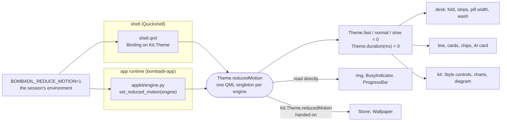

# Motion, and reduced motion

Everything on Bombadil's screen that moves means something (the design system's motion section: the stone rolls
while the machine works, a card folds out of the way of a window, a new row washes its colour in). This page is
the other half of that rule: a person can ask the computer for less motion, and then everything that moves
stops moving, and says the same thing without it. It is one switch, `Theme.reducedMotion`, read by the shell,
the desk, the app kit and every app, and a test that fails when a new animation forgets it.

## The rule

1. **Every movement has a still version.** Under reduced motion nothing slides, fades, grows, sweeps, spins or
   breathes. A change happens at once. What used to say "working" with a roll says it with one pulse of
   opacity instead (1 to `pulseLow` and back, 500 ms each way). That pulse, and the stone's fade when a turn is
   done, are the only movement that stays: a machine at work with nothing alive on the screen reads as a frozen
   one.
2. **One switch.** `Theme.reducedMotion` in the kit's `Theme.qml`, a writable bool, false until something sets
   it. The shell and the app runtime set it from `BOMBADIL_REDUCE_MOTION=1`; nothing else reads the variable.
3. **The tokens carry it.** `Theme.fast`, `normal` and `slow` (120, 200 and 300 ms) read 0 under reduced motion,
   so a component that animates with the design's durations honours the switch with nothing more, and so does a
   `Behavior` in an app the agent wrote. `Theme.duration(ms)` is `ms` or 0, for a duration that is not one of
   the three.

Why a switch at all: some people feel sick, lose their place or cannot read while a screen moves; a remote or
software-rendered session (the VM, a thin client) shows motion as stutter; and on this desk motion means "the
machine is acting", so motion that is only decoration is noise. The widgets brief already asked for it ("with
reduced motion all of it is instant"); before the switch lived in the Theme, only the stone and the wallpaper
honoured it.

## Turning it on

Set `BOMBADIL_REDUCE_MOTION=1` in the environment the session starts with. `hyprland.lua` imports that
environment into the user manager before it restarts agentd and the shell, and agentd starts apps with its own
environment, so the bar, the desk and every app see it. Anything other than `1` is off. From a checkout:
`BOMBADIL_REDUCE_MOTION=1 bin/bombadil-shell`, and the same in front of `bombadil-app run <name>` or
`bombadil-app check <name>`.

On the installed image the session starts from greetd with no login screen, and the image's
`/etc/environment` is where a session-wide variable goes (it already carries `BROWSER`): add the line
`BOMBADIL_REDUCE_MOTION=1` and start the session again. The image sets nothing for it today, and this route has
not been tried on a booted image.

The shell and the runtime read it once, when they start. The property itself is live: whatever sets it, every
surface follows at once (the tests do exactly that).



A QML singleton is one instance per `QQmlEngine`. In Quickshell the bar, the desk and the wallpaper share one
`Kit.Theme`, the one the `Binding` writes. Each app is its own process with its own engine: `make_engine` in
`src/bombadil/appkit/engine.py` sets the property right after it adds the kit to the import path, with
`engine.singletonInstance("Bombadil", "Theme")`, which also makes the instance. A hot reload clears the
component cache but keeps the engine, so the instance, and the switch, stay. `bombadil-app check` goes through
the same `make_engine`, so a check sees what the window sees.

## What every surface does

| Surface | Normally | Under reduced motion |
|---|---|---|
| The stone, working or starting | rolls a third of a turn, once a second | one opacity pulse, 1 to 0.3 and back |
| The stone, needs you | two knocks and a breathing glow, 1.6 s beat | holds still, glow held at 0.45 |
| The stone, done | one hop | fades in from 0.3 over 600 ms |
| The stone, listening | leans toward the text over 240 ms | leans at once |
| The wallpaper | the picture settles in over 300 ms | there at once |
| A desk card folding or unfolding | opacity and scale, 150 ms out, 400 ms back | instant; the 400 ms wait before it returns stays, it is a delay |
| A strip a card folded into | fades in over the fold's 150 ms | there at once |
| The pill's width | eases over 150 ms as cards and windows come and go | instant |
| A new row on a card | its colour washes the card's left edge for 600 ms | no wash; the row is there |
| The ring around a live dot | breathes from small and strong to large and gone, 2 s | holds still, at 1.2 times and 60 % |
| The line above the pill, the picture above it, the AI card, the chips | fade 200 ms, grow 120 ms, border colours 120 to 300 ms | instant |
| The bar's app chips and the pill's border | colour eases over 150 and 300 ms | instant |
| Style controls (buttons, switches, checkboxes, sliders, fields, tabs, menus, popups, dialogs, tooltips, stack pushes, scrollbars fading) | 120 to 200 ms fades, slides and colours | instant |
| A scrollbar hiding | waits 600 ms, then fades | waits 600 ms, then hides; the wait is not movement |
| `BusyIndicator` | an arc turns | the arc holds still and pulses, as the stone does |
| `ProgressBar`, indeterminate | a segment sweeps across | the segment holds in the middle and pulses |
| Charts, meters, rings, the diagram | bars grow, axes ease, boxes slide | instant |
| Brain and Mail (built-in apps) | draw no animation of their own; the kit's controls move as above | the same stills |

Not movement, so not touched: the desk's clock that ticks a counter every second, the line's 12 s stay, the
Send button's arming delay in Mail, a toast's time on screen. A Timer that only counts or waits stays; one that
steps a picture is an animation and takes the rule (below).

What the switch does not reach:

- **The compositor's own slides.** Windows, panels and their fades are Hyprland's animations, set in
  `iso/airootfs/etc/skel/.config/hypr/hyprland.lua` (`animations`, the `windows`, `specialWorkspace` and `fade`
  leaves). Nothing there reads the variable yet. This is the biggest remaining movement: an app sliding in from
  its drawer. It needs a real compositor to try, so it is listed as open rather than guessed.
- **The toolkit's own feel**: touch and wheel scrolling inertia, and the text cursor's blink, are Qt's.

## How to honour it in a new component

1. **Animate with the tokens.** `Behavior on opacity { NumberAnimation { duration: Theme.normal } }`. In the
   shell the kit is imported as `Kit`, so `Kit.Theme.normal`. That is all; it is 0 under reduced motion.
2. **A duration of your own** goes through the helper: `duration: Theme.duration(140)`. The desk's durations
   live in `DeskTheme.js`, a library of plain values that cannot import the Theme, so the desk wraps them where
   it uses them: `duration: Kit.Theme.duration(T.washMs)` (with `import Bombadil as Kit`).
3. **A loop, a spinner, anything whose motion is the point.** Gate it: `running: busy && !Theme.reducedMotion`,
   and give it a still version. For "working" the still version is the pulse the stone uses
   (`SequentialAnimation` on opacity to `Theme.pulseLow` and back, 500 ms each way, `onStopped` putting the
   opacity back). `Style/BusyIndicator.qml` and `Style/ProgressBar.qml` are the examples.
4. **A component that is handed the switch** (`Stone` is one) declares
   `property bool reducedMotion: false` and its user binds it: `reducedMotion: Kit.Theme.reducedMotion`. Its
   animations are gated on its own property, so a test can drive it without a Theme.
5. **A `Timer` that moves something** (a typewriter, a carousel step) is an animation: gate it, and show the
   end state at once.
6. **A wait that is not movement** (a `PauseAnimation` before something hides) may keep its literal duration:
   add it to `ALLOWED` in `tests/test_motion.py` with the reason.

## How to test it

- **The guard.** `test_no_animation_ignores_reduced_motion` reads every `shell/*.qml`,
  `share/qml/Bombadil/**/*.qml` and `share/apps/**/*.qml` and looks at each `Behavior`, `Transition` and
  animation's own lines. A leaf animation (`NumberAnimation`, `ColorAnimation`, `PropertyAnimation`, an
  Animator, `SmoothedAnimation`, ...) passes only with a `duration` of 0, from the Theme (`Theme.fast`,
  `Theme.duration(...)`) or that reads `reducedMotion`. A duration from anywhere else fails, whether it is a
  literal, a property or a `DeskTheme.js` value (`T.washMs`), and so does no duration at all and a
  `SpringAnimation`. So does `loops: Animation.Infinite`. Each passes when the animation, or one around it, is
  gated: its own `running`, `enabled` or `when` reads `reducedMotion`. A `reducedMotion` somewhere else in
  the same block gates nothing. A wait in `ALLOWED` passes, and the list counts its entries, so a stale one,
  or one that now covers a second wait, fails. `test_the_guard_catches_what_it_is_for` runs the same check on
  snippets, so the guard cannot go quiet without a test failing. It does not see a `Timer` that animates, an
  animation written in JavaScript, or an app the agent writes later; those depend on the rule above.
- **A surface, in both modes.** The Theme is a singleton per engine, so a test sets it on its own engine and
  restores it:

  ```python
  theme = engine.singletonInstance("Bombadil", "Theme")
  theme.setProperty("reducedMotion", True)
  ```

  Make the animated mode visible by slowing the animation (the desk tests set `foldMs` to 400 or `pillAnimMs`
  to 2000), change the state, and read the property straight away: instant is the final value, animated is in
  between. `tests/test_motion.py` does this for the fold, the strips, the pill, the wash and the ring, with
  the same assertions on the animated side so a surface cannot go instant for everyone.
- **Through the runtime.** The variable in the child's environment, and `make_engine` does the rest:
  `test_the_runtime_sets_the_theme_from_the_variable` (an app's own QML sees `Theme.reducedMotion` and a hot
  reload keeps it), `test_check_still_works_with_reduced_motion_and_the_app_sees_it`, and the BusyIndicator and
  ProgressBar tests through the kit's driver.
- **Run it:** `QT_QPA_PLATFORM=offscreen python3 -m pytest tests/test_motion.py -q -p no:cacheprovider`, then
  the desk's own tests (`test_desk_qml.py`, `test_desk_cards_qml.py`, `test_desk_drag_qml.py`) and
  `test_stone_qml.py`, which share the files.

## What was decided, and what is open

- **The tokens read 0, instead of every component checking.** One place carries the rule, a component that uses
  the tokens cannot forget it, and an app the agent writes from the skill's `Theme.fast` gets it too. The cost
  is that `fast`, `normal` and `slow` are durations of animations only: a delay that is not movement uses a
  number of its own, never a token. `tests/qml_theme.py` still reads them as 120, 200 and 300, the design's
  values.
- **The desk takes the helper, not the tokens,** because its durations are `DeskTheme.js` values (150 ms for a
  fold, 600 ms for a wash) that are not the design's three, and the tests tune them (`foldMs`, `pillAnimMs`).
  `Kit.Theme.duration(...)` wraps each one where it is used, one line a place.
- **A ring holds still, a wash does not show.** A ring is a second sign that something is live, so it keeps a
  still version; a wash is the same fact as the row arriving, so at zero length it adds nothing.
- **Open: the compositor's slides** (above), and a way to flip the switch while the shell runs, such as a word
  for it; today it takes a restart of the shell and agentd.
- **Not tried here:** Quickshell itself. The shell's `Binding` is the one construct the offscreen tests cannot
  run in its own engine; they load the very line from `shell.qml` in a plain QML engine and see the Theme
  change. A real session (`tests/desktop/run.sh`, or the VM) is where to look at it.
