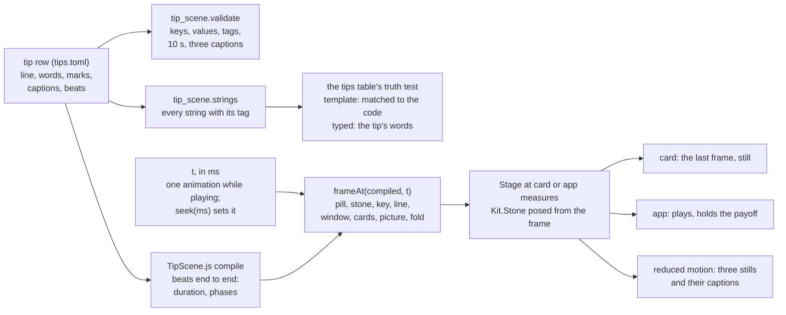

# Tip scenes

A tip is shown on a small copy of Bombadil's own screen: the pill, the line above it, a window, a desk
card. The Tips app plays it once and holds the last frame; the desk's Tips card shows that last frame as a
still poster. Both are drawn by one component, `Kit.TipScene`, from a short list of beats. This page is how
that works and the exact vocabulary a beat is written in. Why a tip moves at all, and how little, is in
[`design/tips-and-desk-defaults-brief.md`](design/tips-and-desk-defaults-brief.md) ("How a tip moves").

## The pieces

| File | What it is |
|---|---|
| `share/qml/Bombadil/TipScene.qml` | `Kit.TipScene`: draws the frame at the card's measures (a poster) or the app's (plays). Pure QtQuick: `Theme`, `QtQuick.Shapes` and `Kit.Stone`, with `font.family` set on every Text. Internal: not in the apps skill, and `bombadil-app check` refuses it in an app the agent writes. |
| `share/qml/Bombadil/TipScene.js` | A `.pragma library` that says what is on the mini screen at any time `t`: `compile(beats)` lays the beats end to end, `frameAt(compiled, t)` returns the frame. It draws nothing and runs nothing. |
| `share/qml/Bombadil/Stone.qml` | `Kit.Stone`, the mark: the pill's stone and the scenes' stone. See [The stone in the kit](#the-stone-in-the-kit). |
| `src/bombadil/tip_scene.py` | The same vocabulary and timing for Python, standard library only, and the validator. The tips table's tests call `validate(tip)` on every row. |
| `tests/tip_fixtures.py` | Thirteen tips written for the tests, which between them use every beat, key and modifier. |
| `tests/test_tip_scene_qml.py`, `tests/test_tip_scene.py` | The renderer's frames, sizes and "nothing runs" tests, and the validator's. |

## Why storyboards, not video

A recorded clip is true by construction, but it is heavy, blurry at 300 px, stale the day the look changes,
and needs a video player in the shell. A storyboard is a few lines of text per tip, drawn live from the theme's
tokens, so it is always in the current look and crisp at any size. The price is that it can lie: it could show a
line the real machine never says. The truth rule below is what pays for that.

## From a tip row to a frame



A scene is a function of its clock. The frame at any `t` is drawn from the beats alone, so a test or a still asks
for it without waiting, and the same `t` is the same picture every time. The one thing that moves is `t`, advanced
by a single `NumberAnimation` that exists only between `play()` and the end. There is no timer, no `Behavior` and
no loop in the scene, and the mini stone is a `Kit.Stone` with `animate: false` whose pose (`turn`, `knock`,
`lean`, `hopY`, `hopSx`, `hopSy`, `glowOpacity`) the scene writes from the frame.

## Using it

```qml
TipScene { tip: row; density: "card" }                                    // the desk card's poster
TipScene { tip: row; density: "app"; reducedMotion: Theme.reducedMotion
           onFinished: replayButton.enabled = true }                       // the Tips app's stage
```

| Property or function | |
|---|---|
| `tip` | A row of the tips table, or any `var` with `line`, `words`, `marks`, `captions` (three) and `beats`. |
| `density` | `"card"` (the default) or `"app"`. |
| `reducedMotion` | Default `false`. The host binds it to `Theme.reducedMotion`; the scene does not read the theme itself. |
| `t` | The clock in ms. Writable. Setting `tip` puts it back at 0 and stops the clock. |
| `duration` | Readonly. Where the last beat ends, in ms. |
| `phase` | Readonly, 0 to 2: the caption that is current. |
| `playing` | Readonly. True only between `play()` and the end. |
| `frame` | Readonly. The frame at the clock, as plain data (what the tests read). |
| `play()` | Plays from `t` (from the start when `t` is at the end) and emits `finished` at the end, where it holds. On the card and under reduced motion nothing plays: it settles on the last frame at once and emits `finished`. |
| `replay()` | `seek(0)` then `play()`. |
| `seek(ms)` | Stops the clock and puts it at `ms`, clamped to the scene. |
| `finished` | The scene reached its last frame. |

## The two densities

| | Card (the poster) | App (the stage) |
|---|---|---|
| Size | 272 x 153, radius 8 | 576 x 324, radius 12, and the captions in a row under it |
| Ground | the sunken surface with the wallpaper's two faint glows | the same |
| Moves | never: it shows the last frame whatever `t` is | plays once and holds the last frame |
| Stone | the 16 px drawing, in ink (`fg`, no state colour) | the 24 px drawing in its real colours, orange only where it acts |
| Pill | 32 px | 52 px |
| Text | 12 px, never smaller | 16 px; the line is 15 px; captions 12 px |
| Line buttons | unlabelled outlines (no Undo sits on a widget) | labelled |
| Counter | none | the seconds, while the stone works |
| Pictures of the machine | generic shapes: no names, numbers or values | the names and the figures |
| Captions | none | three, in a row under the stage, the current one in `fg` |

**Reduced motion** (app density) draws three stills side by side instead of a stage, each the last frame of its
phase with its caption under it, and `play()` settles at once. A phase that ends on Enter is drawn before
the key lands, so its still has the words in the pill. Each still is the card's measures shrunk to a third of
the scene's width: 576 by default, so a thumbnail at 0.68, and a host that gives the scene 840 px or more gets
them at full size with 12 px text. On a still the line buttons are unlabelled outlines, as on the card.

**A line is one line.** It never wraps, so nothing under it is covered; one that does not fit is elided. The
words keep their room first, then the buttons, then the counter, and the command takes what is left or is left
out. On the card, at 12 px, a line holds about 36 characters, or about 29 beside the two buttons. The tests
fail on any fixture line that is elided at either density, and the same loop is the check for the tips' own
lines.

## The nine beats

A scene is a list of beats, played one after the other. A beat is a table. Its drawing keys say what happens, its
modifier keys say how; the keys of one beat happen together, so the beat lasts as long as its longest one, and
`hold` adds a pause after it (alone, it is the pause).

| Beat | What it draws | Modifiers |
|---|---|---|
| `key` | a keycap pressed: `super`, `enter`, `esc`, `tab` or `bang` | `phase` |
| `type` | words typed into the mini pill, 25 characters a second | `ghost`, `phase` |
| `stone` | the stone takes a face: `rest`, `listening`, `working`, `needs`, `done`, `stopped` or `resting` | `phase` |
| `line` | the line above the pill; `""` clears it | `tag`, `tone`, `command`, `counter`, `buttons`, `phase` |
| `window` | an app window slides in from its drawer (a title); `false` or `""` slides it out | `tag`, `rows`, `columns`, `lock`, `doc`, `reload`, `from`, `phase` |
| `card` | a desk card: `watching`, `now` or `machine` | `tag`, `rows`, `title`, `why`, `phase` |
| `picture` | a picture card above the line (its title) | `tag`, `boxes` or `bars`, `lit`, `phase` |
| `fold` | the desk's cards fold to strips (`true`) or come back (`false`) | `tag`, `strips`, `phase` |
| `hold` | a pause, in ms | `phase` |

A beat needs at least one drawing key, and a modifier needs a drawing key it goes with. The validator says so.

### The vocabulary, key by key

| Key | Takes | Meaning |
|---|---|---|
| `key` | `super`, `enter`, `esc`, `tab`, `bang` | Drawn as the marks ⊞, ↵, Esc, Tab and !. It comes in, is down from about 100 ms to 260 ms, where its effect lands at 120 ms, and is gone by 360 ms. `super` makes the stone lean toward the text; `enter` sends what is in the pill, which empties it; `tab` takes the faint completion. |
| `type` | a string | The words, typed from the first character at 25 a second and then 240 ms of rest. What is typed is the tip's own words, so it is `typed` and needs no `tag`. |
| `ghost` | a string | With `type`: the faint completion that follows the typed words once they are all in. |
| `stone` | `rest`, `listening`, `working`, `needs`, `done`, `stopped`, `resting` | The stone's face. `working` rolls a third of a turn a second, `needs` knocks twice on a 1.6 s beat with the glow breathing, `done` hops once, `listening` leans six degrees toward the text, `stopped` is the grey square, `resting` the hollow grey stone, `rest` stands still. While the scene plays the stone shows the motion; on its last frame it stands still in its face. |
| `line` | a string | The line above the pill. Needs a `tag`. |
| `tag` | `template`, `typed`, `model`, `output`, `caption` | Where the beat's strings come from. See [The truth rule](#the-truth-rule). |
| `tone` | `amber`, `red` | The line's marked edge: amber for a step that touches the system, red for one no restore point can undo. On the card it is drawn in ink. |
| `command` | a string | With `line`: the command, in mono. |
| `counter` | `true`, `false`, or a number of seconds | With `line`: the seconds counter, which counts while the stone works. A number starts it from there. `false` stops it. |
| `buttons` | one or two labels, such as `["Undo", "Details"]` | With `line`: the line's buttons. They are tagged `template`. |
| `window` | a title, or `false` or `""` | An app window slides in from its drawer in 300 ms. A title with `reload` and a window already open changes it in place. |
| `rows` | strings, or `[label, value]` lists | With `window`: its rows, arriving 200 ms apart. With `card`: its rows (see `card`). |
| `columns` | `[heading, cell, cell, ...]` lists | With `window`: columns added to the rows, one every 200 ms. |
| `lock` | a string | With `window`: the window shows its lock screen with these words instead of rows. |
| `doc` | `true` or `false` | With `window`: its body is a document, a few lines, not rows. |
| `reload` | `true` or `false` | With `window`: the window is already open and reloads in place, with no slide. |
| `from` | `bottom`, `left`, `right` | With `window`: the edge it slides in from. `bottom` is the default. |
| `card` | `watching`, `now`, `machine` | A desk card arrives (the desk's own fade and scale from 0.6 over 150 ms), or, if it is already there, changes in place. Fields not named again keep what they had. |
| `title` | a string | With `card`: its title. Now's is the task. |
| `why` | a string | With `card`: the small line under the title ("step 2 of 3"). |
| `picture` | a title | A picture card above the line. On the card the title is not drawn. |
| `boxes` | a list of names | With `picture`: boxes streaming in, one every 320 ms, joined by arrows. |
| `bars` | `[label, percent]` or `[label, percent, "amber"]` lists | With `picture`: bars that grow, one every 320 ms, as a disk does. |
| `lit` | an index | With `picture`: the box or bar that is lit. |
| `fold` | `true` or `false` | The cards fold to strips beside the pill, or come back. |
| `strips` | a list of labels | With `fold`: what the strips say ("1 counting"). Needs a `tag`. |
| `hold` | milliseconds | A pause. With another key it adds to that beat. |
| `phase` | `1` or `2` | On the beat that opens the second and the third caption. Give both, in order, or neither: with none, the phases are thirds of the scene. |

Rows by card:

| Card | A row is | The value |
|---|---|---|
| `watching` | `[label, value]`: a job and its reading, such as `["Timer, 25 min", "24:59"]` | any string |
| `now` | `[label, state]`: a step of the route | `done`, `current` or `next` |
| `machine` | `[label, meter]`: a reading and how full it is | a whole number, 0 to 100 |

### An example

```toml
beats = [
  { key = "super" },
  { type = "Make me a ticketing app" },
  { key = "enter", phase = 1 },
  { stone = "working", line = "On it", tag = "template", counter = true },
  { line = "Building Tickets, 140 lines", tag = "template" },
  { window = "Tickets", tag = "model", rows = [["Printer jams on floor 3", "High"]], phase = 2 },
  { line = "Made Tickets. It is open now.", tag = "model", buttons = ["Undo", "Details"], stone = "done" },
]
```

## Timing

A scene runs 6 to 8 s and never over 10: `validate(tip)` reports one over 10 s, and `validate(tip, strict=True)`
holds a shipped tip to 6 to 8 s. The numbers are in `tip_scene.py`, mirrored in `TipScene.js`, and
`test_the_renderer_keeps_the_same_timing_as_the_validator` fails if they drift apart.

| What | Takes |
|---|---|
| `key` | 360 ms, in the 300 to 400 the brief asks for |
| `type` | 40 ms a character (25 a second) and 240 ms of rest |
| `stone` | `done` 700 ms (the hop), `needs` 1600 ms (one beat of knocks), `working` 600 ms, the others 300 ms |
| `line` | 900 ms, the first 200 a fade; clearing one takes 200 ms |
| `window` | 300 ms to slide on (none for a `reload`), 200 ms per row and per column, then 300 ms to read; sliding out takes 300 ms |
| `card` | 800 ms: 150 ms of arrival and a pause |
| `picture` | 300 ms to slide on, 320 ms per box or bar, then 600 ms to read |
| `fold` | 1000 ms, the fade 150 ms |
| `hold` | what it says |

Slides take 300 ms on the system's curve, (0.16, 1, 0.3, 1), which does not overshoot; fades take 200 ms. Nothing
bounces and nothing loops. Every scene ends on its payoff frame and holds it for ever: that frame is the
reduced-motion still and, drawn at card density, the card's poster.

Captions: three per tip, at most three words each, one for each phase. The phase that is current is the one the
clock is inside.

## The stone in the kit

`Kit.Stone` (`share/qml/Bombadil/Stone.qml`) is the mark, drawn and animated. It moved out of `shell/` because a
second place draws it, and it is internal for the same reason `TipScene` is. The pill uses it as it always did.
Three properties are new, each defaulting to what the pill needs:

| Property | Default | |
|---|---|---|
| `animate` | `true` | `false` gates every animation and the settle timer: the stone is painted at once in its face's colour, and its pose is plain values the host writes. Nothing runs. This is how a scene draws it one frame at a time. |
| `ink` | `""` | `"fg"` or `"muted"` draws the stone, its glow, square, outline and dashes in that ink, with no state colour: for use outside the pill. |
| `small` | `false` | The identity brief's 16 px drawing: the stone full-bleed and the b cut as the brand's own outline, the path in `bombadil-symbolic.svg`. The card's mini pill uses it. |

The geometry and the tests that hold it are in [`brand/README.md`](brand/README.md#stone-in-the-kit); the look is
in the [identity brief](design/identity-brief.md). The stone keeps its own `reducedMotion`, default `false`.

## The truth rule

A storyboard must not show what the real machine would not say. So every string a scene shows carries a tag, and
a beat with strings (`line`, `window`, `card`, `picture`, a `fold` with `strips`) needs its `tag`:

| Tag | The string is | Checked by |
|---|---|---|
| `template` | a sentence the code really says, placeholders filled ("Building Tickets, 140 lines") | matched whole against the sentences in the code, so it fails the day one changes |
| `typed` | the tip's own words, what the button puts in the pill | `type` beats are always `typed`; compared with the tip's `words` |
| `model` | a reply in the agent's register, at most four plain lines | read by a person: it is a plausible answer, not a fixed one |
| `output` | a command's example output, drawn in mono | read by a person |
| `caption` | one of the three phase captions | at most three words |

`tip_scene.strings(tip)` returns every string a scene shows as `(tag, text)`, the captions included, for the tips
table's own tests. Button labels are `template`. A row's string value (`"High"`, `"24:59"`) is read with the
row's tag; a number is a meter and is not text.

## Tests

- `tests/test_tip_scene_qml.py` draws the fixture tips offscreen and grabs frames at chosen `t`: every beat kind,
  the poster being the last frame, the card's sizes and 12 px floor, no words or numbers in a poster's machine
  pictures, the stone's colours and ink, the app's measures, reduced motion's three stills, that nothing runs
  while the scene is not playing (no running animation or timer anywhere under the window), that `play()` runs
  one animation, emits `finished` once and holds, and that every line fits on one line.
  Set `BOMBADIL_SCREENS=<dir>` to save pictures of the frames.
- `tests/test_tip_scene.py` tests the validator: unknown keys, bad values, strings without a tag, over 10 s, the
  wrong number of captions; and that the renderer's JS keeps the timing and vocabulary the validator keeps.
- `tests/test_stone_qml.py` holds the stone: its faces, its pose, `animate`, `ink`, the 16 px drawing.
- `tests/test_appkit_internal.py` holds that `bombadil-app check` refuses `Stone` and `TipScene` in an app.

## Writing the beats for a tip

1. Say the tip in three phases (you ask, it works, you have it) and give each a caption of at most three words.
2. Write the beats, putting `phase = 1` and `phase = 2` on the beats that open the second and third phase.
3. Tag every string. Anything the code says is `template`, and it has to be the real sentence.
4. Run `validate(tip, strict=True)`: it names the beat that is wrong, and says if the scene is not 6 to 8 s.
5. Look at the poster and the stage with `BOMBADIL_SCREENS`. The poster is the last beat's state, so end on the
   payoff, and keep a line short enough for the card.
