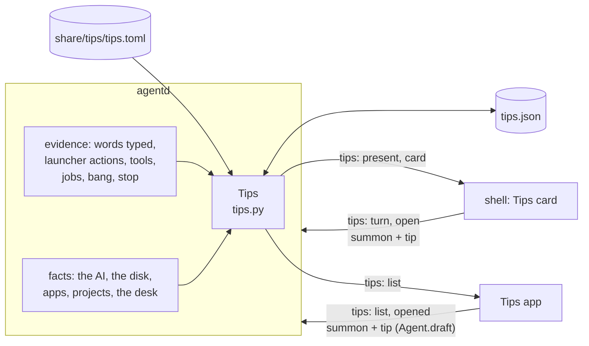
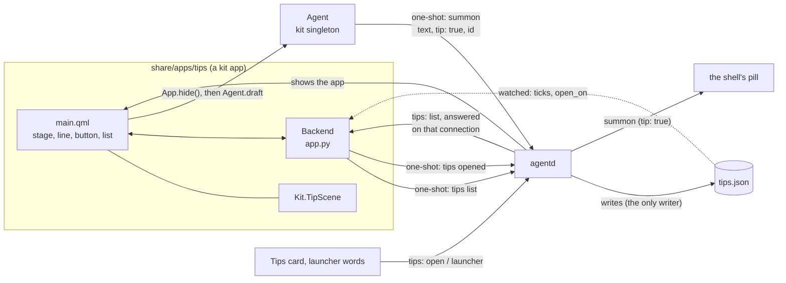

# Tips

Tips teaches a new person what they can ask, one line at a time, and only what this machine can really do.
Why it looks and behaves the way it does is in
[`design/tips-and-desk-defaults-brief.md`](design/tips-and-desk-defaults-brief.md); read its "Tips' own rules"
first, because every piece below is built to them. This page is how the data side is built and how to extend it:
the table of tips, what agentd knows about them, what counts as tried, and the messages the card and the app are
fed by. The two things a person sees have their own sections at the end of this page:

- [the **Tips app**](#the-tips-app) (the window where each tip plays), and
- [the **Tips card**](#the-tips-card-on-the-desk) on the desk (the still card of a new person's first week).

The scenes a tip plays are drawn by `share/qml/Bombadil/TipScene.qml`, and every row of the table ships with its
scene; how to write the beats of a tip, the whole vocabulary, the twenty scenes and the test that fails when a
scene is not true are in [`TIP-SCENES.md`](TIP-SCENES.md).

## The rules the code keeps

| Rule (the brief's) | Where it is kept |
|---|---|
| A tip is one line, one picture and the exact words | `tips.toml` has one `line`, a `words` and a scene per row; `tests/test_tips.py` measures every line at 13 px Inter against the card's 272 px, and the button with "All tips ›" beside it. |
| A tip is true on this machine | `needs` gates and `{app}`, `{project}`, `{ai}` placeholders: a tip whose gate is not met or whose placeholder cannot be filled is not in the list, not on the card, and not in the app, even greyed (`tips.backed`). |
| A tip's scene shows only what is true | Every string in `beats` carries a tag. A `template` string is held whole to a sentence the real code says, what is typed is the tip's own words, and a reply is a plain agent's: `tests/test_tip_truth.py`. A real line that changes fails there, in the scene that shows it. |
| Nothing runs on a click | agentd only *remembers* the words a button put in the pill (`summon` with `tip: true`); a tip is tried when the person's own Enter sends them. |
| It never speaks | Tips has no line, no mark and no sound; its one message is data for a card the person can ignore. agentd sends it only when it changed. |
| It steps aside | seven days of typing in the pill, or six Start-here tips tried, and `present` goes false (unless the person keeps Tips). A tip that came with an update waits in the app (`new`) and is never put on the card unasked. |
| The agent never writes tips | The table is a file in the repository, loaded by agentd. No tool, skill or turn can add a row. |

## The pieces

| File | What it is |
|---|---|
| `share/tips/tips.toml` | The twenty seed tips, one `[[tip]]` row each, each with its scene in `beats`. The only place a tip's words live. |
| `src/bombadil/tips.py` | Loads and checks the table, decides which tips this machine can back (`Facts`, `backed`), fills the placeholders, keeps `tips.json`, picks the card, counts tips as tried. Standard library only; every file it reads and the clock are parameters, so the tests hand it text and a date. |
| `src/bombadil/agentd.py` | Owns one `Tips`. Tells every client the `tips` message when it changed, answers the shell's `tips` ops, remembers a button's words, and feeds `Tips` the evidence it sees (the words typed, a launcher action, a tool, a job, a `!` command, a stop). |
| `src/bombadil/paths.py` | `tips_file()` (`~/.local/state/bombadil/tips.json`) and `tips_table()` (`share/tips/tips.toml` beside the package). |
| `packaging/bombadil/root/usr/bin/bombadil-install` | Copies `tips.json` and `desk.toml` to the installed disk with the sign-in, so the first week does not begin again after an install. |
| `share/apps/tips/` | The Tips app: a built-in kit app, the window where each tip plays. Its own section is below. |
| `src/bombadil/launcher.py` | `TIPS_COMMANDS`: the words that open the app, and `APP_WIDGETS`, made from it: the desk widgets whose open words are the app's ([one word, two owners](#a-kept-tips-card)). |
| `src/bombadil/appkit/native/agent.py` | `Agent.draft(text)`: the app's button. |
| `tests/test_tips.py`, `tests/test_agentd_tips.py`, `tests/test_installer.py` | The table, the gates and the card, and the twenty scenes drawn; agentd's side; the installer's copy. |
| `tests/tip_truth.py`, `tests/test_tip_truth.py` | The sentences the real code says, made by calling it, and every string of every scene held to them ([`TIP-SCENES.md`](TIP-SCENES.md#the-truth-test)). |
| `tests/test_tips_app_backend.py`, `tests/test_tips_app_qml.py`, `tests/tips_app_lab.py` | The app's backend and its window, and the fake agentd they stand on. |



## The table

One `[[tip]]` row per tip, written in the teaching register of `design/voice-brief.md`: one line, no name, no
exclamation mark, no em-dash, no "will", "tomorrow" or "later".

| Field | Meaning |
|---|---|
| `id` | Unique, kebab-case, **never reused once shipped**. `tips.json` remembers ids, so a reused id would look tried. |
| `section` | `start`, `work`, `code` or `machine`: Start here, Work, Code, This machine. |
| `order` | A whole number, fixed inside the section. The card and the app never shuffle. |
| `line` | The one line. At most 272 px at 13 px Inter (the card's row is 300 minus 14 px each side). Placeholders count at their filled length, so the filler is limited too. |
| `words` | Exactly what the button puts in the pill. `""` when the tip has no button (its words only make sense mid-turn). A trailing `…` means "more follows": "In {app}, add…" is tried by "In Tickets, add a due date". |
| `marks` | Words or keys drawn as marks instead of a button (`["Esc"]`, `["why"]`). |
| `needs` | Gates, all of which must be met (below). |
| `card` | `true` by default. `false` when the tip's button does not fit the card's row (the button, its inset and "All tips ›" must fit 272 px): only the app shows it. |
| `tried_when` | Evidence agentd matches against its own live events (below). |
| `captions` | Three phase captions of at most three words, under the stage in the app and beneath the three stills under reduced motion. "You ask", "It works", "You have it" unless the brief words a tip's own (it does for the first tip only: "You ask", "It builds", "You have it"). Like the lines, they are proposals for the voice thread. |
| `beats` | The scene: a list of beats, 6 to 8 s, every string tagged (`TIP-SCENES.md`). Every shipped row has one, and `tests/test_tips.py` fails on a row without. The loader still accepts `beats = []` (a row being added), and the card then has no poster to draw. |

`load_rows` checks every row and **leaves out** a bad one instead of half-using it (a wrong gate, captions that are
not three, evidence nothing sees, a second row with a used id, a field that is not in the table above, so a typo
such as `need` cannot leave a tip ungated, and `beats` holding a value JSON cannot carry, such as a date, which
would otherwise fail every client that connects). The problems go to agentd's stderr. A table that cannot be read
gives no tips, and agentd goes on.

### Gates

A tip is shown only where every gate in `needs` is met (the brief's rule 2). `Facts` holds the machine's side.

| Gate | Met when |
|---|---|
| `model` | an AI is chosen and not signed out (agentd's `access` is `ready` or `resting`). While the AI rests the list does not change: the tips still fill the pill. |
| `installed` | the machine has an installed disk with restore points (`snaps.available`): undo works. Not the live USB. |
| `app` | there is an app in `~/Apps` whose name fits a button. |
| `project` | there is a folder in `~/Projects` whose name fits a button. |
| `sessions` | the coding-sessions code is on this machine. |
| `mail` | the mail tips' code is on this machine (false until a tip needs it; the PR that ships it flips the fact). |
| `noticed` | the self-improvement code is on this machine (as `mail`). |
| `keep` | the desk can keep a widget: true, since the desk's piece 2 (`kept` in `desk.py`, the word "widgets" and the Widgets card, [the desk page](architecture/desk.md#your-desk-keep-when-needed-off)). The "Keep a widget on your desk" tip is tried by the launcher word `widgets` (`local:widgets`). |
| `desk-seen` | a desk card other than Tips has been on the screen. agentd sees the Machine card present, a plan of two steps, a step that touches the system or a job on the desk, and remembers it in `tips.json`. |

### Placeholders

`{app}` is the title of the newest app in `~/Apps` (the one whose `main.qml` was written last), falling back to
its folder name. `{project}` is the newest folder in `~/Projects` (a dot folder is not one). `{ai}` is the name of
the AI in use. A tip whose placeholder cannot be filled is not backed.

The names come from the machine, and a name goes into the pill as words: an app the AI wrote could be called
anything. So a name is used only when it starts with a letter or a digit (never `!` or `~`, which would turn it
into a shell command or a path), holds only letters, digits, spaces and a few marks, and fits 18 characters (apps)
or 24 (projects). A name that does not fit is left out and the next newest is used; with none, the tip is not
backed.

An `{app}` is also never a title the launcher answers as a command. The launcher reads "lock", "desk", "history",
"mail", "restart" and the like before it looks at apps, so for an app called Lock the button "Lock" would lock the
screen, and the tip "Type an app's name to open it" would be untrue. Such an app is skipped (its folder name stands
in when typing that opens it) and the next newest is used (`tips.newest_app` asks `launcher.match`).

The limits are in characters, not pixels, so a very wide name can still overflow the card's row on tips 7 and 8
(`In MMMMMMMMMMMMMMMMMM, add…` is wider than the card). **The card must elide the button's words** rather than
trust the test, which measures one sample name, "Customer Dashboard"; ordinary names fit.

### Marks and the card

A tip with `marks` and no `words` has no button; the card draws the marks (the Esc key, the word `why`). Tips 3,
10, 19 and 20 are of this kind: Esc stops a turn, "where did this come from" and "why" and "undo" make sense
mid-turn or after one, so a button that fills the pill with them would teach nothing.

## What the person has been taught: `tips.json`

`~/.local/state/bombadil/tips.json`, outside the restore points so an undo never makes Tips forget. **agentd is
its only writer**; the shell and the app read the messages, never the file (the app may watch it for changes).

```json
{"first_ready": "2026-11-09", "days": ["2026-11-09"], "tried": ["make-an-app"],
 "known": ["make-an-app", "picture"], "open_on": "", "desk_seen": false}
```

| Key | Meaning |
|---|---|
| `first_ready` | The day setup was first ready. The first week begins here. |
| `days` | Days on which the person **typed in the pill** (at most 30 kept). An app's, a helper's or the builder's prompt is not a day of use. |
| `tried` | Tip ids tried. Retired ids stay, so a reused id could never look tried. |
| `known` | Tip ids the person has had in front of them. When setup is first ready every id in the table is known; a tip that comes with an update is `new` until the app lists it. |
| `open_on` | The tip a press on the card asked the Tips app to open on (`""` is its first). The app reads it, and tells agentd it did (`opened`); agentd clears it then, so a press long ago never moves a window that opens later. |
| `desk_seen` | A desk card other than Tips has been on the screen: the tip that folds cards stays once it has been taught. Not in the contract's first shape; it is here because the machine's fact would otherwise come and go with the desk. |

It is written all or nothing (a temporary file, then a rename), so a crash never leaves half a file, and a disk
that will not take it never costs the change: it is held until agentd stops. Anything missing, damaged or edited
by hand falls back for that part; a file that does not parse starts the person as new. `known` missing, or empty, in a
file that has begun means every tip is known, so none is new (an empty list is what a table that could not be
read leaves behind, and it would otherwise hide every tip).

`bombadil-install` copies it, and `desk.toml`, to the installed disk with the sign-in. On the live USB nothing
survives a restart, so every live boot is a first boot.

## What counts as tried

A tip is tried when agentd sees, **with no model**, that the person did it. Showing a tip never counts, and
neither does pressing its button.

| Evidence in `tried_when` | agentd sees |
|---|---|
| `words` | The words sent are the tip's own words (case, spaces and the end's marks aside), however they got into the pill. Also, **unedited**, the words a button put in the pill for that tip (`summon` with `tip: true` and its `id`). A `…` at the end means more after it still counts. |
| `local:<kind>[:<target>]` | A launcher action of that kind ran well: `local:desk`, `local:picture:disks`, `local:app`, `local:undo`, `local:stop`. Closing or hiding an app, hiding a widget and resuming the AI do not count, and a rest counts only when it pauses. A failed action does not count. |
| `tool:<name>` | The turn's tool call of that name worked (its result came back without an error). An MCP tool counts by its short name, so `tool:create_app` is the OS tool whatever its prefix. |
| `job:start[:<kind>]` | A background job of that kind (`job`, `watch`, `timer`) was started. |
| `bang` | A `!` command was typed. |

Evidence is a closed list checked when the table loads (`tips._EVIDENCE`): a row that asks for something nothing
sees is left out, so a tip can never silently be impossible to try.

### Where agentd sees it

| Evidence | Where in agentd |
|---|---|
| words | the `prompt` branch of `handle`, for a prompt the person typed (not an app's `asked_by`, not a `[from app …]` ask), through `_tips_typed` |
| launcher action | the `local` event's `done` phase, ok only, through `local_keys(action, target, verb)`. A press at the desk (the Tips card's x, the Widgets card's parts and Reset) is answered on the line the same way but teaches nothing (`event(..., teaches=False)`): only the word `desk` is the tip "Say desk to fold the cards". |
| a stop | `AgentD.stop(by_person=True)` for a turn that was really running, as `local:stop`: Esc (the shell's `stop`, or `cancel`) and the word "stop". The word with nothing running teaches nothing, and neither does undo, restart, shutdown or the setup card's cancel, which stop a turn too and are not Esc. |
| tool | `_on_event` for a `tool` event, counted when its `tool_result` arrives without an error (`_tips_tool`) |
| job | `_job_tool`'s start, through `job_keys(kind)` |
| bang | `turn()` for a shell command the person typed (a helper's `!` command teaches nobody) |
| desk card seen | the Machine card present, a plan of two steps, a risk step, a job on the desk |

### The card turns after a tried tip

Twelve seconds after the turn that tried a tip ends (`TIPS_TURN_AFTER`; for a word with no turn, after the
word), agentd moves the card to the first tip not tried and sends the new `tips` message. A turn that begins
before then defers it to its own end, so the card never changes under a turn. A turn that tried nothing never
moves the card.

## The card

`Tips.message()` is the one thing agentd says about Tips, and it says it only when it differs from what it said.

```json
{"type": "tips", "present": true,
 "card": {"id": "make-an-app", "line": "Say what you need. It gets made.", "words": "Make me a ticketing app",
          "marks": [], "why": "Start here · 1 of 6", "index": 1, "count": 6, "tip": {"...": "the whole row"}}}
```

`present: false` (with `card: null`) takes the card away. `present` means "Tips has something to say to a new
person": the AI is ready, the person has not put Tips away, and either they keep it or the first week is not over
(fewer than seven days of use) and a Start-here tip is left untried. The shell adds its own conditions (setup,
persona and recovery cards, the welcome line, a turn, a window).

- **Which tip.** The card stays on the tip it is on until it is turned, or until that tip can no longer be backed
  (then the first tip not tried). A first card is the first Start-here tip not tried.
- **Which tips it turns through.** The Start-here tips in the first week. Once the person keeps Tips on the desk,
  every backed tip that has a `card` button. A tip not yet `known` is left out, so nothing new is put on the desk
  unasked.
- **The why line** is the section and the tip's place among the backed card tips of that section ("Start here · 3
  of 6"). It follows the machine: a tip that cannot be backed leaves the count too.
- **`tip`** carries the whole row, captions and beats, so the card draws its still poster without asking.

### Wire protocol

agentd to a client:

| Message | When | Fields |
|---|---|---|
| `{"type": "tips", "present": bool, "card": {...} \| null}` | Once to each client that connects, and to all of them when it changes, never when it did not. | `present` false (with `card` null) takes the card away. `card.id` the tip; `line` its line, `words` the button's exact words (`""` for a tip with marks), `marks` the words or keys drawn in place of a button; `why` the line under the title ("Start here · 3 of 6"), `index` and `count` its parts; `tip` the whole filled row, captions and beats included, so the card needs no second request. |
| `{"type": "tips", "list": [{...}]}` | The answer to a `list`, on that connection only. | One entry per tip this machine can back now, in the fixed order: `id`, `section`, `order`, `line`, `words`, `marks`, `card` (false: only the app shows it), `tried`, `new` (it came with an update and the app has not listed it yet), `captions`, `beats`. |
| `{"type": "summon", "text": "...", "tip": true}` | A tip's button was pressed (below). | The same message every summon is, with `tip: true`. |

Client to agentd:

| Message | What agentd does |
|---|---|
| `{"type": "tips", "op": "turn", "dir": 1}` or `-1` | Turn the card one tip on or back, round the card's tips; sends the message when it moved. |
| `{"type": "tips", "op": "open", "id": "<id>", "play": true}` | Keep the id as `open_on` (an unknown id means the first) and call the Tips app's open hook, which asks the launcher to show the app (`Launcher.open_tips`, in a thread: it asks Hyprland, and says nothing, because Tips never speaks). The app reads `open_on` from the file. |
| `{"type": "tips", "op": "opened", "id": "<id>"}` | The Tips app has read that request. `open_on` goes back to `""` when it still is that id (a newer press stays), so the same press again is a request again. Nothing is answered. |
| `{"type": "tips", "op": "list"}` | A one-shot: agentd answers on that connection only with the `list` message above, the tips this machine can back now. Asking is looking: the ids it listed are `known` after. An app asks, then closes the socket (an open socket would count as a bar for the machine sampler). |
| `{"type": "summon", "text": "...", "tip": true, "id": "<tip id>"}` | A tip's button. agentd remembers the words for that tip, and broadcasts `{"type": "summon", "text": "...", "tip": true}`. With `tip: true` the pill **keeps words the person typed and has not sent** (the Brain's "Ask about this" still replaces them). Only the JSON `true` is true. |

`BOMBADIL_TIPS=0` turns Tips off in agentd (no card is sent, nothing is kept). A `list` is still answered, with an
empty list, so the Tips app says there is nothing to show instead of waiting on a silent socket. The tests that are
not about Tips run that way, so no other test hears a card.

## How a tip is added

**A PR that adds something a person can ask ships its tip row and its scene in the same PR, gated by a `needs`
flag until its code is on main.** It ships them the way it ships its docs: the row says what to ask, the scene
shows it, the gate keeps both off every machine that cannot do it yet, and the PR that puts the code on main
flips the gate's fact in `read_facts`. `CONTRIBUTING.md` carries this line and points here.

1. Add a `[[tip]]` row to `share/tips/tips.toml` with a new id and the next `order` in its section. The row is a
   claim about this machine: put every gate it needs in `needs`, and write `tried_when` from the list above.
2. If it needs a thing the machine may not have, add a gate to `GATES` and its fact to `Facts`, set from
   `read_facts` (a gate that is a piece of code is `find_spec(...)`, so a branch without it hides the tip).
3. Write its scene in `beats` (`docs/TIP-SCENES.md`: "Writing the beats for a tip"), three captions, 6 to 8 s,
   ending on what the tip gives. Type the tip's words. Every sentence the machine says is copied from the code
   that says it and tagged `template`; the agent's replies are `model`. The poster on the card is the last beat's
   state, so there is no still to draw. A new kind of thing to draw is a new beat kind (`TIP-SCENES.md`, "Adding a
   beat kind").
4. Add the test that fails when the scene is untrue. If the scene says a sentence from a function the truth test
   does not call yet, add the call to `tests/tip_truth.py`; if no code says a string yet, name it in `UNTIED` in
   `tests/test_tip_truth.py` with why, and say which change takes it out. A scene is only as true as the test
   that holds it.
5. Run `tests/test_tips.py` and `tests/test_tip_truth.py`. Together they fail on a line that does not fit the
   card, a malformed or reused id, a voice rule broken, a button that does not fit the card's row while `card` is
   true, words that reach nothing, evidence that nothing sees, a row without beats, a scene that is invalid or
   outside 6 to 8 s, a template string that is not a sentence the code says, typed words that are not the tip's,
   and a poster or stage that has text under 12 px or anything clipped.
6. Look at it: `BOMBADIL_SCREENS=<dir>` saves the contact sheets of the twenty posters and stage payoffs and the
   three stage frames of each Start-here tip. An empty poster or a stray colour is seen at once.

To retire a tip, remove its row. Its id stays in `tried` and `known` in the people's files, which is why an id is
never reused for another tip.

## Testing

```
QT_QPA_PLATFORM=offscreen python3 -m pytest tests/test_tips.py tests/test_tip_truth.py tests/test_agentd_tips.py -q -p no:cacheprovider
```

- `tests/test_tips.py` runs the rules over the shipped table (ids, voice, 272 px with Inter, captions, evidence),
  the loader's errors, gating by `Facts`, placeholders and the names read from folders, the state round trip and
  damage, the card (choice, the why line, turning, the first week, keeping), and every kind of evidence. The width
  test measures with Inter at 13 px (Medium for the button); where Inter or PySide6 is not installed it holds the
  line and the card's button to a character count instead (the reverse test, that the app-only tips really do
  not fit the row, needs the font and is skipped). It also holds the twenty scenes: every row has beats that
  validate and run 6 to 8 s (10 at most) and end on their payoff; every `card = true` poster is drawn offscreen
  with no text under 12 px and nothing off it or cut, no machine's names or figures, no stray orange; every tip is
  drawn at the app's density with nothing elided, its words whole in the pill before Enter and no orange where the
  stone is not working; no window cuts what is in it; a card never reads done while the stone works; replaying
  a tip raises no QML error; three stage frames of each Start-here tip differ; and the contact sheets are saved. These need PySide6's QtQuick and are skipped as a test where it is not installed.
- `tests/test_tip_truth.py` is the truth test (`TIP-SCENES.md`, "The truth test"): the sentences the real code says,
  by role, and every `template` string of every scene whole among them; typed is the tip's words; a `model` string
  is at most four plain lines; the voice rules over all of it; the strings no code can be asked for are named.
- `tests/test_agentd_tips.py` drives a real `AgentD` on a socket with the Fake provider or a Python one-liner: the
  card sent once and only when it changed, the ops, the summon, the day of use, the evidence from each source,
  the 12 s turn (patched to 0.4 s), the beats that reach the card and the list, and Tips off. Nothing calls a model.
- `tests/test_installer.py` runs the installer's copy of the Tips file on two folders (`test_the_installed_system_keeps_the_desks_places_and_what_tips_has_taught`, `test_a_live_system_with_nothing_to_carry_over_installs_all_the_same`).
- `tests/test_tips_app_backend.py` and `tests/test_tips_app_qml.py` are the app's: see [the app's tests](#how-the-app-is-tested).

What no test here shows is the card or the app on a real desk under Hyprland.

## The Tips app

The Tips app is a built-in kit app, `share/apps/tips` (opaque window, 960 x 516). It is where a tip plays: the
picture on the left is a small copy of the real screen that acts the tip out once, and the list on the right is
every tip this machine can back. It replaces the example buttons and the ten-second tour that were never built
(the brief's answer 4a). A tip is never run from here: the button puts its words in the pill, and the person's
own Enter runs them (the brief's answer 2a).

### What it looks like

- **Left, the stage.** `Kit.TipScene` at the app's density (576 x 324, a close-up of the real screen: the pill at
  52 px, the line above it, windows and cards behind). The three phase captions sit in a row under it, the one
  for the phase it is in in the ink and the others muted. Under them, the tip's one line in 17 px DemiBold, then
  the button with the exact words (36 px high, neutral: orange means the machine is acting, and a tip is
  nobody's) and Replay beside it. A tip with marks and no button (Esc, `why`, `undo`) shows its marks in place
  of the button and has nothing to press. The words and the marks are drawn whole when they have the room, and
  when with Replay they are wider than the stage's 576 px they give up the room and elide (the layout shares the
  row, in whole pixels, so a short word is never cut for a fraction of one); nothing pushes the column out.
- **Right, the list.** Sections in the table's order: Start here, Work, Code, This machine, and **New**, which
  exists only after an update brought tips the person has not seen (a tip that is new is in New alone, not in its
  section as well, and stays there while the app is open even though asking made it known). Each row is the line
  and, under it in muted text, the words (or the marks); a tried tip has a tick and "tried". The tip in front is a
  raised row, not an orange one.
- **Nothing else.** No paragraphs, no search, no counts or streaks, no settings, no "coming soon". A tip that
  this machine cannot back is not in the list at all, not even greyed: the window shows what agentd lists and
  nothing else. When agentd lists nothing at all (Tips is switched off with `BOMBADIL_TIPS=0`, or the table could
  not be read) the window says what is empty and why ("No tips to show on this computer", "Tips are switched off
  here, or their table could not be read."), as the voice brief asks of an empty place.

### Behaviour

| What | Does |
|---|---|
| Choosing a tip (a click on its row, Up, Down) | The tip plays once from its start and holds its payoff. Choosing the same tip again does nothing. |
| Replay, or Space | Plays the tip in front again from its start (also while it is playing). Not shown, and no effect, under reduced motion or for a tip that came without a scene (every shipped tip has one; a row being added may not, and its stage is empty). |
| Enter, or the button | **Hides the window first, then** puts the exact words in the pill with the cursor at the end (`Agent.draft`). Nothing is sent: the person adds details, presses Enter, or Esc to drop them. For a tip with no button nothing happens. |
| Esc | Hides the window (the kit's own key). Nothing is put in the pill. |
| Up, Down | Move through the tips in the order the list shows them, from the first section to New, and stop at the ends. The list scrolls so the tip in front is always whole, with the heading above the first tip of a section. |
| Coming forward (shown from its drawer, or taking the keyboard back) | Asks agentd for the list once more, a one-shot, unless a request is out or the list came less than a second and a half ago. That is how the window finds out that agentd went away after the list came (it then says so, as below), and what the machine can back now. Nothing else asks by itself. |
| Nothing | Nothing advances by itself, nothing loops, nothing makes a sound, and nothing moves when a tick arrives: the list keeps its place and the tip in front is not played again. |

A "…" at the end of a tip's words ("In Tickets, add…") is the start of an ask: the button shows it as the table
has it, and the pill gets the words with the dots gone and a space left, so the cursor waits where the person's
own details go.

The window never holds the keyboard by a control: the buttons take no focus, so Space and Enter are always the
window's own keys. Keys with Ctrl, Alt or Meta are not the window's.

**Reduced motion.** With `Theme.reducedMotion` (docs/MOTION.md) the stage is three stills, each the
last frame of its phase, each with its caption, drawn at once; they are the card's size, so on the stage's 576 px two
stand across and the third under the first (the stage's box is centred on them and the line and the button stay
where they were); nothing plays, so Replay and Space have nothing to do. The button and the list work as always.

**While the AI rests** the list does not change and the button still fills the pill: a tip needs agentd to be
there, not the AI to answer (what the person then sends waits in the queue like any ask). The window shows nothing
about the rest.

**When agentd is away** the window says so ("The agent is not answering", "Tips come back as soon as it does.")
and asks again every two seconds until it answers, like the Brain (a refused connection costs nothing). An agentd
that takes the request and says nothing, such as one that has not been restarted since the update, holds a socket
for the five seconds each try waits, so it is asked again only every thirty. Once the list has come nothing asks
by itself: the window looks again when it comes forward (above), and a tick of `tried` asks too.

### How it is built



| File | What it is |
|---|---|
| `app.toml` | Title "Tips", "What to ask, shown in action", icon `sparkles`. |
| `main.qml` | The window: `Kit.TipScene` on its stage, the line, the button or the marks, Replay, the keys, and the two empty states. `press()` is the only place words leave the window. |
| `app.py` | The `Backend`: the list (`Rows`, a model with a heading row per section), the tip in front, the one-shot requests (`Once`), the watch on `tips.json`. |
| `TipList.qml`, `TipRow.qml`, `Marks.qml`, `PillButton.qml` | The list, a row of it, the marks and a round neutral button. |

`Kit.TipScene` and `Kit.Stone` are internal components: `bombadil-app check` refuses them in an app the agent writes
and allows them here because the app is built in (`apps.is_builtin`).

**The Backend.** QML sees `connected`, `model`, `count`, `selected` (the id), `selectedTip` (the whole row: line,
words, marks, captions, beats), `selectedRow`, and `select(id)`, `move(delta)`, `draftOf(id)` (the words for the
pill), `refresh()`, `look()`. It tells the window `selectedChanged` when a different tip is in front (the window plays it)
and `openRequested(id)` when a press on the card named the tip already in front (the window plays it again).
`selectedTipChanged` is emitted before `selectedChanged`, because the window reads the row when it hears the
second. The Backend cleans what agentd lists (an id that is not kebab-case, an unknown section, an empty line, a
duplicate, text over its limits and anything that is not a string are dropped or cut) and takes it as data: every
text is drawn as plain text.

**One-shot connections.** Every request is a fresh `QLocalSocket` that connects, writes its line, reads the answer
if there is one and closes: the list (`{"type": "tips", "op": "list"}`, closed when `{"type": "tips", "list": [...]}`
arrives; given up on after five seconds) and `opened`. A connection that stays open makes agentd sample the machine
for as long as it lasts, and this window stays open for as long as the session does. For the same reason the kit's
`Agent` singleton does not connect until an app looks at it (reads its state, listens to a signal of it, or
asks), so a window that only drafts holds nothing. The look can be a binding in the middle of its evaluation,
so the connection it causes is not announced to it (QML would log a binding loop): it reads the value the
connection has. A request made while one is out is asked once more when it ends, not once each.

**`tips.json`.** The Backend never writes it (agentd is its only writer, and its source has no way to write a
file). It watches the file and its folder (agentd replaces the file, which drops a watch on the file itself), and a
burst of writes becomes one look. The watch is all there is while the state folder exists; a look every five
seconds runs only until the folder can be watched (agentd makes it, and it may not be there yet), so an idle
machine is not woken for as long as the window is kept. Two things come from it:

- **A tick.** `tried` changes when a tip is tried. The row changes with a `dataChanged` on that one row, so the list
  keeps its place and the tip in front is not played again, and the Backend asks the list again (what a turn tried
  may have changed what the machine can back: an app was made). A `tried` that is not a list says nothing.
- **A request to open on a tip.** `open_on` changes when a press on the card names a tip. The Backend shows that
  tip, plays it (or plays it again if it was in front), and says `{"type": "tips", "op": "opened", "id": ...}` so
  that agentd clears the request. A request is a *change* of `open_on`: the same value read again is not a new press.
  A request that comes before the list waits for it; one for a tip that is not listed is read and changes nothing.

**The launcher's words.** `TIPS_COMMANDS` in `launcher.py`: "tips", "the tips", "open tips", "show tips",
"open the tips", "show the tips", "what can you do", "what can I ask" and "help" (whole sentences only: "help me
write a poem" and "what can you do about my disk" are for the agent). They are checked after the core commands and
the Brain's words, and before app names and the desk's widget words, so an app called Help and a widget named
"tips" never stand in for it (Tips is a widget on the desk too: see [one word, two owners](#a-kept-tips-card)). Nor can an app called Tips: the name is reserved like Mail's (`apps.RESERVED`), so
making one is refused and one dropped into `~/Apps/tips` never runs in place of the window (the agent never
writes tips, and the word and the card must open Bombadil's own window). The Tab completion lists "tips" (the command entry; the widget's entry is the desk's verbs). The action opens the app like the Brain's:
bring it forward if it is open, show it from its drawer if it is not, start it if it is not running. It says
"Opened Tips." and, when that fails, "Could not open Tips."

**`Agent.draft(text)`** (`appkit/native/agent.py`, documented for app authors in the apps skill,
`references/native.md`): one short-lived connection that writes
`{"type": "summon", "text": text, "tip": true}` (plus `"id"` when a tip id is given, which is how agentd knows the
words are a tip's) and closes when the line is written or after two seconds. It sends nothing a turn could run, does nothing in
`check` or while agentd is away, and leaves nothing behind. The shell's pill (not this piece) takes the keyboard,
puts the words in with the cursor at the end, and with `tip: true` does not replace words the person typed and has
not sent.

### Adding to it

- **A new tip** needs nothing here: add its row (see "How a tip is added"); the app lists whatever agentd lists, and
  the stage plays its `beats`. A new section needs a name in `SECTIONS` in `tips.py` and in `app.py` (a test holds the two equal).
- **A new word** for the app goes in `TIPS_COMMANDS`; add it to the near-miss tests in `tests/test_launcher.py` so that
  sentences containing it still go to the agent.
- **A new thing the app asks agentd** is a one-shot: build it on `Once` (connect, write, read until `answer`, close)
  and never keep a socket open.

### How the app is tested

```
QT_QPA_PLATFORM=offscreen python3 -m pytest tests/test_tips_app_backend.py tests/test_tips_app_qml.py -q -p no:cacheprovider
```

- `tests/test_tips_app_backend.py` runs the Backend on the test's own Qt loop against `FakeAgentd`
  (`tests/tips_app_lab.py`: it greets a client the way agentd does, answers the list, records every line and how
  many connections are open) and a temp `tips.json`: the list and its order and New, only what is listed, choosing
  and the signal order, the words for the pill, ticks and the file's damage, the press on the card, one-shot
  connections and nothing left open (counted on the app's side, where a close is seen at once), agentd away and
  back, an agentd that says nothing (not asked back to back), looking when the window comes forward, the clock
  under the watcher running only while there is nothing to watch, the app's sections equal to `tips.py`'s, and
  what is dropped from a line.
- `tests/test_tips_app_qml.py` runs the real window (the runtime's `Host`, offscreen, one child process per
  scenario) and drives it with mouse and key events: the sections and rows, a tip plays once and holds, Replay and
  Space, Up and Down, Enter and the button (the log shows the window hiding before the summon, the summon is
  exactly the words and nothing is sent as a prompt), marks, Esc, reduced motion, ticks that leave the list in
  place, agentd away and back, the window looking when it comes forward, the AI resting, a tip with no scene (a
  made-up row with `beats = []` added to the listing: the stage is empty and there is nothing to replay), every
  tip fitting 960 x 516 (and two absurdly long ones with a scene, so Replay stands beside them; the 36 px button
  and the 17 px line among the sizes held, words and marks whole when they have the room and elided when they
  have not), the list scrolling with the keys, and no orange of its own in the item tree or the pixels.
  `BOMBADIL_SCREENS=<dir>` saves pictures (`tips-app-<name>.png`). The window plays the twenty real scenes; the made-up
  rows (a very long one, a tip with no scene) are added to the listing by the tests themselves, with a fixture scene
  from `tests/tip_fixtures.py` where Replay has to stand beside the words.
- The tests wait on conditions and never on a longer sleep, so a busy machine only makes them slower: a tick in
  `tips.json` is answered by a list that says the tip is tried, as agentd's would, and the `opened` line is waited
  for before it is counted.
- Tests in `tests/test_launcher.py` (every word, the near misses, completion), `tests/test_agentd_tips.py` (the open
  and opened ops, and the empty list when Tips is off), `tests/test_apps.py` (an app called Tips cannot stand in
  for the window) and `tests/test_appkit_native.py` (`Agent.draft`, and that a binding, a handler or a read of the
  lazy `Agent` connects it with no error logged while one that only drafts holds no socket) hold the rest.

What these do not show: the drawer sliding in, the window going away and the pill taking the keyboard in that
order on a real compositor, and how long the stage takes to play at the screen's own frame rate. Those need
Hyprland.

## The Tips card on the desk

The card is a desk widget: the top of the right rail, a still card of 300 x 290 px that shows one tip at a time
in a new person's first week. It is fed by the `tips` message above and by nothing else; it never plays, loops or
turns by itself (the Tips app is where a tip moves). Nothing on it runs a tip.

| File | What it is |
|---|---|
| `src/bombadil/desk.py` | The `tips` widget: title "Tips", the word `tips`, the right rail, last in the order (so the top, as the rail stacks from the pill outward), the question "What can I ask it to do?" for its row on the Widgets card, and `calm=True`, so a person can keep it ([A kept Tips card](#a-kept-tips-card)). Not `ALWAYS`, not `OPT_IN`. Putting it away answers "Put Tips away. Say tips to see them again." (`HIDE_NOTES`, for the word, the x and the Widgets card's Off alike). "show tips" and "open tips" are not desk words: the launcher leaves them to the Tips app (`APP_WIDGETS` in `launcher.py`); "keep tips" and "hide tips" are. |
| `shell/DeskState.qml` | `tipsModel` (agentd's card, cleaned), when the card is present (below), its height (290) and its strip (`tips`, muted, no dot), and what the card asks: `tipsTurn`, `tipsOpen`, `tipsTry`, `putAway` for the x, and `stripClicked` for the strip. |
| `shell/TipsCard.qml` | The face, on `DeskCard`: the title, the why line (`whyFigures`: tabular figures, so "1 of 6" and "2 of 6" are as wide), the picture, the line, and the button or the marks beside "All tips ›". |
| `shell/DeskRail.qml`, `shell/DeskStrips.qml` | The face in the rail's loader, and the strip's press. |
| `shell/PillState.qml`, `shell/shell.qml` | The pill's side of the button (below). |

### When it is there

The card is present only when all of these hold; `DeskState.tipsPresent` is their conjunction.

| Rule | Where |
|---|---|
| agentd says `present: true` with a card (`tipsModel` is not null) | agentd: setup ready, not put away, and either the person keeps Tips or the first week is not over and an untried Start-here tip is left. The shell does not look at which: a kept Tips is present whatever the first week says |
| the person has not put it away (`hidden` has no `tips`) | the x, "hide tips" |
| setup is over: the pill's setup state is `ready`, or `resting` (the AI out of plan or paused). The desk does not react to the rest: it neither brings the card nor takes it away | `tipsWanted` |
| the shell is calm **the first time it appears**: the pill is idle (no turn, no ready, welcome or hello line, no closing line, no answer to a word such as "keep tips"), nothing is stoppable, the desk's plan is idle, no persona card is up (`pill.personaAsk`), and no other card of the first minutes is up (`DeskState.cardsUp`) | `tipsCalm` |

Calm is a latch (`_tipsUp`): once the card is up it stays through turns, lines and the rest, and goes only when
`tipsWanted` fails (agentd drops it, the person puts it away, setup is not ready, the socket drops). A card
agentd takes away and brings back mid-turn waits for calm again. So a person who typed during sign-in sees it
first when that turn's closing line has faded (12 s after the turn ends), and nobody has it appear under a
running turn.

The persona card (the name card after sign-in) holds the card back by itself: `tipsCalm` reads the pill's
`personaAsk`, so the Tips card comes when the person has answered or skipped it. `DeskState.cardsUp` is the hook
for the one that is still to come, the recovery key: nothing sets it yet, so the piece that builds that card binds
`deskState.cardsUp` to "it is on screen".

The desk's own rules apply as for any widget: a window over the slot folds the card to its `tips` strip (150 ms
out, 400 ms back), a screen narrower than 1016 px keeps it as a strip, a full-screen window hides it, and the
socket going takes it away (`lost()`; agentd sends the card again to a bar that connects). A press on the strip
opens the Tips app, on the tip it was on (`{"type": "tips", "op": "open", "id": ""}`). The pill narrows for the card
as for any full card, so the line above it never covers it.

### The card

```
50 px   Tips                              ‹ › ×        title 14 px DemiBold; the arrows and the x on hover
        Start here · 1 of 6                            why, 12 px muted, tabular figures
 8 px   +------------------------------+
        |  the poster, 272 x 153       |               Kit.TipScene, still, density "card"
        +------------------------------+
        Say what you need. It gets made.               the line, 13 px, one line
        ( Make me a ticketing app )        All tips ›  the button, and the app's door
```

- **The picture** is `Kit.TipScene` at card density, drawn from `tip` (the whole row agentd sent), still: the
  scene's payoff frame, never its beats playing. It is loaded only while its face is on show (`Loader { active:
  face.visible }`), so a card that is away, and the face behind during a turn, cost nothing.
- **The button** is the sentence you would type: the words elide when they do not fit beside "All tips ›" (the
  press still sends the whole words). A tip with no button (its words only make sense mid-turn) draws its
  **marks** in the button's place: keys (`Esc`, `Tab`, `Enter`, `Super`) as small rounded squares, other words as
  pills with a transparent fill. Marks are not buttons: no raised fill, no pointer, no press.
- **Hover.** The arrows and the x (24 px, muted, top right) fade in over `Theme.fast` while the pointer is on the
  card and out when it leaves. The wheel turns tips: one for a notch (120), a touchpad's small steps add up to
  one, a turn the other way (or leaving the card) starts over. The arrows take the press, not only the release, so
  the title line under them does not also open the app.
- **A turn** crossfades the picture, the line and the button over `Theme.normal`: two faces, one fading out and
  one in, so the card is 290 px tall for every tip and the cards above it never jump. The same tip saying
  something new (its place in the list) changes in place, with no crossfade.
- **Nothing runs at rest**: no timer, no loop, no page dots. `tests/test_tips_card_qml.py` asks the tree for
  running animations and timers, and `tests/test_motion.py` holds the duration rule.
- **Nothing on the card is the accent orange**: the face is neutral and the poster carries its own ink.

| The person | The card asks | Then |
|---|---|---|
| presses the arrows, or turns the wheel | `{"type": "tips", "op": "turn", "dir": 1 or -1}` | agentd sends the card for the next tip; the shell crossfades to it. The shell never turns the card itself. |
| presses the title, "All tips ›" | `{"type": "tips", "op": "open", "id": "<tip>", "play": false}` | agentd keeps the id as `open_on` and shows the Tips app (`Launcher.open_tips`: slid in from its drawer, or brought forward, quietly); the app reads `open_on`, shows that tip, plays it once and says `opened` |
| presses the picture | the same with `"play": true` | the same. The app plays every tip it comes to on (one already in front is played again), so `play` is what the press meant and changes nothing in the app |
| presses the strip | `{"type": "tips", "op": "open", "id": ""}` | the Tips app, on the tip it was on |
| presses the x | `{"type": "desk", "op": "set", "widget": "tips", "state": "off"}` (what the Widgets card's Off sends: Off at once, kept or not) | agentd keeps it in `desk.toml`, says "Put Tips away. Say tips to see them again." on the line (a gesture is its own answer for other cards, but this one has no strip to bring it back), sends the desk and then `present: false` |
| presses the button | `{"type": "summon", "text": "<words>", "tip": true, "id": "<tip>"}` | agentd remembers the words for that tip and tells every bar; see below |

### A kept Tips card

Tips is a calm widget (`calm=True` in `desk.py`): it has something true to show with nothing happening, so a person
can keep it, and its row on the Widgets card has all three parts. The way it was built is the recipe in
[the desk page](architecture/desk.md#extending-it): the widget's declaration, a feed that reads `desk.kept`, and the sentences.

| State | Card | What the card is |
|---|---|---|
| Keep | Keep | The card after every boot, whatever the first week says. |
| When needed | When needed | The default: a new person's first week (seven days of use, or the six Start-here tips tried, whichever is first), then gone. |
| Off | Off | Put away: never on the desk. |

| Typed or pressed | Answer | Desk |
|---|---|---|
| `keep tips`, `keep the tips`, `keep tips on the desk`, `keep tips on my desk`; Keep on the Widgets card | "Tips stays on the desk." (again: "Tips is already kept on the desk."; a card that was put away is back) | kept |
| `hide tips`, `put tips away`, while it is kept | "Tips is no longer kept. Say tips to open the app." | back to When needed: the card stays in the first week and goes after it |
| `hide tips` again; the x on the card; Off on the Widgets card | "Put Tips away. Say tips to see them again." | Off |
| `tips`, `show tips`, `open tips`, `help` (the app's words, below) | "Opened Tips." and the Tips app opens | nothing changes: a card that was put away stays away, and a card that is no longer kept stays so |
| `put tips on the left`, any longer sentence or question | the agent's `desk` tool, when the words asked for the desk. "tips" is a plain word, so after on, to, in or at the gate wants a place on the desk (the left, the right, the other rail, the card): "keep tips in mind" and "put tips in the README" are not the desk (`desk.py`'s `_DESK_ASK`) | |

**One word, two owners.** "tips" is the Tips app's word and the Tips widget's name, and the launcher gives each its
own sentences, the app's first (`launcher.match` answers `TIPS_COMMANDS` before the widget words):

| Said | Whose | What happens |
|---|---|---|
| `tips`, `the tips`, `open tips`, `show tips`, `open the tips`, `show the tips`, `what can you do`, `what can I ask`, `help` | the app's (`TIPS_COMMANDS`) | The Tips app opens. Nothing on the desk changes. |
| `hide tips`, `put tips away`, `keep tips` (and the forms in the table above) | the desk's (`Desk.apply`) | The sentences above. |
| `bring up tips`, `launch tips` and the like | nobody's | They go to the agent, as every longer sentence does. The desk never answers an open verb for Tips. |

The two sentences the desk says about the app are true because of this split, and say exactly this. "Say tips to
open the app." is the app's word, so it opens it. "Put Tips away. Say tips to see them again." says *them* of the
tips, not of the card: the app lists every tip this machine can back and plays each, and that is where saying
"tips" takes the person. The word never brings back a card that was put away, and never undoes "no longer kept"
either: the card is brought back only by "keep tips" or by the Widgets card (Keep, or When needed in the first
week), so a person who says "tips" is never left believing a card is back when it is not. That is the brief's rule
("keep tips on the desk brings the card back for good"; "tips" opens the app), kept as little as possible: there is
no second effect on the word. `APP_WIDGETS` in `launcher.py` is made from `TIPS_COMMANDS` (the widgets whose id is
one of its keys), so the words that open the app and the verbs the desk keeps out of its words cannot disagree.

The pill's hint and completion follow the launcher, as for every widget word. `launcher.entries` offers two
entries named "tips": the widget (the pill takes it only after a verb: hide, keep, close, and open or show, which
the app answers, so the hint "Enter opens Tips" is true) and the command (the bare word, which Tab
completes). Were nothing to answer `show tips`, the widget's entry would say `open: false` and the pill would hint
and complete `hide tips` and `keep tips` but not `show tips`; the entry carries the flag only then.
`tests/test_pill_qml.py` holds the two to each other for every widget word.

The x on the card is the leap, as Off is on the Widgets card: a person who presses an x wants the card gone, so a
kept Tips is put away in one press, where the word "hide tips" first only stops keeping it (a step, so one word
cannot silence a card by accident, as for Machine). The line says the way back either way.

**What a kept card is at rest.** The same still card (docs above), with the same hover, button and strip. Tips reads
`desk.kept` (`kept=lambda: "tips" in self.desk.kept` in agentd) and looks again whenever the desk changes
(`_desk_broadcast` calls `_tips_soon`), so keeping, unkeeping and putting away reach the shell as one `tips`
message. What agentd says follows `Tips._present`:

- *Kept:* present whenever the AI is ready, Tips is not put away and the card has a tip to show. The card shows the
  first tip not tried, in the order Start here, Work, Code, This machine, and turns through every backed tip whose
  button fits the card (`card = true`); a tip that came with an update still waits in the app until it has been in
  front of the person (`known`). With every tip tried it shows the first one, rather than a bare card.
- *Not kept:* present only in the first week, as before.
- *No AI chosen or signed out:* not present, kept or not, and the shell agrees (`pill.setupState` is not `ready` or
  `resting`), so a kept card never sits over setup.

The shell's own rules do not change for a kept card, so it agrees with agentd without looking at `kept`: it first
appears only when the shell is calm (no turn, no ready, welcome or "keep tips" line, no persona card), and then
stays through turns and lines; it folds to its strip under windows and goes under a full-screen window and with the
socket. The line "Tips stays on the desk." is the answer to the word, so on a calm desk the card arrives when that
line has faded, the way every first appearance waits for the pill.

### The button, and the pill

A press never runs anything. The shell sends the summon through agentd (one door for the card and for the Tips
app), agentd broadcasts it, and the pill that has the focus takes the keyboard with the words in it:

- the cursor is at the end, so the person can edit or add to them; **Enter** sends them as the person's own ask
  and **Esc** drops them (the pill's ordinary behaviour);
- the words are not sent, and nothing about the press reaches the model;
- a tip's words that end in an ellipsis (`In {app}, add…`) are put in with the ellipsis taken off and a space
  left, so the person finishes the sentence;
- **words the person had typed and not sent are kept**: `tip: true` fills an empty pill only, where "Ask about this"
  (the Brain's summon, with no `tip`) still replaces what is there. Words an earlier tip's button put in the pill
  and nobody has changed are not typed words: the next tip replaces them, so turning the card and pressing the
  new button is never a silent press. The pill remembers what a tip put in (`tipWords`, per screen), and one more
  word makes them the person's. `PillState.draftFor(current, text, tip, tipWords)` decides (the text, whether the typed
  words stayed and the cursor with them, and what a tip put there now), and `shell.qml` applies what it says when the
  summoned pill takes its draft. (A press over words the person typed changes nothing in the pill, not even the
  cursor: the pill has the keyboard and their draft is whole, and the button is the only one that does not run.)

A tip is tried when the words are sent unedited (agentd's rule above), not by the press.

### Reduced motion

Under `BOMBADIL_REDUCE_MOTION=1` the arrival, the hover fade and the crossfade are instant (their durations come
from `Kit.Theme.fast` and `normal`, which are 0 there), and the poster is already still.

### Testing the card

```
QT_QPA_PLATFORM=offscreen python3 -m pytest tests/test_tips_card_qml.py tests/test_desk_qml.py tests/test_desk_cards_qml.py tests/test_pill_qml.py tests/test_desk.py -q -p no:cacheprovider
```

- `tests/test_tips_card_qml.py` draws the card inside the real rail with the real `DeskState`, from messages a real
  `Tips` builds over the shipped table: the layout at 1280 x 720 and 1920 x 1080, every card tip of the table (no
  overflow, a long app name elided), marks, the poster, hover, wheel, the crossfade, reduced motion, what each
  press sends, and the presence rules above (setup, resting, turns, lines, the persona card, the person's x, agentd
  going, windows, full screen, a narrow screen, the strip), and a kept Tips: after the first week the card comes
  back by `keep` and goes when it is no longer kept, turns through the other sections, never first appears over a
  turn or a line, folds to its strip, and the x puts it away at once. Set `BOMBADIL_SCREENS=<dir>` to save a
  picture of each.
- `tests/test_desk.py` holds the widget's words, rail and sentences, kept and put away, and `keep tips` as a
  launcher word; `tests/test_launcher.py` the split of the word (the app's `tips`, `show tips` and `open tips`, the
  desk's `hide tips`, `put tips away` and `keep tips`, and that saying `tips` changes nothing on the desk); `tests/test_agentd_tips.py` agentd's `present` following the desk (kept after the first week, no
  longer kept, the x, "keep" from away, a restart); `tests/test_widgets_card_qml.py` Tips's row on the Widgets card
  with its three parts; `tests/test_pill_qml.py` what the pill takes from a summon (`PillState.draftFor`: runs of presses over an
  empty pill, over words an earlier tip put there, over words the person typed, the ellipsis, the cursor) and, read
  from the source of `shell.qml`, that the bar hands it the tip flag and applies its answer. `shell.qml` is
  Quickshell's and does not load offscreen, so nothing presses Enter or Esc (the pill's own keys there), and the
  focus and cursor of a real field are not shown by a test.
- `tests/desktop/driver.py`, section 32: agentd with Tips on in headless sway, the card on the rail, the arrows
  by a virtual pointer, the button (the summon, no turn), Enter (the turn and the tried tip), the card turning
  12 s after, the x, the word "tips" (the app opens as a window of its own, as the drawers are Hyprland's, and
  the card stays away), the words "keep tips" (the sentence, `desk.toml`, the card back), a press on the picture
  (the app opens and its `opened` clears the request in `tips.json`), and "hide tips", which puts the desk back as
  `idle.py` expects it. Every other section runs with `BOMBADIL_TIPS=0`.

What no test shows is the card under Hyprland: how the rail draws it under floating and special-workspace windows,
and the fold as a window is dragged past it (the same as every card, DESK.md). The poster's look at card density
is only checked as pictures.
