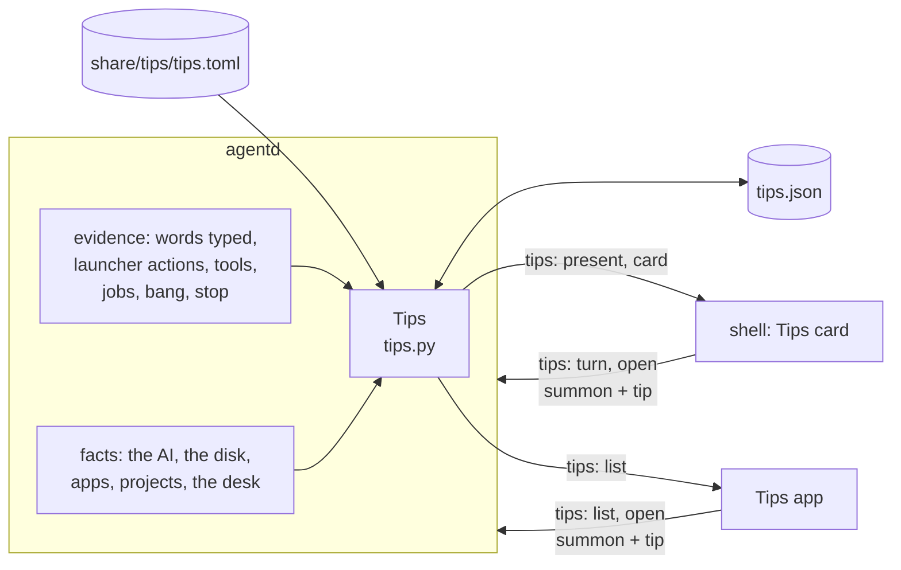

# Tips

Tips teaches a new person what they can ask, one line at a time, and only what this machine can really do.
Why it looks and behaves the way it does is in
[`design/tips-and-desk-defaults-brief.md`](design/tips-and-desk-defaults-brief.md); read its "Tips' own rules"
first, because every piece below is built to them. This page is how the data side is built and how to extend it:
the table of tips, what agentd knows about them, what counts as tried, and the messages the card and the app are
fed by. Two parts of Tips are other pieces and have their own sections at the end of this page, to be written by
those pieces:

- the **Tips app** (the window where each tip plays), and
- the **Tips card** on the desk.

The scenes a tip plays are the scene piece's (`share/qml/Bombadil/TipScene.qml`); their words are in
`docs/TIP-SCENES.md` once that piece lands.

## The rules the code keeps

| Rule (the brief's) | Where it is kept |
|---|---|
| A tip is one line, one picture and the exact words | `tips.toml` has one `line`, a `words` and a scene per row; `tests/test_tips.py` measures every line at 13 px Inter against the card's 272 px, and the button with "All tips ›" beside it. |
| A tip is true on this machine | `needs` gates and `{app}`, `{project}`, `{ai}` placeholders: a tip whose gate is not met or whose placeholder cannot be filled is not in the list, not on the card, and not in the app, even greyed (`tips.backed`). |
| Nothing runs on a click | agentd only *remembers* the words a button put in the pill (`summon` with `tip: true`); a tip is tried when the person's own Enter sends them. |
| It never speaks | Tips has no line, no mark and no sound; its one message is data for a card the person can ignore. agentd sends it only when it changed. |
| It steps aside | seven days of typing in the pill, or six Start-here tips tried, and `present` goes false (unless the person keeps Tips). A tip that came with an update waits in the app (`new`) and is never put on the card unasked. |
| The agent never writes tips | The table is a file in the repository, loaded by agentd. No tool, skill or turn can add a row. |

## The pieces

| File | What it is |
|---|---|
| `share/tips/tips.toml` | The twenty seed tips, one `[[tip]]` row each. The only place a tip's words live. |
| `src/bombadil/tips.py` | Loads and checks the table, decides which tips this machine can back (`Facts`, `backed`), fills the placeholders, keeps `tips.json`, picks the card, counts tips as tried. Standard library only; every file it reads and the clock are parameters, so the tests hand it text and a date. |
| `src/bombadil/agentd.py` | Owns one `Tips`. Tells every client the `tips` message when it changed, answers the shell's `tips` ops, remembers a button's words, and feeds `Tips` the evidence it sees (the words typed, a launcher action, a tool, a job, a `!` command, a stop). |
| `src/bombadil/paths.py` | `tips_file()` (`~/.local/state/bombadil/tips.json`) and `tips_table()` (`share/tips/tips.toml` beside the package). |
| `iso/airootfs/usr/local/bin/bombadil-install` | Copies `tips.json` and `desk.toml` to the installed disk with the sign-in, so the first week does not begin again after an install. |
| `tests/test_tips.py`, `tests/test_agentd_tips.py`, `tests/test_iso_profile.py` | The table, the gates and the card; agentd's side; the installer's copy. |



## The table

One `[[tip]]` row per tip, written in the teaching register of `design/voice-brief.md`: one line, no name, no
exclamation mark, no em-dash, no "will", "tomorrow" or "later".

| Field | Meaning |
|---|---|
| `id` | Unique, kebab-case, **never reused once shipped**. `tips.json` remembers ids, so a reused id would look tried. |
| `section` | `start`, `work`, `code` or `machine`: Start here, Work, Code, This machine. |
| `order` | A whole number, fixed inside the section. The card and the app never shuffle. |
| `line` | The one line. At most 272 px at 13 px Inter (the card's row is 300 minus 14 px each side). Placeholders count at their filled length, so the filler is limited too. |
| `words` | Exactly what the button puts in the pill. `""` when the tip has no button (its words only make sense mid-turn). A trailing `…` means "more follows": "In {app}, add…" is tried by "In Tickets, add a due date". |
| `marks` | Words or keys drawn as marks instead of a button (`["Esc"]`, `["why"]`). |
| `needs` | Gates, all of which must be met (below). |
| `card` | `true` by default. `false` when the tip's button does not fit the card's row (the button, its inset and "All tips ›" must fit 272 px): only the app shows it. |
| `tried_when` | Evidence agentd matches against its own live events (below). |
| `captions` | Three phase captions of at most three words, under the stage in the app and beneath the three stills under reduced motion. "You ask", "It works", "You have it" unless the brief words a tip's own (it does for the first tip only: "You ask", "It builds", "You have it"). Like the lines, they are proposals for the voice thread. |
| `beats` | The scene. The scene piece fills it; a row ships with `beats = []` and the card then draws its still poster from the line alone. |

`load_rows` checks every row and **leaves out** a bad one instead of half-using it (a wrong gate, captions that are
not three, evidence nothing sees, a second row with a used id, a field that is not in the table above, so a typo
such as `need` cannot leave a tip ungated, and `beats` holding a value JSON cannot carry, such as a date, which
would otherwise fail every client that connects). The problems go to agentd's stderr. A table that cannot be read
gives no tips, and agentd goes on.

### Gates

A tip is shown only where every gate in `needs` is met (the brief's rule 2). `Facts` holds the machine's side.

| Gate | Met when |
|---|---|
| `model` | an AI is chosen and not signed out (agentd's `access` is `ready` or `resting`). While the AI rests the list does not change: the tips still fill the pill. |
| `installed` | the machine has an installed disk with restore points (`snaps.available`): undo works. Not the live USB. |
| `app` | there is an app in `~/Apps` whose name fits a button. |
| `project` | there is a folder in `~/Projects` whose name fits a button. |
| `sessions` | the coding-sessions code is on this machine. |
| `mail` | the mail tips' code is on this machine (false until a tip needs it; the PR that ships it flips the fact). |
| `noticed` | the self-improvement code is on this machine (as `mail`). |
| `keep` | the desk can keep a widget: true, since the desk's piece 2 (`kept` in `desk.py`, the word "widgets" and the Widgets card, [the desk page](architecture/desk.md#your-desk-keep-when-needed-off)). The "Keep a widget on your desk" tip is tried by the launcher word `widgets` (`local:widgets`). |
| `desk-seen` | a desk card other than Tips has been on the screen. agentd sees the Machine card present, a plan of two steps, a step that touches the system or a job on the desk, and remembers it in `tips.json`. |

### Placeholders

`{app}` is the title of the newest app in `~/Apps` (the one whose `main.qml` was written last), falling back to
its folder name. `{project}` is the newest folder in `~/Projects` (a dot folder is not one). `{ai}` is the name of
the AI in use. A tip whose placeholder cannot be filled is not backed.

The names come from the machine, and a name goes into the pill as words: an app the AI wrote could be called
anything. So a name is used only when it starts with a letter or a digit (never `!` or `~`, which would turn it
into a shell command or a path), holds only letters, digits, spaces and a few marks, and fits 18 characters (apps)
or 24 (projects). A name that does not fit is left out and the next newest is used; with none, the tip is not
backed.

An `{app}` is also never a title the launcher answers as a command. The launcher reads "lock", "desk", "history",
"mail", "restart" and the like before it looks at apps, so for an app called Lock the button "Lock" would lock the
screen, and the tip "Type an app's name to open it" would be untrue. Such an app is skipped (its folder name stands
in when typing that opens it) and the next newest is used (`tips.newest_app` asks `launcher.match`).

The limits are in characters, not pixels, so a very wide name can still overflow the card's row on tips 7 and 8
(`In MMMMMMMMMMMMMMMMMM, add…` is wider than the card). **The card must elide the button's words** rather than
trust the test, which measures one sample name, "Customer Dashboard"; ordinary names fit.

### Marks and the card

A tip with `marks` and no `words` has no button; the card draws the marks (the Esc key, the word `why`). Tips 3,
10, 19 and 20 are of this kind: Esc stops a turn, "where did this come from" and "why" and "undo" make sense
mid-turn or after one, so a button that fills the pill with them would teach nothing.

## What the person has been taught: `tips.json`

`~/.local/state/bombadil/tips.json`, outside the restore points so an undo never makes Tips forget. **agentd is
its only writer**; the shell and the app read the messages, never the file (the app may watch it for changes).

```json
{"first_ready": "2026-11-09", "days": ["2026-11-09"], "tried": ["make-an-app"],
 "known": ["make-an-app", "picture"], "open_on": "", "desk_seen": false}
```

| Key | Meaning |
|---|---|
| `first_ready` | The day setup was first ready. The first week begins here. |
| `days` | Days on which the person **typed in the pill** (at most 30 kept). An app's, a helper's or the builder's prompt is not a day of use. |
| `tried` | Tip ids tried. Retired ids stay, so a reused id could never look tried. |
| `known` | Tip ids the person has had in front of them. When setup is first ready every id in the table is known; a tip that comes with an update is `new` until the app lists it. |
| `open_on` | The tip the Tips app opens on (`""` is its first). |
| `desk_seen` | A desk card other than Tips has been on the screen: the tip that folds cards stays once it has been taught. Not in the contract's first shape; it is here because the machine's fact would otherwise come and go with the desk. |

It is written all or nothing (a temporary file, then a rename), so a crash never leaves half a file, and a disk
that will not take it never costs the change: it is held until agentd stops. Anything missing, damaged or edited
by hand falls back for that part; a file that does not parse starts the person as new. `known` missing, or empty, in a
file that has begun means every tip is known, so none is new (an empty list is what a table that could not be
read leaves behind, and it would otherwise hide every tip).

`bombadil-install` copies it, and `desk.toml`, to the installed disk with the sign-in. On the live USB nothing
survives a restart, so every live boot is a first boot.

## What counts as tried

A tip is tried when agentd sees, **with no model**, that the person did it. Showing a tip never counts, and
neither does pressing its button.

| Evidence in `tried_when` | agentd sees |
|---|---|
| `words` | The words sent are the tip's own words (case, spaces and the end's marks aside), however they got into the pill. Also, **unedited**, the words a button put in the pill for that tip (`summon` with `tip: true` and its `id`). A `…` at the end means more after it still counts. |
| `local:<kind>[:<target>]` | A launcher action of that kind ran well: `local:desk`, `local:picture:disks`, `local:app`, `local:undo`, `local:stop`. Closing or hiding an app, hiding a widget and resuming the AI do not count, and a rest counts only when it pauses. A failed action does not count. |
| `tool:<name>` | The turn's tool call of that name worked (its result came back without an error). An MCP tool counts by its short name, so `tool:create_app` is the OS tool whatever its prefix. |
| `job:start[:<kind>]` | A background job of that kind (`job`, `watch`, `timer`) was started. |
| `bang` | A `!` command was typed. |

Evidence is a closed list checked when the table loads (`tips._EVIDENCE`): a row that asks for something nothing
sees is left out, so a tip can never silently be impossible to try.

### Where agentd sees it

| Evidence | Where in agentd |
|---|---|
| words | the `prompt` branch of `handle`, for a prompt the person typed (not an app's `asked_by`, not a `[from app …]` ask), through `_tips_typed` |
| launcher action | the `local` event's `done` phase, ok only, through `local_keys(action, target, verb)` |
| a stop | `AgentD.stop(by_person=True)` for a turn that was really running, as `local:stop`: Esc (the shell's `stop`, or `cancel`) and the word "stop". The word with nothing running teaches nothing, and neither does undo, restart, shutdown or the setup card's cancel, which stop a turn too and are not Esc. |
| tool | `_on_event` for a `tool` event, counted when its `tool_result` arrives without an error (`_tips_tool`) |
| job | `_job_tool`'s start, through `job_keys(kind)` |
| bang | `turn()` for a shell command the person typed (a helper's `!` command teaches nobody) |
| desk card seen | the Machine card present, a plan of two steps, a risk step, a job on the desk |

### The card turns after a tried tip

Twelve seconds after the turn that tried a tip ends (`TIPS_TURN_AFTER`; for a word with no turn, after the
word), agentd moves the card to the first tip not tried and sends the new `tips` message. A turn that begins
before then defers it to its own end, so the card never changes under a turn. A turn that tried nothing never
moves the card.

## The card

`Tips.message()` is the one thing agentd says about Tips, and it says it only when it differs from what it said.

```json
{"type": "tips", "present": true,
 "card": {"id": "make-an-app", "line": "Say what you need. It gets made.", "words": "Make me a ticketing app",
          "marks": [], "why": "Start here · 1 of 6", "index": 1, "count": 6, "tip": {"...": "the whole row"}}}
```

`present: false` (with `card: null`) takes the card away. `present` means "Tips has something to say to a new
person": the AI is ready, the person has not put Tips away, and either they keep it or the first week is not over
(fewer than seven days of use) and a Start-here tip is left untried. The shell adds its own conditions (setup,
persona and recovery cards, the welcome line, a turn, a window).

- **Which tip.** The card stays on the tip it is on until it is turned, or until that tip can no longer be backed
  (then the first tip not tried). A first card is the first Start-here tip not tried.
- **Which tips it turns through.** The Start-here tips in the first week. Once the person keeps Tips on the desk,
  every backed tip that has a `card` button. A tip not yet `known` is left out, so nothing new is put on the desk
  unasked.
- **The why line** is the section and the tip's place among the backed card tips of that section ("Start here · 3
  of 6"). It follows the machine: a tip that cannot be backed leaves the count too.
- **`tip`** carries the whole row, captions and beats, so the card draws its still poster without asking.

### Wire protocol

agentd to a client:

| Message | When | Fields |
|---|---|---|
| `{"type": "tips", "present": bool, "card": {...} \| null}` | Once to each client that connects, and to all of them when it changes, never when it did not. | `present` false (with `card` null) takes the card away. `card.id` the tip; `line` its line, `words` the button's exact words (`""` for a tip with marks), `marks` the words or keys drawn in place of a button; `why` the line under the title ("Start here · 3 of 6"), `index` and `count` its parts; `tip` the whole filled row, captions and beats included, so the card needs no second request. |
| `{"type": "tips", "list": [{...}]}` | The answer to a `list`, on that connection only. | One entry per tip this machine can back now, in the fixed order: `id`, `section`, `order`, `line`, `words`, `marks`, `card` (false: only the app shows it), `tried`, `new` (it came with an update and the app has not listed it yet), `captions`, `beats`. |
| `{"type": "summon", "text": "...", "tip": true}` | A tip's button was pressed (below). | The same message every summon is, with `tip: true`. |

Client to agentd:

| Message | What agentd does |
|---|---|
| `{"type": "tips", "op": "turn", "dir": 1}` or `-1` | Turn the card one tip on or back, round the card's tips; sends the message when it moved. |
| `{"type": "tips", "op": "open", "id": "<id>", "play": true}` | Keep the id as `open_on` (an unknown id means the first) and call the Tips app's open hook. No window opens in agentd. |
| `{"type": "tips", "op": "list"}` | A one-shot: agentd answers on that connection only with the `list` message above, the tips this machine can back now. Asking is looking: the ids it listed are `known` after. An app asks, then closes the socket (an open socket would count as a bar for the machine sampler). |
| `{"type": "summon", "text": "...", "tip": true, "id": "<tip id>"}` | A tip's button. agentd remembers the words for that tip, and broadcasts `{"type": "summon", "text": "...", "tip": true}`. With `tip: true` the pill **keeps words the person typed and has not sent** (the Brain's "Ask about this" still replaces them). Only the JSON `true` is true. |

`BOMBADIL_TIPS=0` turns Tips off in agentd (nothing is sent, nothing is kept). The tests that are not about Tips
run that way, so no other test hears a card.

## How a tip is added

**A PR that adds something a person can ask ships its tip row and beats in the same PR, gated by a `needs` flag
until its code is on main.** It ships them the way it ships its docs: the row says what to ask, the gate keeps it
off every machine that cannot do it yet, and the PR that puts the code on main flips the gate's fact in
`read_facts`. (The beats are the scene piece's: until it lands, a row ships with `beats = []` and the card draws
its still from the line alone. Once `docs/TIP-SCENES.md` exists, it says how to write them.) There is no
`CONTRIBUTING` file in the repository yet to carry this line; when one is added it should point here.

1. Add a `[[tip]]` row to `share/tips/tips.toml` with a new id and the next `order` in its section. The row is a
   claim about this machine: put every gate it needs in `needs`, and write `tried_when` from the list above.
2. If it needs a thing the machine may not have, add a gate to `GATES` and its fact to `Facts`, set from
   `read_facts` (a gate that is a piece of code is `find_spec(...)`, so a branch without it hides the tip).
3. Write its scene in `beats` and its still: this part comes from the scene piece (`docs/TIP-SCENES.md`, once it
   lands). Until then leave `beats = []`.
4. Run `tests/test_tips.py`. It fails on a line that does not fit the card, a malformed or reused id, a voice
   rule broken, a button that does not fit the card's row while `card` is true, words that reach nothing, and
   evidence that nothing sees.

To retire a tip, remove its row. Its id stays in `tried` and `known` in the people's files, which is why an id is
never reused for another tip.

## Testing

```
QT_QPA_PLATFORM=offscreen python3 -m pytest tests/test_tips.py tests/test_agentd_tips.py -q -p no:cacheprovider
```

- `tests/test_tips.py` runs the rules over the shipped table (ids, voice, 272 px with Inter, captions, evidence),
  the loader's errors, gating by `Facts`, placeholders and the names read from folders, the state round trip and
  damage, the card (choice, the why line, turning, the first week, keeping), and every kind of evidence. The width
  test measures with Inter at 13 px (Medium for the button); where Inter or PySide6 is not installed it holds the
  line and the card's button to a character count instead (the reverse test, that the app-only tips really do
  not fit the row, needs the font and is skipped).
- `tests/test_agentd_tips.py` drives a real `AgentD` on a socket with the Fake provider or a Python one-liner: the
  card sent once and only when it changed, the ops, the summon, the day of use, the evidence from each source,
  the 12 s turn (patched to 0.4 s), and Tips off. Nothing calls a model.
- `tests/test_iso_profile.py` runs the installer's copy loop on two folders.

What no test here shows is the card or the app on a real desk under Hyprland.

## The Tips app

*Not built yet (the app's piece).* The Tips app is a built-in kit app, `share/apps/tips`, opened by the launcher's
words and by the card. It asks agentd for the list in a one-shot request and plays each tip once. This section
will say how.

<!-- PIECE D: the Tips app. Its section goes here: share/apps/tips, the launcher's words, Agent.draft, how it
reads the list and watches tips.json, the stage and the list, reduced motion, what it does while the AI rests. -->

## The Tips card on the desk

*Not built yet (the card's piece).* The card is a desk widget fed by the `tips` message above. This section will
say how it is drawn, arrives, folds and turns, and how its button hands the words to the pill.

<!-- PIECE E: the Tips card. Its section goes here: the desk entry, the TipsCard face, the pill hand-off, how it
folds, arrives and turns, and the strip. DESK.md's "Adding a widget" is its recipe. -->
