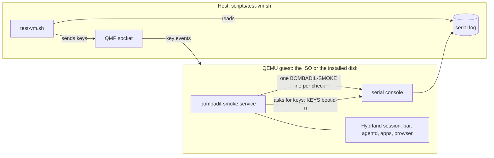
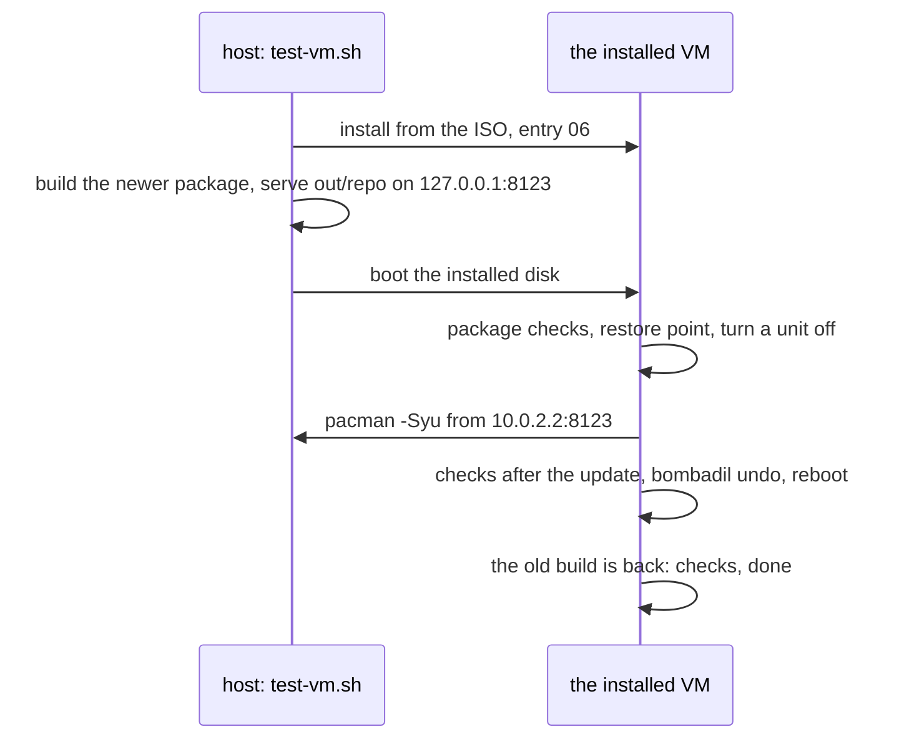

# Testing the whole system in a VM

Unit tests cover the Python and the QML that load without a compositor, and a headless desktop test
(`tests/desktop/run.sh`) drives the bar and the daemon in a sway session against a scripted model
API. Neither can say whether Hyprland focuses the pill, whether the units come back, whether an
install boots. That is the VM smoke test: it boots the real ISO, runs the real session and judges it
from the serial log.

## How it fits together



- The `bombadil` package carries `bombadil-smoke.service` and `bombadil-smoke`, so the ISO and an installed
  system both have them. The unit runs only when the kernel command line has `bombadil.smoke`. A plain
  build leaves the boot entries that set it out (`test-vm.sh` refuses such an ISO);
  `BOMBADIL_TEST_ENTRIES=1 scripts/build-in-container.sh` adds them: `02` `bombadil.smoke` (live
  checks, then power off), `03` `bombadil.smoke=install` (live checks, install to the virtual disk,
  power off), `04` `bombadil.smoke=install-encrypted` (the same with a password, so GRUB asks for it
  at every start), `05` `bombadil.smoke=refresh` (refresh a disk an older Bombadil installed) and
  `06` `bombadil.smoke=install-update` (the same install as `03`, but the installed system starts as
  `update`). The menu number a mode picks follows this order.
  On the installed disk, `bombadil.smoke=undo` runs session checks and then an undo round trip over a
  reboot; `bombadil.smoke=update` updates the package from a newer build the host serves and then undoes
  the update over a reboot; `bombadil.smoke=refreshed` runs on a refreshed disk.
- Each check prints `BOMBADIL-SMOKE: PASS name` or `FAIL name: <last 300 bytes of its output>` and
  the run ends with `DONE pass=N fail=M`. `scripts/test-vm.sh` exits 0 only when every log it
  collected ends with `fail=0` and holds no `FAIL`.
- A virtual machine cannot press keys itself. The guest asks: it prints `KEYS <bootid>-<n> meta_l`
  (a tap of Super; `meta_l+esc` is a chord; `b r o w s e r ret` types a word) and the host sends
  them over QMP (`scripts/qmp.py`), then the guest checks what happened. The boot id keeps the
  numbers of one boot apart from the next, which restarts the count (the undo round trip reboots).

```
BOMBADIL_TEST_ENTRIES=1 scripts/build-in-container.sh   # the ISO with the test entries, in out/
scripts/test-vm.sh                         # live checks
MODE=install scripts/test-vm.sh            # live checks, install to a scratch disk, boot it, undo
MODE=install-encrypted scripts/test-vm.sh  # the same with a password: typed once at GRUB, never asked again
MODE=update scripts/test-vm.sh             # install, build a newer package, serve it to the VM, update it there, undo
REUSE_DISK=1 MODE=update scripts/test-vm.sh   # the same on the disk the last MODE=update run left, with no install
MODE=installed scripts/test-vm.sh          # boot the disk the last install run left (the undo's second boot)
OLD_ISO=old.iso MODE=refresh scripts/test-vm.sh   # install with an older ISO, refresh with this one, put the old system back
TIMEOUT=5400 MODE=install scripts/test-vm.sh
```

Screenshots of the checks that take one (`SHOT name`) land in `out/test/`.

## What each mode proves

Every VM start runs the live checks below (`live` and `install` add the sign-in block to them) and the
`package-*` checks, so the stick and an installed system are both held to the same facts about the package.

| mode | what runs | what it proves | VM runs |
| --- | --- | --- | --- |
| *(none)* | live checks | the session, the bar, the apps, the pill and the package on the stick | one |
| `install` | live checks, `bombadil-install`, then the installed disk with `undo` | the install boots, has the layout, and an undo takes a change back across a reboot | two, and the second one starts twice |
| `install-encrypted` | the installer with a password, then the disk | GRUB asks for the password once and nothing asks again | two |
| `refresh` | an older ISO installs, this ISO refreshes the disk, the disk starts | the refresh keeps the home folder, the sign-in and the computer's name, keeps the old system aside, and puts it back; the home folder's old `hyprland.lua` is split (below) | three, and the last one starts twice |
| `update` | the install of `install-update`, a newer package served by the host, then the disk with `update` | pacman updates Bombadil in place, nothing it should keep is lost, and an undo brings the old build back | two, and the second one starts twice |
| `installed` | the disk an earlier run left | its second boot again, at the password prompt too | one |

Each VM run is held to `TIMEOUT` seconds (2400 unless set; 5400 in the install example above). Without KVM
every start is slow, and a mode that runs the VM more than once takes the sum of its runs: no duration is
promised here.

**The config split in `refresh`.** The old system's home folder holds the old `hyprland.lua`, with
Bombadil's part and the person's lines together. Before the refresh the smoke adds a line of the person's
own to it (`hl.bind("SUPER + F9", ...)`). The refreshed system's agentd then runs its home fix (a moment
after login), and the smoke waits up to 90 s for the result: `hyprland.lua` starts with the stub that
`/etc/skel` has, `hyprland.lua.before-split` holds the old file with the planted line, the planted line is
still in `hyprland.lua`, `~/.local/state/bombadil/home.json` records step 1, Hyprland reports no config
errors and the sign-in marker is as it was. When the old system comes back after the undo, its own checks
run, including the config check, which proves the stub falls back to the old file.

**What `update` does.** The first boot of the installed system runs the live checks and the `package-*`
checks, writes down the version, takes a restore point, turns one user unit off (`bombadil-mail`), and runs
`pacman -Syu` against a pacman.conf of its own that has the real `[options]` and only `[bombadil]` (the VM has
no route to the Arch mirrors). The host serves the newer build on `127.0.0.1:8123`, which the guest sees as
`10.0.2.2:8123`, the first server in `/etc/pacman.d/bombadil.conf`. Afterwards the smoke checks the
version changed to the served build (its commit ends in `+update`), that pacman still owns the package's
files and finds none missing, that the migrate log has no `FAILED` line from this update, that Hyprland
runs without config errors and the bar answers, that the package's units are still enabled, that the
ledger of enabled units is unchanged and that the unit it turned off is still off. Then `bombadil undo` and
a reboot. The second boot checks that the old version, the old package, the stub in the home folder and the
bar are back.



**`REUSE_DISK=1`** skips the install and the live run and boots the disk an earlier `MODE=update` run
left: the undo at the end of a run puts the installed system back as it was, so the disk is ready for the
next update (the host builds a fresh package every time). A disk left halfway (the VM was stopped between
the update and the reboot) is a system that has the update: put it right with `MODE=installed`, or
install again.

## What it covers

The session and its processes (`greetd`, Hyprland, the bar, `agentd`), the two user services and
that each is revived after being killed, the pill taking the keyboard from a Super tap and from
Alt+Space (first that Hyprland lists the bar's two global shortcuts, `pill-shortcuts-registered`,
because it drops a shortcut nobody registered without a word), a launcher word running without a model,
Super+Return opening a terminal on the desktop with a drawer showing (the drawer is put away first),
the browser panel sliding in and out, apps created and opened each in its own place, the sign-in round
trip against a stand-in provider (`fake_signin.py`: the page opens, the pill follows it, cancelling frees
the port and puts the login page away without quitting the browser, no internet waits and recovers), the
name and voice card that the first sign-in asks and the `voice` word that brings it back, restore points
being created and pruned, the installer (a plain disk, an encrypted one where GRUB asks for the password once,
and a refresh of a disk an older Bombadil installed, which keeps the home folder and can put the old system
back), the installed system booting and undoing a change across a reboot, an update of the package
from a repository the host serves (what it replaces, what it keeps, the units, the config files other
packages own) and that undo takes it back, and, in every mode, the package itself (`package-*`: what it owns,
its commands as links, its repository above `core`, its units and the ledger of units it turned on, its
config for greetd, the logo, the browser and sudo, Hyprland loading Bombadil's part).

At the end of the live checks the session is left alone and `idle-cpu` samples Hyprland, the bar, the
daemon and the brain in three slices of 10 s (`IDLE_CPU_SECONDS`): together they must use under 30% of a
core in the middle slice (`IDLE_CPU_LIMIT`; the virtual machine's compositor draws in software under TCG, so
this is not the 10% of the headless test), and the check prints all three either way (a `NOTE` line). A bar that redraws
without end makes Hyprland draw without end too, and a software compositor turns each frame into
real CPU, so this is where the whole of it shows; see [`IDLE-COST.md`](IDLE-COST.md).

The sign-in block deletes the person's provider choice and starts and cancels real logins (a Codex
login revokes the stored one), so it runs only on a system with no provider chosen: the live ISO,
never an installed system someone has signed in on. It says `SKIP signin` when a provider is named in
the config, and a fresh-ISO run that skips it fails.

## Traps

- **Software emulation is slow, and load shows.** Without KVM (`-accel tcg`) the guest is an order of
  magnitude slower, and anything else running on the host (a unit-test run, a second VM, a build)
  stretches the time from a Super tap to the pill taking over past the check's wait. Before a key
  the smoke waits for the guest's load to settle, and says `NOTE the machine was still busy` when it
  did not. Run nothing else while a VM run is in progress.
- **The CPU is `Nehalem` on purpose.** Mesa's software GL (llvmpipe) crashes on the AVX2 that QEMU
  emulates, in Hyprland and in Quickshell's render threads.
- **The pill is a layer surface**, so `hyprctl activewindow` cannot say whether it holds the
  keyboard. Judge by typing into it over QMP and looking at the screenshot.
- **`bombadil history` and `watch` wait for a key when they have a terminal**; the smoke runs them
  without one.
- **Replacing the daemon means replacing its unit.** The daemon is a user service that systemd
  starts again when it is killed, so the smoke stops the unit first, starts its own daemon with the
  environment a check needs, and starts the unit again afterwards (`agentd-restored`).
- **No `send-input-event` in this QEMU**; keys go through `send-key`.
- **The update test needs port 8123 on the host.** The host script starts a small web server there and
  stops the run before the VM starts when the server does not answer. The package is built in the same kind
  of container as the ISO (`scripts/build-in-container.sh package`, into `out/repo`), so Docker or Podman is
  needed, and it is built every run: its release number is the time, which is always above the image's.
- **A user unit that is enabled for everyone is turned off with `systemctl --global disable`.** `systemctl
  --user disable` leaves the link in `/etc/systemd/user` where it is and says so, so it would not test that
  an update leaves a turned-off unit off.
- **The restore point comes before the turn-off.** The undo then brings the unit back on, and the second boot's
  `package-*` checks find all six units enabled again.

## When a check fails

The `FAIL` line carries the tail of the check's output. Checks on the browser's page add a
diagnosis on failure (its processes, every target the debugging port lists, the profile's singleton
files, the daemon's last lines) and a screenshot; take the same habit for a new check that waits on
something visual: say what the machine looked like, not only that it did not match.
