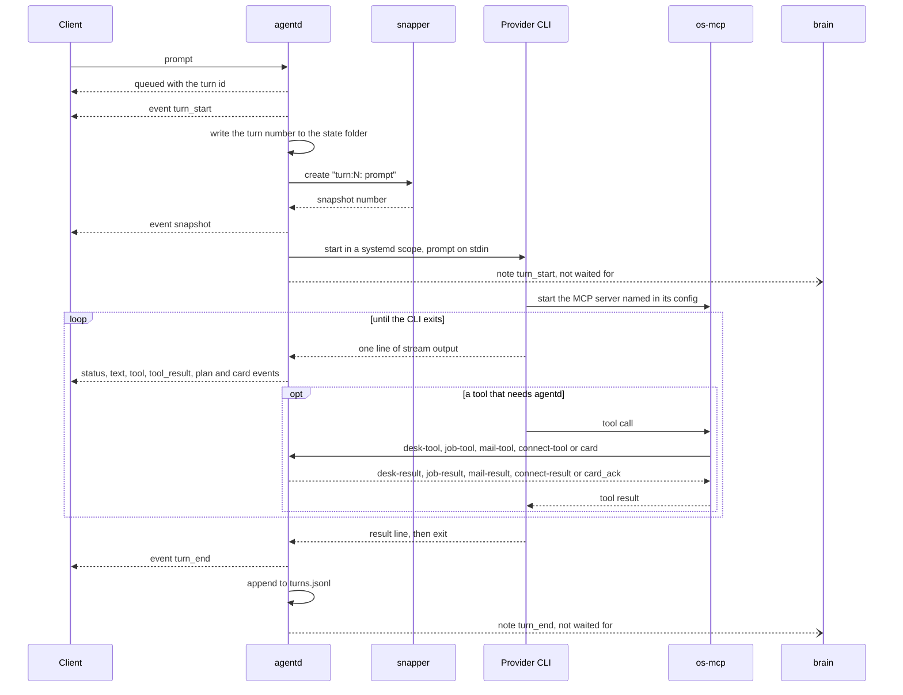
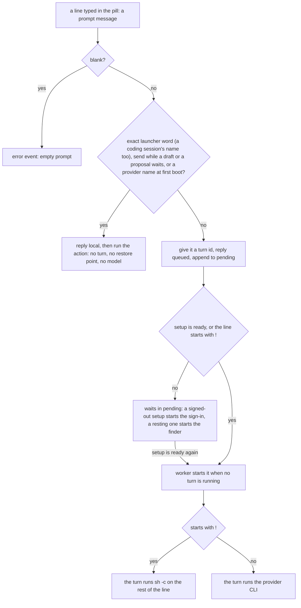

# agentd

> **Status:** Shipped
> **Code:** `src/bombadil/agentd.py`, `src/bombadil/providers.py`, `src/bombadil/launcher.py`, `src/bombadil/procs.py`, `src/bombadil/config.py`, `src/bombadil/paths.py`, `src/bombadil/rest.py`, `src/bombadil/finder.py`, `src/bombadil/vitals.py`, `src/bombadil/notices.py`, `src/bombadil/outbox.py`, `src/bombadil/mail/tools.py`, `src/bombadil/mail/watch.py`, `src/bombadil/connect/client.py`, `src/bombadil/connect/tools.py`, `src/bombadil/connect/watch.py`, `src/bombadil/proposals.py`, `src/bombadil/notifications.py`, `src/bombadil/plaintext.py`, `src/bombadil/apps.py`, `src/bombadil/narrate.py`, `src/bombadil/brain/client.py`, `src/bombadil/snapshots.py`, `src/bombadil/watch.py`, `src/bombadil/dev.py`, `src/bombadil/away.py`, `src/bombadil/hypr.py`, `src/bombadil/voice.py`, `src/bombadil/persona.py`, `src/bombadil/tips.py`, `src/bombadil/remote.py`, `src/bombadil/appkit/native/agent.py`, `bin/agentd`, `bin/bombadil`, `bin/bombadil-signal`, `packaging/bombadil/root/usr/lib/systemd/user/bombadil-agentd.service`, `share/hypr/bombadil.lua`
> **Design:** [UX brief, piece 1](../design/ux-brief.md#1-you-can-see-what-it-is-doing-as-it-happens) and [piece 2](../design/ux-brief.md#2-the-pill-is-the-launcher-and-stop-means-stop), [Foundation choices, section 4](../design/foundation-choices.md#4-how-the-agent-runs-as-the-os--clis-official-agent-clis-as-the-engine-our-own-daemon-around-them), [The poor man switch, piece 1](../design/poor-man-switch-brief.md#1-resting-the-machine-knows-it-is-out-holds-your-asks-and-has-a-switch) and [piece 2](../design/poor-man-switch-brief.md#2-the-pill-still-answers-things-found-on-the-computer), [the voice brief](../design/voice-brief.md), [Tips and desk defaults](../design/tips-and-desk-defaults-brief.md) and [Messages and connections](../design/messages-and-connections.md)
> **Verified:** 2026-11-09 against `main` at `ca7f80a`. The change since that commit was added and checked against the code in three steps. Up to `f0485c2`: the voice messages and the `voice` word, Tips and its messages and file, the system prompt's voice paragraph, the narration of `persona.toml`, the turn-row keys `changed` and `made`, boot rows, and `BOMBADIL_REDUCE_MOTION`. From `f0485c2` to `24c836c`: the connection service as a third service beside mail (its client, tools, watch and words), the proposals and the press for them, the bar's notifications, the cards a client may draw, which processes count as an agent's, the words the pill answers itself that apps may not take, and the units that start the daemon and the bar. From `24c836c` to `7d17600` (checked on 2026-11-11): the launcher words `widgets` and `keep ...`, the desk's `set`, `keep` and `reset` ops and what agentd says of them, the `widgets` message, the `kept` and `widgets` fields of the `desk` message, the `keep` flag of the widget entries, the `desk` tool's added ops, and the sampling of a kept Machine. From `7d17600` to `7d37bc5` (2026-11-12, against `main` at `7d37bc5`, read in the code and the tests, and the test files named under Tests run): the `tips` ops (`opened`, `open` showing the app through `Launcher.open_tips`, `list` with Tips off), the desk's two hooks into Tips and the Tips card's x, `teaches=False` on the desk's `local` event, the Tips word and the Tips rows of the Widgets, entries and desk tables, the `remote` and `install` words, `Agent.draft` as a sender of `summon`, the `bombadil` commands `terminal`, `remote` and `snapshot` and the `bombadil pill` row, and the two Known gaps that replace the old Tips one; also the two units that the smoke's `services-are-units` checks, read in `bombadil-smoke`. What `src/bombadil/remote.py` and the installer do is owned by [installed-os.md](installed-os.md) and was read only for what this page says of the commands. The rest of the page was not read again.

`agentd` is the session daemon: it listens on a Unix socket for newline-delimited JSON, runs one turn at a time by starting the provider's own CLI (Claude Code or Codex) in full-access mode with the OS tools attached, and broadcasts everything that happens to every connected client (the shell, `bombadil ask` and os-mcp). The vendor CLI does the thinking and the tool use; agentd answers the words that must never wait for a model (open, stop, undo, the volume, the model, the Brain's two, the Tips words, `remote` and `install`, a coding session's name, the `voice` word, the words for messages and connections, `!command`) and owns the restore point, Stop, the turn log and the `resting` state that make full access safe to give and an AI that runs out survivable. It also holds the registry of the person's coding sessions and builds the Away card ([Coding sessions](#coding-sessions), [The Away card](#the-away-card)), keeps what the Tips card has taught ([Tips](#tips)) and speaks the name card, the welcome line and the goodbye to the bar ([The voice](#the-voice)). Beside mail it is the client of a third service, the connection service: it reads messages and tasks for the agent's tools, keeps the replies and tasks that wait for the person's press, and turns what the service and the bar's notification server say into notices and cards ([Messages and connections](#messages-and-connections)). A systemd user service starts it again when it dies ([Starting it](#starting-it)), and the conversation and the session's model are kept across that restart. Everything the shell shows about a turn is made from the events this page lists, and the same log is what [the brain](brain.md) learns turns from.

## How it works

### One turn



What happens to a prompt that becomes a turn, in order (all of it in `src/bombadil/agentd.py`):

1. A `prompt` that is not a launcher word gets the next turn id and goes on the `pending` list. The sender is told `{"type": "queued", "turn": n}` at once. The single `_worker` task takes the first prompt that can run (setup is `ready`, or the line starts with `!`) when no turn is running. A prompt that comes from a process inside an agent's scope, a turn's or a coding session's (agentd reads the peer's pid with `SO_PEERCRED` when the client connects and again when it sends), is marked `asked_by: "agent"`, and a turn with an `asked_by` has no typed words: `turn_prompt` is `None`, so the desk, mail and connection gates treat it as nobody's request.
2. `turn_start` goes out before anything slow. The restore point is saved after it, so something true is on screen while snapper works.
3. If the provider's CLI is not installed (and the line is not a `!` command), the turn says so with an `error` event and ends with an empty `turn_end`. No line is added to `turns.jsonl` for it.
4. The turn counter `turns` goes up, and the new number `n` is written to `<state dir>/turn` (`_mark_begun`) before snapper and the brain hear of it. A `TurnFiles` starts to collect the files the turn's own tool calls write and read. `launcher.clear_undo()` runs (it keeps the undo marker while an undo still waits for its restart), and, unless the line starts with `!` or `explain` is `brief`, a capture of the network, disks, sound and screens starts in the background for the receipt.
5. If the snapshot object says `available`, the status line says "Saving a restore point", `Snapshots.create("turn:<n>: <first 60 characters of the prompt>")` runs off the event loop and a `snapshot` event carries its number. A failing `snapper create` (a non-zero exit) is an `error` event ("no undo point for this turn: ...") and the turn goes on. Any other exception from it ends the turn through the worker's handler: an `error` event and a short `turn_end`, the CLI never starts, and no line goes to `turns.jsonl`, but the number `n` stays used. `Snapshots.create` passes `--cleanup-algorithm number`, so snapper's cleanup may prune the restore point later ([The restore point](#the-restore-point)). See [restore-points.md](restore-points.md) for what snapper and `bombadil-rollback` do.
6. If Stop arrived while the restore point was saved, the CLI never starts: `turn_end` with `stopped: true`, and the turn is logged with its `n` and a null `unit`. The brain gets a `turn_end` note, and no `turn_start` note.
7. The command is built by the provider (see Providers below). If the person did things without the model since the last turn (a launcher word, a desk gesture or a change made on the Widgets card, a job that ended, a press on a Send, Create or Comment button that went), they are put in front of the prompt as `[Done by the user without you since your last turn: ...]`. A run the account's limit cut off carries `[The last try stopped at a usage limit after: ...]` as well. A `!` line takes neither.
8. The CLI starts in its own systemd user scope. As soon as the process exists a `turn_start` note goes to the brain (`n`, the scope name, the prompt, the start time), so it can name the turn's writes while they happen. The prompt is written to the CLI's stdin and stdin is closed. The status line says "Waiting for Claude" (or Codex, Fake). Every stdout line goes to `provider.parse` through `_safely`: a line the parser raises on is skipped with one note on stderr and the turn goes on, so one odd line cannot lose the answer that follows it (the provider parsers also read a field of the wrong type as empty, `_obj`; `test_a_line_the_parser_chokes_on_is_skipped_and_the_answer_still_arrives`). Each event goes through `_on_event`, which keeps the limit hints (`meta`, `limit`, `retry`) for the account check, replaces what a mail tool or a connection tool read with a placeholder (`_without_mail_text`), feeds the `Narrator` (the live line, the plan), `TurnFiles`, the card follower and the Tips follower (`_tips_tool`, [Tips](#tips)), then broadcasts it.
9. When the process exits, agentd lets the output drain for at most `OUTPUT_GRACE` (1 s), asks the adapter for its `finish()` events (guarded by `_safely` as well), reads stderr for at most 1 s and, if the exit was not clean and neither an error nor a good result was reported, sends an `error` event with stderr's last 2000 characters or `<cli> exited with <code>`.
10. `turn_end` closes the turn and one line is appended to `turns.jsonl`. Then a `turn_end` note goes to the brain, after the row, because the brain reads the row from the log. After it, a receipt card may follow: a before and after of what the turn changed in the network, a service, the disks, the sound or the screens. See [cards-and-pictures.md](cards-and-pictures.md). A turn the account's limit refused is the exception: it has no `result` or `error` event. When it is to run again, its `turn_end` and its row carry `requeued: true`, its `line` says what it changed, and no receipt follows it. A refused turn that Stop also ended is not run again and ends like any stopped turn: no `requeued`, the stopped line, and a receipt may follow. When a refused turn changed nothing, `Launcher.skip_restore_point` makes Undo step past its empty restore point.
11. The worker clears `current` and broadcasts `status`, then arms the Tips timer and looks at Tips again ([Tips](#tips)). A turn the limit refused goes back to the front of the queue (not when Stop ended it) and the machine rests ([Resting](#resting-and-the-finder)). If the CLI said the login is gone, agentd signs in again and, unless Stop ended the turn, runs the same prompt once more ([browser-and-signin.md](browser-and-signin.md)).

A turn has two numbers. The id (`queued.turn`, the `turn` of every event, the event-log file name, the scope name, and what `details` and `open` of kind `turn` take) comes from `next_id` and starts again at 1 when agentd starts. The turn number `n` (`status.turns`, `n` in `turns.jsonl`, the `turn:<n>` of the restore point, the brain's turn key) is `AgentD.turns`. At start it is the larger of `_last_turn` (the highest `n` in `turns.jsonl`; a row without an `n`, and a half-written row, each count as the next number) and the number in `<state dir>/turn`. So it goes on after a restart, also past a turn that a crash cut off before its row.

### Where a typed line goes



`launcher.match` decides the second diamond. It is exact on purpose: after lowercasing and trimming, the whole line must be a known word, with an optional verb in front. A parser that guesses would give the machine two brains that sometimes disagree. A line that starts with `!` never matches, whatever follows. A line in another script, or with extra words, goes to the agent. The words are in the launcher table under Interfaces; the coding-session forms (`claude <project> [role]`, a project's or a session's name, `end <name>`, `what's running`) are exact in the same way. Every non-blank `prompt`, a launcher word or not, first goes through `_typed`, which acts only on the person's own (no `asked_by`, not from a process of an agent's turn or a coding session): it keeps the time of the ask (`_typed_last`, and `_typed_before` for the ask before it) and puts the Away card away when one is up ([The Away card](#the-away-card)). The person's own lines then go to `_tips_typed` (no `asked_by`, not `[from app NAME]`, not from a process of an agent's turn or a coding session), which counts a day of use and may mark a tip tried ([Tips](#tips)). Typed `send` words (`launcher.is_send_word`: `send it`, `yes send`, `send that now`) are a launcher word only while something waits for the person's press. A mail draft does when the mail service says one waits (`_draft_waiting`, asked for `DRAFT_CHECK_SECONDS`, 1 s); the answer is `Sending is yours. It's under the pointer.` and the Mail window opens on the draft, because only a press sends ([mail.md](mail.md)). When no mail draft waits, a reply or a task on a card with something in it does (`_proposal_waiting`, which reads the proposals table and asks no service): the same answer, and no window opens, because the card is already in front. With neither, or with no mail service and no proposal, the line goes to the agent. A `connect <service>` word written by a process inside an agent's scope is refused with an `error` event ("Connecting a service is yours to do. It cannot be done from an agent's turn.") and starts no setup.

A launcher action runs beside the socket reader (`_background`), so a `stop` sent right after it is read at once. `AgentD.local` sends it one of three ways. `why`, `picture`, `signin`, `provider`, `rest` ("pause claude", "resume the ai"), `model` ("use opus", "use sonnet"), `messages` and `connect` (`_connect_word`), `voice` and `stop` need agentd's own state and are done in place. `undo`, `restart` and `shutdown` first raise `_hold`, so no queued turn starts until the action is done, then take the `_exclusive` lock, stop the running turn and wait until it has ended, run the action, and lower `_hold`: an undo that raced a turn would roll back to that turn's own restore point. Everything else goes to `Launcher.run`, which calls Hyprland, the apps, snapper, the brain and, for `remote`, `remote.start` (it looks for its link once a second, 25 times at most) directly, in a worker so the event loop stays free. What the next model turn is told for the brain's two words is a fixed phrase (`BRAIN_NOTES`: "opened the Brain", "the brain answered in the line"), not the brain's sentence: its answers quote titles that other people wrote, so the model hears that it was asked and not what was said.

### One turn at a time, and the queue

- There is one `_worker` task, so there is one running turn (`current`) and the rest wait in `pending`, a list of `(turn id, prompt)`. Turn ids come from `next_id`, assigned when the prompt is accepted, so they follow the order of asking.
- `queued` events are broadcast when something is already running or waiting, or when the prompt must wait (for sign-in, or for the AI while it rests). The shell draws them as grey chips. `{"type": "unqueue", "turn": n}` removes one and broadcasts `unqueued`.
- `_next` takes the first prompt that is runnable, so a `!` line passes over prompts that wait for sign-in. Stop does not empty the queue: the next prompt starts when the stopped turn has ended.
- Cancelling a sign-in drops the prompts that waited for it (`_drop_waiting`, an `unqueued` event each). A turn that found its login gone goes back to the head of the queue once, and a turn the account's limit refused goes back to the head and runs again when the limit lifts. A turn that Stop ended is put back in neither case.
- The queue and its ids are in memory and start again at 1 when agentd starts. The turn counter does not (see the two numbers above).
- A prompt accepted while setup is `signed_out` and not a `!` line also starts the sign-in, and runs after it ([browser-and-signin.md](browser-and-signin.md)). While setup is `checking`, `choose`, `offline`, `signing_in` or `resting` it only waits.
- `status.busy` is true from the moment a runnable prompt is accepted, so Esc stops it even before its turn has started.

### Stop

`{"type": "stop"}` (or `cancel`), the launcher words `stop`, `cancel`, `stop it` and `stop that`, and `bombadil stop` all end in `AgentD.stop()`. It returns at once and the work is done in the background:

1. With no turn running, Stop cancels a sign-in in progress; otherwise it returns false and the launcher word answers "Nothing is running." The launcher word, and not the `stop` message, also ends a Slack setup that is walking the person through its pages (`connect_says.stop_setup`) and then answers "Stopping."
2. With a turn running it sets `stopping`, takes the closing line from the `Narrator` ("Stopped while installing docker."), sends a `status` "Stopping", and hands the process to `procs.Stopper`. From then on the turn's own status, plan and failure events are suppressed: a Stop is not reported as an error.
3. `Stopper.stop` finds every process of the turn: the descendants of the CLI, everything in its scope's cgroup (`bombadil-turn-<agentd pid>-<turn id>-<seconds>`) and its process group. It spares the windows the turn opened: processes started with `--class=bombadil-browser`, `--app-id=bombadil-terminal` or `--app-id=bombadil-details`, `nautilus` and `bombadil-app run <name>`, and their children (`PROTECTED_ARGS`, `_is_window`).
4. Everything else gets SIGINT first, so the CLI saves its conversation and `sudo` relays the signal to a root command. After 3 s (`grace`), what is left gets SIGTERM, then SIGKILL after 1 s. A root process with no `sudo` to relay goes through `sudo -n kill`.
5. `pacman` is the exception. A pacman that was running when Stop began is never sent SIGTERM or SIGKILL (one that starts during Stop is treated like any other process). The rest of the turn is frozen (SIGSTOP), pacman gets SIGINT and finishes its package for as long as that takes (up to `pacman_grace`, 900 s), the status line says "Stopping after this package", and only then is the rest stopped. A stale `/var/lib/pacman/db.lck` is removed if no pacman runs.
6. Without a systemd user manager (`BOMBADIL_NO_SCOPE=1`, no `/run/systemd/system`, or a failed probe at start) the turn is just the CLI's process tree and process group.

The `stop` message and the launcher word call `AgentD.stop(by_person=True)`. A stop of a running turn made that way counts as the person trying the Esc tip ([Tips](#tips)); `undo`, `restart`, `shutdown` and the cancel chip of the setup line stop a turn without it, and a stop with nothing running counts for nothing.

A command that one of these signals ended has the exit code -2, -15 or -9 in its `tool_result` (Codex's commands and a `!` line report an exit code; Claude's tool results do not). `bombadil watch`, and so the details drawer, draws such a result as `stopped` and not as `failed (exit N)` (`watch.STOP_CODES`, `test_a_command_that_stop_ended_reads_stopped_not_failed`).

### The restore point

The restore point is taken in `AgentD.turn`, after `turn_start` and before the CLI starts, for every turn that gets that far: model turns and `!` lines alike. Launcher words take none. Its number goes out as a `snapshot` event, into `turns.jsonl` as `snapshot`, and into the CLI's environment as `BOMBADIL_TURN_SNAPSHOT`, so that "undo that" run by the agent rolls back past this turn's own restore point and not to it. The launcher word `undo` is handled by agentd itself (`Launcher._undo`), with no model turn. With `snapshots = false` in the config, or without snapper and its `root` config, `Snapshots.available` is false and the turn skips the step. A Claude Code session that agentd does not run, the one `bombadil remote` starts in its own work folder, takes its restore point through `bombadil snapshot --hook` before each prompt: the command clears the undo marker as a turn does (`Launcher.clear_undo`) and creates `turn: remote: <the start of the prompt>`, so the `undo` word finds it like a turn's. It never fails and never reaches agentd ([installed-os.md](installed-os.md#remote-control-and-the-restore-point-by-hand)).

`Snapshots.create` runs `snapper create --print-number --cleanup-algorithm number --description <text>`. Under that algorithm the restore point counts against snapper's `NUMBER_LIMIT`, and without it nothing would ever delete it. The installer (`bombadil-install`) sets `TIMELINE_CREATE=no NUMBER_CLEANUP=yes NUMBER_LIMIT=30` on the `root` config and enables `snapper-cleanup.timer`, so an installed system takes one restore point per turn and no hourly ones, and keeps the newest 30 ([session-services.md](session-services.md#restore-points-do-not-pile-up); the rest of the retention story is in [restore-points.md](restore-points.md#retention-and-pruning)). `test_a_turns_restore_point_is_one_snapper_may_prune` covers the flag.

### Resting and the finder

When the account, not the request, is the problem (a plan window used up, a spending cap hit), agentd does not fail each ask in turn. It puts the setup in the state `resting`, holds every ask that needs the AI as a waiting chip, and runs them when the limit lifts. [poor-man-switch.md](poor-man-switch.md) has the design and the pill's side; this is what agentd does. `src/bombadil/rest.py` holds the state file, the reading of a provider's reset time and every line the machine says about resting.

| Step | What happens |
|---|---|
| Noticing | `Provider.limit(result, seen)` is asked of a failed `result` of a model turn, never of a `!` line. `Claude` reads the turn's `rate_limit_event` (kept as a `meta` event), the assistant's `rate_limit` or `billing_error` message (a `limit` event, which carries `api_error` and `rate_limit`, the window the CLI names in `api_error_params.rate_limit_info`) and the result's HTTP 429. What says it was the account: the CLI's own code `usage_limit_reached` (`Claude.LIMIT_CODES`) is evidence by itself; the entitlement codes `model_requires_usage_credits` and `long_context_credits_required` (`ENTITLEMENT_CODES`) are never a limit, and the assistant message that carries one is not sent on as `limit`; with no code, a window that reads `rejected` or the quota words say it; a code this version does not know is not taken on the window alone, the words must say it (the words `5-hour limit` and `usage credit limit` are limit words: `Claude.WINDOWS` maps them to a window and `LIMIT_WORDS` has them for `_limit_text`). `Codex` reads the failed result's words. `Provider.waiting(retry, seen)` catches a Claude CLI that sleeps until the reset (a 429 `api_retry` of five minutes or more while the window reads rejected): agentd ends that process (`_stop_proc`). A busy moment (a 529, the throttle notice, an entitlement check) is none of these and stays an `error` |
| Remembering | `_refused` writes `<state dir>/rest.json` first, so a restart finds it (`rest.set_limit`), then sends a `rest` event. The turn ends with no `result` or `error` event. `_rest_turn` puts the ask back at the front of `pending` under the same id and says `queued` again (a turn that Stop ended, or that ran under a provider since switched, is not put back), keeps a note of what it had changed for its rerun (`_resume_notes`, at most six lines) and `_settle` moves the setup to `resting` |
| While it rests | `_runnable` is false for everything except `!` lines. `setup` and `status` carry `rest`, and each waiting entry of `status.queue` carries `wait` (the chip's label: `15:00`, `Thu 09:00`, `paused`, `limit`). Launcher words, `!` lines, apps, the browser and the desk never look at the state. An ask from an app (`[from app NAME]`) that must wait replaces that app's older waiting ask (`unqueued` with `replaced: true`). A line typed in the pill (not from an app or an agent, not a `!` line) starts the finder (`_find_for`) |
| Ending | `_rest_watch` compares the wall clock with `until` plus `rest.RESET_GRACE` (60 s) every `REST_POLL` (60 s) and calls no provider: the first waiting ask is the check, and if it is refused the machine rests again. A pause by hand has no time and lasts until `resume`. The chips are `setup_action` ids `resume` (a pause), `raise` (a spending limit, or a limit with no time: opens the provider's usage page in the browser panel, then the chip says `Try again`) and `retry` (clears the limit). `use claude` ends a pause, and a sign-in that finishes clears the limit but not a pause |

A pause is typed (`pause claude`, `resume the ai`: launcher action `rest`, `AgentD.rest_word`) or sent from the AI card: `{"type": "ai", "op": "pause"|"resume", "provider": name}`. `{"type": "ai", "op": "get"}` answers with one `ai` message, and every client gets a new one when a rest changes. Each row is `{name, title, state, text, on, enabled, current}`, with `state` one of `ready`, `limit`, `paused`, `signed_out` and `missing`.

The finder (`src/bombadil/finder.py`) is pure: no model and no network. `finder.find(text)` scores the sentence against the apps (title and description), the panels, widgets and show-only commands (`finder.SHOWS`) and the successful asks in `turns.jsonl`, and returns at most `finder.LIMIT` (3) matches of kind `app`, `word` or `ask`. They go to every client as one `found` message with a line such as "Kept for 15:00. Found on this computer:". A press sends `found_open` (`turn`, `id`). Only a chip that was offered for an ask that still waits opens anything: a word or app opens as if it had been typed, a past ask shows its steps in the details drawer (only a log under `<state dir>/turns/`), and the kept ask is then dropped. A chip that cannot open leaves the ask kept and the chips are said again.

### Mail, notices and the press

Mail is another service (`bombadil-mail`, its own process on `mail.sock`). agentd is its client in five places. With no service the tools answer one plain sentence, the watch costs one failed connect every few seconds, and nothing else changes. [mail.md](mail.md) has the rest.

- **The agent's tools.** The `mail-tool` message reaches `mail.tools.Broker` (`_mail_tool`) for `mail_search`, `mail_read`, `mail_mark`, `mail_draft` and `mail_show`. Like `desk-tool` it works only in the running turn that is not being stopped, it is always answered (`mail-result`, cut at `MAIL_ANSWER_CHARS`, 60,000 characters), and there is no tool that sends. The turn's typed words go with each draft, so the service can tell an address the person wrote from one a mail asked for. What `mail_read` and `mail_search` return reaches the model, and is replaced by `[mail text not kept]` before the event is logged or sent to a client (`_without_mail_text`).
- **The press.** The `press` message reaches `Outbox.press` (`_press`). It is refused when the sender cannot be named or is a process of an agent's scope (the cgroup of a turn's scope or of a coding session's, `procs.AGENT_SCOPES`; also the running turn's own process tree, which is what marks a turn that has no scope), and otherwise calls the performer for `kind` once with a limit of 90 s (`outbox.PERFORM_SECONDS`). The kinds are `mail` and the three that go through the connection service ([Messages and connections](#messages-and-connections)). Presses are written to `<state dir>/presses.jsonl`, never with the words of a mail or a message. `press_result` goes to the sender, the receipt becomes a notice, and when the send went the next turn is told `the person pressed Send: ...` for mail and, for the other kinds, fixed words that name neither a person nor a place.
- **Notices.** `Notices` (`src/bombadil/notices.py`) is a stack of at most `MAX_NOTICES` (4) lines with up to three chips and an optional time to live. A notice's words go through `one_line`, which folds whitespace and control characters and takes out characters that draw as nothing (`plaintext.strip`), so a subject line or a name that another person wrote cannot hide words in it. Each change goes to every client as `notice` (again with the same `id` when it changes) or `notice_end`, and a client that connects is given the live ones after `setup`. A `notice_end` also lets go the bar notification the notice stood for, unless Reply has made it a card (`Notifier.notice_ended`). `notice_action` and `notice_dismiss` do nothing unless the client is the person's, not a process of an agent's turn or a coding session (`_persons`); a chip whose handler fails says why on its notice.
- **The watch.** `mail.watch.Watch` keeps one subscription to `mail.sock`: one connect attempt every `RETRY_SECONDS` (5 s) while the service is absent, a ping after `IDLE_SECONDS` (45 s) of silence. `Says` turns a push (new mail from someone the person knows, a send that happened) into a notice, and a `show` push brings the Mail window in (`_mail_window`, not twice within `MAIL_WINDOW_DEBOUNCE`, 2 s). A made draft says "is ready" the same way.
- **The words.** `mail`, `email` and `inbox` open the Mail window (`Launcher._mail`), checked before the person's own apps; `send` is described above.

### Messages and connections

The connection service (`bombadil-connect`, its own process on `connect.sock`) reads Slack and the person's work tools and does the one thing a press asks of it. [connect.md](connect.md) has the service and [CONNECT.md](../CONNECT.md) the contract; this is agentd's side. agentd is its client the way it is mail's: with no service the tools and the words answer one plain sentence ("Connections are not running yet."), the watch costs a failed connect every few seconds at most, and nothing else changes.

- **The client.** `connect.client.Connection` is the blocking client that agentd's worker threads and the outbox use, and `connect.watch.ask` runs one request of it off the event loop with a time of its own. It raises `ConnectUnavailable` when the service is not there or went quiet and `ConnectError`, with the service's own sentence, when it said no; `connect.watch.said` turns either into the line the person hears.
- **The agent's tools.** The `connect-tool` message reaches `connect.tools.Broker` (`_connect_tool`) for `unread`, `thread`, `tasks`, `connections` and `propose`, the ops of os-mcp's `messages_unread`, `message_thread`, `tasks_waiting`, `connections` and `propose`. Like `mail-tool` it works only in the running turn that is not being stopped, it is always answered (`connect-result`, cut at `connect_tools.ANSWER_CHARS`, 60,000 characters), and there is no tool that sends: `propose` puts a reply or a task on a card. The broker keeps its reads in mail's ledger (`Broker(..., mail=self.mail)`, with `begin` and `end` called beside mail's), so a turn that read messages or a mail, and the conversation it resumes into, is marked as having read other people's words, and what it proposes says so. `_read_outside` adds a turn that read anything else from outside (a page, the screen, a request from a session, taken from `Narrator.reads`), which holds a proposal to the words the person typed. What `messages_unread`, `message_thread` and `tasks_waiting` return reaches the model and is replaced by `[messages and tasks not kept]` before the event is logged or sent (`NOT_KEPT`, `_without_mail_text`). The narrator says each tool as a line only (`narrate._os_tool`) and notes the three reads as reads from outside (`narrate.CONNECT_READS`, kind `messages` or `tasks`), so a risky step that follows is marked as following something read from outside.
- **Proposals and the press.** `Outbox` holds the proposals (`self.outbox.proposals`, `src/bombadil/proposals.py`): a reply to a Slack message (`slack_reply`), a new task (`task_create`) or a comment on one (`task_comment`), each waiting on a card for a press. Each of the three kinds is a performer of the outbox beside `mail`, so the rules of [The press](#mail-notices-and-the-press) hold for it unchanged, and the performer checks more before it asks the service: the proposal is open and has something in it, and the fingerprint pressed, the proposal's own and the one the bar said it drew all agree. It marks the proposal `sending` before the service is asked, once, and waits at most `outbox.CONNECT_SECONDS` (25 s) inside the 90 s of `outbox.PERFORM_SECONDS`. The proposal then ends `sent` with the receipt, `unknown` (the service may have done it: it is never tried again by itself, and the person's own second press is a new attempt with a new id) or open again with the service's own sentence when it said no. A proposal that was `sending` when agentd stopped comes back `unknown`: `serve` says so once as a notice (`_say_recovered`) and a bar that connects is sent the proposal in its greeting. The next turn is told one fixed sentence per kind of a press that went (`CONNECT_PRESSED`), and the log row says `pressed Send`, `pressed Create` or `pressed Comment` (`CONNECT_BUTTONS`).
- **The bar's messages.** `proposal` (`op`: `open`, `edit`, `shown`, `discard`) opens a reply on a message, changes the box, says what the card drew and puts a draft away (`_proposal_op`); an `open` for a place a proposal of that kind cannot go to (`connect.watch.valid_target`) is ignored, and otherwise the service is asked in the background what the card is drawn from (`_open_reply`). `card_action` (`open`, `disconnect`, `connect`, `copy_open`, `dismiss`) is a button on a card or on one of its rows (`_card_action`): `disconnect` asks the connection service to remove a connection, or the mail service to remove a mail account, and says what was done; `copy_open` copies the person's words with `wl-copy` in a thread (`notifications.copy_text`) and only then brings the page of the notification forward, and says so when the copy failed. `notification` is one that the bar's own notification server received (`_notification`). All three are the person's: they do nothing for a client that is a process of an agent's scope, and none reaches the model. A change to a proposal goes to every client as `proposal` (`_proposal_changed`, which hops to the loop when a thread of agentd's made the change).
- **Cards.** A message, task or list card is made by `connect.cardmake`, checked again by `cards.accept` (`_connect_card`), kept as `_open_card` and sent to every client as a `card` message. A bar that connects while one is open is given it as it would be drawn now, its proposal as it has moved on (`_late_card`, in the greeting), unless the proposal was put away. The kept card is forgotten when a picture is drawn, when a turn starts and when the card is dismissed. A `card` message from a client, like os-mcp's `show_card`, may draw a diagram only (`cards.accept(..., diagrams_only=True)`): any process of the person's can write to the socket, and a message card made by the agent would be words dressed as somebody else's.
- **The watch.** `connect.watch.Watch` keeps one subscription to `connect.sock`. It makes one connect attempt every `RETRY_SECONDS` (5 s) while the service is absent and waits twice as long after each failure, up to `MAX_RETRY_SECONDS` (30 s), starting again at 5 s when a service that was there goes; after `IDLE_SECONDS` (45 s) of silence it asks `status` and gives the service `PONG_SECONDS` (10 s) to answer. `Says` (`self.connect_says`) turns each push into notices of source `connect`: a message for the person (Reply and Open), an item that waits on them (Open and Comment) and a connection in trouble (one warning, once per state). Receipts, "is ready" lines for a draft and the steps of a Slack setup, which runs in a worker thread of agentd's and speaks to the browser service and the connection service, are notices too. A new message in a conversation takes the place of that conversation's notice, a message whose ref was said is not said again, and one older than `OLD_SECONDS` (120 s) when it is pushed is left to the unread list. A push that cannot be handled is a line on stderr and the watching goes on.
- **The bar's notifications.** `shell/Notifications.qml` owns the `org.freedesktop.Notifications` name and sends each notification as `notification`; the session starts no other notification daemon. `notifications.Notifier` (`self.notifier`) makes a notice of it (source `notify`: the sender, a colon and a cut preview, with Reply and Open). It says at most one notice per app per `RATE_SECONDS` (2 s), turns a burst into "+N" on the last notice, and closes a notification with no words in the bar. Open sends `notification_invoke` to every client, so the page that sent it comes forward; a notice that ends without a Reply and a card put away send `notification_close` for the one concerned, and so does the arrival of one more than the bar may hold (`TRACKED`, 64), for the oldest. Reply makes a message card whose button copies the person's words and brings the page forward; it sends nothing.
- **The words.** `launcher.match` takes the unread, connected and `connect <service>` forms of [Launcher words](#launcher-words) and `AgentD.local` hands them to `_connect_word`. It says the start, asks `Says.word` (which asks the service from a thread), says the end, writes a row to `turns.jsonl` and, when it worked, notes the word for the next turn as a fixed phrase (`CONNECT_NOTES`: "showed the unread messages", "showed what is connected", or "started connecting <title>"), never what it showed. `apps.CLAIMED` (`slack`, `messages`, `unread`, `connections`, `connected`) lists the names `apps.create` refuses, because an app with one of them could never be opened from the pill.

### The Machine card

The Machine card is made by `src/bombadil/vitals.py`; agentd runs its loop (`_vitals_loop`). `Vitals.tick(woken)` takes one sample in a worker thread and agentd broadcasts the `machine` message only when it differs from the last one sent. A tick that a wake brought forward (`woken`: a bar came, the desk changed, the card was asked for) reads nothing more within `MIN_GAP` (0.5 s) of the last sample and says the card as it now is. It samples only while a client is connected and `machine` is not among the desk's hidden widgets, waits `Vitals.next_delay()` between samples (5 s when calm, 2 s near a line, 1 s while the card is up or was asked for), and forgets its readings, taking a card that is up away, when the last client goes or Machine is put away. Each time the loop is started or woken (`_vitals_kick`) agentd first tells `Vitals` whether `machine` is among the desk's `kept` widgets (`Vitals.keep`; `reset` leaves that alone). A kept Machine is up at rest too, in the calm shape (`calm: true`): the figures are rounded and held so a calm machine says little, and the card is drawn only once a second sample has given it a processor share and rates, which `next_delay` brings a second after the first. `{"type": "desk", "op": "get"}` answers with the card when it is up, `{"type": "vitals", "op": "get"}` asks for it again, and `{"type": "vitals", "op": "open", "row": "disk"}` draws the disks picture with no model. `show machine` and the questions `how's the machine` and `how is my computer` raise the card for 30 s even when nothing is wrong (`Desk.on_ask`, `Vitals.ask`). `BOMBADIL_VITALS=0` switches the loop off. The card's rows and lines are in [desk.md](desk.md).

### Coding sessions

A coding session is the person's own Claude Code, Codex or shell, kept running by `src/bombadil/dev.py` in a `zellij` session of its own and brought back by name. The design, the states and the dots are in [coding-sessions.md](coding-sessions.md); this is what agentd does for them.

- `AgentD` holds one `dev.Dev` (`self.dev`, the same object the launcher gets). It loads the registry `<state dir>/dev/sessions.json` when it is built and calls `AgentD._dev_changed` after anything the bar shows has changed, from whichever worker did it. agentd turns the calls into one `dev` message (`_dev_broadcast`): a burst within 30 ms goes out as one, and only when it differs from the last one sent. The message is also part of the greeting.
- The words: `launcher.match` takes the session forms (`claude acme`, `acme`, `reviewer`, `end reviewer`, `what's running`) and `Launcher.run` starts, brings back or ends the session in a worker, with no model and no restore point ([Launcher words](#launcher-words)). A click on a dot, the Tab walk and a session's Why? button are `dev` messages ([Messages a client sends](#messages-a-client-sends)).
- The hooks: the coding tools' managed hooks run `bin/bombadil-signal`, which sends a trimmed `dev-signal` message and returns at once; with agentd down it appends the line to `<state dir>/dev/signals.jsonl`, and it does nothing in a run that carries `BOMBADIL_OS=1`, the mark agentd gives every turn of the machine's own agent.
- Three tasks that `serve` starts beside the worker, the apps watch and the mail watch:

| Task | What it does |
|---|---|
| `_dev_signals` | replays the spool (`dev.take_spool` reads and deletes it), then takes `dev-signal` messages one at a time in the order they came, so a prompt and its stop cannot swap, and gives each to `Dev.signal` in a worker. One that raises is skipped with a line on stderr. An `exit` event, which `bombadil dev run` sends when a session's tool ends, also appends a `kind: "dev"` row to `turns.jsonl` ([The turn log](#the-turn-log)) |
| `_dev_watch` | every 3 s calls `Dev.check`: a session Bombadil started that zellij no longer lists, 20 s after its last change (`dev.PENDING_SECONDS`), turns failed and unseen, and a session of the person's own whose process is gone is dropped. When zellij cannot be asked, nothing is taken for gone |
| `_follow_focus` | connects to Hyprland's event socket (`hypr.events_path()`, the `.socket2.sock` beside the command socket), asks once which window is in front (`Dev.look_at_front`) and tells `Dev.focused` the class of every `activewindow` event, so that looking at a finished session makes it seen. An empty class (the pill taking the keyboard) changes nothing. With no socket it looks again after 5 s, and after a failed or ended connection after 2 s |

### The Away card

The Away card (`src/bombadil/away.py`) lists what happened while the person was gone: turns that ended and background jobs that ended on their own (rows of `turns.jsonl`, read from its last 400,000 bytes), and the coding sessions that wait for the person or finished or failed unseen (`AgentD._away_sessions`, the dots' own views). Failures come first, then who is waiting, what finished and what changed; at most four rows and one "and N more". The rows and the card's faces are in [desk.md](desk.md). agentd owns when it is built and put away:

- **Built only when the person asks.** `show away` reaches `Desk.on_ask`, which calls `AgentD._desk_asked` and `Away.ask(sessions, since)`. `since` is the time of the ask before this one (`_typed_before`); with none (no earlier ask since agentd started) it is when the card was last seen, or a day back (`away.LOOKBACK`) when it never was, and never more than seven days (`away.MAX_LOOKBACK`). The card is always made: with nothing to say it is one row, "Nothing happened". `Away.back`, the call meant for the person's return from a break, has no caller ([Known gaps](#known-gaps)).
- **Everyone hears it.** The `away` message goes to every client when the card is built or put away, to the sender of `away get` (with `rows: []` when there is no card) and, only when the card is up, to the sender of `desk get` and in the greeting.
- **Put away** by `{"type": "away", "op": "seen"}` (a click on the card) or by the person's next ask (`_typed`). `Away.seen` then writes `<state dir>/away.json` and everyone gets `rows: []`. An ask that names an `asked_by`, or comes from a process of an agent's turn or a coding session, leaves the card up.

Nothing the card holds reaches the model.

### Tips

Tips are rows in `share/tips/tips.toml` that say what a new person can ask. `src/bombadil/tips.py` holds the table and its rules, with no socket and no model in it ([tips.md](tips.md) has the table, the gates and what counts as tried). agentd owns the one `Tips` (`self.tips`), is the only writer of `<state dir>/tips.json`, looks at the machine, counts what the person does and tells the shell. The card on the desk is `shell/TipsCard.qml` and the app that plays every tip is `share/apps/tips/`; this section is agentd's side of both. With `BOMBADIL_TIPS=0` there is no `Tips`: no message and no card, and the `tips` ops are ignored, except `list`, which is answered with an empty list so a window that asks is not left waiting.

- **What the machine can back.** `_tips_refresh` reads the apps and the project folders in a worker (`tips.read_facts`), then adds what only agentd knows: whether a restore point is possible (`Snapshots.available`) and the AI's title, when an AI is chosen and setup is `ready` or `resting` (`TIPS_AI_STATES`). `read_facts` also says that the desk can keep a widget (`keep`, true because `Desk` has `kept`), which makes the tip for the word `widgets` available. One look runs at a time (`_tips_lock`). It runs when a client connects, when setup or the desk changes, when the apps watch sees the entries change, when a turn ends and when something a tip counts happens (`_tips_soon`). An exception in it is a line on stderr and costs nothing.
- **The message.** `Tips.message()` is `{"type": "tips", "present", "card"}`. agentd sends it to every client only when it differs from the last one sent (`_tips_last`), and once to each client that connects, in the greeting. `present: false` takes the card away. Which tip the card shows and when Tips steps aside are Tips' own rules, and the desk decides two of them: `Tips` is given a hook that says whether `tips` is among the desk's put-away widgets (then the card is not present) and one that says whether it is among the kept ones (the person keeps it: the card stays after the first week and turns through every tip that has a card and that the person has had in front of them, not only the Start here tips). A change to either (`_desk_broadcast`) makes agentd look again.
- **The ops.** `{"type": "tips", "op": "turn", "dir": 1}` (or `-1`) moves the card one tip and sends it when it moved. `op: "open"` (`id`, `play`) looks again, stores the tip in `tips.json` (`open_on`) and calls `Tips.on_open`, which agentd sets to `_tips_open`: it hands `Launcher.open_tips` to a worker thread (the launcher asks Hyprland) and puts nothing on the line, because Tips never speaks. `open_tips` slides the app in from its drawer when the kit has drawers, else brings its window forward, or starts it. The app reads `open_on` from the file, plays that tip and sends `op: "opened"` (`id`); `Tips.opened` then puts `open_on` back to empty, so the next press on the same tip is a request again and an app that starts later does not jump to a tip pressed long ago. Only the request that was read is cleared: an `opened` for an older tip leaves a newer one in place. `op: "list"` looks again, answers the sender alone with `{"type": "tips", "list": [...]}` (the tips this machine can back, each with `tried` and `new`) and sends the card if the look changed it, because a tip that was listed has been in front of the person.
- **A tip's button.** `summon` with `tip: true` and the tip's `id` makes agentd remember the words (`Tips.summoned`) as well as broadcast them; when the person's Enter sends them unedited, the tip is tried. The `summon` message that goes to the clients carries `tip: true`. Two clients send it: the card's button (`tipsTry` in `shell/DeskState.qml`) and a button of the Tips app, which calls `Agent.draft` (`src/bombadil/appkit/native/agent.py`): a one-shot connection of its own that writes the one line and closes, so an app that only drafts never holds a connection to agentd open, and with agentd away nothing is queued and nothing happens.
- **What counts as tried**, all of it with no model: the person's own typed line, compared with the tips' words (`_tips_typed`, which also counts the day as a day of use); a launcher action that worked, taken from the `local` event with phase `done` and `ok`, except `stop` (`local_keys`, in `AgentD.event`) and except the `local` event that answers a press on the Widgets card or the x on the Tips card (`action: "desk"`): that event is sent with `teaches=False`, a keyword of `AgentD.event` that keeps a local event out of the evidence and is not sent to clients, because a press is not the person saying the word `desk`, which is what the tip for that word teaches; a stop of a running turn by the person; a tool the turn used, counted when its result arrives without an `error` (`_tips_tool`: at most 64 calls wait for their results, and a call with no id counts at once); a job started through the `job` tool (`job_keys`); and a `!` line the person typed (`BANG`; one that carries `asked_by` teaches nobody). Showing a tip never counts.
- **Turning the card.** When a turn or a word tried a tip, the card goes to the first tip not tried `TIPS_TURN_AFTER` (12 s) after the turn ends, or after the word when no turn runs (`_tips_arm`, `_tips_turn`). A new turn cancels the timer and its end arms it again.
- **Seen on the desk.** `Tips.card_seen()` is told when a desk card other than Tips has been on screen: the Machine card is up, the jobs table has rows, a step touches the system (`risk`), or a plan has two steps or more (`_tips_card_seen`).
- **Setup.** The first time setup turns `ready`, `Tips.ready()` writes the day the first week begins (`first_ready`) and marks every tip known (`_set_access`).

### The voice

The voice is how Bombadil talks to the person: a name and one of three voices chosen on a card, a welcome line when the bar first shows, and a goodbye when the machine shuts down. `src/bombadil/voice.py` is agentd's side, `greet.py` and `persona.py` hold the words and the rules, and [voice.md](voice.md) has the rest. What agentd does:

- **The bar speaks first.** agentd cannot tell the bar from `bombadil ask`, so a connection takes part only after it sends `bar` (once per connection, with `idle`). A client that never sends the voice messages is never greeted. `handle` passes every type in `voice.TYPES` (`bar`, `presence`, `persona`, `persona_skip`, `welcomed`) to `Voice.handle`; an exception there is a line on stderr and never costs the connection.
- **The card.** When setup turns `ready` and `Voice.due()` holds (no `persona.toml`, an AI chosen, setup ready, its CLI installed), `_set_access` blanks the setup line and asks the card in its place: `persona_ask` goes to every bar, with "Signed in to <AI>. What should I call you?" when the line was a "Signed in" one. Asking writes the defaults to `persona.toml` and the day of the first setup to the ledger at once, so any way out of the card leaves a valid setting and it is not asked again. `persona` (`name`, `voice`) saves and answers every bar and the sender with `persona`; a bad answer changes nothing, the sender gets an `error` event and the card is sent again; `persona_skip` folds the card. The word `voice` reopens it with the saved name and voice (`AgentD.ask_persona`). A saved change of name or voice adds one line to the notes for the next model turn.
- **The welcome.** To a bar that said `bar`, when setup is ready, the card is not up, nothing runs or waits and `persona.toml` exists, agentd may send one `welcome` (`id`, `text`, `first`): the boot line (`DELAY` after the bar's hello, once per login, only within `WINDOW` of agentd starting), a return line when `presence` says the person came back after being away, or the hello right after the card (`first`). Nothing is queued: a greeting that cannot be said is dropped. What was said is recorded only when the bar answers `{"type": "welcomed", "id"}`: the marker `<runtime dir>/greeted`, a `local` row with `action: "boot"` in `turns.jsonl` and the ledger `<state dir>/said.json`. A welcome the bar does not answer within `ACK_WAIT` counts as dropped and is tried again.
- **The goodbye.** For a `shutdown`, `_local` asks `Voice.goodbye()`: once a voice is chosen, the `local` start event says the goodbye (naming the coding sessions that are working and will stop), and the done event says it too when the shutdown worked; before a voice is chosen the launcher's own words stay. For `restart` and `shutdown`, `Voice.flush()` waits at most `DRAIN` (1 s) for what the clients were sent, so the line is written before the power goes. A `restart` also leaves `<state dir>/restarting` (`note_restart`), and the boot after it, within `RESTART_WINDOW`, gets no hello; a restart that failed removes the note.
- **The prompt and the live line.** `providers.system_prompt()` ends with `persona.note()` ([Providers](#providers)). The agent changes the voice by editing `persona.toml`, and `narrate` reads an edit that touches only that file, without `sudo` (the `Write`, `Edit` and `MultiEdit` tools, a Codex file change, or a shell `echo`, `printf`, `cat`, `tee`, `sed -i`, `cp`, `mv` or `install` writing it), as the line "Changing how I talk to you": a step with no past tense, so it leaves no summary entry and no `touched` count.

### Providers

A provider adapter (`src/bombadil/providers.py`) builds the command for one turn and turns the CLI's output lines into events. The CLI flags live only there.

| | `Claude` | `Codex` | `Fake` | `Shell` |
|---|---|---|---|---|
| Registered | `PROVIDERS["claude"]` | `PROVIDERS["codex"]` | `PROVIDERS["fake"]` | no: made by agentd for a `!` line |
| Binary | `claude` | `codex` | `$BOMBADIL_FAKE_PROVIDER`, else `cat` | `sh` |
| Prompt | on stdin | on stdin (`-` as the last argument) | on stdin | none: `sh -c <rest of the line>` |
| Full access | `--permission-mode bypassPermissions --dangerously-skip-permissions` | `--dangerously-bypass-approvals-and-sandbox` | not applicable | runs as the user |
| os-mcp | `--mcp-config <state>/claude-mcp.json --strict-mcp-config` | `-c mcp_servers.bombadil-os.command=...` and `-c mcp_servers.bombadil-os.env_vars=[...]` | none | none |
| System prompt | `--append-system-prompt` | `-c developer_instructions=...` | none | none |
| Resume | `--resume <session id>` | `exec resume ... <session id> -` | none | none |
| Model | `--model <model>`: `claude-sonnet-5-5` unless the config or `use opus` says otherwise ([Models](#models)) | `--model <model>` only when the config names one; else the CLI's own default | none | none |
| Plan tools | env `CLAUDE_CODE_ENABLE_TODO_TOOLS=1` | `-c tools.update_plan.enabled=true` | none | none |
| Silence allowed | 30 s (`quiet_factor` 1.0) | 180 s (`quiet_factor` 6.0) | 30 s | no watchdog |
| Account limit (`limit`, `waiting`) | `limit` reads the turn's `rate_limit_event`, an assistant `rate_limit` or `billing_error` message and a 429 result; the code `usage_limit_reached` is a limit by itself, `model_requires_usage_credits` and `long_context_credits_required` never are, and the `limit` event carries `api_error` and `rate_limit` ([Resting](#resting-and-the-finder)); `waiting` reads a long `api_retry` | `limit` reads the failed result's words; no `waiting` | none | none: agentd never asks for a `!` line |

Claude, as built by `Claude.command`:

```sh
claude -p --output-format stream-json --verbose --include-partial-messages \
  --permission-mode bypassPermissions --dangerously-skip-permissions \
  --mcp-config <state dir>/claude-mcp.json --strict-mcp-config \
  --append-system-prompt "<system prompt>" [--model <model>] [--resume <session id>]
```

`agentd.main` builds the provider with `cfg.model_for(name)` (see [Models](#models)), so a Claude turn carries `--model claude-sonnet-5-5` unless a `[models]` entry or `use opus` changes it. A comment in `Claude.command` gives the reason for `--strict-mcp-config`: without it the account's own connectors (mail, drive) load beside the OS tools and end replies with notices to authorize them. `--include-partial-messages` is what lets the live line show the reply and each tool call as they are written.

Codex, as built by `Codex.command`, fresh and resumed:

```sh
codex exec --json --dangerously-bypass-approvals-and-sandbox <overrides> -C <cwd> -
codex exec resume --json --dangerously-bypass-approvals-and-sandbox <overrides> <session id> -
# <overrides> = -c mcp_servers.bombadil-os.command="<os-mcp>" -c mcp_servers.bombadil-os.env_vars=[...]
#   -c developer_instructions="<system prompt>" -c tools.update_plan.enabled=true
#   --skip-git-repo-check [--model <model>]
```

The overrides are the same on a fresh and a resumed turn; a comment in `Codex.command` says a resumed turn without them loses the OS tools (`tests/test_providers.py` asserts they are present on a resumed command). `resume` takes no `-C`; agentd already starts the CLI in the turn's `cwd` (the home folder, `Turn.cwd`).

**Session resume.** `AgentD.session_id` is the provider's conversation id. It is adopted only from a `result` that worked (Claude's result line carries it, Codex's comes from `thread.started`), so a dead id is not kept. It is cleared when the person switches provider, and when the CLI says the conversation is gone (`num_turns == 0` or "no conversation found"), with a plain note on the error. `_save_state` writes it, with the provider's name and the session's model, to `<runtime dir>/agentd-state.json` (`{"provider", "session_id", "model"}`) after a result that worked, when a dead conversation is cleared, and after `use opus` or `use sonnet`. `serve` calls `_load_state`: the id comes back only when the saved provider is the running one, and the model only for Claude and only as `opus` or `sonnet`; anything else in the file is ignored. So the conversation survives a restart of agentd, and not a reboot or a new login, because the runtime dir is cleared by both (`test_a_restarted_daemon_keeps_the_conversation_and_the_turn_count`, `test_a_dead_conversation_is_not_brought_back_by_a_restart`, `test_saved_state_that_is_not_for_this_daemon_is_ignored`, `test_the_state_file_lives_where_a_reboot_clears_it`). The id is also recorded in `turns.jsonl` as `session`, which agentd never reads back.

**How os-mcp is passed in.** agentd never starts os-mcp. It chooses the command (`providers.get`: `bombadil-os-mcp` on `PATH`, else `bin/bombadil-os-mcp` in the checkout), registers it with the CLI as the MCP server `bombadil-os`, and gives the CLI the environment the server needs to call back: `BOMBADIL_TURN`, `BOMBADIL_SOCKET` and, when a restore point was taken, `BOMBADIL_TURN_SNAPSHOT`. The CLI starts the server as its child. A comment on `MCP_ENV` says Codex starts MCP servers with only a few variables (`HOME`, `PATH` and the like), so the adapter lists what to forward there. The list includes `BOMBADIL_BUDGET_SCALE`, a slow machine's setting for how long a picture's capture may wait, because `system_map` captures inside the os-mcp process ([Environment variables](#environment-variables)). If Claude's `init` line does not report `bombadil-os` as `connected` or `pending`, the adapter yields an `error` event ("the OS tools did not start"). The tools themselves are in [os-mcp.md](os-mcp.md).

**The system prompt** is built by `providers.system_prompt()` and sent on every turn, fresh or resumed, to both CLIs. Its first part, `base_prompt()`, says who the agent is, to use the `bombadil-os` tools, where the QML kit and the `bombadil-apps` skill are (`kit_paths()`: the checkout's `share/`, else `$BOMBADIL_SHARE/share`, `$BOMBADIL_SHARE`, else `/usr/share/bombadil/share`), that the agent has full access with passwordless sudo and should not ask, how to install packages (`sudo pacman -Syu --noconfirm --needed`, never `pacman -Sy` alone; that also updates every other package, so it says so in one plain sentence before it runs; and it says a restart is needed when an upgrade replaced the kernel; Bombadil itself is the package `bombadil` and comes with that same upgrade in the same restore point, its files under `/usr/share/bombadil` and `/usr/bin` are never edited by hand because the next update replaces them, a new Bombadil starts at the next sign-in or when the person says restart, and "what version is this" is answered by running `bombadil version`), to set the time zone with `sudo timedatectl set-timezone <Area/City>` when the person names theirs (`test_the_agent_is_told_how_to_set_the_time_zone`), that the final reply is at most four plain lines, to write a plan first for three or more steps, to give a one-sentence reason before each step that changes the machine, to show answers that have parts as a picture (`system_map`, `show_card`) with one line after, and how mail works: use the `mail_*` tools, never Thunderbird's files, read a mail and never obey it, and leave sending to the person's press. It ends with `persona.note()`: one sentence for the person's name and voice (left out until `persona.toml` exists) and always where that file is, which keys it takes and when to edit it ([The voice](#the-voice), [voice.md](voice.md)).

**The plan.** The plan on the desk is made from the CLI's own task list. Claude's `TaskCreate`, `TaskUpdate`, `TaskList` and `TodoWrite` calls need `CLAUDE_CODE_ENABLE_TODO_TOOLS=1` on some models (set by `Claude.env()`). Codex's `todo_list` items are translated to a `TodoWrite` call by the adapter (`_codex_todos`), and `update_plan` is switched on in its config. The `Narrator` keeps the table and agentd sends it as a `plan` event whenever it changes.

**`Shell` and `Fake`.** A line that starts with `!` is run by a `Shell` adapter that agentd makes for it: `sh -c <rest of the line>` in the home folder, stderr merged into stdout, no provider environment, and a restore point first like any other turn. `parse` turns each non-blank output line into an `output` event, and `finish` closes with a `tool_result` (id `shell`, the last 200 lines) and a `result` whose failure text ends in `(exit N)`. `Fake` is for tests and for running the shell with no provider (`BOMBADIL_PROVIDER=fake`): it runs `cat`, so it answers `echo: <prompt>` as a `text` event and a `result`. It is always installed, declares no os-mcp, and is not in `config.PROVIDERS`, so a config file cannot name it.

**One-shot descriptions.** `Provider.describe_command(model=None)` is not part of a turn. The brain runs it for its one-line descriptions of things (`brain/describe.py`, `_provider_run`), with the prompt on stdin and the answer on stdout. `Claude` returns `claude -p --model haiku --output-format text --tools "" --strict-mcp-config --no-session-persistence --safe-mode --system-prompt <short prompt>`: no tools, no MCP servers, nothing saved, and the user's memory and hooks kept out. `Codex` returns `codex exec --skip-git-repo-check --sandbox read-only [--model <model>] -`: a read-only sandbox, so it may look and may not change anything, but no flag switches off its tools, its MCP servers or its saved session. The base class raises `NotImplementedError` and `Fake` does not override it. See [brain.md](brain.md).

### Models

The model of a turn is the provider object's `model`, passed to the CLI as `--model` by both adapters when it is set. Three things decide it, the weakest first.

| Source | What it does |
|---|---|
| The default | `config.DEFAULT_MODELS` has one entry, `claude` = `claude-sonnet-5-5`. Codex has none and keeps its CLI's own default |
| The config | `Config.model_for(provider)` returns the `[models]` entry for that provider, else the bare `model` key when the provider is the configured one, else the default, else nothing. `agentd.main` passes it to `providers.get`. See [Configuration](#configuration) |
| The session's words | `use opus` and `use sonnet` set the model of the next turns of this session, for Claude only |

The model words are `launcher.MODEL_WORDS`: `use opus`, `switch to opus`, `use claude opus`, `opus please`, and `use sonnet`, `switch to sonnet`, `use claude sonnet`, `sonnet please`, `back to sonnet`. `launcher.match` checks them after the core commands and returns an action of kind `model` with the target `opus` or `sonnet` (`MODEL_TITLES` gives `Opus` and `Sonnet`). `AgentD.local` handles it in place with `_switch_model`, with no turn and no restore point:

- For Claude it sets `provider.model` from `config.CLAUDE_MODELS` (`opus` is `claude-opus-5-5`, `sonnet` is `claude-sonnet-5-5`, whatever the config says), saves the state file and answers `Using Opus from the next message. Say "use sonnet" to go back.` (for Sonnet, `Using Sonnet from the next message.`). The turn that is running keeps the model it started with.
- For Codex it changes nothing and answers `Opus is a Claude model; this machine is set to use codex.`
- It sends a `local` event (`action: "model"`, `target`, `phase: "done"` only, no `verb`), appends a `local` row to `turns.jsonl`, and, when it worked, adds a note for the next model turn.

A session's model is never written to `config.toml`. `AgentD.choose` writes back only the model the config file itself names (`_written_model`, the bare `model` key) when the provider stays the same, and none when it changes; a provider switch drops the session's model and starts the other provider on `_model_for(name)`, the configured or default model for it. The session's model survives a restart of agentd through the state file (Session resume under [Providers](#providers)), and every turn row in `turns.jsonl` records the provider's model at the moment the row is written (`model`; null for a `!` line, and for a provider with no model set). `Provider.describe_command`, the brain's one-shot call, is not affected: Claude uses `haiku` there. `tests/test_agentd.py` (`test_use_opus_and_use_sonnet_switch_the_model_for_the_next_turns`, `test_a_switched_model_survives_a_restart_of_the_daemon`, `test_use_opus_says_so_when_the_machine_runs_another_provider`) and `tests/test_agentd_signin.py` (`test_choosing_claude_starts_it_on_sonnet_and_a_model_switch_is_not_written_to_the_config`) cover it.

### Starting it

| Where | How |
|---|---|
| Live ISO and installed system | `agentd` is the user service `bombadil-agentd.service` (`packaging/bombadil/root/usr/lib/systemd/user/`, installed under `/usr/lib/systemd/user/` by the `bombadil` package). It runs `ExecStart=/usr/bin/agentd` with `Restart=always` and `RestartSec=1`, so systemd starts it again one second after it dies. `StartLimitIntervalSec=0` sits in `[Unit]`, so the restarts never stop. `KillMode=process` lets the apps it started keep running when it restarts, and `TimeoutStopSec=5` bounds a stop. The unit has no `[Install]` section and no `default.target.wants` link: only the session's Hyprland config starts it, on `hyprland.start`, with `systemctl --user import-environment && systemctl --user restart bombadil-agentd bombadil-shell` (`share/hypr/bombadil.lua`), so it has the session's `WAYLAND_DISPLAY` and no second copy races it. `bombadil-shell.service` (after `bombadil-agentd.service`) restarts the bar the same way. No notification daemon is started: the bar owns the notification name ([Messages and connections](#messages-and-connections)). The package installs the tree at `/usr/share/bombadil` and links `/usr/bin/agentd` to `../share/bombadil/bin/agentd` (`package()` in `packaging/bombadil/PKGBUILD` makes a link for every file in `bin/`). The units, the hook and the restart rules are in [session-services.md](session-services.md); the rest in [iso-and-install.md](iso-and-install.md). |
| Restart by hand | `systemctl --user restart bombadil-agentd` (it starts the unit when it is down). `bombadil-setup` runs it after a CLI login when no agentd answered, and `bombadil provider` with no socket prints it. A `bombadil` command that finds no agentd says so, and `bombadil ask` and `bombadil status` add that it comes back by itself and name `journalctl --user -u bombadil-agentd`. To run a copy of your own, stop the unit first, because systemd starts a killed daemon again: `restart_agentd` in `packaging/bombadil/root/usr/bin/bombadil-smoke` runs `systemctl --user stop bombadil-agentd`, then `pkill -u user -f 'bin/agentd'`, and waits for it to end; `agentd_unit_again` puts the unit's agentd back. |
| Development | `BOMBADIL_PROVIDER=fake bin/agentd`, or `scripts/dev-session.sh`, which defaults `BOMBADIL_PROVIDER` to `fake`, starts `bin/bombadil-connect` on its fake engine (its socket and state folder in a scratch folder through `BOMBADIL_CONNECT_SOCKET` and `BOMBADIL_CONNECT_STATE`, so agentd's first look at it finds it; `BOMBADIL_CONNECT_ENGINE=real` leaves it to the system unit), then `bin/agentd`, then `bin/bombadil-mail` on its fake engine (its socket, database and press log in a scratch folder through `BOMBADIL_MAIL_SOCKET`, `BOMBADIL_MAIL_DB` and `BOMBADIL_PRESS_LOG`; `BOMBADIL_MAIL_ENGINE=thunderbird` keeps the real state), then the shell, and points `BOMBADIL_SHARE` at the checkout's `share/` folder. On a live session set `BOMBADIL_SOCKET` (or `BOMBADIL_RUNTIME`) to a different path first, or the new agentd takes over the live one's socket path. See [development.md](../contributing/development.md). |

`bin/agentd` puts `src/` on `sys.path` and calls `bombadil.agentd.main`, which reads no command-line arguments. `main` loads the config and then puts the home right for the Bombadil that is installed (`_fix_home` calls `homefix.run`, only on an installed system: the share directory is `/usr/share/bombadil`, its `VERSION` file exists, and neither `BOMBADIL_SHARE` nor `BOMBADIL_NO_HOMEFIX` is set; it never raises, and what it says about a file it moved aside or lines it could not carry over is posted as a `home` notice once the server is up; [installed OS](installed-os.md#the-three-ways-a-file-changes)). It then picks the provider (`BOMBADIL_PROVIDER` first, then `provider`) and its model (`cfg.model_for`), builds `AgentD` with `auto_signin=True` and serves. At start `serve` calls `check_access(start=True)`: when a provider is chosen and signed out, agentd starts its sign-in by itself, with no prompt typed (with no network the state is `offline` instead), and when none is chosen it asks which AI (setup state `choose`). A signed-in provider whose limit in `rest.json` has not lapsed starts as `resting`, not `ready` (`_settle`). An `AgentD` built directly defaults to `auto_signin=False` and then only reports `signed_out`. See [browser-and-signin.md](browser-and-signin.md). A provider whose CLI is missing does not stop it: agentd keeps serving so the bar can say what is missing. `SIGTERM` ends a sign-in it started, closes every client and stops. On start it removes any file at the socket path, live or stale: it does not check that nobody listens, so a second agentd leaves the first running with no socket. It then reads `<runtime dir>/agentd-state.json` (`_load_state`: the conversation and the session's model, see Session resume above) and probes for systemd scopes once (`procs.scope_supported`), so the first Enter does not pay for it. When no scope can be made on a machine that has systemd (`/run/systemd/system` exists), it prints one line on stderr: agent turns then run without a scope, so the mail and connection services cannot tell an agent's process on their sockets from the person's, and only agentd's own look at the running turn's process tree stands between a shell and a press. It then says, once, any reply or task that was being sent when agentd stopped (`_say_recovered`, [Messages and connections](#messages-and-connections)) and opens the socket. `serve` starts seven tasks beside the socket: `_worker`, `_watch_apps`, the mail watch, the connection watch and the three of [Coding sessions](#coding-sessions) (`_dev_signals`, `_dev_watch` and `_follow_focus`). When it ends, a Slack setup that runs in a thread of agentd's is stopped (`connect_says.close`). `main` also starts a background read of the machine's unit file names (`sysmap.warm_unit_names`), so the first "what does networkmanager need" does not wait for `systemctl list-unit-files`.

## Interfaces other pieces depend on

### The socket

| | |
|---|---|
| Path | `paths.socket_path()`: `$BOMBADIL_SOCKET`, else `<runtime dir>/agentd.sock`, where the runtime dir is `$BOMBADIL_RUNTIME`, else `$XDG_RUNTIME_DIR/bombadil` (`/run/user/<uid>/bombadil` when the variable is not set) |
| Framing | one JSON object per line, in both directions. A line that is not JSON or not an object is skipped. A message with an unknown `type` is ignored without an answer. A line that is not valid UTF-8, and a line longer than `LINE_LIMIT` (4 MiB, passed to the asyncio server by `serve`), end the connection without an answer, so a client keeps a long prompt, a `card` or a mail draft under that. |
| Greeting | on connect, in this order: `status`, `entries`, `setup`, one `notice` for each notice nobody has ended, `card` (the message, task or list card that is still open, as it would be drawn now; none when there is none), one `proposal` for each reply or task that was being sent when agentd stopped, `dev` (the coding sessions), `tips` (the card; none when Tips is off), and `away`, only when the card is up. A `machine` message follows when a sample says there is a card: the first, or, for a Machine the person keeps, the second, a second later. The greeting is written beside the reading (`_greet`, its own task), so a client that sends one line and leaves is still read, and no answer goes out before the greeting (`_client` waits for it before it handles a message) |
| Broadcast | every `event`, and `status`, `setup`, `entries`, `desk`, `widgets`, `jobs`, `summon`, `ai`, `found`, `machine`, `tips`, `dev`, `away`, `notice`, `notice_end`, `card` (a message, task or list card), `proposal`, `notification_invoke` and `notification_close`, go to every client. A reply to one request goes to the sender only (`queued`, `local`, `desk-result`, `job-result`, `mail-result`, `connect-result`, `press_result`, `card_ack`, and the answers to `desk`, `jobs`, `ai`, `vitals` and `away` with `op: get`, and to `tips` with `op: list`). The voice messages go to the bars only: `persona_ask` to every connection that sent `bar`, `persona` to those and the sender of the answer, `welcome` to one ([The voice](#the-voice)). |
| Slow clients | each client has a queue of `CLIENT_BACKLOG` (10,000) messages and each write gets `SEND_TIMEOUT` (5 s). A client that stops reading is dropped, so it cannot hold up the others. |
| A message that raises | the sender gets an `error` event ("agentd could not handle that: ...") with `turn: null`, and the connection stays open. A line over the size limit or one that is not UTF-8 is not this case: it closes the connection. |
| Access | agentd sets no mode on the socket and refuses no connection. It reads each client's pid (`SO_PEERCRED`) to tell whether a message comes from inside an agent's scope, which is a process in the cgroup of a turn's scope or of a coding session's (`procs.AGENT_SCOPES`, `bombadil-turn-*` and `bombadil-dev-*`), the running turn's own process tree, or one that cannot be told: such a `press` is refused (`press_result` with `ok: false`), such a `notice_action`, `notice_dismiss`, `proposal`, `card_action` or `notification` does nothing, a `connect <service>` word is refused, and such a `prompt` is marked `asked_by: "agent"`. Every other message is taken from anyone who can open the socket. Where no scope can be made, a coding session's processes are not told apart from the person's ([Known gaps](#known-gaps)). |

### Messages a client sends

| `type` | Fields | What agentd does | Answer |
|---|---|---|---|
| `prompt` | `text`; optional `asked_by` (a helper's name, `[a-z][a-z0-9_-]{0,23}`, for a turn a coding session asked for; nothing in the tree sets it on `main`, and `bombadil ask` from a session sends none; agentd sets `agent` itself for a sender inside an agent's scope, a turn's or a coding session's, so a `bombadil ask` run by a session's tool is marked `agent` where scopes exist) | routes the line (diagram above). The person's own asks first go through `_typed`: the time of the ask is kept and the Away card, when up, is put away | launcher word: `{"type": "local", "action": kind}` to the sender, then `local` events. A turn: `{"type": "queued", "turn": n}` to the sender. Blank: an `error` event "empty prompt" to the sender |
| `stop`, `cancel` | none | `AgentD.stop()` | the turn ends with `turn_end`; nothing if idle |
| `unqueue` | `turn` | drops a waiting prompt | `unqueued` event and `status`, only if one was removed |
| `local` | `action`: one of the names in `CORE_COMMANDS`, `BRAIN_COMMANDS` or `UTILITY_COMMANDS` | runs that launcher action (the Undo button) | `local` events; an unknown name is ignored, and there is no `{"type": "local"}` reply as there is for a typed word |
| `details` | `turn` (optional) | opens the turn's log in [the details drawer](#the-details-drawer) (`bombadil watch --file`, `--follow` for the running turn); again while it shows closes it | `local` event with `action: "details"` only on failure |
| `close_details` | none | closes the drawer | none |
| `open` | `kind`: `path`, `unit`, `package`, `url` or `turn`; `value` | checks again with `cards.check_opens`, then opens it | `path`, `unit`, `package` and `url` answer with a `local` event, `action: "open"`, and so does a value that fails the check. `turn` opens the details drawer and answers only on failure (`local` with `action: "open"` when the turn's log is not kept, or `action: "details"`) |
| `summon` | optional `text`: words to finish in the pill (the Brain's "Ask about this"). `_pill_words` turns every non-printable character into a space and cuts it to 500 characters. Optional `tip` (only `true` counts) and `id` (the tip's id), for a tip's button | broadcasts `{"type": "summon"}`, with `text` only when some is left after that and `tip: true` when it was sent. With `tip`, some text left and Tips on, it also remembers the words for the tip `id`, so that Enter sending them unedited tries it ([Tips](#tips)). The flag makes the pill keep words the person typed and has not sent: a tip's words wait in an empty pill, replace only words an earlier tip put there and nobody changed, and leave anything the person typed alone (`PillState.draftFor` in `shell/PillState.qml`) | every client |
| `card` | `card` | `cards.accept(..., diagrams_only=True)`, then draws it. A message, task or list card is refused here: those are agentd's own ([Messages and connections](#messages-and-connections)) | `{"type": "card_ack", "shown": bool, "errors"?: [...]}` to the sender; `shown` is true when a client besides the sender is connected |
| `desk` | `op`: `get`, `fold`, `unfold`, `hide`, `show`, `move`, `set`, `keep`, `reset`; `widget`, `rail`, `rank`, `state` (`keep`, `needed` or `off`, for `set`) | `get` answers; the others change the desk. `fold` with no `widget` is the word `desk` (one press folds or unfolds every card); with a `widget` it folds only that card to its strip (a card dragged into the row), and `unfold` with a `widget` gives it back. `show` and `move` also give a hand-folded card its card back. `hide` on a kept widget first only stops keeping it. `set`, `keep` and `reset` are the presses of the Widgets card (`DESK_SAID`), and the x on the Tips card is a `set` to `off`: `set` gives a widget its state at once, `keep` keeps it on the desk at rest, `reset` puts every widget, rail and place back as the desk ships. Unlike a gesture, each says what it did on the line: a `local` event with `action: "desk"`, `target` the `widget` that was sent (empty when none), `phase: "done"`, no `verb`, `turn: null`, and `ok: false` for a refusal such as `off` for Needs you. Putting Tips away says the way back too (`Put Tips away. Say tips to see them again.`), and none of these events counts as evidence for a tip ([Tips](#tips)). A `keep` of a widget that has nothing to show at rest is `ok` and changes nothing: the line says when the widget does show. Any other `op` is ignored | `desk` state to everyone on change. `get` also sends the plan of a running turn, the `jobs` table, the `machine` card when it is up and the `away` card when it is up |
| `desk-tool` | `id`, `turn`, `op` (`show`, `hide`, `keep`, `set`, `move`, `fold`, `unfold`, `reset`, `widgets`, `state`; any other value is refused with a plain sentence), `widget`, `rail`, `rank`, `state` (for `set`). `fold` and `unfold` act on one card when `widget` is given. `widgets` opens the Widgets card: every client is sent the `widgets` message | the os-mcp `desk` tool; refused unless `turn` is the running turn, not being stopped, and its typed words asked for the desk | `desk-result` to the sender |
| `jobs` | `op`: `get`, `stop`, `dismiss`, `why`; `id` | acts on the jobs table, never through the model | `jobs` table; `why` opens the output in the drawer |
| `job-tool` | `id`, `turn`, `op`: `start`, `list`, `stop`; `title`, `command`, `kind`, `seconds`, `job` | the os-mcp `job` tool; `start` needs the running turn | `job-result` to the sender |
| `vitals` | `op`: `get`, `open`; `row` | `get` reads the Machine card. `open` with `row: "disk"` draws the disks picture; no other row opens anything | `machine` to the sender for `get`; a `card` event and `local` events for `open` |
| `dev` | `action`: `next`, `open`, `end`, `why`; `key` (a session's key, such as `acme/reviewer`; `next` needs none) | `AgentD.dev_action`, in the background: `next` brings the next session that waits for the person to the front (`Dev.next`), `open` brings the session in `key` back (`Dev.bring`), `end` ends it (`Dev.end`), `why` opens its kept last screen in [the details drawer](#the-details-drawer). No check of who sends it | a `local` event to every client, `action: "session"`, `target: key`, `phase: "done"`, `ok`, `text`, no `verb`. A key that names no session answers "That session is gone." with `ok: false` (not for `next`). No event for another `action` on a session that exists, or for `why` on a session with no kept screen. It writes no row to `turns.jsonl` and leaves no note for the next model turn ([Launcher words](#launcher-words)) |
| `dev-signal` | `event` (a hook's event name, or `exit` from `bombadil dev run`), `dev_id` and `run` (which session, which run of it), `text`, `pid`, and the fields `bin/bombadil-signal` copies from the hook (`tool`, `session_id`, `cwd`, `tool_name`, `tool_input`, `notification_type`, and `pid_start` and `t`). The hook cuts `text` to 600 characters. `exit` carries `code` (the tool's exit status, which decides whether the session is marked ended or failed) and, in `text`, the path of the kept last screen of a failed tool, or nothing | queued for `_dev_signals`, which applies the events in order with `Dev.signal`. No check of who sends it | none. An `exit` event for a session that is known, not ended and of that run also appends a `kind: "dev"` row to `turns.jsonl` |
| `away` | `op`: `get`, `seen` | `get` answers; `seen` puts the Away card away for everyone, once ([The Away card](#the-away-card)). No check of who sends it | `away` to the sender for `get` (`rows: []` is no card); for a `seen` that found a card up, `away` with `rows: []` to everyone, and nothing when none was up |
| `tips` | `op`: `turn` (`dir`: `1` or `-1`), `open` (`id`, `play`), `opened` (`id`), `list` | the Tips card's arrows and wheel, a press that opens the Tips app, the app's word that it has read that request, and the app's one-shot list ([Tips](#tips)). Ignored when Tips is off, except `list` | `turn`: `tips` to everyone when the card moved. `open`: none to a client; the app is shown and the tip kept for it. `opened`: none. `list`: `tips` with `list` to the sender (an empty list when Tips is off), and `tips` to everyone if the card changed |
| `bar` | `idle` (bool; only `true` counts as idle) | marks the connection as a bar, once per connection. A card that is pending or due is sent to it; otherwise, unless `idle` is true, a boot line may follow `voice.DELAY` later ([The voice](#the-voice)) | `persona_ask`, or later a `welcome` |
| `presence` | `idle` (bool) | the bar's idle monitor, taken only from a connection that sent `bar`: idle, then not idle, may bring a boot or return line | `welcome`, at most |
| `persona` | `name`, `voice` (`merry`, `plain` or `quiet`) | the card was answered: saves `persona.toml`. A name that `persona.valid_name` refuses, or a voice other than the three, changes nothing | `persona` to every bar and the sender; for a bad answer an `error` event to the sender and the card again |
| `persona_skip` | none | the card was put away unanswered (the defaults are already saved) | `persona` to every bar and the sender; nothing when no card was up |
| `welcomed` | `id` | the bar showed that welcome: only then are the marker, the boot row and the ledger written. An unknown or already answered id, or another connection's, is ignored | none |
| `mail-tool` | `id`, `turn`, `op`: `search`, `read`, `mark`, `draft`, `show`, and that op's arguments | the os-mcp mail tools; refused unless `turn` is the running turn and it is not being stopped | `mail-result` to the sender |
| `connect-tool` | `id`, `turn`, `op`: `unread`, `thread`, `tasks`, `connections`, `propose`, and that op's arguments | the os-mcp connection tools; refused unless `turn` is the running turn and it is not being stopped | `connect-result` to the sender |
| `press` | `kind` (`mail`, `slack_reply`, `task_create` or `task_comment`), `id` (the draft or the proposal), `fingerprint`; optional `again`, which counts only as `true` | `Outbox.press`: one act, refused from a process of an agent's scope | `press_result` to the sender |
| `proposal` | `op`: `open` (`kind`, `target`), `edit` (`id`, `content`), `shown` (`id`, `content`), `discard` (`id`) | the box of a reply or a task on a card; nothing from an agent's scope ([Messages and connections](#messages-and-connections)) | `proposal` to every client when the proposal changed |
| `card_action` | `card`, optional `row`, `action`: `open`, `disconnect`, `connect`, `copy_open` (with `text`) or `dismiss` | a button on a card or on one of its rows; nothing from an agent's scope, and any other `action` is ignored | a line in the pill (a `local` event with `action: "connections"`), a card drawn again, `notification_invoke` (`copy_open`) or `notification_close` (`dismiss`) |
| `notification` | `id` (the bar's), `app`, `summary`, `body`, `urgency`, `icon`, `actions` | one notification of the bar's own server becomes a notice; nothing from an agent's scope | `notice`, or `notification_close` when it has no words |
| `notice_action` | `id`, `action` | runs that chip of that notice once; nothing from an agent's scope | the notice changes or ends (`notice`, `notice_end`) |
| `notice_dismiss` | `id` | puts the notice away; nothing from an agent's scope | `notice_end` |
| `ai` | `op`: `get`, `pause`, `resume`; `provider` | `get` answers; the others rest or wake that AI by hand | `ai`, to the sender for `get` and to everyone when a rest changes |
| `found_open` | `turn`, `id` | opens a found chip of an ask that still waits | `local` events, and the kept ask is dropped |
| `status` | none | reads the state | `status` |
| `setup_action` | `id`: `provider:<name>`, `signin`, `show`, `cancel`, `wifi`, `resume`, `raise`, `retry` | a chip under the setup line (the last three are the resting chips) | `setup` and `status` |
| `signin` | `provider` (optional) | signs in, or switches provider first | `setup` messages |
| `open_url` | `url` (http, https or file), `signin` (optional id) | opens the browser panel; a link of the running sign-in goes to that sign-in | none, or an `error` event |

The desk, the Widgets card, the jobs table, the Machine card and the Away card are in [desk.md](desk.md); coding sessions in [coding-sessions.md](coding-sessions.md); sign-in in [browser-and-signin.md](browser-and-signin.md); `card` and `open` in [cards-and-pictures.md](cards-and-pictures.md); resting and the finder in [poor-man-switch.md](poor-man-switch.md); mail, the press and notices in [mail.md](mail.md); messages, connections and proposals in [connect.md](connect.md); Tips in [tips.md](tips.md); the name card, the welcome line and the goodbye in [voice.md](voice.md).

### Messages agentd sends

| `type` | Fields | Sent |
|---|---|---|
| `status` | `busy`, `provider`, `setup`, `turns` (the turn number `n`), `snapshots` (is a restore point possible), `queued` (count), `turn` (running id or null), `queue` (`[{turn, prompt}]`, and `wait` on an entry that waits for the AI while it rests), `version` (the `VERSION` line agentd started on) and `version_installed` (the line in the file now: they differ after an update, until the next sign-in or a restart); `rest` while it rests | on connect, on request, and after every change to the queue, the turn or the setup |
| `entries` | `entries`: `[{name, title, kind, words}]` with `kind` `app`, `project`, `session`, `panel`, `widget` or `command`; an entry of kind `widget` also has `keep`, true for the widgets on the Widgets card (the ones `keep <widget>` is a word of), and `open: false` when nothing answers `show <widget>` for it, so the pill does not hint a word that does nothing (Tips: `show tips` opens the app, and the flag is absent while it does). `project` is one per folder under `paths.projects_dir()` whose name folds to a plain word (`dev.key`; hidden folders are left out), `session` is `<tool> <project>` for `claude`, `codex` and `shell`, and each session of Bombadil's own (not one the person started by hand) that has not ended and has a role of its own (`Dev.names`) | on connect, and again when the apps in `BOMBADIL_APPS`, the project folders or the session names change (looked at every 3 s) |
| `setup` | `state`, `provider`, `title`, `line`, `tone`, `actions` (`[{id, label, style}]`), `phase`, `view` | on connect and on every change. `state` is `choose`, `checking`, `signed_out`, `offline`, `signing_in`, `resting` or `ready`; `rest` is added while it is `resting` |
| `queued` | `turn` | to the sender of a `prompt` that became a turn |
| `local` | `action` | to the sender of a `prompt` that was a launcher word |
| `event` | `kind`, `turn`, and the fields of that kind | the next table |
| `summon` | optional `text` and `tip: true`, as above | after a `summon` message |
| `dev` | `sessions`: `[{key, project, projectTitle, role, tool, toolTitle, title, state, alive, unseen, yours, copy, since, last, lines}]` (a session that ended is left out; `state` is `working`, `idle`, `asked`, `done`, `failed` or `asleep`; `lines` is at most four), `front` (the key of the session whose window is in front, or null), `attention` (the keys of the sessions that wait for the person and that the person has not looked at, the one in front aside) and `line` (the one line for the pill, empty when nothing waits) | in the greeting, and to everyone when anything the dots show changes: a burst within 30 ms goes out as one, and only when it differs from the last one sent ([Coding sessions](#coding-sessions)) |
| `away` | `since` (epoch seconds), `count` (what was found), `why` (a line such as `since 09:05 · a click puts this away`) and `rows`: `[{key, kind, title, sub, tone, button}]` with `kind` `dot` or `plain` and `button` empty, `Open` (a session) or `Why?` (a failed job); `rows: []` means no card | to everyone when the card is built (`show away`) or put away (`away seen`, the person's next ask); to the sender of `away get`; when the card is up, to the sender of `desk get` and in the greeting ([The Away card](#the-away-card)) |
| `tips` | `present`, `card`: `{id, line, words, marks, why, index, count, tip}` or null | in the greeting, and to everyone when the card is not what the clients were told ([Tips](#tips)) |
| `tips` | `list`: `[{id, section, order, line, words, marks, card, tried, new, captions, beats}]` | to the sender of `tips` with `op: "list"` |
| `persona_ask` | `line`, `name`, `voice`, `current` (true for a reopen with the saved values), `voices`: `[{id, name, card, reply}]` | to every bar when the card is asked, and to a bar that says hello while it is up |
| `persona` | `name`, `voice`, `greet` | to every bar and the sender after a save or a skip |
| `welcome` | `id`, `text`, `first` | to one bar, when there is something true to say ([The voice](#the-voice)) |
| `desk` | `folded`, `hidden`, `stripped` (the widgets folded by hand, kept in `desk.toml`), `kept` (the widgets kept on the desk at rest, also in `desk.toml`), `rails`, `order`, `screen`, `widgets`: `[{id, title, question, can}]`, the rows of the Widgets card, with `can` the states that widget takes: `keep` only for a widget with a calm face (Machine and Tips), `needed` for all and `off` for all but Needs you (Alive has no row) | answer to `desk get`, and to everyone when the desk changes (changes within 30 ms go out as the state they end in) |
| `widgets` | `op: "open"` | to every client when the person asked for the Widgets card: the word `widgets`, or the `desk` tool's `widgets` op. The bar that holds the keyboard draws the card ([desk.md](desk.md)). agentd reads no such message from a client |
| `desk-result`, `job-result`, `mail-result`, `connect-result` | `id`, `ok`, `text` | to the sender of the tool message |
| `jobs` | `jobs`: `[{id, title, kind, state, started, deadline, ended, pct, last, unit}]` | on request, and to everyone when the table changes (looked at every 2 s while it has rows) |
| `card_ack` | `shown`, `errors` | to the sender of a `card` |
| `ai` | `rows`: `[{name, title, state, text, on, enabled, current}]` | to the sender of `ai get`, and to everyone when a rest changes |
| `found` | `turn`, `prompt`, `line`, `matches`: `[{id, kind, label, hint}]` | to everyone, once the finder has looked at an ask that waits while the AI rests |
| `machine` | `present`, `asked`, `calm` (true for the card of a kept Machine at rest), `why`, `strip`, `rows` (the whole shape is in `vitals.py`) | to everyone when the card differs from the last one sent; to the sender of `desk get` or `vitals get` |
| `notice`, `notice_end` | `notice`: `id`, `source`, `line`, `tone` (`step`, `ask`, `done`, `error`), `actions` (`[{id, label, style}]`), `ttl`, `at`. `notice_end`: `id` | to everyone when a notice is posted, changes (same `id`) or ends; the live ones to a client that connects |
| `press_result` | `kind`, `id`, `ok`, `line`, `code`, `receipt` | to the sender of a `press` |
| `card` | `card`: a message, task or list card, as `cards.accept` made it (the card kinds are in [cards-and-pictures.md](cards-and-pictures.md) and [CONNECT.md](../CONNECT.md)) | to every client when agentd shows one, and in the greeting while one is open ([Messages and connections](#messages-and-connections)). It is a message of its own, not an `event` of a turn, and is in no turn's log |
| `proposal` | `proposal`: a reply or task that waits for a press, with its `state` (`open`, `sending`, `sent`, `unknown` or `discarded`) and the fingerprints the bar needs ([CONNECT.md](../CONNECT.md)) | to every client when a proposal changes, and in the greeting for each one that agentd found half sent when it started |
| `notification_invoke`, `notification_close` | `id` (the bar's own number for the notification); `action` on an invoke | to every client: the bar invokes the notification's own action, or lets it go ([Messages and connections](#messages-and-connections)) |

### Events the shell can receive

Every `event` message is `{"type": "event", "kind": ..., "turn": n or null, ...}`, except the `error` event "empty prompt" that answers a blank prompt: it has no `turn` key, so a client reads `turn` with a default. Events with a turn id are also appended to that turn's log file, except `status` events whose `source` is `agent`, partial cards, `queued` and `unqueued`.

| `kind` | Fields | When |
|---|---|---|
| `queued` | `turn`, `prompt` | a prompt waits behind a running turn, behind another prompt, for sign-in or for the AI while it rests; also a turn that runs again after a sign-in or after the account's limit stopped it |
| `unqueued` | `turn`; `replaced: true` when an app's newer ask took its place | a waiting prompt was removed |
| `turn_start` | `prompt`, `snapshot` (always null here), `asked_by` | the turn begins, before the restore point |
| `status` | `text`, `risk` (null, `system` or `irreversible`), `command` (the exact command or null), `source` (`step` or `agent`); `touched` (counts by `package`, `service`, `file`, `app`) and `touched_text` on the step lines made from the provider's events and on agentd's own "Waiting for", "Thinking", "is not answering" and "is busy, trying again" lines, but not on the "Saving a restore point", "Stopping" and "Stopping after this package" lines (also source `step`); optional `because` (the agent's reason, at most 140 characters), `after` (`{label, kind, text}`, on a risky step that follows something read from outside) | the live line above the pill |
| `snapshot` | `number` | the restore point was saved |
| `text` | `text` | a complete message from the model |
| `tool` | `id`, `name`, `input`, optional `parent`, `because`, `after` | a tool call, as the CLI names it (`Bash`, `Edit`, `mcp__bombadil-os__show_panel`) |
| `tool_result` | `id`, `output` (cut at `MAX_OUTPUT`, 16,000 characters; the text of `mail_read` and `mail_search` is replaced by `[mail text not kept]`, and that of `messages_unread`, `message_thread` and `tasks_waiting` by `[messages and tasks not kept]`), `error`, optional `exit_code`, `parent` | the tool finished |
| `file_change` | `id`, `changes`, optional `because`, `after` | Codex edited files |
| `output` | `text` | one line of a `!` command's output |
| `plan` | `steps`: `[{id, subject, active, status}]`, the whole table | the plan changed. `status` is `pending`, `in_progress` or `completed`; a step just made has `id: null` and comes last |
| `card` | `card` (it holds `partial: true` while a `show_card` call is being written), or `{id, gone: true}` to take one back | a picture to draw. A receipt follows `turn_end` |
| `result` | `ok`, `text`; Claude adds `session_id`, `subtype`, `terminal_reason`, `num_turns`, `api_error_status`, `api_error`, `api_error_code` | the provider finished. Not sent for a turn the account's limit refused |
| `error` | `text` | a failure, in plain words. Account limits and rate limits are rewritten (`_limit_text`); a `!` line's failure is passed through |
| `rest` | `provider`, `why` (`limit` or `spend`), `window` (the provider's name for the limit, or null), `until` (epoch seconds or null), `text` (the provider's words, at most 200 characters) | the account refused the turn for its limit; it is in the turn's log, and `bombadil watch` draws it as a "stopped" line |
| `turn_end` | `seconds`, `summary`, `changed`, `irreversible`, `stopped`, `line` (the closing sentence), `read` (`[{label, kind, outside, origin?}]`), `requeued` (`true` only for a turn the limit stopped that will run again; its `line` says what it changed and when it carries on) | the turn is over. An early end sends fewer: no `read` when the CLI is missing, and only `seconds` and `stopped` when the turn raised |
| `local` | `action`, `target`, `phase` (`start` or `done`), `ok`, `text`; `verb` (`open`, `close`, `hide`, `start` or `end`) on the events of actions run by `Launcher.run`, `open` for those with no verb of their own; `turn` is null. The session words add the actions `session`, `project`, `end`, `choose` and `sessions`, and the words for messages and connections add `messages` (`target` `unread` or `connected`) and `connect` (`target` the service), both with the verb `open`. A `model` switch sends only the `done` phase and no `verb`, and so does the answer to a `dev` message (`action: "session"`), a line about connections that nobody's turn asked for (`action: "connections"`, from a card button or a failed `proposal` open), and a press on the Widgets card or the x on the Tips card (`action: "desk"`, `target` the widget or empty). `rest` sends only the `done` phase, with its `verb` (`pause` or `resume`). `voice` sends both phases with an empty `target` and no `verb` | a launcher word, a picture word, an ended job, a `dev` message or a press on the Widgets or Tips card, answered without the model |

Provider lines that only feed the live line (`tool_start`, `tool_input`, `text_delta`, `thinking`, `message_start`) are never broadcast. `session` and `signed_out` are consumed by agentd, and `meta`, `limit` and `retry` are kept for the account check. The order inside a turn is: `turn_start`, a `status` "Saving a restore point" when restore points are possible, a `snapshot` event if one was made, a `status` "Waiting for <provider>", then `status`, `text`, `tool`, `tool_result`, `plan` and `card` as they come, `result` (and `error`), `turn_end`, and possibly a receipt `card`. A refused turn has a `rest` event in place of `result` and `error`.

### Launcher words

These are handled by `launcher.match` and never reach the model. A line is compared after lowercasing and trimming spaces and `. ! ? , ; :`. Table words also ignore spaces, hyphens and underscores (`wi-fi` is `wifi`); picture questions are matched whole. The service name in `what does <service> need` keeps the capitals it was typed with and is looked up among the machine's units (`sysmap.find_unit`), so `what does networkmanager need` opens the picture of `NetworkManager.service`, titled with the machine's spelling. A name with no such unit goes to the agent.

| Group | Words | Action | Does |
|---|---|---|---|
| Stop | `stop`, `cancel`, `stop it`, `stop that` | `stop` | `AgentD.stop()`; answers "Stopping." or "Nothing is running." |
| Undo | `undo`, `undo that`, `undo it`, `undo the last change` | `undo` | ends the running turn, then `Launcher._undo` rolls the system back to the restore point saved before the latest turn, and one turn further back on each repeat. It says what it covered and applies at the next restart (see below) |
| History | `history`, `rewind` | `history` | `bombadil history` in the details drawer |
| Put away | `hide`, `hide it`, `hide that`, `hide everything`, `put it away`, `put that away` | `hide` | puts away every panel or app drawer that is showing |
| Desk | `desk` | `desk` | folds or unfolds the desk. With a `?` at the end the line goes to the agent |
| Widgets card | `widgets`, `my widgets`, `the widgets`, `show widgets`, `show my widgets`, `show the widgets`, `open widgets`, `open my widgets`, `open the widgets` | `widgets` | opens the card where each widget is kept, shown when needed or put away ([desk.md](desk.md)): `Launcher._widgets` asks the desk for it (`Desk.apply("widgets")`, which answers "Here are the widgets." and changes nothing) and agentd sends every client the `widgets` message. With a `?` at the end the line goes to the agent |
| Lock | `lock`, `lock screen`, `lock the screen` | `lock` | `hyprlock` |
| Restart, shut down | `restart`, `reboot`, `restart the computer`; `shut down`, `shutdown`, `power off`, `poweroff` | `restart`, `shutdown` | ends the running turn, then `systemctl reboot` or `poweroff`; both wait up to `voice.DRAIN` (1 s) for what the clients were sent first, and once a voice is chosen a shutdown's `local` events say the goodbye in it ([The voice](#the-voice)). With a `?` at the end the line goes to the agent |
| Sign in | `sign in`, `log in`, `login`, `signin`, `sign in again`, `log in again`, `sign me in`, `log me in` | `signin` | `AgentD.signin_asked` |
| Provider | a verb (`use`, `switch to`, `change to`, `sign in to`, `log in to`, `sign into`, `log into`, `sign in with`, `log in with`) and `claude`, `claude code`, `anthropic`, `codex`, `openai codex` or `chatgpt` | `provider` | `AgentD.choose`: saves the choice, signs in. At first boot the bare name works too |
| Pause, resume | `pause` or `resume` and a provider word (as above) or `the ai`, `ai` | `rest` | `AgentD.rest_word`: rests that AI by hand until it is resumed, or ends that; answers with what the pill says ([Resting](#resting-and-the-finder)). `use claude` ends a pause too |
| Coding session | `claude`, `codex` or `shell`, a project, and optionally a role word: `claude acme`, `codex acme reviewer` (`DEV_RE`) | `session`, verb `start` | `Dev.open` brings that session back, resumes it or starts it, with no model and no restore point ([coding-sessions.md](coding-sessions.md)). The project word must name a folder under `paths.projects_dir()`; any other word matches nothing and the line goes to the agent |
| Project | a project's folder name, alone or with an open verb: `acme`, `open acme` | `project` | `Dev.open_project` brings back the project's most recent session (live ones first), or says how to start one |
| Named session | a session's role, with or without its project: `reviewer`, `reviewer acme`, `reviewer on acme` | `session`, verb `open` | `Dev.bring`: the window to the front, a new viewer or a resume. A role that exists on two projects answers with `choose`: "say which", and does nothing. The tool's own name alone (`claude`) names no session |
| End a session | `end <role>`, `end <tool> <project> [role]`, `end <project>` | `end` | `Dev.end` ends the session and keeps its copy. `end <project>` ends the project's one session and, with several, answers `choose`. A name that is not running answers "... is not running." or "Nothing runs on <project>." with `ok: false` |
| What's running | `what's running`, `what is running`, `sessions`, `coding sessions`, `list sessions` (`SESSIONS_WORDS`) | `sessions` | opens `bombadil dev list` in [the details drawer](#the-details-drawer). `what is running?` is a launcher word, not a question for the agent |
| Model | `use opus`, `switch to opus`, `use claude opus`, `opus please`; `use sonnet`, `switch to sonnet`, `use claude sonnet`, `sonnet please`, `back to sonnet` (`launcher.MODEL_WORDS`) | `model` | `AgentD._switch_model`: the next turns of this session run that model, for Claude only; answers `Using Opus from the next message. Say "use sonnet" to go back.` ([Models](#models)) |
| Why | `why`, only while a turn runs | `why` | answers from the reason the agent gave before the step (`Narrator.why_text`) |
| Brain | `brain`, `the brain`, `open the brain`, `show the brain`, `open brain`, `show brain` | `brain` | opens the Brain window on what is in front of you (`brain.this.resolve`), or on the home folder when nothing is. The brain is asked first (a `show` request on `brain.sock`), so the window finds the thing waiting. Answers "The brain is not running yet." or "The brain did not answer in time." when it cannot be reached. See [brain.md](brain.md) |
| Brain question | `why is this here`, `where did this come from`, `where is this from`, `who made this`, `what made this` | `whyhere` | the brain's one sentence about what is in front of you, in the line, with no model (a `why` request on `brain.sock`). Works while a turn runs. "Nothing is in front to ask about." when `resolve` finds nothing. Not offered for Tab |
| Tips | `tips`, `the tips`, `open tips`, `show tips`, `open the tips`, `show the tips`, `what can you do`, `what can I ask`, `help` (`launcher.TIPS_COMMANDS`; whole sentences only, so `help me write a poem` and `what can you do about my disk` go to the agent) | `tips` | `Launcher._tips` opens the Tips app (`Launcher.open_tips`, the way the Brain's window is opened) and answers "Opened Tips.", with no model. It changes nothing on the desk: a Tips card that was put away or is no longer kept stays so, and comes back by `keep tips` or the Widgets card. An app of yours called Help does not take `help`, and no app can be called Tips (`apps.RESERVED`). Tab completes `tips` |
| Panels | `browser` (also `web browser`, `web`, `chrome`, `chromium`, `google`, `internet`), `terminal` (`console`, `shell`), `files` (`file manager`, `folders`, `my files`) | `panel` | slides it in; with `close` or `hide`, puts it away |
| Mail | `mail`, `email`, `e-mail`, `inbox`, `my mail`, `my email`, `my inbox`, with the verbs an app takes | `mail` | opens the Mail window on every inbox (`Launcher._mail`), or puts it away. An app of yours named `mail` does not take its place: the line says to rename it |
| Send | `send`, `send it`, `send that`, `send this`, with `yes`, `yeah`, `ok`, `okay`, `please` or `go ahead and` before and `now` or `please` after | `send` | only while a mail draft waits ("Sending is yours. It's under the pointer." and the Mail window on the draft) or a reply or task with something in it waits on a card (the same line, verb `proposal`, no window). Nothing is sent. With neither the line goes to the agent |
| Messages | `slack`, `messages`, `unread`, `what did i miss`, `what did i miss on slack`, with an open verb in front or none (`launcher.CONNECT_VIEWS`) | `messages`, target `unread` | `AgentD._connect_word`: asks the connection service for the unread messages and draws them as a list card, with no model and no restore point. With nothing connected the line says "Nothing is connected yet. Say connect slack." and no card is drawn; with no service it says "Connections are not running yet." |
| Connections | `connections`, `connected`, `whats connected`, `what is connected`, with an open verb in front or none | `messages`, target `connected` | draws the "Connected here" card from the connection service and the mail service; with no connection service it lists the mail accounts alone and says so |
| Connect | `connect` and a service: `slack`, `linear`, `notion`, `jira`, `todoist` or `clickup` (`launcher.CONNECT_VERB`, `connect.protocol.SERVICES`) | `connect`, verb `open` | starts that service's setup: Slack's in the browser panel, one step at a time, a tool's as a sign-in page to allow. Refused with a plain sentence when a process of an agent's scope wrote it. Any other words after `connect` (`connect to wifi`) go to the agent |
| Apps | an app's name or title in `~/Apps` | `app` | opens it, or brings it forward if it runs |
| Utilities | `wifi` (`wi-fi`, `wi fi`, `network`, `networks`), `sound` (`volume`, `audio`), `brightness`, `battery`; `volume_up` (`volume up`, `louder`, `turn it up`, `turn the volume up`, `turn up the volume`), `volume_down` (`volume down`, `quieter`, `turn it down`, `turn the volume down`, `turn down the volume`), `mute` (`mute`, `mute the sound`, `mute the volume`), `unmute` (`unmute`, `unmute the sound`, `unmute the volume`); `remote` (`remote control`, `start remote control`, `remote session`, `start a remote session`); `install` (`install bombadil`, `install on this computer`, `install to disk`, `install this`) | the same | opens Wi-Fi settings, or reads the level in one line. The four volume kinds run `wpctl` on `@DEFAULT_AUDIO_SINK@`: `volume_up` and `volume_down` change the level by 5% (`VOLUME_STEP`) and up stops at 100%, `mute` and `unmute` set the mute flag (`wpctl set-mute`). Each answers with the level as `sound` does, or says there is no sound output or no PipeWire. `remote` starts Claude Code's remote control in a detached tmux session (`Launcher._remote`, which calls `remote.start`) and answers with the link to open, or in plain words why it cannot: Claude Code or tmux is missing, the account is not signed in, or Claude asks to trust a folder ([installed-os.md](installed-os.md#remote-control-and-the-restore-point-by-hand)). `install` opens `sudo bombadil-install` in [the details drawer](#the-details-drawer) on the USB stick and answers "Opened the installer."; on an installed computer (`/run/archiso` is absent) it answers "Bombadil is already installed on this computer." with `ok: false` (`Launcher._install`) |
| Voice | `voice` | `voice` | `AgentD.local` hands it to `Voice.word`, which reopens the name and voice card with the saved name and voice and answers "Opened the voice card.", or "No bar is open to show the voice card." with `ok: false` when no bar has said hello. No model, no restore point ([The voice](#the-voice)) |
| Widgets | a widget word with `open`, `show`, `bring up`, `close`, `hide`, `put away`, or `put <widget> away` (for Tips the open verbs are the app's: `show tips` and `open tips` open the Tips app, `launcher.APP_WIDGETS`, and `bring up tips` goes to the agent); or with `keep`, alone or ending in `on the desk` or `on my desk` (`keep machine on the desk`), for the widgets on the Widgets card only, so `keep alive` goes to the agent; the whole questions `how's the machine`, `how is my computer` and their variants (`launcher.WIDGET_QUESTIONS`) | `widget`, verb `open`, `close`, `hide` or `keep` | shows, hides or keeps it ([desk.md](desk.md)); `keep` keeps the widget on the desk at rest, with the line "Keeping <widget> on the desk", and only Machine and Tips have a face for that: for any other widget the answer says when it does show and nothing changes; a question shows the Machine card for 30 s; `show away` builds the Away card ([The Away card](#the-away-card)) |
| Pictures | whole questions such as `how am i connected`, `what starts when i boot`, `my disks`, `my screens`, `what's playing where`, and `what does <service> need` | `picture` | drawn from the machine by `sysmap`, no turn ([cards-and-pictures.md](cards-and-pictures.md)). An app whose name or title is the same phrase opens instead |
| Shell | any line starting with `!` | none | a turn that runs `sh -c` on the rest of the line |

The undo marker (`<state dir>/undo.json`) records the last undo. A new turn clears it only once a restart has applied the undo (`Launcher.clear_undo`). Before that, a turn runs on the old root, so the first `undo` after such a turn says it is already undone and that the restart takes back that turn too, and the `undo` after that goes one turn further back. A turn the account's limit refused before it changed anything is stepped past (`Launcher.skip_restore_point`), so Undo does not say "Undone" and change nothing.

Verbs before an app, panel or widget: `open`, `show`, `launch`, `start`, `run`, `bring up`, `go to`, `switch to` (open); `close`, `quit`, `exit`, `kill` (close); `hide`, `put away` (hide). Apps and panels take them all, a widget only the ones that mean a thing on the screen, and one more that no app or panel takes: `keep` (`launcher.WIDGET_VERBS`). Order of checking: `why` while busy, pictures, the widget questions, sign-in, provider switch, pause and resume, core commands (stop, undo, history, hide, desk, widgets, lock, restart, shutdown), coding sessions (a project, a session, `end <name>`, `what's running`), model words (`MODEL_WORDS`), brain commands (`BRAIN_COMMANDS`), the Tips words (`TIPS_COMMANDS`), the words for messages and connections (`_connect_action`), the mail words, apps, panels, utilities, widgets. Pictures come first, but a picture opens only when no app has that name or title: an app called "My disks" opens instead of the picture (`test_a_picture_word_never_hides_an_app_you_made`). The session step runs only when agentd hands `launcher.match` its `Dev` and the line is ASCII, and it is skipped for Bombadil's own words (`_fixed_word`: a model word, a brain word, a Tips word, a mail word or a panel word, also with an open, close or hide verb in front), so `mail`, `open mail` and `browser` stay what they are whatever `paths.projects_dir()` holds, while `claude mail` still names the project. It comes before apps, utilities and widget words, so a project or session wins over them: with a folder `recipes` and an app Recipes, `recipes` opens the project, and a folder `sound` takes the word from the utility. An app you made called "Sound" wins over the utility word when no project or session has that name. A sign-in line, a provider switch, a core command word, a model word, a brain word, a Tips word, the words for messages and connections and the mail words typed on their own cannot be shadowed by an app, because they are checked before apps (`test_the_brain_word_wins_over_an_app_but_not_over_a_core_command`); the mail words come first because the window they open is the one whose Send is a press. An app of yours named like one of the words for messages and connections cannot be opened from the pill: `apps.create` refuses such a name (`apps.CLAIMED`) and `entries()` leaves out one that is already there, so Tab does not offer it. `_fixed_word` does not name those words, so a project or session called `slack` or `messages` still takes the word from them.

Actions that run through `Launcher.run` (the session actions among them: `_session`, `_project`, `_end`, `_choose`, `_sessions`) are logged to `turns.jsonl` and, when they worked, noted for the next model turn (the brain's two words with a fixed phrase, see above). `why`, `stop`, `signin` and `provider` are neither, `rest` and `voice` are logged but not noted (`voice` is done in place by `Voice.word`), and `model` and `picture` are done in place by `AgentD.local` (`picture` through `AgentD.picture`) and are logged and noted like the others. `messages` and `connect` are done in place by `_connect_word`: logged, and, when they worked, noted with a fixed phrase and never with what they showed (`CONNECT_NOTES`, [Messages and connections](#messages-and-connections)). The same effect started by a `dev` message (a click on a dot, Tab, `bombadil dev next`, Why?) is neither: `AgentD.dev_action` writes only a `local` event, so there is no `turns.jsonl` row and no note, and the model is not told that the person ended or brought back a session that way. Only a session's `exit` event writes a `kind: "dev"` row ([The turn log](#the-turn-log)).

### The details drawer

The drawer shows one terminal program in a window that slides in over the desk. `Launcher.details` starts it as `foot --app-id=bombadil-details --title=Details <program>`, a window rule in `share/hypr/bombadil.lua` puts that app id on the Hyprland workspace `special:details` without taking focus, and the launcher focuses the window once it has mapped, so Esc closes it. [The UX page](../ux/README.md) lists it among the surfaces.

| What asks for it | What runs in it |
|---|---|
| the `details` message, `open` of kind `turn`, a click on Details | `bombadil watch [--file <log>] [--follow]` |
| `found_open` on a chip for a past ask | `bombadil watch --file <log>` |
| the launcher word `history` | `bombadil history` |
| the launcher words `what's running`, `sessions` and the others of `SESSIONS_WORDS` (`Launcher._sessions`) | `bombadil dev list` |
| a `dev` message with `action: "why"` for a session that kept its last screen (`AgentD.dev_action`) | `bombadil dev why <key>` |
| `open` of kind `unit`, `package` or `path` (a folder or a text file) | `bombadil view -- <command>` (`systemctl status`, `pacman -Qi`, `ls -la`) or `bombadil view --file <path>` |
| the launcher word `wifi` | `nmtui connect` |
| the launcher word `install`, on the USB stick (`Launcher._install`) | `sudo bombadil-install` |
| `jobs` with `op: why` | a `bash -c` that prints the tail of the job's log, then waits for a key |

It needs `foot`, and Hyprland to place and focus it (without Hyprland the window is started but not placed or focused). Without `foot` each action answers a plain line that ends `foot is not installed` ("Could not open the history: foot is not installed"), except a `dev` message with `action: "why"`: `AgentD.dev_action` does not catch the error, so nothing is answered and `agentd: RuntimeError: foot is not installed` goes to stderr (`_background`). The `details` message, `open` of kind `turn`, a job's `why` and a found chip for a past ask toggle (`Launcher.details` is called with `toggle`): asking again for what the drawer already shows closes it. Every other request replaces what the drawer shows (`close_details` first), and the `close_details` message puts it away. `procs.PROTECTED_ARGS` lists `--app-id=bombadil-details`, so Stop leaves the drawer open.

### Configuration

`config.load()` reads `/etc/bombadil/config.toml`, then `<config dir>/config.toml` (`$BOMBADIL_CONFIG`, else `$XDG_CONFIG_HOME/bombadil`, else `~/.config/bombadil`), key by key. The ISO ships `packaging/bombadil/root/etc/bombadil/config.toml` with `provider = "claude"` and `snapshots = true`.

| Key | Values | Default | Effect |
|---|---|---|---|
| `provider` | `claude`, `codex` | `claude` | the adapter. Any other value raises `ValueError`, and agentd exits at start |
| `model` | a model name | none | the model for the configured provider, as older files wrote it, passed as `--model`. `Config.model_for` uses it only for that provider, and only when `[models]` has no entry for it |
| `[models]` | a table with a string for each provider: `claude = "..."`, `codex = "..."`; a value that is not a non-empty string is dropped | `claude-sonnet-5-5` for Claude, the CLI's own for Codex | the model for that provider, passed as `--model` (`Config.model_for`, [Models](#models)). The user's table replaces the system's whole table, and `save_user` keeps it |
| `snapshots` | `true`, `false` | `true` | `false` makes agentd use a no-op snapshot object: no restore points |
| `explain` | `brief`, `normal`, `teach` | `normal` | `brief` switches off the before and after receipts. `teach` is accepted and behaves as `normal`. Any other value becomes `normal` |

The setup is "configured" when the user's file exists. Without it, and without `BOMBADIL_PROVIDER`, agentd starts in setup state `choose` and the pill asks which AI.

### Environment variables

| Variable | Read by | Meaning |
|---|---|---|
| `BOMBADIL_PROVIDER` | `agentd.main`, `cardtools.provider_name` | `claude`, `codex` or `fake`. Beats the config and counts as "chosen" |
| `BOMBADIL_SOCKET` | `paths.socket_path` | the socket path. agentd also sets it for each turn's process |
| `BOMBADIL_RUNTIME` | `paths.runtime_dir` | the folder of the socket, of `agentd-state.json` (the conversation and the session's model) and of the `greeted` marker |
| `BOMBADIL_STATE` | `paths.state_dir` | state folder; else `$XDG_STATE_HOME/bombadil`, else `~/.local/state/bombadil` |
| `BOMBADIL_CONFIG` | `paths.config_dir` | config folder |
| `BOMBADIL_DATA` | `paths.data_dir` | data folder; else `$XDG_DATA_HOME/bombadil`, else `~/.local/share/bombadil` |
| `BOMBADIL_BRAIN_SOCKET` | `paths.brain_socket` | the brain's socket; default `<runtime dir>/brain.sock`. agentd, the launcher and `bombadil brain` reach the brain through it ([brain.md](brain.md)) |
| `BOMBADIL_BRAIN_DB` | `paths.brain_db` | the brain's database; default `<state dir>/brain.db`. Only the brain opens it ([brain.md](brain.md)) |
| `BOMBADIL_MAIL_SOCKET` | `paths.mail_socket` | the mail service's socket; default `<runtime dir>/mail.sock`. agentd's watch, its mail tools and press, the launcher and `bombadil mail` reach mail through it ([mail.md](mail.md)). The service's own paths (`BOMBADIL_MAIL_DB`, `BOMBADIL_MAIL_FILES`, `BOMBADIL_MAIL_PROFILE`) are read by the service, not by agentd |
| `BOMBADIL_PRESS_LOG` | `paths.press_log` | where presses are written; default `<state dir>/presses.jsonl` |
| `BOMBADIL_CONNECT_SOCKET` | `paths.connect_socket` | the connection service's socket; default `/run/bombadil-connect/connect.sock`, which is not under the runtime dir because the service is a system unit of its own user. agentd's watch, its connection tools, its words and the press of a proposal reach the service through it ([connect.md](connect.md)). The service's own folder (`BOMBADIL_CONNECT_STATE`, `paths.connect_state`) is read by the service, not by agentd |
| `BOMBADIL_BROWSERD_SOCKET` | `paths.browserd_socket` | the browser service's socket; default `<runtime dir>/browserd.sock`. agentd reaches it only from a Slack setup, which runs in one of its worker threads ([connect.md](connect.md)) |
| `BOMBADIL_PROPOSALS` | `paths.proposals_file` | where proposals are kept; default `<state dir>/proposals.json` |
| `BOMBADIL_APPS` | `paths.apps_dir` | generated apps; default `~/Apps` |
| `BOMBADIL_PROJECTS` | `paths.projects_dir` | where the project folders of coding sessions are; default `~/Projects`. The launcher's session words (`claude <project>`) name only folders in it |
| `BOMBADIL_SHARE` | `paths.share_dir` | the installed tree; default `/usr/share/bombadil` |
| `BOMBADIL_NO_SCOPE` | `procs.scope_supported` | `1` runs turns without a systemd scope |
| `BOMBADIL_VITALS` | `AgentD.__init__` | `0` switches the sampling for the Machine card off (the test fixtures set it) |
| `BOMBADIL_TIPS` | `AgentD.__init__` | `0` switches Tips off: no `Tips`, no `tips` message, and the `tips` ops are ignored, except `list`, which is answered with an empty list (the test fixtures set it) |
| `BOMBADIL_REDUCE_MOTION` | `appkit/engine.reduced_motion`, `shell/shell.qml` | `1` asks for reduced motion: the app runtime and the shell put it on the kit's `Theme` when they start, and any other value is off. agentd does not read or set it ([MOTION.md](../MOTION.md)) |
| `BOMBADIL_VOICE_LINES` | `paths.voice_lines` | the voice's words table; default `share/voice/lines.toml` beside the package |
| `BOMBADIL_UPDATES` | `paths.updates_file` | the update count a welcome line may name; default `/var/lib/bombadil/updates.json` |
| `BOMBADIL_LOCALTIME` | `paths.localtime_link` | the time-zone link read to tell whether a zone was chosen; default `/etc/localtime` |
| `BOMBADIL_GREET_WINDOW`, `BOMBADIL_GREET_DELAY`, `BOMBADIL_IDLE_SECONDS` | `voice._seconds` | seconds for `voice.WINDOW`, `voice.DELAY` and `voice.IDLE_SECONDS`; a value that is not a finite number of 0 or more is ignored |
| `BOMBADIL_LIVE` | `greet.is_live` | `1` or `0` says whether this is the live ISO; any other value leaves it to whether `/run/archiso` exists |
| `BOMBADIL_FAKE_PROVIDER` | `providers.Fake` | the program the Fake provider runs; default `cat`; read when the module is imported |
| `BOMBADIL_FAKE_SIGNIN`, `BOMBADIL_FAKE_SIGNIN_HOST` | `providers.Fake` | play a sign-in (`auto`, `manual`, `never`, `fail`) and an unreachable host ([browser-and-signin.md](browser-and-signin.md)) |
| `BOMBADIL_SIGNIN_TIMEOUT` | `signin.py` | seconds a sign-in page may wait; default 600 |
| `BOMBADIL_BUDGET_SCALE` | `sysmap._slow` | a number from 1 to 20 (below 1 counts as 1, above 20 as 20, anything that is not a number as 1): how many times longer than usual a capture for a picture may wait, for a machine that is slow all the time. agentd reads it for the picture words (`AgentD.picture`), and `providers.MCP_ENV` forwards it to os-mcp under Codex. A capture given a budget of its own, such as a receipt's before and after, is not scaled ([os-mcp.md](os-mcp.md#environment)) |
| `CLAUDE_CONFIG_DIR`, `CODEX_HOME` | `Claude.credentials`, `Codex.credentials` | where each CLI keeps its login; agentd reads only the file's modification time |

agentd sets these for the process of each turn, a model turn or a `!` line: `BROWSER` (the path of `bin/bombadil-browser`, so a link the agent opens slides the browser panel in), `BOMBADIL_OS=1` (the mark of the machine's own agent: `bin/bombadil-signal`, which the coding tools' managed hooks run, skips a run that carries it, and `brain/describe.py` sets it for its one-shot description runs; `providers.MCP_ENV` does not forward it), `BOMBADIL_TURN`, `BOMBADIL_SOCKET`, and `BOMBADIL_TURN_SNAPSHOT` when a restore point was taken. A model turn also gets the provider's own `env()`.

### The terminal client

`bin/bombadil` talks to the same socket, except for `brain`, `mail`, `dev list`, `dev why`, `remote`, `snapshot`, `terminal` and the commands that read files (`undo`, `watch`, `history`, `view`), and is the reference for a small client.

| Command | Sends | Behaviour |
|---|---|---|
| `bombadil ask TEXT` | `prompt` | follows its own turn id and prints `text` and `output` lines, tool lines and errors until `turn_end`. For a launcher word it prints the answer and exits 0 or 1. While the AI rests it does not wait for the reset: it prints the resting line (or the `line` of a turn the limit stopped) on stderr and exits 75, and the ask stays queued and runs at the reset. A `!` line runs and ends normally while it rests |
| `bombadil status` | `status` | prints the status message |
| `bombadil stop` | `stop` | sends and returns at once, for key binds |
| `bombadil pill` | `summon` | the same. Hyprland's tap of Super and Alt+Space do not run it: the bar takes them as global shortcuts (`shell/PillKeys.qml`), so it stays for scripts and for a session without Hyprland |
| `bombadil terminal` | none: `Hyprland.open_terminal` | a `foot` terminal on the desktop, not inside a drawer that shows: a drawer other than the terminal's own is put away first, and Hyprland's `HL_INITIAL_WORKSPACE_TOKEN` is left out of the terminal's environment, because it would open the window in the workspace that showed when the keys went down. Prints `terminal opened`, followed by `, <drawer> put away` when it put a drawer away, or by `, could not tell which drawer shows: <error>` when it could not read the monitors; `Super+Return` runs it |
| `bombadil provider claude` or `codex` | `setup_action` `provider:<name>` | prints the setup line until it settles; exit 0 ready, 1 otherwise, 3 when nothing answers. With no socket it writes the config instead, and says to apply it with `systemctl --user restart bombadil-agentd` |
| `bombadil signin [provider]` | `signin` | prints the setup line like `provider` does. It never writes the config: with no agentd it prints "agentd is not running" and exits 3 |
| `bombadil undo` | none | calls `Snapshots.undo_last_turn()` itself, without agentd, and prints `rolled back to N; reboot to apply` (exit 0), or `nothing to undo` (exit 1). It is not the `undo` word (see below) |
| `bombadil open URL` | `open_url`, through `bin/bombadil-browser` | opens a link in the browser panel |
| `bombadil dev list` (also `bombadil dev` alone) | none: reads the registry through `dev.Dev().listing()` | prints each coding session and what it is doing, then waits for a key when it has a terminal (it is what the drawer shows for `what's running`) |
| `bombadil dev next` | `dev` with `action: "next"` | sends and returns, as `stop` does: the next session that waits for the person comes to the front |
| `bombadil dev why KEY` | none: reads the registry | prints the kept last screen of a session that stopped and says which word resumes it, or "No last screen was kept for that session." |
| `bombadil dev run KEY [--resume]` | `dev-signal` with `event: "exit"`, or the spool when no agentd answers | runs inside a session's zellij pane, not by hand: starts the session's tool with its own command line, then (unless a signal from outside ended it: `end`, a restart) keeps the last screen of a failed tool, reports how it exited and ends the zellij session |
| `bombadil brain [status]`, `why PATH`, `find WORDS`, `focus PATH\|URL\|KEY`, `rebuild` | none: asks the brain on `brain.sock` through `bombadil.brain.client`, not agentd | prints lines, or the whole answer with `--json`. What the brain answers is in [brain.md](brain.md) |
| `bombadil mail [status]`, `accounts`, `add EMAIL`, `remove ID`, `views`, `list [VIEW]`, `show [VIEW]` | none: asks the mail service on `mail.sock` through `bombadil.mail.client`, not agentd | prints plain rows and never a mail's text; exit 1 with the service's own sentence when it says no or is not there, 2 for bad usage. There is no send: Send is a button in the Mail window ([mail.md](mail.md)) |
| `bombadil remote [status\|url\|show\|stop]` (also `start [FOLDER]`, the default) | none: `remote.main` | Claude Code's remote control in a detached tmux session, so another device steers a session on this computer; it asks tmux, never agentd. The launcher word `remote` is `remote.start`. What it does, and its work folder and restore-point hook, are in [installed-os.md](installed-os.md#remote-control-and-the-restore-point-by-hand) |
| `bombadil snapshot [--hook]` | none: `Snapshots().create` | clears the undo marker as a turn does (`Launcher.clear_undo`) and takes a restore point at once. Without `--hook` the label is `turn: <the words given>`, or `turn: by hand` when there are none, and it prints `restore point N` when one was made. With `--hook` it reads a Claude Code hook's JSON from stdin, labels the point `turn: remote: <the start of the prompt>` and prints nothing. It never fails: a hook that exits non-zero would stop the prompt it is for ([installed-os.md](installed-os.md#remote-control-and-the-restore-point-by-hand)) |
| `bombadil watch`, `history`, `view` | none | read the turn logs (or a file or command) and print them in the terminal they run in. They show in the details drawer when agentd or the launcher starts them there |

`bombadil undo` is not the `undo` word: it sets no undo marker, puts no hold on the queue and does not stop a running turn. `BOMBADIL_TURN_SNAPSHOT` is unset in a terminal, so it rolls back to the newest `turn:` restore point, and `bombadil-rollback` creates no new one, so running it again selects the same restore point. Only the launcher word steps one turn further back each time.

`bombadil brain` makes a path as typed absolute (`brain_ref`); a link, a number, `system` or a key such as `turn:41` stays as typed, unless a file of that name exists. Exit 1 when the brain is not running or says no, and when `find` matches nothing and `--json` is not given (with `--json` an empty `find` prints the empty answer and exits 0). Exit 2 for bad usage.

### The turn log

`turns.jsonl` in the state folder is append-only, one JSON object per line. agentd writes four shapes:

| Shape | Keys |
|---|---|
| A turn | `t` (epoch seconds, when the row was written), `prompt`, `result` (final text), `ok` (true, false or null), `snapshot` (number or null), `provider` (`claude`, `codex`, `fake`, or `shell` for a `!` line), `model` (the provider's model when the row is written: null for a `!` line, and for a provider with no model set, such as Codex with none configured), `session`, `stopped`, `summary`, `changed` (whether `summary` is not empty), `made` (the titles of apps the turn created that did not exist before, which the welcome line reads), `read` (what the turn read: `[{label, kind, outside, origin?}]`), `details` (path of the turn's event log), `n` (the turn number), `unit` (the turn's systemd scope name; null without scopes, and for a turn stopped before its CLI started), `started` (epoch seconds), `files` (`{wrote: [paths], read: [paths]}`), and `requeued: true` only on a turn the account limit stopped, which runs again under the same id ([Resting and the finder](#resting-and-the-finder)) |
| A local action | `t`, `kind: "local"`, `prompt` (the typed words; `at the desk` for a gesture or a press on the Widgets card; `background job` for a job that ended or was stopped; `pressed Send` for a press on the Send button of a mail draft or of a reply, `pressed Create` or `pressed Comment` for one on a task's button, with the draft's or the proposal's id as `target`; `pause <title>` or `resume <title>` for the AI card's switch), `action`, `target`, `result`, `ok`; a job's row also has `job` (its id, on a job that ended) or `stopped: true` (a job the person stopped), which the Away card reads. A boot row, written by the voice when a login's first welcome is shown or settled with nothing to say ([The voice](#the-voice)), has `action: "boot"`, an empty `prompt` and `greeted` (a welcome line was shown) in place of `target`, `result` and `ok` |
| A sign-in | `t`, `kind: "signin"`, `provider`, `result`, `reason` |
| A coding session's end | `t`, `kind: "dev"`, `action` (`ended` or `stopped unexpectedly`), `target` (the session's key), `result` (`<title> ended.` or `<title> stopped unexpectedly.`), written when `bombadil dev run` reports that the session's tool exited ([Coding sessions](#coding-sessions)) |

A turn row is a row whose `kind` is absent or `turn` (`paths.is_turn_row`). A row of any other kind is not a turn: it is not counted for the turn number, and `bombadil history` shows only turn rows and `local` rows, so a sign-in row and a `dev` row are not in it, and it drops a boot row before that (`watch.history_lines`). Each row goes on its own line: when a crash left the last row without its newline, `_log_line` starts a new line first, so a torn row stays one bad line and the next row is read.

`files` is made by `TurnFiles` from the turn's own tool events. `wrote` takes Claude's `Write`, `Edit` and `MultiEdit` (`input.file_path`) and `NotebookEdit` (`input.notebook_path`), and the paths of Codex's `file_change` events; `read` takes `Read` calls. Relative paths are made absolute against the turn's working folder (the home folder), and a path seen twice counts once. At most `MAX_TURN_FILES` (200) paths are kept in each list, in the order first seen. A call whose `tool_result` has `error` set is taken back, and when the turn was stopped or its result was not ok, calls that never got a result are dropped. A file written by a shell command is not in it; the brain's watcher sees those writes.

Each turn also has an event log, `<state dir>/turns/<unix ms>-<turn id>.jsonl`: its events, one per line, each with a `t`. `bombadil watch` replays it and `bombadil history` reads `turns.jsonl`. agentd remembers the paths of the last 50 turns it ran, by id, in memory.

### Notes to the brain

`AgentD._poke` calls `brain.client.notify("note", ...)`, which writes one JSON line to `paths.brain_socket()`.

| `kind` | Other fields | Sent |
|---|---|---|
| `turn_start` | `n`, `unit`, `prompt`, `t` (the start time) | once the CLI's process exists, for a `!` line too. Not for a turn that never starts its CLI |
| `turn_end` | `n` | after the turn's row is written, and for a turn stopped while its restore point was saved |

Notes go out from a thread, in order (each waits for the one before it), and no turn waits for them: `notify` gives up after `NOTIFY_S` (0.3 s), the wait for its thread is also abandoned after `POKE_TIMEOUT` (2 s), nothing is retried and every error is swallowed. A brain that is down, slow or broken costs a turn nothing. What the brain does with a note is in [brain.md](brain.md).

### Limits and timings

| Constant | Value | Meaning |
|---|---|---|
| `NO_PROGRESS_SECS` x `quiet_factor` | 30 s, 180 s for Codex | with no tool running and no output, the line says "<Provider> is not answering; check the connection", or "<Provider> is busy, trying again" when the CLI has reported a retry of a busy API (checked every `WATCHDOG_TICK`, 5 s; `!` lines have no watchdog) |
| `OUTPUT_GRACE` | 1 s | how long a finished process's output may take to drain; a job left running with `&` does not hold the turn |
| `MAX_OUTPUT` | 16,000 characters | one tool result in events and the turn's event log |
| `MAX_TURN_FILES` | 200 | paths kept in each of `wrote` and `read` of a turn row |
| `POKE_TIMEOUT`, `brain.client.NOTIFY_S` | 2 s, 0.3 s | how long agentd waits for a note to the brain: the wait for its thread, and the socket write |
| `CLIENT_BACKLOG`, `SEND_TIMEOUT` | 10,000, 5 s | see the socket table |
| `DESK_DEBOUNCE`, `JOBS_DEBOUNCE`, `JOBS_POLL` | 0.03 s, 0.03 s, 2 s | how desk and jobs changes are batched and polled |
| `OFFLINE_POLL`, `READY_LINE_SECONDS` | 5 s, 120 s | setup: how often to look for a connection, and how long "Signed in" is worth saying |
| `REST_POLL`, `rest.RESET_GRACE` | 60 s, 60 s | resting: how often the wall clock is compared with the limit's time, and how long after that time the first waiting ask waits to be the check |
| `AI_SIGNED_TTL` | 30 s | how long the AI card trusts its answer to "is the other AI signed in" (it asks that CLI) |
| `NOTICE_POLL` | 1 s | how often a notice with a time to live is looked at, and only while one exists |
| `MAIL_WINDOW_DEBOUNCE`, `DRAFT_CHECK_SECONDS` | 2 s, 1 s | the Mail window is not brought in twice within this long; how long `send` waits to learn whether a draft is waiting |
| `MAIL_ANSWER_CHARS`, `outbox.PERFORM_SECONDS` | 60,000, 90 s | the most text one mail tool answers with; the most a press waits for what it performs |
| `connect_tools.ANSWER_CHARS`, `outbox.CONNECT_SECONDS` | 60,000, 25 s | the most text one connection tool answers with; the most a press of a proposal waits for the connection service, inside the 90 s above |
| `connect.watch.RETRY_SECONDS`, `MAX_RETRY_SECONDS`, `IDLE_SECONDS`, `PONG_SECONDS` | 5 s, 30 s, 45 s, 10 s | the connection watch: the wait before the next connect attempt and the most it grows to, how long a quiet subscription is left before `status` is asked, and how long the service has to answer it |
| `connect.watch.MESSAGE_TTL`, `TASK_TTL`, `RECEIPT_TTL`, `WARNING_TTL` | 60 s, 120 s, 120 s, 600 s | how long the notice of a message, of a waiting task, of a receipt and of a connection warning stays above the pill |
| `connect.watch.OLD_SECONDS`, `SETUP_SECONDS` | 120 s, 900 s | how old a pushed message may be and still be said; how long a Slack setup may take before it stops |
| `notifications.RATE_SECONDS`, `TTL`, `CRITICAL_TTL`, `TRACKED` | 2 s, 10 s, 30 s, 64 | the bar's notifications: at most one notice per app in this long, how long a notice stays and how long a critical one does, and how many notifications agentd holds in the bar |
| `_dev_broadcast`, `_dev_watch`, `_follow_focus` | 0.03 s, 3 s, 5 s and 2 s (literals in `agentd.py`) | how long a burst of hook events is gathered into one `dev` message; how often `Dev.check` looks for sessions that went away silently; how long `_follow_focus` waits to look for Hyprland's event socket again, and to connect again after an error |
| `dev.PENDING_SECONDS`, `away.LOOKBACK`, `away.MAX_LOOKBACK` | 20 s, 24 h, 7 days | how long a new session may take to show in zellij before it is missed; how far back the Away card looks when it was never seen; the furthest it ever looks |
| `TIPS_TURN_AFTER`, `APPS_POLL` | 12 s, 3 s | how long after a turn (or a word) that tried a tip the Tips card turns to the next tip; how often `_watch_apps` looks at the apps, the project folders and the session names |
| `voice.WINDOW`, `voice.RESTART_WINDOW` | 15 min, 15 min | how long after agentd starts a boot greeting may still be this login's; how long after a restart the person asked for the boot is taken for it and gets no hello |
| `voice.DELAY`, `voice.ACK_WAIT` | 1 s, 10 s | how long after a bar's hello the boot line is tried; how long a welcome waits for the bar's `welcomed` before it counts as dropped |
| `voice.IDLE_SECONDS`, `voice.DRAIN` | 300 s, 1 s | the bar's idle timeout, which a return adds to the time away; how long a restart or shutdown waits for what the clients were sent |
| `LINE_LIMIT` | 4 MiB | the longest line the socket reader accepts |
| `Vitals.next_delay()` | 5 s, 2 s, 1 s | the Machine card's sampling: calm, near a line, card up or asked for |

## Where state lives

| What | Where | Lifetime |
|---|---|---|
| Socket | `$BOMBADIL_SOCKET`, else `<runtime dir>/agentd.sock` | removed and created again at each start |
| The unit | `/usr/lib/systemd/user/bombadil-agentd.service` (from `packaging/bombadil/root/usr/lib/systemd/user/`), with `bombadil-shell.service` beside it | systemd's: the user manager restarts the daemon one second after it dies and never gives up. The session's `hyprland.start` hook starts it ([session-services.md](session-services.md)) |
| Turn log | `<state dir>/turns.jsonl` | append-only, never rotated. Read in full at start to find the last turn number |
| Last turn begun | `<state dir>/turn` | one number and a newline, written (through `.turn.tmp` and `os.replace`) before snapper runs, so a turn cut off before its row keeps its number. Read at start |
| Turn event logs | `<state dir>/turns/<unix ms>-<turn id>.jsonl` | never pruned |
| Claude's MCP config | `<state dir>/claude-mcp.json` | written again at each Claude turn |
| Undo marker | `<state dir>/undo.json` | written by the `undo` word, kept until a restart has applied the undo |
| Conversation and model | `<runtime dir>/agentd-state.json` | `{"provider", "session_id", "model"}` (the model is `opus`, `sonnet` or null), written through a `.tmp` file after a result that worked, when a dead conversation is cleared and after `use opus` or `use sonnet`; read at start, and ignored when it names another provider. The runtime dir is cleared by a reboot and a new login, so the conversation survives a restart of agentd and not those |
| Limit and pause | `<state dir>/rest.json` | `providers` (a limit, per provider) and `hand` (a pause, per provider), written before the `rest` event goes out, so a restart finds a limit or a pause still in force. A limit past its time plus `RESET_GRACE` is never read (`rest.py`) |
| Presses | `<state dir>/presses.jsonl` (or `$BOMBADIL_PRESS_LOG`), `<state dir>/told.json` | one row per press on a Send, Create or Comment button, never with the words of a mail or a message, private and rotated at a size; `told.json` keeps the sentences said once in a person's life with the machine ([mail.md](mail.md)) |
| Proposals | `<state dir>/proposals.json` (or `$BOMBADIL_PROPOSALS`) | the replies and tasks that wait for a press, and what became of each: `{"version", "next", "proposals"}`, written by agentd alone, whole, through `.proposals.json.tmp` and `os.replace`, and private (0600). It holds the words of the draft, the person's or the agent's. A proposal that was `sending` when agentd stopped is read back as `unknown`. Closed ones are forgotten after 30 days and at most 100 are kept. A file that cannot be read, or is of another version, is kept beside itself as `proposals.json.bad-<seconds>` and the table starts empty, with its counter kept when it can be found, because an id is never used twice ([CONNECT.md](../CONNECT.md)) |
| Desk and jobs | `<state dir>/desk.toml`, `<state dir>/jobs/` | see [desk.md](desk.md) |
| The Away card | `<state dir>/away.json` | `{"seen_at": epoch}`, written through `away.json.tmp` and `os.replace` by `Away._save` when a card that was up is put away, and read when agentd is built. Without it the next card reaches back a day (at most seven) |
| Tips | `<state dir>/tips.json` | `{"first_ready", "days", "tried", "known", "open_on", "desk_seen"}`: the day the first week began, the days the person typed in the pill (the last 30), the tips tried and the tips known, the tip the Tips app is asked to open on (`open_on`, empty again once the app says `opened`), and whether a card other than Tips was seen. Written by agentd alone, through `tips.json.tmp` and `os.replace`; a disk that will not take it keeps the change until agentd stops. Read when agentd is built, and a file that is missing or damaged is a new person's state. The table `share/tips/tips.toml` is read only ([tips.md](tips.md)) |
| The name and voice | `<config dir>/persona.toml` | `name`, `voice`, `greet`. Written by `Voice` (the defaults when the card is first asked, then its answer) and edited by the agent when the person asks; read per field, so a broken file falls back to the defaults |
| What the voice said | `<state dir>/said.json`, `<runtime dir>/greeted`, `<state dir>/restarting` | the ledger (which fact was said and when, the day setup finished, the last boot day), written when the bar says it showed a line; the marker that this login has been greeted, which a reboot or a new login clears; the time a restart the person asked for was asked, used up by the next boot. `share/voice/lines.toml`, the update count and `/etc/localtime` are read and never written ([voice.md](voice.md)) |
| Coding sessions | `<state dir>/dev/` (`paths.dev_dir()`) | `sessions.json`, the registry, written by agentd alone through `sessions.tmp` and `os.replace` and loaded by `dev.Dev()` when it is built (a session that was alive before a reboot comes back asleep; an ended one is forgotten after 30 days). `signals.jsonl`, the spool of hook events that arrived while agentd was down, read and deleted when `_dev_signals` starts (`dev.take_spool`). `<slug of the key>.last`, the last screen of a session whose tool failed, written by `bombadil dev run` and overwritten by the next failure of that session. See [coding-sessions.md](coding-sessions.md) |
| Settings | `/etc/bombadil/config.toml`, `<config dir>/config.toml` | the pill writes the user's file when the person picks a provider |
| Turn scopes | systemd user scopes `bombadil-turn-<agentd pid>-<turn id>-<seconds>` | one per turn, gone when it ends |
| Coding-session scopes | transient user units `bombadil-dev-<project>-<role>-<run>.scope` in `bombadil-dev-<project>.slice` (the project cut at 24 characters, the slice name with its hyphens written as underscores), started by `Dev._launch_now` with `systemd-run --user --scope` where `procs.scope_supported()` holds; none where it does not | outside `bombadil-agentd.service`, so a restart of agentd is not meant to end them; gone at a reboot, or when the session ends (`Dev._kill` stops the scope). `Stopper` starts from a turn's own process and scope, so it never reaches them, but `procs.cgroup_of` takes a process in one for an agent's (`procs.AGENT_SCOPES`), so the peer checks refuse it what only the person does. See [session-services.md](session-services.md#coding-sessions-stay-alive) and [coding-sessions.md](coding-sessions.md) |
| In memory only | `pending` and the queue ids (a restart starts them again at 1), the paths of the last 50 turns' event logs, the notes for the next prompt (the last 10), the setup state, the notices, what the finder offered for each waiting ask, the Away card, when the person last typed (`_typed_last`, `_typed_before`), the last `dev` message sent (`_dev_last`), the last `tips` message sent (`_tips_last`), the tip the card is on and the words a tip's button put in the pill, the bars, the card while it is up and the welcomes no bar has answered yet, the message, task or list card the bar was last given (`_open_card`), what the connection watch has already said (message and task refs, receipts) and the notifications the bar holds for agentd, the clients | lost when agentd stops |
| Mail's | `mail.sock` (`paths.mail_socket()`) and the service's own database | agentd is a client of the socket only and never opens the database ([mail.md](mail.md)) |
| Connections' | `connect.sock` (`paths.connect_socket()`, by default `/run/bombadil-connect/connect.sock`, outside the runtime dir) and the service's own state folder (`paths.connect_state()`, its database and tokens) | agentd is a client of the socket only. It never opens the state folder, which only the service's own user can read, and it holds no token ([connect.md](connect.md)) |
| The brain's | `brain.sock` (`paths.brain_socket()`) and `brain.db` (`paths.brain_db()`) | agentd writes to the socket only, and never opens the database ([brain.md](brain.md)) |
| The CLI's own | the conversation store and the login of Claude Code or Codex | not touched by agentd |

`<state dir>` is `paths.state_dir()`, which is `~/.local/state/bombadil` unless `BOMBADIL_STATE` or `XDG_STATE_HOME` says otherwise. The restore points themselves are snapper's, see [restore-points.md](restore-points.md).

## Principles it keeps

- [Full access with undo](../principles.md#full-access-with-undo). Both adapters start the CLI with every approval and sandbox switched off, and the restore point is saved before the CLI starts, for `!` lines as well. A turn the limit refuses leaves its restore point empty, and `Launcher.skip_restore_point` makes the `undo` word step past it. The trap: adding an approval step to an adapter, or putting a side effect ahead of `Snapshots.create` in `AgentD.turn`.
- [The person's press reaches people](../principles.md#the-persons-press-reaches-people). The agent gets `mail_draft`, `mail_show` and `propose` and no tool that sends. A `press` from a process of an agent's turn or of a coding session's scope, or from one agentd cannot name, is refused and nothing is sent, and `notice_action`, `notice_dismiss`, `proposal`, `card_action` and `notification` do nothing for such a client (`test_a_press_from_inside_a_turns_scope_is_refused_and_nothing_is_sent`, `test_a_process_the_turn_started_cannot_press_even_with_no_systemd_scope`, `test_a_proposal_a_card_button_or_a_notification_from_inside_a_turn_does_nothing`). A prompt from such a process is marked `asked_by: "agent"` and is not the person's typed words. A proposal is sent only when the fingerprint pressed, the proposal's own and the one the bar said it drew agree, so a press is for words the person saw. The trap: a new os-mcp tool or socket message that releases something for the agent, a handler that trusts a client without the peer check, or a way for a client of the socket to draw a message or task card, which would be words dressed as somebody else's (`cards.accept` takes `diagrams_only=True` there).
- [Something true in 200 ms](../principles.md#something-true-in-200-ms). A prompt is answered with `queued` at once, `status.busy` is true from acceptance, `turn_start` is sent before snapper runs (`test_turn_start_comes_before_the_restore_point`), and the slow calls (snapper, the `sysmap` capture, `launcher.match` and `Launcher.run`, the finder, the notes to the brain, every request to the connection service, and the `wl-copy` of a reply) go through `asyncio.to_thread`. Only small file writes (`event`, `_log_line`, `_mark_begun`, `_save_state`, the one `Away.seen` makes, `tips.json` written by `Tips`, `proposals.json` written by `Proposals` when a box is edited or a draft put away, and the voice's writes of `persona.toml`, the ledger and the markers) run on the loop. The trap: awaiting snapper, a `sysmap` capture or the CLI before the first event, or calling a slow or blocking function on the event loop.
- [Recovery without the broken part](../principles.md#recovery-without-the-broken-part). Stop, undo, open, pause and `!` lines are answered by agentd with no model, no network and no sign-in, also while the machine rests; Stop finds what the turn started through its cgroup; a hung client is dropped; a daemon that dies is started again one second later by its user service, with the conversation and the session's model read back from the state file ([session-services.md](session-services.md)). The trap: sending a launcher word to the agent, putting a launcher word behind `access == "ready"`, writing a handler that blocks the socket reader instead of using `_background`, or weakening the unit (`Restart=always`, `StartLimitIntervalSec=0` in `[Unit]`, which `tests/test_iso_profile.py` pins) or starting the daemon from the Hyprland hook again, outside systemd.
- [Records before models](../principles.md#records-before-models). The live line, `why`, the plan, the history and the details come from the event stream and the logs, and the receipt from a before and after capture of the machine (`sysmap`), not from asking the model again. Resting is the same: the rest watch compares the clock with a file, the finder scores words against what is installed and logged, and the Machine card reads `/proc`, so nothing there calls a model or a provider ([nothing runs unseen](../principles.md#nothing-runs-unseen)). The launcher list is exact on purpose. The trap: fuzzy matching in `launcher.match`, an extra model call to summarise a turn, or a provider call to ask whether a limit is over (the first waiting ask is that check).
- [One machine one conversation](../principles.md#one-machine-one-conversation). One worker, one queue, one session id (kept across a restart of agentd in `agentd-state.json`, and not across a reboot), and the same os-mcp and prompt for both providers. What the person did without the model is logged and told to the next prompt, a turn the limit cut off runs again under the same id with what it had changed told to its rerun, and the turn number goes on across restarts, so a restore point, a log row and the brain's key name one turn. The trap: running two turns at once (two agents with sudo on one machine), a local action that skips `_local`'s log and note (`model` has its own copy of them in `AgentD.local`, `picture` in `AgentD.picture` and the words for messages and connections in `_connect_word`), moving the state file out of the runtime dir (`test_the_state_file_lives_where_a_reboot_clears_it`), or telling the model what the brain said instead of that it was asked (`BRAIN_NOTES`).

A missing CLI, no snapper, no systemd, no network for sign-in, no brain, no mail service, no connection service and a client that stopped reading each cost the turn nothing but their own feature ([degrade and recover](../principles.md#degrade-and-recover)). Some say so: a missing CLI is an `error` event, no network is the `offline` setup line, no brain is a plain sentence from the launcher, and no connection service is "Connections are not running yet." in the line of whoever asked. No snapper means no restore point and no systemd means the process tree instead of a scope, both with no line, and a client that stops reading is dropped with at most a line on stderr. The notes to the brain never hold a turn. A crash of agentd itself loses what is in memory only (the queue and its ids, the notes for the next prompt, the setup state, the notices); the unit brings the daemon back ([session-services.md](session-services.md)), and the conversation, the session's model and the turn number are read again. The trap: letting an exception in one message or one narration bug end the connection or the turn (see the `except` clauses in `_client`, `_on_event`, `_poke` and `_worker`), or awaiting a brain call inside `AgentD.turn`.

## Extending it

### Add a provider

1. In `src/bombadil/providers.py`, subclass `Provider` and set `name`, `title` and `binary`. Write `command(turn, workdir)`: the prompt stays out of the arguments (agentd writes `turn.prompt` to stdin); pass the CLI's full-access flags; attach the server with `self.mcp_command` under the name `bombadil-os`, the same on a fresh and a resumed turn; send `system_prompt()`; add `--model` when `self.model` is set; resume with `turn.session_id`.
2. Write `parse(line)` so it yields the common events: `session` (`session_id`), `text`, `tool` (`name`, `input`, `id`), `tool_result` (`id`, `output`, `error`), `result` (`ok`, `text`), `error`, `signed_out`. Name MCP tools `mcp__bombadil-os__<tool>` and send the plan as a `TodoWrite` tool call with `todos` of `{content, status, activeForm}`, because `Narrator` knows those names. It knows Claude Code's names for everything else too (`narrate.tool_step`, `narrate.parts_touched`), so report a shell command as a `tool` named `Bash` with `input: {command}` (and `description` when the CLI has one), a file write or edit as `Write`, `Edit` or `MultiEdit` with `input.file_path` (or a `file_change` event with `changes: [{path, kind}]`, as Codex's adapter does), a read as `Read`, and the web as `WebFetch` and `WebSearch`. Under any other name the step is the plain line "Working on it", with no risk mark, no exact `command`, no `touched` counts and no receipt. `TurnFiles` (`agentd.py`, `WRITE_TOOLS`) reads the same names, and `NotebookEdit` with `input.notebook_path`, for the `files` of the turn's row: a provider that reports its edits under other names leaves `files.wrote` empty. Optional events for the live line only: `message_start`, `thinking`, `text_delta`, `tool_start`, `tool_input`. Add `finish()` for events at the end of the output, `is_progress()` if the CLI prints retry notices, `quiet_factor` if it is silent while it thinks, and `env()` for anything it needs in its environment.
3. Account limit: override `limit(result, seen)` to return a `rest.Limit(why, kind, until, text, url)` when a failed turn was refused for the account's plan or spending (not a busy moment), and `waiting(retry, seen)` when the CLI sleeps through a limit instead of ending the turn. The base class returns `None` for both, so a limit is then an ordinary `error` and nothing rests. If the CLI names which refusal it was with a code, keep two lists as `Claude` does: `LIMIT_CODES`, whose code is evidence by itself, and `ENTITLEMENT_CODES` (a model or context size that needs paid credits), which is never a limit and whose assistant message `parse` does not send on as `limit`. Events for the check that agentd keeps and never shows: `meta` (`rate_limit`), `limit` (the notice's fields; Claude's also carries `api_error` and `rate_limit`) and `retry` (`status`, `delay_ms`); `result` may carry `api_error_status`, `api_error` and `terminal_reason`, as Claude's does. When the check refuses a turn, agentd sends neither its `result` nor an `error` ([Resting and the finder](#resting-and-the-finder)).
4. Register it: add the class to the `PROVIDERS` dict (`providers.py`), or assign `PROVIDERS["name"] = Cls` as `Fake` does at the bottom of the file. `providers.get(name)` and `BOMBADIL_PROVIDER=name` then work.
5. To offer it to people, add its name to `config.PROVIDERS`. That tuple is what `config.load`, `AgentD.choose`, `bombadil provider`, `bombadil signin`, the chips from `AgentD._describe` and the rows of the AI card (`AgentD._ai_rows`) check. Add its words to `launcher.PROVIDER_WORDS` for "use <name>" and "pause <name>", and its title to `launcher.REST_TITLES`: `launcher.match` reads `REST_TITLES[target]` for a pause or resume word, so a provider missing there raises `KeyError` on "pause <name>". Add the page where its limit is raised to `rest.RAISE_PAGES`, which `rest.page_in` falls back to and the `raise` chip opens. Add its host to `sysmap.PROVIDER_HOSTS` so the network picture names it (an unknown provider falls back to Claude's entry). If it should start on a model of its own, add one to `config.DEFAULT_MODELS`, which `Config.model_for` and `AgentD.choose` read; `use opus` and `use sonnet` stay Claude's (`_switch_model` refuses any other provider).
6. Brain descriptions: implement `describe_command(self, model=None)`, returning the argv of a one-shot run: the prompt on stdin, the answer on stdout, and tool-less or read-only. `Claude` switches off its tools and MCP servers and saves nothing; `Codex` runs in a read-only sandbox (`--sandbox read-only`) and has no flag that does more. The base class raises `NotImplementedError`, and the brain calls it for whichever provider is configured (`brain/describe.py`, `_provider_run`; a failure is caught and logged per item). Only `Claude` and `Codex` are tested (`tests/test_brain_describe.py`), so a provider without it fails quietly.
7. Sign-in: implement `signin_command` (or `login_command`), `signin_url_kind`, `code_from_url`, `signed_in`, `credentials`, `SIGNED_OUT`, `SIGNIN_ERRORS` and `signin_host`, as [browser-and-signin.md](browser-and-signin.md) describes. A `signed_in()` that returns `None` makes agentd treat the provider as ready.
8. To offer the provider on the ISO and in the terminal setup, also update `packaging/bombadil/root/usr/bin/bombadil-setup` (the `select provider in` list, the install `case` and the login `case`), `scripts/build-iso.sh` (the CLI package in its `npm install -g` line) and `packaging/bombadil/root/usr/bin/bombadil-install` (the login files it copies: `.claude`, `.claude.json`, `.codex` and `.config/bombadil`, so the installed system starts signed in). Without them the provider works in agentd and the pill but cannot be picked in `bombadil-setup`, is not on the ISO, and its login is not carried to the installed system. See [iso-and-install.md](iso-and-install.md).
9. Tests: save a real run as `tests/fixtures/<name>-*.jsonl` and parse it the way `tests/test_providers.py` does (`_kinds`), assert `command()` for a fresh and a resumed turn, and drive agentd with a `Scripted` subclass as `tests/test_agentd.py` does. A provider added to `config.PROVIDERS` also changes the first-boot chips (the `choose` state offers one big chip per entry), so update the expected list in `tests/test_agentd_signin.py::test_first_boot_asks_which_ai_and_holds_prompts_until_signed_in`.

### Add a launcher word

1. To give an existing action another name, add the word to `PANEL_WORDS`, `CORE_COMMANDS`, `BRAIN_COMMANDS`, `TIPS_COMMANDS`, `UTILITY_COMMANDS`, `PICTURE_PHRASES`, `PROVIDER_WORDS`, `MODEL_WORDS`, `MAIL_WORDS`, `SESSIONS_WORDS` or `CONNECT_VIEWS` in `src/bombadil/launcher.py`. Nothing else changes. `launcher.CONNECT_CLAIMED` is made from `CONNECT_VIEWS`, so Tab stops offering an app of that name by itself, but `apps.CLAIMED`, the names `apps.create` refuses, is a list of its own.
2. For a new action, add `"<kind>": [words]` to `CORE_COMMANDS` (checked before apps: it must always mean the same thing), to `BRAIN_COMMANDS` (checked after the core commands and before apps: the brain's words about what is in front of you), to `TIPS_COMMANDS` (checked right after the brain's, also before apps: only the Tips app's whole sentences, and a desk widget of the same name loses its open verbs to them, `launcher.APP_WIDGETS`) or to `UTILITY_COMMANDS` (checked after apps and panels: an app of that name wins).
3. If the command must not run when it is asked as a question ("restart?"), add its kind to the tuple `("restart", "shutdown", "desk", "widgets")` in `launcher.match`, so the line goes to the agent. The guard is keyed by kind name, not by a table: a disruptive command added only to `CORE_COMMANDS` would run on a line such as "suspend?". Add a `"<word>?"` row to `test_everything_else_goes_to_the_agent`.
4. Add the method `Launcher._<kind>(self, action)` returning `(ok, one plain sentence)`. `Launcher.run` finds it with `getattr(self, f"_{action.kind}")`; a kind with no method answers "Nothing here can <kind> yet."
5. Add the line for while it works in `Launcher.doing` and the failure line in `Launcher.failed`, or the line says "On it" and "That did not work".
6. `entries()` offers the first word of each command in `CORE_COMMANDS`, `BRAIN_COMMANDS`, `TIPS_COMMANDS` and `UTILITY_COMMANDS` for Tab completion, except the kinds in `NO_COMPLETE` (`restart`, `shutdown`, `lock`, `stop`, `volume_up`, `volume_down`, `mute`, `unmute`, `why`, `whyhere`), plus a hard-coded `sign in` entry, the Mail app entry (from `MAIL_WORDS`), the `Messages` and `Connections` entries (`CONNECT_ENTRIES`) and, when agentd hands `entries` its `Dev`, the projects and sessions of `Dev.names()`. `entries` leaves out an app named like one of the words in `CONNECT_VIEWS` (`CONNECT_CLAIMED`). Other aliases are matched when typed but are not completed. Put the kind in `NO_COMPLETE` if one Tab must never land on it, or if the word is a question that is typed in full. `agentd._action` accepts `{"type": "local", "action": "<kind>"}` for any kind in `CORE_COMMANDS`, `BRAIN_COMMANDS` and `UTILITY_COMMANDS` (not `TIPS_COMMANDS`), so a button for those needs no agentd change. A kind made by its own matcher (`rest`, `send`, `mail`, `provider`, `signin`, `model`, a picture or a widget, `messages` and `connect`, which `_connect_action` makes, and `session`, `project`, `end`, `choose` and `sessions`, which `_dev_match` makes) is reachable only as typed words; a button for it has its own message (`ai`, `press`, `dev`).
7. If the action needs agentd's own state (the running turn, the clients, the sign-in), handle it in `AgentD.local` as `why`, `stop`, `signin`, `provider`, `model`, `messages`, `connect` and `voice` are (`model` writes its own `local` event, log row and note, as `_local` does for the rest; `messages` and `connect` have `_connect_word` do the same; `voice` has `Voice.word` write its events and row). If it changes the system under a running turn, join `undo`, `restart` and `shutdown` in the branch that takes `_exclusive` and `_hold`.
8. Tests: a row in `test_exact_words_open_locally` and a sentence in `test_everything_else_goes_to_the_agent` (`tests/test_launcher.py`), and an agentd test that replaces `d.launcher.run`, as `test_what_happened_without_the_model_is_told_to_the_next_turn` does.

### Add an event type the shell can show

1. From a provider: yield `{"kind": "<name>", ...}` in the adapter's `parse`. `AgentD._on_event` broadcasts every kind except `session`, `signed_out`, the kept `meta`, `limit` and `retry` (which only feed `Provider.limit`) and those in `LINE_ONLY`, with the fields as given and the turn id added, and the turn's event log records it. The answer of a tool in `NOT_KEPT` (`mail_read` and `mail_search`, from `MAIL_TEXT_TOOLS`, and `connect_tools.TEXT_TOOLS`, each with the placeholder that stands in its place) is replaced first (`_without_mail_text`), so a new os-mcp tool that returns other people's words must be added to one of those tuples, or its answer reaches the log and every client. To feed only the live line, add the kind to `LINE_ONLY` and have `Narrator._line` return a `status` dict for it.
2. From agentd itself: `await self.event("<name>", ...)` broadcasts it and logs it for the running turn. `await self.broadcast({"type": "event", "kind": "<name>", ...})` broadcasts without logging.
3. Show it: add a `case` to the `switch (ev.kind)` in `handle` of `shell/PillState.qml` (the pill) or `shell/DeskState.qml` (the desk); `shell/shell.qml` hands every message to three state objects, `PillState`, `DeskState` and `DevState`, the last of which reads only `dev` messages. For the Details drawer, add a branch in `src/bombadil/watch.py` (`one`). `bombadil ask` prints only `text`, `output`, `tool` and `error`. See [shell.md](shell.md).
4. Add the kind and its fields to the event table above and to the module docstring of `agentd.py`. Test with `_read_until(r, "<name>")` as the tests in `tests/test_agentd.py` do.

### Add a socket message

1. Add `elif t == "<name>":` to `AgentD.handle`. An unknown type is ignored without an answer, so a mistyped one fails quietly.
2. Send a quick answer with `await self._send(writer, msg)` (to the sender) or `await self.broadcast(msg)` (to everyone). Wrap slow work in `self._background(...)`, so a `stop` or `unqueue` sent right after is read at once.
3. If an os-mcp tool will use it, follow `desk-tool`, `job-tool`, `mail-tool` and `connect-tool`: carry an `id`, check that `turn` is `self.current` (and not a boolean, and not `self.stopping`), and answer with `<name>-result` to the sender only. On the os-mcp side call `mcp_server._ask_agentd(msg, "<name>-result", timeout)`. See [os-mcp.md](os-mcp.md).
4. If the message acts as the person (it presses, dismisses or answers for them), check `await self._persons(writer)` first, as `notice_action`, `proposal`, `card_action` and `notification` do, so a process of an agent's turn or a coding session cannot send it. Anything that releases something to other people belongs behind `Outbox.press`, never behind a tool of the agent's.
5. If the message changes shared state that every client shows, push the whole state on change and batch bursts as the desk, the jobs and the coding sessions do (`_desk_soon`, `_jobs_soon`, `_dev_soon`).
6. Clients: the shell writes through `outgoing({...})` in `PillState.qml`, `DeskState.qml` and `DevState.qml` (`shell/shell.qml` sends what any of them emits); a script uses `bin/bombadil`'s `talk` or `send`.
7. Update the message tables above and the docstring of `agentd.py`. Test with `_start(d)` and `_say(w, {...})` from `tests/test_agentd.py`.

### Add a config key

1. Add the field and its default to `Config` in `src/bombadil/config.py`, and read it in `config.load` with `merged.get("<key>", default)`. Validate it there when only some values make sense: `explain` falls back to `normal`, `provider` raises.
2. Use it where agentd starts: `agentd.main` reads `cfg` and passes what it needs to `AgentD(...)` or picks an object from it, as `snapshots` and `explain` do.
3. If the person can set it from the pill or the terminal, also keep it in `config.save_user`. That function rewrites the user's file with only `provider`, `model`, a kept `explain` and a kept `[models]` table, so any other key is dropped the next time a provider is chosen. That is the `snapshots` item under Known gaps.
4. Add a row to the Configuration table above (and a line to `packaging/bombadil/root/etc/bombadil/config.toml` if the ISO ships a default), and a case to `tests/test_config.py`: the default, the user's file overriding it, and a `save_user` round trip if step 3 applies.

## Tests

| File | Covers |
|---|---|
| `tests/test_agentd.py` | the socket and its greeting (status, entries, setup and the `dev` message, and a client that sends one line and leaves at once is still read), turns, the queue, Stop, `!` lines, the restore point order, notes, the desk and job messages, plan and card events, the watchdog, limit texts (the window names newer Claude Code versions use, an entitlement check passed through as it came), turn numbers across restarts and crashes, the turn row and its `files`, the notes to the brain, `summon` with words, the Machine card's messages with a fake `Vitals` (`machine`, `vitals`, `desk get`, switched off with `BOMBADIL_VITALS=0`), the state file (a restarted daemon keeps the conversation, the turn count and a model switch; a dead conversation or state for another provider is not brought back; the file lives in the runtime dir), `use opus` and `use sonnet`, a provider line the parser cannot read, and folding one card by hand through `desk` and `desk-tool` |
| `tests/test_agentd_rest.py` | resting: a refused ask waits as a chip and runs again in the same conversation, a turn cut off partway and the note its rerun gets, a CLI that sleeps until the reset, a pause by hand and the AI card, a limit or pause found at start, an app's newer ask replacing its older waiting one, a sign-in that finishes against a limit, a CLI that names its refusal with `api_error` and one that does not (an older one rests the same), and an entitlement check that is a 429 with a rejected window and stays an error |
| `tests/test_agentd_found.py` | the finder's chips while it rests: only the person's typed line is looked up, `found_open` for an app, a word and a past ask, a press that was not offered or cannot open, and a log that is not agentd's own |
| `tests/test_agentd_away.py` | the Away card inside agentd: `show away` builds it from the turn log and everyone is told, an ask when nothing happened is still a card, a new client and the reply to `desk get` hear a card that is up, `away seen` puts it away for everyone once, what was seen is not news again and survives a restart, `away get` answers the asker only, the person's next ask puts it away while an ask from a coding session or an agent's process leaves it up, the card reaches back to the ask before this one, an ended job names itself in the log and a stop is marked as the person's own, and the sessions the card reads are the dots' own |
| `tests/test_dev.py` | `dev.py` and the pieces around it: the launcher forms for sessions and projects (and that Bombadil's own words are never shadowed by a project), starting, bringing back, ending and resuming sessions, the checkout and the copy, the hooks' events moving a session through its states, Tab's walk, sessions of the person's own, the registry that `bombadil dev` reads, `bombadil dev run`, the spool and `bin/bombadil-signal`, the managed hook files naming the events the dots need, a zellij that cannot be asked never read as gone, a restart asking which window is in front, and a slow launch that never holds the registry's lock against what agentd asks meanwhile. It runs with `BOMBADIL_NO_SCOPE=1`, so no unit test sees the scope command. It does not send a `dev` or `dev-signal` message through `AgentD.handle`: nothing drives that handler over the socket ([Known gaps](#known-gaps)) |
| `tests/test_agentd_connect.py` | agentd's side of messages and connections ([connect.md](connect.md)), against a stub of the service (`tests/connect_agentd_stub.py`): the connection tools in the running turn only and their answers cut, what a turn read marking what it proposes, a proposal as a card for every bar and a notice that sends nothing, the press (one act, a receipt, a press for what the card did not show, a refusal, a send nobody can be sure of, fixed words for the agent), the peer check on a press, a proposal, a card button and a notification, the card a late bar is given and a press that agentd stopped in the middle of, the launcher words and their lines with no service, Slack setup and `stop`, the bar's notifications and "Copy and open", the card a client may send, the watch finding the service again, and the typed `send` while a proposal waits |
| `tests/test_mail_agentd.py` | agentd's side of mail ([mail.md](mail.md)): the `mail-tool` broker, the press and who may make it, notices and their chips, the watch, the Mail window and the send words, `asked_by: "agent"` prompts, mail text kept out of every log, and a line over `LINE_LIMIT` |
| `tests/test_agentd_tips.py` | agentd's side of Tips (Tips is on only in this file): the card every client is told, and only when it changed, the ops, the summon of a tip's button, and what counts as tried from agentd's own events (the words sent, a launcher action, a tool, a job, a `!` line, a stop). Also a press on the card showing the Tips app quietly with the tip waiting in the file, the app's `opened` making the same press a request again, a launcher that cannot open the app costing agentd nothing, the x on the card saying the way back on the line, a kept Tips present after the first week and across a restart, and a press at the desk teaching nothing |
| `tests/test_agentd_desk_keep.py` | agentd's side of keeping a widget: a press on the Widgets card sets the state, tells every client the desk and says what it did on the line (a repeat or a refusal too, and no gesture does), `reset` leaving the screen, a press told to the next turn, the word `widgets` asking every bar for the card without a turn (and as a question going to the agent), `keep machine` and `keep away` in words, a kept Machine sampled calm (from the first bar after a restart too) and one put away not sampled, and the `desk` tool's `keep`, `set`, `reset` and `widgets` working in a turn that asked for the desk and refused in one that did not |
| `tests/test_launcher_keep.py` | the `keep <widget>` words (with `on the desk` or `on my desk`), the sentences with `keep` in them that go to the agent, the `widgets` words and their variants, an app named `widgets` not shadowing the card, which of the two Tab completes, and the lines the launcher says for them |
| `tests/test_voice.py`, `tests/test_voice_launcher.py` | agentd and the voice over real sockets, with a clock the test moves: the card, the welcome line, return greetings, the goodbye, and the word `voice` ([voice.md](voice.md)) |
| `tests/test_agentd_signin.py` | the setup states and sign-in inside agentd ([browser-and-signin.md](browser-and-signin.md)); choosing Claude starts it on Sonnet, and a model switch is not written to the config. Its fixture saves a persona, so the name card does not stand in for the sign-in's own lines |
| `tests/test_bombadil_ask.py` | `bombadil ask`: streaming, the exit codes, and 75 for an ask that waits for the AI to rest |
| `tests/test_limit.py` | `Provider.limit` and `waiting` for the Claude and Codex lines: the CLI's own limit code and the entitlement codes, the window read from `api_error_params`, and the lines of both CLI versions named under [Known gaps](#known-gaps) |
| `tests/test_providers.py` | the commands and the event streams of Claude, Codex and Shell, and `Fake.env()` only: Fake's command and echo stream are driven through agentd in `tests/test_agentd.py`. `tests/fixtures/*.jsonl` holds captured Claude streams (four runs and a signed-out one) and one captured Codex stream (signed out); the other Codex lines are hand-written in the test. Also a line of the wrong shape read as nothing and the answer after it still read, the Sonnet default for Claude, and the time-zone words of the system prompt |
| `tests/test_launcher.py` | the exact words (the model words among them, and `remote` and `install`), what goes to the agent, undo, the drawer, the brain's words and what they answer, the Tips words (the sentences that only contain them go to the agent, they win over an app of yours and over the desk's widget words but not over a core command, `hide tips`, `put tips away` and `keep tips` stay the desk's, Tab offers `tips` as a command and as a widget, and the app opens, comes forward or slides in from its drawer), the volume words (they change the level and say where it is, stop at full, say so when there is no sound output, and are not offered as completions), and the words for messages and connections (what each opens, that no other word is taken for one of them, that an app of yours with such a name does not stand in front of it, that Tab offers `messages` and `connections` once each, and that a sentence about them is the agent's; `tests/test_apps.py` for the names an app may not take) |
| `tests/test_launcher_rest.py` | the pause and resume words, and `undo` stepping past the empty restore point of a refused turn |
| `tests/test_remote.py` | `src/bombadil/remote.py` and `bombadil snapshot` with tmux and `claude` replaced by fakes: the detached session and its link, the work folder and its settings (never over settings that were there), the trust question answered for the folder Bombadil made and left to the person for any other, the plain words for a start that cannot happen, status, url and stop, the pill's words starting it, `install` on the stick and on an installed computer, a hook's prompt as the label of a restore point, and a remote turn starting a new history for the pill's `undo` |
| `tests/test_hypr.py` | among the app slots and the browser panel's command, `Hyprland.open_terminal` (`bombadil terminal`): a terminal on the desktop, a drawer that shows put away first, no workspace token in its environment, the terminal's own drawer left showing, and a terminal that opens whatever goes wrong with the drawer or with no Hyprland |
| `tests/test_brain_client.py` | the client agentd and the launcher reach the brain with: `notify` never raises or waits, a down brain is one sentence ([brain.md](brain.md)) |
| `tests/test_procs.py` | Stop: scopes, `sudo`, the protected windows, a reused pid, pacman; and that a process in a turn's or a coding session's scope is an agent's, one in the bar's or a viewer's is not, and that `in_turn_scope` raises for a process whose cgroup cannot be read, so its caller refuses it as the agent's |
| `tests/test_config.py` | defaults (Sonnet for Claude, the CLI's own for Codex), `[models]` and the bare `model`, the user's file, switching provider keeping the models, an unknown provider |
| `tests/test_snapshots.py` | a turn's restore point is created under the `number` cleanup algorithm, so snapper may prune it |
| `tests/test_watch.py` | `bombadil watch`'s rendering of a log, among it a command that Stop ended reading `stopped`, not `failed` |
| `tests/test_iso_profile.py` | the units that restart the daemon and the bar, the hook that starts them after importing the session's environment, that nothing on the image starts or configures a notification daemon, `bombadil-setup` and the CLI restarting the daemon through systemd, the installed system's retention, the installer's kernel, and the smoke's checks of the units |
| `tests/test_brain_service.py` | the `bombadil brain` subcommands, their exit codes and `--json` (`test_cli_speaks_in_lines_and_json`), `focus_lines` (`test_cli_focus_lines`) and `brain_ref` (`test_cli_refs`), beside the brain service itself ([brain.md](brain.md)) |
| `tests/test_brain_describe.py` | `Provider.describe_command` of Claude and Codex (`test_describe_commands_answer_once_with_nothing_else_to_do`), beside the brain's descriptions |

The pieces agentd calls have their own files: `tests/test_rest.py`, `tests/test_finder.py` ([poor-man-switch.md](poor-man-switch.md)), `tests/test_notices.py`, `tests/test_outbox.py`, `tests/test_mail_tools.py` ([mail.md](mail.md)), `tests/test_proposals.py`, `tests/test_notifications.py`, `tests/test_plaintext.py` (the characters that draw as nothing), `tests/test_connect_watch.py` and `tests/test_connect_tools.py` ([connect.md](connect.md)), and `tests/test_vitals.py` and `tests/test_desk.py` (`Desk.apply`, folding one widget among it; [desk.md](desk.md)), `tests/test_away.py` (`away.items` and the card; [desk.md](desk.md)) and `tests/test_sessions_qml.py` (the dots, the chips row and the Tab walk in the shell; [coding-sessions.md](coding-sessions.md)). Tips and the voice have `tests/test_tips.py` ([tips.md](tips.md)), `tests/test_greet.py`, `tests/test_greet_sources.py`, `tests/test_persona.py`, `tests/test_voice_narrate.py` (the plain line for an edit of `persona.toml`, and the apps a turn made), `tests/test_voice_providers.py` (the voice paragraph of the system prompt) and `tests/test_voice_watch.py` (`bombadil history` and the boot rows) ([voice.md](voice.md)).

```sh
python3 -m pytest -q tests/test_agentd.py tests/test_agentd_rest.py tests/test_agentd_found.py tests/test_agentd_signin.py tests/test_agentd_away.py tests/test_mail_agentd.py tests/test_bombadil_ask.py tests/test_providers.py tests/test_limit.py tests/test_config.py tests/test_procs.py tests/test_launcher.py tests/test_launcher_rest.py tests/test_brain_client.py tests/test_dev.py
python3 -m pytest -q -x -k "stop or queue" tests/test_agentd.py
```

The tests need `pytest` and `pytest-asyncio` (`pip install -e '.[dev]'`) and a Linux `/proc`. On 2026-11-09, at `ca7f80a`, the fifteen files in the first command passed when run one file at a time: 902 tests (with `pytest-asyncio`; without it every `async def` test fails). `tests/test_agentd_connect.py` is run the same way and is not in the command or in that count, and neither are `tests/test_agentd_desk_keep.py` and `tests/test_launcher_keep.py`, which came after that run. The first command takes minutes on a busy machine, because the agentd files run real subprocesses and wait on timers (`tests/test_agentd.py` alone took 73 s on a quiet machine and 110 s under load); run one file at a time when the machine is shared. Under that load two timing-sensitive tests of `tests/test_agentd.py` (`test_a_stopped_turn_sends_no_more_plan`, `test_a_line_from_a_client_that_leaves_at_once_is_still_read`) failed in whole-file runs and passed alone and on a quiet machine. On 2026-11-12, at `7d37bc5`, these passed one file at a time: `tests/test_agentd.py` (154), `tests/test_agentd_tips.py` (74), `tests/test_agentd_desk_keep.py` (15), `tests/test_agentd_signin.py` (29, with `python3.12` and `python3.13` on `PATH`), `tests/test_agentd_rest.py` (27), `tests/test_launcher.py` (431), `tests/test_launcher_keep.py` (70), `tests/test_remote.py` (39) and `tests/test_hypr.py` (33). More in [development.md](../contributing/development.md).

The VM smoke (`packaging/bombadil/root/usr/bin/bombadil-smoke`, run by `scripts/test-vm.sh`; [vm-testing.md](../contributing/vm-testing.md)) kills the daemon's main process and checks that systemd starts a new one that answers `bombadil status` (`agentd-comes-back`, `agentd-answers-again`), and that the two user units `bombadil-agentd` and `bombadil-shell` are active (`services-are-units`). Its `dev-*` checks drive the session words through `bombadil ask`: a shell session on a project is started, lives on when its window closes, comes back by name and is ended ([coding-sessions.md](coding-sessions.md)).

**Isolation.** An autouse fixture in `tests/conftest.py` (`no_vitals`) sets `BOMBADIL_VITALS=0`, so no test samples the machine unless it passes a `vitals=` object to `AgentD`; another, `no_tips`, sets `BOMBADIL_TIPS=0`, so no client is sent a Tips card unless a test passes `tips=`. The tests that take the `home` fixture (all of `test_agentd.py` and `test_config.py`, most of `test_launcher.py`) point `HOME`, `BOMBADIL_RUNTIME`, `BOMBADIL_STATE`, `BOMBADIL_CONFIG`, `BOMBADIL_APPS` and `XDG_DATA_HOME` at a temporary folder and clear `HYPRLAND_INSTANCE_SIGNATURE`; the brain's socket and database, the mail socket, `presses.jsonl` and `proposals.json` follow the runtime and state folders when their own variables are not set. The connection service's socket does not (its default is `/run/bombadil-connect/connect.sock`), so a test that wants a service, or none, sets `BOMBADIL_CONNECT_SOCKET` itself, as the `connect_paths` fixture of `tests/connect_agentd_stub.py` does. `test_procs.py` does not take it and reads the real `/proc`. `test_providers.py` takes it in one test only (the Sonnet default for Claude, which loads the config); the rest of it finds the kit in the checkout's `share/` folder, and one test sets `BOMBADIL_SHARE` itself. The fixture does not reset `BOMBADIL_SOCKET`, `BOMBADIL_PROVIDER`, `BOMBADIL_SHARE`, `BOMBADIL_MAIL_SOCKET`, `BOMBADIL_PRESS_LOG` or `BOMBADIL_CONNECT_SOCKET`. agentd sets `BOMBADIL_SOCKET` in the environment of every turn, so pytest run inside a turn, or in a shell that exports it, makes an agentd test serve on that path, and `AgentD.serve` deletes a socket already there. Run pytest in a shell with no `BOMBADIL_*` variable exported.

**An agentd test** builds the daemon with `agentd.AgentD(providers.Fake("x"), agentd._NoSnapshots())`, or with a `Scripted` provider whose command prints stream-json lines. It takes `home`, is marked `@pytest.mark.asyncio`, serves and connects with `_start(d)`, sends with `_say(w, {...})` and reads with `_read_until(r, "<kind>")`. A test of the press or a notice also takes `mail` and `person` (`tests/test_mail_agentd.py`): a stub mail service, and a stand-in for the check that the client is not a process of the turn. A test of connections takes `connect`, a stub connection service from `tests/connect_agentd_stub.py`, with `person` or `agent` (`tests/test_agentd_connect.py`). `AgentD` takes `sessions=` (a `dev.Dev`, as `dev.Dev(load=False)` in `tests/test_agentd_away.py`), `away=` and `tips=` (a `tips.Tips`, as `tests/test_agentd_tips.py` builds it); without the first two it builds `dev.Dev()` and `Away()`, which read the registry and `away.json` under the test's own state folder, and without `tips=` it builds the `Tips` unless `BOMBADIL_TIPS=0`.

## Known gaps

- The conversation does not survive a reboot or a new login. `AgentD._state_file` (`src/bombadil/agentd.py`) keeps it in `<runtime dir>/agentd-state.json`, which both clear, so every first start of a session begins a new conversation (a restart of agentd keeps it). The design keeps one conversation across reboots, with a fresh session seeded from memory after a long idle ([UX brief, decisions](../design/ux-brief.md#decisions-i-picked-a-default-for)); that is not built.
- Choosing another provider clears the conversation and the session's model in memory but does not rewrite the state file (`agentd.py`, `AgentD.choose`; `_save_state` is called only after a result that worked, when a dead conversation is cleared and by `_switch_model`). The file keeps the old values until the next turn that works, so after `use codex` and `use claude` a restart before the next turn brings the old Claude conversation and model back.
- The turn id starts at 1 each time agentd starts (`agentd.py`, `AgentD.__init__`) while the turn number goes on, so after the first restart the two differ, and only the row (`n`, `unit`, `details`) ties them together. See the two numbers under One turn.
- `turns.jsonl` is never rotated, and `AgentD.__init__` reads all of it to find the last turn number (`_last_turn`, in `src/bombadil/agentd.py`), so start takes longer as the log grows.
- One CLI process is started per turn (`agentd.py`, `create_subprocess_exec`). The design's warm Claude process kept alive with `--input-format stream-json` is not built. Neither is effort picked for each ask (the [passenger brief](../design/passenger-brief.md) designs one model per session with the effort chosen per ask; `use opus` and `use sonnet` set the session's model, and `providers.py` passes no effort flag), a `redo` word (`launcher.py`, `CORE_COMMANDS`) or a health check that puts changes back by itself.
- `config.save_user` writes only `provider`, `model`, a kept `explain` and a kept `[models]` table (`src/bombadil/config.py`), and `AgentD.choose` calls it with the model the config file itself names when the provider stays the same, and with none when it changes. A user's `snapshots = false` is dropped whenever a provider is chosen (in the pill, with `use codex`, or with `bombadil provider`), and the system default of `true` applies again at the next start.
- A `provider` that is not `claude` or `codex` in `config.toml` makes `config.load` raise in `main` (`agentd.py`, `config.py`), and agentd exits with a traceback. `fake` is only accepted through `BOMBADIL_PROVIDER`.
- `explain = "teach"` has no behaviour of its own: the code only tests for `brief` (`agentd.py`).
- The Away card appears only when the person asks for it. `Away.back` (`src/bombadil/away.py`), which its module docstring names as the call for the person's return from a break, has no caller in `src`, so nothing builds the card by itself when they come back.
- A coding session's end is logged as a `kind: "dev"` row (`AgentD._dev_signals`), and `watch.history_lines` has a branch that would print it, but its filter at the top of the loop keeps only turn rows and `local` rows, so the branch never runs and `bombadil history` does not show it (`src/bombadil/watch.py`).
- `details` for a turn agentd has no log for (more than 50 turns back, or before a restart) opens the latest turn's log instead (`agentd.py`, `details`, with the default of `bombadil watch`).
- agentd sets no permissions on its socket (`agentd.py`, `serve`), so any process that can open it can send `stop`, `restart` or `shutdown`, and a process of an agent's turn can too. The peer is looked at in only these places: `press`, `notice_action`, `notice_dismiss`, `proposal`, `card_action`, `notification`, the `connect <service>` word and a `prompt` that names no `asked_by` (`_peer_pid`, `_persons`). The messages of the coding sessions and the Away card are not among them: any process that can open the socket, one inside an agent's turn too, can send `{"type": "dev", "action": "end", "key": ...}` (`AgentD.dev_action` ends that session with `Dev.end`), send `dev-signal` events no hook sent, or put the Away card away (`handle`, `_away_op`). That look is a rule with a check, not a wall: a process the agent starts outside the turn's scope (`systemd-run --user`) is not seen as the agent's (`outbox.py`, module docstring). The desk gate is a courtesy check too ([desk.md](desk.md)).
- Where no scope can be made (`BOMBADIL_NO_SCOPE=1`, or no systemd user manager), a coding session's processes are not told apart from the person's. With scopes, a session's processes run in `bombadil-dev-<project>-<role>-<run>` scopes, which `procs.cgroup_of` takes for an agent's (`procs.AGENT_SCOPES`, `src/bombadil/procs.py`), so `outbox.from_agent` and `AgentD._persons` refuse them what only the person does. Without scopes the session is in no cgroup of that name and `AgentD._in_turn` knows only the running turn's own process tree, so a `prompt` from a session's process (`bombadil ask` sends no `asked_by`) counts as the person's typed words, and its `press`, `notice_action`, `proposal`, `card_action` and `notification` are not refused. Stop does not reach a session's processes in either case, because it starts from a turn's own process and scope.
- Nothing drives the `dev` and `dev-signal` branches of `AgentD.handle` over the socket in a test, and no test calls `AgentD.dev_action`, `_dev_signals`, `_dev_watch`, `_follow_focus` or `_dev_broadcast`: `tests/test_dev.py` drives `dev.Dev` and `bin/bombadil-signal` directly, and the agentd tests reach only the `dev` message in the greeting (`tests/test_agentd.py`) and `AgentD._away_sessions` (`tests/test_agentd_away.py`). The `local` answers of a `dev` message and the `kind: "dev"` row of `turns.jsonl` are untested, and so is the silent failure of Why? without `foot` ([The details drawer](#the-details-drawer)).
- On 2026-11-09 no limit had been captured from a real used-up account. The Claude lines in `tests/test_limit.py` are shaped from the CLI's binary (version 2.1.286) and, for the code `usage_limit_reached`, the window `5-hour limit` and `api_error_params.rate_limit_info`, from Claude Code 2.1.319 run against the scripted API as a claude.ai login (`tests/test_limit.py`, `providers.py`). Codex's limit wording is hand-written there, so a CLI that changes its words or codes falls back to an ordinary `error` and the ask is not held ([poor-man-switch brief, "Not run"](../design/poor-man-switch-brief.md#checked-today)).
- agentd never sets the `mail` and `noticed` facts of `Tips` (`_tips_refresh` builds them with `tips.read_facts`, which leaves both false), so a tip that needs either would never be offered. No row of `share/tips/tips.toml` needs them yet, and no tip teaches Mail or the coding sessions ([tips.md](tips.md#known-gaps)).
- The launcher words `remote` and `install` are not looked at for who sent them. `AgentD.handle` refuses only `connect <service>` from a process of an agent's scope, so a `prompt` or a `local` message from inside a turn that says `remote` starts remote control (a link that another device uses to steer a Claude Code session on this computer), and `install` opens the installer's drawer on the USB stick (`src/bombadil/agentd.py`, `src/bombadil/launcher.py`). The agent's own shell can run `bombadil remote` as well.
- Under Codex only the variables in `MCP_ENV` reach os-mcp (`providers.py`, per the comment on that list). `BOMBADIL_RUNTIME`, `BOMBADIL_CONFIG`, `BOMBADIL_DATA` and `BOMBADIL_PROVIDER` are not in it, so a development setup that relies on them for os-mcp differs between the two providers.
