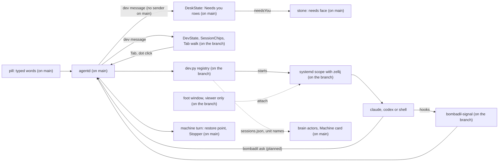

# Coding sessions

> **Status:** In progress. Pieces 1 and 2 are built on an unmerged branch, with the plain own copy of piece 3 and the `BOMBADIL_SESSION=1` mark that `dev.py` sets and nothing reads. The rest of piece 3 and pieces 4 to 6 are designed and have no code. Nothing on `main` creates a session or sends a `dev` message. `main` has only readers that wait for the piece: the desk's Needs you rows, the stone's needs-you mark, the brain's and the Machine card's reading of the session units, and two readers of the text mark a session's request is to carry. The branch holds `main` only up to `969b80b`: `main` at `7176e55` has 42 commits it lacks, among them the user services and dragging desk cards ([Known gaps](#known-gaps) says where they meet the branch).  
> **Code:** On `main`, what the piece builds on or reads: `src/bombadil/agentd.py`, `src/bombadil/outbox.py`, `src/bombadil/procs.py`, `src/bombadil/snapshots.py`, `src/bombadil/providers.py`, `src/bombadil/launcher.py`, `src/bombadil/narrate.py`, `src/bombadil/notices.py`, `src/bombadil/mail/tools.py`, `src/bombadil/mcp_server.py`, `src/bombadil/paths.py`, `src/bombadil/hypr.py`, `src/bombadil/watch.py`, `src/bombadil/vitals.py`, `src/bombadil/brain/actors.py`, `src/bombadil/brain/service.py`, `shell/PillState.qml`, `shell/QueueChips.qml`, `shell/NoticeChips.qml`, `shell/DeskState.qml`, `shell/Stone.qml`, `shell/shell.qml`, `bin/bombadil`, `iso/airootfs/etc/skel/.config/hypr/hyprland.lua`, `iso/airootfs/etc/systemd/user/bombadil-agentd.service` and `iso/airootfs/etc/systemd/user/bombadil-shell.service`. Built on an unmerged branch, not on `main`: `src/bombadil/dev.py`, `bin/bombadil-signal`, `shell/DevState.qml`, `shell/SessionChips.qml`, `shell/SessionPeek.qml`, `share/zellij/config.kdl`, `iso/airootfs/etc/claude-code/managed-settings.d/50-bombadil.json`, `iso/airootfs/etc/codex/config.toml`, `iso/airootfs/etc/codex/requirements.toml`, `tests/test_dev.py` and `tests/test_sessions_qml.py`; and the branch's additions to files that exist on `main`: `src/bombadil/agentd.py`, `src/bombadil/launcher.py`, `src/bombadil/paths.py` (`projects_dir`, `dev_dir`), `src/bombadil/hypr.py` (`events_path`), `src/bombadil/watch.py`, `bin/bombadil`, `shell/shell.qml`, `iso/airootfs/etc/skel/.config/hypr/hyprland.lua`, `iso/airootfs/etc/systemd/system/bombadil-live.service` and `iso/airootfs/usr/local/bin/bombadil-install` (lingering for the user), `iso/packages.x86_64` (`zellij`), `scripts/build-iso.sh` (links `bombadil-signal`), `iso/airootfs/usr/local/bin/bombadil-smoke`, `tests/test_agentd.py`, `tests/desktop/driver.py`, `tests/desktop/fake_api.py`, `tests/desktop/Dockerfile` and `tests/desktop/inside.sh`. Planned, with no code anywhere: `bombadil-worktree` and `bombadil-checkpoint`.  
> **Design:** [Building on Bombadil, the brief](../design/dev-brief.md), [the page](../design/pages/building-on-bombadil.html)  
> **Verified:** 2026-11-08 against `main` at `7176e55`: every statement about `main` below was re-read at that commit, and `src/bombadil/dev.py` is not on `main`. The unmerged branch was read at `812d436`, which holds `main` only up to `969b80b`: its last commit merges `main` at that point and changes none of the coding-session files, which are the same as at `7c09bcd`, where they were first read one by one (`dev.py`, `bombadil-signal`, the three QML files, the zellij and hook files, `tests/test_dev.py` and `tests/test_sessions_qml.py`). The branch's additions to the files it shares with `main` were read at `812d436` as its difference from `969b80b`. `tests/test_dev.py` gives 19 passed, run from an extracted copy of `812d436`. `tests/test_sessions_qml.py` has 6 tests and was not run, because PySide6 is missing here. A trial merge of `main` into the branch was made in a throwaway clone (see [Known gaps](#known-gaps)); the test counts under [Tests](#tests) come from runs on extracted copies of `main`, of the branch and of that merge. Pieces 4 to 6 have no code anywhere. The vendor facts in the brief are dated 27 Sep 2026 and were not re-checked.

Coding sessions are how Bombadil is meant to host the coding tools people already use, Claude Code and Codex, unchanged. Each one is meant to keep running when its window closes, to come back when its name is typed, to show as one dot beside the pill, and to be fenced off from the machine's own agent. It exists because a coding session on `main` is a bare `foot` window, which ends with its window and with the compositor, and because nothing under the home folder can be undone. What `main` has at `7176e55` is the receiving end: Needs you rows and a stone mark that wait for a `dev` message nothing sends, a brain and a Machine card that look for the unit names this piece is to write, two readers of the text mark a session's request is to carry, and the user units that keep `agentd` and the bar alive, beside which a session's own unit is meant to sit.

## How it works

### The six pieces and where each stands

None of this can be used from `main`. Each part says whether it is built on an unmerged branch or designed only.

- **Named sessions that outlive their window** (piece 1, built on an unmerged branch). `claude acme`, `codex acme` or `shell acme`, with an optional role (`claude acme reviewer`), start the vendor's own tool, or the person's shell, with no model call. The project word must name a folder that exists under `~/Projects`; any other word matches nothing and goes to the model. Each session runs in an invisible `zellij` session, in its own systemd user scope where `procs.scope_supported()` holds (otherwise with no scope and no slice). The `foot` window is only a viewer: closing it leaves the session running, and typing the name attaches a viewer again, mid-sentence. A session is named by its role (`reviewer`) or, with none, by its tool; `reviewer`, `reviewer acme` and `reviewer on acme` bring it back, the project word alone (`acme`) brings back one of the project's sessions (live ones first, then the most recent) or says how to start one, and a role that exists on two projects answers "say which" and does nothing. A Claude or Codex session works in the checkout while no live Claude or Codex session holds it (one started by hand in exactly that folder counts), and gets a `git worktree` under `~/Projects/.work/<repo>/<role>` while one does. A session that already has a copy keeps it, and a folder that is not a git repository gets no copy, so the session shares the folder. `shell` sessions always open in the checkout and never take it from anyone. After a reboot sessions come back dim and nothing resumes by itself. Bringing one back resumes a Claude session by the id Bombadil gave it with `--session-id` (the SessionStart hook replaces it when the conversation switches, as with `/clear` or `/resume`), and a Codex session by the id its SessionStart hook reported (a fresh one when none was), and starts a `shell` session as a fresh shell. `end <name>` ends a session and keeps its copy; `end` also takes the tool and the project (`end claude acme`, `end codex acme reviewer`), or the project alone when it has one session, and says which when it has several.
- **Dots for whose turn it is** (piece 2, built on an unmerged branch, apart from the designed-only parts named here). One chip per project, one dot per session: moving while it works, lit when it is your turn, red when it failed, dim when asleep, a ring for a session started by hand and seen through the same hooks ("yours"). More than three projects fold into one chip ("4 projects · 1 waiting") that opens on a click. A click on a dot brings its session to the front; a click on a red dot that stopped opens its last screen first (`bombadil dev why`), and typing its name resumes it. The empty pill says who waits and Tab walks to the next one, ending with "Nothing needs you." The session in front never announces itself, and hovering a dot shows its last lines. The same `dev` message feeds the Needs you rows and the stone's mark on `main`, so on the branch the stone knocks while a session that asked, finished or failed has not been looked at. Designed only: the "Claude 5-hour limit at 84%" line, reconciling with `claude agents --json --all`, notifications from plain shells, and the "what's running?" card (the branch opens a plain list in the details drawer).
- **The fence** (piece 3, designed only; the branch has the own copy and the `BOMBADIL_SESSION=1` mark). A session runs as the person without sudo (`setpriv --no-new-privs`). A refused `sudo pacman -S` points it to `bombadil ask "install postgresql 17"`, which shows as "api on Acme asks: install postgresql 17 [Do it]"; Tab runs it as an ordinary machine turn with a restore point and Undo. Each session also gets ten ports, a database name and a memory limit, and a developer note that only sessions read.
- **Undo per session** (piece 4, designed only). `undo this`, `undo <name>` and `redo` put a session's last turn back from a git checkpoint taken by `bombadil-checkpoint` around each prompt, skipping files changed since and saying what was covered. A bare `undo` keeps its one meaning, the machine's last turn.
- **Handing words across** (piece 5, designed only). `tell api …` types into a session's terminal, marked "(from the pill)"; `give this to claude on bombadil` starts a session from the person's own words; `have codex review builder` starts a read-only session; "While you were away" is built from the registry with no model call. The Claude app on the phone lists Claude sessions under the same names. Codex has no phone host on Linux.
- **Try, read, ship** (piece 6, designed only). `run it`, `what did builder change?` with a Diff button, an opt-in check after each turn, then `ship builder` (the session commits, Bombadil pushes and opens the pull request), `land builder` for a local merge and `clean up`. Nothing is meant to be pushed or merged before the person says so.
- **Designed only, beyond the six pieces:** a project card, standing roles in `.bombadil/project.toml`, watchers that run once, a native review app, and the brief's list of [gaps not designed yet](../design/dev-brief.md#not-designed-yet).

### The flow

Boxes marked "on main" exist at `7176e55`; the others are on the unmerged branch, and the edge from a session's `bombadil ask` is planned.



### What it builds on in `main`

| Where on `main` | What is there | What the piece does with it |
|---|---|---|
| `src/bombadil/agentd.py`: the module docstring, `AgentD._client`, `AgentD.handle`, `AgentD._persons` | One Unix socket of newline-delimited JSON, every event broadcast to every client; a client that connects is greeted with `status`, `entries`, `setup` and the live notices, and the greeting wakes the vitals reading. `AgentD.handle` accepts `asked_by` on a `prompt` (checked by `_WHO`), `turn_start` echoes it and the desk's Now card reads it. `bombadil ask` sets none, but `handle` marks a prompt `asked_by: "agent"` when it comes from a process of an agent's turn or a client it cannot name (`_persons`, added for mail). A turn with the mark has no `turn_prompt`, so the `desk` tool is refused for it and the mail tools get no typed words; a launcher word sent with the mark is still answered locally; the mark of a turn that the limit stopped is kept when `_rest_turn` puts the turn back at the front of the queue, and the marks of turns that were unqueued are dropped when the next turn starts. `handle` neither sends nor handles a `dev` message. | The branch adds `dev` and `dev-signal` in and a `dev` broadcast out, and puts the current `dev` message into the greeting (`AgentD._greet`, a task that writes the greeting beside the reading of the client's first line). A session's `bombadil ask` comes from a process outside every turn (`outbox.from_agent` is false for it, checked with a fake `/proc` on 2026-11-08), so on `main` it would count as the person's own typed words. The brief names the `[asked by <who>, untrusted]` text mark for a session's request and does not say whether the request also sets the `asked_by` field; the field is what makes a turn untyped, so piece 3 has to set it. |
| `src/bombadil/agentd.py`: `AgentD.turn`, `AgentD._log` | Each turn takes a snapper restore point where snapper is configured (`Snapshots.available`), and runs in a scope named `bombadil-turn-<pid>-<turn>-<time>` where systemd supports one (`procs.scope_supported`), with `Turn.cwd` defaulting to the home folder (`Turn` in `src/bombadil/providers.py`) and `BOMBADIL_TURN` and `BOMBADIL_SOCKET` in its environment. Its `turns.jsonl` row has `n`, `unit`, `started` and `files` (what the turn wrote and read), which the brain reads. | Leaves the restore point and the turn scope alone. The branch adds one environment variable, `BOMBADIL_OS=1`, to every turn's environment, which is the only mark `bombadil-signal` reads to skip the machine's own agent. Sessions are not turns: no restore point and no turn scope. Their own git undo is designed only (piece 4). |
| `src/bombadil/paths.py`: `is_turn_row`; `src/bombadil/watch.py`: `history_lines` | A `turns.jsonl` row with a `kind` other than none or `turn` is no turn: `is_turn_row` keeps it out of turn numbers (`agentd._last_turn`) and out of the brain's `TurnsLog` witness, and `history_lines` shows only turn rows and `local` rows. | The branch writes `{"kind": "dev"}` rows when a session's tool exits by itself. Its own branch for them in `history_lines` sits after the same filter, on the branch as well as after a merge, so it never runs: with one `dev` row and one `local` row in `turns.jsonl`, the history shows the `local` row only (run on the branch's `watch.py` on 2026-11-08). |
| `src/bombadil/procs.py`: `SCOPE`, `scope_supported`, `cgroup_of`, `Stopper.stop`, `PROTECTED_ARGS` | `SCOPE` is the `systemd-run --user --scope` prefix. `Stopper.stop` ends a turn's descendants, its scope's cgroup and its process group, except windows that `_is_window` recognises (the `PROTECTED_ARGS` windows, `nautilus` and `bombadil-app run <name>`) and their children, and removes a stale pacman lock. `cgroup_of` and `scope_cgroup` accept only a cgroup named `bombadil-turn-*`. | The branch reuses `SCOPE` and `scope_supported` for session scopes. `Stopper` must never reach a session: a `bombadil-dev-*` scope is never taken for a turn's cgroup. |
| `src/bombadil/snapshots.py`: `Snapshots` | Snapper snapshots of the config `root` only (`config_name="root"` in `__init__`). See [restore points](restore-points.md). | Leaves it. Per-session undo is separate and planned. |
| `src/bombadil/brain/actors.py`: `Sessions`, `from_event`, `DEV_SLICE`; `src/bombadil/brain/service.py` | A writer in a scope under `bombadil-dev-<project>.slice` is named `session:<project>/<name>`. The name comes from `~/.local/state/bombadil/dev/sessions.json`: a row whose `unit` (without `.scope`) is the cgroup's scope, with a `name` or `role`. `Sessions.lookup` accepts a list of rows or a dict of rows. [brain.md](brain.md) has the rest; `tests/test_brain_core.py` covers it. | The branch writes the registry as `{"sessions": [...]}`, which `Sessions.lookup` does not read, and writes a project's hyphens as underscores in the slice name. Checked on 2026-11-08 by saving a session with the branch's `Dev._save` for the project `my-app`: `Sessions.lookup` finds no row, and a writer in the session's scope is named `session:my_app`, with no role. One side changes when the two meet. |
| `src/bombadil/vitals.py`: `classify_unit`, `DEV_SLICE`, `RULES`, `ceiling_of` | The Machine card counts the memory of every unit whose name starts `bombadil-dev` (`bombadil-dev.slice`, `bombadil-dev-<project>.slice`, `bombadil-dev-<project>-<role>-<run>.scope`) as the sessions' share. It says "Coding sessions are near their memory limit" when `bombadil-dev.slice` crosses 90% of its `memory.high`, else of its `memory.max`; with neither set there is no ceiling and no line. `tests/test_vitals.py` covers it. | The branch's scopes and per-project slices are counted as they are. The branch sets no `MemoryHigh` or `MemoryMax` (a search of the branch's `src`, `iso`, `share` and `bin` finds none), so the ceiling line waits for the fence (piece 3, designed only). |
| `src/bombadil/launcher.py`: `match`, `entries`, `MODEL_WORDS`, `_undo` | Exact words skip the model. On `main`, `claude acme`, `end reviewer`, `undo this`, `what's running?` and `sessions` match nothing and go to the model (`launcher.match` run on 2026-11-08), which says what is running with the os-mcp `job` tool's `list` (`tests/test_agentd.py` scripts that turn for "what is running?"). In `match`, after the picture, widget-question, sign-in, provider and rest words come the core commands, then the model words (`MODEL_WORDS`: `use opus`, `use sonnet` and their variants, Action kind `model`), then the brain's words (`BRAIN_COMMANDS`), then Mail's words, app names, panels and utility words (`UTILITY_COMMANDS`, which at `7176e55` include volume up, volume down, mute and unmute). `_undo` answers "Your home folder and apps stay as they are." | The branch adds project, role and session words in `_dev_match`, called at the place where `main` has the model words: right after the core commands, ahead of the brain's words and of app names. A merge has to choose the order of the two (the trial merge conflicts there). It also makes `whats running`, `what is running`, `sessions`, `coding sessions` and `list sessions` open the plain list (`bombadil dev list`), so "what's running?" no longer reaches the `job` tool; the branch edited that test to "list my jobs". Run on a trial merge on 2026-11-08: a folder `~/Projects/mail` makes `mail` and `open mail` match the project, in front of Mail's own word. `undo this` and `undo <name>` are designed only (piece 4); the branch does not match them. |
| `src/bombadil/narrate.py`: `_ASKED_RE`, `prompt_reads`; `src/bombadil/mail/tools.py`: `_OUTSIDE`, `typed_words` | A prompt block `[asked by <who>, untrusted]` is recorded as an outside read of kind `session`, or of kind `app` when `<who>` starts with `app `, and the mail tools leave the same block, and the `[Screen]` block, out of the person's typed words. Nothing on `main` or on the branch sends that line: the app kit's `Agent.ask` sends `[from app <name>]` (`src/bombadil/appkit/native/agent.py`), which neither reads. | The brief has a session's request arrive marked `[asked by coding session <name> on <project>, untrusted]` (designed, piece 3; no code sends it). |
| `src/bombadil/mcp_server.py`: `OsTools._register` and its `_tool` decorator | Each os-mcp tool is registered with `@t(name, description, properties, required)`; the mail tools and the app kit's tools register from `_register` too. There is no session tool. See [os-mcp.md](os-mcp.md). | Piece 5 adds `list_sessions`, `start_session`, `tell_session`, `session_screen`, `stop_session` and `end_session` here. Sessions are to get a separate `bombadil-dev` server instead, so that they cannot call `rollback` or `create_app`. |
| `shell/PillState.qml`: `handle`, `needsYou`, `face`; `shell/shell.qml` | `PillState.handle` follows one turn by id; a message whose `type` is not one it handles (`status`, `entries`, `setup`, `notice`, `notice_end`, `ai`, `found`, `summon`, `local`, `queued`), `dev` included, reaches `if (ev.type !== "event") return`. `needsYou` has one writer, the desk, and `face` tests it before `working`. In `shell.qml`, `Keys.onTabPressed` only completes a name (`pillState.completion`), and the empty field's text is the resting hint or "Ask anything". | The `dev` message carries no turn id, so the turn logic is untouched. The branch makes Tab in an empty pill call `devState.next()` while any session exists, and the field's text the `dev` message's `line`, and draws its chips in a row above the pill's left end. |
| `shell/DeskState.qml`: `_applyDev`, `onRowAction`, `needsYou`; `shell/Stone.qml` | `DeskState.handle` sends a `dev` message to `_applyDev`, which builds the Needs you rows from `sessions` and `attention`; its Open button sends `{"type": "dev", "action": "open", "key": key}`, which nothing answers on `main`. `needsYou` is true while there is one row or more, a `Binding` writes it to `PillState.needsYou`, and the stone then has its `needs` face: amber, two knocks and a glow. `needsPresent` wants two rows, so one waiting row is no card, and nothing on `main` reads a `dev` message's `line`: for one row the stone knocks and no line is drawn. `lost()` empties the sessions and the rows go with them. See [desk.md](desk.md#the-needs-you-mark). | The branch's `dev` message is the feed for all of it: it supplies the message and the `open` action, and the mark needs no change. The line for one waiting session is the branch's (`line`, drawn by `shell/shell.qml`). |
| `shell/QueueChips.qml` | Grey chips from `pill.queue`: "next", or the time an ask runs while the AI rests. | The branch adds `SessionChips.qml` beside it: a chip per project, a dot per session. |
| `src/bombadil/notices.py`, `shell/NoticeChips.qml`: `Notices` | The lines another service says above the pill, with up to three chips and a time to live (mail uses them). | The branch does not use them: its line is the empty field's text. Which of the two carries a session's line after a merge is open. |
| `bin/bombadil` | `ask` sends `{"type": "prompt"}` and streams the reply; when the AI rests it says so and exits 75, the ask staying queued. `stop` sends `{"type": "stop"}`; `brain` reads the brain; `mail` reads Mail. No `dev` subcommand. | The branch adds `bombadil dev …`, and the brief gives `ask` a second meaning inside a session. |
| `iso/airootfs/etc/skel/.config/hypr/hyprland.lua`, `iso/airootfs/etc/systemd/user/bombadil-agentd.service`, `bombadil-shell.service`, `mako.service.d/restart.conf` | `SUPER + Return` runs `foot`. `hyprland.start` runs one `hl.exec_cmd` that imports the session environment and restarts the units `bombadil-agentd bombadil-shell mako`, then another that hands Mail's unit the session's environment; it starts no daemon directly. The units restart on exit (`Restart=always`, `RestartSec=1`, `StartLimitIntervalSec=0` in `[Unit]`), and `bombadil-agentd.service` has `KillMode=process`. `SUPER + CTRL + Escape` runs `systemctl --user restart bombadil-shell`, `SUPER + Escape` runs `bombadil stop`, and the terminal panel is `foot --app-id=bombadil-terminal` (`PANELS` in `src/bombadil/hypr.py`). No rule for session windows. See [the session stays alive](session-services.md). | The branch adds a window rule for the viewer (`bombadil-sessions`, matching the app id prefix `bombadil-session-`) and `hl.exec_cmd("foot --server")`, written in the three-line block that started `agentd`, `bombadil-shell` and `mako` before `main` replaced it with the units line: a trial merge conflicts there. A session's scope is meant to sit beside the agentd unit, not in it. The plain terminal stays plain. |

## Interfaces other pieces depend on

Nothing on `main` sends or answers any of these. The one part of them that `main` has is the receiving end in `shell/DeskState.qml`, which reads the `dev` message (`_applyDev`) and sends the `open` action. The State column says which are built on the unmerged branch and which are planned (no code anywhere).

| Name | Kind | State |
|---|---|---|
| `{"type": "dev", "sessions", "front", "attention", "line"}`, sent to a client when it connects and on every change; a session has `key`, `project`, `projectTitle`, `role`, `tool`, `toolTitle`, `title`, `state` (`working`, `idle`, `asked`, `done`, `failed`, `asleep`), `alive`, `unseen`, `yours`, `copy`, `since`, `last`, `lines`. `DeskState.qml` on `main` reads `key`, `projectTitle` or `project`, `role`, `last` and `state` | agentd to clients | on the branch |
| `{"type": "dev", "action": "next"\|"open"\|"end"\|"why", "key"}`, answered by an event `{"kind": "local", "action": "session", "target", "ok", "text"}`. `DevState.open` sends `why` for a dot that is red and not alive and `open` for any other; `why` opens `bombadil dev why <key>` in the details drawer when a last screen was kept and sends no answer when none was | clients to agentd, and back | on the branch |
| `{"type": "dev-signal", "tool", "event", "session_id", "cwd", "tool_name", "tool_input", "notification_type", "text", "dev_id", "run", "pid", "pid_start", "t"}`; the wrapper's own `"event": "exit"` carries `code` and, in `text`, the path of the last screen | hooks and the wrapper to agentd | on the branch |
| `bombadil dev list`, `next`, `why <key>`, `run <key> [--resume]` | commands | on the branch |
| `bombadil-signal claude`, `codex`, `codex-notify` | hook program | on the branch |
| Claude Code hooks `SessionStart`, `UserPromptSubmit`, `PreToolUse` (matcher `AskUserQuestion`), `PermissionRequest`, `PostToolUse`, `Notification`, `Stop`, `StopFailure`, `SessionEnd` in `/etc/claude-code/managed-settings.d/50-bombadil.json`; Codex hooks `SessionStart`, `UserPromptSubmit`, `PermissionRequest`, `PostToolUse`, `Stop`, `Interrupt`, `SessionEnd` in `/etc/codex/requirements.toml` and `notify` in `/etc/codex/config.toml` (both Codex files set `check_for_update_on_startup = false`) | managed hooks | on the branch |
| `claude --session-id <id> -n "<role> on <Project>"` for a first start and `claude --resume <id> -n …` to resume; `codex --no-daemon`, and `codex --no-daemon resume <id>` to resume; the shell is `$SHELL` or `/bin/bash`; Claude and Codex go through `mise exec --` when `mise` is on the path. All of it runs as `bombadil dev run <key> [--resume]` in a pane of `zellij --config share/zellij/config.kdl attach --create-background <name> --close-on-exit` (`dev.command_for`, `Dev._launch`) | tool command lines | on the branch |
| `~/.local/state/bombadil/dev/sessions.json` (`{"sessions": [...]}`; an ended row is kept 30 days, a hand-started one goes with its process), `signals.jsonl` (what hooks wrote while agentd was away), `<slug of key>.last`, for example `acme-reviewer.last`; `{"kind": "dev"}` rows in `turns.jsonl` | registry, spool, last screen, log | on the branch |
| `bombadil-dev-<project>-<role>-<run>.scope` in `bombadil-dev-<project>.slice` (the branch cuts the project at 24 characters, and writes its hyphens as underscores in the slice name only); the `zellij` session `bombadil-<project cut at 24>-<role>`; a copy's git branch `bombadil/<role>` in the person's repository; `share/zellij/config.kdl`; lingering for the user (`loginctl enable-linger user` in `iso/airootfs/etc/systemd/system/bombadil-live.service` for the live image, a file under `/var/lib/systemd/linger` in `iso/airootfs/usr/local/bin/bombadil-install`); `zellij` in `iso/packages.x86_64` | units, host config | on the branch |
| `BOMBADIL_SESSION=1`, `BOMBADIL_DEV_ID`, `BOMBADIL_DEV_RUN`, `BOMBADIL_PROJECT`; `BOMBADIL_PROJECTS` (the projects folder, default `~/Projects`); `BOMBADIL_OS=1`, set by agentd in every turn's environment and read by `bombadil-signal` | environment | on the branch |
| `claude\|codex\|shell <project> [role]`; `<project>`; `<role>`, `<role> <project>` and `<role> on <project>`; `end <role>` (with the same project forms), `end <tool> <project> [role]` and `end <project>`; `whats running`, `what is running`, `sessions`, `coding sessions` and `list sessions`. A word that names a role on two projects, or a project with several sessions to end, is answered "say which" (Action kind `choose`) | launcher words | on the branch |
| `launcher.Action` kinds `session`, `project`, `end`, `choose` and `sessions`, with the added fields `tool` and `role`; `launcher.match(text, app_list, dev_names, busy)` and `launcher.entries(app_list, dev_names)` take the registry; window app id `bombadil-session-<slug>`; `quickshell ipc call dev chips` (the desktop test) | launcher, window | on the branch |
| `bombadil ask` from a session, `bombadil-worktree`, `.worktreeinclude`, `setpriv --no-new-privs`, `PORT`, `BOMBADIL_PORTS`, `COMPOSE_PROJECT_NAME`, `BOMBADIL_DB`, `bombadil-dev.slice` limits | fence | planned |
| `bombadil-checkpoint pre\|post`, `refs/bombadil/<role>/<n>/pre` and `post`, `.git/bombadil/<role>.index`; `undo this`, `undo <name>`, `redo` | undo | planned |
| `stop <name>`, `stop everything`, `run it` | launcher words | planned |
| `remoteControlAtStartup` (Claude Code user settings), `CLAUDE_CLIENT_PRESENCE_FILE`, `crossSessionInbound` (set to refuse in the machine agent's own session) | Claude Code settings and environment | planned |
| os-mcp `list_sessions`, `start_session`, `tell_session`, `session_screen`, `stop_session`, `end_session`; MCP server `bombadil-dev` with `ask_machine`, `progress`, `show_preview` | tools | planned |
| `BOMBADIL_SHIP=1`, `core.hooksPath` pre-push hook, `~/.local/state/bombadil/projects/<p>.toml`, `.bombadil/project.toml` | ship and projects | planned |

## Where state lives

All of this is on the unmerged branch; `main` writes none of it.

| What | Where | Lifetime |
|---|---|---|
| The registry | `~/.local/state/bombadil/dev/sessions.json` (`paths.dev_dir()`), written by agentd alone (`Dev._save`, through a temporary file and a rename) and read by agentd at start (`Dev._load`), by `bombadil dev run`, `list` and `why`, and by the brain | Survives a restart of agentd and a reboot. A row from an earlier boot comes back `asleep`, an ended row is forgotten after 30 days, a hand-started row is dropped when its process is gone |
| Hook events that arrived while agentd was away | `signals.jsonl` beside it, appended by `bombadil-signal` and by `dev.send_signal` | Read and deleted by agentd when it starts (`dev.take_spool`) |
| A stopped session's last screen | `<slug of key>.last` beside it, written by `bombadil dev run` when a Claude or Codex tool exits with a non-zero code inside zellij | Kept beside the registry; `bombadil dev why` and the `why` action read it through the row's `why` |
| The session's processes | a systemd user scope `bombadil-dev-<project>-<role>-<run>.scope` in `bombadil-dev-<project>.slice`, holding the `zellij` server and the tool; the `zellij` session is `bombadil-<project>-<role>`, with `session_serialization false` in `share/zellij/config.kdl` | Ends when the tool exits (`bombadil dev run` kills the `zellij` session) or on `end` (`zellij kill-session`, then `systemctl --user stop` of the scope). A restart of agentd, the bar or the compositor is not meant to touch it |
| Lingering | `loginctl enable-linger user` run by `bombadil-live.service` on the live image; a file under `/var/lib/systemd/linger` made by `bombadil-install` on an installed disk | Keeps the user's systemd running without a login, so the scopes outlive the desktop session |
| The viewer | a window of `footclient` when a `foot --server` socket exists (`foot-<WAYLAND_DISPLAY>.sock` in `XDG_RUNTIME_DIR`, `dev.foot_server`), else a plain `foot`; app id `bombadil-session-<slug of key>` | Closing it ends nothing |
| A copy | `~/Projects/.work/<repo>/<role>`, a `git worktree` on the branch `bombadil/<role>` of the person's repository | `end` keeps it; nothing on the branch removes one |
| Which window is in front, and the last `dev` message sent | agentd's memory: `Dev.front` from Hyprland's `activewindow` events (`AgentD._follow_focus`, `hypr.events_path`), and `AgentD._dev_last` | Lost when agentd restarts and set again by the next focus change |
| The dots, the line and the peek | the bar's memory: `DevState` (`sessions`, `attention`, `line`, `front`, `peeked`, `expanded`) | Replaced by every `dev` message; `lost()` clears only the line, so the dots stay while agentd is away |

## Principles it keeps

- [Full access with undo](../principles.md#full-access-with-undo): the machine's agent keeps sudo and one restore point per turn; a session is to get neither (designed, piece 3). The trap is giving a session passwordless sudo for convenience: its root change then lands inside whichever machine turn is open, and undo reverts it or misses it.
- [One machine one conversation](../principles.md#one-machine-one-conversation): a session is meant to be a program the person runs, never queued behind the pill and never given the pill's "this" context. The trap is letting the pill forward typed text to the session in front.
- [The person's press reaches people](../principles.md#the-persons-press-reaches-people): nothing is meant to be pushed, opened as a pull request or merged before `ship` or `land` (designed, piece 6; the pre-push hook that enforces it exists neither on `main` nor on the branch, and a branch session runs the vendor's tool as the person with nothing to stop a push). The trap is relying on a vendor's background sessions, which commit and push on their own.
- [Nothing runs unseen](../principles.md#nothing-runs-unseen): every session has a dot, and nothing resumes after a restart until the person asks (both built on the branch). The trap is a `zellij` session with no dot, or an automatic resume.
- [Quiet at rest](../principles.md#quiet-at-rest): the pill is meant to speak only when it is the person's turn, something failed or (designed only) a limit is near, never about the session in front. On the branch `Dev.line` speaks for a question, a finished turn or a stop, and `Dev.attention` leaves out the session in front. The trap is a line at the end of every turn, or bells from background panes.
- [Recovery without the broken part](../principles.md#recovery-without-the-broken-part): on `main` `agentd` and the bar are user units that systemd restarts (`bombadil-agentd.service` and `bombadil-shell.service`, with `KillMode=process` on the first), so a session is to sit beside them and not in them. The branch starts each session with `systemd-run --user --scope` (`procs.SCOPE`) in a unit of its own and turns lingering on, so that restarting `agentd`, the shell or the compositor does not touch it; the branch's desktop test restarts a hand-started `agentd` and checks that the sessions stay. The ISO smoke on `main` kills and revives `bombadil-agentd`, `bombadil-shell` and `mako` (`revives` in `iso/airootfs/usr/local/bin/bombadil-smoke`), but with no session running, and no test restarts a unit or the compositor while a coding session runs. The trap is starting a session inside a turn's process tree, where `Stopper` would end it.

## Extending it

The steps below are the ones the branch follows. `src/bombadil/dev.py` is not on `main`, so none of them can be done there before a merge.

### Add a launcher word for sessions

1. In `launcher._dev_match`, return an `Action` of a kind with a `target`, `verb`, `title`, and `tool` and `role` where they apply. `launcher.match` calls it with the registry (`dev_names`) after the core commands, so a word it takes never reaches the model.
2. Add `Launcher._<kind>(action)` returning `(ok, text)`: `Launcher.run` finds the method by `getattr(self, f"_{action.kind}")`. Add the kind's lines to `Launcher.doing` and `Launcher.failed`. A kind that `AgentD.local` does not name answers with a `local` event and a `local` row in `turns.jsonl`.
3. Do the work through a `dev.Dev` method (`open`, `bring`, `open_project`, `end`). `Dev` holds a lock of its own, so `agentd` calls it through `asyncio.to_thread`, and it calls `on_change` after anything the bar shows, so the dots follow.
4. If Tab should complete the word, return it from `Dev.names`. `AgentD._watch_apps` sends the bar fresh entries within a few seconds when the names change.
5. Add the case to `tests/test_dev.py` (`test_launcher_forms_name_projects_and_sessions` and its neighbours) and run the tests in [Tests](#tests).

### Add a hook event or a state

1. Register the event in the managed hook file of the tool (`50-bombadil.json` for Claude Code, `requirements.toml` for Codex), with the command `bombadil-signal claude` or `bombadil-signal codex`.
2. Map it in `Dev.signal`: the sets `WORKING` and `ASKING`, or a branch of its own, set `state`, `unseen`, `last` and the lines for the hover.
3. If the state should call for the person, add it to `Dev.attention` (its rank) and to the sentences of `Dev.line`.
4. Give the dot a look in `DevState.look`, `color` and `stateWords`; `SessionChips.qml` draws what `look` says.
5. Cover the event in `tests/test_dev.py` (`test_hooks_move_a_session_through_its_states`, `test_managed_hooks_cover_the_events_the_dots_need`) and the look in `tests/test_sessions_qml.py`.

### Add a coding tool

1. Add its name to `dev.TOOLS` and `dev.TOOL_TITLES`, its command line to `dev.command_for`, and its name to the regular expression `DEV_RE` in `src/bombadil/launcher.py`, which lists the three tools.
2. Teach `bin/bombadil-signal` the tool's payload in `message`, and ship a managed hook file for it under `iso/airootfs/etc/`.
3. A session of the tool started by hand is listed as "yours" from `Dev._yours`, which takes the tool name from the signal.

### Change what a session records

1. Add a field to `dev.Session`. `Session.from_dict` ignores keys it does not know, so an older registry still loads, and `asdict` writes the field.
2. Put it in `Session.view()` only when the bar needs it. The brain reads `unit` and `name` or `role` from each row and nothing else.
3. Keep the file readable by the brain: see the registry row in [What it builds on in `main`](#what-it-builds-on-in-main).

### The order of work for the pieces that have no code

1. Pieces 1 and 2 first: they are useful alone. The two things the brief asks for before them are on `main` at `7176e55`: the status-line and app-kit changes (`shell/StatusLine.qml`, `src/bombadil/appkit/`), and `agentd` and Quickshell as systemd user services ([the session stays alive](session-services.md)).
2. Piece 3 next. It is what lets parallel sessions exist without breaking the confirmed undo model. Before it, test `setpriv --no-new-privs` beyond `sudo` and `newuidmap`, and that a `git worktree` under `~/Projects/.work` passes Claude's worktree check. No test does the second on its own, though the branch's desktop test (the section headed `10. Coding sessions`, step f) runs the real Claude Code in such a copy and answers its question there.
3. Then pieces 4 to 6, which read from the first three.
4. The branch's desktop test covers Shift+Enter reaching Claude Code through `foot` and `zellij`, under headless sway. Its coding-sessions section sends only keys (`wtype`) and no pointer events, so a hover or a click on a dot and a click on the fold chip are covered only offscreen, by `tests/test_sessions_qml.py`. The desktop test on `main` has a virtual pointer (`tests/desktop/pointer.py`), which that section could use after a merge. Still not covered: the mouse inside `zellij`, OSC 9, 99 and 777 reaching `foot`, and a vendor tool under Hyprland in a VM; the branch's smoke `dev-*` checks run a `shell` session there. The brief's fallback host is `tmux`, and nothing in the tree uses it.

### Merge the branch into `main`

1. Resolve four conflicts. `docs/README.md`: both sides add lines. `iso/airootfs/etc/skel/.config/hypr/hyprland.lua`: keep `main`'s units line, which `tests/test_iso_profile.py` pins, and put `foot --server` after it, or make the server a socket-activated unit as the brief says. `src/bombadil/agentd.py`: the module docstring only, the `dev` message beside the `desk` message with its `stripped` list. `src/bombadil/launcher.py`: `match`, where the call of `_dev_match` and the model words sit at the same place after the core commands, and the merge has to choose their order.
2. Make the registry and the brain agree: the brain reads a list or a dict of rows and unescapes `\x2d` in a slice name, and the branch writes `{"sessions": [...]}` and a project's hyphens as underscores (`my_app`).
3. Decide whether a session's line is the empty field's text (the branch) or a notice (`Notices`).
4. Update this page, the row in [the roadmap](../roadmap.md) and the status block of [the brief](../design/dev-brief.md), and fold the branch's own notes on the piece (`docs/dev-sessions.md`, and its lines in `docs/ARCHITECTURE.md` and `docs/README.md`) into this page.

## Tests

On the branch (not on `main`):

| File | What it proves |
|---|---|
| `tests/test_dev.py` (19 tests) | The launcher forms for projects, roles and sessions; a session coming back by name and never started twice; `end` by role, tool and project, keeping the copy; the checkout for the first session and a copy for the next; sessions asleep after a restart and resumed by id; a session still running after `agentd` restarts, and one whose `zellij` went away taken for failed; a `zellij` that cannot be asked never taken for gone; hook events moving a session through its states; several waiting merged into one line and Tab's walk; bringing a session back counting as seen; a crashed tool turning red and resuming by name; hand-started sessions listed as "yours"; the registry the wrapper and the list read; the wrapper's exit report; the hook program's spool and its skip of `BOMBADIL_OS=1`; the managed hook files; the path defaults |
| `tests/test_sessions_qml.py` (6 tests) | The bar offscreen: no chips without sessions, a chip per project and a dot per session, hover and click, a red dot showing why first, rings for "yours" and the fold above three projects, the line and Tab |
| `tests/test_agentd.py` (the branch's edits) | On the branch the greeting ends with the `dev` message (`test_turn_round_trip` and the helpers that read the greeting), and a client that sends its line, half-closes and leaves at once is still read (`test_a_line_from_a_client_that_leaves_at_once_is_still_read`, run with a greeting that takes 0 and 0.3 seconds), which pins that `AgentD._greet` writes the greeting beside the reading. The branch also changed the test of the `job` tool to ask "list my jobs", because on the branch "what is running?" opens the sessions list |
| `tests/desktop/driver.py`, the section headed `10. Coding sessions` | The real Claude Code in `zellij` and `foot` under headless sway, against the scripted API (`tests/desktop/fake_api.py` answers "ask me" with an `AskUserQuestion` call): start by name, the window and no `zellij` bars, the dot moving and lit, the chip above the pill's left end, Shift+Enter, closing the window, coming back mid-sentence, a second session in its own copy, its question lighting the dot and the stone, Tab, `agentd` restarting, `end reviewer` keeping the copy. The test image gains `zellij` and `git` (`tests/desktop/Dockerfile`), and `tests/desktop/inside.sh` copies `50-bombadil.json` into it. It sends keys only, with no pointer. It needs docker and a `claude` binary ([the desktop test](../contributing/development.md#the-desktop-test)) |
| `iso/airootfs/usr/local/bin/bombadil-smoke`, the `dev-*` checks | A `shell` session in a VM under Hyprland: tools, hook files, lingering, scope, slice, window and its size, close, back by name, end, history ([the ISO smoke](../contributing/development.md#the-iso-smoke)) |

Run on 2026-11-08: `tests/test_dev.py` gives 19 passed from an extracted copy of the branch tip. `tests/test_sessions_qml.py` skips without PySide6, and the desktop test and the smoke were read and not run. On a trial merge of `main` into the branch with both sides kept in the four conflicts, `tests/test_agentd.py` (148 passed), `tests/test_launcher.py` and `tests/test_dev.py` (341 passed together) and `tests/test_iso_profile.py` (27 passed) pass; no QML test was run.

On `main`, what a change to this piece must keep, and the tests that pin each item:

- `bombadil ask "…"` as it is: it sends an ordinary prompt and streams that turn's output. `agentd` queues it behind a running turn, holds it while signed out, and while the AI rests the command says so and exits 75 with the ask still queued; `iso/airootfs/usr/local/bin/bombadil-smoke` relies on the held case, and `tests/test_bombadil_ask.py` pins the exit 75. It does not wait for Tab. The brief gives a session's `bombadil ask` a request message that does wait for Tab, and does not say how the command knows it runs in a session (`BOMBADIL_SESSION=1` is named only as the gate for the developer note). Settle that before piece 3.
- The `asked_by` contract in the first table row. Pinned by `tests/test_agentd.py` (`test_a_turn_a_coding_session_asked_for_cannot_use_the_desk_tool`, `test_the_turn_says_who_asked_for_it`, `test_a_launcher_word_from_a_coding_session_is_still_a_launcher_word`), `tests/test_mail_agentd.py` (`test_a_turn_a_coding_session_asked_for_has_no_typed_words`) and `tests/test_mail_tools.py` (`typed_words`). `test_the_turn_says_who_asked_for_it` covers the unqueued marks; no test covers the mark that `_rest_turn` keeps. The mark is also what [the decision log](../decisions/agent-providers-and-sessions.md#d-371) names for a session-asked turn.
- Stop (Esc, `SUPER + Escape`, `bombadil stop`) ends the machine's turn only. Sessions stay outside every turn's scope, process group and tree. The brief's `stop <name>` and `stop everything` interrupt sessions and are separate words, designed only. `tests/test_procs.py`.
- Bare `undo` keeps its one meaning and never touches the home folder. `tests/test_launcher.py`.
- The `dev` message keeps `sessions[]` and `attention[]` and the session fields `DeskState.qml` reads, and carries no turn id. It reaches the desk because `shell/shell.qml` hands every line to `PillState` and `DeskState`; `PillState.needsYou` keeps one writer, the desk. `tests/test_desk_qml.py` (the Needs you tests, among them `test_two_sessions_waiting_show_the_card_and_one_does_not`), `tests/test_pill_qml.py::test_needs_you_outranks_a_running_turn`, `tests/test_stone_qml.py::test_needs_you_is_amber_with_a_glow_and_two_knocks`.
- The registry rows and unit names that `brain/actors.py` and `vitals.py` read: rows with `unit` and `name` or `role`, in a list or a dict, `bombadil-dev-<project>.slice`, and names that start `bombadil-dev`. `tests/test_brain_core.py`, `tests/test_vitals.py`.
- A `turns.jsonl` row with another `kind` is no turn (`paths.is_turn_row`); the branch's `dev` rows rely on that. Pinned by `tests/test_agentd.py::test_rows_of_other_kinds_are_not_turns`, `tests/test_brain_witnesses.py::test_turns_rows_of_other_kinds_are_not_turns` and `tests/test_watch.py::test_history_lists_turns_and_launcher_actions`. To show the `dev` rows in the history, the `kind == "dev"` branch of `history_lines` has to move before the filter, which the branch has not done ([Known gaps](#known-gaps)).
- `SUPER + Return` stays a plain `foot`. A session started by hand is seen, never wrapped.
- `hyprland.start` starts the daemon, the bar and `mako` only through their units, and `SUPER + CTRL + Escape` restarts the bar's unit. `tests/test_iso_profile.py`.

To run the tests on `main`: the QML files skip without PySide6, and `tests/test_agentd.py`, `tests/test_mail_agentd.py` and `tests/test_mail_tools.py` need `pytest-asyncio` (without it 42 tests of `tests/test_mail_tools.py` fail with "async def functions are not natively supported"); [development.md](../contributing/development.md#set-up) says how to install both. At `7176e55` the first command gives 884 passed, the second 4 passed and the third 3 passed; the fourth skipped here for want of PySide6.

```sh
pytest tests/test_brain_core.py tests/test_launcher.py tests/test_procs.py tests/test_narrate.py tests/test_mail_tools.py tests/test_vitals.py tests/test_watch.py tests/test_brain_witnesses.py
pytest tests/test_agentd.py -k "coding_session or says_who_asked or other_kinds_are_not_turns"
pytest tests/test_mail_agentd.py -k "coding_session or process_of_the_turn or put_in_front"
pytest tests/test_desk_qml.py tests/test_pill_qml.py tests/test_stone_qml.py
pytest tests/test_dev.py tests/test_sessions_qml.py    # on the branch only
```

## Known gaps

Gaps on `main` at `7176e55`, each read in the code:

- The Needs you card's caption says "Tab walks these · one alone is just the line" (`DeskState._refreshNeeds`), but Tab walks nothing on `main`: `Keys.onTabPressed` in `shell/shell.qml` only completes a name. The walk is the branch's (`DevState.next`).
- One waiting row gives the stone's knock and no line (`DeskState.needsPresent` wants two rows, and nothing on `main` reads a `dev` message's `line`).
- A session's `bombadil ask` would count as the person's own words (see the first row of the table above), so the gates that trust typed words, the `desk` tool and the mail tools, would trust it.

Gaps on the unmerged branch, each read in the code or run on 2026-11-08:

- A click on a red dot that stopped, with no last screen kept, does nothing and says nothing. `DevState.open` sends `why` for any dot that is red and not alive, and `AgentD.dev_action` handles `why` only when the row has a `why` (`src/bombadil/agentd.py`). A session that `Dev.check` finds gone (a crash, or a kill from outside) keeps none: only `dev.run` dumps a screen, and only for a Claude or Codex tool that exits with a non-zero code.
- A project's name alone can answer that a hand-started session "runs in a terminal of yours; Bombadil cannot bring it back". `Dev.open_project` takes the first of `on_project`, which includes hand-started sessions and sorts live ones first, even when one of Bombadil's own sessions on the project is asleep and could be resumed (`src/bombadil/dev.py`).
- The project word is matched before Mail's word, so a folder `~/Projects/mail` takes `mail` from Mail (`launcher._dev_match`, see the launcher row above).
- The registry and the brain disagree on the file's shape and on the slice name (see the brain row above, `src/bombadil/dev.py` and `src/bombadil/brain/actors.py`).
- Nothing sets `MemoryHigh` or `MemoryMax`, so the Machine card's line about the sessions' memory never fires (the vitals row above).
- A `{"kind": "dev"}` row in `turns.jsonl` never shows in the history (`src/bombadil/watch.py`, `history_lines`; see the row above).
- `foot --server` starts from the start hook and not as a socket-activated unit, so nothing restarts it if it dies, and `Dev._viewer` falls back to a plain `foot` that agentd starts (`iso/airootfs/etc/skel/.config/hypr/hyprland.lua`, `src/bombadil/dev.py`).

The branch and `main` have diverged. The branch tip `812d436` (2026-10-07) holds 25 commits that are not on `main` (16 without merges, the last a merge of `main` at `969b80b`), and `main` at `7176e55` holds 42 that the branch lacks (30 without merges). What `main` gained meets the branch in places:

- The user services and VM fixes: `bombadil-agentd` and `bombadil-shell` as user units next to a `mako` drop-in, restarted by Hyprland's start hook; the launcher's model words and the volume words; restore points pruned to the newest 30; `agentd` keeping its conversation and model across a restart. The units line and the model words are what `hyprland.lua` and `launcher.match` conflict on.
- Dragging desk cards (`shell/DeskDrag.qml`, `DeskState.qml`, `DeskRail.qml`, `DeskStrips.qml`, `src/bombadil/desk.py`): one widget folded by hand and kept in `desk.toml`, and the `desk` message's `stripped` list, which sits beside the branch's `dev` line in the `agentd.py` docstring.

A trial merge of `main` into the branch, made in a throwaway clone on 2026-11-08 on read-only refs, conflicts in four files: `docs/README.md`, `iso/airootfs/etc/skel/.config/hypr/hyprland.lua` (the start hook), `src/bombadil/agentd.py` (the module docstring only) and `src/bombadil/launcher.py` (`match`). `bin/bombadil`, `shell/shell.qml`, `src/bombadil/watch.py`, `bombadil-smoke`, `scripts/build-iso.sh`, `bombadil-install` and the tests merge without a conflict. Tests of the result are in [Tests](#tests).

The branch also differs from the brief in places:

- `zellij` serialization is off (`share/zellij/config.kdl`), and `foot --server` starts from `hyprland.start`, not as a socket-activated unit.
- Windows are matched by an app id per session, not `--toplevel-tag`, and focus follows `activewindow`, not `activewindowv2` (`AgentD._follow_focus`).
- Codex `notify` sits in `/etc/codex/config.toml`, not the skel, and `Dev.signal` handles `CwdChanged` although the Claude hook file does not register it.
- The chips sit in a row above the pill's left end (`shell/shell.qml`), not left of it, and a `dev` row reaches `turns.jsonl` only when a tool exits by itself; starts and ends typed as words are logged as `local` rows.

Not decided: the brief records its 19 defaults as confirmed on 2026-09-27 and names no open question for them. Still undecided are the items under [not designed yet](../design/dev-brief.md#not-designed-yet): several monitors, the pill's words from the phone, quota headroom for the pill, per-session databases, conflicts git cannot see, adopting existing sessions, secrets in copies, and IDEs as ordinary apps.
