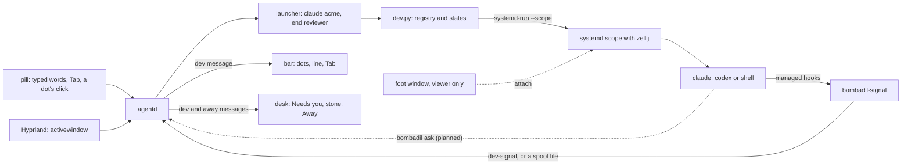

# Coding sessions

> **Status:** Partly shipped. On `main`: piece 1 (named sessions that outlive their window), piece 2 (the dots and the pill's line) apart from the parts listed as designed below, the own copy of piece 3 (a `git worktree`) and the `BOMBADIL_SESSION=1` mark, which `dev.py` sets and nothing reads, and the part of piece 5 that reads the sessions (the Away card, `src/bombadil/away.py`). Designed, with no code on `main`: the rest of piece 3 (no `sudo`, ports, a database name, a memory limit, the developer note, `bombadil ask` as the door), piece 4 (undo per session), the rest of piece 5 (handing words across, the phone) and piece 6 (try, read, ship).  
> **Code:** The piece itself: `src/bombadil/dev.py`, `bin/bombadil-signal`, `bin/bombadil` (`bombadil dev`), `shell/DevState.qml`, `shell/SessionChips.qml`, `shell/SessionPeek.qml`, `share/zellij/config.kdl`, and the managed hook files `packaging/bombadil/root/etc/claude-code/managed-settings.d/50-bombadil.json`, `packaging/bombadil/root/etc/codex/config.toml` and `packaging/bombadil/root/etc/codex/requirements.toml`. Its parts in files that other pieces share: `src/bombadil/agentd.py` (the `dev` and `dev-signal` messages, `_greet`, `_dev_signals`, `_dev_watch`, `_follow_focus`, `dev_action`, `BOMBADIL_OS`), `src/bombadil/launcher.py` (`_dev_match` and the Action kinds), `src/bombadil/paths.py` (`projects_dir`, `dev_dir`), `src/bombadil/hypr.py` (`events_path`), `src/bombadil/away.py`, `src/bombadil/brain/describe.py` (marks the describer's run `BOMBADIL_OS=1`), `shell/shell.qml` (the chips row, the pill's line, Tab, the bar's exclusive zone), `shell/DeskState.qml`, `shell/DeskRail.qml`, `shell/DeskCard.qml` and `shell/RowsCard.qml` (the Needs you and Away rows), `share/hypr/bombadil.lua` (the window rule and `foot --server`), `iso/airootfs/etc/systemd/system/bombadil-live.service` and `packaging/bombadil/root/usr/bin/bombadil-install` (lingering), `iso/packages.x86_64` (`zellij`), `scripts/build-iso.sh` (links `bombadil-signal`), `packaging/bombadil/root/usr/bin/bombadil-smoke`, and the tests `tests/test_dev.py`, `tests/test_sessions_qml.py`, `tests/test_agentd.py`, `tests/test_agentd_away.py`, `tests/test_away.py`, `tests/test_desk_qml.py`, `tests/test_brain_describe.py` (the describer's mark) and `tests/desktop/` (`driver.py`, `fake_api.py`, `Dockerfile`, `inside.sh`, `run.sh`). What the piece builds on or reads: `src/bombadil/outbox.py`, `src/bombadil/procs.py`, `src/bombadil/snapshots.py`, `src/bombadil/providers.py`, `src/bombadil/narrate.py`, `src/bombadil/notices.py`, `src/bombadil/mail/tools.py`, `src/bombadil/mcp_server.py`, `src/bombadil/watch.py`, `src/bombadil/vitals.py`, `src/bombadil/brain/actors.py`, `src/bombadil/brain/service.py`, `shell/PillState.qml`, `shell/QueueChips.qml`, `shell/NoticeChips.qml`, `share/qml/Bombadil/Stone.qml`, `packaging/bombadil/root/usr/lib/systemd/user/bombadil-agentd.service` and `packaging/bombadil/root/usr/lib/systemd/user/bombadil-shell.service`. Planned, with no code anywhere: `bombadil-worktree` and `bombadil-checkpoint`.  
> **Design:** [Building on Bombadil, the brief](../design/dev-brief.md), [the page](../design/pages/building-on-bombadil.html)  
> **Verified:** 2026-11-09 against `main` at `ca7f80a`. Every statement below was read in the code at that commit: `src/bombadil/dev.py` (all of it), `bin/bombadil-signal` (all of it), `bin/bombadil`, `share/zellij/config.kdl` (each key), the three hook files, `src/bombadil/agentd.py` (the `dev` message and `dev_action`, `AgentD.turn`'s environment), `src/bombadil/launcher.py`, `src/bombadil/away.py`, `src/bombadil/procs.py`, `src/bombadil/outbox.py`, `src/bombadil/brain/actors.py`, `src/bombadil/brain/describe.py`, `src/bombadil/vitals.py`, `shell/DevState.qml`, `shell/SessionChips.qml`, `shell/SessionPeek.qml`, `shell/shell.qml`, `shell/DeskState.qml`, `share/hypr/bombadil.lua`, the two lingering files, and the `dev-*` checks of the smoke (counted: 19) and section `10. Coding sessions` of the desktop driver (counted: 20 checks). Run: the launcher words by calling `launcher.match` against a folder of sample projects; the registry and the brain by saving a session with `Dev._save` and reading it with `actors.Sessions` and `actors.from_event`; the missing history rows by calling `watch.history_lines` on a log with one `dev` row and one `local` row; `tests/test_dev.py` (25 passed), `tests/test_agentd.py` (154), `tests/test_launcher.py` (322), `tests/test_iso_profile.py` (32), `tests/test_agentd_away.py` (11), `tests/test_away.py` (75) and `tests/test_brain_describe.py` (18), with `pytest-asyncio`. Found by searching `tests/`: no test checks `BOMBADIL_OS` in a turn's environment or calls `AgentD.dev_action`; and run: `tests/test_dev.py` with `dev._clean_env` replaced by a plain copy of the environment still gives 25 passed. Read and not run: `tests/test_sessions_qml.py` and the other QML tests (PySide6 is missing here), the desktop test and the smoke. The vendor facts in the brief are dated 27 Sep 2026 and were not re-checked. Pieces 4 and 6 have no code anywhere. On 2026-11-12, against `main` at `7d37bc5`, what the merges since changed for this page was read in the code: the `SUPER + Return` bind and `Hyprland.open_terminal`, the Tips words in `launcher._fixed_word`, and the knock of the stone as a cue (`share/qml/Bombadil/Stone.qml`); nothing else on the page was read again.

Coding sessions are how Bombadil hosts the coding tools people already use, Claude Code and Codex, unchanged. `claude acme` in the pill starts the vendor's own tool in an invisible `zellij` session, in a systemd user scope of its own. The `foot` window is only a viewer, so closing it, or restarting `agentd`, ends nothing, and typing the name again attaches a window mid-sentence. One dot per session sits above the pill's left end and says whose turn it is, and `agentd` feeds the same `dev` message to the pill's line, the stone's mark and the Needs you card, and the sessions' views to the Away card. The page exists because a coding session in a bare `foot` window ends with its window, and because nothing under the home folder can be undone. `SUPER + Return` and the terminal panel still open a plain `foot`, which Bombadil never wraps. The fence from the machine's own agent, undo per session, handing words across and shipping are designed and have no code.

## What is built and what is designed

The brief has six pieces. Each part says what is on `main` and what is designed only.

- **Named sessions that outlive their window** (piece 1, on `main`). `claude acme`, `codex acme` or `shell acme`, with an optional role (`claude acme reviewer`), start the vendor's own tool, or the person's shell, with no model call. The project word must name a folder under `~/Projects` (`BOMBADIL_PROJECTS`) whose name folds to a plain word (`dev.key`: letters and digits, with spaces, hyphens and underscores dropped, so `My App` is `myapp`); any other word matches nothing and goes to the model. A role is letters, digits and dashes, at most 24 characters, starting with a letter or a digit (`ROLE_RE`); with another the answer is "A session's name is a short word: letters, digits and dashes." Each session runs in an invisible `zellij` session, in its own systemd user scope where `procs.scope_supported()` holds (otherwise with no scope and no slice). The `foot` window is only a viewer: closing it leaves the session running, and typing the name attaches a viewer again, mid-sentence. A session is named by its role (`reviewer`) or, with none, by its tool; `reviewer`, `reviewer acme` and `reviewer on acme` bring it back, the project word alone (`acme`) brings back one of the project's sessions (live ones first, then the most recent) or says how to start one, and a role that exists on two projects answers "say which" and does nothing. A Claude or Codex session works in the checkout while no live Claude or Codex session holds it (one started by hand in exactly that folder counts), and gets a `git worktree` under `~/Projects/.work/<repo>/<role>`, on the branch `bombadil/<role>`, while one does. A session that already has a copy keeps it, and a folder that is not a git repository gets no copy, so the session shares the folder. `shell` sessions always open in the checkout and never take it from anyone. After a reboot sessions come back dim and nothing resumes by itself: typing the name or a click on the dim dot brings one back, and so does the Open button of a Needs you or Away row for a session that stopped (the click and the button send `open`, which `AgentD.dev_action` hands to `Dev.bring`). Bringing one back resumes a Claude session by the id Bombadil gave it with `--session-id` (the `SessionStart` hook replaces it when the conversation switches, as with `/clear` or `/resume`), and a Codex session by the id its `SessionStart` hook reported (a fresh one when none was), and starts a `shell` session as a fresh shell. `end <name>` ends a session and keeps its copy; `end` also takes the tool and the project (`end claude acme`, `end codex acme reviewer`), or the project alone when it has one session, and says which when it has several.
- **Dots for whose turn it is** (piece 2, on `main`, apart from the designed parts named here). One chip per project, one dot per session: moving while it works, lit when it is your turn, red when it failed, dim when asleep, a ring for a session started by hand and seen through the same hooks ("yours"). More than three projects fold into one chip ("4 projects · 1 waiting") that opens on a click and stays open until the sessions fit in three projects again. A click on a dot brings its session to the front, and on a dim dot it resumes the session, as typing its name does (`DevState.open` sends `open` for every dot but a red one that is not running, and `Dev.bring` resumes a session that is not alive); only a click on a red dot that stopped and is not running opens its last screen first (`bombadil dev why`), and typing its name then resumes it. The empty pill says who waits, in the accent colour and ending in a tab mark, and Tab walks to the next one, ending with "Nothing needs you." The session in front never announces itself, and hovering a dot shows its last lines. The same `dev` message feeds the stone's mark and the Needs you rows: one waiting session is the pill's line and the stone, which turns amber and knocks (as a cue, not a loop), and two or more are also the card ([the needs-you mark](desk.md#the-needs-you-mark)). Designed only: the "Claude 5-hour limit at 84%" line and the meter behind it, reconciling with `claude agents --json --all`, notifications from plain shells (foot's desktop notifications and the bell), a hook for folder changes (`Dev.signal` handles `CwdChanged`, but no managed hook registers it), and "what's running?" as a card (it opens a plain list in the details drawer).
- **The fence** (piece 3, partly on `main`). On `main`: the own copy (a `git worktree`, `Dev._make_copy`) and `BOMBADIL_SESSION=1` in each session's environment (`dev.session_env`), which nothing in the tree reads. Designed, with no code: a session will run as the person without `sudo` (`setpriv --no-new-privs`); a refused `sudo pacman -S` will point it to `bombadil ask "install postgresql 17"`, which will show as "api on Acme asks: install postgresql 17 [Do it]", and Tab will run it as an ordinary machine turn with a restore point and Undo; each session will get ten ports, a database name and a memory limit, and a developer note that only sessions read.
- **Undo per session** (piece 4, designed only). `undo this`, `undo <name>` and `redo` will put a session's last turn back from a git checkpoint taken by `bombadil-checkpoint` around each prompt, skipping files changed since and saying what was covered. A bare `undo` will keep its one meaning, the machine's last turn. On `main` `undo this` and `undo <name>` match nothing and go to the model.
- **Handing words across** (piece 5, partly on `main`). On `main`: the Away card, which lists what failed, which sessions wait and what finished from the turn log and the sessions' views, with no model call; a session's row has an Open button that sends `{"type": "dev", "action": "open"}`. It opens when the person asks for it ("show away"); `Away.back`, the moment they come back from a break, has no caller yet ([the Away card](desk.md#the-away-card)). Designed, with no code: `tell api …` will type into a session's terminal, marked "(from the pill)"; `give this to claude on bombadil` will start a session from the person's own words; `have codex review builder` will start a read-only session; the os-mcp session tools and the `bombadil-dev` MCP server; the Claude app on the phone will list Claude sessions under the same names (Codex has no phone host on Linux).
- **Try, read, ship** (piece 6, designed only). `run it`, `what did builder change?` with a Diff button, an opt-in check after each turn, then `ship builder` (the session will commit, Bombadil will push and open the pull request), `land builder` for a local merge and `clean up`. Nothing will be pushed or merged before the person says so.
- **Designed only, beyond the six pieces:** a project card, standing roles in `.bombadil/project.toml`, watchers that run once, a native review app, and the brief's list of [gaps not designed yet](../design/dev-brief.md#not-designed-yet).

## How it works

### The flow

`bombadil ask` from inside a session is the one edge that does not exist yet.



### Using it

| You do | What happens |
|---|---|
| Tap Super, type `claude acme`, Enter | Claude Code opens in a large floating window, in `~/Projects/acme`. |
| Close the window | Only the viewer closes. The session keeps running. |
| Type `claude acme` again | A window attaches to the same session, scrollback and half-typed sentence intact. |
| Click a dot above the pill | Brings that session to the front. A dim dot (asleep) resumes the session, as typing its name does. |
| `claude acme reviewer`, while `claude acme` runs | A second, named session on the same repository, in a `git worktree` of its own. |
| `codex acme`, `shell acme` | The same, for Codex and for a plain shell. |
| `end reviewer`, `end claude acme`, `end acme` | Ends that session. A project name alone ends its only session, or says which. |
| `what's running?` | A plain list of every session that has not ended, in the details drawer. |

### Hosting

`Dev` in `src/bombadil/dev.py` is agentd's view of the sessions. Each one is an invisible `zellij` session in its own systemd user scope, started by `Dev._launch_now` as `systemd-run --user --scope` (`procs.SCOPE`) with `--unit=bombadil-dev-<project>-<role>-<run>` and `--slice=bombadil-dev-<project>.slice` around `zellij --config share/zellij/config.kdl attach --create-background bombadil-<project>-<role> --close-on-exit -- bombadil dev run <key> [--resume]`. The project is cut at 24 characters, and the slice name writes its hyphens as underscores. A dead `zellij` session of that name is deleted first, because `zellij` would resurrect it. A session that `zellij` does not list within 5 seconds is marked failed, with the first line of what `zellij` said.

`share/zellij/config.kdl` is used with `zellij --config` for these sessions only, so the person's own `zellij` settings are untouched: no keys of its own (`keybinds clear-defaults=true`, `default_mode "locked"`, so every key goes to the tool), no frames, no startup tips or release notes, no serialization (each tool resumes its own conversation), a force-closed window detaches (`on_force_close "detach"`), the kitty keyboard protocol on (`support_kitty_keyboard_protocol true`, which the brief names for Shift+Enter and which the desktop test's Shift+Enter check exercises), a 50000-line scroll buffer, the mouse effects and actions off (`mouse_hover_effects`, `advanced_mouse_actions` and `mouse_scroll_resize` are `false`), and notifications handed on as OSC 99 (`host_notification_protocol`). A background `zellij` session always starts with its default layout, tab and status bars included, so `Dev._bare` closes them once they have loaded (up to 3 seconds), and the viewer shows only the tool.

The wrapper `bombadil dev run <key>` (`dev.run`) reads the session's row from the registry and runs the tool in the pane. Ctrl+C and the other signals are the tool's; the wrapper only waits. When the tool exits it reports how (an `exit` event with the exit code and, for a Claude or Codex tool that exited with a non-zero code inside `zellij`, the path of the last screen it dumped), then ends the `zellij` session so an exited tool never leaves an empty one. A tool ended by `SIGHUP`, `SIGTERM` or `SIGKILL` (by `end` or a restart) returns 0 without reporting: whoever ended it knows.

The command lines are the tools' own (`dev.command_for`): `claude --session-id <id> -n "<role> on <Project>"`, and `claude --resume <id> -n …` to resume; `codex --no-daemon`, and `codex --no-daemon resume <id>` to resume (the shared Codex daemon would give every session one environment and its hooks the daemon's, and it updates itself under running work); the shell is `$SHELL` or `/bin/bash`. Claude and Codex go through `mise exec --` when `mise` is on the path, so the project's own toolchains are there. Each session's environment is agentd's with its own marks removed (`BOMBADIL_OS`, `BOMBADIL_TURN_SNAPSHOT` and `zellij`'s variables, `dev._clean_env`), and `BOMBADIL_SESSION=1`, `BOMBADIL_DEV_ID`, `BOMBADIL_DEV_RUN` and `BOMBADIL_PROJECT` added (`dev.session_env`).

A scope lives in the user's systemd, outside `agentd`, the bar and the compositor, so none of them takes a session down with it. Restarting `agentd` is exercised (the desktop test restarts a plain `agentd` and checks that the sessions stay). Surviving a restart of the bar or the compositor, or a logout, rests on the scope and on lingering (`loginctl enable-linger user` run by `bombadil-live.service`, a file under `/var/lib/systemd/linger` made by `bombadil-install`) and is not tested.

### Names and folders

A session is `<project>/<role>`, its key; the role defaults to the tool's name, and its title is `<role> on <Project>`. The first Claude or Codex session on a repository works in the checkout; a further one gets a `git worktree` under `~/Projects/.work/<repo>/<role>` (`Dev._start`, `Dev._make_copy`, `Dev._checkout_taken`), and one that already has a copy keeps it. Shells always use the checkout and never take it from anyone. `Dev.projects` reads the folders of `~/Projects` (not those that start with a dot) and keys each by `dev.key`; `Dev.names` hands the launcher every project and its three tool forms (`claude acme`, `codex acme`, `shell acme`) and every session that has a role of its own, so Tab can complete them.

### The hooks

`bin/bombadil-signal` is what the tools' hooks run, with the event as JSON on standard input (`codex-notify` takes it as the last argument). It uses only the standard library and nothing from Bombadil, and it never prints and never exits with an error. It trims the event to a `dev-signal` message (the tool's name, the event, the tool's conversation id, the folder, the tool name and a trimmed input of the few fields that name what is asked, a notification type, up to 600 characters of text, `BOMBADIL_DEV_ID` and `BOMBADIL_DEV_RUN`, and the tool's process id and start time for liveness), writes it to agentd's socket, and waits for agentd to hang up (the socket's timeout is one second) so that a line agentd took is never also spooled. With agentd down it appends the line to `~/.local/state/bombadil/dev/signals.jsonl`, which agentd reads and deletes when it starts (`dev.take_spool`). It exits at once when `BOMBADIL_OS=1`: managed hooks fire in the machine's own turns too, and those are not coding sessions.

The hooks are managed, so they apply to every run of the tool on the machine. Claude Code: `/etc/claude-code/managed-settings.d/50-bombadil.json` registers nine events, all `async`: `SessionStart`, `UserPromptSubmit`, `PreToolUse` (matcher `AskUserQuestion`), `PermissionRequest`, `PostToolUse`, `Notification`, `Stop`, `StopFailure` and `SessionEnd`. Codex: `/etc/codex/requirements.toml` registers `SessionStart`, `UserPromptSubmit`, `PermissionRequest`, `PostToolUse` and `Stop` (async), and `Interrupt` and `SessionEnd` (`timeout = 2`, not async), and `/etc/codex/config.toml` sets `notify = ["bombadil-signal", "codex-notify"]` for the turn-complete event of Codex versions whose hooks do not reach it, and the `osc9` terminal notification. Both Codex files set `check_for_update_on_startup = false`. `/etc/codex/config.toml` is the system layer, so the person's own `~/.codex/config.toml` sits above it (its comment says so), and the hooks in `requirements.toml` are managed, so they run without a trust prompt (its comment says so).

The hooks are read-only reporters: they change nothing in the tool. Claude's hooks and five of Codex's are `async`, so the tool does not wait for them; Codex's `Interrupt` and `SessionEnd` hooks are not, so a slow agentd can hold Codex for the socket's timeout there ([Known gaps](#known-gaps)).

### States

`Dev.signal` turns each event into a change of the session's state: `idle`, `working`, `asked`, `done`, `failed`, `asleep` or `ended`.

- `UserPromptSubmit` and `PostToolUse` mean `working` (the prompt also adds a line to the hover); `PermissionRequest`, `Elicitation` and `PreToolUse` of `AskUserQuestion` mean `asked`, and so does a `Notification` of type `permission_prompt`. The text is the question (`asked_text`).
- `Stop` (and Codex's `agent-turn-complete` from `notify`) means `done`, or `idle` when the session's window is in front. `Interrupt` means `idle`. A `Notification` of type `idle_prompt` ends a working turn as `idle`, because Claude has no hook for Esc. `StopFailure` means `failed`.
- `SessionStart` replaces the stored conversation id and clears what the session last said. `SessionEnd` drops a session started by hand.
- The wrapper's `exit` ends the session (exit code 0, or any code for a shell), or fails it (`Claude stopped unexpectedly (exit 3)`) and keeps the last screen.
- A session that finished, asked or failed while its window was not in front is `unseen`; bringing it forward, or typing its name, is looking at it. A session whose window is in front when it asks, finishes or fails is not marked `unseen`. agentd follows Hyprland's `activewindow` events (`AgentD._follow_focus`, `Dev.focused`), ignores an empty window class (the pill taking the keyboard) and asks `j/activewindow` each time it starts listening, so a restart does not forget what is in front (`Dev.look_at_front`).
- Every 3 seconds agentd runs `Dev.check`: a session that is alive but that `zellij` does not list, more than 20 seconds (`PENDING_SECONDS`) after its state last changed, is `failed` ("Stopped unexpectedly"). It never takes a `zellij` that cannot be asked for "gone", and never judges a session that is being launched. A session started by hand whose process is gone is dropped.
- Sessions started by hand, seen only through the hooks, are listed as "yours" under the folder they run in; Bombadil never wraps, restarts or ends them.

`Dev.attention` lists the sessions that waited for the person and were not looked at, the one in front aside: asked (while alive), then done, then failed, oldest first within each. `Dev.line` says it in one line: "reviewer on Acme: run the migration?", "reviewer on Acme finished: …", "reviewer on Acme stopped: …", or for several "api and reviewer are waiting" (a tool's name needs its project; five or more are "5 sessions are waiting"). `Dev.next` is Tab: it brings the first one forward, or says "Nothing needs you."; a failed session that is not running is not brought back, it says how it stopped and that its name resumes it.

### Windows

`Dev._viewer` opens the window. With Hyprland, an open window of the session (class `bombadil-session-<slug of key>`) is focused instead of a second viewer; without Hyprland (a test session) a `pgrep` for an attached viewer replaces that check and nothing can raise the window. Otherwise it runs `footclient --no-wait` on the shared `foot --server` when its socket (`foot-<WAYLAND_DISPLAY>.sock` in `XDG_RUNTIME_DIR`) exists and `footclient` answers, else a plain `foot` that agentd starts itself, with the app id, the title, the working directory and `zellij attach`. The window rule `bombadil-sessions` in `share/hypr/bombadil.lua` floats it, centred, at 86% by 80% of the monitor. `hyprland.start` starts `foot --server`; it is not a unit, so nothing restarts it if it dies ([session services](session-services.md)).

### What the bar and the desk get

agentd broadcasts one `dev` message, `{sessions, front, attention, line}`, whenever the sessions change and the message differs from the last one (`AgentD._dev_broadcast`, a burst of events coalesced over 30 milliseconds), and sends it to each client that connects, after `status`, `entries`, `setup` and the live notices. `shell/DevState.qml` groups it by project, decides the fold and sends `{"type": "dev", "action": "next"}` for Tab and `open` or `why` for a click; the walk's order is agentd's (`Dev.attention`). `shell/SessionChips.qml` draws the chips and dots, `shell/SessionPeek.qml` the hover. `DevState.lost()` clears the line only, so the dots stay while agentd is away.

In `shell/shell.qml` the chips sit in a row above the pill's left end, because the desk's strips use the row beside the pill. The empty field's text is `devState.line` followed by a tab mark, in the accent colour, while a session waits (else the rest hint or "Ask anything"), and Tab in an empty pill calls `devState.next()` while any session exists. The row adds to the bar's exclusive zone (`64`, plus the app chips row, plus the sessions' row), and the shell hands that zone to the desk as `DeskState.rowZone`, so the rails stop above the row and a card is never laid out under it.

The desk reads the same message: `DeskState._applyDev` makes a Needs you row of every key in `attention`, and its Open button sends `{"type": "dev", "action": "open", "key"}` (on a session that stopped, that resumes it). One row is no card (`needsPresent` wants two), but the stone turns amber for one or more (`needsYou`) and knocks as a cue, not on a loop: for 9.6 s when the need appears, then one beat every five minutes while it stands ([the stone](shell.md#the-stone)), and the pill says it in its line. The Away card is a second reader of the sessions: `AgentD._away_sessions` hands `Dev.snapshot()["sessions"]` to `Away.ask`, and a session that asked, or finished or failed unseen, is a row `dev:<key>` whose Open button sends the same `open` ([the Away card](desk.md#the-away-card)).

### The launcher

`launcher.match` takes the session words in `_dev_match`, after the picture, widget-question, sign-in, provider and rest words and the core commands (`undo`, `stop`, `history` and the like), and before the model words, the brain's words, Mail's word, app names, panels, utility words and widget words. The forms: `claude|codex|shell <project> [role]`; a project's name (`acme`, `open acme`); a role, `<role> <project>` and `<role> on <project>` (also with an open verb such as `switch to`); `end <role>` with the same project forms, `end <tool> <project> [role]` and `end <project>`; and `whats running`, `what is running`, `sessions`, `coding sessions` and `list sessions` (an apostrophe is ignored), which open `bombadil dev list` in the details drawer. A role on two projects, or a project with several sessions to end, is answered "say which" (Action kind `choose`).

Five groups of Bombadil's own words are never shadowed: `_fixed_word` keeps a model word, a brain word and a Tips word as typed, and Mail's word and a panel word as typed or after `open`, `close` or `hide`, out of `_dev_match`, so `open mail` opens Mail whatever `~/Projects` holds, and `claude mail` still names the project called mail. Everything else a project or a session is named like is taken by the project: app names (by design: the comment says project, then session, then app), and also desk widget words and utility words ([Known gaps](#known-gaps)). `undo this`, `undo <name>`, `stop <name>`, `stop everything` and `run it` are designed and match nothing, so they go to the model. A word the launcher answers is a `local` event and a `local` row in `turns.jsonl`, and when it worked the model hears of it with the other things done without it.

### Locks

`Dev` blocks (zellij, systemd, the compositor and `git` are all asked), so agentd calls it off its event loop. `Dev.lock` guards the registry and is only ever held for a moment, so a client's greeting, a hook's report and the dots never wait on a launch. `Dev.launching` serialises the slow work of starting, bringing back and ending a session, which waits on `zellij`, systemd and the compositor for seconds, and only those actions share it: `end` waits for the session's own launch instead of racing it. A session being launched is in `Dev._launching`, so the watcher never judges it gone while `zellij` has not listed it yet.

### What it builds on

| Where | What is there | What the piece does with it |
|---|---|---|
| `src/bombadil/agentd.py`: `AgentD.serve`, `_client`, `_greet`, `handle`, `_dev_changed`, `_dev_signals`, `_dev_watch`, `_follow_focus`, `dev_action`, `_watch_apps` | One Unix socket of newline-delimited JSON, every event broadcast to every client. A client that connects is greeted with `status`, `entries`, `setup`, one `notice` for each notice nobody has ended, the `dev` message, the start of the vitals reading, and the `away` message when that card is up. `_greet` is a task that writes the greeting beside the reading of the client's first line. | `handle` takes `dev-signal` (queued in `AgentD._signals`) and `dev` (`dev_action`: `next`, `open`, `end`, `why`; an unknown key is answered "That session is gone."). `serve` starts `_dev_signals` (the spool first, then each hook in order, so a prompt and its stop never swap), `_dev_watch` and `_follow_focus`. `_watch_apps` sends the bar fresh `entries` within 3 seconds when a project or session name appears or goes. `Dev.on_change` is `_dev_changed`, which hops to the loop and broadcasts. |
| `src/bombadil/agentd.py`: `AgentD.handle`, `_persons`, `_rest_turn` | `handle` accepts `asked_by` on a `prompt` (checked by `_WHO`); `turn_start` echoes it and the desk's Now card reads it. `bombadil ask` sets none, but `handle` marks a prompt `asked_by: "agent"` when it comes from a process of an agent's turn or a client it cannot name (`_persons`). A turn with the mark has no `turn_prompt`, so the `desk` tool is refused for it and the mail tools get no typed words; a launcher word sent with the mark is still answered locally; the mark of a turn the limit stopped is kept when `_rest_turn` puts the turn back at the front of the queue, and the marks of turns that were unqueued are dropped when the next turn starts. | A session's `bombadil ask` is the agent's, not the person's: `procs.cgroup_of` accepts a `bombadil-dev-*` scope as well as a `bombadil-turn-*` one (`procs.AGENT_SCOPES`), so `outbox.from_agent` is true for a process in a session and `_persons` refuses it what only the person does. A prompt from a session is marked `asked_by: "agent"` and has no typed words. The brief names the text mark `[asked by <who>, untrusted]` for a session's request; the mark `main` sets is `agent`, not the session's name ([Known gaps](#known-gaps)). |

| `src/bombadil/agentd.py`: `AgentD.turn`, `_log`; `src/bombadil/brain/describe.py`: `Describer` | Each turn takes a snapper restore point where snapper is configured (`Snapshots.available`), runs in a scope named `bombadil-turn-<pid>-<turn>-<time>` where systemd supports one (`procs.scope_supported`), with `Turn.cwd` defaulting to the home folder (`src/bombadil/providers.py`) and `BOMBADIL_TURN` and `BOMBADIL_SOCKET` in its environment. Its `turns.jsonl` row has `n`, `unit`, `started` and `files`, which the brain reads. | Leaves the restore point and the turn scope alone. `BOMBADIL_OS=1` is set in every turn's environment (a `!` shell turn too) and in the brain's describer run; it is the one mark `bombadil-signal` reads to skip the machine's own agent. Sessions are not turns: no restore point and no turn scope. Their own git undo is designed only (piece 4). |
| `src/bombadil/paths.py`: `is_turn_row`; `src/bombadil/watch.py`: `history_lines`; `src/bombadil/agentd.py`: `_dev_signals` | A `turns.jsonl` row with a `kind` other than none or `turn` is no turn: `is_turn_row` keeps it out of turn numbers (`agentd._last_turn`) and out of the brain's `TurnsLog` witness, and `history_lines` shows only turn rows and `local` rows. | agentd writes `{"kind": "dev", "action": "ended" or "stopped unexpectedly", "target": <key>, "result"}` when the wrapper's `exit` event arrives. An `end` typed as a word is a `local` row, and the `end` action of a `dev` message is not logged. `history_lines` has a case for `dev` rows after its filter, so it never runs and the rows are never listed ([Known gaps](#known-gaps)). |
| `src/bombadil/procs.py`: `SCOPE`, `scope_supported`, `cgroup_of`, `Stopper.stop`, `PROTECTED_ARGS` | `SCOPE` is the `systemd-run --user --scope` prefix. `Stopper.stop` ends a turn's descendants, its scope's cgroup and its process group, except windows that `_is_window` recognises (the `PROTECTED_ARGS` windows, `nautilus` and `bombadil-app run <name>`) and their children, and removes a stale pacman lock. `cgroup_of` and `scope_cgroup` accept only a cgroup named `bombadil-turn-*`. | `Dev` reuses `SCOPE` and `scope_supported` for session scopes. `Stopper` must never reach a session: a `bombadil-dev-*` scope is never taken for a turn's cgroup. |
| `src/bombadil/snapshots.py`: `Snapshots` | Snapper snapshots of the config `root` only (`config_name="root"`). See [restore points](restore-points.md). | Leaves it. Per-session undo is separate and designed. |
| `src/bombadil/brain/actors.py`: `Sessions`, `from_event`, `DEV_SLICE`; `src/bombadil/brain/service.py` | A writer in a scope under `bombadil-dev-<project>.slice` is named `session:<project>/<name>`. The name comes from `~/.local/state/bombadil/dev/sessions.json`: a row whose `unit` (without `.scope`) is the cgroup's scope, with a `name` or `role`. `Sessions.lookup` accepts a list of rows or a dict of rows. [brain.md](brain.md) has the rest. | The registry is `{"sessions": [...]}`, which `Sessions.lookup` does not read, and the slice name writes the project's hyphens as underscores. Checked on 2026-11-09 by saving a session with `Dev._save` for the project `my-app` and reading it with `actors.Sessions` and `actors.from_event`: `lookup` finds no row, and a writer in the session's scope is `session:my_app`, with no role (`session:myapp` for the project `myapp`). The brain names a session by its project only, and one side has to change. |
| `src/bombadil/vitals.py`: `classify_unit`, `DEV_SLICE`, `RULES`, `ceiling_of` | The Machine card counts the memory of every unit whose name starts `bombadil-dev` (`bombadil-dev.slice`, `bombadil-dev-<project>.slice`, `bombadil-dev-<project>-<role>-<run>.scope`) as the sessions' share. It says "Coding sessions are near their memory limit" when `bombadil-dev.slice` crosses 90% of its `memory.high`, else of its `memory.max`; with neither set there is no ceiling and no line. | The scopes and per-project slices are counted as they are. Nothing on `main` sets `MemoryHigh` or `MemoryMax`, so the ceiling line never fires until the fence (piece 3) does. |
| `src/bombadil/narrate.py`: `_ASKED_RE`, `prompt_reads`; `src/bombadil/mail/tools.py`: `_OUTSIDE`, `typed_words` | A prompt block `[asked by <who>, untrusted]` is recorded as an outside read of kind `session`, or of kind `app` when `<who>` starts with `app `, and the mail tools leave the same block, and the `[Screen]` block, out of the person's typed words. | Nothing sends that line: the app kit's `Agent.ask` sends `[from app <name>]` (`src/bombadil/appkit/native/agent.py`), which neither reads. The brief has a session's request arrive marked `[asked by coding session <name> on <project>, untrusted]` (designed, piece 3). |
| `src/bombadil/mcp_server.py`: `OsTools._register` and its `_tool` decorator | Each os-mcp tool is registered with `@t(name, description, properties, required)`. There is no session tool. See [os-mcp.md](os-mcp.md). | Piece 5 (designed) will add `list_sessions`, `start_session`, `tell_session`, `session_screen`, `stop_session` and `end_session` here. Sessions will get a separate `bombadil-dev` server instead, so that they cannot call `rollback` or `create_app`. |
| `shell/PillState.qml`: `handle`, `needsYou`, `face`; `shell/QueueChips.qml`; `shell/NoticeChips.qml`, `src/bombadil/notices.py` | `PillState.handle` follows one turn by id; a message whose `type` is not one it handles, `dev` included, reaches `if (ev.type !== "event") return`. `needsYou` has one writer, the desk, and `face` tests it before `working`. `QueueChips` draws the queued asks; notices are lines another service says above the pill (Mail uses them). | The `dev` message carries no turn id, so the turn logic is untouched. A session's line is the empty field's text in `shell.qml`, not a notice, and its chips are a row of their own beside the queue and app chips. |
| `bin/bombadil` | `ask` sends `{"type": "prompt"}` and streams the reply; when the AI rests it says so and exits 75, the ask staying queued. `stop`, `brain` and `mail` are other subcommands. | `bombadil dev list`, `next`, `why <key>` and `run <key> [--resume]` are the piece's. With no argument `bombadil dev` lists; `list` and `why` wait for a key (`watch.wait_for_key`), so that the details drawer stays open. The brief gives `ask` a second meaning inside a session (designed). |
| `share/hypr/bombadil.lua`, `packaging/bombadil/root/usr/lib/systemd/user/bombadil-agentd.service`, `bombadil-shell.service` | `SUPER + Return` runs `bombadil terminal`, which puts away a drawer that shows and starts a plain `foot` without Hyprland's `HL_INITIAL_WORKSPACE_TOKEN` (`Hyprland.open_terminal`, `src/bombadil/hypr.py`), and the terminal panel is `foot --app-id=bombadil-terminal` (`PANELS` in the same file). `hyprland.start` runs one `hl.exec_cmd` that imports the session environment and restarts the units `bombadil-agentd bombadil-shell`, then `foot --server`, then one that hands Mail's unit the session's environment and one that hands the browser service's unit the same. The units restart on exit (`Restart=always`, `RestartSec=1`, `StartLimitIntervalSec=0` in `[Unit]`), and `bombadil-agentd.service` has `KillMode=process`. See [the session stays alive](session-services.md). | A session's scope sits beside the agentd unit, not in it. The plain terminal stays plain: a session started by hand is seen and never wrapped. |

## Interfaces other pieces depend on

Everything in this table is on `main`.

| Name | Kind | Where |
|---|---|---|
| `{"type": "dev", "sessions", "front", "attention", "line"}`, sent to a client when it connects and on every change; a session has `key`, `project`, `projectTitle`, `role`, `tool`, `toolTitle`, `title`, `state` (`working`, `idle`, `asked`, `done`, `failed`, `asleep`), `alive`, `unseen`, `yours`, `copy`, `since`, `last`, `lines` (the last four). `DeskState.qml` reads `key`, `projectTitle` or `project`, `role`, `last` and `state`; `away.py` reads those and `unseen` and `since` | agentd to clients | `Dev.snapshot`, `Session.view` |
| `{"type": "dev", "action": "next"\|"open"\|"end"\|"why", "key"}`, answered by an event `{"kind": "local", "turn": null, "action": "session", "target", "phase": "done", "ok", "text"}`. `DevState.open` sends `why` for a dot that is red and not alive and `open` for any other; `why` opens `bombadil dev why <key>` in the details drawer when a last screen was kept and sends no answer when none was. Nothing in the shell sends `end` | clients to agentd, and back | `AgentD.dev_action` |
| `{"type": "dev-signal", "tool", "event", "session_id", "cwd", "tool_name", "tool_input", "notification_type", "text", "dev_id", "run", "pid", "pid_start", "t"}`; the wrapper's own `"event": "exit"` carries `code` and, in `text`, the path of the last screen | hooks and the wrapper to agentd | `bin/bombadil-signal`, `dev.run` |
| `bombadil dev list`, `next`, `why <key>`, `run <key> [--resume]` | commands | `dev_command` in `bin/bombadil` |
| `bombadil-signal claude`, `codex`, `codex-notify`; it reads `BOMBADIL_OS` (it does nothing when it is `1`), `BOMBADIL_SOCKET`, `BOMBADIL_RUNTIME`, `BOMBADIL_STATE`, `BOMBADIL_DEV_ID`, `BOMBADIL_DEV_RUN` and `CLAUDE_PID`, with `XDG_RUNTIME_DIR` and `XDG_STATE_HOME` as fallbacks for the socket and the spool | hook program | `bin/bombadil-signal` |
| Claude Code hooks `SessionStart`, `UserPromptSubmit`, `PreToolUse` (matcher `AskUserQuestion`), `PermissionRequest`, `PostToolUse`, `Notification`, `Stop`, `StopFailure`, `SessionEnd`, all `async`; Codex hooks `SessionStart`, `UserPromptSubmit`, `PermissionRequest`, `PostToolUse`, `Stop` (async), `Interrupt` and `SessionEnd` (`timeout = 2`); Codex `notify` | managed hooks | `/etc/claude-code/managed-settings.d/50-bombadil.json`, `/etc/codex/requirements.toml`, `/etc/codex/config.toml` |
| `claude --session-id <id> -n "<role> on <Project>"` for a first start and `claude --resume <id> -n …` to resume; `codex --no-daemon`, and `codex --no-daemon resume <id>`; `$SHELL` or `/bin/bash`; Claude and Codex through `mise exec --` when `mise` is on the path. All of it runs as `bombadil dev run <key> [--resume]` in a pane of `zellij --config share/zellij/config.kdl attach --create-background <name> --close-on-exit` | tool command lines | `dev.command_for`, `Dev._launch_now` |
| `~/.local/state/bombadil/dev/sessions.json` (`{"sessions": [...]}`; a row is a `dev.Session` with `project`, `role`, `tool`, `folder`, `copy`, `conversation`, `zellij`, `unit`, `run`, `state`, `alive`, `unseen`, `started`, `since`, `boot`, `last`, `lines`, `yours`, `pid`, `pid_start`, `code` and `why`), `signals.jsonl` (what hooks wrote while agentd was away), `<slug of key>.last` (for example `acme-reviewer.last`); `{"kind": "dev"}` rows in `turns.jsonl` | registry, spool, last screen, log | `Dev.registry`, `dev.spool`, `dev.run` |
| `bombadil-dev-<project>-<role>-<run>.scope` in `bombadil-dev-<project>.slice` (the project cut at 24 characters; the slice name writes its hyphens as underscores); the `zellij` session `bombadil-<project cut at 24>-<role>`; a copy's git branch `bombadil/<role>` in the person's repository; `share/zellij/config.kdl`; lingering for the user; `zellij` in `iso/packages.x86_64` | units, host config | `Dev._launch_now`, `bombadil-live.service`, `bombadil-install` |
| `BOMBADIL_SESSION=1`, `BOMBADIL_DEV_ID`, `BOMBADIL_DEV_RUN`, `BOMBADIL_PROJECT` (set in a session's environment; the first and the last are read by nothing); `BOMBADIL_PROJECTS` (the projects folder, default `~/Projects`); `BOMBADIL_OS=1`, set by agentd in every turn's environment and in the brain's describer run, read by `bombadil-signal` and removed from a session's environment | environment | `dev.session_env`, `paths.projects_dir` |
| `claude\|codex\|shell <project> [role]`; `<project>`; `<role>`, `<role> <project>` and `<role> on <project>`; `end <role>` (with the same project forms), `end <tool> <project> [role]` and `end <project>`; `whats running`, `what is running`, `sessions`, `coding sessions` and `list sessions`. A word that names a role on two projects, or a project with several sessions to end, is answered "say which" (Action kind `choose`) | launcher words | `launcher._dev_match` |
| `launcher.Action` kinds `session`, `project`, `end`, `choose` and `sessions`, with the fields `tool` and `role`; `launcher.match(text, app_list, dev_names, busy)` and `launcher.entries(app_list, dev_names)` take the registry; window app id `bombadil-session-<slug>`; `quickshell ipc call dev chips` (the desktop test) | launcher, window | `launcher.py`, `Dev.app_id`, `shell/shell.qml` |

Interfaces it adds that are designed, with no code anywhere:

| Name | Kind | Status |
|---|---|---|
| `bombadil ask` from a session, `bombadil-worktree`, `.worktreeinclude`, `setpriv --no-new-privs`, `PORT`, `BOMBADIL_PORTS`, `COMPOSE_PROJECT_NAME`, `BOMBADIL_DB`, `bombadil-dev.slice` limits | fence (piece 3) | designed |
| `bombadil-checkpoint pre\|post`, `refs/bombadil/<role>/<n>/pre` and `post`, `.git/bombadil/<role>.index`; `undo this`, `undo <name>`, `redo` | undo (piece 4) | designed |
| `stop <name>`, `stop everything`, `run it` | launcher words | designed |
| `remoteControlAtStartup` (Claude Code user settings), `CLAUDE_CLIENT_PRESENCE_FILE`, `crossSessionInbound` (set to refuse in the machine agent's own session) | Claude Code settings and environment (piece 5) | designed |
| os-mcp `list_sessions`, `start_session`, `tell_session`, `session_screen`, `stop_session`, `end_session`; MCP server `bombadil-dev` with `ask_machine`, `progress`, `show_preview` | tools (piece 5) | designed |
| `BOMBADIL_SHIP=1`, `core.hooksPath` pre-push hook, `~/.local/state/bombadil/projects/<p>.toml`, `.bombadil/project.toml` | ship and projects (piece 6) | designed |

## Where state lives

| What | Where | Lifetime |
|---|---|---|
| The registry | `~/.local/state/bombadil/dev/sessions.json` (`paths.dev_dir()`), written by agentd alone (`Dev._save`, through a temporary file and a rename) and read by agentd at start (`Dev._load`), by `bombadil dev run`, `list` and `why`, and by the brain (`actors.Sessions`, which cannot use its shape: [Known gaps](#known-gaps)) | Survives a restart of agentd and a reboot. A row from an earlier boot comes back `asleep` ("Stopped by a restart"). An ended row is dropped at the next load once it is older than 30 days (`ENDED_KEPT`); a row of a session started by hand is dropped at load when its process is gone, and by `Dev.check` while agentd runs |
| Hook events that arrived while agentd was away | `signals.jsonl` beside it, appended by `bombadil-signal` and by `dev.send_signal` | Read and deleted by agentd when it starts (`dev.take_spool`) |
| A stopped session's last screen | `<slug of key>.last` beside it, written by `bombadil dev run` when a Claude or Codex tool exits with a non-zero code inside `zellij` | Kept beside the registry; `bombadil dev why` and the `why` action read it through the row's `why` |
| The log | `turns.jsonl`: a `{"kind": "dev"}` row when the wrapper reports an exit; a `{"kind": "local"}` row for a start or an end typed as words | Never listed by `history_lines` for the `dev` rows ([Known gaps](#known-gaps)) |
| The session's processes | a systemd user scope `bombadil-dev-<project>-<role>-<run>.scope` in `bombadil-dev-<project>.slice`, holding the `zellij` server and the tool; the `zellij` session is `bombadil-<project>-<role>` | Ends when the tool exits (`bombadil dev run` kills the `zellij` session) or on `end` (`zellij kill-session`, then `systemctl --user stop` of the scope). A restart of agentd does not touch it; see [Hosting](#hosting) for the bar and the compositor |
| Lingering | `loginctl enable-linger user` run by `bombadil-live.service` on the live image; a file under `/var/lib/systemd/linger` made by `bombadil-install` on an installed disk, and kept by a refresh ([installed OS](installed-os.md)) | Keeps the user's systemd running without a login, so the scopes outlive the desktop session |
| The viewer | a window of `footclient` when a `foot --server` socket exists (`dev.foot_server`), else a plain `foot`; app id `bombadil-session-<slug of key>` | Closing it ends nothing |
| A copy | `~/Projects/.work/<repo>/<role>`, a `git worktree` on the branch `bombadil/<role>` of the person's repository | `end` keeps it; nothing removes one |
| Which window is in front, and the last `dev` message sent | agentd's memory: `Dev.front` from Hyprland's `activewindow` events (`AgentD._follow_focus`, `hypr.events_path`), and `AgentD._dev_last` | Lost when agentd restarts; agentd asks Hyprland which window is in front each time it starts listening, so `Dev.front` is set again at once |
| The dots, the line and the peek | the bar's memory: `DevState` (`sessions`, `attention`, `line`, `front`, `peeked`, `expanded`) | Replaced by every `dev` message; `lost()` clears only the line |
| What the Away card has seen | `~/.local/state/bombadil/away.json`, the Away card's own file | See [the Away card](desk.md#the-away-card) |

## Principles it keeps

- [Full access with undo](../principles.md#full-access-with-undo): the machine's agent keeps `sudo` and one restore point per turn. A session runs as the person like any terminal, with no fence and no checkpoint (designed, pieces 3 and 4). The trap is giving a session passwordless `sudo` for convenience: its root change then lands inside whichever machine turn is open, and undo reverts it or misses it.
- [One machine one conversation](../principles.md#one-machine-one-conversation): a session is a program the person runs, never queued behind the pill and never given the pill's "this" context. The trap is letting the pill forward typed text to the session in front.
- [The person's press reaches people](../principles.md#the-persons-press-reaches-people): nothing will be pushed, opened as a pull request or merged before `ship` or `land` (designed, piece 6). No pre-push hook exists, and a session runs the vendor's tool as the person with nothing to stop a push. The trap is relying on a vendor's background sessions, which commit and push on their own.
- [Nothing runs unseen](../principles.md#nothing-runs-unseen): every session has a dot, and nothing resumes after a restart until the person asks, by typing its name or by a click on its dot or on a row's Open button (`Dev._load` brings a session back `asleep`). The trap is a `zellij` session with no dot, or an automatic resume.
- [Quiet at rest](../principles.md#quiet-at-rest): the pill speaks only when it is the person's turn or something failed, never about the session in front (`Dev.line`, `Dev.attention`); a limit line is designed. The trap is a line at the end of every turn, or bells from background panes.
- [Recovery without the broken part](../principles.md#recovery-without-the-broken-part): `agentd` and the bar are user units that systemd restarts, and a session sits beside them, in a scope of its own that `Dev._launch_now` starts with `systemd-run --user --scope` (`procs.SCOPE`), with lingering on. The desktop test restarts `agentd` and checks that the sessions stay. The ISO smoke kills and revives `bombadil-agentd` and `bombadil-shell` (`revives` in `packaging/bombadil/root/usr/bin/bombadil-smoke`) before its `dev-*` checks, so with no session running; no test restarts the bar or the compositor, or logs out, while a coding session runs. The trap is starting a session inside a turn's process tree, where `Stopper` would end it.
- The brief's [rules](../design/dev-brief.md#the-rules) the code keeps: the real tool, unchanged (every key goes to the tool; `zellij` has no keys, frames or bars of its own), and hooks that only report (`bombadil-signal` never prints, never fails and changes nothing in the tool; see [The hooks](#the-hooks) for the two Codex hooks that are not async). The trap is wrapping the tool in an interface of Bombadil's own.

## Extending it

### Add a launcher word for sessions

1. In `launcher._dev_match`, return an `Action` of a kind with a `target`, `verb`, `title`, and `tool` and `role` where they apply. `launcher.match` calls it with the registry (`dev_names`) after the core commands and unless the text is one of Bombadil's fixed words (`_fixed_word`), so a word it takes never reaches the model.
2. Add `Launcher._<kind>(action)` returning `(ok, text)`: `Launcher.run` finds the method by `getattr(self, f"_{action.kind}")`. Add the kind's lines to `Launcher.doing` and `Launcher.failed`. A kind that `AgentD.local` does not name answers with a `local` event and a `local` row in `turns.jsonl`.
3. Do the work through a `dev.Dev` method (`open`, `bring`, `open_project`, `end`). `Dev` has two locks: `Dev.lock` for the registry, held only for a moment, and `Dev.launching` for starting, bringing back and ending. `agentd` calls it off its event loop, and it calls `on_change` after anything the bar shows, so the dots follow.
4. If Tab should complete the word, return it from `Dev.names`. `AgentD._watch_apps` sends the bar fresh entries within a few seconds when the names change.
5. Add the case to `tests/test_dev.py` (`test_launcher_forms_name_projects_and_sessions` and its neighbours) and run the tests in [Tests](#tests).

### Add a hook event or a state

1. Register the event in the managed hook file of the tool (`50-bombadil.json` for Claude Code, `requirements.toml` for Codex), with the command `bombadil-signal claude` or `bombadil-signal codex`, and `async` unless it has to be waited for.
2. Map it in `Dev.signal`: the sets `WORKING` and `ASKING`, or a case of its own, set `state`, `unseen`, `last` and the lines for the hover.
3. If the state should call for the person, add it to `Dev.attention` (its rank) and to the sentences of `Dev.line`.
4. Give the dot a look in `DevState.look`, `color` and `stateWords`; `SessionChips.qml` draws what `look` says.
5. Cover the event in `tests/test_dev.py` (`test_hooks_move_a_session_through_its_states`, `test_managed_hooks_cover_the_events_the_dots_need`) and the look in `tests/test_sessions_qml.py`.

### Add a coding tool

1. Add its name to `dev.TOOLS` and `dev.TOOL_TITLES`, its command line to `dev.command_for`, and its name to the regular expression `DEV_RE` in `src/bombadil/launcher.py`, which lists the three tools.
2. Teach `bin/bombadil-signal` the tool's payload in `message`, and ship a managed hook file for it under `packaging/bombadil/root/etc/`.
3. A session of the tool started by hand is listed as "yours" from `Dev._yours`, which takes the tool name from the signal.

### Change what a session records

1. Add a field to `dev.Session`. `Session.from_dict` ignores keys it does not know, so an older registry still loads, and `asdict` writes the field.
2. Put it in `Session.view()` only when the bar needs it. The brain reads `unit` and `name` or `role` from each row and nothing else.
3. Keep the file readable by the brain: see the registry row in [What it builds on](#what-it-builds-on).

### Show the sessions somewhere else

1. Read the facts the dots read; do not poll `zellij`. In the shell that is the `dev` message (`DevState` is plain Qt Quick with no Quickshell types, so tests can drive it offscreen); in agentd it is the views from `Dev.snapshot()`. The desk's Needs you card does the first and the Away card the second (`AgentD._away_sessions`).
2. Keep what the message carries: `sessions[]`, `attention[]` and the session fields the readers use (`key`, `projectTitle` or `project`, `role`, `state`, `unseen`, `since`, `last`), and no turn id.
3. Open a session by sending `{"type": "dev", "action": "open", "key": <key>}`, as the Needs you and Away buttons do.

### The order of work for the pieces that have no code

1. Piece 3 first. It is what lets parallel sessions exist without breaking the confirmed undo model. Before it, test `setpriv --no-new-privs` beyond `sudo` and `newuidmap`, and that a `git worktree` under `~/Projects/.work` passes Claude's worktree check. No test does the second on its own, though the desktop test (the section headed `10. Coding sessions`, step f) runs the real Claude Code in such a copy and answers its question there.
2. Then pieces 4 to 6, which read from the first three. Piece 5 needs the door of piece 3 and the registry.
3. The desktop test covers Shift+Enter reaching Claude Code through `foot` and `zellij`, under headless sway. Its coding-sessions section sends only keys (`wtype`) and no pointer events, so a hover or a click on a dot and a click on the fold chip are covered only offscreen, by `tests/test_sessions_qml.py`; the virtual pointer (`tests/desktop/pointer.py`) is used by the dragging and Away sections, and that section could use it. Still not covered: the mouse inside `zellij`, OSC 9, 99 and 777 reaching `foot`, and a vendor tool under Hyprland in a VM (the smoke's `dev-*` checks run a `shell` session there). The brief's fallback host is `tmux`, and nothing in the tree uses it.

## Tests

| File | What it proves |
|---|---|
| `tests/test_dev.py` (25 tests) | The launcher forms for projects, roles and sessions; a session coming back by name and never started twice; `end` by role, tool and project, keeping the copy; the checkout for the first session and a copy for the next; sessions asleep after a restart and resumed by id; a session still running after `agentd` restarts, and one whose `zellij` went away taken for failed; a `zellij` that cannot be asked never taken for gone; hook events moving a session through its states; several waiting merged into one line and Tab's walk; bringing a session back counting as seen; a crashed tool turning red and resuming by name; hand-started sessions listed as "yours"; the registry the wrapper and the list read; the wrapper's exit report; the hook program's spool and its skip of `BOMBADIL_OS=1`; the managed hook files; the path defaults; a slow launch never stalling what agentd asks meanwhile; ending a session waiting for its own launch; a restart asking which window is in front; a line agentd took but was slow to answer not being spooled twice (the wrapper's sender and the hook program); Bombadil's own words never shadowed by a project of the same name |
| `tests/test_sessions_qml.py` (6 tests) | The bar offscreen (`DevState`, `SessionChips`, `SessionPeek`): no chips without sessions, a chip per project and a dot per session, hover and click, a red dot showing why first, rings for "yours" and the fold above three projects, the line and `next`. It does not cover the pill's text or Tab in `shell.qml` |
| `tests/test_agentd.py` | The greeting carries the `dev` message after `status`, `entries` and `setup` (`test_turn_round_trip` and the helpers that read the greeting; the `away` message follows only when that card is up), and a client that sends its line, half-closes and leaves at once is still read (`test_a_line_from_a_client_that_leaves_at_once_is_still_read`, run with a greeting that takes 0 and 0.3 seconds), which pins that `AgentD._greet` writes the greeting beside the reading. The test of the `job` tool asks "list my jobs", because "what is running?" opens the sessions list |
| `tests/test_away.py`, `tests/test_agentd_away.py` | The sessions' rows of the Away card: a session that asked, or finished or failed unseen, is a row `dev:<key>` with Open, and `test_away_sessions_are_the_coding_sessions_the_dots_show` pins that agentd hands the card the dots' own views |
| `tests/test_brain_describe.py` (18 tests) | Among the describer's tests, that its run of the provider's CLI has `BOMBADIL_OS=1` in its environment (`test_the_default_run_uses_the_configured_provider`) |
| `tests/test_desk_qml.py` | The Needs you rows from the `dev` message (`test_two_sessions_waiting_show_the_card_and_one_does_not`) and the stone's mark; `rowZone` moving the rails |
| `tests/desktop/driver.py`, the section headed `10. Coding sessions` (20 checks; the file has several sections numbered 10, so name it by its heading) | The real Claude Code in `zellij` and `foot` under headless sway, against the scripted API (`tests/desktop/fake_api.py` answers "ask me" with an `AskUserQuestion` call): start by name, the window and no `zellij` bars, the dot moving and lit, the chip above the pill's left end, Shift+Enter, closing the window, coming back mid-sentence, a second session in its own copy, its question lighting the dot and the stone, Tab, the answer stopping the stone, `agentd` restarting, `end reviewer` keeping the copy. The test image has `zellij` and `git` (`tests/desktop/Dockerfile`), and `tests/desktop/inside.sh` copies `50-bombadil.json` into it. It sends keys only, with no pointer. It runs as `tests/desktop/run.sh` and needs docker and a `claude` binary ([the desktop test](../contributing/development.md#the-desktop-test)) |
| `packaging/bombadil/root/usr/bin/bombadil-smoke`, the 19 `dev-*` checks (run by `scripts/test-vm.sh`) | A `shell` session in a VM under Hyprland: tools, hook files, lingering, scope, slice, window and its size (at least 70% of the monitor's width), close, back by name, end, history ([the ISO smoke](../contributing/development.md#the-iso-smoke)) |

Run on 2026-11-09: `tests/test_dev.py` gives 25 passed, `tests/test_agentd.py` 154, `tests/test_launcher.py` 322, `tests/test_iso_profile.py` 32, `tests/test_agentd_away.py` 11 and `tests/test_away.py` 75. `tests/test_sessions_qml.py` skips without PySide6, and the desktop test and the smoke were read and not run.

What a change to this piece must keep, and the tests that pin each item:

- `bombadil ask "…"` as it is: it sends an ordinary prompt and streams that turn's output. `agentd` queues it behind a running turn, holds it while signed out, and while the AI rests the command says so and exits 75 with the ask still queued; `packaging/bombadil/root/usr/bin/bombadil-smoke` relies on the held case, and `tests/test_bombadil_ask.py` pins the exit 75. It does not wait for Tab. The brief gives a session's `bombadil ask` a request message that does wait for Tab, and does not say how the command knows it runs in a session (`BOMBADIL_SESSION=1` is named only as the gate for the developer note). Settle that before piece 3.
- The `asked_by` contract in the second table row of [What it builds on](#what-it-builds-on). Pinned by `tests/test_agentd.py` (`test_a_turn_a_coding_session_asked_for_cannot_use_the_desk_tool`, `test_the_turn_says_who_asked_for_it`, `test_a_launcher_word_from_a_coding_session_is_still_a_launcher_word`), `tests/test_mail_agentd.py` (`test_a_turn_a_coding_session_asked_for_has_no_typed_words`) and `tests/test_mail_tools.py` (`typed_words`). `test_the_turn_says_who_asked_for_it` covers the unqueued marks; no test covers the mark that `_rest_turn` keeps. The mark is also what [the decision log](../decisions/agent-providers-and-sessions.md#d-371) names for a session-asked turn.
- The one mark that keeps the machine's own agent out of the dots: `BOMBADIL_OS=1` in the environment of every turn (`AgentD.turn`, a `!` shell turn too) and of the describer's run (`Describer` in `src/bombadil/brain/describe.py`). `bombadil-signal` does nothing when it sees the mark, and `dev._clean_env` removes it from a session's environment. Without it the machine's own turns report through the managed hooks and show as hand-started "yours" sessions. Pinned by `tests/test_brain_describe.py` (the describer), by `tests/test_dev.py` (`test_the_hook_program_spools_when_agentd_is_away_and_skips_the_machine` for the hook program's skip) and, weakly, by the assertion that a session's environment has no `BOMBADIL_OS` in `test_first_session_takes_the_checkout_and_the_next_one_a_copy`, which never puts the mark in the environment first. Nothing pins the turn's own environment ([Known gaps](#known-gaps)).
- Stop (Esc, `SUPER + Escape`, `bombadil stop`) ends the machine's turn only. Sessions stay outside every turn's scope, process group and tree. The brief's `stop <name>` and `stop everything` interrupt sessions and are separate words, designed only. `tests/test_procs.py`.
- Bare `undo` keeps its one meaning and never touches the home folder. `tests/test_launcher.py`.
- The `dev` message keeps `sessions[]` and `attention[]` and the session fields `DeskState.qml` and `away.py` read, and carries no turn id. It reaches the desk because `shell/shell.qml` hands every line to `PillState`, `DeskState` and `DevState`; `PillState.needsYou` keeps one writer, the desk. `tests/test_desk_qml.py` (the Needs you tests), `tests/test_pill_qml.py::test_needs_you_outranks_a_running_turn`, `tests/test_stone_qml.py::test_needs_you_is_amber_with_a_glow_and_two_knocks`.
- The registry rows and unit names that `brain/actors.py` and `vitals.py` read: rows with `unit` and `name` or `role`, in a list or a dict, `bombadil-dev-<project>.slice`, and names that start `bombadil-dev`. `tests/test_brain_core.py`, `tests/test_vitals.py`.
- A `turns.jsonl` row with another `kind` is no turn (`paths.is_turn_row`); the `dev` rows rely on that. Pinned by `tests/test_agentd.py::test_rows_of_other_kinds_are_not_turns`, `tests/test_brain_witnesses.py::test_turns_rows_of_other_kinds_are_not_turns` and `tests/test_watch.py::test_history_lists_turns_and_launcher_actions`. To show the `dev` rows in the history, the `kind == "dev"` case of `history_lines` has to move before the filter ([Known gaps](#known-gaps)).
- Bombadil's own words are never shadowed by a project or a session of the same name (`launcher._fixed_word` guards both). `tests/test_dev.py::test_bombadils_own_words_are_never_shadowed_by_a_project_of_the_same_name`, which names projects only (among them `tips` and `help`).
- `SUPER + Return` stays a plain `foot` window: `bombadil terminal` puts a drawer away and starts it, and wraps nothing. A session started by hand is seen, never wrapped.
- `hyprland.start` starts the daemon and the bar only through their units, and `SUPER + CTRL + Escape` restarts the bar's unit. `tests/test_iso_profile.py`.

To run the tests: the QML files skip without PySide6, and `tests/test_agentd.py`, `tests/test_agentd_away.py`, `tests/test_mail_agentd.py` and `tests/test_mail_tools.py` need `pytest-asyncio` (without it the async tests fail with "async def functions are not natively supported"); [development.md](../contributing/development.md#set-up) says how to install both. On 2026-11-09 the first command gives 884 passed, the second 4 passed and the third 3 passed; the fourth skipped here for want of PySide6.

```sh
pytest tests/test_brain_core.py tests/test_launcher.py tests/test_procs.py tests/test_narrate.py tests/test_mail_tools.py tests/test_vitals.py tests/test_watch.py tests/test_brain_witnesses.py
pytest tests/test_agentd.py -k "coding_session or says_who_asked or other_kinds_are_not_turns"
pytest tests/test_mail_agentd.py -k "coding_session or process_of_the_turn or put_in_front"
pytest tests/test_desk_qml.py tests/test_pill_qml.py tests/test_stone_qml.py tests/test_sessions_qml.py
pytest tests/test_dev.py tests/test_away.py tests/test_agentd_away.py
```

## Known gaps

Each read in the code at `ca7f80a`, or run:

- A session's `bombadil ask` is marked `asked_by: "agent"`, not with the session's name, and nothing tells the agent which session sent it; the brief's `[asked by <who>, untrusted]` mark is not built (`src/bombadil/procs.py` `AGENT_SCOPES`, `src/bombadil/agentd.py` `_persons`). Whether a session can reach agentd's other message types as the person is a gap of the client check, not of this piece: see [the security model](../security-model.md).
- A click on a red dot that stopped, with no last screen kept, does nothing and says nothing. `DevState.open` sends `why` for any dot that is red and not alive, and `AgentD.dev_action` handles `why` only when the row has a `why` (`src/bombadil/agentd.py`). A session that `Dev.check` finds gone (a crash, or a kill from outside) keeps none: only `dev.run` dumps a screen, and only for a Claude or Codex tool that exits with a non-zero code.
- A project's name alone can answer that a hand-started session "runs in a terminal of yours; Bombadil cannot bring it back". `Dev.open_project` takes the first of `on_project`, which includes hand-started sessions and sorts live ones first, then the most recent, even when one of Bombadil's own sessions on the project is asleep and could be resumed, or is live and older (`src/bombadil/dev.py`).
- The registry and the brain disagree on the file's shape and on the slice name (see the brain row of [What it builds on](#what-it-builds-on), `src/bombadil/dev.py` and `src/bombadil/brain/actors.py`).
- Nothing sets `MemoryHigh` or `MemoryMax`, so the Machine card's line about the sessions' memory never fires (`src/bombadil/vitals.py`; a search of `src`, `iso`, `share`, `bin` and `scripts` finds none set).
- A `{"kind": "dev"}` row in `turns.jsonl` never shows in the history (`src/bombadil/watch.py`, `history_lines`; checked by calling it on a log with one `dev` row and one `local` row: only the `local` row is listed).
- `foot --server` starts from the start hook and not as a socket-activated unit, so nothing restarts it if it dies, and `Dev._viewer` falls back to a plain `foot` that agentd starts (`share/hypr/bombadil.lua`, `src/bombadil/dev.py`).
- A project folder named like a desk widget word or a utility word takes it: with `~/Projects/machine`, `show machine` and `machine` match the project, and with `~/Projects/mute`, `mute` does (`launcher._fixed_word` protects only model, brain, Tips, Mail and panel words; checked by calling `launcher.match` with those folders).
- No test checks that `AgentD.turn` puts `BOMBADIL_OS=1` in a turn's environment (`src/bombadil/agentd.py`; a search of `tests/` finds the mark only in the three tests named in [Tests](#tests)). Deleting that line would make every turn of the machine's own agent show as a "yours" session, and no test would fail. Nor would any fail if `dev._clean_env` stopped removing the mark, because the one assertion on a session's environment never sets it first (checked by running `tests/test_dev.py` with `_clean_env` replaced by a plain copy of the environment: 25 passed).
- No test sends agentd a `dev` message with an `action`: `AgentD.dev_action` (`open`, `end`, `why`, and "That session is gone." for an unknown key) is reached only by Tab (`next`) in the desktop test. The clicks and the row buttons are tested to send the message (`tests/test_sessions_qml.py`, `tests/test_desk_qml.py`), and `Dev.bring` and `Dev.next` are tested in `tests/test_dev.py`, but not the step between them (`src/bombadil/agentd.py`).
- `Away.back`, which builds the Away card when the person comes back from a break, has no caller, so the card appears only when asked for ("show away"; `src/bombadil/away.py`, `src/bombadil/agentd.py`).
- Codex's `Interrupt` and `SessionEnd` hooks are synchronous (`timeout = 2`), while `bombadil-signal` can wait up to a second for agentd to hang up, so a slow agentd can hold Codex for that long there (`packaging/bombadil/root/etc/codex/requirements.toml`, `bin/bombadil-signal`).

The code differs from the brief in places:

- `zellij` serialization is off (`share/zellij/config.kdl`), and `foot --server` starts from `hyprland.start`, not as a socket-activated unit.
- Windows are matched by an app id per session, not `--toplevel-tag`, and focus follows `activewindow`, not `activewindowv2` (`AgentD._follow_focus`).
- Codex `notify` sits in `/etc/codex/config.toml`, not the skel, and `Dev.signal` handles `CwdChanged` and `Elicitation` although no managed hook file registers them.
- The chips sit in a row above the pill's left end (`shell/shell.qml`), not left of it, and a `dev` row reaches `turns.jsonl` only when a tool exits by itself; starts and ends typed as words are logged as `local` rows.
- The "what's running?" answer is a plain list in the details drawer (`bombadil dev list`), not a card.

Not decided: the brief records its 19 defaults as confirmed on 2026-09-27 and names no open question for them. Still undecided are the items under [not designed yet](../design/dev-brief.md#not-designed-yet): several monitors, the pill's words from the phone, quota headroom for the pill, per-session databases, conflicts git cannot see, adopting existing sessions, secrets in copies, and IDEs as ordinary apps.
