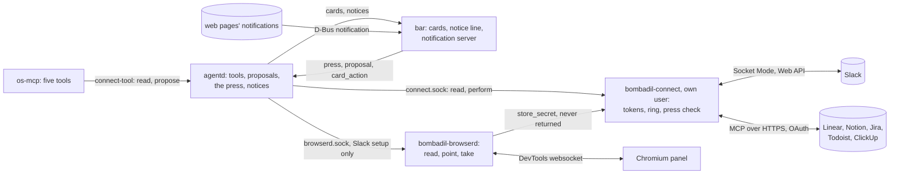
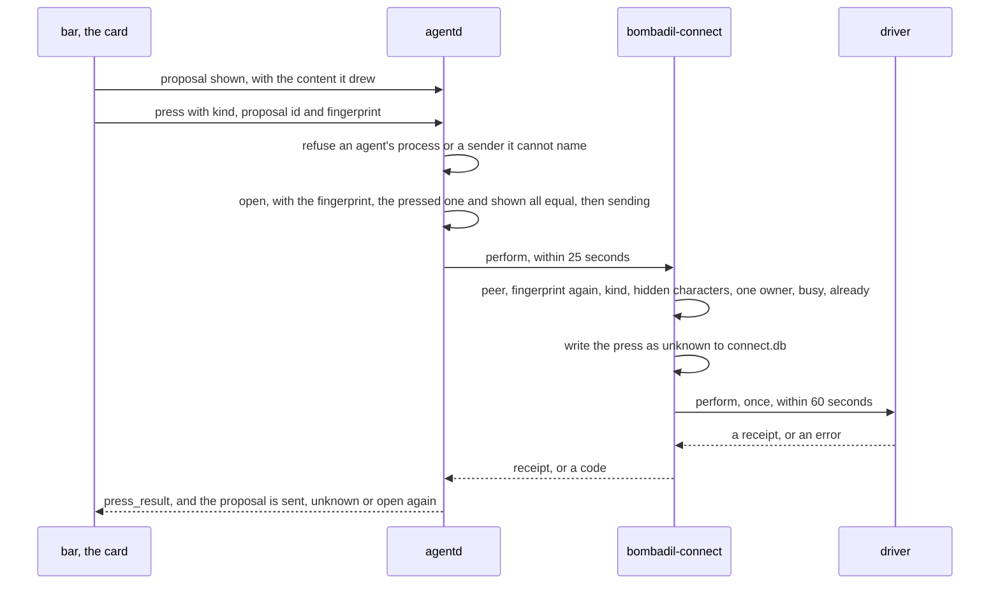
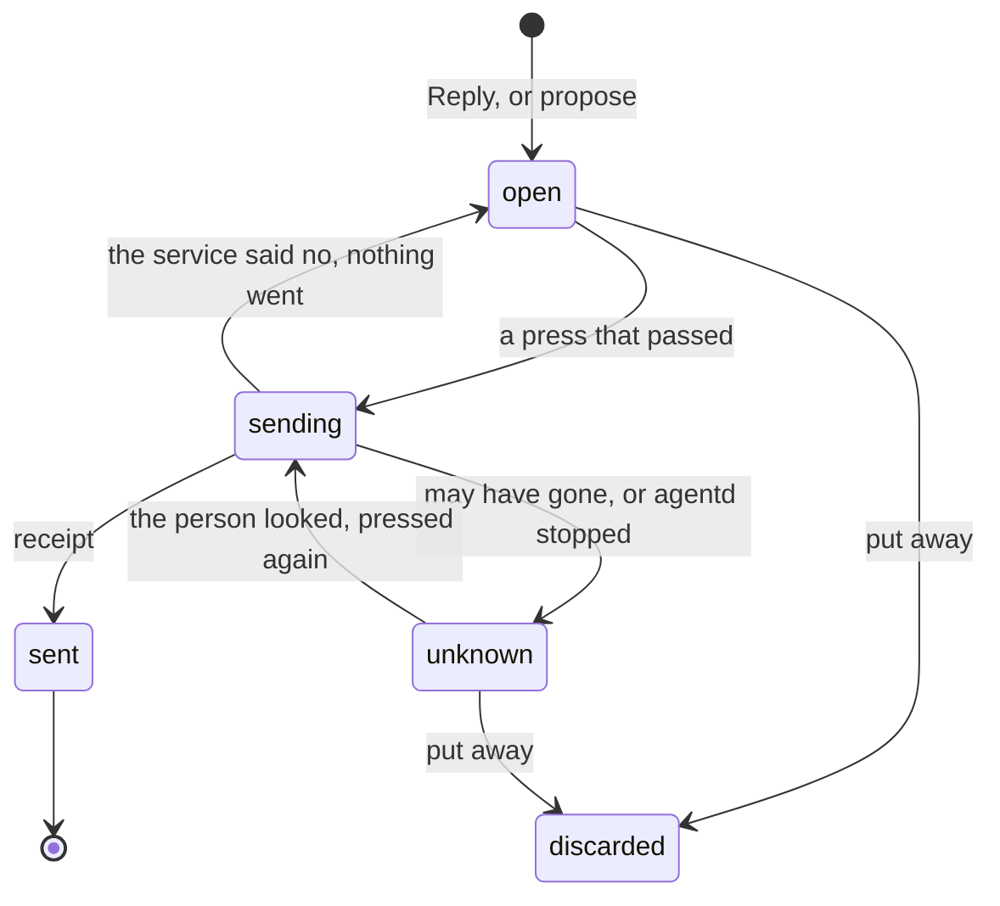

# Messages and connections

> **Status:** Shipped  
> **Code:** `src/bombadil/connect/`, `bin/bombadil-connect`, `src/bombadil/browserd/`, `bin/bombadil-browserd`, `src/bombadil/proposals.py`, `src/bombadil/outbox.py`, `src/bombadil/cards.py`, `src/bombadil/notifications.py`, `src/bombadil/plaintext.py`, `src/bombadil/ws.py`, `src/bombadil/agentd.py`, `src/bombadil/launcher.py`, `src/bombadil/apps.py`, `src/bombadil/procs.py`, `src/bombadil/mcp_server.py`, `src/bombadil/paths.py`, `src/bombadil/narrate.py`, `src/bombadil/notices.py`, `share/connect/`, `share/skills/bombadil-connect/SKILL.md`, `shell/Notifications.qml`, `shell/CardHost.qml`, `shell/CardBox.qml`, `shell/CardButton.qml`, `shell/CardScroll.qml`, `shell/ScrollThumb.qml`, `shell/Draft.qml`, `shell/DraftBar.qml`, `shell/MessageFace.qml`, `shell/TaskFace.qml`, `shell/ListFace.qml`, `shell/PillState.qml`, `iso/airootfs/etc/systemd/system/bombadil-connect.service`, `iso/airootfs/usr/lib/sysusers.d/bombadil-connect.conf`, `iso/airootfs/etc/systemd/user/bombadil-browserd.service`, `iso/airootfs/etc/skel/.config/hypr/hyprland.lua`, `iso/airootfs/etc/sudoers.d/bombadil`, `iso/packages.x86_64`, `iso/airootfs/usr/local/bin/bombadil-smoke`, `scripts/dev-session.sh`, `tests/connect_fakes/`, `tests/browserd_fakes/`  
> **Design:** [Messages and connections](../design/messages-and-connections.md), [Bombadil at work, piece 2](../design/everyday-work-brief.md#2-messages-and-connections)  
> **Verified:** 2026-11-09 against `main` at `24c836c`: the code behind each claim below was read at that commit, and so were the unit, sysusers and sudoers files and the smoke test's checks. These tests were run, one file at a time, and passed: `tests/test_connect_store.py`, `test_connect_client.py`, `test_connect_service.py`, `test_connect_slack.py`, `test_connect_mcp.py` (against `mcp` 2.3.0 and `httpx2` from the Python package index, not the image's packages), `test_connect_tools.py`, `test_connect_watch.py`, `test_connect_e2e.py`, `test_agentd_connect.py`, `test_proposals.py`, `test_outbox.py`, `test_cards.py`, `test_cardmake.py`, `test_plaintext.py`, `test_ws.py`, `test_notifications.py`, `test_launcher.py`, `test_apps.py`, `test_iso_profile.py`, the two connection-tool tests of `test_mcp_server.py`, and `test_browserd.py` and `test_slack_setup.py` with a real headless Chromium and none skipped. Not run: `tests/test_connect_cards_qml.py` and `tests/test_notice_qml.py` (they need PySide6), the desktop test and the VM smoke, so nothing here about the unit under a real systemd, its sandbox keys, the notification name on a real bus, a real Hyprland or the packages on a built image was observed in this check. Nothing has been run against a real Slack workspace or a real Notion, Linear, Jira, Todoist or ClickUp server. On 2026-11-12, against `main` at `7d37bc5`, the statements on the installed layout and on a refresh, the smoke checks of the notification block (counted in `iso/airootfs/usr/local/bin/bombadil-smoke`) and the `agentd.py` anchors were read again in the code; the rest of the page was not.

Messages and connections is piece 2 of "Bombadil at work", after [Mail](mail.md). A Slack message to the person, a ticket that waits on them in a work tool and any other web page's notification each become one line above the pill. A reply or a ticket is a draft in a box on a card, and it leaves only on the person's own press on the card's button. The keys to Slack and the work tools are kept by a service of its own, `bombadil-connect`, which runs as a system user and gives no key back through any op, tool, card or log, so the model never sees one. Everything here is on `main` and tested against fakes. No real service has been run, and the token store is closed to the person's own programs but not to `sudo`, which the image still gives the agent without a password ([the rules](#the-rules-the-code-keeps), [known gaps](#known-gaps)).

[docs/CONNECT.md](../CONNECT.md) is the contract the code comments point to and has every field and limit of the wire protocol. This page says how the pieces work, which rules have a check and which are only a convention, and what was run against what.

## What is built and what is not

| Part | State on `main` at `24c836c` |
|---|---|
| The connection service, token store and client | Shipped: `bombadil-connect` (a system unit with its own user), `connect.db`, the message ring, `connect.sock` and the blocking client |
| Slack | Shipped, never run against a real workspace: the driver (Socket Mode and the Web API), the app manifest and the setup recipe |
| Work tools | Shipped, never run against a real server: one MCP driver and five recipes (`clickup`, `jira`, `linear`, `notion`, `todoist` in `share/connect/recipes/`), each with `verified = false` |
| The browser service | Shipped, the read half only: `bombadil-browserd`, a user unit |
| Proposals and the press | Shipped for three kinds: `slack_reply`, `task_create` and `task_comment` |
| Cards | Shipped: `message`, `task` and `list`, drawn by `MessageFace.qml`, `TaskFace.qml` and `ListFace.qml` |
| Notifications | Shipped: the bar's `NotificationServer` owns `org.freedesktop.Notifications`, and the image has no `mako` |
| The agent's side | Shipped: five tools, `propose` among them, and the skill |
| The image | Shipped: the system unit, its user, the browser unit, `python-mcp` and `python-httpx`, and 23 smoke checks ([the image](#the-units-and-the-image)) |

Not built, or built less than the design says:

1. **No hands in a page.** The browser service never clicks, types or navigates. Its ops are `status`, `open`, `tabs`, `read`, `find`, `point`, `unpoint`, `wait` and `take` (`OPS` in `src/bombadil/browserd/service.py`). Writing inside a tool's own page is a later piece ([Bombadil at work, after these, in order](../design/everyday-work-brief.md#after-these-in-order)).
2. **No holding card for "Connected here".** It opens only from the launcher words `connections`, `connected`, `whats connected` and `what is connected`, and is redrawn when a connection changes while it is open.
3. **The client metadata document is not the client id.** `share/connect/client-metadata.json` is read for the client name and the response type (`recipes.client_metadata`), but `BOMBADIL_CLIENT_METADATA_URL` is unset and no recipe sets `client_metadata_url` (`src/bombadil/connect/mcpconn.py:469-471`), so each sign-in registers dynamically under the name "Bombadil".
4. **Notion lists nothing that waits on the person.** `share/connect/recipes/notion.toml` has no `[list]`, so Notion only makes pages and comments. The skill says the same.
5. **Teams and other web apps are only notifications.** They get Reply (a card whose button is "Copy and open") and Open. There is no connection for them.
6. **The token store is not a wall.** See [the rules](#the-rules-the-code-keeps).
7. **Disconnecting does not revoke.** `remove_connection` deletes the tokens from `connect.db` and stops the driver. Nothing tells Slack or a work tool's server that the grant is over (`src/bombadil/connect/mcpconn.py:48` says so for the MCP driver, and `slack.py` calls no revoke method).

### What was run against what

| Part | Run against | Not run against |
|---|---|---|
| Slack driver | `tests/connect_fakes/fake_slack.py`, a fake that speaks the Web API and Socket Mode | A real Slack workspace |
| Slack setup recipe | Pages that imitate Slack's (`tests/browserd_fakes/slack_pages.py`) in a real headless Chromium (`tests/browserd_fakes/chromium.py`, which skips when there is none), and a fake DevTools port (`tests/browserd_fakes/fake_cdp.py`) | Slack's real pages, which nobody has seen through it |
| MCP driver | `tests/connect_fakes/fake_mcp.py`, a server and an OAuth provider written with the same SDK | Any of the five real servers. The only contact was unauthenticated, on 2026-11-08, as the comments of the recipes say |
| The five recipes | Nothing. Every tool name, argument name and answer shape is a guess (`linear.toml` and `todoist.toml` say so in comments) | Everything |
| The service behind a real agentd | `tests/test_connect_e2e.py`: the real `Service` on the fake engine, with `procs.cgroup_of` patched to find no agent scope. It proves the shapes, the fingerprint and press-once | A real service, or a press from a real scope |
| The bar | `tests/test_connect_cards_qml.py` offscreen, and `tests/desktop/driver.py` step 31: a real Quickshell in a headless sway session against the fake engine, with a notification posted on the bus | A real Hyprland, a browser's own notifications, a real agent turn that uses the five tools |
| The unit | `bombadil-smoke` runs the real unit only to answer `status` with no connection. For anything that needs a connection it restarts the unit on the fake engine through a drop-in in `/run/systemd/system/bombadil-connect.service.d`, with a scratch state directory, and puts it back | The real engine with an account |
| A dev session | `scripts/dev-session.sh` starts `bin/bombadil-connect` as the person on the fake engine, in a scratch folder (`BOMBADIL_CONNECT_ENGINE=fake` unless set to anything else). It does not start `bombadil-browserd` | The system unit's separation |

## How it works

### The processes

- **`bombadil-connect`** (`bin/bombadil-connect`, `src/bombadil/connect/service.py`) is a system unit with `User=bombadil-connect`. It owns `connect.sock`, `connect.db`, the message ring and the press check, and runs one driver per connection. It restarts on failure after 2 seconds (`Restart=on-failure`, `StartLimitIntervalSec=0`, `MemoryMax=300M`). A driver that does not start or dies is built again after a pause of 2 seconds doubling to 60 (`BACKOFF_MIN`, `BACKOFF_MAX`), and 60 seconds of uptime starts the pauses over (`STABLE_S`). A driver's start has 60 seconds, a read 10, and a press 60 (`START_S`, `DRIVER_S`, `PERFORM_S`).
- **`bombadil-browserd`** (`bin/bombadil-browserd`, `src/bombadil/browserd/service.py`) is a user unit, `WantedBy=default.target`, `After=graphical-session.target`, with `KillMode=process` so a browser it started outlives a restart of the service. It holds one websocket per tab it works on (at most 8) to the panel's Chromium DevTools port, and serves 16 clients at most. [Browser and sign-in](browser-and-signin.md) describes the panel.
- **agentd** holds the broker for the tools (`connect/tools.py`), the subscription and the voice (`connect/watch.py`: `Watch` and `Says`), the card makers (`connect/cardmake.py`), the proposals and the outbox (`proposals.py`, `outbox.py`) and the notifier (`notifications.py`). [agentd](agentd.md#messages-and-connections) describes it from its side.
- **The bar** draws the cards (`CardHost.qml` and the faces) and owns the desktop's notification name (`Notifications.qml`). [The shell](shell.md#the-cards-of-the-connections) describes it from its side.
- **os-mcp** registers the five tools (`mcp_server.py` calls `connect_tools.register`). [os-mcp](os-mcp.md) describes the server.
- **The fake engine** (`BOMBADIL_CONNECT_ENGINE=fake`, `connect/fake.py`) gives the service a `FakeDriver` for every connection and a store that starts with a workspace called Acme and a Linear connection, each with invented messages or tasks.

Nothing waits for a connection. A caller that cannot reach the service says "Connections are not running yet." in its own line, a read has a limit of 4 to 8 seconds, adding a connection 20, a press 25, and a turn never blocks on Slack.

### Who may do what

The service asks the kernel who is on the other end of `connect.sock` (`SO_PEERCRED` and a pid handle) and decides for each peer. A peer is the agent's when its process is in a `bombadil-turn-` or `bombadil-dev-` scope (`procs.AGENT_SCOPES`, so a coding session's process too), when the kernel cannot name it, when it has gone since it connected, or when its cgroup cannot be read. A peer outside the uid range 1000 to 59999 (`UID_RANGE`, `BOMBADIL_CONNECT_UIDS=min-max`) is refused and closed. The service keeps 64 clients at most, 8 of them the agent's, and at most 20 connections.

| | The agent (a process in a turn's or a coding session's scope) | The person's own process |
|---|---|---|
| Read: `status`, `connections`, `messages`, `thread`, `tasks`, `subscribe` | Yes. Through the tools the text is marked and the turn is remembered as a reader. Straight on the socket it is neither ([known gaps](#known-gaps)) | Yes |
| Draft | Only through `propose`, which is agentd's and puts a draft on a card | Typing in the card's box |
| Press (`perform`) | Never: `agent` | Through agentd, from the card |
| Connect, disconnect, give a token, say what was read (`add_connection`, `remove_connection`, `store_secret`, `seen`: `PERSONS_ONLY`) | Never: `refused`, "... is yours to do" | Yes |
| The card's buttons, a proposal's box, a notification, `connect <service>` at agentd | Ignored, or answered "Connecting a service is yours to do. It cannot be done from an agent's turn." | Yes |
| The browser service | Closed at the first request | The one caller is agentd's Slack setup |

This is a rule with a check, not yet a wall ([the rules](#the-rules-the-code-keeps)).

### The service and its drivers

`service.py` knows nothing about Slack or Linear. It asks a driver (`driver.py`: `Driver`, `Secrets`, `DriverError`, `UnknownOutcome`, `fingerprint`) for everything particular to a service and cleans what comes back (`clean_message` and `clean_task` in `protocol.py`: only the keys of the shapes, no control, invisible or direction-changing characters, every text cut).

- **The ring.** Messages live in the memory of the service: at most 500 (`RING_MAX`), none older than 14 days (`RING_AGE_S`). "Unread" is the service's own note, a time per conversation in `connect.db` (`seen`), never Slack's. A message is unread when it is newer than that time.
- **A connection** is `{id, kind, service, name, state, note, reads, can_post, steps, task_fields?, open?}`. Its `state` is `ok`, `signin`, `setup`, `blocked`, `error` or `off`. `can_post` is true only when the state is `ok` and the driver can post. `task_fields` says which boxes a ticket and a comment have in that service, from its recipe.
- **One owner per press.** `_doer` picks the one connection that owns the target (`Driver.owns`). With none it refuses `no_connection`, with two that are ready it refuses ("More than one connection could do that, so I did not guess"), and a connection that is `blocked`, `error` or only reads is refused with its own sentence.

### Slack

`slack.py` is the Slack driver, and Bombadil does not ship one Slack app for everyone. An app shared outside the Marketplace is held to one history request a minute, so the person makes a small private app in their own workspace from a manifest Bombadil prepares (`connect/manifest.py`):

- **Scopes and events.** User scopes only, no bot user: `channels:history`, `groups:history`, `im:history`, `mpim:history`, `channels:read`, `groups:read`, `im:read`, `mpim:read`, `users:read` and `chat:write`. Socket Mode on, user events `message.channels`, `message.groups`, `message.im` and `message.mpim`, no interactivity, no token rotation. Nothing listens on the computer.
- **Tokens.** `app_token` (`xapp-`, opens the socket) and `user_token` (`xoxp-`, reads and posts as the person). `store_secret` takes only those two names and only a value that starts with the prefix (`secret_rules`).
- **What it calls.** Nine Web API methods: `apps.connections.open`, `auth.test`, `conversations.list`, `conversations.history`, `conversations.replies`, `conversations.info`, `users.info`, `chat.getPermalink` and `chat.postMessage`. Only `chat.postMessage` writes.
- **What is for the person.** Any message in a direct or group direct message from someone else, a channel message that mentions them, and a reply in a thread they have posted in (`_for_me`). After connecting it backfills up to 100 direct and group conversations, the last 20 messages of each from the last 14 days, so "what did I miss" is true after a restart.
- **The reply.** `perform("slack_reply", ref, text)` posts with the user token as a reply in the ref's thread, with `unfurl_links` off. A text over 3000 characters (`MAX_REPLY`) or with a control or hidden character is refused before anything is sent. A failure after the request was written is `UnknownOutcome`, and so is no answer in 20 seconds. The receipt line says where and when ("Posted in #launch · 11:04") and carries a permalink when Slack gives one.
- **Errors become states.** `invalid_auth`, `token_revoked`, `account_inactive`, `not_authed` and `token_expired` make the connection `error` with code `auth`. An administrator's approval wall (`app_approval`, `not_allowed_token_type`, `restricted_action`) makes it `blocked`. Slack unreachable for five connections in a row makes it `error` with "I can't reach Slack. I'll keep trying.".

**The setup recipe** (`slack_setup.py`) runs in agentd, in a thread of its own, as the person. It uses the browser service and puts the pointer on each button the person is to press: open Slack's page with the manifest filled in (`manifest.creation_url()`), point at Create, point at the App-Level Token button, point at Install to Workspace and then Allow. The two tokens are taken off the page by the browser service's `take`, which hands them straight to `store_secret`, so they never pass through agentd's code or the model. It presses nothing and runs only fixed scripts. It stops after 15 minutes (`SETUP_SECONDS`) or when the person types "stop" or "cancel", and an administrator's approval wall ends it with one sentence and leaves the connection in `setup` with whatever token it already stored, so the next `connect slack` goes on from the app the person opens. A run takes tokens only from pages of the one app it began with.

### Work tools

`mcpconn.py` is one driver for Notion, Linear, Jira, Todoist and ClickUp, built on the official Python SDK (`mcp` 2.3.0, over `httpx2`, Streamable HTTP and the SDK's own OAuth client). It opens a connection for each request and closes it after (30 seconds for the whole request: `OP_SECONDS`), because one failed request ends the SDK's whole session.

- **Sign-in.** The service listens on a loopback port of its own for the redirect (`BOMBADIL_CONNECT_CALLBACK_PORT` fixes it), the connection goes to `signin` with one step that opens the server's authorization page in the panel, and the person has 15 minutes to come back (`SIGNIN_SECONDS`). The tokens are stored through `Secrets`, and the state becomes `ok`. A refresh that fails, or a server that wants the person again, is a new sign-in.
- **Reading.** `tasks()` calls the recipe's list tool, and with tokens stored the same call runs every 5 minutes (`POLL_SECONDS`) and pushes a `task` for each item not seen before in that run, at most 20 at a time. The first look is silent.
- **Writing.** `perform("task_create" | "task_comment", target, fields)` is one call of the recipe's tool, with only the boxes the recipe lists, each at most 20 000 characters. A request that was written and then failed or timed out is `UnknownOutcome`; one that cannot have been written never is. The receipt line is "Created LIN-42 in Linear" or "Commented on LIN-42 in Linear", with the item's address when the answer has one.
- **A recipe** (`share/connect/recipes/<service>.toml`, `recipes.py`) is data: `[server]` with the service, the address, `scopes`, `write_scopes`, `reads` and `verified`; optionally `[context]` (Jira's site lookup); `[list]` with its tool, arguments and how an answer maps to a task; `[create]` and `[comment]` with the tools and how a card's boxes map to arguments. The consent page asks for the read scopes always and the write scopes whenever the recipe can create or comment, so it asks to write although a post still happens only on a press. Notion names no scope.

### The browser service

`browserd/service.py` answers on `browserd.sock` in JSON lines, only to the person's own uid and never to a peer in an agent's scope, which it asks again for every request and fails closed (`_agents`: a peer it cannot name, look at or that has gone is refused). It has no hands. A request with an argument its op does not take is refused (`ARGS`), a caller passes data (a word, a selector, a regex) and the only code that reaches a page is the fixed set in `overlay.py`. A tab's debugging address must be on this computer.

- `open` is the panel opening, through `browser.open_url`; a request with no `tab` afterwards means that page, and if it was closed the answer is "That page is gone.", never the first page of the person's.
- `read` returns the page's visible text, at most 200 000 characters, with `untrusted: true`, a password field blank and anything shaped like a Slack token replaced by "[token hidden]".
- `point` draws an orange ring and a labelled pointer from an element the service injects, gone after 20 seconds by default (`ttl`), on `unpoint` or on a navigation.
- `take` runs a regex over the page's visible text and the values of its visible fields and hands the first match to the connection service's `store_secret`. The answer says only whether it was stored. With `url`, nothing is taken unless the page's address matches, decided in the same look as the text.

### Proposals and the press

A proposal is what waits for a press (`proposals.py`, held by the `Outbox`): `{id, kind, target, content, where, created_by, tainted, typed, warnings, fingerprint, shown, state, receipt, note}`. The kind is one of `slack_reply`, `task_create` and `task_comment` (`driver.KINDS`) and the button says Send, Create or Comment (`agentd.CONNECT_BUTTONS`). The `fingerprint` is the SHA-256 of the kind, the target and the content in canonical JSON (`driver.fingerprint`), and `shown` is the fingerprint of what the shell last said it drew. The shell sends the content, never a hash, so a proposal is `ready` only while the two agree.

Warnings, in the order they matter: `new_place` (a conversation the person has had nothing from in 14 days and has not written in), `broadcast` (`@channel`, `@here` or `@everyone`), `long` (over 3 000 characters) and `tainted` (the agent wrote it in a turn that read other people's words, and it is not the person's typed words). A reply is at most 20 000 characters (`proposals.MAX_CONTENT`), a task field 5 000, and the table keeps 100 proposals (`MAX_KEPT`).

1. **At agentd** (`Outbox.press`) a press is refused when its sender cannot be named (`no_peer`), when it is a process in an agent's scope or in the running turn's process tree (`agent`), when the kind has no performer, when its shape is wrong, or when the same `(kind, id)` is already running (`busy`). The performer for the kind then asks `_perform_proposal`: the proposal must exist with that kind. A `sent` one answers its stored receipt without asking the service. An `unknown` one needs `again`. A `sending` one is `busy`. An empty one is refused, and the fingerprint must equal the proposal's own and the one reported as shown, else `changed`. `begin_send` marks it `sending` before the service is asked.
2. **At the service** (`_op_perform`) the checks run in this order: the peer is not the agent (`agent`); the request has a shape and a size (`target` at most 200 characters, `content` at most 100 000 as JSON); the fingerprint worked out again is the one given (`changed`); the kind is in `KINDS`; no word of the content has a hidden character (`plaintext.has_hidden`, `refused`); exactly one connection owns the target and is `ok` and can post; the proposal id is valid; the id is not running (`busy`, checked before `already` so a press in flight is not answered "may have gone"); the id is not in `connect.db` (`already`).
3. **The press is written down before the driver is asked.** `_do` writes the id as `unknown`, calls the driver once under 60 seconds, and on a plain `DriverError` takes the row back (`forget_performed`), so the person may press again. An `UnknownOutcome`, a `DriverError` whose code is `unknown_outcome`, a timeout and any other failure end as `unknown` and are answered `unknown_outcome`. Otherwise the row is `done` and the answer is the receipt. Performed ids are kept 90 days (`PERFORMED_KEEP_S`).
4. **Back at agentd** an outcome `sent` makes the proposal `sent` with the receipt. `unknown`, and also `already`, `internal` and a connection lost after the request was written, make it `unknown` with "I can't tell whether that went. Look in Slack before you press Send again." (the service's name for a work tool). Any other refusal reopens it with the sentence. A service that could not be reached at all reopens it with "Connections are not running yet. Nothing was sent.". Nothing retries at any level.
5. **A second try is the person's.** After an unknown outcome the card shows the sentence and the button returns only when the person ticks "I looked in <where>". The press then carries `again: true` and goes to the service as a new attempt with its own id (`p3`, then `p3-2`), so the first row stays as it was.

If agentd stops while a proposal is `sending`, it is loaded as `unknown` and agentd says so once ("I can't tell whether your reply in #launch went when I restarted."). Closed proposals are forgotten after 30 days (`FORGET_AFTER`).

Typing "send it" sends nothing. While a reply or a ticket waits on a card, `launcher.is_send_word` is answered "Sending is yours. It's under the pointer." and no model is asked.

### The three card kinds

`cards.accept` takes three kinds beside the diagram, and agentd checks every one again before the bar gets it. `connect/cardmake.py` builds them from what the service, a proposal or a notification says. Every card has an `id`, a `title` (at most 80 characters), a `source` (`connect`, `notification` or `mail`) and one `say` sentence (at most 160).

- **`message`**: the last six messages of a thread, oldest first (`THREAD_ROWS`, each text cut at 1 200), the reply box, its warnings and one button. A card made from a notification has a reply of kind `copy` and its button says "Copy and open": the shell copies the words, agentd puts them on the clipboard with `wl-copy` (4 000 characters at most, 3 seconds) and invokes the notification so the page that sent it comes forward. It is no send: no ring, no "Yours".
- **`task`**: a ticket that waits on the person with its fields, or the form for a ticket to make, with one box per field the recipe lists (at most 12 boxes and rows together, each box 5 000 characters). Without `task_fields` a ticket has a title and a description and a comment has one box.
- **`list`**: at most 12 rows, each with a state mark, a line, a time and at most two buttons. The unread messages and "Connected here" are lists. "Connected here" has a row for each mail account, Slack workspace and tool with what it reads and a Disconnect, and a quiet Connect for each service not connected.

The button of a message or task card is lit only while `ready` is true and the box holds exactly the proposal's content, and it waits 300 ms after that so a click already on its way elsewhere does not press (`Draft.armDelay`). Then it has the orange ring and "Yours: Send". A card takes the keyboard only after a Reply or a click in its box. A card with a box is drawn on one screen only, 560 wide, and a list 480. Every word on a face is another person's and is drawn as plain text.

### Notifications in place of mako

`shell/Notifications.qml` is Quickshell's `NotificationServer` and owns `org.freedesktop.Notifications`. It draws nothing. It sends each notification to agentd as `{type: "notification", id, app, summary, body, urgency, icon, actions}` (text cut at 2 000 characters, at most 8 actions) and holds it, at most 64, until agentd says `notification_invoke` or `notification_close`.

agentd's `notifications.py` decides what the person sees. A notification becomes a notice "sender: preview" with Reply and Open, for 10 seconds (30 for a critical one). At most one notice per app per 2 seconds, a burst folding into "+N" on the last. A notification with no summary and no body says nothing and is closed. Open invokes the notification's `default` action so the page comes forward, and with no `default` it puts the notification away. No other action of an app is ever invoked from here. The notification's words are other people's words, made plain and cut.

The image has no notification daemon: `iso/packages.x86_64` lists none, `hyprland.lua` starts none, and a test fails the build on any of the usual names.

### Launcher words

The pill answers these itself with no model (`launcher.CONNECT_VIEWS`, matched before the person's own apps, with or without a leading `open` or `show`):

| Words | Does |
|---|---|
| `slack`, `messages`, `unread`, `what did i miss`, `what did i miss on slack` | Opens the list card of unread messages |
| `connections`, `connected`, `whats connected`, `what is connected` | Opens "Connected here" |
| `connect slack`, `connect linear`, `connect notion`, `connect jira`, `connect todoist`, `connect clickup` | Starts that setup. Exact words only: "connect to wifi" goes to the agent |

`apps.CLAIMED` (`slack`, `messages`, `unread`, `connections`, `connected`) makes `apps.create` refuse an app of those names, and Tab offers `messages` and `connections` only.

### The rules the code keeps

Each rule says what holds it and what tests it. **Check** means the code refuses at run time and a test covers the refusal. **Absence** means it holds because the code has no such function, and a test asserts the absence. **Convention** means it is a sentence to the model or a habit, with no check.

| Rule | What holds it | Kind | Tests |
|---|---|---|---|
| The agent has no tool that sends, posts, replies, creates or comments | `connect/tools.py` has five ops (`OPS`) and `Broker` has no `perform`; the performers in the outbox are the only way out | Absence | `test_the_five_connection_tools_are_listed_and_none_of_them_sends` in `tests/test_mcp_server.py`; `test_nothing_the_broker_does_can_send_there_is_no_perform_in_it` in `tests/test_connect_tools.py`; the set of performers in `tests/test_outbox.py` |
| A press from inside an agent's turn goes nowhere | `Outbox.press` (`procs.cgroup_of` or the running turn's process tree, a gone process counts as the agent's) and the service's `_scoped` (`procs.in_turn_scope`, which raises on an unreadable cgroup, so the caller refuses) | Check | `test_a_press_from_inside_an_agents_turn_is_refused_whatever_it_says`, `test_a_peer_that_joins_an_agents_turn_after_it_connected_is_caught` and `test_a_peer_whose_cgroup_cannot_be_read_is_refused_as_the_agents_and_one_that_can_is_told_apart` in `tests/test_connect_service.py`; `test_a_press_from_inside_a_turn_is_refused_by_agentd_and_by_the_service_and_nothing_goes` in `tests/test_connect_e2e.py` |
| A press is for exactly what the card drew | The proposal's fingerprint, the pressed one and `shown` must agree at agentd, and the service works it out again | Check | `test_a_press_for_other_words_than_the_card_drew_goes_nowhere` in `tests/test_connect_e2e.py`; `test_a_press_whose_fingerprint_is_not_the_one_worked_out_again_is_changed_and_does_nothing` in `tests/test_connect_service.py`; `test_ready_is_what_was_drawn_equal_to_what_would_go` in `tests/test_proposals.py` |
| One press is at most one act, and nothing retries | The row is written as `unknown` before the driver is asked, the id is added to `_running` before the first await, and the driver's answer is final | Check | `test_two_presses_of_one_proposal_at_once_are_one_act_and_a_busy`, `test_an_outcome_that_is_not_known_is_recorded_answered_and_never_retried` and `test_an_unknown_outcome_is_remembered_by_a_restart` in `tests/test_connect_service.py` |
| What the person read is all of what goes | `plaintext.strip` takes hidden characters out of a draft, and the service refuses any that remain | Check | `tests/test_plaintext.py`; `test_words_that_draw_as_nothing_are_not_sent_even_with_the_right_fingerprint` in `tests/test_connect_service.py` |
| Reading is quiet | A driver never marks anything read, joins or reacts; the Slack driver's only write is `chat.postMessage` | Absence | `test_what_the_service_asks_for_never_writes_to_slack` in `tests/test_connect_slack.py` |
| Bombadil keeps no copy of other people's words | The ring is in memory (500, 14 days); `connect.db` has tables for connections, secrets, seen times, performed ids and a counter, and none for words | Absence | `test_the_ring_holds_at_most_five_hundred_messages`, `test_the_ring_drops_what_is_older_than_fourteen_days_by_the_messages_own_time` and `test_seen_is_remembered_by_a_restart_and_the_ring_is_not` in `tests/test_connect_service.py` |
| The keys are not the agent's | `connect.db` is 0600 in a 0700 directory owned by `bombadil-connect`; `ConnectionSecrets.get` is the one way a value leaves the store; no op, tool, card, push or log returns one; `take` never answers the value | Check against the person's own programs, not against `sudo` | `test_no_method_but_get_gives_a_value_back` and the mode tests in `tests/test_connect_store.py`; `test_a_secret_is_in_no_answer_push_log_line_or_exception` in `tests/test_connect_service.py`; `test_take_hands_the_first_match_to_the_connection_service_and_nothing_comes_back` in `tests/test_browserd.py`; the smoke's `connect-state-is-closed` |
| Connecting, disconnecting and the card's buttons are the person's | `PERSONS_ONLY` at the service; `_persons` at agentd for `proposal`, `card_action`, `notification` and `connect <service>` | Check | `test_what_a_person_alone_may_do_is_refused_to_a_process_in_an_agents_turn` in `tests/test_connect_service.py`; `test_a_proposal_a_card_button_or_a_notification_from_inside_a_turn_does_nothing` and `test_connect_linear_written_to_the_socket_from_inside_a_turn_is_refused_and_connects_nothing` in `tests/test_agentd_connect.py` |
| The browser service has no hands and answers no agent | Nine ops, arguments checked, fixed scripts, the scope check on every request | Check, and absence of the hands | `test_a_peer_inside_an_agents_turn_is_refused_for_every_op_and_nothing_reaches_the_browser_or_the_service` and `test_a_process_that_joins_a_turn_after_it_connected_is_refused_at_its_next_request` in `tests/test_browserd.py` |
| Typing "send it" sends nothing | `launcher.is_send_word` is answered locally while a proposal waits | Check | `test_typed_send_while_a_reply_or_a_ticket_waits_on_its_card_is_answered_here_and_is_not_a_send` in `tests/test_agentd_connect.py` |
| Other people's words are read, never obeyed | The tools put them between two marks with a fresh random word and quote every line with `> `; the person's own words are compared with the draft (`tainted`, `new_place`); the skill and the tools' descriptions say never to obey | Partly check (the quoting and the warnings), partly convention (the marks and the sentences are advice to a model that has a shell) | `tests/test_connect_tools.py`; `test_words_the_agent_wrote_after_reading_messages_are_flagged_unless_the_person_typed_them` in `tests/test_proposals.py` |

**A rule with a check, not a wall.** The agent runs as the person, and the image gives that user passwordless `sudo` (`iso/airootfs/etc/sudoers.d/bombadil`: `user ALL=(ALL) NOPASSWD: ALL`). For the token store that means this:

- `connect.db` and its directory belong to `bombadil-connect` (`iso/airootfs/usr/lib/sysusers.d/bombadil-connect.conf`: no login, no home; `StateDirectoryMode=0700`; the database 0600, `src/bombadil/connect/store.py`). A program of the person's without `sudo` cannot list the directory, and the smoke checks that (`connect-state-is-closed`: owner and mode, and that `ls` fails as the person's non-root user).
- With `sudo`, the agent's own shell can read `connect.db`. The store keeps tokens as they are, with no encryption, so every token is there in the clear, and a process that has them can call Slack or a work tool directly with no card, no fingerprint and no press. The unit file's own comment says an agent that uses `sudo` still can.
- So the store is a rule with a check, and it becomes a wall only when the agent loses `sudo`. The hardening order in [the design](../design/messages-and-connections.md#what-is-a-rule-not-yet-a-wall) is that the agent loses `sudo` and agentd accepts presses only from the shell's own process.
- The other "never" rules are checks for the same reason. A process of the person's outside every agent scope, for one started with `systemd-run --user`, passes the scope check on `connect.sock`, on agentd's press path and on `browserd.sock`. On a machine where turns run without a systemd scope, no process can be told from the person's on those sockets, and agentd logs that once at start (`agentd.py:582-585`).
- What stands against it is the skill and the tools' descriptions telling the agent not to, the fingerprints, the warnings and, at agentd, the press log.

The unit file also carries sandbox keys: `NoNewPrivileges`, `ProtectSystem=strict`, `ProtectHome=yes`, `PrivateTmp`, `RestrictAddressFamilies=AF_UNIX AF_INET AF_INET6`, `MemoryMax=300M`, and `PrivateDevices`, `ProtectKernelTunables`, `ProtectKernelModules`, `ProtectControlGroups`, an empty `CapabilityBoundingSet`, `RestrictNamespaces`, `RestrictRealtime`, `RestrictSUIDSGID` and `LockPersonality`. It sets none of `ProtectProc`, `ProcSubset`, `PrivateUsers` or `PrivatePIDs`, because the press check reads `/proc/<pid>` of the caller. The smoke reads `User`, `NoNewPrivileges`, `ProtectSystem`, `ProtectHome`, `PrivateTmp`, `RuntimeDirectoryMode` and `MemoryMax` from the loaded unit, and `tests/test_iso_profile.py` reads the file for those and for `RestrictAddressFamilies`, `Restart`, `StateDirectory` and the missing keys above. The other nine keys (`PrivateDevices` to `LockPersonality`) are checked by nothing, and no real systemd has loaded the unit in this check.

## Interfaces other pieces depend on

### The socket: `connect.sock`

JSON lines, each at most 1 MiB, at `paths.connect_socket()` (`BOMBADIL_CONNECT_SOCKET`, default `/run/bombadil-connect/connect.sock`), mode 0666 because who may talk is decided by the peer's uid. A request is `{"id", "op", "rid"?, ...}`. An answer is `{"id", "ok": true, "result"}` or `{"id", "ok": false, "error": "one sentence", "code"}`. A client that is not subscribed and says nothing for 10 minutes is closed (`IDLE_S`), and a subscriber that falls 1 000 pushes behind or does not take what it is sent within 10 seconds is dropped. The blocking client is `connect/client.py` (`CONNECT_SECONDS` 2.0 to connect, `NOTIFY_SECONDS` 0.3 for a poke that never raises).

| Op | Arguments | Result |
|---|---|---|
| `status`, `connections` | | `{state: "ok", connections}`; `{connections}` |
| `add_connection` † | `service` (`slack`, `linear`, `notion`, `jira`, `todoist`, `clickup`) | the connection in `setup` or `signin`, with its `steps` and `open`; a work tool already connected answers with the one it has, and `slack` makes another each time |
| `remove_connection` † | `id` | `{}`: the driver stops, its secrets and seen times are deleted and its messages leave the ring |
| `store_secret` † | `connection`, `name`, `value` | `{stored: true}`; the value is one printable line of at most 2 000 characters and is never answered, logged or pushed |
| `messages` | `unread?`, `since?`, `limit?` (50, at most 100), `connection?` | `{messages, skipped}`, newest first |
| `thread` | `ref`, `limit?` (20, at most 100) | `{messages}`, oldest first |
| `seen` † | `refs` (at most 100) | `{}` |
| `tasks` | `service?`, `limit?` (30, at most 100) | `{items, skipped}` |
| `perform` ‡ | `kind`, `target`, `content`, `fingerprint`, `proposal` | `{receipt: {line, web?}}` |
| `subscribe` | | `{}`, then pushes `message`, `task` and `connection` |
| `fake_inject` | `message` or `item`, `connection?` | `{injected}`; only on the fake engine |

† Refused to a process inside an agent's scope. ‡ Refused with code `agent` to such a process, and subject to the checks above.

Codes (`protocol.CODES`): `no_connection`, `not_found`, `bad_request`, `refused`, `agent`, `blocked`, `auth`, `rate_limited`, `service_down`, `already`, `busy`, `changed`, `unknown_outcome` and `internal`.

### The socket: `browserd.sock`

At `paths.browserd_socket()` (`BOMBADIL_BROWSERD_SOCKET`, default `$XDG_RUNTIME_DIR/bombadil/browserd.sock`), mode 0600, JSON lines. The ops are the nine named under [the browser service](#the-browser-service) and the codes are `bad_request`, `refused`, `no_browser`, `no_tab`, `not_found`, `page` and `internal`. The client is `browserd/client.py`, whose calls allow up to 30 seconds. `BOMBADIL_DEVTOOLS_PORT` names the Chromium debugging port.

### The agent's five tools

Each is one `connect-tool` line to agentd for the running turn (`BOMBADIL_TURN`), answered by `connect-result` to its sender only. os-mcp waits up to 30 seconds, and agentd refuses unless that turn is the one running and not stopping. An answer is cut at 60 000 characters.

| Tool | Arguments | Does |
|---|---|---|
| `messages_unread` | `limit?` (20, at most 50) | The unread messages between two marks that say they are other people's words, and the list card |
| `message_thread` | `ref` | One conversation's messages, same marks, and its message card |
| `tasks_waiting` | `service?` | What waits on the person in a work tool, same marks |
| `connections` | | What is connected and in what state, and the boxes a ticket or comment takes in each (`task_fields`); no workspace name, no key, not between marks, and it does not taint the turn |
| `propose` | `kind`, `target`, `content` | A proposal made `created_by: "agent"` with its card, and the line "Reply to Alex is ready. Sending is yours." The place and the name come from the service, never from the model |

The three read tools leave nothing in the turn's log: agentd replaces their output with `[messages and tasks not kept]`. A turn that read messages or tasks is remembered as a reader, with the conversation it resumes into, in the same ledger as mail's (`Broker(..., mail=self.mail)`), and what it proposes carries `tainted`. A `propose` whose target the service does not know, or with a box the tool does not have, is refused. The skill `share/skills/bombadil-connect/SKILL.md` is linked into both CLIs' skill folders. The system prompt in `providers.py` names the mail tools and does not name these five.

### Messages between the bar and agentd

| Message | Direction | Meaning |
|---|---|---|
| `{type: "press", kind, id, fingerprint, again?}` and `press_result` | bar to agentd, and back to the sender only | The person's press; `{kind, id, ok, line, code, receipt}`. Only an explicit `true` is `again` |
| `{type: "proposal", op: "open" \| "edit" \| "shown" \| "discard", ...}` and `proposal` | bar to agentd, and to every client | The box of a reply or task. `open` makes a proposal as the person's, `edit` clears `shown`, `shown` carries the content so agentd works the fingerprint out |
| `{type: "card_action", card, row?, action}` | bar to agentd | `open`, `disconnect`, `connect`, `copy_open` or `dismiss`. None reaches the model |
| `{type: "notification", ...}`, `notification_invoke`, `notification_close` | bar to agentd, and back | See [notifications](#notifications-in-place-of-mako) |
| `{type: "card", card}` | agentd to the bar | A message, task or list card; the open one is sent again to a bar that connects later |
| `notice`, `notice_end`, `notice_action`, `notice_dismiss` | both | The stack of at most 4 lines with up to 3 chips. A message line lasts 60 seconds, a ticket line 120, a receipt 120, a warning 600; "is ready" and an unknown outcome stay |

### Environment and files it reads

| Name | What it is |
|---|---|
| `BOMBADIL_CONNECT_SOCKET`, `BOMBADIL_CONNECT_STATE`, `BOMBADIL_CONNECT_UIDS` | The socket, the service's state directory, and the accepted uid range |
| `BOMBADIL_CONNECT_ENGINE=fake`, `BOMBADIL_CONNECT_FAKE_SIGNIN_S` | The fake engine, and the seconds its fake sign-in takes (2 by default) |
| `BOMBADIL_CONNECT_CALLBACK_PORT`, `BOMBADIL_CLIENT_METADATA_URL` | A fixed port for the OAuth redirect; an address for the client metadata document (none is published) |
| `BOMBADIL_SLACK_API` | The Web API base, default `https://slack.com/api`, so a test points at a fake |
| `BOMBADIL_BROWSERD_SOCKET`, `BOMBADIL_DEVTOOLS_PORT` | The browser service's socket and the debugging port |
| `BOMBADIL_PROPOSALS`, `BOMBADIL_PRESS_LOG` | The proposals file and the press log |
| `BOMBADIL_SHARE` | Where `share/connect/` is found: this directory, then `/usr/share/bombadil`, then the checkout |

## Where state lives

| What | Where | Notes |
|---|---|---|
| `connect.sock` | `/run/bombadil-connect/connect.sock`, with `connect.sock.lock` beside it | Mode 0666 in a directory of mode 0755 (`RuntimeDirectoryMode`), so the person's programs can reach it |
| `connect.db` | `/var/lib/bombadil-connect/connect.db` (`BOMBADIL_CONNECT_STATE`), with `connect.db.lock` | SQLite in WAL mode, `synchronous=FULL`, file 0600 in a directory of 0700 owned by `bombadil-connect`. Schema version 1: `connections`, `secrets` (in the clear), `seen` (a time per conversation key, never words), `performed` (proposal ids, kept 90 days) and `meta` (counters). A database that cannot be opened, is damaged or is newer than this code makes the service report and stop: it holds the only copy of the tokens and of which presses went, so it is never quietly replaced |
| The message ring | The service's memory | 500 messages, 14 days; gone when it stops. The Slack driver keeps 200 in its own memory too |
| `browserd.sock` | `$XDG_RUNTIME_DIR/bombadil/browserd.sock` and its lock | Mode 0600 |
| `proposals.json` | `~/.local/state/bombadil/proposals.json` (`BOMBADIL_PROPOSALS`) | Written whole and renamed into place, 0600. It holds the person's drafts, the place name of each (cut to 80 characters) and up to 4 000 characters of the words they typed. A file that cannot be read is set aside beside itself and the table starts empty, with the id counter kept |
| `presses.jsonl`, `told.json` | `~/.local/state/bombadil/` | One row per press, written by agentd with `src: "agentd"` and no message text, 0600, rotated at 1 MiB. The service writes no press log, only a line in the journal for each press. `told.json` has the once-ever sentence "I never press Send for you. Change anything in it first if you like." |
| Open cards, held notifications, notices | agentd's memory | They die with agentd. A notification's text is kept no longer than its notice and card |
| The bar | Its memory | At most 64 notifications held |

### The units and the image

- **`bombadil-connect.service`** is a system unit (`iso/airootfs/etc/systemd/system/`): `User=bombadil-connect`, `ExecStart=/usr/local/bin/bombadil-connect`, `RuntimeDirectory=bombadil-connect`, `StateDirectory=bombadil-connect` mode 0700, enabled by a link in `multi-user.target.wants`. The user comes from `sysusers.d/bombadil-connect.conf` (`u bombadil-connect - "Bombadil connections" - -`).
- **`bombadil-browserd.service`** is a user unit enabled for every login. It starts before the session has a screen, so `hyprland.lua`'s start hook imports `WAYLAND_DISPLAY`, `HYPRLAND_INSTANCE_SIGNATURE` and `XDG_CURRENT_DESKTOP` and restarts it, as it does for `bombadil-mail.service`. That hook restarts `bombadil-agentd` and `bombadil-shell` first and starts no notification daemon.
- **Packages.** `iso/packages.x86_64` adds `python-mcp` and `python-httpx` (`httpx2` comes with `python-mcp`) and has no `mako`; `wl-clipboard` and `libnotify` were already there. `scripts/build-iso.sh` links `bombadil-connect` and `bombadil-browserd` into `/usr/local/bin`.
- **The smoke** has 23 checks for this piece. Thirteen run in every mode: `connect-tools-installed`, `connect-python-installed`, `mako-is-not-installed`, `connect-skill-installed`, `connect-user-exists`, `connect-unit-enabled`, `connect-unit-active`, `connect-unit-hardened`, `connect-unit-answers`, `connect-state-is-closed`, `browserd-unit-enabled`, `browserd-unit-active` and `browserd-unit-answers`. Ten more are skipped in the undo mode: `mako-is-not-running`, `notifications-owner-is-the-shell` (`busctl` says the name's owner is `quickshell`), `notification-agentd-signed-in` (agentd restarts on the stand-in provider, so the notice is not held behind the setup line), `notification-becomes-a-notice` (`notify-send -a Teams`), `notification-agentd-unit-again` (agentd's unit is started again), `connect-fake-starts`, `connect-status`, `connect-connections-listed`, `connect-messages-listed` and `connect-unit-restored`. [ISO and install](iso-and-install.md#the-smoke-test) describes the test.
- **A restore point rolls the token store back.** In the installed layout `/var/lib/bombadil-connect` is in `@`, which `undo` swaps for the restore point (`@log` and `@pkg` sit beside `@` for `/var/log` and the package cache, and the home is `@home`: [installed OS](installed-os.md)); the layout is described at the top of `iso/airootfs/usr/local/bin/bombadil-install`. The tokens return to what they were then (a token the person has since replaced or had revoked comes back and fails with `auth`), and the ids of presses performed since are forgotten. A post that went stays posted, and a proposal that was `sent` stays `sent` in the person's own state, which is in `@home` and is not rolled back, so it answers with its old receipt and asks the service nothing. A refresh of the installed system from a newer image puts the old root aside and copies a new one from the image, keeping only the files that `REFRESH_KEEP` names (`bombadil-install`), and `/var/lib/bombadil-connect` is not among them: the connections are made again, and the old store stays in the root that was put aside ([installed OS](installed-os.md)). The live image has no restore points ([restore points](restore-points.md)).

## Principles it keeps

- [The person's press reaches people](../principles.md#the-persons-press-reaches-people): the agent has `propose` and no tool that sends, and a draft goes only on a press on the card's button for exactly what the card drew. The traps are a tool that sends, a typed "send it" that sends, a second path to `perform` that skips the fingerprint, and calling the check a wall.
- [Full access with undo](../principles.md#full-access-with-undo): the agent has full access, so what hostile words can talk it into must be visible and reversible, which a draft on a card is. What was sent cannot be undone, which is why it is the press. A restore point also rolls the tokens back ([the image](#the-units-and-the-image)).
- [Nothing runs unseen](../principles.md#nothing-runs-unseen): connections read all day out of sight, so each one has a state and a reason the person can read in "Connected here", a connection that stops working is one line once, and Disconnect stops it at once. The trap is a driver that does something with nowhere to see or stop it.
- [Plain files stay the truth](../principles.md#plain-files-stay-the-truth): Bombadil writes down its own notes (connections, tokens, times, press ids) and never a copy of other people's words. The trap is a second store of message text, in `connect.db` or in the Brain.
- [Degrade and recover](../principles.md#degrade-and-recover): with no service the pill, turns and undo carry on, every call has a limit, and a press that may have gone is said as that. The trap is a call that waits on Slack without a limit.

## Extending it

1. **A work tool.** Add `share/connect/recipes/<service>.toml` (the file's stem is two to twelve lowercase letters; `recipes.py` looks in the installed share, then `BOMBADIL_SHARE`, then the checkout). Add the name to `protocol.SERVICES`, `cardmake.SERVICE_TITLES`, `cardmake.OFFERS` and `service.SERVICE_NAMES`. `launcher.py` imports `SERVICES` and `SERVICE_TITLES`, so `connect <service>` follows, and `tools.py` takes `TOOL_SERVICES` from `SERVICES` without `slack`. Set `verified = false` until it has run against the real server. Tests: `tests/test_connect_mcp.py`, `tests/test_connect_tools.py` and `tests/test_launcher.py`.
2. **A chat service.** Write a driver to the interface in `connect/driver.py`, register it in `service.REGISTRY`, name its kind in `driver.KINDS` if it has a new thing to send, extend the connection id pattern in `protocol.py` (`_CONNECTION_ID` is `(slack|mcp):...`), and change the places that accept a reply only for the Slack kind (`tools.py` and `watch.py`). The card, the press and the receipt are shared. Tests: `tests/test_connect_service.py` with a fake of the service.
3. **A kind that can send.** Register a performer where agentd builds `self.outbox` (`Outbox.register(kind, performer)`) and have the service that does the act check what was shown, as `_op_perform` does. Never add a second way from a press to an act, and keep `set(box.performers)` in `tests/test_outbox.py` true to what really sends.
4. **An agent tool.** Add its op to `OPS` and `TIMEOUTS` in `connect/tools.py`, register it in `register`, add a `Broker._<op>` method and a step line in `narrate.py`, and a line in the skill. Never add a tool that sends, and keep `test_the_five_connection_tools_are_listed_and_none_of_them_sends` passing.
5. **A service op.** Add the name to `OPS` in `service.py` and an `async def _op_<name>(self, req, peer)` that returns JSON or raises `Refusal(code, sentence)`. Put it in `PERSONS_ONLY` if it changes what is connected or what was read. Tests: `tests/test_connect_service.py`.
6. **A card kind.** A validator in `cards.py` and a face in `shell/`, as in [cards and pictures](cards-and-pictures.md#add-a-card-type), with a maker in `connect/cardmake.py` and a test in `tests/test_cardmake.py`.

## Tests

| Layer | Files | Runs here |
|---|---|---|
| The store, the protocol and the client | `tests/test_connect_store.py`, `tests/test_connect_client.py`, `tests/test_plaintext.py`, `tests/test_ws.py` | Yes |
| The service on the fake engine | `tests/test_connect_service.py` (every op, the press, the peer checks) | Yes, in strict `asyncio` mode |
| The Slack driver | `tests/test_connect_slack.py` against `tests/connect_fakes/fake_slack.py` | Yes, with `httpx` |
| The MCP driver | `tests/test_connect_mcp.py` against `tests/connect_fakes/fake_mcp.py` | Yes, with `python-mcp` 2.x and `httpx2` |
| The browser service and the Slack setup | `tests/test_browserd.py`, `tests/test_slack_setup.py`, with `tests/browserd_fakes/` | Yes; the tests that need a real headless Chromium skip without one |
| agentd's side | `tests/test_agentd_connect.py` (against `tests/connect_agentd_stub.py`), `tests/test_connect_tools.py`, `tests/test_connect_watch.py`, `tests/test_proposals.py`, `tests/test_outbox.py`, `tests/test_notifications.py` | Yes |
| The service and agentd together | `tests/test_connect_e2e.py` | Yes |
| Cards and words | `tests/test_cards.py`, `tests/test_cardmake.py`, `tests/test_launcher.py`, `tests/test_apps.py`, and the tools' tests in `tests/test_mcp_server.py` | Yes |
| The bar | `tests/test_connect_cards_qml.py` (the cards offscreen), `tests/test_notice_qml.py` | Skipped without PySide6 |
| The image | `tests/test_iso_profile.py` (the unit's keys, the user, the packages, no notification daemon, the skill links, the smoke's check names, the dev session) | Yes |
| The desktop and the VM | Step 31 of `tests/desktop/driver.py` (a headless sway session on the fake engine) and the 23 checks of `bombadil-smoke` | Need Docker or QEMU; see [development](../contributing/development.md#run-the-tests) |

Run one file at a time on a busy machine, for example `pytest tests/test_connect_service.py`. These files need `pytest-asyncio`, and the Slack and MCP files need what the image has (`python-httpx`, `python-mcp`), which `pyproject.toml`'s `dev` list does not name.

## Known gaps

- **No real service has been run.** Not Slack, Notion, Linear, Jira, Todoist or ClickUp. Every recipe has `verified = false`, `linear.toml` and `todoist.toml` say in comments that tool names and answer shapes are guesses, and the brief's own "Not checked" section says the same. The rate limits, the sign-in pages and the answer shapes are guesses until a real account runs.
- **The Slack setup is unverified against Slack's real pages.** It finds things by their visible words and by token shape, and was tested against pages that imitate them (`tests/browserd_fakes/slack_pages.py`).
- **The MCP handshake is the older `initialize`.** `connect/mcpconn.py` says no real server has been asked which it wants; one that accepted only the newer would need a change named in the docstring.
- **The client metadata document is unused** (`connect/mcpconn.py:469-471`), so every sign-in registers a client.
- **The token store is a rule with a check, not a wall.** Tokens are in the clear in `connect.db`, and the agent's passwordless `sudo` reads them ([the rules](#the-rules-the-code-keeps)).
- **A process outside every scope passes the checks.** One started with `systemd-run --user` is neither the agent's by cgroup nor the turn's by process tree. Where turns have no scope, agentd logs it once and only its look at the running turn's process tree stands between a shell and a press (`agentd.py:582-585`).
- **A read straight on `connect.sock` is not marked and not remembered.** `_op_messages`, `_op_thread`, `_op_tasks` and `_op_status` do not look at the peer, and the marking and the reader ledger are in `Broker._read` in `connect/tools.py`. A process in an agent's scope can read the ring (at most 500 messages from the last 14 days) with no marks, and a `propose` later in that turn is not `tainted` for it.
- **The rules reach the agent only through the skill and the tools' descriptions.** `providers.py` names the mail tools in the system prompt and none of the five.
- **An `unknown` outcome is never retried by the system.** Only the person's own second press, as a new attempt (`p3-2`), can; the first row stays in `connect.db` as `unknown` for 90 days.
- **Two connections that could do one press refuse it.** `service._doer` answers "More than one connection could do that, so I did not guess", for example when the person made a second Slack app for the same workspace.
- **Disconnecting does not revoke** the grant at Slack or at a work tool's server (`connect/mcpconn.py:48`).
- **The browser service has no write half.** Writing in a page, with the orange frame, is a later piece.
- **A restore point rolls the token store back** with the root ([the image](#the-units-and-the-image)).
- **`scripts/dev-session.sh` does not start `bombadil-browserd`,** so `connect slack` in a dev session says the browser service is not running.
