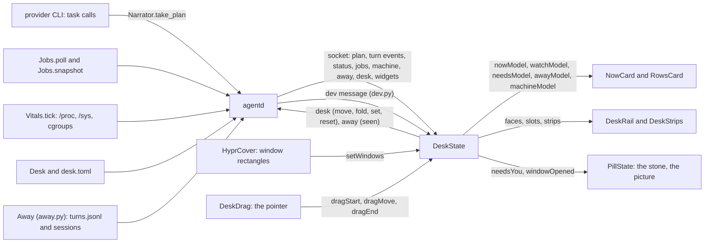
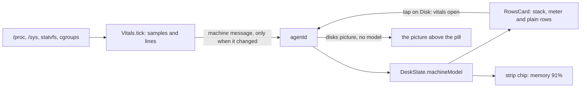
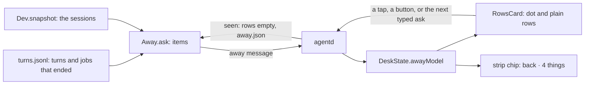
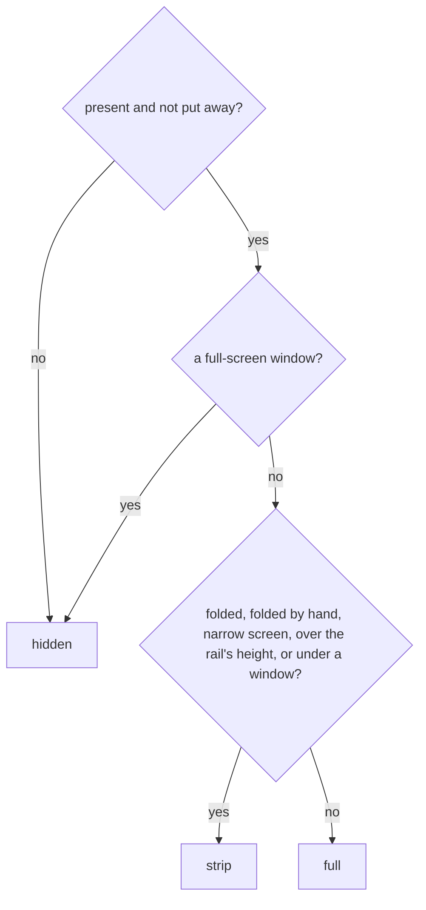
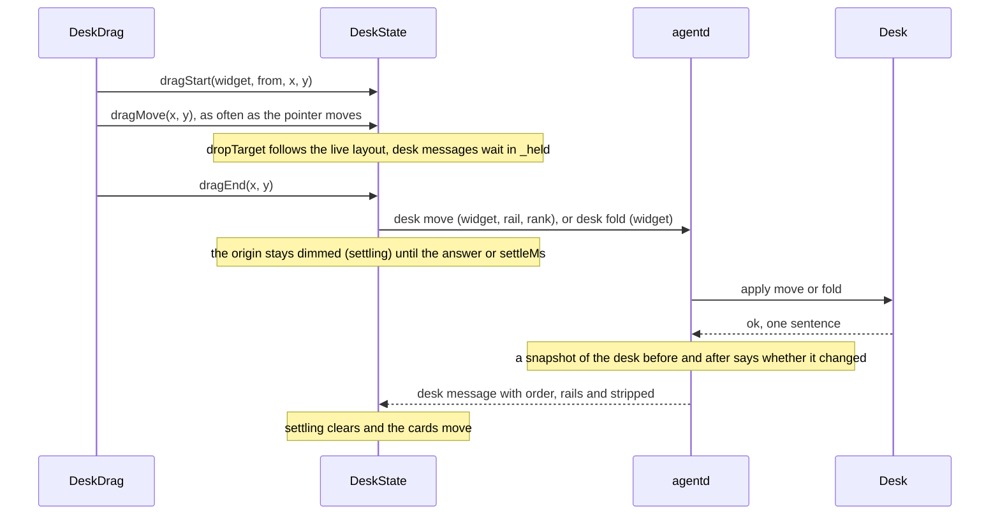
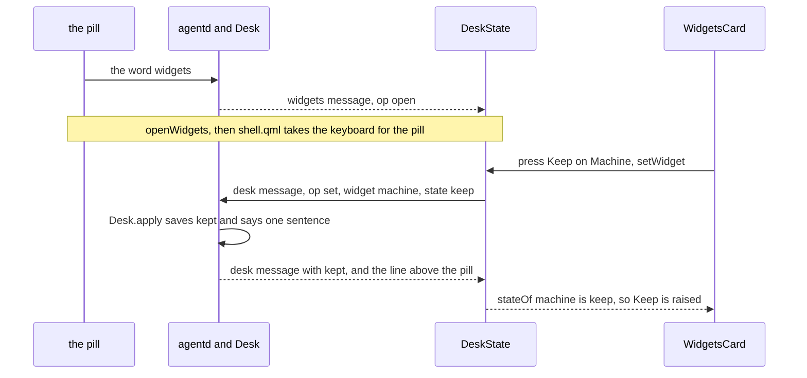
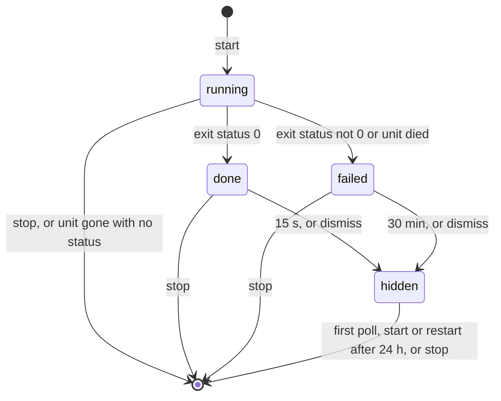

# The desk

> **Status:** Partly shipped
> **Code:** `src/bombadil/desk.py`, `src/bombadil/jobs.py`, `src/bombadil/vitals.py`, `src/bombadil/away.py`, `src/bombadil/dev.py`, `src/bombadil/watch.py`, `src/bombadil/agentd.py`, `src/bombadil/mcp_server.py`, `src/bombadil/launcher.py`, `src/bombadil/narrate.py`, `src/bombadil/providers.py`, `src/bombadil/paths.py`, `bin/bombadil`, `shell/DeskState.qml`, `shell/DeskRails.qml`, `shell/DeskRail.qml`, `shell/DeskStrips.qml`, `shell/DeskStrip.qml`, `shell/DeskDrag.qml`, `shell/DeskCard.qml`, `shell/NowCard.qml`, `shell/RowsCard.qml`, `shell/WidgetsCard.qml`, `shell/DeskTheme.js`, `shell/HyprCover.qml`, `shell/PillState.qml`, `shell/Stone.qml`, `shell/shell.qml`
> **Design:** [The desk: widgets for a passenger](../design/widgets-brief.md), [the desk as a drawn page](../design/pages/the-bombadil-desk.html), [Tips, and the desk after boot](../design/tips-and-desk-defaults-brief.md) (its piece 2, Your desk, is built; its Tips card is designed, with no code)
> **Verified:** 2026-11-09 against `main` at `ca7f80a`. The desk's reduced-motion behaviour (the fold, the strips' fade, the pill's width, the wash and the ring, with the entry in Known gaps and the test that covers them) was added and checked against `main` at `f0485c2`, and the line numbers the text cites were moved to the code at that commit. The change since `24c836c` was added and checked against `main` at `7d17600`: Your desk (the `kept` list, When needed and Off for each widget, the Widgets card and its words, the `keep`, `set`, `reset` and `widgets` ops, the calm Machine), and the line numbers the text cites in `src/bombadil/desk.py`, `src/bombadil/vitals.py`, `src/bombadil/agentd.py`, `src/bombadil/mcp_server.py`, `src/bombadil/narrate.py`, `shell/DeskState.qml`, `shell/shell.qml` and `tests/desktop/driver.py` were moved to the code at that commit; the rest of the text was not read again.

The desk is where Bombadil's widgets live around the pill: cards in two rails at the sides of the screen, and small chips (strips) in the pill's row when a card has no room or the person folded it. A widget is on the desk only while it has something to say, unless the person keeps it, so by default a machine at rest is wallpaper and a pill. It exists so the person can see the route of a turn, what is counting in the background, who is waiting for them, what happened while they were away and whether the machine is in trouble, without the line above the pill carrying more than one line.

Shipped on `main`: the desk's memory and words (`desk.py`, `desk.toml`, the word `desk`, widget names with show and hide), the rails, strips and fold rules, dragging a card by its title to a rail or into the row, or a strip to a rail, with the hand fold kept in `desk.toml` ([below](#dragging-cards-and-folding-by-hand)), the `desk` tool, the `now` card (the route of a turn), the jobs registry with the `job` tool, the `watching` card, and the `machine` card with the sampler behind it (`vitals.py`). Your desk is shipped too: a `kept` list in `desk.toml` beside `hidden` and `stripped`, When needed and Off for each widget, the Widgets card that the word `widgets` opens above the pill, the words `keep <widget>` and `keep <widget> on the desk`, the `keep`, `set`, `reset` and `widgets` ops (the agent's `desk` tool takes them too), and a calm Machine at rest for a Machine the person keeps ([below](#your-desk-keep-when-needed-off)). The `needs` card and the stone's mark for a waiting session (`needsYou`) are fed by the `dev` message that agentd sends from `src/bombadil/dev.py` (`Dev.snapshot`: to a client when it connects, in `AgentD._greet`, and after every change, in `AgentD._dev_broadcast`; [coding-sessions.md](coding-sessions.md)). The `away` card is shipped too (`src/bombadil/away.py`, the `away` message, `DeskState.awayModel`, [below](#the-away-card)); `show away` raises it, and nothing raises it yet when the person returns from a break. Only `alive` is a registered name with no card and no feed. Designed and not built: the dot face, hover-peek and click-to-keep on a strip, the widgets the agent makes, the `make` and `remove` ops of the `desk` tool, and the Tips card of the Tips brief. No test or check in the repository runs dragging on Hyprland; `tests/desktop/driver.py` drags with a virtual pointer on sway ([Known gaps](#known-gaps)). `src/bombadil/watch.py` is listed because the `now` card's title opens it; it is not a watcher ([below](#what-watchpy-is)). The lines the pill's notice stack says above the pill (`src/bombadil/notices.py`, `shell/NoticeChips.qml`) and the AI card are not desk widgets: they have no rail, strip or `desk.toml` key ([shell.md](shell.md#notices)). The coding sessions' chips (`shell/SessionChips.qml`, with the hover peek `shell/SessionPeek.qml` and their state `shell/DevState.qml`, drawn by `shell/shell.qml` above the pill's left end) are not desk widgets either: no rail, no `desk.toml` key, not in `WIDGETS`.

## How it works



1. **The desk's memory.** `Desk` in `src/bombadil/desk.py` holds `folded` (every card a strip, the word `desk`), the put-away widgets (`hidden`), the widgets kept on the desk at rest (`kept`), the widgets folded by hand (`stripped`), each widget's rail (`rails`), each rail's `order` (bottom up: rank 0 is nearest the pill) and `screen`. One `Desk` is shared by the launcher, agentd's handler of the shell's messages and the agent's tool (`AgentD.__init__`). Every change goes through `Desk.apply(op, widget, rail, rank, state)`, which returns `(ok, one plain sentence)`, writes `desk.toml` when something changed, and then calls `on_change`. agentd turns that into one `desk` message to every client (changes within 30 ms go out as the state they end in). A `show` of an askable widget (`ASKABLE`, which holds `machine` and `away`) also calls `Desk.on_ask`, which agentd points at `AgentD._desk_asked`: it sends `away` to `_away_asked`, which builds the card ([The Away card](#the-away-card)), and any other id to `_vitals_asked`, which answers only `machine`. The `widgets` op calls `Desk.on_widgets`, which agentd points at `AgentD._widgets_asked`: it sends every client `{"type": "widgets", "op": "open"}` ([Your desk](#your-desk-keep-when-needed-off)).
2. **What a turn says.** agentd already broadcasts `turn_start`, `status` and the other turn events ([agentd.md](agentd.md#messages-agentd-sends)). The desk adds `asked_by` on `turn_start` and the `plan` event. `Narrator` in `src/bombadil/narrate.py` builds the plan from the provider's task calls (`TaskCreate`, `TaskUpdate`, `TaskList`, `TodoWrite`; Codex's `todo_list` is turned into a `TodoWrite` by `_codex_todos` in `src/bombadil/providers.py`), keeps at most 24 steps (`MAX_PLAN`), and agentd sends the whole table whenever it differs from the last one sent. A plan reaches the desk only if the CLI offers its task tools: `Claude.env()` sets `CLAUDE_CODE_ENABLE_TODO_TOOLS=1` (`src/bombadil/providers.py:286`) and `Codex.command` passes `-c tools.update_plan.enabled=true` (`:583`), as [agentd.md](agentd.md) says. Whether the agent writes a plan at all is the system prompt's rule: `system_prompt()` in `src/bombadil/providers.py`, which both CLIs get on every turn, tells it to write the plan first with its task tool, in short plain words, for a request of three or more steps, and to keep it updated. That plan is what `Narrator.take_plan` hands to agentd.
3. **What is counting.** `Jobs` in `src/bombadil/jobs.py` is the registry of background commands, watchers and timers. agentd looks at it every 2 s while it has rows and sends the `jobs` table when the table changes.
4. **What the machine is doing.** `Vitals` in `src/bombadil/vitals.py` takes a sample (processor, memory, disk, heat, network, and who holds the memory) off agentd's event loop, keeps four lines and builds the one `machine` message. `AgentD._vitals_loop` runs it only while a bar is connected and Machine is not put away, and broadcasts the message when it differs from the last one ([The Machine card](#the-machine-card)). A Machine the person keeps is sampled at rest too, in a calm shape ([A kept Machine at rest](#a-kept-machine-at-rest)): `AgentD._vitals_kick` tells `Vitals` whether Machine is kept (`Vitals.keep`) when a bar connects and whenever the desk changes.
5. **What the person missed, and who is waiting.** `Away` in `src/bombadil/away.py` reads the tail of `turns.jsonl` and the coding sessions' views and builds one `away` message; agentd builds it when the person asks for it and takes it away when they have seen it ([The Away card](#the-away-card)). `Dev` in `src/bombadil/dev.py` is the registry of coding sessions. agentd sends its `dev` message (`Dev.snapshot`) to a client when it connects (`AgentD._greet`) and after every change (`AgentD._dev_broadcast`: changes within 30 ms go out as one message, and only when it differs from the last), and the shell makes the `needs` rows from the message's `attention` list.
6. **What the shell does.** `shell/shell.qml` hands every line from agentd to `PillState.handle`, to `DeskState.handle` and to `DevState.handle`, which reads only `dev` messages: the sessions' chips and the line in the pill, not the desk. `DeskState` is plain Qt Quick with no Quickshell types, so tests load it offscreen. It turns messages into five models (`nowModel`, `watchModel`, `needsModel`, `awayModel`, `machineModel`; `aliveModel` stays `null`), decides each widget's face, works out each card's slot, and sets `PillState.needsYou` ([The needs-you mark](#the-needs-you-mark)). From the `desk` message it also keeps `kept` and `widgetList`, the rows of the Widgets card, which `WidgetsCard` draws in the bar's window above the pill ([Your desk](#your-desk-keep-when-needed-off)). `DeskRails` draws the cards in two layer-shell windows, `DeskStrips` draws the strips in the bar window, each card's title and each chip carry a `DeskDrag` handle, and `HyprCover` tells `DeskState` where the windows are ([shell.md](shell.md#the-desks-hosts)); a window that comes onto the stage also emits `DeskState.windowOpened`, which `shell/shell.qml` passes to `PillState.windowOpened` to put a picture away ([cards-and-pictures.md](cards-and-pictures.md)). When the socket connects, `DeskState` asks for `desk get`.
7. **Three routes change the desk, one function does it.** A launcher word (`desk`, `hide machine`, `keep machine`, `widgets`) reaches `Desk.apply` through `Launcher`. A message from the shell (`desk` with `op`) reaches it through `AgentD._desk_op`. The agent's `desk` tool reaches it through `AgentD._desk_tool`, which refuses unless the person's own words asked for the desk. Nothing here starts a model turn, and `DeskState` never changes its own `folded`, `hidden`, `stripped`, `kept`, `rails` or `order` first: a drop sends a `move` or a `fold` and only dims the card it took until the answer, and the state comes back as a `desk` message ([Dragging cards and folding by hand](#dragging-cards-and-folding-by-hand)).

### When the desk shows

With nothing kept, at rest there is no card, no strip and no rail window: a rail's window is up only while a card is in full, while a card or a strip is being dragged (both windows, an empty rail's too), and for `foldMs + 80` ms after either, and the clock that moves the `watching` rows runs only while the table has a running or a done row that the person has not removed (`DeskState.ticking`); a table of failed rows runs no clock. A widget the person keeps is the exception: a kept Machine is a card in full at rest ([Your desk](#your-desk-keep-when-needed-off)).

| Widget | On the desk when | Code |
|---|---|---|
| `now` | a turn runs and has a plan of two or more steps or has touched the system (a step with a `risk`); after `turn_end`, while the pill still shows its closing line. A stopped or failed turn, a turn the limit cut off (`turn_end` with `requeued`), or one that never qualified, leaves at once | `DeskState.nowVisible`, `_qualifies`, `_end` |
| `watching` | the jobs table has a row the person has not removed; a done row leaves 12 s after it ended, a failed row stays until dropped (agentd drops it after 30 min) | `watchingPresent`, `_refreshWatch` |
| `needs` | two or more sessions want the person (the `dev` message's `attention`); one is the line in the pill and not a card. It cannot be put away | `needsPresent`, `isHidden` |
| `machine` | the last `machine` message said `present: true` and had a row the card can draw: a line is crossed, the person asked, or the person keeps Machine ([The Machine card](#the-machine-card)) | `machinePresent`, `_applyMachine` |
| `away` | its model has rows and Away is not put away: after `show away` or `show while you were away` builds it, until the person has seen it (a tap, or their next typed ask) ([The Away card](#the-away-card)) | `awayPresent`, `_applyAway` |
| `alive` | its model has rows. Nothing fills it, so it never shows | `alivePresent` |
| any but `needs` | and it is not in `hidden`; `alive` starts put away until "show alive" | `isHidden`, `OPT_IN` |

### The widgets

| Widget | Default rail, rank | Answers | Status | Face | Fed by |
|---|---|---|---|---|---|
| `now` | left, 0 | What is it doing, and why? | Shipped | `NowCard` | `turn_start`, `plan`, `status`, `turn_end` |
| `watching` | left, 1 | What is it keeping an eye on? | Shipped | `RowsCard` | the `jobs` table |
| `alive` | left, 2 (put away) | What is being touched? | Registered only | none | none |
| `needs` | right, 0 | What is waiting for me? | Partly shipped: no request rows with `Do it` | `RowsCard` | the `dev` message |
| `away` | right, 1 | What happened while I was gone? | Partly shipped: raised by `show away`, not by a return from a break | `RowsCard` | the `away` message |
| `machine` | right, 2 | Is the machine in trouble? | Shipped | `RowsCard` | the `machine` message |

The design's Sessions widget (the project chips with a dot per session) is not in `WIDGETS`. The chips and the hover peek of a dot are on `main` (`shell/SessionChips.qml`, `shell/SessionPeek.qml`, `shell/DevState.qml`, drawn in `shell/shell.qml`) but are not a desk widget, and the card the brief designs for it is not built ([coding-sessions.md](coding-sessions.md)). The agent-made widget is designed ([the brief](../design/widgets-brief.md#widgets-the-agent-makes)) and has no code.

**`now`.** `DeskState._refreshNow` builds the model.

| Part | Value |
|---|---|
| Title | the person's prompt on one line (at most 60 characters, "Working on it" when empty); for a turn a coding session asked for, `<ask> · asked by <name>` with the ask cut to fit |
| Why line | running: `Step N of M · <touched_text> · Esc stops` (`Step N of M` only with a plan; a line over 44 characters moves the counts after `Esc stops`). After the turn: `done in N s`, plus ` · Undo is above the pill` when the turn changed something |
| Steps | the plan: `completed` ticked green, `in_progress` pulsing orange in its `active` words, the rest grey. With no plan and a system step, one step made from the step line. At most 12 rows, around the current step |
| Edge | `machine` orange while running, `amber` for risk `system`, `red` for `irreversible`, `ok` green when done |
| Command and caption | the exact command of a marked step under the current one; for `irreversible`, also `can't be undone · Esc stops it` |
| Click on the title | `DeskState.openDetails` calls `PillState.details()`, which sends `{"type": "details", "turn": n}` |

Plans and statuses stamped with another turn's id are dropped. A bar that connects mid-turn starts the card from agentd's `status` (`busy`, `turn`) and gets the latest `plan` in the reply to `desk get`.

**`watching`.** One row per entry in the jobs table that the person has not removed. Every row has a `×`: a running job is stopped with `systemctl`, a finished row is dropped, and neither goes through the model.

| Row | Looks like |
|---|---|
| running, with a percent in its output | meter row: title, elapsed time (`4 min`), percent, orange track |
| running, no percent | dot row, `<span> so far`, pulsing orange dot |
| running timer | dot row, `m:ss left`, pulsing blue dot |
| done | green dot, `done in <span>`; leaves 12 s after `ended` |
| failed | red dot, the job's last line, and a `Why?` button that opens the log in the details drawer; stays until dropped (agentd keeps it in the table 30 min) |

The card's line says `N counting · each ends with one line in the pill`, or `finished`. A removed row stays gone until a table without it arrives, and comes back after 5 s if the job is still listed (the stop did not work).

**`needs`.** One row per key in `attention`, in that order: title `<role> on <project>`, the first line of what the session said (70 characters), a pulsing blue dot while its `state` is `asked`, and an `Open` button that sends `{"type": "dev", "action": "open", "key": key}`. agentd answers with `Dev.bring` (the session's window to the front, a new viewer, or a resume) and a `local` event with `action: "session"` (`AgentD.dev_action`). Its line reads `Tab walks these · one alone is just the line`, and the walk exists: Tab in an empty pill, while any coding session exists, calls `devState.next()` (`Keys.onTabPressed` in `shell/shell.qml`), which sends `{"type": "dev", "action": "next"}`, and `Dev.next` brings the first session in `attention` to the front (a session that stopped is only marked seen, and the line says to type its name to resume it). One waiting session is the empty pill's own text (`devState.line`, the placeholder in `shell/shell.qml`) and no card.

A rows card (`watching`, `needs`, `away` or `machine`) washes: a row that was not on the card before the model last changed paints the card's left edge in its tone and fades over `washMs` (600 ms; `DeskCard.wash`, called from `RowsCard.onRowListChanged`). Rows that arrive with the card, or onto a card that had none, do not wash, and one change washes once.

### The Machine card

`machine` is absent at rest, rises when a line is crossed or the person asks, and leaves when every reading is back under its line; when the person keeps Machine it stays at rest in a calm shape ([A kept Machine at rest](#a-kept-machine-at-rest)). `Vitals` decides and builds the one `machine` message; the shell draws what it says and knows none of the numbers. The loop and the message are also in [agentd.md](agentd.md#the-machine-card).



| Reading | Where it comes from (`Sampler`) |
|---|---|
| Memory | `MemTotal` less `MemAvailable` in `/proc/meminfo`; the row is a `stack` cut into who holds it |
| Who holds it | each unit's `memory.current` less `inactive_file`, found by a walk of the user's cgroup tree (from `/proc/self/cgroup`, at most four levels, only `.slice` directories): `machine` is a unit named `bombadil-turn-`, `bombadil-job-` or `bombadil-timer-`, `sessions` one named `bombadil-dev`, `you` is the rest of the used memory. With no readable tree the stack is one `you` part and the sentence names no holder |
| Disk | the fuller of `/` and `/home` by `statvfs`, used against used plus available (as `df` says Use%). Filesystems that are not disks (memory, images, network shares) are not looked at, and two paths on one device count once. The disks picture this row opens (`sysmap.capture_disks`) counts `findmnt`'s `USED` against its `SIZE`, the whole size, so on a disk with blocks kept back for root it reads a few points lower than the row |
| Processor | the busy share between two reads of `/proc/stat` (the first sample has none and says 0%) |
| Heat | the hottest of the thermal zones and the `temp*_input` of the processor's own chips (`coretemp`, `k10temp`, `zenpower`, `cpu_thermal`, `cpu-thermal`); any other hwmon chip only when those read nothing; a value of 0 or under, or over 150 degrees, is no reading. The card shows it as the text of the Processor row (`62°`), whose meter is the busy share |
| Network | bytes a second from `/proc/net/dev`, per interface, without loopback, containers, bridges, bonds, VLANs and virtual-machine ports; none until two reads at most 8 s apart |
| Sessions' ceiling | the `bombadil-dev.slice` unit's use against its `memory.high`, else `memory.max`; none when it has no limit |

A source that is missing (no cgroup v2, no sensor, no interface) makes that reading `None` and no function in `vitals.py` raises: the memory or disk row is left out, the processor and network say nothing or a dash, and the stack is one `you` part. A machine with no sensor and no user cgroup tree still has its memory, its disk (when `/` or `/home` is a real disk) and, from the second sample, its processor and network (`test_the_sampler_without_a_cgroup_tree_says_so_and_the_rest_still_reads` and `test_a_sample_of_a_machine_with_nothing_readable_is_empty_and_does_not_raise` in `tests/test_vitals.py`). Sizes are written in powers of 1000 (`size_text` in `src/bombadil/vitals.py`), as the disks picture writes them, so they read larger than the binary figures of `free -h`.

| Line | Raised at | Let go at | Chip | `why` says |
|---|---|---|---|---|
| `sessions` | the sessions' slice at 90% of its limit | 80% | `sessions 93%` | `Coding sessions are near their memory limit` |
| `memory` | 90% of the memory in use | 85% | `memory 91%` | `Memory is nearly full` |
| `disk` | 90% of the fuller disk | 88% | `disk 94%` | `The disk is nearly full` |
| `heat` | 80 degrees | 72 degrees | `hot · 82°` | `The processor is hot` |

The [widgets brief](../design/widgets-brief.md) names the lines (memory near the sessions' limit, a full disk, a hot processor) and no numbers; the numbers are `RULES` in `src/bombadil/vitals.py`. A line is crossed after `ENTER_SAMPLES` (3) samples in a row at or over it, and left after `LEAVE_SAMPLES` (10) in a row at or under its lower mark and no sooner than `MIN_UP` (10 s) after it rose, so a reading that wobbles around its line does not flicker the card. A missing reading counts as under. `why` names the lines in the table's order, the first as the table says it and the rest with a lower-case first letter, joined by ` · `: `Memory is nearly full · sessions use most`. The clause after the memory sentence (`sessions use most`, `the machine uses most`, `your apps use most`) is added only when one holder has half of the used memory or more. The chip is the first line's text. Its dot is amber, or red when the disk line is up and the disk is at 97% or more (`DISK_RED`, the number the disks picture turns red at). The memory row is amber with the memory line, the disk row amber with the disk line and red from 97%, and a row in amber or red colours its percent.

**Asking.** `show machine`, one of the whole questions in `launcher.WIDGET_QUESTIONS` (`how's the machine`, `how is my computer`, and their variants) and a `show` from the shell or the `desk` tool all reach `Desk.apply("show", "machine")`, which calls `Vitals.ask()`: the card stays up for `ASK_FOR` (30 s) with nothing crossed. The message then has `asked: true`, `why` says `The machine is fine`, and the chip is the reading nearest its line (`heat 52°`, `disk 36%`) with no dot; a reading that is already over its line is said as if it were crossed. The line says `Here is the machine.`, and ` It is back on the desk.` when Machine had been put away (asking brings it back). A longer question goes to the agent.

| Sampled again after | When |
|---|---|
| `CALM_EVERY` (5 s) | nothing is up and no reading is near its line (a kept Machine at rest included: its calm card is cheap) |
| `NEAR_EVERY` (2 s) | a reading is within 5 points of its line (5 degrees for heat): the same calm sample, a little sooner |
| `FAST_EVERY` (1 s) | the card is up or asked for, or a line is one sample from being crossed; these samples walk the cgroup tree too. A kept Machine's second sample also comes after `FAST_EVERY`, once, and does not walk the tree ([A kept Machine at rest](#a-kept-machine-at-rest)) |

The list of mounts, the list of sensors and (when calm) the tree walk are redone every `SLOW_EVERY` (30 s); a calm sample is a handful of small reads: `/proc/stat`, `/proc/meminfo`, `/proc/net/dev`, the thermal files, one `statvfs` on each of `/` and `/home` (so a line that counts samples counts readings) and, when the last walk found it, the sessions' slice. `Vitals` holds its state lock (`_lock`) only to read or change its state and never across the reads (`_tick_lock` makes one sample at a time), so a bar that connects during a slow sample is answered at once, and the numbers in the message are rounded (`_pct`, `_deg`, `_frac`) so that a calm machine sends nothing (a kept Machine rounds and holds its figures further, below). A bar that connects, a change of the desk or an ask wakes the loop for an immediate sample (`AgentD._vitals_kick` sets `_vitals_wake`, and `_vitals_loop` passes `woken` to `Vitals.tick`). A wake within `MIN_GAP` (0.5 s) of the last sample reads nothing more: a rate over so short a stretch is noise, and a burst of short-lived connections would count as samples in a row over a line. `tick` then says the card as it is, from the last reading. Nothing is sampled with no bar connected or with Machine put away, and when the last bar goes or Machine is put away `Vitals.reset()` forgets the streaks and a card that was up is taken away. The first card after that shows the processor at 0% and the network as dashes until the next sample (`_cpu_row` and `_net_row` in `src/bombadil/vitals.py`); a kept Machine's card waits for its second sample instead.

**What the shell takes.** `DeskState._applyMachine` keeps a row only with a key (a repeat of a key is dropped) and a kind `meter`, `stack` or `plain`, at most six rows, tones `machine`, `sessions`, `you`, `ok`, `amber` and `red` (any other is `you`), numbers held to 0..1, a stack's parts cut so that together they never pass the track, and no button, pulse or × on any row. `present` must be exactly `true`; a message with no row it can draw takes the card away, and one equal to the model it has changes nothing. `strip` is only `text` and `dot` (`amber`, `red` or none); without a `strip.text` the chip says `machine`. `asked` and `calm` are sent and the shell reads neither: a calm card is drawn as any other. A tap anywhere on a row that has `opens` sends `{"type": "vitals", "op": "open", "row": opens}`; agentd answers only for `disk`, by drawing the disks picture (`VITALS_OPENS`), with no model turn.

#### A kept Machine at rest

A person who keeps Machine ([Your desk](#your-desk-keep-when-needed-off)) has the card on the desk after every boot, in a shape that costs little and says little. agentd tells `Vitals` (`Vitals.keep(True)`, in `AgentD._vitals_kick`). That is how the card is set up and not a reading, so `Vitals.reset()` leaves it alone. Until a line is crossed or the card is asked for, the message is the calm one, with `"calm": true`.

| Part | What the calm card says (`_calm_memory_row`, `_calm_disk_row`, `_calm_cpu_row`, `_calm_net_row`) |
|---|---|
| Words | `The machine is fine`, and a chip that names the reading nearest its line (`heat 60°`) with no dot |
| Memory | one meter, not the stack of who holds it: that needs the walk of the memory groups, and a card at rest has nothing to say about who |
| Disk | a meter that still opens the disks picture |
| Processor | a meter, with the heat as its words |
| Network | plain text, `↓ 1 MB/s   ↑ 40 kB/s`, or a dash for a rate not known yet |
| Tone | `you` on every row |

The figures are rounded and held, so a calm machine says next to nothing (`_figures`, `_calm`, `_calm_deg` and `calm_rate` in `src/bombadil/vitals.py`). A figure moves only when the reading is clearly in the next step, so a reading on the edge between two says nothing.

| Figure | Rounded to | Moves when the reading is |
|---|---|---|
| memory, disk, and the chip's reading | steps of `CALM_STEP` (5 points) | more than `CALM_HOLD` (0.75) of a step from the figure shown |
| the processor's share | steps of `CALM_CPU_STEP` (a fifth) | more than 0.75 of a step from the figure shown |
| heat | steps of `CALM_DEGREES` (5 degrees) | more than 0.75 of a step from the figure shown |
| a network rate | one figure (`2 MB/s`, `40 kB/s`), and a rate under `CALM_QUIET` (10 kB/s) reads `0 B/s` | `CALM_RATE_HOLD` (1.5) times more than the rate shown, or under two thirds of it |

The rows and the chip are all made from the held figures, so they agree. A message goes out only when a figure the card shows has moved: an idle machine sends a handful in an hour (`tests/test_vitals_calm.py` counts them over a wobbling one), and a machine whose figures really move says so. The sizes are written from the rounded meter: one decimal below 10 units and whole numbers from 10 (`size_text`, with `whole_from` 10, against 100 for a raised card).

- **Cost.** The sample is the cheap one, every `CALM_EVERY` (5 s), or every `NEAR_EVERY` (2 s) when a reading is within five points of its line. The first sample reads everything and walks the cgroup tree; later samples do not, until the lists of mounts and sensors are redone with the walk every `SLOW_EVERY` (30 s). A card at rest needs a processor share and rates, which take two reads, so the second sample comes `FAST_EVERY` (1 s) after the first, once, and `Vitals._build` says no card until then (`_taken` is under 2). The card is drawn a second after the bar connects with everything known, and never as 0% and dashes.
- **A line crossed.** The card becomes the one it always was: the sentence says why, memory is the stack, the chip has its dot and sampling is every second. A kept card waits for the line to hold its `ENTER_SAMPLES` samples, so a spike does not flicker it, and its meters say what they read meanwhile. Under the lower mark for `LEAVE_SAMPLES` samples and `MIN_UP`, it is calm again, in a message of its own.
- **Asking.** `show machine` gives the live card for `ASK_FOR` (30 s), and an asked card never says the machine is fine over a line that is already crossed. When the time passes, a kept Machine is calm again and one that is not kept leaves.
- **No longer kept.** The next sample says `present: false` and the card goes, unless a line is crossed.

### The Away card

`away` answers "what happened while I was gone?". It sits on the right rail between Needs you and Machine, its chip says `back · 4 things`, and it lists what failed, who is waiting, what finished and what changed, the most urgent first. `src/bombadil/away.py` reads the turn log and the sessions and decides; the shell draws what the one `away` message says and knows nothing about turns or sessions. Nothing in it reaches the model. agentd's side of it is also in [agentd.md](agentd.md#the-away-card). [The brief](../design/widgets-brief.md#5-away-what-happened-while-i-was-gone) designs more than `main` has ([Known gaps](#known-gaps)).



**The message.** `{"type": "away", "since", "count", "why", "rows"}`; `rows: []` takes the card away. `Away` reads the last `TAIL` (400 000) bytes of `turns.jsonl` (`read_tail`; a row cut by the read or by a crash is dropped) and the sessions' views, which agentd takes from `Dev.snapshot()["sessions"]` (`AgentD._away_sessions`: the same views as the dots). A row of the log counts only when it is later than `since` and not more than a minute ahead of the clock.

**The rows.** Most urgent kind first (`KINDS`), the newest first within a kind.

| Kind | It is | Tone | Second line | Button |
|---|---|---|---|---|
| `failed` | a turn that ended with `ok` false or with no verdict, a background job that failed, or a coding session that failed and has not been looked at | red | the first line of the turn's result (`It did not finish.` when it has none) or of the job's last line; for a session, the line it last said | `Why?` on a job that ended within `JOB_KEPT` (24 h; its output is not kept longer), `Open` on a session |
| `waiting` | a session in state `asked` | the sessions' blue (`sessions`) | what it asked | `Open` |
| `finished` | a turn or a job that ended well, or a session that is `done` and has not been looked at | green (`ok`) | the line a job or a session ended with | `Open` on a session |
| `changed` | a turn that ended well with a `summary` and a restore point (`snapshot`) or a file it wrote (`files.wrote`); the title is the summary | orange (`machine`) | none | none |

The title is the person's prompt (a job's title, a session's `<role> on <project>`). A row with no second line says `at HH:MM`, with the weekday before it when it was not today. Left out: a prompt that starts with `!` or `[from app`, a turn that was stopped or is waiting for a limit to lift (`requeued`), a job the person stopped (`stopped: true`), a `local` row that is not a job (a desk word or gesture), rows of any other kind (a coding session's end, `kind: "dev"`), and a session that is only working or idle, or finished or failed and already looked at. A row it cannot make sense of is dropped; nothing in `away.py` raises. A row's key is `turn:<n>`, `job:<id>` or `dev:<key>`.

At most `ROWS` (4) rows are drawn, then one plain `and N more` row (key `more`). `count` is everything found, not the rows shown. A title or a second line is cut to `TITLE` (44) characters. `why` reads `since HH:MM · a click puts this away`, with the weekday before the time when `since` was not today (`since Mon 09:05 · ...`).

**When it is built.** Any route to `Desk.apply("show", "away")` builds it: `show away`, `show while you were away` (the widget's longer name; the bare phrase `while you were away` is a sentence for the agent, not a launcher word, and does not open the `desk` tool's gate), a `show` message from the shell, the `desk` tool once the person's words have opened its gate (`show while you were away` does, `show away` does not: [The `desk` tool and its gate](#the-desk-tool-and-its-gate)); `away` is in `ASKABLE`. The answer is `Here is what happened while you were away.`, and ` It is back on the desk.` when Away had been put away. `AgentD._away_show` calls `Away.ask` with `since` set to the person's typed ask before the one that raised the card (`AgentD._typed_before`, in memory only), else the time the card was last seen (`seen_at`, from `away.json`), else `LOOKBACK` (24 h) ago, and never more than `MAX_LOOKBACK` (7 days) back. With nothing to say the card is one plain row, `Nothing happened` (key `none`), and the chip says `back · nothing new`. A card that is up goes to every bar, to a bar that connects (`AgentD._greet`) and in the reply to `desk get`. `Away.back(since)` builds the card for the moment the person returns from a break, with no `Nothing happened` row (`rows: []` when there is nothing to say); nothing calls it.

**When it goes.** When the person has seen it: a tap on a row, on the title or on the line under it (`DeskCard.captionTaps`; `onTitleClicked` in `shell/DeskRail.qml`), a press on a button, or their next typed ask. A button does what it says first: `Open` on a `dev:<key>` row sends `{"type": "dev", "action": "open", "key"}`, `Why?` on a `job:<id>` row sends `{"type": "jobs", "op": "why", "id"}`. Then the shell sends `{"type": "away", "op": "seen"}`. A typed ask (`AgentD._typed`, before the words are matched, so a launcher word counts) puts it away with no message from the shell; an ask that carries `asked_by`, one from a coding session, or one from a process inside an agent's turn does not count as the person being there. agentd then broadcasts `rows: []` to every client and writes `~/.local/state/bombadil/away.json`. A `seen` with no card up changes nothing and does not move `seen_at`. The card itself is in agentd's memory only, so a restart of agentd takes it away; `away.json` keeps only when it was last seen, and a restart does not bring back what was seen.

**What the shell takes.** `DeskState._applyAway` keeps rows of kind `dot` and `plain` only, drops a row with no key or a key already used, keeps at most `awayMaxRows` (6), reads a tone as `_applyMachine` does (any other is `you`), keeps a button only if it is `Open` or `Why?`, and sets no pulse and no ×. Every row has `opens: "seen"`, so a tap on a row is `awaySeen()`. The card is titled `While you were away`, its line is the message's `why` (`since` is sent and unused), and the strip text comes from `count`. A message with no row it can draw takes the card away, one equal to the model it has changes nothing, and `lost()` empties the model: a bar that connects is told again. `heightOf("away")` is 68 plus 44 per row.

### The needs-you mark

`DeskState.needsYou` is true while `needsModel` has one row or more, so one waiting session counts, although a single session is the line in the pill and not a card. A `Binding` in `DeskState` writes it to `PillState.needsYou`, which gives the stone its `needs` face (amber, two knocks of 8 degrees on a 1.6 s beat, with a glow that breathes; `shell/PillState.qml`, `shell/Stone.qml`, drawn as [shell.md](shell.md) describes). `needsYou` changes the face and nothing else in `PillState`.

| What | Behaviour |
|---|---|
| One session or many | One waiting session is the line in the pill and no card (`needsPresent` wants two rows); the stone knocks for one or more |
| Nothing puts it away | A fold (the word `desk`, or a hand fold of `needs`: it may be in `stripped`), a covering window, a narrow screen and the capsule under a full-screen window take the card away and leave the mark, and `needs` cannot be put away |
| It outranks a running turn | `PillState.face` tests `needsYou` before `busy`, so the face is `needs` while a turn runs and a session waits (`test_the_stone_knocks_over_a_running_turn_and_the_turn_goes_on_after`); the `now` card keeps drawing the turn. When the last row goes, the face is what the pill says (working, resting, done or rest) |
| It clears | with the last row, and when the socket drops (`lost()` empties the sessions) |
| Setup keeps its own | Setup's ask (`choose`, `signed_out`, `offline`) gives the same face by another cause, and the desk clearing its rows never clears it |
| What lights it | A row exists for each key in `attention` that has a session in `sessions`. Both come from the `dev` message (`Dev.snapshot`), which agentd sends to a client when it connects and after every change. `Dev.attention` lists the sessions that asked (while alive) or finished or failed and have not been looked at, the session in front aside: questions first, then finished, then failed, oldest first within each ([coding-sessions.md](coding-sessions.md)) |

The knock is 8 degrees on a stone drawn on a 24 px grid (`shell/Stone.qml`), a small tilt, so the amber colour is what shows first. If that proves too quiet on a screen, the change is in `Stone.qml`, not in the desk.

### Faces, folding and fit

`DeskState.faces` gives each widget one of three values. The brief's third face, a dot on the pill, has no value here.

| Face | What it is | Drawn by |
|---|---|---|
| `full` | a card, 300 px wide, as tall as its rows, in a rail | `DeskRail` |
| `strip` | a 28 px chip in the pill's row | `DeskStrips`, `DeskStrip` |
| `hidden` | nothing: not present, put away, or a full-screen window has the stage | |



| Rule | Condition | Effect |
|---|---|---|
| Presence | `present[id]` is false | no face and no slot, so the cards above it slide down |
| `desk` word | `folded` is true | every present widget is a strip |
| Folded by hand | the widget is in `stripped` | a strip whatever the room, and no slot: the cards above it slide down. It stays one when the word `desk` unfolds the desk and when a window leaves, it stays in `stripped` while the widget has nothing to say (and is a strip when it comes back), and a `move` or a `show` gives its card back ([Dragging cards and folding by hand](#dragging-cards-and-folding-by-hand)) |
| Narrow screen | `screenWidth < 2 * (300 + 16 + 12) + 360` (1016) | every present widget is a strip, so the line above the pill never covers a card |
| Height | the card's slot, from the rail's bottom up in rail order, does not fit in `railHeight` (`screenHeight - rowZone - 56`: `screenHeight - 120` with the bare zone of 64) | it and every card above it are strips |
| Right of way | a window or panel rectangle overlaps the card's slot (touching edges do not count) | the card folds at once (a 150 ms scale and fade toward the rail's outer bottom corner) and its strip fades in; it unfolds 400 ms after no window covers it, and a window back inside that time keeps it folded. Each widget has its own timer, and a folded card keeps its slot. The common case is a coding session's viewer window: the `bombadil-sessions` rule in `iso/airootfs/etc/skel/.config/hypr/hyprland.lua` floats it in the middle at 86% of the monitor's width and 80% of its height, so on an ordinary screen it reaches over the columns of both rails and every card whose slot it touches folds to its strip while it is up (an `Open` on a Needs you row, or a session's name typed in the pill, brings it up) |
| Full-screen window | any window has `fullscreen` | every face is `hidden`: no rail windows, no strips, and the pill becomes a 100 px capsule. The bar also puts the picture above the line away (`CardHost.suppressed` follows `capsule`, `shell/shell.qml`) |

Heights, which the stack and the drawn cards must agree on: `now` is `68 + 26 * steps`, plus 20 with a command and 18 with a caption; a rows card is `50 + 18` plus 34 per meter or stack row and 44 per other row (214 for the Machine card with its four rows); `alive` is 168 (a fixed number for a face that does not exist). Rails are 16 px from the screen edge, start 40 px from the top, stop 16 px above the bar's exclusive zone, and cards are 12 px apart. The bar's zone is 64 px, plus the app-chip row while apps run, plus the coding sessions' chips row while any session exists (`exclusiveZone` in `shell/shell.qml`). `DeskState.rowZone` is a writable property, 64 by default, that the shell binds to the bar's zone on the desk's screen (`deskZone`, `shell/shell.qml`), so the stack, the rails' bottom and the row where a drop folds a card follow the real zone and the rails stop above the chip rows (`test_a_row_of_chips_above_the_pill_lifts_the_rails_with_the_bars_zone`).

`DeskState.mode` is `immersive` with any full-screen window, `shared` with any window or panel on the stage, and `open` otherwise. The pill's width follows it: 100, 360, or `stageRoom`, which is `max(360, min(900, screenWidth - 2 * (max(left strips, right strips, 300 if a card is full) + 12 + 16)))`, animated over 150 ms (`pillTarget`, `pillWidth`).

A picture above the pill ([cards-and-pictures.md](cards-and-pictures.md)) takes the same room but is not narrowed with the pill. `DeskState.pictureTarget` is `min(560, stageRoom)` in `shared` mode, so beside a window a picture may take about 560 px, less where the strips and a card in full leave less, and never under the pill's 360. In the other modes it is the pill's width. `pictureWidth` follows it over the same 150 ms, and `shell/shell.qml` gives the picture's host `Layout.maximumWidth: Math.max(360, win.pictureMax)`, where `pictureMax` is `deskState.pictureWidth` on the screen the desk lives on and `Kit.Theme.pillMaxWidth` (900) on the others. Under a full-screen window `pictureWidth` is the pill's 100, the host keeps its floor of 360 and the picture is put away anyway (`CardHost.suppressed`). The pill itself is in [shell.md](shell.md).

**Reduced motion.** With `BOMBADIL_REDUCE_MOTION=1` the shell sets `Kit.Theme.reducedMotion` (`shell/shell.qml`), and the desk stops moving. A card's fold (`DeskRail`), the fade of a strip (`DeskStrips`), the width of the pill and of a picture above it (`DeskState`) and the wash of a row that arrives (`DeskCard`) take no time, and the ring around a live dot (`DeskCard.Ring`, on the `now` and rows cards and on a strip's dot) holds still, at 1.2 times its size and 60 % opacity, where it would breathe. The timings stay as they are: `foldMs` is still 150 ms and `washMs` 600 ms in `DeskTheme.js`, and `pillAnimMs` 150 ms in `DeskState`. Each animation takes its duration through `Kit.Theme.duration(...)`, which gives the value or 0, because `DeskTheme.js` is a library script that cannot read the Theme (`duration: Kit.Theme.duration(T.washMs)`). The 400 ms wait before a card unfolds is a delay and not a movement, so it stays. [Motion, and reduced motion](../MOTION.md) has the rule, a table of every surface and how a card of your own honours it.

**Strips.** At most three a side, then `+N`. On the right they run outward from the pill in the rail's order; on the left the order is reversed, so the last widget of the left rail sits next to the pill and `now` is outermost. A card's model may carry a `strip` that overrides these fields.

| Widget | Strip text | Dot |
|---|---|---|
| `now` | `step N of M`, or `working` with no plan, or `done` | orange with a breathing ring; green, no ring, when done |
| `watching` | the first word of the first meter's title and its percent (`Ubuntu 43%`), else `N counting`; `finished` when nothing counts | orange with a ring; green or, if one failed, red when finished |
| `needs` | `N need you` | white, outlined |
| `away` | the model's `strip` (`DeskState._applyAway`), which overrides `_stripOf`: `back · N things`, `back · 1 thing`, and `back · nothing new` when it was asked for with nothing to say. N is the message's `count` (everything found), not the rows shown | none |
| `alive` | `N alive` | none |
| `machine` | the message's `strip.text` (`memory 91%`, `hot · 82°`, `heat 52°` when asked or kept at rest), else `machine` | amber, or red when the disk line is up and the disk is at 97% or more; none when asked or kept with nothing crossed |

**Layers and input.** `shell/DeskRails.qml` makes one `PanelWindow` a side on `WlrLayer.Bottom` (the layer meant to sit over the wallpaper and under app windows; no test observes that, see [Known gaps](#known-gaps)), namespace `bombadil-desk-left` or `bombadil-desk-right`, with `exclusionMode: ExclusionMode.Normal` and `exclusiveZone: 0`, so it reserves nothing. Its `mask` is one box around the full cards (`DeskRail.hitArea`), so a click beside them is meant to reach what is behind. The window is not visible on a screen the desk does not live on or under a full-screen window, and otherwise only while a card is full, while a card or a strip is being dragged, and for `foldMs + 80` ms after the last card folded or the drag ended (`DeskRail.shown`). The strips are children of the bar window, and the bar's input mask lists `stripsLeft` and `stripsRight` with the pill, the line and the chips, the sessions' chips among them (`shell/shell.qml`, `mask`); a side with no strips has zero width and takes no input.

**Where the windows come from.** `shell/HyprCover.qml` asks Hyprland for the window list on the events that move a window (the list is in [shell.md](shell.md#the-desks-hosts)), reads the answers 40 ms and again 250 ms later, and asks again every `pollMs` (300 ms) while any window is on the stage, because Hyprland sends no event while a floating window is dragged. It lists the windows on the desk screen's workspace and on the special workspace shown over it, and calls `DeskState.setWindows`. It does nothing unless `HYPRLAND_INSTANCE_SIGNATURE` is set (`live`); the headless sway test stands in with `quickshell ipc call desk cover`.

### Dragging cards and folding by hand

A card is taken by its title, or a strip by the chip, and dropped on a rail or in the pill's row. The drop is a `desk` message; agentd's answer is what moves the card.



| Handle | Where | Taken only when |
|---|---|---|
| a card | the first 50 px of the card, its title and the line under it (`deskGrip-<id>` in `shell/DeskRail.qml`); the rows below start no drag, so a button or a `×` stays a button | the widget's face is `full` (`from: "rail"`) |
| a strip | a chip in `shell/DeskStrips.qml`; the `+N` chip (id `more`) is not a handle | the widget's face is `strip` (`from: "strip"`) |

`shell/DeskDrag.qml` is a left-button `DragHandler` that reports where the pointer is, in screen coordinates, to `DeskState.dragStart`, `dragMove` and `dragEnd`; `DeskState` has no Quickshell types, so tests drive it. A tap, or a slide under the drag threshold, stays a tap: a click on Now's title still opens the details. The threshold is `DragHandler`'s default, which Qt takes from the platform (`startDragDistance`, 10 px on most). A layer-shell window cannot ask where it sits, and a grab keeps delivering positions beyond its window's edge, so each handle is given its window's top-left (`origin`): `railX(side)` and `T.railTop` for a rail, and `(0, screenHeight - the bar's height)` for the strips (`shell/shell.qml`). `DeskState.dragStart` refuses, and nothing changes, unless agentd is connected, no other drag is on and the widget has the face it is taken from.

What a drop does is worked out by `DeskState._target` from the live layout, in this order:

| The pointer is | A card (taken from a rail) | A strip |
|---|---|---|
| over any window or panel rectangle | nothing | nothing |
| at `y >= screenHeight - rowZone` (the bottom of the screen that the bar's zone covers: 64 px bare, more with a chip row) | `fold` of that widget: it becomes a strip | nothing |
| at `x <= railX("left") + 300 + 40` | `move` to the left rail | `move` to the left rail |
| at `x >= railX("right") - 40` | `move` to the right rail | `move` to the right rail |
| anywhere else, the stage | nothing | nothing |

The rank is counted in the rail's whole order without the widget, the put-away ones included, as `Desk._move` counts. The card takes the place of the first card on show, counting from the pill, whose centre is above the pointer (that card moves one place further from the pill). With no such card it goes straight after the last card on show, ahead of any widget that follows that card in the whole order without being on show, and with no card on show at all it takes rank 0 (the mark is then at the rail's bottom). A card dropped back in its own place among the cards on show sends nothing. A strip is never in its place, because it is a strip for the room, a window, the word `desk` or a hand fold, so dropping it on a rail is always a `move`, and a `move` gives it its card back. The drop sends `{"type": "desk", "op": "move", "widget", "rail", "rank"}` or `{"type": "desk", "op": "fold", "widget"}`. The shell never moves a card first: what was taken stays dimmed where it stands (`DeskState.settling`) until the `desk` message that answers or `settleMs` (500 ms), whichever comes first.

While a card or a strip is in hand:

- Desk messages wait in `_held`, because a changed order would rebuild the rail's cards under the hand that holds one. They are applied in order when the drag ends; a drop applies them first and then sends its own message, so the rank is counted in the order agentd keeps.
- Both rail windows are up, an empty rail's too, because it draws the mark and the window the drag began in must not go. The mark is a 3 px line in `T.you` across the column, in the gap the card would take (`dropMark` in `shell/DeskRail.qml`).
- Over the row, a card's chip shows as an outlined ghost (opacity 0.6) past the strips its side already has. It is drawn outside the strips' own item, so it neither moves the pill nor widens the bar's input mask (`DeskStrips.ghost`).
- The drag ends by itself, and sends nothing, when agentd is lost (`onConnectedChanged`), when `faces` stops matching what was taken (a window folded the card, it has nothing to say, a full-screen window took the desk), when the grab is taken for any reason but the button going up (`DeskDrag.onGrabChanged`), and when the handle is destroyed.
- No key cancels a drag, the pointer keeps its shape, and the card does not follow the pointer.

**Folding by hand.** A `fold` with a widget puts that widget in `Desk.stripped` and nothing else: the word `desk` is a `fold` with no widget (`AgentD._desk_op` turns it into `toggle`). The widget stays a strip whatever the room and takes no slot ([Faces, folding and fit](#faces-folding-and-fit)). `stripped` is kept in `desk.toml` and sent in every `desk` message, and unlike `hidden` it may hold `needs`. The way back is a `move` (a drop on a rail, or the `desk` tool), a `show` of the widget (the launcher's `show <widget>` or the tool) or an `unfold` with the widget (the tool or a message); the sentences are listed with the `Desk.apply` ops under [Interfaces](#interfaces-other-pieces-depend-on). Putting a widget away is another thing: `hide` leaves `stripped` as it was.


### Your desk: keep, when needed, off

The desk ships quiet: after boot it is the wallpaper and the pill, and a widget comes up only with something to say. The person can change that for each widget, with words or on the Widgets card, and the choice is kept in `desk.toml`, so it survives every boot. A widget is in one of three states (`STATES` in `src/bombadil/desk.py`). `Desk.state_of` and `DeskState.stateOf` read it the same way: put away wins over kept, and a widget that is neither is `needed`.

| State | The card's name | What it means | In `desk.toml` |
|---|---|---|---|
| `keep` | Keep | on the desk at rest, after every boot | in `kept` |
| `needed` | When needed | the default: on the desk only while it has something to say | in neither list |
| `off` | Off | put away: not on the desk, and it does not raise itself either | in `hidden` |

**Which widget can be which.** `desk.can(widget)` says, and `Desk.snapshot` sends it as `can` on each row of the card, so the shell draws what agentd allows and decides nothing.

| Widget | `can` | Why |
|---|---|---|
| `machine` | `keep`, `needed`, `off` | its `Widget.calm` is true: it has something true to show at rest ([A kept Machine at rest](#a-kept-machine-at-rest)) |
| `now`, `watching`, `away`, `alive` | `needed`, `off` | nothing to show while nothing happens; each has a `quiet` sentence that says when it does show |
| `needs` | `needed` | it is in `ALWAYS`: two sessions' requests can be answered together nowhere else, so it cannot be put away |

`alive` has no row on the card: its `Widget.listed` is false, because it has no face and no feed. Only Machine has `calm=True` on `main`.

The rules, all in `src/bombadil/desk.py`:

- A widget is never both kept and put away. `keep` takes it out of `hidden` and out of `stripped`, `set` to `off` takes it out of `kept`, and `Desk.load` drops from `kept` an id that is not a widget with a calm face and an id that is also in `hidden`, so of the two a hand-edited `desk.toml` can say at once, off wins. A file from before keeping has no `kept` line and keeps nothing.
- `hide` on a kept widget is a step, not a leap. The first `hide` stops keeping it and the next puts it away, so one word cannot silence a warning by accident. `set` is the leap: it puts a widget in the state asked for at once, whatever it was, and that is what a press on a part of the card means.
- A `keep` of a widget with no calm face changes and saves nothing. The answer says when the widget does show (`Widget.quiet`), or, for one that is put away, how it comes back (`Alive is put away. Say show alive to bring it back.`).
- `move` and `show` give a card folded by hand its card back, as before, and leave `kept` as it was. `keep` gives it back too. The word `desk` and a hand fold are about the face and not the state, so they leave `kept` as it was.
- `reset` puts every widget, rail and place back as the desk ships (nothing kept, only Alive put away, nothing folded, the default rails and orders) and leaves `screen` alone. On a desk that is already so it says so and saves nothing.

**Words.** All of them are launcher words (no model, offline), and each is answered by `Desk.apply` with one sentence.

| Typed | Answer | Desk |
|---|---|---|
| `keep machine`, `keep the machine`, `keep machine on the desk`, `keep machine on my desk` | `Machine stays on the desk.`; when it is already kept, `Machine is already kept on the desk.`, or `Unfolded Machine.` if it was folded by hand | Machine kept, and back on the desk if it was put away |
| `keep watching`, `keep now`, `keep route`, `keep needs you`, `keep away` | the widget says when it shows (`Watching shows only while something counts.`), or, when it is put away, `Watching is put away. Say show watching to bring it back.` | nothing changes and nothing is saved |
| `hide machine` while it is kept | `Machine is no longer kept. It still comes up when something needs a look.` | back to When needed |
| `hide machine` again | `Put Machine away.` | Off, and its warnings stop |
| `show machine` | `Here is the machine.`, and ` It is back on the desk.` when it was put away | raises the card for 30 s ([The Machine card](#the-machine-card)); `kept` is as it was |
| `widgets`, `my widgets`, `the widgets`, `show widgets`, `show my widgets`, `show the widgets`, `open widgets`, `open my widgets`, `open the widgets` | `Here are the widgets.` | opens the Widgets card |
| `keep alive`, `widgets?`, `keep machine?` and any longer sentence | the agent's | its `desk` tool, when the words asked for the desk |

Only a widget with a row on the card takes `keep`: `launcher.entries()` marks each widget with `keep` (`WIDGETS[w].listed`), so `keep alive` is a sentence for the agent. `widgets` is one of `CORE_COMMANDS`, which `match` tries before the person's apps and projects, so an app or a project named Widgets does not shadow the card. The pill knows the words too: `keep mach` completes with Tab, and `keep machine` (with or without ` on the desk` or ` on my desk`, `_keepTails` in `shell/PillState.qml`) shows the same hint as `show machine`. An app's name after `keep` is not a launcher word.

**The Widgets card.** The word `widgets` reaches `Desk.apply("widgets")`, which calls `Desk.on_widgets`, and agentd sends every client `{"type": "widgets", "op": "open"}` (`AgentD._widgets_asked`). `DeskState.handle` calls `openWidgets()` and emits `widgetsRequested`; `shell/shell.qml` puts the AI card away and takes the keyboard for the pill, and a card rises above the pill in the AI card's shape: 360 px wide, the same glass, radius and border, a title with a small ×, one row for each entry of `DeskState.widgetList`, and `Reset the desk`.



A row is 56 px: the widget's name and, at the right, the three-part control (Keep, When needed, Off), then the question the widget answers (`Widget.question`) at the row's full width, cut with an ellipsis. The part that matches `DeskState.stateOf` is raised (`Theme.raised`) with `fg` text, and the others are muted and brighten under the pointer. A part the widget cannot take is `faint`, and neither it nor the part the widget is already in has a hover or a press. Nothing on the card is orange: orange is the machine acting, and this is the person choosing.

- **A press never draws its own answer.** `DeskState.setWidget(id, state)` sends only what agentd would take (connected, the widget on the card, a state its `can` lists, and not the state it is already in) and returns whether it did. `kept` and `hidden` change only when agentd's `desk` message says so. A press remembers the widget and the state under the pointer when it goes down (`armedId`, `armedState`), so a message that reorders the rows before the release cannot send the press for another row. Two quick presses before the answer send two messages, and agentd answers the second as already so. `DeskState.resetDesk` sends `{"type": "desk", "op": "reset"}` the same way.
- **A press says what it did.** `AgentD._desk_op` handles `set`, `keep` and `reset` (`DESK_SAID`) like the other ops, and for these it also says one sentence on the line above the pill (a `local` event with `action: "desk"` and `phase: "done"`, and `ok` false for a refusal such as `Needs you cannot be hidden.`), because a press has no gesture to show what it did. A change reaches the next turn as `at the desk: Machine stays on the desk.` and a `local` entry in `turns.jsonl`, as for a drag.
- **The card is open only while the pill holds the keyboard.** `shell/shell.qml` closes it when `summonedOn` becomes empty, so whatever lets go of the keyboard closes the card: Esc, a click elsewhere (`HyprlandFocusGrab`), a tap on Super, an Enter that sends words and the drawer taking the keyboard. The pill's Esc handler puts the card away before it stops a running turn, because a launcher word does not wait for a turn and the card can be up while one runs: the first Esc closes the card and a second stops the turn. Typing closes it, as typing puts the AI card away; opening the AI card closes it, so one card sits over the pill; the small × closes it; and a dropped socket closes it (`DeskState.lost`, `onConnectedChanged`), because a press would reach nobody. Each `widgets` open takes the keyboard again with `takeKeyboard()`, which never toggles it away as a tap on Super does, on the screen the pill was typed into, else the focused monitor's (`focusedScreenName()`). The pill's idle timer, which gives the keyboard back after a pause, does not run while the card is shown.
- **It sits in the bar's window,** between the AI card and the pill, and in the window's input mask like the AI card. It touches nothing in the rails. A `desk` message that arrives during a drag waits until the drag ends, like every other (the card follows the desk's state and never the press), and the `widgets` message does not wait, because nothing in a rail is rebuilt by it. While the card is up the picture above the pill steps aside (`CardHost.suppressed`, as under a full-screen window, and it is there again after): the picture may take 60% of the screen and the two together would push its top off a small one.
- **Its motion is the design's tokens.** It fades over `Kit.Theme.normal` and its height eases over `Kit.Theme.fast`, so under reduced motion it appears and goes at once ([MOTION.md](../MOTION.md)).

**The agent's tool.** The `desk` tool takes the same ops, `keep`, `set` (with `state`), `reset` and `widgets`, and the gate is unchanged ([The `desk` tool and its gate](#the-desk-tool-and-its-gate)): it works only in a turn whose own words asked for the desk, and `keep`, `widgets` and `desk` already count. The line above the pill while the tool runs says what it tries (`Keeping Machine on the desk`, `Putting Machine away`, `Showing Watching only when it has something to say`, `Putting the desk back as it came`, `Opening the widgets`), like the other ops, and claims no change, because a call can be refused.

**What a kept Machine is.** The Machine card with its message arriving at rest. The shell has no behaviour of its own for it: `present` and the rows decide, so a kept Machine takes the right rail's slot, folds to its strip under a window and goes under a full-screen window like every card. agentd keeps `Vitals` in step with the desk (`Vitals.keep` in `AgentD._vitals_kick`, which runs when a bar connects and whenever the desk changes), so a kept Machine is sampled from the first bar after boot. Its calm shape is under [A kept Machine at rest](#a-kept-machine-at-rest).

### The jobs registry

A job is a command the agent started with the `job` tool, a watcher on something already running, or a timer. Each is a transient `systemd-run --user` unit, so it outlives the turn that started it and stopping the turn never reaches it.

| Kind | Made by | Unit | Ends when |
|---|---|---|---|
| `job` | `op: start` with `command` | `bombadil-job-<id>` | the command exits |
| `watch` | the same, with `kind: "watch"` and a command that waits (`tail --pid=1234 -f /dev/null`) | `bombadil-job-<id>`, built the same way; the kind only changes the fallback row title (`Watching`) | the command exits |
| `timer` | `seconds`, with or without a `command` | `bombadil-timer-<id>`: `--on-active=<n>s --timer-property=AccuracySec=1s`, a `.timer` and its `.service` | the deadline passes and the unit runs the command, or only writes status 0 |



`hidden` is not a stored state. It is a `done` or `failed` record that `snapshot()` no longer lists. A restart of agentd reloads every record, so a job still running is counted again (`serve` calls `_jobs_kick`). On the installed system agentd and the shell are systemd user services with `Restart=always` and `RestartSec=1`, so a crashed agentd comes back by itself, reads `desk.toml` and counts the running jobs again, and a bar that reconnects or restarts asks `desk get` and is told the desk, the plan, the jobs and the Machine card again ([the session's services](session-services.md#what-a-restart-keeps-and-loses)).

| Step | What `src/bombadil/jobs.py` does |
|---|---|
| `start` | checks the request: a title (cut to 80 characters) and a non-empty command for a job or watch; for every kind, a command of at most 20 000 characters with no NUL byte (a timer's optional command too); a timer of 1 s to 7 days, rounded up, whose title defaults to `Timer, <span>`; an optional absolute `cwd` that is a folder (the tool does not offer it); at most 20 running. Writes `<id>.json` first, then runs `systemd-run`. If systemd refuses or is missing, it forgets the record and raises `JobError` in one plain sentence |
| the unit's shell | `/bin/sh -c <command> >> <id>.log 2>&1; s=$?; echo $s > <id>.exit; exit $s`. The command runs in a shell of its own, so an `exit` in it cannot skip the status. The id is six hex digits as made (`secrets.token_hex(3)`) and 4 to 12 are accepted (`ID_RE`), checked before any path or unit name is built; a job's title is passed only as the unit's `--description` (a timer's not at all) |
| `poll` | for each running job: the `.exit` file decides first; else `systemctl --user is-active` says whether the unit is there. While it is, the last 4096 bytes of the log give the percent (the last `NN%`, 0 to 100) and the last non-empty line (120 characters). A unit that died with no status is `failed`, and its row shows the log's last line, or `it stopped before it finished` when the log is empty (a non-zero exit with an empty log shows `exit status N`); one that is gone with no status (`systemctl stop` from outside, a reboot) is forgotten without a word; systemd that cannot be asked counts as active. Returns the jobs that ended since the last look, once each |
| `snapshot` | the table in the order the jobs began. It only hides rows and deletes nothing: a done row is hidden 15 s after it ended, a failed one after 30 min or a dismiss |
| `_expire` | deletes a finished record, its log and its exit file at the first call more than 24 h after the job ended. It is called from `poll`, from `start` and when `Jobs` is built, so it is not clock-driven: `_jobs_loop` stops polling once the table is empty, and on an idle machine the record and log stay until the next job starts or agentd restarts |
| `stop`, `dismiss` | `stop` runs `systemctl --user stop` (a timer's `.timer` too), clears a failed unit, and deletes the record, log and exit file at once; it raises `JobError` and keeps the row if systemd will not stop it. `dismiss` only hides a finished row |
| `listing`, `why` | the table in words for the agent's `list`; the `bash -c` command the details drawer runs to show the title and the last 300 lines of the log until a key is pressed |

agentd owns the loop (`AgentD._jobs_loop`): every `JOBS_POLL` (2 s) while the table has anything, then it stops. When a job ends, `_job_ended` says one line in the pill (a `local` event with `action: "job"` and no turn), adds `background job <id>: <line>` to the notes the next prompt is told (a failed job also names its log), and logs a `local` entry in `turns.jsonl`. A job stopped with `×` is noted and logged but not said on the line.

### The `desk` tool and its gate

`desk.asked_for_desk(prompt)` is the gate. The `desk` tool works only in the running turn (not one being stopped) whose own typed words asked for the desk: `agentd` passes the raw prompt, not the one with notes in front, and a turn someone else asked for has no typed words: a coding session's (`asked_by` is its helper's name), and a prompt from a client that was inside an agent's own turn when it connected, or that could not be told (`asked_by` is then `agent`; `AgentD.handle` decides it and `AgentD.turn` drops the words). It is a courtesy, not a boundary: anyone who can type to the agent can say the words, and anyone who can open the socket can send any message ([agentd.md](agentd.md)).

| Words | Opens the gate |
|---|---|
| `desk` or `widget(s)` anywhere, except `standing`, `front`, `help` or `writing` before `desk`, or `desk job`, `desk lamp`, `desk chair`, `desk work` after it | yes (`_DESK_WORD`) |
| a verb (`show`, `hide`, `put`, `keep`, `pin`, `move`, `bring`, `fold`, `unfold`), then any number of `up`, `back`, `the` or `my`, then a widget's name (`now`, `watching`, `needs you`, `machine`, `alive`, `while you were away`) that is not followed by an apostrophe, then the end, a comma, or one of `on`, `to`, `in`, `into`, `at`, `above`, `below`, `up`, `back`, `first`, `last`, `again`, `always`, `please`, `rail`, `rails`, `card`, `where` | yes, one sentence at a time (`_DESK_ASK`): `hide machine`, `show the machine`, `put my watching on the right`, `bring up the watching card`, `unfold the machine card`, `fold the machine into a strip` |
| `keep watching the build`, `show me the machine's logs`, `a standing desk` | no |

### `DeskTheme.js`

`shell/DeskTheme.js` is a `.pragma library` script of 33 plain values, because a library script cannot import a directory and `DeskState` reads it too. Most comments name the token in `share/qml/Bombadil/Theme.qml`; the list that is kept equal is `DESK_COLOURS` and `DESK_VALUES` in `tests/test_theme.py`, which keeps 25 of the 33 equal to their tokens: the 18 colours (`panel` is `glassCard`, `strip` is `glassStrip`, `you` is `fg`, `machine` is `accent`, `sessions` is `info`, `ok` is `good`, `amber` is `warn`, `red` is `bad`, and so on), `radius`, `rowHeight`, `pillHeight`, `fontFamily`, `monoFamily`, and `cardWidth` against `railWidth` and `stripHeight` against `chipHeight`. The other eight (`railMargin`, `railTop`, `railBottom`, `cardGap`, `stripGap`, `foldMs`, `unfoldDelayMs`, `washMs`) have no token. `test_no_shell_file_hard_codes_a_colour` covers `shell/*.qml` only, so `DeskTheme.js` is the one shell file that may hold colour literals. The tokens are explained in [the design system](../design-system/README.md).

### What `watch.py` is

`src/bombadil/watch.py` is `bombadil watch` and `bombadil history` (both dispatched in `bin/bombadil`): it renders a turn's events as terminal lines. The `now` card's title reaches it: `details` makes agentd open `bombadil watch --file <turn log>` (with `--follow` for the running turn) in the details drawer. `history` lists the rows of `turns.jsonl` that are turns or `local` entries (a desk word, a job that ended) and skips rows of any other kind, such as the self-improvement loop's and a coding session's end (`kind: "dev"`, written by `AgentD._dev_signals`; `history_lines` has a branch for those rows after its filter, so it never runs) (`paths.is_turn_row`). It plays no part in jobs. `Why?` on a failed job opens the `bash -c` command from `Jobs.why`, not `watch`. A turn the limit stopped is in it too: a `rest` event prints as `stopped at its limit until 15:00` (built from the event's fields by `rest.words`, never from the provider's own words), and the turn's closing `line` is the one `turn_end` carries. A command that Stop ended (exit code -2, -15 or -9, `STOP_CODES` in `src/bombadil/watch.py`) reads `stopped`, not `failed (exit -2)`. `tests/test_watch.py` covers the renderer (`test_a_command_that_stop_ended_reads_stopped_not_failed` among its tests), `history` and following a turn.

## Interfaces other pieces depend on

**Messages agentd sends that the desk reads** (all handled in `DeskState.handle`; anything else is ignored).

| Message | Fields read | Effect |
|---|---|---|
| `{"type": "desk"}` | `folded`, `hidden`, `stripped`, `kept`, `rails`, `order`, `screen`, `widgets` | replaces the desk state; a missing key keeps its value, a bad one is dropped; a widget the order omits goes last in its rail; `stripped` and `kept` are filtered to known widgets, each once, and `needs` may be in `stripped` (it may not be in `hidden`). `widgets` replaces `widgetList`, the rows of the Widgets card (`id`, `title`, `question`, `can`): a row of an unknown widget, with no title, with no state it can take or a repeat is dropped, and a message that leaves `kept` or `widgets` out leaves them as they were. While a card or a strip is in hand the message waits and is applied when the drag ends; applied, it ends the dimming of a card that was just dropped |
| `{"type": "jobs"}` | `jobs[]`: `id`, `title`, `kind`, `state`, `started`, `deadline`, `ended`, `pct`, `last` (`unit` is sent, unused) | replaces the table; unknown states are dropped, `pct` is clamped to 0..100 |
| `{"type": "dev"}` | `sessions[]` (`key`, `role`, `project`, `projectTitle`, `state`, `last`), `attention[]` (`front` and `line` are sent too, and read by `shell/DevState.qml`, not by `DeskState`) | the `needs` rows and the stone's mark. Sent by agentd (`Dev.snapshot`) to a client on connect and on every change, 30 ms after the first of a burst and only when it differs from the last |
| `{"type": "away"}` | `rows[]` (`key`, `kind` `dot` or `plain`, `title`, `sub`, `tone`, `button` `Open` or `Why?`), `count`, `why` (`since` is sent and unused) | replaces the Away card, or takes it away with no rows ([The Away card](#the-away-card)) |
| `{"type": "machine"}` | `present`, `why`, `strip` (`text`, `dot`), `rows[]`: `key`, `kind` (`meter`, `stack`, `plain`), `title`, `sub`, `meter`, `meterText`, `tone`, `parts[]` (`tone`, `fraction`), `opens` (`asked` and `calm` are sent, unused) | replaces the Machine card, or takes it away ([The Machine card](#the-machine-card)); `calm: true` is a kept Machine at rest ([A kept Machine at rest](#a-kept-machine-at-rest)) |
| `{"type": "widgets", "op": "open"}` | `op` | opens the Widgets card (`openWidgets()`, then `widgetsRequested`), every time, even with the card up. There is no message that closes it: closing is the shell's own ([Your desk](#your-desk-keep-when-needed-off)). Not held while a card is in hand |
| `event` `turn_start` | `turn`, `prompt`, `asked_by` | starts the `now` card |
| `event` `plan` | `turn`, `steps[]`: `id`, `subject`, `active`, `status` (`pending`, `in_progress`, `completed`) | the route, if `turn` is the running one |
| `event` `status` | `source: "step"`, `risk`, `command`, `touched_text`, `text` | edge, command, caption, counts |
| `event` `tool_result`, `result`, `error`, `turn_end` | `turn`; `result`: `text`, `ok`; `error`: `text`; `turn_end`: `seconds`, `changed`, `stopped`, `requeued` | `tool_result` clears the step's command; `result` and `error` decide whether the turn failed; at `turn_end` the card ticks every step, or leaves if the turn was stopped, cut off by a limit (`requeued`) or failed |
| `{"type": "status"}` | `busy`, `turn` | a bar that connects mid-turn starts the card; idle ends it |

**Messages the desk sends** (`DeskState.outgoing`, written to the socket by `shell/shell.qml`).

| Message | Sent when | agentd answers |
|---|---|---|
| `{"type": "desk", "op": "get"}` | the socket connects | `desk`, the running turn's last `plan`, `jobs`, and `machine` and `away` while those cards are up, in that order (`AgentD._desk_op`). A connecting client also gets the `dev` snapshot and an Away card that is up in its greeting (`AgentD._greet`) |
| `{"type": "desk", "op": "fold" \| "unfold" \| "hide" \| "show" \| "move", "widget", "rail", "rank"}` | `DeskState.dragEnd`: the drop of a card in the row sends `fold` with the widget (`foldWidget`), and the drop of a card or a strip on a rail sends `move` with `rail` and `rank` (`move`). `DeskState.fold`, `hide` and `show` are called by nothing in `shell/`, and nothing in it sends `unfold` | `fold` with no widget is the word `desk` (a toggle), with a widget it folds only that card; `unfold` with a widget gives it back and with none unfolds the desk. Then `desk` to everyone if the state changed, and a note for the agent plus a `turns.jsonl` entry. A `show` of `machine` or `away` is also a question: the card comes up asked |
| `{"type": "desk", "op": "set", "widget", "state": "keep" \| "needed" \| "off"}` and `{"type": "desk", "op": "reset"}` | a press on a part of the Widgets card (`DeskState.setWidget`) and on `Reset the desk` (`resetDesk`). agentd also takes `{"type": "desk", "op": "keep", "widget"}`, which nothing in `shell/` sends | `desk` to everyone if the state changed, a note for the agent and a `turns.jsonl` entry as for the other ops, and in every case one sentence on the line above the pill (a `local` event with `action: "desk"`, `phase: "done"` and `ok` false for a refusal), because a press has no gesture to show what it did ([Your desk](#your-desk-keep-when-needed-off)) |
| `{"type": "jobs", "op": "stop" \| "dismiss", "id"}` | `×` on a row | `jobs` table |
| `{"type": "jobs", "op": "get"}` | nothing in `shell/` sends it; any client may (`src/bombadil/agentd.py`, `_jobs_op`) | the `jobs` table to that client |
| `{"type": "jobs", "op": "why", "id"}` | `Why?` on a `watching` row, and on an Away row of a failed job | opens the log in the details drawer |
| `{"type": "dev", "action": "open", "key"}` | `Open` on a `needs` row, and on an Away row of a session | `AgentD.dev_action`: `Dev.bring` (the session's window to the front, a new viewer, or a resume), then a `local` event with `action: "session"`. Tab in the empty pill sends `{"type": "dev", "action": "next"}` from `DevState`, not from the desk |
| `{"type": "away", "op": "seen"}` | `DeskState.awaySeen`: a tap on an Away row, on its title or the line under it, and after a button | agentd takes the card away for every client and remembers when (`away.json`); nothing when no card is up |
| `{"type": "away", "op": "get"}` | nothing in `shell/` sends it; any client may (`AgentD._away_op`) | `away` to that client (`rows: []` when no card is up) |
| `{"type": "vitals", "op": "open", "row"}` | a tap on a Machine row that has `opens` (`DeskState.onRowOpen`) | for `row: "disk"`, the disks picture (`card` event and `local` events, no turn); any other row, nothing |
| `{"type": "vitals", "op": "get"}` | nothing in `shell/` sends it; any client may (`AgentD._vitals_op`) | `machine` to that client (the absent card when none is up) |

**Tool messages** ([agentd.md](agentd.md#messages-a-client-sends)).

| Message | Fields | Gate in `agentd` |
|---|---|---|
| `desk-tool` / `desk-result` | `id`, `turn`, `op`, `widget`, `rail`, `rank`, `state` / `id`, `ok`, `text` | `turn` is the running turn, not stopping, and `asked_for_desk(turn_prompt)`; `op` is one of `show`, `hide`, `keep`, `set`, `move`, `fold`, `unfold`, `reset`, `widgets`, `state` |
| `job-tool` / `job-result` | `id`, `turn`, `op`, `title`, `command`, `kind`, `seconds`, `job` / `id`, `ok`, `text` | `start` needs the running turn that is not stopping and does not need the person's own words; `list` and `stop` need no turn check |

**Tools** (the catalogue is in [os-mcp.md](os-mcp.md#the-tool-catalogue)). Both need `BOMBADIL_TURN` in the tool process's environment, which agentd sets per turn, and both raise `ToolError` in plain words otherwise. A call waits for agentd's answer for `DESK_TIMEOUT` (10 s) or `JOB_TIMEOUT` (25 s, because starting a job waits for systemd); after that the error says `agentd did not answer within N seconds, so the desk (or the job table) may be unchanged`.

| Tool | Arguments | Notes |
|---|---|---|
| `desk` | `op` (`show`, `hide`, `keep`, `set`, `move`, `fold`, `unfold`, `reset`, `widgets`, `state`), `widget` (`now`, `watching`, `alive`, `needs`, `away`, `machine`), `state` (`keep`, `needed`, `off`, for `set`), `rail` (`left`, `right`), `rank` (integer, 0 is nearest the pill; none puts it last, and a rank past the end is the end) | `fold` and `unfold` with a `widget` fold or unfold only that card, and a `move` or a `show` gives a folded card back. `hide` of a kept widget first only stops keeping it. The line (`src/bombadil/narrate.py:929-953`) says what it tried (`Folding <Widget>` with a widget, `Folding the desk` without, `Keeping <Widget> on the desk`, `Putting <Widget> away`, `Showing <Widget> only when it has something to say`, `Putting the desk back as it came`, `Opening the widgets`; `Looking at the desk` for `state` and for a `set` with no state it knows) and claims no change, offers no Undo, and the desk is outside the restore points |
| `job` | `op` (`start`, `list`, `stop`), `title`, `command`, `kind` (`job`, `watch`), `seconds`, `id` | `id` is the job's; it travels as `job` because `id` names the request. A timer is `seconds`, not a kind. The pill's line is `Watching <title>` (or `Starting a background job`), `Stopped <title>` or `Checking the background jobs` (`src/bombadil/narrate.py:954-962`); like the `desk` line it claims no change and offers no Undo |

**`Desk.apply` ops and their sentences** (`src/bombadil/desk.py`): `toggle` (the word `desk`), `fold`, `unfold`, `hide`, `show`, `keep`, `set`, `move`, `reset`, `widgets`, `state`. `fold` and `unfold` with no widget fold or unfold the whole desk (`Folded the desk.`, `Unfolded the desk.`, `The desk is already folded.`, `The desk is already unfolded.`); with a widget they fold only that card (`Folded <Widget> to its strip.`, `Unfolded <Widget>.`, `<Widget> is already folded.`, `<Widget> is already unfolded.`). Other examples: `Put Machine away.`, `Needs you cannot be hidden.`, `Moved Watching to the right rail.`, `The rails are left and right.`. `show` of `machine` always answers `Here is the machine.` and `show` of `away` (the widget may be named `while you were away` too) `Here is what happened while you were away.`, each with ` It is back on the desk.` when the widget had been put away, and both call `Desk.on_ask`, because Machine and Away are in `ASKABLE` (`test_showing_away_is_asking_for_it_too_by_either_of_its_words` in `tests/test_desk.py`); every other `show` says `Put <Widget> on the desk.`, `Unfolded <Widget>.` for a widget that was on the desk but folded by hand, or `<Widget> is already on the desk.` Every `show` gives a hand-folded widget its card back, and so does a `move`, even when it changes no place (`Unfolded <Widget>.` takes the place of `<Widget> is already there.` and `<Widget> is already in the left rail.`). `hide` of a kept widget answers with the widget's `then` sentence (`Machine is no longer kept. It still comes up when something needs a look.`) and stops keeping it, and the next `hide` puts it away. `keep` answers `Machine stays on the desk.`, `Machine is already kept on the desk.` or `Unfolded Machine.`, and for a widget with no calm face its `quiet` sentence (`Watching shows only while something counts.`) or, when it is put away, `Alive is put away. Say show alive to bring it back.`. `set` takes a `state`: `keep` answers as `keep` does; `off` answers `Put Machine away.`, `Machine is already put away.` or `Needs you cannot be hidden.`; `needed` answers `Machine is no longer kept. ...`, `Put Machine on the desk.` or `Machine is already on the desk.`; any other state answers `A widget is kept, shown when needed, or off.`. `reset` answers `The desk is back as it came.` or `The desk is already as it came.`, and `widgets` answers `Here are the widgets.` and calls `Desk.on_widgets`. `state` answers with `Desk.describe`, which adds ` (kept on the desk)` after a kept widget and ` (folded to a strip)` after a hand-folded one: `The desk is open. Left rail, nearest the pill first: Now, Alive (put away). Right rail: Needs you (folded to a strip), Away, Machine (put away), Watching.` A widget is named by its id, title or words (`find`): `needs`, `needs you`, `Needs-You` and `while you were away` all work; `Needs You.` does not.

**Launcher words** (`src/bombadil/launcher.py`; exact, handled by agentd with no model).

| Words | Does |
|---|---|
| `desk` | folds or unfolds every card (`Desk.apply("toggle")`); `desk?` goes to the agent |
| `show`, `open` or `bring up` `<widget>` | `apply("show")`, which also gives a card folded by hand its card back. A project folder or a coding session named like a widget takes these words first (`_dev_match` runs before `_widget_action`, and `_fixed_word` shields only the model, brain, Mail and panel words): with `~/Projects/machine` or `~/Projects/away`, `show machine`, `show away`, `machine` and `away` open the project, not the widget ([coding-sessions.md](coding-sessions.md)). `hide machine` and the whole machine questions still reach the widget |
| `hide`, `close` or `put away` `<widget>`, `put <widget> away` | `apply("hide")`; on a kept widget the first one only stops keeping it |
| `keep <widget>`, `keep <widget> on the desk`, `keep <widget> on my desk` | `apply("keep")`. Only a widget with a row on the Widgets card takes `keep` (`WIDGETS[w].listed`), so `keep alive` is the agent's; `keep machine?` is the agent's too |
| `widgets`, `my widgets`, `the widgets`, `show widgets`, `show my widgets`, `show the widgets`, `open widgets`, `open my widgets`, `open the widgets` | `apply("widgets")`, which opens the Widgets card; `widgets?` is the agent's |
| one of the twelve whole questions in `WIDGET_QUESTIONS`, such as `how's the machine` or `how is my computer` | `apply("show", "machine")`; a longer question (`how's the machine learning course going`) is the agent's |
| a bare widget name, or a sentence | the agent's, not the launcher's |

**Files.**

| Path | What |
|---|---|
| `~/.local/state/bombadil/desk.toml` | the desk ([Where state lives](#where-state-lives)) |
| `~/.local/state/bombadil/jobs/<id>.json`, `.log`, `.exit` | one job's record (`id`, `title`, `kind`, `command`, `started`, `deadline`, `ended`, `state`, `exit`, `pct`, `last`, `dismissed`), its output and its exit status. `dismissed` keeps a dismiss across a restart of agentd; a record whose file name is not an id, or whose `id`, `kind`, `state` or `started` is wrong, is not read (`Jobs._read`) |
| `~/.local/state/bombadil/turns.jsonl` | a `local` entry for a desk word (the typed words), a desk gesture (`at the desk`), and a job that ended or was stopped (`background job`). A job that ended: the entry carries `job`, its id (`AgentD._job_ended`). A job stopped with the x: the entry carries `stopped: true` and no id (`AgentD._jobs_stop`), and the Away card leaves it out. The Away card reads the tail of this log ([The Away card](#the-away-card)) |
| `~/.local/state/bombadil/away.json` | `{"seen_at": <epoch seconds>}`, when the Away card was last seen. Written through a `.tmp` file and replaced. An unreadable file is as if the card had never been seen, and the next look reaches back a day; an unwritable disk keeps the time in memory until agentd restarts |

**`desk.toml` keys** (`Desk.load` and `Desk.save`).

| Key | Meaning |
|---|---|
| `folded` | `true` shows every present widget as a strip (the word `desk`) |
| `hidden` | the put-away widgets; `needs` is never listed here and `alive` is in the default |
| `kept` | the widgets kept on the desk at rest, in the widgets' own order (written after `hidden`). Only a widget with a calm face, and never one that is also in `hidden`: of the two a hand-edited file can say at once, `hidden` wins. A file with no `kept` line keeps nothing |
| `stripped` | the widgets folded by hand, in the widgets' own order (written after `kept`); a widget that is in it is a strip whatever the room and has no slot. Unlike `hidden`, it may hold `needs`; an id that is not a widget is dropped on load |
| `screen` | the output the desk lives on, such as `DP-1`; `""` is the first screen. The shell (`deskScreen` in `shell/shell.qml`) shows the rails, the strips and the narrowed pill only on that screen, takes `screenWidth` and `screenHeight` from it, and falls back to the first screen when the named output is not plugged in. No `Desk.apply` op, launcher word or tool sets it: it is edited by hand while agentd is stopped |
| `[rails]` | each widget id, `left` or `right` |
| `[order]` | `left` and `right`, each a list of widget ids, bottom up (rank 0 is nearest the pill) |

**Developer hooks.** `quickshell ipc call desk state` prints `DeskState.snapshot()` as JSON (the desk's own state with `stripped` and `kept`, whether the Widgets card is open (`widgetsOpen`) and its rows (`widgets`), the faces, slots, strips, the `now`, `watching`, `needs`, `machine` and `away` models, `needsYou`, the pill's face, and `drag`, `dropTarget` and `settling` for a drag); `desk cover '{"windows": [{"x", "y", "w", "h", "fullscreen"}]}'` stands in for Hyprland's windows; `desk inject '<message>'` feeds the shell a message as agentd would send it, except a `notice` or `notice_end`, which only a bar started with `BOMBADIL_BAR_INJECT=1` takes ([shell.md](shell.md#notices); `shell/shell.qml`, `IpcHandler`). `BOMBADIL_STATE` moves the state directory (else `$XDG_STATE_HOME/bombadil`, else `~/.local/state/bombadil`) and `BOMBADIL_SOCKET` the socket (`src/bombadil/paths.py`). `HYPRLAND_INSTANCE_SIGNATURE` switches `HyprCover` on; without it only `desk cover` moves the windows. `BOMBADIL_VITALS=0` stops agentd from sampling the machine (`AgentD.vitals` is then `None`, `tests/conftest.py` sets it, and so does the desktop test, which injects the `machine` message): there is no card and `vitals` messages get no answer, and `show machine` still says `Here is the machine.`

**Constants** (`src/bombadil/jobs.py`, `src/bombadil/vitals.py`, `src/bombadil/away.py`, `src/bombadil/mcp_server.py`, `src/bombadil/agentd.py`, `shell/DeskState.qml`, `shell/DeskRail.qml`, `shell/DeskTheme.js`).

| Name | Value | Meaning |
|---|---|---|
| `DONE_STAYS`, `FAILED_STAYS`, `KEEP` | 15 s, 30 min, 24 h | how long a done row, a failed row and a record stay |
| `CALL_TIMEOUT` | 15 s | how long one `systemd-run` or `systemctl` call may take (`src/bombadil/jobs.py:49`). The `job` tool waits longer than the `desk` tool because a start waits for systemd |
| `MAX_RUNNING`, `MAX_TITLE`, `MAX_COMMAND`, `MAX_SECONDS`, `MAX_LAST`, `TAIL` | 20, 80, 20 000, 7 days, 120, 4096 | limits |
| `doneStaysMs`, `goneMs`, `tickMs` | 12 000, 5000, 1000 | the shell's own clock for a done row, a removed row and the rows' time |
| `foldMs`, `unfoldDelayMs` | 150, 400 | fold and unfold timing (`DeskTheme.js`) |
| `DESK_TIMEOUT`, `JOB_TIMEOUT` | 10 s, 25 s | how long a `desk` or `job` tool call waits for agentd (`src/bombadil/mcp_server.py:30-31`) |
| `DESK_DEBOUNCE`, `JOBS_DEBOUNCE`, `JOBS_POLL` | 0.03 s, 0.03 s, 2 s | changes within 30 ms of each other go out as one `desk` or `jobs` message, the state they end in; agentd looks at the jobs every 2 s while the table has a row (`src/bombadil/agentd.py:333-336`) |
| `CALM_EVERY`, `NEAR_EVERY`, `FAST_EVERY`, `SLOW_EVERY` | 5 s, 2 s, 1 s, 30 s | the gap between Machine's samples, and between redoing the mounts, the sensors and the cgroup walk (`src/bombadil/vitals.py:35-38`) |
| `ENTER_SAMPLES`, `LEAVE_SAMPLES`, `MIN_UP`, `NEAR`, `NEAR_DEGREES` | 3, 10, 10 s, 0.05, 5 | how long a line takes to be crossed and left, and what counts as near it |
| `ASK_FOR`, `DISK_RED`, `NET_STALE` | 30 s, 0.97, 8 s | how long an asked card stays, where the disk turns red, the longest gap over which a network rate is worked out |
| `CALM_STEP`, `CALM_CPU_STEP`, `CALM_DEGREES`, `CALM_HOLD` | 0.05, 0.20, 5, 0.75 | what a kept Machine's figures are rounded to (a meter, the processor's share, heat), and how many steps from the figure shown a reading must be before the figure moves (`src/bombadil/vitals.py`) |
| `CALM_QUIET`, `CALM_RATE_HOLD` | 10 000 bytes a second, 1.5 | a network rate under the first reads `0 B/s` on a kept Machine, and a rate moves only when it is 1.5 times more or less than the one shown |
| `MIN_GAP` | 0.5 s | a wake within this of the last sample reads nothing more (`src/bombadil/vitals.py`) |
| `MAX_DEPTH`, `MAX_SENSORS`, `MAX_SANE_C` | 4, 24, 150 | the cgroup walk's depth, the sensors read, the hottest reading believed |
| `machineMaxRows` | 6 | rows the shell keeps of a `machine` message (`shell/DeskState.qml`) |
| `STATES`, `DESK_SAID` | `keep`, `needed`, `off`; `set`, `keep`, `reset` | the states a widget takes (`src/bombadil/desk.py`), and the ops whose press says a sentence on the line above the pill (`src/bombadil/agentd.py`) |
| the Widgets card | 360 px wide, 56 px a row | the card's width and the height of each widget's row (`implicitWidth` and the row's `implicitHeight`, `shell/WidgetsCard.qml`) |
| `ROWS`, `TITLE` | 4, 44 | rows on the Away card before `and N more`, and the characters of a row's title and second line (`src/bombadil/away.py`) |
| `LOOKBACK`, `MAX_LOOKBACK` | 24 h, 7 days | how far back Away looks when the card was never seen, and the furthest it ever looks (`src/bombadil/away.py`) |
| `TAIL` | 400 000 bytes | how much of the end of `turns.jsonl` Away reads (`src/bombadil/away.py`; not the jobs' 4096) |
| `awayMaxRows` | 6 | rows the shell keeps of an `away` message (`shell/DeskState.qml`) |
| the picture's width beside a window | 560 px | the most a picture above the pill takes while a window or panel shares the stage (`pictureTarget`, a literal in `shell/DeskState.qml`) |
| the grip | 50 px | the part of a card, from its top, that is a drag handle (`deskGrip-<id>`, `shell/DeskRail.qml`) |
| `rowZone` | 64 px default | set by `shell/shell.qml` from the bar's `exclusiveZone` on the desk's screen (`deskZone`): the bottom of the screen where a drop folds a card, and what the rails stop above (`shell/DeskState.qml`) |
| the side margin | 40 px | how far past the cards' column a drop still counts as that rail: to `railX("left") + 300 + 40` on the left and from `railX("right") - 40` on the right (`DeskState._target`, a literal) |
| `settleMs` | 500 ms | how long a dropped card stays dimmed when agentd does not answer (`shell/DeskState.qml`) |
| the mark | 3 px | the line that shows where a dragged card would land (`dropMark`, `shell/DeskRail.qml`) |

## Where state lives

| What | Where | Notes |
|---|---|---|
| The desk | `~/.local/state/bombadil/desk.toml` | `folded`, `hidden`, `kept`, `stripped`, `screen`, a `[rails]` table and an `[order]` table; read at start by `Desk.load()` and written by `save()` through a `.tmp` file and `os.replace`. Edit it by hand only while agentd is stopped |
| Jobs | `~/.local/state/bombadil/jobs/` | `<id>.json`, `<id>.log`, `<id>.exit` |
| The turn's events | `~/.local/state/bombadil/turns/<unix ms>-<turn>.jsonl` | one file per turn, `plan` events included (a `status` that is not a step's is left out). `details` opens it with `bombadil watch --file`; see [the turn log](agentd.md#the-turn-log) |
| The units | the user's systemd: `bombadil-job-<id>`, `bombadil-timer-<id>` | transient; a reboot removes them (inferred from how `systemd-run` units work, not tested) |
| Machine's readings and streaks | `Vitals` in the agentd process | in memory only, no file. `reset()` clears them (and a kept Machine's held figures and sample count) when the last bar goes or Machine is put away; `AgentD._vitals_last` is what the bars were last told. Whether Machine is kept (`Vitals._kept`) is not a reading, so `reset()` leaves it: `AgentD._vitals_kick` sets it from `desk.toml`'s `kept` |
| The Away card | `Away` in the agentd process, and `~/.local/state/bombadil/away.json` | the card is in memory only: a restart of agentd takes it away. `away.json` is `{"seen_at": epoch seconds}`, written through a `.tmp` file that replaces it (`Away._save`); an unreadable file is as if the card had never been seen, and the next look reaches back a day; an unwritable disk keeps the time in memory until agentd restarts. `AgentD._typed_last` and `_typed_before` (the person's last two typed asks) are in memory only |
| What the shell shows | `DeskState` in the shell process | rebuilt from `desk get` when the bar connects; `lost()` empties the jobs, the sessions, the Machine card and the Away card and closes the Widgets card when the socket drops. A card or strip in hand (`drag`, the desk messages waiting in `_held`, `settling`) and whether the Widgets card is open (`widgetsOpen`) live only here, and losing the socket ends the drag |

The desk file, the jobs folder and `away.json` are under the home folder, outside every restore point, so an undo never moves the desk, removes a job's record or changes when the Away card was last seen ([restore-points.md](restore-points.md)).

A desk the person has changed: Watching moved to the right rail (a move with no rank puts it last) and Machine put away. The default has `hidden = ["alive"]`, `kept = []`, `stripped = []`, Watching in the left rail and the orders `now, watching, alive` and `needs, away, machine`. A person who keeps Machine has `kept = ["machine"]` and `hidden` without it.

```toml
# Bombadil's desk: which widget sits in which rail, which are put away, which are kept on the
# desk at rest and which are folded by hand.
# agentd writes this when the desk changes; edit by hand only while agentd is stopped.
folded = false
hidden = ["alive", "machine"]
kept = []
stripped = []
screen = ""

[rails]
now = "left"
watching = "right"
alive = "left"
needs = "right"
away = "right"
machine = "right"

[order]
left = ["now", "alive"]
right = ["needs", "away", "machine", "watching"]
```

`load()` takes each part that is missing or wrong from the default: a file that does not parse gives the default desk, `needs` is never kept in `hidden`, `kept` keeps only ids that are widgets with a calm face and drops any that is also in `hidden`, `stripped` keeps only ids that are widgets (`needs` may be among them), `screen` must look like an output name (`DP-1`, at most 40 characters), a widget the order omits or lists under the wrong rail goes last in the rail it belongs to. A disk that will not take the file costs nothing: the change holds until agentd stops.

## Principles it keeps

- [Nothing runs unseen](../principles.md#nothing-runs-unseen): every background command is a row with a `×` that stops it through `systemctl`, and its end is said in the pill. The trap is a process started outside the registry (`&`, `nohup`), which nobody can see or stop; the `job` tool's description tells the agent to use the registry instead. A card button reports the press and the shell decides, so no button starts model work. Machine's sampler reads files and starts nothing, and putting Machine away stops it ("hide machine", twice when Machine is kept).
- [Quiet at rest](../principles.md#quiet-at-rest): a widget with nothing to say has no face, no rail window and no timer of its own in the shell, unless the person keeps it: a kept Machine is their own choice, and its calm message goes out only when a figure it shows has moved. The trap is a card that is present for everyone, or a clock that runs with no job counting; nothing runs while a drag is held, and after it only the 500 ms wait for agentd and each rail window's `foldMs + 80` ms before it goes. Two things can run with no widget present: `HyprCover`'s 300 ms refresh, which runs on Hyprland while any window is on the stage, and agentd's sampling for Machine (every 5 s while calm, and only while a bar is connected and Machine is not put away). agentd also runs the coding sessions' own loops (`_dev_watch` every 3 s, and `_follow_focus`), which belong to [coding sessions](coding-sessions.md), not to a widget. The Away card has no clock: agentd reads the log once, when the card is asked for. A new sampler that is not stopped by hiding its widget breaks this. The desk's movements (the fold, the strips' fade, the pill's width, the wash and the ring) have a still version under reduced motion ([above](#faces-folding-and-fit)); the trap is an animation with a duration of its own, which `tests/test_motion.py` fails.
- [The answer is the thing](../principles.md#the-answer-is-the-thing): widgets yield. Rails reserve no space (`exclusiveZone: 0`) and a card folds when a window covers it. The trap is a card that stays over what the agent brought, or an exclusive zone that shrinks every window.
- [Colour says who](../principles.md#colour-says-who): orange is the machine, blue is coding sessions, white is the person; green and red are state. The trap is a tone for another meaning: the running timer's blue is one such case (see [Known gaps](#known-gaps)).
- [One design language](../principles.md#one-design-language): `DeskTheme.js` mirrors `Theme.qml` and a test keeps 25 of its 33 values equal. The trap is a literal in a card's QML or a layout number with no token, which no test would catch.
- [Every piece degrades](../principles.md#degrade-and-recover): a damaged `desk.toml` gives the default desk, an unwritable disk keeps the change in memory (`away.json` the same: the time of the last look stays in memory until agentd restarts, and an unreadable file makes the next look reach back a day), a row of the log that Away cannot read is dropped, a broken listener never costs the change, systemd that cannot be asked never drops a job, and a `/proc` file, sensor or cgroup tree that is missing leaves that one reading out of the Machine card, and a drag ends by itself and sends nothing when agentd is lost or the card stops being what was taken, while a drop that gets no answer only stops being dimmed after `settleMs`. The trap is a path that raises where these return a default, or a drag that moves a card in the shell before agentd has said so.

## Extending it

Search for the name when a line number has moved.

**Add a widget** (a card of rows is the least work).

1. In `src/bombadil/desk.py`, add `Widget(id, title, words, rail, question)` to `WIDGETS`; its place among the widgets of its rail is its default rank, and `question` is the one question it answers, which is its row on the Widgets card. Add the id to `ALWAYS` if it may never be put away, or `OPT_IN` if it starts put away. Say whether it can be kept: `calm=True` only when it has something true to show with nothing happening, with `then`, the sentence for when it is no longer kept (`It still comes up when something needs a look.`); for a widget that cannot be, `quiet` is the answer to `keep <widget>`. A calm widget also needs a feed that reads `Desk.kept` and says its calm face at rest, as agentd does for Machine (`Vitals.keep` in `AgentD._vitals_kick`): `calm=True` alone puts Keep on its row and nothing on the desk. `listed=False` keeps a widget with no face yet off the card and off the `keep` words (Alive). This already gives it a `desk.toml` key, a row on the Widgets card, a `desk` tool `widget` value (the enum in `src/bombadil/mcp_server.py` is `list(WIDGETS)`) and launcher words with Tab completion (`launcher.WIDGET_WORDS`). The tool's description lists the widgets by hand (`src/bombadil/mcp_server.py:135-136`): add the name there. If a `show` of it should also be a question, as for Machine, add it to `ASKABLE` with its answer; `Desk.on_ask` then fires, as `AgentD._desk_asked`, which has a branch for `away` (`_away_asked`) and sends every other id to `_vitals_asked`, which answers only `machine`: a new askable widget needs a branch there.
2. Add its words to `_DESK_ASK` in `desk.py`, a hand-written list of widget names. Without that, a sentence about it does not open the `desk` tool's gate.
3. In `shell/DeskState.qml`: add the id to `widgetIds` and to the default `rails` and `order`; add `property var xModel` shaped `{title, why, rows, strip}` (`aliveModel` is the one bare placeholder, `null` with no feed; `machineModel` and `awayModel` are the examples a feed fills); add an `xPresent` property and put it in `present`; return the model from `_model(id)`; add a case to `_stripOf(id)` if the strip should not read the id (or put a `strip` in the model, as `_applyAway` does); fill the model from a message in `handle(ev)`, as `_applyJobs`, `_applyMachine` and `_applyAway` do; and clear the model's inputs in `lost()`. `stripped` and `kept` need no change for a new widget: they start empty, `snapshot()` carries them and `_applyDesk` keeps an id only if it is in `widgetIds`; the card's rows (`widgetList`) come from agentd, so the card needs no change either. `lost()` empties only `jobs`, `_gone`, `sessions`, `attention`, `machineModel` and `awayModel` when the socket drops, so a new widget keeps its last rows and its card until the next table arrives. `tests/test_desk_qml.py::test_the_socket_going_takes_both_tables_away_and_a_reconnect_brings_them_back` is the model for a test.
4. In `shell/DeskRail.qml`, add the id to the `Loader`'s `sourceComponent` (rows widgets use `rowsFace`; any other card is its own component on `DeskCard`, as `NowCard` is), and change the `current` property of `rowsFace` (`:130-132`), which gives `watchModel` to `watching`, `machineModel` to `machine`, `awayModel` to `away` and `needsModel` to every other id: a new rows widget would draw the Needs you rows until it picks its own model, for example with `rail.desk._model(cell.modelData)`. A widget whose model goes `null` when it has nothing to say needs the `last` pattern at `:134-137`, or its card is empty while it folds away. Answer its buttons in `DeskState.onRowAction`, `onRowRemove` and `onRowOpen`: `onRowAction` knows `watching`, `needs` and `away` (`_awayAct`), `onRowRemove` only `watching`, and `onRowOpen` `machine` and `away` (`awaySeen`). A card whose whole header is a button sets `captionTaps` on its `RowsCard`, as `away` does (`onTitleClicked` in `DeskRail`). A face gets a drag handle for free: `DeskRail` puts a `DeskDrag` over the first 50 px of every card (`deskGrip-<id>`), and `stripped`, the drop and the ghost chip work for any id in `WIDGETS`. The face must keep its title and its line inside those 50 px and start its rows and buttons below them, or a press on a button starts a drag.
5. Make `heightOf(id)` match the drawn card (a rows card: `50 + 18`, plus 34 per meter or stack row and 44 per other row).
6. In agentd, send its table the way `jobs` goes out (`_jobs_soon`, `_jobs_broadcast`), the way `machine` does (`_vitals_loop`, `_vitals_send`) or the way `away` does (built on request in `_away_show`, a card that is up in the greeting, `_away_op` for `get` and `seen`), and include it in the reply to `desk get` (`_desk_op`).
7. Update the tests that spell the widgets out. At `ca7f80a`, steps 1 to 3 break these tests, with a seventh widget in `WIDGETS` and in `DeskState.qml`; run them and fix each. In `tests/test_desk.py`: `test_a_new_desk_is_the_one_the_shell_expects` (which also spells out the rows of the Widgets card, so a listed widget adds one), three cases of `test_what_each_op_does_and_says` (the two `sofa` cases and the `Which widget?` one, whose sentences end `The widgets are Now, Watching, Alive, Needs you, Away and Machine.`, which `_names()` builds from `WIDGETS`), `test_state_is_said_in_words_and_changes_nothing`, `test_a_move_puts_the_widget_where_it_was_asked`, `test_a_change_survives_a_restart`, all eight cases of `test_a_corrupt_or_odd_file_gives_a_working_default_desk`, which compare the default order and `test_a_hand_edit_moves_a_widget_and_the_rest_is_kept`. In `tests/test_agentd.py`: `test_the_shell_asks_for_the_desk_and_only_the_asker_is_told` and `test_the_desk_tool_works_in_the_turn_that_asked_for_the_desk`. In `tests/test_launcher.py`: `test_the_desk_and_its_widgets_are_in_the_names_the_pill_completes`. In `tests/test_launcher_keep.py`: `test_widgets_is_a_completion_and_keep_is_not_a_word_to_complete`, which lists the `keep` flag of every widget. In `tests/test_desk_keep.py`: `test_the_shipped_desk_keeps_nothing_and_can_be_asked_which_state_each_widget_is_in` and `test_the_widgets_card_lists_what_the_desk_lists_and_what_each_can_be`, which spell out the widgets and what each can be. In `tests/test_desk_qml.py`, once `DeskState.qml` has the new id: `test_a_desk_message_that_is_partial_or_wrong_costs_nothing`, which lists the six ids. Nothing in `tests/test_mcp_server.py` or `tests/test_narrate.py` spells the widgets out. Step 6 changes more: a new message in the reply to `desk get` also changes the sequence that `test_the_shell_asks_for_the_desk_and_only_the_asker_is_told` expects (it reads `jobs` as the last line, then silence) and breaks `test_a_bar_that_restarts_mid_turn_gets_the_route_again` in `tests/test_agentd.py`, which reads `desk`, `plan` and `jobs` and then expects the next `desk` reply. No test reads `widgetIds` and `WIDGETS` together: keep the two lists equal by hand.
8. Test the new widget. `tests/test_desk_qml.py` loads the real `PillState`, `DeskState`, both rails and both strips in one offscreen window, and its `Desk` helper feeds them agentd's messages; `tests/test_desk_cards_qml.py` draws a card face alone; what only a compositor shows goes in `tests/desktop/driver.py`. `tests/test_desk_drag_qml.py` drives the rails and the bar as three windows with real pointer events, and a test that a new face's buttons are not handles belongs there (`test_a_rows_button_and_x_are_not_handles` is the model). A widget whose card is its own component (step 4) needs two more edits. Add its file to `CARD_FILES` in `tests/test_desk_qml.py`, which copies a fixed list of shell files into a temporary folder: without it every test in that file errors with `<Name> is not a type`. And add a `Component` and a `kind` branch to the `HARNESS` of `tests/test_desk_cards_qml.py`, which can draw only `now`, `rows` and the strip, to draw the new face alone. A rows widget needs neither. `tests/test_theme.py` also reads every `shell/*.qml`: each `Text` must set `font.family` (`test_every_shell_text_sets_the_type_family`), and no hex colour or `white` or `black` is allowed (`test_no_shell_file_hard_codes_a_colour`).

**Add a job kind.**

1. In `src/bombadil/jobs.py`, add the name to `KINDS`; `_read` drops a record whose kind is not there.
2. In `Jobs.start`, the first `if` decides `kind` and the seconds; add the kind and its checks.
3. If its unit differs, change `_unit`, `_argv` and `_wrapper`. A kind with more than one unit, as a timer has a `.timer` and a `.service`, must also be known to `_units` and to `Jobs.stop`, which builds its own unit list, and to `_reset_failed`, which resets only the unit `_unit(...)` names (a timer's `.timer` is not reset), so a second unit of a new kind would keep its failed state.
4. Say it: `ending(rec)`, `started_text(rec, log)` and `Jobs.listing` (the countdown of a running timer) branch on `rec["kind"]`.
5. Offer it: the `kind` enum and description of the `job` tool in `src/bombadil/mcp_server.py`.
6. Show it: `DeskState._cleanJobs` turns any kind but `watch` and `timer` into `job`, and `_jobRow` gives a kind its look and fallback title.
7. Test it in `tests/test_jobs.py` (the `Systemd` stand-in answers `systemd-run` and `systemctl`) and `tests/test_desk_qml.py`. Step 5 also breaks `tests/test_mcp_server.py::test_the_job_tool_is_listed_with_what_it_can_do_and_when_to_use_it`, which spells out the `kind` enum (`["job", "watch"]`) and keeps several phrases of the tool's description: update both.

**Add a desk op** (`make` and `remove`, which the brief designs, would be two).

1. In `src/bombadil/desk.py`, handle the op in `Desk._apply` (`:222`), which returns `(ok, one plain sentence, changed)`. An op it does not know ends as `The desk cannot <op>.`; an op that names a widget joins the `("hide", "show", "move", "fold", "unfold", "keep", "set")` tuple so the widget is looked up first, and one that names none (`toggle`, `state`, `widgets`, `reset`) is handled before it. A further argument (`state` was the last) is a parameter of `Desk.apply` and of `_apply`. Update the list of ops in the docstring of `Desk.apply`.
2. Offer it to the agent: the `op` enum of the `desk` tool and the ops listed in its description (`src/bombadil/mcp_server.py:134-148`). A new argument also goes into the `desk` tool's schema (`state` is `list(STATES)`), into the keys `_desk` forwards (`op`, `widget`, `rail`, `rank`, `state`), into the call to `Desk.apply` and into agentd's calls of it.
3. Let it through the gate: the tuple of ops in `AgentD._desk_tool` (`src/bombadil/agentd.py:1079`) and the sentence under it that names the ops by hand. If a new verb should open the gate for it, add the verb to `_DESK_ASK` in `desk.py`.
4. If the shell may send it: the tuple in `AgentD._desk_op` (`agentd.py:1044`), which maps the shell's `fold` with no widget to `toggle` and passes the others through (an op in `DESK_SAID`, as `set`, `keep` and `reset` are, also says its sentence on the line above the pill, because a press has no gesture to show what it did), and a function in `DeskState.qml` that calls `outgoing` like `foldWidget` and `move`, which the drop calls (`fold`, `hide` and `show` are there too, and nothing calls them). A spoken word is separate: `Launcher._desk` and `Launcher._widget` call `Desk.apply`.
5. Say it in the pill: the `desk` branch of `_os_tool` in `src/bombadil/narrate.py` (`:929-953`; `tool_step` calls it for the `bombadil-os` tools). An op it does not know shows `Looking at the desk`.
6. Test it: the op sentences in `tests/test_desk.py` (the pill's line is tested there too), the tool cases and the shell's messages in `tests/test_agentd.py`, and the literal `op` enum in `tests/test_mcp_server.py`.

**Change what a rail shows.**

| To change | Edit |
|---|---|
| which widgets are on a rail and in what order by default | `WIDGETS` in `desk.py` and the defaults of `rails` and `order` in `DeskState.qml`. For one machine, the person says "put watching on the right" or edits `desk.toml` |
| when a widget appears | its `*Present` property in `DeskState.qml` (`nowVisible`, `_rows(...) > 0`, `>= 2` for `needs`) |
| what a card says | the function that builds its model: `_refreshNow`, `_refreshWatch` with `_jobRow`, `_refreshNeeds`, `_applyMachine`, `_applyAway`; for Machine and Away the words are agentd's (`vitals.py`, `away.py`). `NowCard` and `RowsCard` only draw the model |
| a row's look | `shell/RowsCard.qml`: kinds `dot`, `meter`, `stack`, `plain`; tones `machine`, `sessions`, `you`, `ok`, `amber`, `red` |
| a strip's text | `_stripOf`, or a `strip` object in the model |
| which states a widget may take (Keep, When needed, Off) | `Widget.calm`, `Widget.listed` and `can()` in `desk.py`; agentd sends the result as `can` on each row and `shell/WidgetsCard.qml` draws what it is sent |
| what a kept widget shows at rest | the feed that reads `Desk.kept`: for Machine, the calm card in `Vitals._build` (`_figures`, `_calm_memory_row` and the rows after it) |
| how many cards fit | `railTop`, `railBottom` and `cardGap` in `DeskTheme.js`, `heightOf` in `DeskState.qml`; `rowZone` follows the bar's zone (`deskZone` in `shell/shell.qml`), which a chip row above the pill grows |
| fold timing | `foldMs` and `unfoldDelayMs` in `DeskTheme.js` |
| a card's animation | give it a duration from `Kit.Theme` (`Kit.Theme.normal`, or `Kit.Theme.duration(T.washMs)` for a value of its own), so it is instant under reduced motion; `tests/test_motion.py` fails one that is not ([how](../MOTION.md#how-to-honour-it-in-a-new-component)) |
| where a card is taken and where a drop lands | the height of the grip (`deskGrip-<id>`) in `shell/DeskRail.qml`; `DeskState._target`, which holds the row's height (`rowZone`) and the 40 px side margin; the strips' handle in `shell/DeskStrips.qml` |

A change to a card's height needs the matching change in `heightOf`, or the stack and the card disagree (`tests/test_desk_qml.py` checks both).

## Tests

| File | Covers |
|---|---|
| `tests/test_desk.py` | `desk.py`: every op and its sentence, the hand fold (`stripped`), `desk.toml` round trip and damage, concurrent changes, the gate's words, the line the `desk` tool shows |
| `tests/test_desk_keep.py` | `desk.py` for Your desk: keep and its sentences, `set`, `reset`, the file and a hand-edited `kept`, keeping a card that was folded by hand, a random run of every op that must leave a consistent desk that round-trips, concurrent changes, and the words that open the `desk` tool's gate |
| `tests/test_launcher_keep.py` | the words `keep <widget>`, `keep <widget> on the desk` and `widgets`, every sentence that must stay the agent's, and what the words say and do on a real `Desk` |
| `tests/test_agentd_desk_keep.py` | agentd's side of Your desk over a real socket: a press on the card (the desk to everyone, the sentence on the line, a refusal, a second press), `reset`, a press told to the next turn, the word `widgets` asking every bar for the card, `keep machine` in words, `keep away` changing nothing and never raising the Away card, the agent's `desk` tool and its gate, and a kept Machine sampled calm from the first bar and not sampled when put away |
| `tests/test_jobs.py` | `jobs.py` with a `Systemd` stand-in: starting, the wrapper (run with a real `/bin/sh`), polling, expiry, stop, dismiss, restart, odd ids and folders |
| `tests/test_watch.py` | `watch.py`: details, history, following a turn, and a command that Stop ended reading `stopped` |
| `tests/test_desk_qml.py` | `DeskState`, `DeskRail`, `DeskStrips` offscreen: presence, fit, cover, modes, the pill's width and a picture's beside a window (`test_a_picture_beside_a_window_is_wider_than_the_pill`, `test_a_picture_beside_a_window_takes_what_the_rails_leave_on_a_smaller_screen`), strips, jobs rows, the clock, needs rows, the stone's mark, the hand fold, the rules of a drag (where a drop lands, what waits in `_held`, what ends a drag, the dimming), the Away card (from `test_an_away_message_puts_the_card_on_the_right_rail_with_its_rows` to `test_away_loads_without_qml_warnings`: its rows, its strip, the buttons and a tap meaning seen, `hide away`, `lost()`) and the bar's zone (`test_a_row_of_chips_above_the_pill_lifts_the_rails_with_the_bars_zone`), and Your desk's half: what a `desk` message carries (`kept` and the card's rows, cleaned like the rest, and left as they were when the message leaves them out), what a press sends and what it does not (`setWidget` and `resetDesk`), the words `widgets` opening the card every time even mid-drag, a dropped socket closing it, a kept Machine in its slot and the calm card going to a raised one and back in place |
| `tests/test_widgets_card_qml.py` | `WidgetsCard` drawn against a real `DeskState` offscreen: the rows, the raised part, a part that cannot be pressed, what a press sends, nothing in orange, text that fits at 360 px, closing, and the wiring in `shell/shell.qml`, which is read as text because Quickshell does not load offscreen |
| `tests/test_away.py` | `away.py` with rows of a log and a clock it is handed: which rows count and which are left out, the order, the wording and the cuts, `read_tail`, `Away` (`ask`, `back`, `seen`) and `away.json` |
| `tests/test_agentd_away.py` | agentd's side of the Away card: `show away` builds it and everyone is told, the greeting and the reply to `desk get`, a `seen` from the shell, the person's next ask and an ask that does not count, the memory across a restart, reaching back to the ask before this one, the jobs' entries in the log, and the sessions' views |
| `tests/test_dev.py`, `tests/test_sessions_qml.py` | the registry behind the `dev` message that feeds Needs you and the stone's mark (the states, `attention`, the line and Tab's walk in `test_dev.py`), and the sessions' chips, the peek and `DevState` (`test_sessions_qml.py`); the desk's own half is in `tests/test_desk_qml.py` ([coding-sessions.md](coding-sessions.md)) |
| `tests/test_desk_drag_qml.py` | dragging with real pointer events across the three windows a drag crosses (the left rail, the right rail and the bar), each press, move and release given in the coordinates of the window the press began in, as a compositor's grab delivers them: the handles, the grab, the mark, the ghost chip, the dimming, what ends a drag |
| `tests/test_desk_cards_qml.py` | `DeskCard`, `NowCard`, `RowsCard`, `DeskStrip`: geometry, states, buttons, elision |
| `tests/test_motion.py` | the desk in both modes, with the fold or the pill's width slowed so that instant and animated read differently: a card folding and unfolding, the strip it folds into, the pill's width, the wash of a row that arrives and the ring holding still. Also the Theme's switch, the runtime setting it and the guard that fails an animation under `shell/`, the kit or the apps that ignores it ([MOTION.md](../MOTION.md#how-to-test-it)) |
| `tests/test_theme.py` | `DeskTheme.js` against `Theme.qml`, no colour literal in `shell/*.qml` |
| `tests/test_vitals_calm.py` | `vitals.py` for a kept Machine, with the readings handed in: the calm message, rounding and holding, no message for a wobble, the cost, a line crossed and back, asked and kept, `MIN_GAP` and a burst of wakes |
| `tests/test_vitals.py` | `vitals.py` with no real machine to read: the parsers, `Sampler` on fake `/proc`, `/sys` and cgroup trees, the four lines and their streaks, asking, the `machine` message, and two tests that read the machine they run on and assert only that nothing raises (`test_the_real_sampler_reads_this_machine_without_raising`, `test_vitals_with_no_sampler_given_reads_this_machine_without_raising`). `vitals.py` takes every read, directory listing, `statvfs` and clock as a parameter and imports only the standard library (and `CGROUP_ROOT` from `src/bombadil/procs.py`), which is why a test can hand it text and fake trees (`test_the_module_needs_nothing_but_the_standard_library`). It needs no PySide6 |
| `tests/test_stone_qml.py`, `tests/test_pill_qml.py` | the `needs` face the mark gives the stone: amber, a glow, two knocks (`test_needs_you_is_amber_with_a_glow_and_two_knocks`), and `needsYou` outranking a running turn (`test_needs_you_outranks_a_running_turn`); and in `test_pill_qml.py` the pill's `keep` words, which hint and complete for the widgets on the card and for nothing else (`test_keep_is_a_launcher_word_of_the_widgets_on_the_card_and_of_nothing_else`) |
| `tests/test_agentd.py`, `tests/test_mcp_server.py`, `tests/test_launcher.py`, `tests/test_narrate.py`, `tests/test_providers.py` | the desk and job messages and tools, the words, the plan, and in `tests/test_agentd.py` the Machine card's loop (ten tests after `_machine_msg`, from `test_the_machine_card_is_sent_when_the_machine_says_so_and_again_when_it_changes` to `test_with_vitals_switched_off_there_is_no_card_and_no_looking`: what is sent and when, the reply to `desk get` and `vitals get`, a tap on a row, nothing sampled with no bar or with Machine put away, asking, a look that fails) |
| `tests/desktop/driver.py` | the headless desktop test on sway: the route, a window over it, `desk`, injected jobs and sessions, the stone's amber pixels while a session waits, (section 11, "Machine") asking how the machine is, then an injected `machine` message that raises the Machine card in full with its rows and colours, and one that takes it away, (section 12, "dragging") a card dragged to the other rail, into the row and back, and a chip dropped on a rail, read off `desk state`, `desk.toml` and screenshots, (section 13, "Away") `show away` with rows written to the turn log, the rows and their colours, a tap that puts the card away, the next ask that does too, and an injected card, (section 14, "your desk") `widgets`, `keep machine`, `hide machine` twice and `show machine` typed to the real pill, with the card opening and Esc putting it away, `desk.toml` after each, and an injected calm `machine` message drawn in full on the right rail, and (the section headed "10. Coding sessions", at the end of the file) the stone knocking for a session's question and Tab going to it (needs docker and a `claude` binary) |
| `tests/desktop/pointer.py` | not a test: the virtual pointer the driver's dragging section starts, because the headless session has none. It speaks wlroots' virtual-pointer protocol by hand, reads `move X Y`, `press`, `release` and `quit` on stdin and answers `ok` once the compositor has taken each |

```sh
python3 -m pytest -q tests/test_desk.py tests/test_jobs.py tests/test_watch.py tests/test_theme.py tests/test_vitals.py tests/test_vitals_calm.py tests/test_away.py tests/test_agentd_away.py tests/test_desk_keep.py tests/test_launcher_keep.py tests/test_agentd_desk_keep.py
python3 -m pytest -q tests/test_agentd.py tests/test_mcp_server.py tests/test_launcher.py -k "desk or job or plan or widget or folded or machine or vitals or sampled or card_again or no_card or disk_row or look_that_fails"
python3 -m pytest -q tests/test_narrate.py tests/test_providers.py -k "plan or job or desk or todo or task"
QT_QPA_PLATFORM=offscreen python3 -m pytest -q tests/test_desk_qml.py tests/test_desk_cards_qml.py tests/test_desk_drag_qml.py tests/test_widgets_card_qml.py tests/test_motion.py
```

The fourth needs PySide6 (without it the five files are skipped, and in a bare container Qt needs `libEGL` and `libxkbcommon`), and `test_agentd.py` in the second and `test_agentd_away.py` and `test_agentd_desk_keep.py` in the first need `pytest-asyncio` (without it those cases fail). In `tests/test_desk_drag_qml.py` the rail windows are tool-tip windows that do not accept focus, as a layer-shell window with no keyboard focus does, because the offscreen platform makes every new window the active one and that takes the grab from the window the drag began in (`test_a_window_that_loses_focus_mid_drag_ends_the_drag_with_no_drop` covers that end of a drag). Set `BOMBADIL_SCREENS=<dir>` to save a picture of each state from the QML files. `tests/desktop/run.sh` needs docker and a `claude` binary: the desk steps of its driver inject agentd's messages with `quickshell ipc call desk inject`, stand in for Hyprland's windows with `desk cover`, and read the desk back with `desk state` (the faces, slots, rows, the stone's face and what is in hand during a drag); its dragging section moves a real pointer with `tests/desktop/pointer.py`. The driver runs on sway only: what Hyprland would change is under [Known gaps](#known-gaps). More in [development.md](../contributing/development.md).

## Known gaps

- `Open` on a stopped session resumes it (`Dev.bring` in `src/bombadil/dev.py`), while a click on its dot shows its last screen first: `DevState.open` (`shell/DevState.qml`) sends `why` for a session that failed and is not alive, and `DeskState` always sends `open` (`onRowAction`, `_awayAct`).
- Nothing tells agentd that the person came back from a break. `Away.back` (`src/bombadil/away.py`) has no caller, so only `show away` raises the card (`AgentD._away_show` in `src/bombadil/agentd.py`).
- The Away card's `since` is the person's typed ask before the one that raised it (`AgentD._typed`, `_typed_before`, kept in memory only), which stands in for when they were last there: a turn they started and watched can show as news. With no earlier typed ask in memory (after a restart of agentd, and when the card is raised by the first ask typed since), it is the time the card was last seen, or a day.
- An Away row never opens Time and never offers Undo: `_row` in `src/bombadil/away.py` sets only `Open` and `Why?`, `DeskState._applyAway` keeps only those two, and a tap on a row only says it was seen. `Why?` is offered only for a job that ended within `JOB_KEPT` (24 h), because the job's output is not kept longer. A failed turn shows only the first line of its result, cut at 44 characters.
- `alive` has no face and no feed. It is in `WIDGETS` (`src/bombadil/desk.py:52-65`), `shell/DeskRail.qml:91-93` loads a face only for `now`, `watching`, `needs`, `machine` and `away`, its model is `null`, and `heightOf` holds a fixed 168 for it.
- The dot face does not exist: `DeskState.faces` has no value for it. The one mark a widget puts on the pill is `needsYou` (`shell/DeskState.qml:147`, written to `PillState.needsYou` by the `Binding` at `:311-319`). A strip can draw the white mark on its dot (`shell/DeskStrip.qml`, `mark`), but `_stripOf` always sets it false (`shell/DeskState.qml:391`) and no model's `strip` sets it.
- Hovering a strip and clicking it are not wired. `shell/DeskStrip.qml:18-19` emits `clicked` and `hoverChanged`, `shell/DeskStrips.qml` connects neither, and nothing calls `DeskState.fold`, `hide` or `show`. The way back from a hand fold is a drop on a rail, a `show` or a `move`.
- No key cancels a drag and a card does not follow the pointer: `shell/DeskDrag.qml` and `shell/DeskRail.qml` have no key handler and no copy of the card that moves, so what is in hand stays dimmed where it stands until the drop.
- No test or check in the repository runs dragging on Hyprland. It has run in the offscreen tests and on sway with a virtual pointer (`tests/desktop/driver.py`, section 12, and `tests/desktop/pointer.py`). Not observed on Hyprland:
  - whether a grab keeps delivering the pointer from a rail's window to the bar and back, with the stage empty and with windows on it. A release and a leave when the pointer goes off a layer-shell surface would drop the card where the pointer last was;
  - whether the grab goes on past a rail's input mask, which takes input only where the cards are;
  - whether the origins `DeskRail` and `shell/shell.qml` give the handles hold at 125% scale, with a row of chips above the pill (the bar is taller then) and on a second monitor;
  - whether the default pointer shape reads as holding something, and whether the hover on the card or chip under the pointer comes back at once after a release;
  - whether a rail window that is mapped mid-grab (an empty rail's, as a drag starts) leaves the grab alone, and how the dimming looks as agentd's answer clears it;
  - anything done with a finger.
- The gate's word list is shorter than the names `find` accepts. `src/bombadil/desk.py:82-86` lacks `needs`, `away` and `route`, so `hide away`, `show needs` and `move away to the right` do not open the `desk` tool, although the launcher takes `hide away` as a word.
- The `desk` tool has no `make` or `remove` (`src/bombadil/mcp_server.py:147-148`), and `WIDGETS` is a fixed table, so no widget can be added at run time.
- Two literal copies of the widget list and its defaults exist (`src/bombadil/desk.py:52-65`, `shell/DeskState.qml:43,66-67`), and no test compares them.
- Eight `DeskTheme.js` values have no token and no test (`shell/DeskTheme.js:41-44,46,51-53`).
- The sessions' ceiling line cannot be crossed on `main`. `src/bombadil/vitals.py:287-289` reads `memory.high`, else `memory.max`, of `bombadil-dev.slice`. The units exist: `Dev._launch_now` in `src/bombadil/dev.py` starts each session, where `procs.scope_supported()` holds, in a scope `bombadil-dev-<project>-<role>-<run>` under `bombadil-dev-<project>.slice` (a project's hyphens are written as underscores in the slice name), so the sessions' part of the memory stack is drawn while a session runs. But nothing in `src/`, `scripts/`, `iso/`, `share/` or `bin/` sets `MemoryHigh` or `MemoryMax` on `bombadil-dev.slice`, so `ceiling_of` returns `None` and the `sessions` line is never raised until someone sets `memory.high` or `memory.max` there.
- The Machine card's readings from a real machine's cgroup tree and sensors are tested on fake trees (`tests/test_vitals.py`). The two tests that read the machine they run on (`test_the_real_sampler_reads_this_machine_without_raising` and `test_vitals_with_no_sampler_given_reads_this_machine_without_raising`) assert that nothing raises and what shape the message has, `tests/desktop/driver.py` turns the sampler off (`BOMBADIL_VITALS=0`) and injects the `machine` message, and the VM smoke has no Machine step, so what a given machine's cgroups and sensors expose is not checked anywhere. The same holds for a kept Machine's calm card: `tests/test_vitals_calm.py` hands the readings in, and the desktop test injects the calm message.
- Only Machine can be kept. `Widget.calm` is true only for `machine` in `src/bombadil/desk.py:52-65`: Now, Watching, Away and Needs you have no calm face. [The Tips brief](../design/tips-and-desk-defaults-brief.md) names Tips as the second, and Tips has no widget ([tips.md](tips.md#known-gaps)).
- There is no word for resetting the desk. `Reset the desk` is the Widgets card's footer and the agent's `reset` op, and `src/bombadil/launcher.py` has no launcher word for it.
- What only Hyprland shows was not run for the Widgets card: a click elsewhere closing it (`HyprlandFocusGrab.onCleared` calls `release()` in `shell/shell.qml`) and the keyboard going back and forth when a typed `widgets` gives it up before agentd asks for it again. The offscreen tests cannot load `shell/shell.qml` (Quickshell is not installed there), so `tests/test_widgets_card_qml.py` reads its wiring as text; the headless sway run (`tests/desktop/driver.py`, section 14) checks the words, the card opening, Esc and the line.
- A tap on the Machine card's disk row draws the disks picture (`VITALS_OPENS` in `src/bombadil/agentd.py`). [The brief](../design/widgets-brief.md) has a click on Machine open the Map in size mode, and no size mode exists in `src/` or `shell/`.
- The Machine card's sentence is one line cut at the card's width (`shell/DeskCard.qml`, `elide` and `maximumLineCount: 1`), so with several lines crossed only the first are readable; the chip and the meters carry the rest.
- Real systemd is never exercised. `tests/test_jobs.py` stands in for `systemd-run` and `systemctl`. The comment at `tests/desktop/driver.py:772` says the VM smoke runs real jobs, but `iso/` has no job step.
- Jobs do not survive a reboot, as far as the code shows (no test reboots): transient units are gone, and `Jobs._look` forgets a unit that is gone with no status without a word (`src/bombadil/jobs.py:396-397`), so a timer set before a reboot never fires and is not reported.
- A running timer's row is blue (`shell/DeskState.qml:727`), the colour the brief gives to coding sessions. A running meter row shows the elapsed time and percent, not the job's last line (`:730-733`), so `12 MB/s` in the brief's example is never drawn.
- A card still counting when a newer card replaces it does not move into `watching`, and standing watchers have no card: nothing links `shell/CardHost.qml` or `src/bombadil/cards.py` to the jobs table.
- The cover refresh polls every 300 ms (`shell/HyprCover.qml:14`); the brief says 500 ms.
- `shell/RowsCard.qml:252` styles a primary `Do it` button, and no producer sends one: `_refreshNeeds` gives every row `Open` (`shell/DeskState.qml:812`), `_jobRow` gives `Why?` or no button and `_applyAway` keeps only `Open` and `Why?`. A session cannot ask the machine for something through Needs you.
- Reduced motion leaves Hyprland's own animations alone, and the shell reads the switch once. `iso/airootfs/etc/skel/.config/hypr/hyprland.lua` sets the `windows`, `specialWorkspace` and `fade` animations (`:47-49`) and nothing in the image reads `BOMBADIL_REDUCE_MOTION`, so a window that covers a card still slides in, and the card folds at once. `shell/shell.qml` reads the variable when it starts (`:36`), so turning it on takes a restart of the shell. [MOTION.md](../MOTION.md#what-was-decided-and-what-is-open) lists both as open.
- Layer stacking (the rails under floating and special-workspace windows), the input masks, the Hyprland coverage, a window dragged past a card and whether Hyprland's `dim_special` dims the rails are read from the QML and from the VM checklist in [the brief](../design/widgets-brief.md), not observed on a compositor by a test in this repository: the headless desktop test runs on sway and `desk cover` stands in for Hyprland's window list, and `iso/airootfs/etc/skel/.config/hypr/hyprland.lua` does not set `dim_special`. That transient units vanish at reboot is inferred from how `systemd-run` units work.
