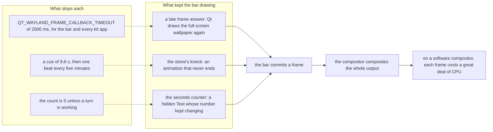
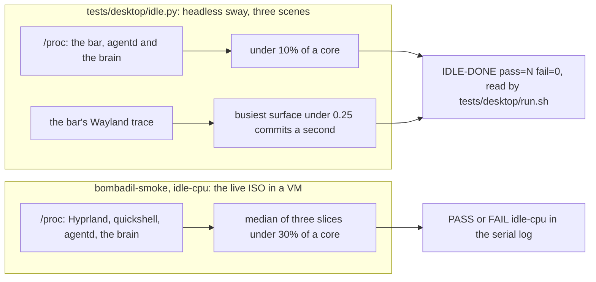

# Idle cost: the desktop at rest

> **Status:** Shipped  
> **Code:** `bin/bombadil-shell`, `src/bombadil/appkit/engine.py`, `share/qml/Bombadil/Stone.qml`, `shell/StatusLine.qml`, `shell/DeskState.qml`, `shell/HyprCover.qml`, `tests/desktop/idle.py`, `tests/desktop/run.sh`, `tests/desktop/inside.sh`, `iso/airootfs/usr/local/bin/bombadil-smoke`, `tests/test_stone_qml.py`, `tests/test_pill_qml.py`, `tests/test_theme.py`, `tests/test_appkit_runtime.py`  
> **Design:** there is no design brief. The contract the code comments and tests point to is [What the desktop costs when nothing is happening](../IDLE-COST.md); the rule it serves is [Quiet at rest](../principles.md#quiet-at-rest)  
> **Verified:** 2026-11-12 against `main` at `7d37bc5`. Read in the code: `bin/bombadil-shell`, `configure` and `make_app` in `src/bombadil/appkit/engine.py`, the roll, the cue, the settle timer and the glow of `share/qml/Bombadil/Stone.qml` (the drawing of the faces was not read), the seconds counter and `lineTimer` of `shell/StatusLine.qml`, `ticking` and its clock in `shell/DeskState.qml`, the poll in `shell/HyprCover.qml`, the ring in `shell/DeskCard.qml`, the dot's pulse in `shell/SessionChips.qml`, the pill's clock, the booting timer and the reconnect timer in `shell/shell.qml`, `Style/BusyIndicator.qml`, `Style/ProgressBar.qml`, the clock of `TipScene.qml`, `tests/desktop/idle.py` and `tests/desktop/inside.sh` in full, `tests/desktop/run.sh`, and `idle_share` with the lines around it in `bombadil-smoke`. Run on 2026-11-12: the two tests that pin the frame-answer timeout (`tests/test_theme.py` and `tests/test_appkit_runtime.py`, 2 passed), `bash -n` on the smoke, and a parse of `idle.py`. Read and not run: `tests/test_stone_qml.py` and `tests/test_pill_qml.py` (PySide6 is not installed here, so both skip as a whole), `tests/desktop/idle.py` (it needs Docker and a compositor) and the smoke's `idle-cpu` (it needs a virtual machine). Every measured figure on the page (the table under "What it costs", the cost of a beat of the knock, the 265%, and the frame rates with a cause put back) is quoted from the flat page, which took them in a virtual machine and in headless sway, and was not measured again. That Qt's own default for the frame-answer timeout is 100 ms is taken from the comment in `bin/bombadil-shell`; Qt's source was not read.

A machine left alone should cost next to nothing. On a battery-powered machine that is charge; in a virtual machine it is the host's fan; on a computer whose compositor draws in software it is the difference between a desktop you can use and one that is always busy. The rule is: when nobody is typing and nothing is working, the bar, agentd and the brain together use well under a tenth of a core, and the bar tells the compositor it drew a frame only from time to time, not sixty times a second. This page is where the piece is described: the three loops that broke the rule once and how each was stopped, what may run at rest and why, the watch that fails when one comes back, and the rules for anything that moves, ticks or polls. The flat page [IDLE-COST.md](../IDLE-COST.md) is the contract. `tests/desktop/idle.py`, `tests/desktop/run.sh` and `bombadil-smoke` point to it by name, so it stays where it is; it has the story of how the cost was found and the measurements, and this page summarises it and says what the code on `main` does.

## How it works

The unit of cost is the frame. Every time the bar commits a frame a software compositor composites the whole output again, which in the virtual machine the flat page measured cost seconds of CPU a frame at 1920 by 1080. Qt Quick draws a window again whenever something in it changes, hidden or not, and an animation that never ends keeps its window drawing for as long as it exists. So the work is not to make drawing cheaper; it is to give every loop a condition that ends it.

### The three loops and how each was stopped

| Loop | What kept it going | What stops it on `main` | Pinned by |
|---|---|---|---|
| A late frame answer | Qt Wayland draws a window again when the compositor's answer to its frame arrives after `QT_WAYLAND_FRAME_CALLBACK_TIMEOUT`, 100 ms by Qt's default. A compositor that draws in software needs longer for a full-screen frame, so the wallpaper, which never changes, was drawn again as each answer came, and each draw gave the compositor another frame. The flat page measured this as most of Hyprland's 265% | `bin/bombadil-shell` exports the timeout as 2000 ms for the bar (`${QT_WAYLAND_FRAME_CALLBACK_TIMEOUT:-2000}`, so a value already set is kept) and `configure` in `src/bombadil/appkit/engine.py`, which `make_app` calls, sets the same 2000 with `os.environ.setdefault` for every kit app, since an app window is as exposed as the wallpaper | `test_the_shell_waits_longer_than_qt_does_for_a_slow_compositor_to_answer_a_frame` in `tests/test_theme.py` and `test_an_app_waits_longer_than_qt_does_for_a_slow_compositor_to_answer_a_frame` in `tests/test_appkit_runtime.py` (both ran, 2 passed), and the smoke's `idle-cpu` |
| The stone's knock | While anything needed the person, the `needs` face of `share/qml/Bombadil/Stone.qml` ran two animations with `loops: Animation.Infinite`, which keeps the window drawing every 16 ms for as long as the need stands | The knock is a cue (below). It plays when the face becomes `needs`, rests, and comes back as one beat | `test_the_knock_is_a_cue_that_ends_and_comes_back_as_one_beat` and `test_a_new_need_knocks_again_and_reduced_motion_never_does` in `tests/test_stone_qml.py` (read, not run), and the frame count of `tests/desktop/idle.py` |
| A hidden number kept counting | `StatusLine.seconds` (the "12s" beside a working turn) was bound to a clock, and its `Text` is bound to it. A `Text` whose string changes asks its window to be drawn again even when it is hidden, so a setup line on an idle machine made the bar commit a frame a second | `seconds` is `0` unless `pill.mode === "working"` (`shell/StatusLine.qml`), so nothing changes while the machine rests | `test_the_seconds_counter_counts_only_while_a_turn_works` in `tests/test_pill_qml.py` (read, not run), and the frame count of `tests/desktop/idle.py` |

### The knock as a cue

`Stone.qml` has `cueMs: 9600`, `remindMs: 300000` and `cueing`. The knock and the breathing glow run only while `cueing` is true and reduced motion is off.

- **It starts when the face becomes `needs`.** `_needsCue` is `animate && face === "needs" && !reducedMotion`; each time it changes, `cueing` follows it and the cue length is reset to `cueMs`. A stone created already needing the person starts the cue in `Component.onCompleted`. The cue is six beats of 1.6 s. A second need that arrives while the face is already `needs` does not start another cue; the face has to leave `needs` and come back.
- **It rests.** A timer of `_cueFor` ms ends `cueing`. The stone stays amber with its glow held at 0.45, the value reduced motion holds, so the need is still told by colour. Nothing animates.
- **It comes back as one beat.** While `_needsCue` is true and the cue is not playing, a timer of `remindMs` (five minutes) starts one beat of 1.6 s (`_cueFor` is set to 1600), and the wait starts again when the beat ends. A beat was measured at fifteen to twenty core-seconds in the virtual machine, which is why the reminder is every five minutes and not every minute: a beat a minute was a third of a core for as long as the need stood.
- **Reduced motion never knocks.** `_needsCue` is false, so neither timer runs.

The need arises from `PillState.face`: a waiting coding session, or setup waiting on a choice, a sign-in or the network. A machine with no AI chosen or signed out therefore has the `needs` face from first boot until it is signed in, which is why the sign-in line is the first quiet scene of the watch. [The stone](shell.md#the-stone) and [the needs-you mark](desk.md#the-needs-you-mark) have the faces and what sets them.

### What may run at rest

The shell has a handful of timers and animations. Each one has a condition that is false when nothing is going on, and that condition is what this page asks of every one that is added.

| What | Where | Runs while | Stops when |
|---|---|---|---|
| The roll (`working`, `starting`) and, under reduced motion, its opacity pulse | `Stone.qml` | the face is `working` or `starting` and `animate` is on | the turn ends; `starting` ends when agentd answers or the 15 s `booting` timer in `shell/shell.qml` runs out |
| The knock and the glow's breathing | `Stone.qml` | `cueing` | the cue (9.6 s) or a reminder beat (1.6 s) ends |
| The settle timer | `Stone.qml` | the first 400 ms of a stone with `animate` on | it fires once |
| The line's timer, every 250 ms | `lineTimer` in `shell/StatusLine.qml` | a line shows, and no picture holds a finished line | the line goes, or a picture keeps it |
| The seconds counter | `StatusLine.seconds` | a turn is working | the count is `0` otherwise |
| The desk's clock, every `tickMs` (1000 ms) | `clock` in `shell/DeskState.qml` | `ticking`: agentd lists a job that is not failed and not removed, counting or finished | the table has no such job; a finished row leaves 12 s after it ended |
| The poll of the windows, every `pollMs` (300 ms) | `shell/HyprCover.qml` | under Hyprland, and at least one window is on the stage | the stage is empty |
| The ring around a live dot | `shell/DeskCard.qml` | the row is a dot with `pulsing`, and reduced motion is off | the row stops pulsing |
| A working coding session's dot | `shell/SessionChips.qml` | `dot.look === "working"` | the session stops working |
| `BusyIndicator`, indeterminate `ProgressBar` | `share/qml/Bombadil/Style/` | `running` (or `indeterminate`) and visible | either goes |
| The pill's clock | `shell/shell.qml` | always; a timer sets the text every 30 s | it changes once a minute, so it is a frame a minute at most |
| The bar's reconnect | `shell/shell.qml` | the bar has no connection to agentd, every 1.5 s | the connection is made |
| The Tips card | `shell/TipsCard.qml` | a tip turns, as a 200 ms crossfade; the card has no timer and no loop | the crossfade ends |
| A tip's scene | `share/qml/Bombadil/TipScene.qml` | it plays once, on one `NumberAnimation` with no loops, and holds its last frame; the card's poster and reduced motion draw a still, and its `Kit.Stone` is created with `animate: false`, so no timer of the stone's runs either | the scene ends |

agentd and the brain are measured with the bar by the watch below. This page does not list their loops.

### The watch

**The headless watch.** `tests/desktop/idle.py` runs after `driver.py` in the same container, as the same ordinary user in the same home folder (`tests/desktop/inside.sh`), so the last section of the driver puts the desk back with nothing kept for it. It starts headless sway (pixman renderer, 1280 by 800), agentd, the brain and the bar (`bin/bombadil-shell`, with `WAYLAND_DEBUG=client`, `BOMBADIL_BAR_INJECT=1` and the software Qt Quick backend), and it removes `QT_WAYLAND_FRAME_CALLBACK_TIMEOUT` from the environment first, so the launcher's own default is what runs. After `IDLE_SETTLE` (30 s) it leaves everything alone for `IDLE_WINDOW` (20 s) in each of three scenes, injecting the state of each with `quickshell ipc`:

1. only the sign-in line, which is what a machine shows before its first sign-in (the stone's cue is waited out first, 14 s);
2. something waiting for the person, a coding session that asked a question (the cue waited out the same way);
3. a job and a window on the stage, 4 s after the injection.

Each sample makes two checks. `ticks()` reads the user and system time of every thread of the bar, agentd and the brain from `/proc` before and after, and the sum must be under `IDLE_CORE_PERCENT` (10) of one core; the compositor's share is printed and not counted. `commits()` counts the `wl_surface#N.commit()` requests per surface in the bar's own trace, and the busiest surface must commit under `IDLE_COMMITS_PER_SECOND` (0.25) a second. The frame count is the sharper of the two: a bar that redraws once a second costs a hundredth of a core where sway draws in memory and several cores where the compositor draws in software, and the number of commits is the same on both. There are seven checks (the sign-in line is up, then two for each scene) and the last line is `IDLE-DONE pass=N fail=M`. `tests/desktop/run.sh` fails unless `out/desktop/idle.log` holds `IDLE-DONE pass=<n> fail=0`, after it has checked the driver's own `DONE` line. It takes a couple of minutes.

The flat page records what the watch saw with each cause put back, on the fixed tree and in headless sway: the old stone committed 62 frames a second (3% of a core), the old seconds counter 1.1 a second (under 1%), and the fixed tree 0.00 to 0.10 a second and under 1% of a core. Those figures were not measured again.

**The smoke.** `idle-cpu` in `bombadil-smoke` (`# Left alone` at `:649`, `idle_share` at `:658`, the check at `:714`) is at the top level of the script after the common checks and not inside a mode's block, so every mode that gets that far runs it. It waits up to 240 s for the guest to be calm (a one-minute load average under 1.5), sleeps 30 s more, and then takes three slices of `IDLE_CPU_SECONDS` (10 s). In each it sums the share of one core that Hyprland and `quickshell` (found by process name; the check fails when either is not running), agentd and the brain (found by the name of the file they run) used. The check passes when the median of the three totals is under `IDLE_CPU_LIMIT` (30). The median is on purpose: a stone that needs the person plays one beat from time to time, which this guest's software compositor pays for in one slice, and a loop that never ends is in every slice. The three slices are printed as a `NOTE` line whether the check passes or not. The limit is for that guest, where Hyprland draws in software under TCG; on real hardware the same stack uses about a tenth of that, which is what the headless watch holds to 10%. [The VM testing page](../contributing/vm-testing.md#what-it-covers) and [the smoke's catalogue](iso-and-install.md#the-smoke-test) describe the check from the VM's side.

**By hand.** The two measurements behind both are short enough to rebuild: the per-thread share of one core from `/proc` (`ticks()` in `idle.py`), and a count of `commit()` requests per surface in `WAYLAND_DEBUG=client` output (`commits()`). The first said that the bar's render thread and Hyprland's main thread were busy and not Python, the brain or a poll; the second says exactly how many frames each window made, whatever the speed of the compositor.

### What it costs

Measured by the flat page's authors in the live ISO in a guest (TCG, four cores, software OpenGL, 1920 by 1080), as a share of one core, and quoted here:

| State | Hyprland | The bar |
|---|---|---|
| Before the three fixes, nothing on screen | 265% | 97% |
| At rest, a need standing (about 12% with agentd and the brain) | 1.5 to 2.4% | 7 to 10% |
| At rest at the end of the whole smoke, what `idle-cpu` reads (6.1, 6.0 and 13.2% in three slices) | 0.3 to 4.8% | 3 to 5% |
| One beat of the stone's knock | 80 to 130% for about ten seconds | 25 to 50% |
| A turn working (the roll asks for 60 frames a second), not an idle state | 263 to 275% | 75 to 81% |

[The flat page](../IDLE-COST.md#what-it-costs-now) has the slices and what to read from them. The bar's own 7 to 10% at rest is a main-thread cost that nobody traced further.

### The bar's height

The bar is a layer surface as tall as what is in it, so a picture or a card that appears resizes it. The flat page measured a bar fixed at 600 px and at the full 1080 px against the shipped one, at rest and with a turn working, and the three were the same within the noise of the slices; the table is in [A fixed-height bar costs nothing extra](../IDLE-COST.md#a-fixed-height-bar-costs-nothing-extra). Nothing has chosen a fixed height. [Cards and pictures](cards-and-pictures.md#known-gaps) says what the resizes do to the pill.

### Where reduced motion meets it

[Reduced motion](../MOTION.md) removes movement; it is not an idle-cost switch, and the two overlap in three places. The knock never plays under reduced motion, because `_needsCue` is false and neither timer runs. The pulse that replaces the roll is still an `Infinite` animation, gated by the same `running` as the roll, so it ends with the turn. And `MOTION.md` leaves a `Timer` that only counts or waits alone under reduced motion, which is exactly the kind of loop this page is about: a timer that changes a hidden number costs frames whether or not motion is reduced, so such a timer needs its own condition.

## Interfaces other pieces depend on

| Name | Value and meaning | Where |
|---|---|---|
| `QT_WAYLAND_FRAME_CALLBACK_TIMEOUT` | `2000` (milliseconds) for the bar, which keeps a value already in the environment (an empty value is replaced), and for every kit app, which keeps any value that is set | `bin/bombadil-shell`, `configure` in `src/bombadil/appkit/engine.py` (called by `make_app`) |
| `Stone.cueMs`, `Stone.remindMs` | `9600` and `300000` ms: how long the knock plays when the face becomes `needs`, and the wait before one beat. Properties, so a test sets them | `share/qml/Bombadil/Stone.qml` |
| `DeskState.tickMs`, `DeskState.ticking` | `1000` ms; whether the desk's clock runs | `shell/DeskState.qml` |
| `HyprCover.pollMs` | `300` ms, the poll of the windows while one is on the stage | `shell/HyprCover.qml` |
| `StatusLine.seconds` | the turn's seconds while `pill.mode` is `working`, else `0` | `shell/StatusLine.qml` |
| `IDLE_SETTLE`, `IDLE_WINDOW`, `IDLE_CORE_PERCENT`, `IDLE_COMMITS_PER_SECOND` | `30` s, `20` s, `10` (percent of one core), `0.25` (frames a second): the times and limits of the headless watch | `tests/desktop/idle.py` |
| `IDLE_CPU_LIMIT`, `IDLE_CPU_SECONDS` | `30` (percent of one core) and `10` (seconds a slice): the smoke's limit and slice, read from the smoke's own environment | `iso/airootfs/usr/local/bin/bombadil-smoke` |
| `IDLE-DONE pass=N fail=M` | the last line of `idle.py`, which `tests/desktop/run.sh` looks for in `idle.log` | `tests/desktop/idle.py`, `tests/desktop/run.sh` |
| `idle-cpu` | the smoke's check name, and the `NOTE` line with the three slices | `iso/airootfs/usr/local/bin/bombadil-smoke` |

## Where state lives

The piece keeps no state of its own. The timeout is an environment variable set at launch; the knock's timers and `cueing` live in the `Stone` item, per stone, and are lost with it.

What the watch leaves behind: in the container, `idle.log` (the checks, tee'd by `inside.sh`), `idle-sway.log`, `idle-agentd.log`, `idle-brain.log` and `idle-wayland-trace.log` (the bar's stderr under `WAYLAND_DEBUG=client`) in the output folder (`out/desktop`, or `OUT`), and a runtime folder under `/tmp/xdg-idle-<uid>` with the sway configuration. In the guest, the smoke writes `/tmp/smoke.idle-cpu.log` and prints the same text as a `NOTE` line on the console. `idle.py` starts agentd in the container's home folder, the same one the driver used, so whatever the driver leaves in `desk.toml` and the other state files is part of what is measured.

## Principles it keeps

- [Quiet at rest](../principles.md#quiet-at-rest): the screen at rest is wallpaper and one pill. The rule here is stricter than the principle's: a movement needs not only a meaning but a condition that ends it. The trap is a state that can last an hour with an animation that lasts as long; a person away for an hour must cost the machine nothing for that hour.
- [Quiet at rest](../principles.md#quiet-at-rest), hidden items: "not visible" does not mean "not costing". A hidden `Text` or `Image` bound to a value that changes still makes the window draw. The trap is hiding a counter with `visible: false` and leaving it bound to a clock.
- [Colour says who](../principles.md#colour-says-who): the cue ends the movement and leaves the colour. A need that stands is amber with a held glow, so the stone still says whose turn it is while it is still. The trap is making a cue so short or so quiet that the colour is the only thing that says it, and then changing the colour.

## Extending it

1. **Add an animation.** Say what single thing it means, give it `running:` bound to something that goes false, and give it a still version under reduced motion ([MOTION.md](../MOTION.md#how-to-honour-it-in-a-new-component)). If the state it shows can last (a long job, a question nobody answers), do not loop it for as long as the state lasts: make it a cue as `Stone.qml` does, a length, a rest and, if the person should be reminded, a rare beat.
2. **Add a timer.** Give it a `running:` that is false at rest, as the desk's clock is (`ticking`) and the window poll is (`desk.windows.length > 0`). A timer that sets a property which nothing shows should not run at all.
3. **Bind a hidden item.** Bind it to `visible ? value : constant`, as `StatusLine.seconds` does with the mode, so nothing changes while it is hidden.
4. **Add a window that Qt draws.** The bar gets the frame-answer timeout from `bin/bombadil-shell` and every kit app gets it from `make_app`. Start a Qt program through one of them. `test_nothing_launches_quickshell_without_the_kit_path` in `tests/test_theme.py` exists for the kit's import path, and it also fails a `quickshell -p .../shell.qml` in `hyprland.lua`, `scripts/dev-session.sh` or `tests/desktop/driver.py` that skips `bin/bombadil-shell`, and so the timeout.
5. **Add a scene to the watch.** In `tests/desktop/idle.py`, after the last scene, inject the state with `ipc("desk", "inject", json.dumps({...}))`, wait out any cue (the first two scenes wait 14 s), and call `sample("a label")`. A feature with a state that can last needs a scene of its own.
6. **Run the watch after a change to anything that moves, ticks or polls.** `tests/desktop/run.sh` runs it after the driver. To run only the watch, use the Docker command in [the flat page](../IDLE-COST.md#what-keeps-it-from-coming-back).

## Tests

| Where | What it checks | How to run it |
|---|---|---|
| `tests/test_theme.py`, `tests/test_appkit_runtime.py` | the launcher and the kit export the frame-answer timeout, and keep a person's own value | `pytest tests/test_theme.py tests/test_appkit_runtime.py -k waits_longer` (needs no PySide6; ran, 2 passed) |
| `tests/test_stone_qml.py` | the knock stops by itself, one beat comes back after `remindMs`, a need that appears again knocks again, reduced motion never knocks | `pytest tests/test_stone_qml.py` (needs PySide6; skips as a whole without it) |
| `tests/test_pill_qml.py` | the seconds counter is `0` unless a turn is working | `pytest tests/test_pill_qml.py -k seconds_counter` (needs PySide6) |
| `tests/desktop/idle.py` | the bar's CPU and its frames a second in three quiet scenes | `tests/desktop/run.sh` (needs Docker and a `claude` binary), or the Docker command in the flat page for the watch alone ([the desktop test](../contributing/development.md#the-desktop-test)) |
| `iso/airootfs/usr/local/bin/bombadil-smoke`, check `idle-cpu` | Hyprland, the bar, agentd and the brain together, in the booted ISO | `scripts/test-vm.sh` ([VM testing](../contributing/vm-testing.md)) |

## Known gaps

- **The headless watch may not pin the frame-answer timeout.** The flat page says cause 1 does not show in headless sway at all, because sway answers a frame in microseconds, so only the smoke can see it. The docstring of `tests/desktop/idle.py` says the opposite, that a window Qt kept redrawing because the compositor answered late shows in it. The mechanism the comment in `bin/bombadil-shell` describes, a window drawn again only when the answer is later than the timeout, fits the flat page; whether the watch fails without the 2000 was not run. What pins the timeout for certain is `tests/test_theme.py`, `tests/test_appkit_runtime.py` and the smoke.
- **The CPU limit of the headless watch leaves out the compositor.** `sample()` in `tests/desktop/idle.py` sums the bar, agentd and the brain and prints sway's share without counting it, so a cost that lands on the compositor shows only through the frame count.
- **No scene has agentd down.** `tests/desktop/idle.py` starts agentd once and never stops it, so the bar's 1.5 s reconnect timer in `shell/shell.qml` is not measured.
- **The smoke forgives one slice.** `idle_share` judges the median of three totals, so a loop that is on for under a third of the run does not fail it; a reminder beat of the stone is the case it was built for.
- **No test reads the smoke's `idle-cpu`.** The smoke is parsed with `bash -n` and the headless watch is the same measurement on a compositor that draws in memory; neither runs `idle_share`.
- **The bar's own cost at rest was not traced further.** The 7 to 10% of a core the bar uses in the guest is a main-thread cost the flat page left as it was.
