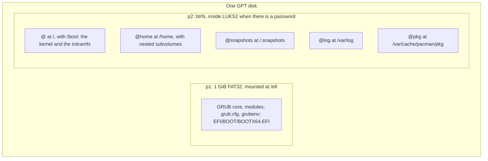
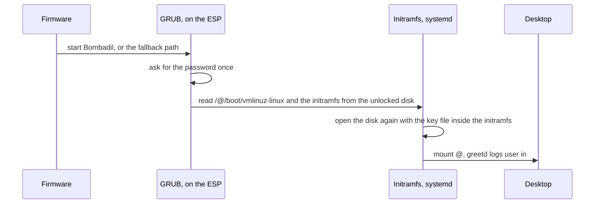
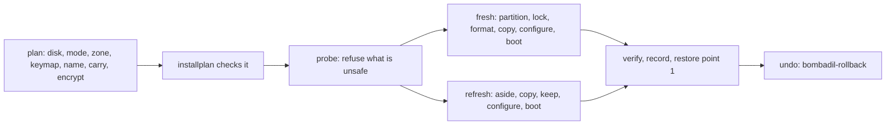
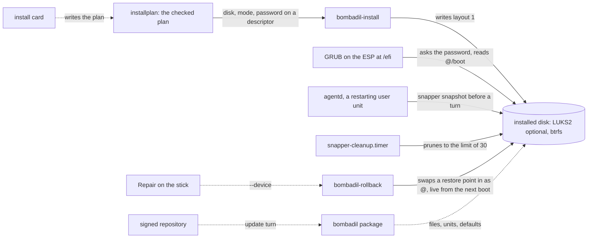

# The installed OS

> **Status:** Partly shipped. On `main`: layout 1 (an optional LUKS2 layer, the ESP at `/efi`, the kernel inside the root, five subvolumes and nested ones in the home), a guided, a planned and a whole-disk install, the refresh that keeps the home, `bombadil-rollback --device`, the GRUB screen, restore points of the system and of the home under a limit of 30, user units that restart, lingering for `user`, `bombadil remote` and `bombadil snapshot`. Designed only: the install card, packages, the signed repository, updates as a turn, a start that puts itself back, next to Windows, repair and erase from the stick, a copy somewhere else, Secure Boot and TPM, and the rest of piece 4.  
> **Code:** `iso/airootfs/usr/local/bin/bombadil-install`, `iso/airootfs/usr/local/bin/bombadil-rollback`, `iso/airootfs/usr/local/bin/bombadil-grub-config`, `iso/airootfs/etc/grub.d/000_bombadil_screen`, `iso/airootfs/usr/local/bin/bombadil-setup`, `iso/airootfs/usr/local/bin/bombadil-smoke`, `install/carry.list`, `src/bombadil/installplan.py`, `src/bombadil/remote.py`, `src/bombadil/snapshots.py`, `src/bombadil/agentd.py`, `src/bombadil/launcher.py`, `src/bombadil/providers.py`, `src/bombadil/sysmap.py`, `bin/bombadil`, `iso/packages.x86_64`, `iso/profiledef.sh`, `iso/efiboot/loader/entries/`, `scripts/build-iso.sh`, `scripts/build-in-container.sh`, `scripts/test-vm.sh`, `scripts/wsl-vm.sh`, `iso/airootfs/etc/greetd/config.toml`, `iso/airootfs/etc/skel/.config/hypr/hyprland.lua`, `iso/airootfs/etc/systemd/`, `share/grub/bombadil/`, `tests/test_installer.py`, `tests/test_installplan.py`, `tests/test_remote.py`, `tests/test_iso_profile.py`, `tests/test_boot_console.py` and `tests/test_snapshots.py`  
> **Design:** [Bombadil, installed](../design/installed-os-brief.md), [the page](../design/pages/bombadil-installed.html)  
> **Verified:** 2026-11-12 against `main` at `7d37bc5`, the commit every `file:line` below is read at. Read in full: the installer, `bombadil-rollback`, `bombadil-grub-config`, `000_bombadil_screen`, `installplan.py`, `remote.py`, `install/carry.list`, `scripts/test-vm.sh`, `scripts/wsl-vm.sh`, `scripts/build-iso.sh` and `bombadil-smoke`, and the changes to the rest since `7d17600`. Run: `tests/test_installer.py` (114 passed, 3 skipped because `shellcheck` is not installed), `tests/test_installplan.py` (50), `tests/test_remote.py` (39), `tests/test_iso_profile.py` (51), `tests/test_boot_console.py` (8) and `tests/test_snapshots.py` (1), and `bash -n` on the scripts. Not run: no ISO was built and no VM mode was booted, so the page records what the code and its tests say about LUKS, GRUB, btrfs, snapper, `tmux` and `claude remote-control`, and observed none of it on a disk. What those tools do is their vendors' behaviour, which no file here shows.

The installed OS is Bombadil as a system a person installs on a disk, the way they would install Debian or Windows, and not only as a system that runs from a USB stick. The stick is the door: it tries and installs, and it will repair, reinstall and erase (designed), and everything that lasts lives on the installed machine. It exists because every earlier design (undo, updates as a turn, promises that survive a restart) assumes an installed machine, and because four choices cannot be changed by an update once strangers have installed: the disk layout, encryption, where GRUB lives, and which files a package owns. The first three are decided and built as layout 1. The fourth, packages, is designed only. [ISO and install](iso-and-install.md) owns the image, the boot flow, the installer's steps and the VM tests.

## What is built and what is designed

| State | What it holds |
|---|---|
| **On `main`** (`7d37bc5`) | The installer, `bombadil-install`, as sourced functions with four ways to run it: guided at a terminal, `--plan FILE`, `DISK [--yes]` and `--refresh DISK`. `src/bombadil/installplan.py` checks the plan and lists the disks. Layout 1: GPT, a 1 GiB ESP at `/efi`, btrfs (inside LUKS2 when there is a password) with `@`, `@home`, `@snapshots`, `@log` and `@pkg`, the kernel in `@/boot`, and nested subvolumes in `@home`. Three keyslots with a password (the password, a key file in the initramfs, a recovery key). Guards before anything is written, and a read-back of the result. `install/carry.list` for what comes from the stick's home. Restore point 1, "Bombadil <version>, as installed", and the programs installed on the stick as point 2. The refresh, which keeps the home. `bombadil-rollback [--device DEV] N\|refresh`, with a guard against a restore point that has no kernel. The GRUB screen (`bombadil-grub-config`, `000_bombadil_screen`). Restore points made with `--cleanup-algorithm number` under a limit of 30, none hourly, for the `root` and `home` configs; `snapper-cleanup.timer`, `fstrim.timer` and `systemd-timesyncd` enabled. `agentd` and the bar as restarting user units; lingering for `user`; turn numbers and the session id that last across a restart of the daemon. Outside the brief: `bombadil remote` and `bombadil snapshot [--hook]`. The words `install` and `remote` in the pill. The test modes `install`, `install-encrypted`, `refresh` and `installed` in `scripts/test-vm.sh`, and `tests/test_installer.py`, `tests/test_installplan.py` and `tests/test_remote.py`. |
| **Designed only** (no code anywhere) | The install card (piece 3), packages (2), hardware on the stick (5), the repository (6), updates as a turn (7), a start that puts itself back (8), next to Windows (9), repair, reinstall and erase from the stick (10), a copy somewhere else (11), Secure Boot and TPM (12), a Bombadil you carry (13), and the rest of piece 4: the daily prune of `@.undone-*`, `@.before-refresh-*` and `@.after-refresh-*`, the other timers, the 100 changed pairs, the lid lock and greetd's password. The first-start card that shows the recovery key once is part of the card (designed). |

What is designed is written in the future tense below and labelled `(designed)`, and it is never mixed into a table of what exists.

## How it works

### The layout

`bombadil-install` writes layout 1 (`LAYOUT=1`, `bombadil-install:23`), the one thing an update cannot change later, and records the number as `layout` in `/var/lib/bombadil/install.json` (`:815-853`). The header comment of the script (`:13-18`) describes it.



| Choice | Why, as the code says it |
|---|---|
| The ESP at `/efi`, the kernel in `@/boot` | A restore point holds the kernel that goes with its modules. GRUB's core, modules, `grub.cfg` and `grubenv` live on the ESP and never roll back; the kernel and initramfs are read from `@/boot`, so they go back with an undo (`boot`, `bombadil-install:743-744`). `restore-point-has-a-kernel`, `undo-kernel-matches-modules` and `undo-layout-kept` in the smoke read this back (`bombadil-smoke:833`, `:846-847`). |
| `@log` and `@pkg` beside `@` | Undo swaps `@` for a snapshot, so what the logs of a bad start hold and what was downloaded since must not be inside it (`bombadil-install:16-17`). |
| Nested subvolumes in `@home` | A restore point of the home folder does not contain what is listed in `HOME_SUBVOLS` (`:44-45`): `.cache`, `.local/state/bombadil`, `.claude`, `.codex`, `.local/share/claude`, `.config/chromium`, `.local/share/bombadil/browser` and `Projects`. The comment gives the reasons: the conversation and the history are not undone with what the agent changed, and caches, the browser profile and the projects (git has those) are not worth rolling back. That btrfs leaves a nested subvolume out of a snapshot is btrfs's behaviour. `make_subvolume` converts a folder that already has files by copying it into a subvolume beside it and swapping it in, so a stop leaves the files where they were (`:610-644`). |
| `fstab` by UUID, `/` by the name `@` | A snapshot swapped in under the name `@` then mounts like the root it replaced (`write_fstab`, `:462-474`). `verify` also requires the top level to be btrfs's default subvolume (`:806-807`), the reason `Snapshots.rollback` gives for swapping by name and not with `snapper rollback` (`src/bombadil/snapshots.py:68-77`). |

### How the disk is opened



With a password, p2 is a LUKS2 container (partition type `8309`, label `bombadil`) and `make_luks` gives it three ways in (`bombadil-install:217-238`):

- **The password**, in the first slot, with argon2id at 256 MiB (`LUKS_MEMORY=262144` KiB) and 1000 ms of work (`LUKS_ITER_TIME`, both overridable with `BOMBADIL_LUKS_MEMORY` and `BOMBADIL_LUKS_ITER_TIME`; `:48-49`). The comment at `:46-47` gives the reason for staying under cryptsetup's own cost: firmware that fragments memory below 4 GiB makes GRUB reject the right password. That claim about firmware is the comment's, and nothing here measures it.
- **A key file**, 64 random bytes, added with pbkdf2 and 1000 iterations and set to be tried first (`new_keyfile`, `:209-215`; the priority, `:225`). It is installed as `/etc/cryptsetup-keys.d/root.key` and named in the initramfs's `FILES`, so the password is typed once, at GRUB. `/etc/crypttab` names it with `luks,discard,x-initrd.attach` (`write_initramfs_config`, `:476-504`).
- **A recovery key** from `systemd-cryptenroll --recovery-key` (`:227-229`).

Each way is tried with `cryptsetup open --test-passphrase` before a filesystem is made (`:231-233`). The password is limited to the characters from space to `~` and to 254 of them, because GRUB reads it on a US keyboard into a 256-byte buffer that keeps two bytes back (`password_problem`, `:90-97`, `MAX_PASSWORD`, `:40`): a password the boot screen cannot type is refused before the disk is locked with it. It reaches the installer only on a file descriptor (`--password-fd N`, or the guided flow's own, `:1017-1021`), and the account gets it on standard input (`chpasswd`, `:601-602`), so it is in no argument, no file and no log. With a password the installer sets `GRUB_ENABLE_CRYPTODISK=y` (`:552`), and `verify` insists that `grub.cfg` opens the disk it just locked (`cryptomount -u <that UUID>`) and that GRUB has a `luks` module on the ESP (`:808-812`).

The recovery key is shown on the terminal only (`show_recovery_key`, `:1026-1035`: file descriptor 3, which the main block keeps because everything else goes through `tee` into a log that is copied onto the installed disk, `:1078-1081`). It is shown in a guided run. In a run from a plan nothing shows it: `/var/lib/bombadil/recovery-key` (mode 600) keeps it and `recovery_key_pending` stays true in `install.json`, until a first-start card shows it (designed; no code reads `recovery_key_pending`). With no password nothing is encrypted: `encrypt` is `no`, there is no `/etc/crypttab` and no `sd-encrypt` hook. A plan that says `encrypt: true` without a password is refused (`read_password`, `:99-114`).

The smoke's `install-encrypted` and `installed` modes check that GRUB asks for the password and that nothing after it asks again (`scripts/test-vm.sh:153-165`). They were written for a VM and not run for this page.

### What GRUB shows

GRUB's screen is the one thing a person sees before Bombadil is up. The installer puts `background.png` from `share/grub/bombadil/` on the ESP, because `grub.cfg` is read there before the disk is unlocked, and makes the font `inter-16.pf2` with `grub-mkfont` from the Inter the system has (`grub_theme`, `bombadil-install:520-541`). If either fails it says so and GRUB keeps its plain screen. It then writes `/etc/default/grub.d/bombadil.cfg`, which switches GRUB to the graphical terminal unless something else chose the terminal: a test install that reads GRUB on a serial line (`BOMBADIL_INSTALL_GRUB_SERIAL`, `:554-557`) keeps the text one.

`/etc/grub.d/000_bombadil_screen` is what puts the font and the picture on the screen. It is a `grub.d` script and not a GRUB theme because it must sort before `00_header`, whose `cryptomount` is what asks for the password, and because GRUB applies a theme only when the menu shows, which is never unless Esc is held (the script's comment and `share/grub/bombadil/README.md`). It does nothing unless `GRUB_TERMINAL_OUTPUT` is `gfxterm`. `theme.txt` in `share/grub/bombadil/` is not wired; the README says why.

`grub.cfg` is written by `bombadil-grub-config`, not by `grub-mkconfig` directly. `grub-mkconfig` echoes two "Loading ..." lines before every kernel and Arch's GRUB has no switch for them, so the script runs `grub-mkconfig` in the C locale, so that the text is the English one the cut looks for, and deletes those lines from the file (`bombadil-grub-config:12-14`). The file is `/efi/grub/grub.cfg`, or `BOMBADIL_GRUB_CFG`. Anything that writes `grub.cfg` again runs the script; the installer does (`boot`, `bombadil-install:765`).

GRUB is installed twice, with `--efi-directory=/efi --boot-directory=/efi`: once as a named firmware entry, `--bootloader-id=Bombadil`, whose failure is only a note, and once as `--removable`, which writes the fallback path (`:759-763`). The menu is hidden with a one second timeout unless Esc is held (`grub_defaults`, `:543-563`); [ISO and install](iso-and-install.md#boot-and-the-console-from-power-on-to-the-desk) owns the quiet console.

### The three operations



**Guards (`probe`, `bombadil-install:139-173`).** Before anything is written it refuses: a computer that did not start in UEFI mode; a missing tool (`sgdisk`, `wipefs`, `mkfs.fat`, `mkfs.btrfs`, `btrfs`, `blkid`, `lsblk`, `partprobe`, `arch-chroot`, `python3`, `snapper`, `grub-install`, and with a password `cryptsetup` and `systemd-cryptenroll`); anything that is not a whole disk; the disk the stick started from, found from `archisosearchuuid` on the kernel command line with `blkid -U` and `lsblk`'s `PKNAME`, which holds after copy-to-RAM (`stick_disk`, `:120-127`); a disk under 16 GB; a disk with an iso9660 filesystem; and a disk with anything mounted. It reads the image at `/run/archiso/airootfs` when that is mounted, and finds the newest kernel in it (`newest_kernel`, `:132-137`), else it copies the running system. A fresh install on a disk that has Windows on it is not refused: `installplan --disks` lists such a disk with the note "Windows is on it" and the install erases it once its name is typed (or the plan is given). A refresh refuses it.

**Fresh install.** `partition` wipes the disk, makes a 1 GiB EFI system partition and p2 (type `8300`, or `8309` with a password) and formats the ESP (`:193-205`); `make_filesystem` locks p2 when asked, makes the btrfs and its five subvolumes (`:240-249`). The system is copied from the read-only image with `cp -a "$image/." "$target/"`, which carries nothing the stick's own session wrote; with no image mounted it copies the running system with `cp -ax /.` and clears its own state (`copy_system`, `:420-447`). A marker, `var/lib/bombadil/install-incomplete`, is in the system from the copy until `record` removes it. The disk's name is typed to confirm unless `--yes` or a plan says it was already confirmed (`confirm`, `:176-181`).

**Refresh (`--refresh DISK`).** It reads and checks first (`refresh_open`, `:272-318`) and refuses: no ESP; Windows on the disk (`EFI/Microsoft`); a disk that is not a Bombadil one (no `@`, `@home` or `@snapshots`); no `user` home to keep; under 10 GB free (`REFRESH_FREE_GIB`); an encrypted disk without its password. It then renames `@` to `@.before-refresh-<stamp>` and `@snapshots` to `@snapshots.@.before-refresh-<stamp>` (`refresh_aside`, `:320-367`), marks the fresh `@` unfinished before a file goes into it, copies the system in, and keeps from the old one what belongs to the computer: the Wi-Fi connections, the host name, `localtime`, `locale.conf`, `vconsole.conf`, `machine-id`, the SSH host keys, the lingering flag, the recovery key and `etc/cryptsetup-keys.d` (`REFRESH_KEEP`, `:384-386`; `refresh_keep`, `:388-411`). The account keeps the password it had (`:598-600`), the home keeps what it has (the skeleton adds only missing files, `prepare_home`, `:651`, and a sign-in from the stick never replaces one the home has, `carry`, `:663-667`), and the programs the old system had that the image lacks are listed in `/var/lib/bombadil/refresh-<stamp>.txt`. For a disk made before layout 1, the old kernel is copied from the ESP into the old system's own `/boot` and its `fstab` is pointed at `/efi` (the old text is kept as `fstab.bombadil-backup`) so that the old system can still start. The ESP is emptied last with `find -delete` and not formatted again, so its identifier stays (`boot`, `:752-758`).

A stop before the boot files change puts the old system straight back (`refresh_restore`, `:370-381`, called from `cleanup`, `:855-890`). A later stop leaves the marker, and running the refresh again starts over from the system still aside (`refresh_open`, `:300-306`); the installer says which case it was (`cleanup`). Everything about the fresh system that can be checked without GRUB, namely every kernel module read with `zstd -tq`, the kernel and both initramfs files, and for an encrypted disk the key, `crypttab` and `systemd-cryptsetup` in the initramfs listing, is checked before the old boot files go (`verify_system`, `:783-795`).

**Undo from outside (`bombadil-rollback --device DEV N|refresh`).** On the stick, where the disk is not the running root, `--device` names the btrfs device (already unlocked, if it is encrypted). With a number, the snapshot is made beside `@` as `@.new-<stamp>` first, so a failure leaves `@` as it was, then swapped in with `mv --exchange` where the system has it and with two renames otherwise; the previous root stays as `@.undone-<stamp>` (`bombadil-rollback:30-37`, `:56-67`). It refuses a restore point with no kernel of its own when the system on the disk keeps its kernel in `/boot`, so a disk from before layout 1, whose kernel is on the ESP, is not refused (`:58-62`). `refresh` puts back the newest whole `@.before-refresh-*` (it needs `etc/fstab`, `usr/lib/modules`, no incomplete marker and `boot/vmlinuz-linux`, `:39-54`) and keeps the other as `@.after-refresh-<stamp>` and `@snapshots.after-refresh-<stamp>`. Run on the installed system itself, with no `--device`, it finds the root with `findmnt` and does the same swap, which is what `Snapshots.rollback` calls. That a snapshot swapped in under the name `@` mounts at the next boot because GRUB reads `/@/boot` is the design's reasoning and was not booted here.

The guided flow tells the person that a refresh keeps the old system for 14 days (`bombadil-install:995`). Nothing deletes it ([Known gaps](#known-gaps)).

### The plan and what comes along

The guided flow builds a plan from its answers, and the install card (designed) will write one. `src/bombadil/installplan.py` is its only reader. A plan is a JSON object with the keys `disk`, `mode` (`fresh` or `refresh`), `timezone`, `timezone_source` (`detected`, `chosen` or `unset`), `keymap`, `hostname`, `carry`, `encrypt` and `kind` (`internal` or `usb`); an example:

```json
{
  "disk": "/dev/vda",
  "mode": "fresh",
  "timezone": "Europe/Lisbon",
  "timezone_source": "detected",
  "keymap": "us",
  "hostname": "acme-pc",
  "carry": [".claude", ".config/bombadil"],
  "encrypt": true
}
```

The module refuses a `password` key (the password never goes in a plan), unknown keys, a disk outside `/dev`, a time zone the system has no file for, a computer name that is not lowercase letters, digits and dashes, a carry path that is not on `install/carry.list`, and a plan that disagrees with the command line about the disk or the mode (`validate`, `installplan.py:80-146`). Every value is matched against a strict pattern, and the module prints quoted shell assignments (`P_DISK`, `P_MODE`, `P_TIMEZONE`, `P_CARRY` and the rest) that the installer evaluates (`shell_assignments`, `:149-157`; `load_plan`, `bombadil-install:76-85`). With no `carry` key the whole list comes; with no time zone the system is UTC with `timezone_source` `unset`; with no name the computer is `bombadil-` and four characters of its machine id (`bombadil-install:578`). `suggest_hostname` (`installplan.py:169-181`) offers a readable one from the maker's model, and the guided flow asks for the final name.

`python3 -m bombadil.installplan --disks [--stick DISK] [--lsblk FILE]` lists the whole disks with what is on each (`list_disks`, `:199-240`). A disk is listed and not offered, with the reason, when it is the stick, holds an install image, has something mounted or is under 16 GB.

`install/carry.list` names, one home path a line, what comes from the stick's home to the installed one: `.claude`, `.claude.json`, `.codex`, `.config/bombadil`, `.local/state/bombadil/desk.toml`, `.local/state/bombadil/tips.json`, `Apps` and `.config/chromium`. `carry` (`bombadil-install:657-680`) copies each that exists, adds the Wi-Fi connections the stick joined (a fresh install only) and removes `undo.json`, whose restore point number means nothing on the installed system. Anything not on the list stays on the stick, and the stick is gone at power-off: the coding sessions' state and the rest of `~/.local/state/bombadil` do not come along.

### The account and the records

`configure` (`bombadil-install:566-606`) writes `fstab` and the initramfs configuration, sets the time zone, keymap and name (a fresh install only: a refresh keeps the old ones), makes `user` (UID 1000, groups `wheel,video,input,audio`) if the copy has none, rebuilds the home from `/etc/skel` when there is none, touches `/var/lib/systemd/linger/user`, and enables `greetd`, `NetworkManager`, `systemd-timesyncd`, `fstrim.timer` and `snapper-cleanup.timer` (`:594-595`). The stick's own unit, `bombadil-live`, is deleted from the copy, so the installer's line is what gives an installed machine lingering. With a password, the account gets it; with none, `passwd -d user` leaves it empty; a refresh restores the old hash.

`record` (`:815-853`) writes `/var/lib/bombadil/install.json` with `layout`, `date`, `image_version`, `mode`, `encrypted`, `target_kind`, `timezone`, `timezone_source`, `packages_brought`, `recovery_key_pending` and `kept_aside`. The image version is `/usr/share/bombadil/VERSION`, which `scripts/build-iso.sh` writes as the build's date and commit (`:15-18`). On a refresh the old zone is kept and recorded as `chosen`, or `unset` when it is UTC (`:820-823`). `run` ends with restore point 1, "Bombadil <version>, as installed" (`:1067`), and `replay_stick_packages` installs what was installed on the stick since it started from the stick's own package cache with `pacman -U`, as restore point 2, "Brought from the USB stick: ..." (`:712-741`); a package whose file is gone is named and not brought. `run` ends with "Installed. Take out the USB stick, then Restart." (`:1072`), and a guided run then waits for Enter and runs `systemctl reboot` (`:1083-1086`).

### Restore points, retention and the units that restart

`snapper_setup` (`bombadil-install:683-704`) makes the `root` and `home` configs with `TIMELINE_CREATE=no`, `NUMBER_CLEANUP=yes` and `NUMBER_LIMIT=30`, and mounts `@snapshots` at `/.snapshots`. `Snapshots.create` passes `--cleanup-algorithm number` (`src/bombadil/snapshots.py:51-59`), so each turn's restore point is one snapper may prune, and `snapper-cleanup.timer` enforces the limit of 30. Nothing is deleted when a restore point is made, so more than 30 can exist between two runs of the timer, and the smoke checks the config and the timer and not a deletion ([restore points](restore-points.md#retention-and-pruning)). Nothing prunes `@.undone-*`, `@.before-refresh-*` or `@.after-refresh-*`, and no code takes a restore point of `home`: `Snapshots` is built for `root` (`snapshots.py:37`).

`agentd` and the bar are user units with `Restart=always`, started by the Hyprland start hook (`hyprland.lua:9-10`); [the session stays alive](session-services.md) owns that design. Turn numbers last across restarts (`src/bombadil/agentd.py:396-398`), and so do the session id and the session's model, which `agentd` keeps in `$XDG_RUNTIME_DIR/bombadil/agentd-state.json` (`:522-548`): a restart of the daemon by systemd keeps the conversation, a reboot does not, and a later login does not either where lingering is off ([what a restart keeps](session-services.md#what-a-restart-keeps-and-loses)). Coding sessions run in scopes of their own, which lingering keeps through a compositor crash or a logout ([the session stays alive](session-services.md#coding-sessions-stay-alive), [coding sessions](coding-sessions.md)).

### Remote control and the restore point by hand

These two are not in the brief. `bombadil remote [start [FOLDER]|status|url|show|stop]` (`src/bombadil/remote.py`, wired in `bin/bombadil:464-465`) runs Claude Code's `claude remote-control --name "Bombadil on <host>"` in a detached `tmux` session called `bombadil-remote`, so a person can steer a session on this computer from claude.ai/code or the Claude app. It needs `claude` and `tmux` (the image lists `tmux`, `iso/packages.x86_64:36`), and a claude.ai account: an API key does not do. The session starts inside `systemd-run --user --scope` where that exists, so restarting whatever started it does not take it down, and `remain-on-exit` keeps what it said if it stops (`remote.py:64-69`, `:182-183`). `show` attaches the terminal (Ctrl-b then d leaves it running). Nothing in `iso/` starts it at boot: after a restart the person says `remote` in the pill, which runs `start` (`launcher.py:1064-1067`; the words are `remote`, `remote control`, `start remote control`, `remote session` and `start a remote session`, `:106`).

`start` with no folder uses `~/Projects/remote`, makes it, and writes `.claude/settings.json` there unless one exists: `permissions.defaultMode` set to `bypassPermissions`, and a `UserPromptSubmit` hook that runs `bombadil snapshot --hook` (`remote.py:81-93`). Claude Code asks once whether to trust a folder, and Bombadil answers that question (up to five times, after a short wait, since a key sent as the question is drawn is thrown away) only for a default folder that is empty or holds nothing but its own settings; a folder the person names, or a default folder that holds a project, is left to them (`folder_is_fresh`, `start`, `:96-117`, `:161-205`). It recognises four reasons it cannot start and says what to do: not signed in, remote control turned off by the organization, Claude unreachable and an untrusted folder (`PROBLEMS`, `:42-51`).

`bombadil snapshot [--hook]` (`bin/bombadil:466-482`) takes a restore point at once. It first clears the undo marker, as a turn from the pill does, so the pill's "undo" takes this turn back. The label is `turn: remote: <the first 60 characters of the prompt>` when a hook hands it the prompt (`snapshots.label_from_hook`, `snapshots.py:25-33`), else `turn: <the words, or "by hand">`. It never fails, because a hook that returned an error would stop the prompt it was taken for, and it prints `restore point N` except under `--hook`.

### Designed only

Each item is decided in the brief and has no code anywhere.

- **Packages (designed).** A pacman package will own every file Bombadil ships: the tree at `/usr/share/bombadil`, commands in `/usr/bin` (`scripts/build-iso.sh:25` links thirteen into `/usr/local/bin` at the Verified commit), units in `/usr/lib/systemd`, with the two provider CLIs installed by `npm` as the one exception until piece 7. Defaults will live in `/usr` and change with each update, and the person's own settings will be short files that load them. A file another package owns will change by a numbered step, or by a drop-in. Existing installs will move by one refresh, never by `pacman --overwrite`.
- **The install card (designed).** The chip "Install on this computer" will open a card that draws the disks as bars, never offers the stick or a disk in use, and asks for one password. Time zone, keyboard, computer name and what comes along will be one line each with "change". The red button will name the disk, and no model call will sit between it and the disk: the agent may fill the card and never press it. It will write the plan that `--plan` already reads, show the recovery key once at the first start, and take the place of the terminal flow, which asks a disk, a password, a time zone and a name where the card will ask two.
- **The rest of "months, not minutes" (designed).** `paccache.timer` and a monthly scrub; a daily timer that prunes `@.undone-*` and `@.before-refresh-*` older than 14 days; `smartd`; swap on zram; the screen locking on lid close; greetd's `default_session` asking for the password, so a crash or a logout never reopens an unlocked desktop; and retention of 100 changed pairs where `main` sets a limit of 30 restore points.
- **Repository, updates, repair (designed).** Stage one will be a local `/etc/pacman.d/bombadil.conf` with `SigLevel = Optional TrustAll` that nothing public reads; stage two a signed public repository on a release tagged `repo`, a `bombadil-keyring` package and a workflow that builds, signs and tests before it uploads (testing first, stable after 3 days with no revert). "update" will install the two keyrings, run `-Su` inside one restore point, then the numbered layout steps, and say what needs a restart. Installing one program will not upgrade the system, which will change the prompt line at `src/bombadil/providers.py:45`; `main` keeps `-Syu` there and only makes the agent say, in one plain sentence before it runs, that it also updates every other package (`:45-47`, asserted at `tests/test_iso_profile.py:21-31`). A start that fails twice will put itself back; a disk that will not start will get Repair, "Reinstall, keep my files" and Erase from the stick.

### How the parts connect



Solid lines exist on `main`. Dotted lines are designed only: the card, the package, the repository and Repair.

### The thirteen pieces

The pieces of the brief, in its order (effort S, M or L, from the brief):

| # | Piece | Effort | State |
|---|---|---|---|
| 1 | The disk that lasts: layout v1, and a refresh that keeps your home | L | Shipped. On `main`: the layout, encryption, the plan, the guards, the refresh, `--device`, the carry list and the fallback boot, exercised by `tests/test_installer.py` and `tests/test_installplan.py` and by the VM modes `install`, `install-encrypted` and `refresh`, which were not run for this page. The recovery key's first-start card is the card's (designed). Not measured: the cost of the password slot on slow laptops (the code uses 1000 ms where the brief aims at 2 to 3 seconds), GRUB opening the slot on real firmware, and the offline replay of the stick's programs. `bombadil-vm refresh` still updates in place and is a different tool (`scripts/wsl-vm.sh:152-155`). |
| 2 | Bombadil as packages, with homes that follow its releases | M to L | Designed. |
| 3 | The install card | M to L | Designed. On `main` the groundwork: the plan, `installplan --disks`, the terminal flow and the pill word `install`; no card, chip, `install` message or tool. It builds on `capture_disks`, `CardHost.qml` and `PasswordField.qml`, which are on `main`. |
| 4 | Months, not minutes | M | Partly shipped. On `main`: restore points made with `--cleanup-algorithm number` under a limit of 30, no hourly points, `snapper-cleanup.timer`, a `home` config, `fstrim.timer`; `agentd` and the bar as restarting user units; turn numbers across restarts. Designed only: the rest, as listed above. |
| 5 | Hardware on the stick | S to M | Designed. Microcode, `cryptsetup`, `parted` and `tmux` are on the image for the installer and for remote control (`iso/packages.x86_64:6-10`, `:36`); none of the brief's hardware packages is. |
| 6 | The signed repository and the download page | M | Designed. There is no `.github/` directory and no workflow. |
| 7 | Updates as a turn | M | Designed (passenger piece 6, which no piece of work owns). |
| 8 | A start that fails puts itself back | M to L | Designed. It will use the ESP at `/efi` and `grubenv`, which layout 1 provides. |
| 9 | Next to Windows | L | Designed. It comes after whole-disk installs (the owner's answer to question 3, 30 Sep 2026). |
| 10 | Repair, reinstall and erase from the stick | M | Designed. Reinstall is piece 1's `--refresh` and `bombadil-rollback --device` is on `main`; the stick's repair flow and its card are not built, and nothing erases from the stick except a fresh install. |
| 11 | A copy somewhere else, and a move to another computer | L | Designed. |
| 12 | Secure Boot and TPM | M to L | Designed. |
| 13 | A Bombadil you carry | S | Designed. Most of it arrives with pieces 1 and 3; `bombadil-install` records `target_kind` (`internal` or `usb`) and offers a USB disk as a target. |

### Decided and still open

- **Order (the brief).** Pieces 1 and 2 first, because they are what no later update can fix (the disk, and the path every later fix travels). Pieces 3 to 6 must all land before any public download. Until then only the owner installs, through the terminal and a VM. See [build these first](../design/installed-os-brief.md#build-these-first) and [after these, in order](../design/installed-os-brief.md#after-these-in-order).
- **Decided by the owner on 30 Sep 2026.** A locked disk by default, a full Bombadil on a USB drive as well as the stick, and whole disks first with next to Windows after.
- **Where the code differs from the brief.** The disk is opened through `/etc/crypttab` with `x-initrd.attach` and not `/etc/crypttab.initramfs`; the password slot costs 1000 ms where the brief says 2 to 3 seconds; `@home` has one nested subvolume more than the brief lists (`.local/share/bombadil/browser`); the snapshots a refresh puts aside are `@snapshots.@.before-refresh-<stamp>`; the terminal flow prints the recovery key and the card will show it at the first start.
- **Still open.** The geo-IP service, whether the Claude Code binary may be redistributed, the ISO staying under 4 GiB, and the clock when travelling.

## Interfaces other pieces depend on

**What exists on `main`**

| Name | What it is |
|---|---|
| `bombadil-install` | Four forms: no argument at a terminal (the guided flow, `:939-1022`, chosen at `:1078`); `--plan FILE [--password-fd N]`; `DISK [--yes]`, a whole disk with no password and no encryption, which `bombadil-smoke` runs (`:727`) and `scripts/wsl-vm.sh` runs (`:109`); `--refresh DISK [--yes] [--password-fd N]`. Environment: `BOMBADIL_INSTALL_CMDLINE` (extra kernel arguments, `:559-561`), `BOMBADIL_INSTALL_GRUB_SERIAL` (`:554-557`), `BOMBADIL_INSTALL_LEAVE_MOUNTED` (`:860`), `BOMBADIL_INSTALL_LOG` (`:29`), `BOMBADIL_LUKS_MEMORY` and `BOMBADIL_LUKS_ITER_TIME` (`:48-49`). The seams the tests use: `BOMBADIL_TARGET`, `BOMBADIL_SRC`, `BOMBADIL_CARRY_LIST`, `BOMBADIL_SHARE`, `BOMBADIL_MODULES`, `BOMBADIL_CMDLINE_FILE`, `BOMBADIL_EFI_SYSFS`, `BOMBADIL_STICK_CACHE`, `BOMBADIL_NM_CONNECTIONS` and `BOMBADIL_ZONEINFO` (`:25-37`, `:894`). Sourced by the tests, which call its functions (`:20`, `:1075`). |
| `python3 -m bombadil.installplan` | `--plan FILE`, `--disk`, `--mode`, `--carry-list`, `--zoneinfo`, and `--disks [--stick DISK] [--lsblk FILE]`; prints `P_*` assignments or the disk lines, and exits 2 with a one-line reason (`installplan.py:264-294`). |
| `bombadil-rollback [--device DEV] N\|refresh` | `N` swaps restore point `N` in as `@`; `refresh` puts back the system a refresh set aside (`bombadil-rollback:6-18`). |
| `bombadil-grub-config`, `/etc/grub.d/000_bombadil_screen`, `BOMBADIL_GRUB_CFG` | Writes `/efi/grub/grub.cfg` and cuts GRUB's "Loading" lines; the font and picture before the password prompt. |
| `install/carry.list`, `/usr/share/bombadil/VERSION` | The home paths that come from the stick, and the image's date and commit (`scripts/build-iso.sh:14-18`). |
| `bombadil remote ...`, `bombadil snapshot [--hook]`, the words `remote` and `install` | Remote control, a restore point by hand or from a hook, and the pill words (`launcher.py:106-107`). `install` opens `sudo bombadil-install` in the details drawer and answers "Bombadil is already installed on this computer." when `/run/archiso` is absent (`_install`, `:1057-1062`; `_live`, `:202`). |
| `src/bombadil/snapshots.py:43-46`, `:51-59`, `:68-77` | `available` needs `snapper` and `/etc/snapper/configs/root`; `create` runs `snapper create --print-number --cleanup-algorithm number`; `rollback` runs `sudo bombadil-rollback N`. Piece 4 will build the rest on this (100 changed pairs, pruning the set-aside systems). |
| `src/bombadil/agentd.py:396-398`, `:522-548`, `:2075`, `:2082`, `:2315`, `:2838` | `session_id` starts empty and is kept with the session's model in `agentd-state.json` in the runtime directory; the turn count is read back from `turns.jsonl` and the `turn` marker file at start; the `setup` message carries `actions` (`:2075`), which `_describe` builds (`:2082`) and `setup_action` answers (`:2315`); the restore point description is `turn:<n>: ` and the first 60 characters of the prompt (`:2838`). The card will add an `install` action and save `session_id` where a reboot and the install keep it (designed). |
| `src/bombadil/launcher.py:855-856`, `:908-910`, `:1070`, `:1122-1127` | The `undo.json` marker, "Undo starts once Bombadil is installed" when `/run/archiso` exists, `_battery`, and `_lock`, which needs `hyprlock`, in no package list. Pieces 1, 3 and 4 use or will change them. |
| `src/bombadil/providers.py:45-49` | The prompt line for installing programs: `sudo pacman -Syu --noconfirm --needed`, never `-Sy` alone, and a plain sentence first that it updates every other package (`:45-47`). Piece 7 will change that line itself. The prompt also says the agent can set the time zone with `sudo timedatectl set-timezone <Area/City>` when the person names it (`:48-49`). |
| `src/bombadil/sysmap.py:767`, `shell/CardHost.qml`, `share/qml/Bombadil/PasswordField.qml:15` | `capture_disks` reads `lsblk` (no `TRAN` or `PKNAME`) and `findmnt`; `CardHost` holds one picture; `PasswordField` hides text. Piece 3 will build the card on them. The installer's own disk list is `installplan --disks`, which reads `TRAN`. |
| `iso/airootfs/etc/greetd/config.toml`, `iso/airootfs/etc/sudoers.d/bombadil` | `initial_session` and `default_session` run `start-hyprland` (through `systemd-cat`) as `user`; `user` has `NOPASSWD: ALL`. Piece 4 will change `default_session`; the agent's sudo will stay. |
| `iso/airootfs/etc/skel/.config/hypr/hyprland.lua:7-24`, `:83`, `:94-102`, `:115` | Copied into the home once, so an edit reaches no installed home. The `hyprland.start` hook imports the session's environment and restarts the `agentd` and bar units (`:10`), starts `foot --server` (`:14`), then hands Mail's and the browser service's units their display variables and restarts them (`:15-22`); Super+Ctrl+Escape restarts the shell unit (`:83`); the window rule `bombadil-sessions` (`:94-102`) floats and centres a coding session's window; the `mail-engine` rule (`:115`) sends Thunderbird's windows to a hidden workspace. Piece 2 will turn the file into a stub that loads a shipped part. |
| `iso/airootfs/etc/systemd/user/`, `iso/airootfs/etc/systemd/system/` | The `agentd` and shell units are `Restart=always` with no `default.target.wants` link, started by the hook; the brain, mail and browser units start with the user manager; the connection service is a system unit. All the user units set `StartLimitIntervalSec=0` under `[Unit]`. The installer copies the image's `/etc`, so they reach an installed system. Piece 2 will move the `ExecStart` of the units that run Bombadil's own commands from `/usr/local/bin` to `/usr/bin` and give them to the package. See [the session stays alive](session-services.md). |
| `src/bombadil/brain/watch.py:8-19`, `tests/vm/btrfs-kernel.sh:1-5` | The watcher mounts the top level (`subvolid=5`) privately and maps `/@home` back to `/home`, so nested subvolumes under `/home` are covered; the VM test lays out `@`, `@home` and `@snapshots` as `bombadil-install` does, plus a nested `@home/user/Projects`, and has no `@log` or `@pkg`. |
| `scripts/build-iso.sh:14-18`, `:21-23`, `:25`, `:35-56`, `iso/pacman.conf`, `iso/airootfs/etc/systemd/system/pacman-init.service:7-8` | The tree and `install/` are copied into the image with the `VERSION` file; the boot entries `02` to `09` are dropped unless `BOMBADIL_TEST_ENTRIES` is set; thirteen commands are linked into `/usr/local/bin`; `verify_image` reads the erofs back and compares it with the tree. `[core]` and `[extra]` only; a bare `pacman-key --populate`. Pieces 2 and 6 will add `[bombadil]` and a keyring. |
| `iso/packages.x86_64:3-14`, `:36`, `iso/profiledef.sh:14-16`, `:20-25` | `linux-firmware`, `btrfs-progs`, `cryptsetup`, `amd-ucode`, `intel-ucode`, `gptfdisk`, `parted`, `snapper`, `grub`, `efibootmgr` and `tmux` are listed (57 packages); boot is UEFI only; the erofs image is built without `-E ztailpacking`, and the two grub scripts are executable by `file_permissions`. `iso/airootfs/etc/thunderbird/policies/policies.json` is a file Bombadil ships in `/etc`. |
| `iso/efiboot/loader/entries/`, `scripts/test-vm.sh:143-213`, `scripts/wsl-vm.sh:91`, `:109` | Entries 02 to 05 exist only in test builds; 03, 04 and 05 write `/dev/vda` without asking (`bombadil.smoke=install`, `install-encrypted`, `refresh`). The ISO is attached to the VM as a USB disk with 8 GB of memory in the install modes (`test-vm.sh:55-60`), and the test VMs boot OVMF with a variable file of its own where the machine has a split image (`:41-51`; `-bios` at `wsl-vm.sh:91`). `wsl-vm.sh refresh` is an in-place update, not the installer's `--refresh` (`:152-155`). |
| `share/grub/bombadil/` | `background.png` is copied to the ESP by `grub_theme`; `theme.txt` is wired by nothing. |

**Interfaces it adds (designed)**

| Name | What it is | Status |
|---|---|---|
| `{"type": "install", "plan": ...}`, setup action id `install`, `install_card(disk, keep_windows, size)` | The card's socket message (`agentd` runs `!sudo bombadil-install --plan ...`) and the `os-mcp` tool that fills the card and cannot press it | designed |
| `where()` in `src/bombadil/system.py` | Returns "live", "installed" or "dev" | designed |
| `packaging/bombadil/PKGBUILD`, `bombadil.install`, `/usr/share/bombadil/migrate/NNN-*.sh` | The package, and numbered steps for files other packages own | designed |
| `src/bombadil/homefix.py`, `hyprland.lua.before-split` | Numbered home steps run by `agentd`, the old file kept aside | designed |
| `/etc/pacman.d/bombadil.conf`, `bombadil-keyring` | Repository servers and keys | designed |
| `bombadil-boot-ok.service`, `boot_ok` in `grubenv`, kernel argument `bombadil.rollback=N` | Bad-start rollback | designed |

## Where state lives

| Where | What it holds |
|---|---|
| p1, mounted at `/efi` | The EFI system partition (FAT32, label `BOMBADIL`, mounted with `umask=0077`): `EFI/BOOT/BOOTX64.EFI`, `/efi/grub/` (GRUB's core, modules, `grub.cfg`, `grubenv`, and `themes/bombadil/` with the picture and the font). Outside every restore point; a refresh empties it and does not format it. |
| p2, LUKS2 when there is a password | One btrfs volume labelled `bombadil`: `@` at `/`, `@home`, `@snapshots` at `/.snapshots`, `@log` at `/var/log`, `@pkg` at `/var/cache/pacman/pkg`. The kernel and both initramfs images are in `/boot` of `@`. |
| `@.undone-<stamp>`, `@.before-refresh-<stamp>`, `@snapshots.@.before-refresh-<stamp>`, `@.after-refresh-<stamp>`, `@snapshots.after-refresh-<stamp>` at the btrfs top level | The root an undo replaced, the system and the restore points a refresh put aside, and what an undo of a refresh put aside. Nothing prunes them. |
| `/etc/snapper/configs/root`, `/etc/snapper/configs/home`, `snapper-cleanup.timer` | The configs with `NUMBER_LIMIT=30` and `TIMELINE_CREATE=no`, written by the installer (`bombadil-install:683-704`). |
| `/var/lib/bombadil/install.json` | `layout`, `date`, `image_version`, `mode`, `encrypted`, `target_kind`, `timezone`, `timezone_source` (`detected`, `chosen`, `unset`), `packages_brought`, `recovery_key_pending`, `kept_aside`. |
| `/var/lib/bombadil/recovery-key` (mode 600), `/var/lib/bombadil/install-incomplete` | The recovery key, until a card shows it (designed); the marker of an install that stopped. |
| `/var/lib/bombadil/refresh-<stamp>.txt`, `/var/log/bombadil-install.log` | The programs the old system had and the image lacks; the install's log, readable by its owner alone (the password is in no log). |
| `/usr/share/bombadil/install/carry.list`, `/usr/share/bombadil/VERSION` | One home path per line, read by the installer; the image's date and commit. |
| `/etc/mkinitcpio.conf.d/bombadil.conf`, `/etc/mkinitcpio.d/linux.preset`, `/etc/crypttab`, `/etc/cryptsetup-keys.d/root.key`, `/etc/default/grub.d/bombadil.cfg` | Initramfs, unlock and GRUB screen files written by the installer. The preset has `default` and `fallback` images in `/boot` and no `ALL_config`, so mkinitcpio reads the drop-in with the hooks. |
| `/var/lib/systemd/linger/user` | Lingering for `user`: the user's systemd, and with it the coding sessions' scopes, keeps running after a compositor crash or a logout. The installer touches it (`bombadil-install:594`); on the stick `bombadil-live.service` runs `loginctl enable-linger user`. A machine installed before those lines has no such file ([the session stays alive](session-services.md#updating-a-running-system)). |
| `iso/airootfs/etc/systemd/user/` on the image, `/etc/systemd/user/` on the installed system | The `agentd`, shell, brain, mail and browser user units; the installer copies the image's `/etc`. |
| `/etc/claude-code/managed-settings.d/50-bombadil.json`, `/etc/codex/config.toml`, `/etc/codex/requirements.toml` | The hooks of the coding tools that run `bombadil-signal`, so the dots beside the pill follow a session; they arrive with the copied `/etc` ([coding sessions](coding-sessions.md#the-hooks)). |
| `$XDG_RUNTIME_DIR/bombadil/agentd-state.json` | Provider, session id and session model; survives a restart of the daemon, not a reboot (`agentd.py:522-548`). |
| `~/.local/state/bombadil/` (`turns.jsonl`, `turn`, `undo.json`) | The turn log, the number of the last turn begun, and the undo marker (`agentd.py:398`, `launcher.py:855-856`). It is a nested subvolume of `@home`, so a restore point of the home does not contain it. |
| tmux session `bombadil-remote`, `~/Projects/remote` | The remote-control session and its folder, with `.claude/settings.json` written by `bombadil remote` (`remote.py:81-93`). |
| `/tmp/bombadil-install.log`, `/run/bombadil-install/` | The installer's log on the stick (mode 600) and its scratch space (the key file, the mounts); both on the stick, which is gone at power-off. |
| `~/.local/state/bombadil/session.json` | `agentd`'s `session_id`, kept across a reboot and the install (designed). |
| `~/.local/state/bombadil/home.json` | The record of the numbered home steps (designed). |
| `/etc/pacman.d/bombadil.conf` | Repository servers (designed). |

## Principles it keeps

- [Full access with undo](../principles.md#full-access-with-undo): the password is no wall between the agent and the machine (`user` keeps `NOPASSWD: ALL`), and undo takes the kernel back because the kernel is in `@/boot`. The trap is a layout that puts the kernel and initramfs outside the root undo swaps (as the ESP at `/boot` did before layout 1), or that leaves logs or the package cache inside it.
- [Recovery without the broken part](../principles.md#recovery-without-the-broken-part): undo needs no network, model or desktop, and `bombadil-rollback --device`, which the stick runs, needs none; Repair and bad-start rollback will need none either (designed). The trap is a Repair that calls `agentd`, or a rollback list kept in a file rewritten on the FAT ESP.
- [Nothing runs unseen](../principles.md#nothing-runs-unseen): updates will happen on the person's word, as a turn, with a receipt; on `main` the agent is already told to say, before an install that updates every package, that it does, and a refresh lists the programs the image does not have. The trap is a timer that installs updates, or a step that erases a disk without naming it: the typed name, or the plan from a card whose button names the disk, is what confirms it.
- [Plain files stay the truth](../principles.md#plain-files-stay-the-truth): `install.json`, `carry.list` and the plan are the records, and short user files that load shipped defaults will be (designed). The trap is state only a database holds, or an update that rewrites a file in the person's home.
- [Records before models](../principles.md#records-before-models): the disk list reads `lsblk` (`installplan --disks`, and `capture_disks` for the card) with no model. The trap is a model call on the path that erases a disk.
- [Stupidly simple](../principles.md#stupidly-simple): the card will ask two questions, which disk and one password. The trap is a partition editor or a settings screen, or carrying the terminal flow's four questions over to the card.

## Extending it

**Carry one more path from the stick's home into an installed system**

1. Add one line to `install/carry.list`, a path relative to the home. `installplan.py` reads that file and refuses a `carry` entry that is not on it, and `carry` in `bombadil-install` copies the entries that exist on the stick.
2. If a restore point of the home must never roll it back, also add it to `HOME_SUBVOLS` (below). Add it to `tests/test_installer.py` where the carry list is checked (`test_a_fresh_install_brings_what_the_carry_list_names_and_nothing_else`).

**Keep a nested subvolume in the home out of home restore points**

1. Add the path, relative to the home, to `HOME_SUBVOLS` (`bombadil-install:44-45`).
2. `prepare_home` makes it with `make_subvolume`, which copies a folder that already has files into a subvolume beside it and swaps it in, so a stop leaves the files where they were. A change to the layout of subvolumes needs the same change in `tests/vm/btrfs-kernel.sh`, and a changed layout is a higher `LAYOUT` number with a migration in the refresh path, because an installed machine is never reinstalled by an update.

**Add a field to the plan**

1. Add the key to `KEYS` in `installplan.py` with its pattern, validation and `P_*` assignment (`validate`, `shell_assignments`), and a test in `tests/test_installplan.py`.
2. Read the `P_*` variable in `bombadil-install`. Nothing a card sends is trusted until the plan has validated it.

**Keep a different number of restore points**

1. Change `NUMBER_LIMIT` in `snapper_setup` (`bombadil-install:692` and `:700`). Only an install made afterwards gets the value; an installed machine keeps its own `/etc/snapper/configs/root`.
2. Update the places that name 30: `tests/test_iso_profile.py:198-205` and the smoke checks `layout-snapper` and `snapshots-are-pruned` (`bombadil-smoke:782`, `:837`). See [restore points](restore-points.md) for the readers' limits (what undo can reach).

**Make another service come back when it dies**

1. Add `iso/airootfs/etc/systemd/user/<name>.service` with `Restart=always`, `RestartSec=1` and `StartLimitIntervalSec=0` under `[Unit]`, as the two units do ([the session stays alive](session-services.md)).
2. Add its name to the `systemctl --user restart` line of the `hyprland.start` hook (`hyprland.lua:10`).
3. Add it to the unit list in `test_the_daemon_and_the_bar_come_back_when_they_die` (`tests/test_iso_profile.py:166-180`) and to `units_active` and a `revives` check in `bombadil-smoke` (`:245-255`).

**Keep these when you change `bombadil-install`**

- `DISK --yes`, which `bombadil-smoke` and `scripts/wsl-vm.sh` run, and `--plan FILE --password-fd N`, which `install-encrypted` runs (`bombadil-smoke:742-743`).
- The name-based mount of `/` and the `@` swap in `bombadil-rollback`.
- Never run `btrfs subvolume set-default` or `snapper rollback`: undo swaps by name, and `verify` fails an install whose top level is not the default subvolume. Do not format the ESP on a refresh. Run `bombadil-grub-config`, not `grub-mkconfig`, whenever `grub.cfg` is written again, so that the "Loading" lines stay cut; a person who must write it by hand runs `sudo bombadil-grub-config`. A package script should not run it either: the reasoning, which was not checked here, is that after an undo and before the reboot it would write the paths of a root that is no longer there.
- The text that tests read. `tests/test_iso_profile.py:198-205` asserts `set-config TIMELINE_CREATE=no NUMBER_CLEANUP=yes NUMBER_LIMIT=30`, `systemctl enable ... snapper-cleanup.timer` and `create-config` before `set-config`; `:206-215` asserts `install -Dm644 "$kernel" "$target/boot/vmlinuz-linux"`, that `kernel=$(newest_kernel "$image")` comes before `sgdisk -Z "$disk"`, and no `bootmnt`; `tests/test_boot_console.py:100-106` needs `copy_system` to hold `cp -a "$image/." "$target/"` and `cp -ax /. ` and to leave `grub.d` alone; `tests/test_installer.py` sources the functions by name, so a renamed function breaks it.
- The lingering line (`mkdir -p /var/lib/systemd/linger && touch /var/lib/systemd/linger/user`, `:594`): the installer deletes `bombadil-live.service`, which turns lingering on for the stick, so without this line an installed machine has none. `test_the_account_lingers_so_coding_sessions_outlive_the_session_that_started_them` pins it, and the smoke's `dev-linger` reads it back.
- The `-Syu` prompt line and its sentence (`tests/test_iso_profile.py:21-31`), which piece 7 will change.
- `bombadil.smoke` as the last argument of entry 02, which `scripts/wsl-vm.sh:97` edits.
- The account `user` and `/home/user`.

## Tests

- `tests/test_installer.py` sources the installer's functions into a shell with the disk tools replaced by shims: the password rules and the descriptor, the guards and their reasons, the guided flow's questions, LUKS and the initramfs, `fstab`, GRUB twice and the screen, the carry list, the nested subvolumes, the refresh (what it keeps, the stop and restore paths, the order of the checks), the restore points and the stick's programs, the record, the recovery key, and `bombadil-rollback` (the swap, the kernel guard, `refresh`). 114 passed; the 3 `shellcheck` tests skip where `shellcheck` is not installed. `tests/test_installplan.py` covers the plan and the disk list, and `tests/test_remote.py` covers remote control, `bombadil snapshot` and the pill words.
- `tests/test_iso_profile.py` reads the image's files by text: the stick carries what the installer calls (`:107-112`), `systemd-timesyncd` is enabled (`:114-118`), `tmux` is on the image (`:120-123`), the image is built without `ztailpacking` and read back (`:125-137`), every script added to the path or to GRUB is executable (`:138-165`), the restart units (`:166-180`), the start hook that imports the session's environment before it restarts them (`:181-190`), `bombadil-setup` restarting `agentd` through `systemctl --user restart bombadil-agentd` and `bombadil provider` printing that command when `agentd`'s socket is not there (`bin/bombadil:456`; the test at `:191-197` only checks that both files contain the text), the snapper limit and timer (`:198-205`) and the kernel rule (`:206-215`).
- `tests/test_snapshots.py:16` checks that `create` passes `--cleanup-algorithm number`. `tests/test_providers.py:284` checks that the prompt tells the agent how to set the time zone. `tests/test_agentd.py` covers the state kept across a restart of the daemon (`:197`, `:222`, `:302`), where the state file lives and what it ignores (`:245`, `:253`), and turn numbers across restarts (`:1243`).
- `bombadil-smoke` checks the units in three ways (`:245-255`). `agentd-comes-back`, `bar-comes-back` kill the unit's process and wait for another process; `agentd-answers-again` and `bar-layer-again` wait for the daemon to answer and for the bar's layer to be back; `services-are-units` checks that both are active. `idle-cpu` measures the session at rest (`:649-715`). On an installed disk the `undo` mode checks the layout (`layout_checks`, `:769-794`: twelve checks, and seven more with a password), `restore-point-has-a-kernel`, `snapshot-is-prunable` and `snapshots-are-pruned` (`:836-837`; the second reads the config and the timer, and does not wait for a deletion) and `undo-kernel-matches-modules` and `undo-layout-kept` after the reboot (`:846-847`). The `install-encrypted` and `refresh` modes check the installer from the stick (`:730-766`), and the `refreshed` mode checks what a refresh kept and puts the old system back (`:851-870`). [ISO and install](iso-and-install.md#the-smoke-test) catalogues every check.
- `MODE=install`, `MODE=install-encrypted` and `MODE=refresh OLD_ISO=old.iso` of `scripts/test-vm.sh` install to a scratch disk from an ISO built with `BOMBADIL_TEST_ENTRIES=1 scripts/build-in-container.sh`, boot the result and test it; `MODE=installed` boots the disk the last install run left, typing the password again at GRUB where the first run asked for it (`scripts/test-vm.sh:5-16`, `:143-213`). None of them was run for this page. The test boot entries erase `/dev/vda` without asking, so they exist only in images built with that flag and must never be started on a real disk. The host side is in [testing the whole system in a VM](../contributing/vm-testing.md).
- Run the Python tests with `pytest tests/test_installer.py`, `tests/test_installplan.py`, `tests/test_remote.py` and `tests/test_iso_profile.py`, one file at a time ([developing](../contributing/development.md)).

## Known gaps

- **Pruning stops at the restore points.** Nothing prunes `@.undone-*`, `@.before-refresh-*` or `@.after-refresh-*` (`bombadil-rollback:66`, `bombadil-install:351-353`), although the guided refresh tells the person the old system is kept for 14 days (`bombadil-install:995`), and nothing deletes `/var/lib/bombadil/recovery-key`.
- **No code takes a restore point of the home.** The `home` config exists (`bombadil-install:693-700`) and `Snapshots` is built for `root` (`snapshots.py:37`); the smoke checks only that `snapper -c home list` works (`refresh-home-restore-points`, `bombadil-smoke:860`).
- **The recovery key has no first-start card.** In a plan run, the way the install card will run it, nothing shows the key; it stays in `/var/lib/bombadil/recovery-key` with `recovery_key_pending` true, and no code reads that field.
- **The guided flow says the password unlocks the screen.** `ask_new_password` says so (`bombadil-install:921`), and no screen lock exists: `launcher._lock` needs `hyprlock`, which no package list has (`launcher.py:1122-1127`), and greetd's sessions open with no password (`iso/airootfs/etc/greetd/config.toml`).
- **An optional password.** With none, `user` has an empty password, nothing is encrypted and `sudo` asks for nothing; the guided flow asks a second yes before it goes on (`bombadil-install:926-928`).
- **A fresh install erases a disk that has Windows on it** once its name is typed (`installplan.py:217-232`, `bombadil-install:139-173`); next to Windows is designed.
- **A refresh adds only missing skeleton files.** A changed line in an existing skeleton file never reaches an installed home (`bombadil-install:651`).
- **The GRUB theme is wired only in part.** The installer copies `background.png` and makes the font; `theme.txt` is wired by nothing (`share/grub/bombadil/README.md`, `bombadil-install:520-541`).
- **`scripts/vm-tools/update-in-place` does not know the installer's changes.** It looks for "Loading Linux" in the serial log after a reboot (`scripts/vm-tools/update-in-place:81`), which the installer's `bombadil-grub-config` cuts from `grub.cfg`, and its `SYSTEM` list names `bombadil-setup`, `-install`, `-rollback` and `-smoke` and not `bombadil-grub-config` (`:23-26`).
- **`bombadil-vm refresh` updates in place.** It does not call the installer's `--refresh` (`scripts/wsl-vm.sh:152-155`).
- **The VM modes hard-code the disk.** `install`, `install-encrypted` and `refresh` use `/dev/vda` (`bombadil-smoke:727`, `:742`, `:765`; the refresh plant mounts `/dev/vda2`, `:752`) and boot entries 03 to 05 write it without asking.

## When it ships

The piece ships when the card and the packages are on `main`, or when the brief is cut to what exists. Then:

- the Status line of this page becomes Shipped, and the Verified line is re-read;
- the row in [the roadmap](../roadmap.md) and the status block of [the brief](../design/installed-os-brief.md) change with it, and so do the status columns that repeat it in [the architecture overview](../ARCHITECTURE.md), [the docs index](../README.md) and [the design index](../design/README.md);
- the Built column of the installed-OS rows in [the decisions](../decisions/installed-os-and-updates.md) changes with it;
- a dated line goes into [the history](../history.md).
