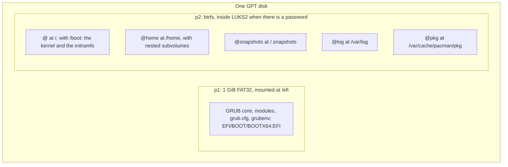
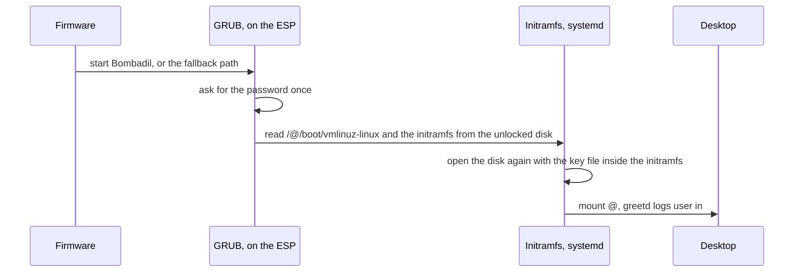
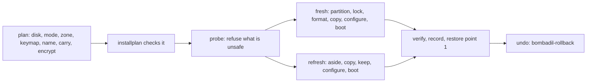
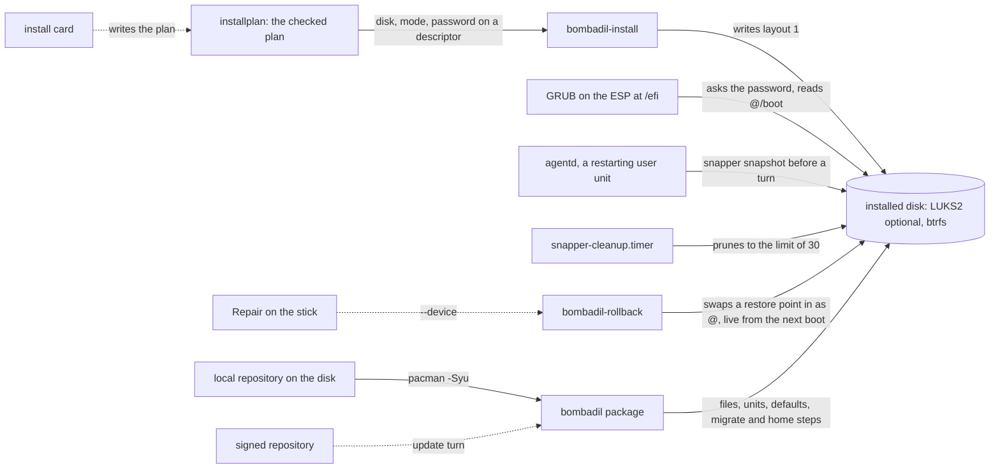
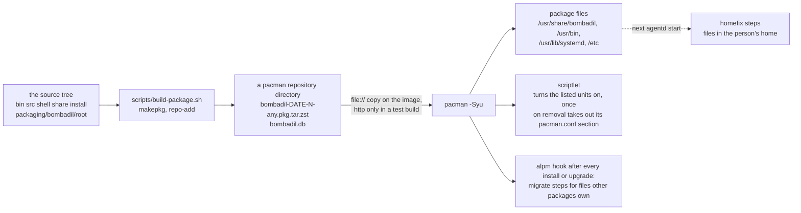

# The installed OS

> **Status:** Partly shipped. On `main`: layout 1 (an optional LUKS2 layer, the ESP at `/efi`, the kernel inside the root, five subvolumes and nested ones in the home), a guided, a planned and a whole-disk install, the refresh that keeps the home, `bombadil-rollback --device`, the GRUB screen, restore points of the system under a limit of 30 (a `home` snapper config is made beside `root`, and nothing takes a restore point of the home), user units that restart, lingering for `user`, `bombadil remote` and `bombadil snapshot`, and Bombadil as one pacman package, `bombadil`, which owns every file Bombadil ships (the tree at `/usr/share/bombadil`, the commands in `/usr/bin`, the units and the settings in `/etc`). An update is a newer package taken with `sudo pacman -Syu` from a repository on the disk; numbered steps change the files other packages own and the files in a home; the home's `hyprland.lua` is a short file that loads Bombadil's part and then holds the person's own lines; `bombadil version` says which Bombadil this is. Designed only: the install card, the signed repository (its local first stage is built), updates as a turn, a start that puts itself back, next to Windows, repair and erase from the stick, a copy somewhere else, Secure Boot and TPM, and the rest of piece 4.  
> **Code:** `packaging/bombadil/PKGBUILD`, `packaging/bombadil/bombadil.install`, `packaging/bombadil/root/` (the files the package puts at their own paths: `usr/bin/bombadil-install`, `usr/bin/bombadil-rollback`, `usr/bin/bombadil-grub-config`, `usr/bin/bombadil-setup`, `usr/bin/bombadil-smoke`, `etc/grub.d/000_bombadil_screen`, `usr/lib/systemd/`, `usr/share/bombadil/migrate/`, `usr/share/libalpm/hooks/bombadil-migrate.hook`, `usr/share/bombadil/greetd/config.toml`, `etc/pacman.d/bombadil.conf`, `etc/sudoers.d/bombadil` and `etc/skel/`), `share/hypr/bombadil.lua`, `share/hypr/old/`, `install/carry.list`, `src/bombadil/installplan.py`, `src/bombadil/homefix.py`, `src/bombadil/version.py`, `src/bombadil/remote.py`, `src/bombadil/snapshots.py`, `src/bombadil/agentd.py`, `src/bombadil/launcher.py`, `src/bombadil/providers.py`, `src/bombadil/sysmap.py`, `bin/bombadil`, `iso/packages.x86_64`, `iso/profiledef.sh`, `iso/pacman.conf`, `iso/efiboot/loader/entries/`, `scripts/build-iso.sh`, `scripts/build-package.sh`, `scripts/pacman-conf-with-repo.sh`, `scripts/hypr-old-versions.py`, `scripts/build-in-container.sh`, `scripts/test-vm.sh`, `scripts/wsl-vm.sh`, `share/grub/bombadil/`, `tests/test_installer.py`, `tests/test_installplan.py`, `tests/test_remote.py`, `tests/test_iso_profile.py`, `tests/test_boot_console.py`, `tests/test_snapshots.py`, `tests/test_packaging.py`, `tests/test_homefix.py`, `tests/test_version.py` and `tests/test_vm_harness.py`  
> **Design:** [Bombadil, installed](../design/installed-os-brief.md), [the page](../design/pages/bombadil-installed.html)  
> **Verified:** 2026-11-13 against the merge of `main` (`dbad5ec`) into the installed-OS branch (`ff02c26`), the tree every `file:line` below is read at. `main`'s page was written at `7d37bc5`, and the code files it anchors to are the same at `dbad5ec`; each of its anchors was moved to its place in this tree through the diff of the file (the installer, `bombadil-smoke`, `bombadil-rollback`, `bombadil-grub-config`, `scripts/build-iso.sh`, `scripts/test-vm.sh`, `scripts/wsl-vm.sh`, `bin/bombadil`, `agentd.py`, `launcher.py`, `providers.py`, the Hyprland hook, `iso/profiledef.sh`, `iso/packages.x86_64` and the test files that changed), and the anchors in changed text were read again. Read in full for the package: `packaging/bombadil/PKGBUILD`, `bombadil.install`, the migrate hook, runner and steps, the enable lists, the tmpfiles, greetd and repository files, `scripts/build-package.sh` and `scripts/build-iso.sh`; read by search: `src/bombadil/homefix.py`, `src/bombadil/version.py`, `scripts/test-vm.sh`, `scripts/wsl-vm.sh`, `scripts/build-in-container.sh` and the `package-*`, `update-*` and `refresh-homefix-*` checks of `bombadil-smoke`. Run for this check: `tests/test_iso_profile.py` (52 passed), `tests/test_packaging.py` (42), `tests/test_vm_harness.py` (63 passed, `test_no_file_in_the_repo_names_the_retired_updater` among them) and `tests/test_brand.py` (5), and `bash -n` on the installer, `bombadil-rollback`, `bombadil-smoke`, `scripts/test-vm.sh`, `scripts/wsl-vm.sh`, `scripts/build-package.sh`, `scripts/build-iso.sh` and `scripts/build-in-container.sh`. Not run: `tests/test_installer.py`, `tests/test_installplan.py`, `tests/test_remote.py`, `tests/test_boot_console.py`, `tests/test_snapshots.py`, `tests/test_homefix.py` and `tests/test_version.py` (the counts `main` recorded for some of them at `7d37bc5` are not carried over, because the merge changed the installer and its tests), no ISO or package was built, no VM mode was booted, and no real pacman transaction, `pacman -R`, `.pacnew` or Hyprland was involved. So the page records what the code and its tests say about LUKS, GRUB, btrfs, snapper, `tmux`, `claude remote-control`, pacman, alpm hooks and systemd, and observed none of it on a disk; what those tools do is their vendors' behaviour, which no file here shows. The Mermaid diagrams were not rendered. The sections on the package come from the installed-OS branch's page and were checked against the code listed above.

The installed OS is Bombadil as a system a person installs on a disk, the way they would install Debian or Windows, and not only as a system that runs from a USB stick. The stick is the door: it tries and installs, and it will repair, reinstall and erase (designed), and everything that lasts lives on the installed machine. It exists because every earlier design (undo, updates as a turn, promises that survive a restart) assumes an installed machine, and because four choices cannot be changed by an update once strangers have installed: the disk layout, encryption, where GRUB lives, and which files a package owns. The first three are decided and built as layout 1. The fourth is built as the package `bombadil` ([packages and updates](#packages-and-updates)). [ISO and install](iso-and-install.md) owns the image, the boot flow, the installer's steps and the VM tests.

## What is built and what is designed

| State | What it holds |
|---|---|
| **On `main`** | The installer, `bombadil-install`, as sourced functions with four ways to run it: guided at a terminal, `--plan FILE`, `DISK [--yes]` and `--refresh DISK`. `src/bombadil/installplan.py` checks the plan and lists the disks. Layout 1: GPT, a 1 GiB ESP at `/efi`, btrfs (inside LUKS2 when there is a password) with `@`, `@home`, `@snapshots`, `@log` and `@pkg`, the kernel in `@/boot`, and nested subvolumes in `@home`. Three keyslots with a password (the password, a key file in the initramfs, a recovery key). Guards before anything is written, and a read-back of the result. `install/carry.list` for what comes from the stick's home. Restore point 1, "Bombadil <version>, as installed", and the programs installed on the stick as point 2. The refresh, which keeps the home. `bombadil-rollback [--device DEV] N\|refresh`, with a guard against a restore point that has no kernel. The GRUB screen (`bombadil-grub-config`, `000_bombadil_screen`). Restore points of the system made with `--cleanup-algorithm number` under a limit of 30, none hourly; the installer makes a `home` snapper config beside `root`, both with `TIMELINE_CREATE=no`, `NUMBER_CLEANUP=yes` and `NUMBER_LIMIT=30`, and nothing takes or undoes a restore point of the home; `snapper-cleanup.timer`, `fstrim.timer` and `systemd-timesyncd` enabled. `agentd` and the bar as restarting user units; lingering for `user`, made by the package's `tmpfiles.d` line; turn numbers and the session id that last across a restart of the daemon. Bombadil as the package `bombadil` (piece 2), built by `scripts/build-package.sh` from `packaging/bombadil/`: the tree at `/usr/share/bombadil` with its `VERSION`, `/usr/bin` links, the units and the settings in `/etc`; a scriptlet that turns the listed units on once and never starts anything; the alpm hook that runs the numbered migrate steps for files other packages own; `src/bombadil/homefix.py`, which agentd runs at start, with the config split of `hyprland.lua` and the skeleton entries; the repository file `/etc/pacman.d/bombadil.conf` and the copy of the repository on the disk; and `bombadil version`. Outside the brief: `bombadil remote` and `bombadil snapshot [--hook]`. The words `install` and `remote` in the pill. The test modes `install`, `install-encrypted`, `refresh`, `installed` and `update` in `scripts/test-vm.sh`, and `tests/test_installer.py`, `tests/test_installplan.py`, `tests/test_remote.py`, `tests/test_packaging.py`, `tests/test_homefix.py` and `tests/test_version.py`. |
| **Designed only** (no code of their own on `main`) | The install card (piece 3), hardware on the stick (5), the signed repository (6; its first stage, a local repository file, is built with the package), updates as a turn (7; the agent already updates with `sudo pacman -Syu`), a start that puts itself back (8), next to Windows (9), a copy somewhere else (11), Secure Boot and TPM (12), and the rest of piece 4: the daily prune of `@.undone-*`, `@.before-refresh-*` and `@.after-refresh-*`, the other timers, the 100 changed pairs, the lid lock and greetd's password. The first-start card that shows the recovery key once is part of the card (designed). Pieces 10 (repair, reinstall and erase from the stick) and 13 (a Bombadil you carry) have no flow of their own and only reuse piece 1's code: `--refresh` and `bombadil-rollback --device`, and `target_kind` in `install.json` with the USB mark in the disk list. |

What is designed is written in the future tense below and labelled `(designed)`, and it is never mixed into a table of what exists.

## How it works

### The layout

`bombadil-install` writes layout 1 (`LAYOUT=1`, `bombadil-install:23`), the one thing an update cannot change later, and records the number as `layout` in `/var/lib/bombadil/install.json` (`:817-867`). The header comment of the script (`:13-18`) describes it.



| Choice | Why, as the code says it |
|---|---|
| The ESP at `/efi`, the kernel in `@/boot` | A restore point holds the kernel that goes with its modules. GRUB's core, modules, `grub.cfg` and `grubenv` live on the ESP and never roll back; the kernel and initramfs are read from `@/boot`, so they go back with an undo (`boot`, `bombadil-install:745-746`). `restore-point-has-a-kernel`, `undo-kernel-matches-modules` and `undo-layout-kept` in the smoke read this back (`bombadil-smoke:946`, `:956-957`). |
| `@log` and `@pkg` beside `@` | Undo swaps `@` for a snapshot, so what the logs of a bad start hold and what was downloaded since must not be inside it (`bombadil-install:16-17`). |
| Nested subvolumes in `@home` | A restore point of the home folder would not contain what is listed in `HOME_SUBVOLS` (`:44-45`); the `home` config exists and nothing takes one yet ([Known gaps](#known-gaps)). The list: `.cache`, `.local/state/bombadil`, `.claude`, `.codex`, `.local/share/claude`, `.config/chromium`, `.local/share/bombadil/browser` and `Projects`. The comment gives the reasons: the conversation and the history are not undone with what the agent changed, and caches, the browser profile and the projects (git has those) are not worth rolling back. That btrfs leaves a nested subvolume out of a snapshot is btrfs's behaviour. `make_subvolume` converts a folder that already has files by copying it into a subvolume beside it and swapping it in, so a stop leaves the files where they were (`:609-643`). |
| `fstab` by UUID, `/` by the name `@` | A snapshot swapped in under the name `@` then mounts like the root it replaced (`write_fstab`, `:462-474`). `verify` also requires the top level to be btrfs's default subvolume (`:808-809`), the reason `Snapshots.rollback` gives for swapping by name and not with `snapper rollback` (`src/bombadil/snapshots.py:68-77`). |

### How the disk is opened



With a password, p2 is a LUKS2 container (partition type `8309`, label `bombadil`) and `make_luks` gives it three ways in (`bombadil-install:217-238`):

- **The password**, in the first slot, with argon2id at 256 MiB (`LUKS_MEMORY=262144` KiB) and 1000 ms of work (`LUKS_ITER_TIME`, both overridable with `BOMBADIL_LUKS_MEMORY` and `BOMBADIL_LUKS_ITER_TIME`; `:48-49`). The comment at `:46-47` gives the reason for staying under cryptsetup's own cost: firmware that fragments memory below 4 GiB makes GRUB reject the right password. That claim about firmware is the comment's, and nothing here measures it.
- **A key file**, 64 random bytes, added with pbkdf2 and 1000 iterations and set to be tried first (`new_keyfile`, `:209-215`; the priority, `:225`). It is installed as `/etc/cryptsetup-keys.d/root.key` and named in the initramfs's `FILES`, so the password is typed once, at GRUB. `/etc/crypttab` names it with `luks,discard,x-initrd.attach` (`write_initramfs_config`, `:476-504`).
- **A recovery key** from `systemd-cryptenroll --recovery-key` (`:227-229`).

Each way is tried with `cryptsetup open --test-passphrase` before a filesystem is made (`:231-233`). The password is limited to the characters from space to `~` and to 254 of them, because GRUB reads it on a US keyboard into a 256-byte buffer that keeps two bytes back (`password_problem`, `:90-97`, `MAX_PASSWORD`, `:40`): a password the boot screen cannot type is refused before the disk is locked with it. It reaches the installer only on a file descriptor (`--password-fd N`, or the guided flow's own, `:1031-1035`), and the account gets it on standard input (`chpasswd`, `:600-601`), so it is in no argument, no file and no log. With a password the installer sets `GRUB_ENABLE_CRYPTODISK=y` (`:552`), and `verify` insists that `grub.cfg` opens the disk it just locked (`cryptomount -u <that UUID>`) and that GRUB has a `luks` module on the ESP (`:810-814`).

The recovery key is shown on the terminal only (`show_recovery_key`, `:1040-1049`: file descriptor 3, which the main block keeps because everything else goes through `tee` into a log that is copied onto the installed disk, `:1092-1095`). It is shown in a guided run. In a run from a plan nothing shows it. Either way `record` keeps it in `/var/lib/bombadil/recovery-key` (mode 600) with `recovery_key_pending` true in `install.json` (`bombadil-install:863-866`), until a first-start card shows it (designed; no code reads `recovery_key_pending`). With no password nothing is encrypted: `encrypt` is `no`, there is no `/etc/crypttab` and no `sd-encrypt` hook. A plan that says `encrypt: true` without a password is refused (`read_password`, `bombadil-install:99-114`).

The smoke's `install-encrypted` mode checks that GRUB asks for the password once and that no second prompt appears (`scripts/test-vm.sh:208-209`); `installed` types the password at GRUB again where the first run asked for it (`:264-268`). They were written for a VM and not run for this page.

### What GRUB shows

GRUB's screen is the one thing a person sees before Bombadil is up. The installer puts `background.png` from `share/grub/bombadil/` on the ESP, because `grub.cfg` is read there before the disk is unlocked, and makes the font `inter-16.pf2` with `grub-mkfont` from the Inter the system has (`grub_theme`, `bombadil-install:520-541`). If the font cannot be made the installer says so, removes the theme folder and GRUB keeps its plain screen; with no `background.png` in the share folder it does nothing and says nothing (`:522`). Once the font exists it writes `/etc/default/grub.d/bombadil.cfg`, which switches GRUB to the graphical terminal unless something else chose the terminal: a test install that reads GRUB on a serial line (`BOMBADIL_INSTALL_GRUB_SERIAL`, `:554-557`) keeps the text one.

`/etc/grub.d/000_bombadil_screen` is what puts the font and the picture on the screen. The package ships it (`packaging/bombadil/root/etc/grub.d/000_bombadil_screen`, executable in git, which `grub-mkconfig` needs). It is a `grub.d` script and not a GRUB theme because it must sort before `00_header`, whose `cryptomount` is what asks for the password, and because GRUB applies a theme only when the menu shows, which is never unless Esc is held (the script's comment and `share/grub/bombadil/README.md`). It does nothing unless `GRUB_TERMINAL_OUTPUT` is `gfxterm`. `theme.txt` in `share/grub/bombadil/` is not wired; the README says why.

`grub.cfg` is written by `bombadil-grub-config`, not by `grub-mkconfig` directly. `grub-mkconfig` echoes two "Loading ..." lines before every kernel and Arch's GRUB has no switch for them, so the script runs `grub-mkconfig` in the C locale, so that the text is the English one the cut looks for, and deletes those lines from the file (`bombadil-grub-config:12-14`). The file is `/efi/grub/grub.cfg`, or `BOMBADIL_GRUB_CFG`. Anything that writes `grub.cfg` again runs the script; the installer does (`boot`, `bombadil-install:767`).

GRUB is installed twice, with `--efi-directory=/efi --boot-directory=/efi`: once as a named firmware entry, `--bootloader-id=Bombadil`, whose failure is only a note, and once as `--removable`, which writes the fallback path (`:761-765`). The menu is hidden with a one second timeout unless Esc is held (`grub_defaults`, `:543-563`); [ISO and install](iso-and-install.md#boot-and-the-console-from-power-on-to-the-desk) owns the quiet console.

### The three operations



**Guards (`probe`, `bombadil-install:139-173`).** Before anything is written it refuses: a computer that did not start in UEFI mode; a missing tool (`sgdisk`, `wipefs`, `mkfs.fat`, `mkfs.btrfs`, `btrfs`, `blkid`, `lsblk`, `partprobe`, `arch-chroot`, `python3`, `snapper`, `grub-install`, and with a password `cryptsetup` and `systemd-cryptenroll`); anything that is not a whole disk; the disk the stick started from, found from `archisosearchuuid` on the kernel command line with `blkid -U` and `lsblk`'s `PKNAME`, which holds after copy-to-RAM (`stick_disk`, `:120-127`); a disk under 16 GB; a disk with an iso9660 filesystem; and a disk with anything mounted. It reads the image at `/run/archiso/airootfs` when that is mounted, and finds the newest kernel in it (`newest_kernel`, `:132-137`), else it copies the running system. A fresh install on a disk that has Windows on it is not refused: `installplan --disks` lists such a disk with the note "Windows is on it" and the install erases it once its name is typed (or the plan is given). A refresh refuses it.

**Fresh install.** `partition` wipes the disk, makes a 1 GiB EFI system partition and p2 (type `8300`, or `8309` with a password) and formats the ESP (`:193-205`); `make_filesystem` locks p2 when asked, makes the btrfs and its five subvolumes (`:240-249`). The system is copied from the read-only image with `cp -a "$image/." "$target/"`, which carries nothing the stick's own session wrote; with no image mounted it copies the running system with `cp -ax /.` and clears its own state (`copy_system`, `:420-447`). A marker, `var/lib/bombadil/install-incomplete`, is in the system from the copy until `record` removes it. The disk's name is typed to confirm unless `--yes` or a plan says it was already confirmed (`confirm`, `:176-181`).

**Refresh (`--refresh DISK`).** It reads and checks first (`refresh_open`, `:272-318`) and refuses: no ESP; Windows on the disk (`EFI/Microsoft`); a disk that is not a Bombadil one (no `@`, `@home` or `@snapshots`); no `user` home to keep; under 10 GB free (`REFRESH_FREE_GIB`); an encrypted disk without its password. It then renames `@` to `@.before-refresh-<stamp>` and `@snapshots` to `@snapshots.@.before-refresh-<stamp>` (`refresh_aside`, `:320-367`), marks the fresh `@` unfinished before a file goes into it, copies the system in, and keeps from the old one what belongs to the computer: the Wi-Fi connections, the host name, `localtime`, `locale.conf`, `vconsole.conf`, `machine-id`, the SSH host keys, the lingering flag, the recovery key and `etc/cryptsetup-keys.d` (`REFRESH_KEEP`, `bombadil-install:384-386`; `refresh_keep`, `:388-411`). The account keeps the password it had (`:597-599`), the home keeps what it has (the skeleton adds only missing files, `prepare_home`, `:650`, homefix offers a new `.config` file of the skeleton once after the first start ([homefix steps](#the-three-ways-a-file-changes)), and a sign-in from the stick never replaces one the home has, `carry`, `:662-666`), and the programs the old system had that the image lacks are listed in `/var/lib/bombadil/refresh-<stamp>.txt`. For a disk made before layout 1, the old kernel is copied from the ESP into the old system's own `/boot` and its `fstab` is pointed at `/efi` (the old text is kept as `fstab.bombadil-backup`: `refresh_restore` puts it back after a stop before the boot files change, a successful refresh deletes it at the end of the run, `bombadil-install:1080`, and a later stop leaves it) so that the old system can still start. The ESP is emptied last with `find -delete` and not formatted again, so its identifier stays (`boot`, `:754-760`). A disk installed before Bombadil was a package moves onto it by this refresh ([an install from before the package](#an-install-from-before-the-package)).

A stop before the boot files change puts the old system straight back (`refresh_restore`, `:370-381`, called from `cleanup`, `:869-904`). A later stop leaves the marker, and running the refresh again starts over from the system still aside (`refresh_open`, `:300-306`); the installer says which case it was (`cleanup`). Everything about the fresh system that can be checked without GRUB, namely every kernel module read with `zstd -tq`, the kernel and both initramfs files, and for an encrypted disk the key, `crypttab` and `systemd-cryptsetup` in the initramfs listing, is checked before the old boot files go (`verify_system`, `:785-797`).

**Undo from outside (`bombadil-rollback --device DEV N|refresh`).** On the stick, where the disk is not the running root, `--device` names the btrfs device (already unlocked, if it is encrypted). With a number, the snapshot is made beside `@` as `@.new-<stamp>` first, so a failure leaves `@` as it was, then swapped in with `mv --exchange` where the system has it and with two renames otherwise; the previous root stays as `@.undone-<stamp>` (`bombadil-rollback:30-37`, `:56-67`). It refuses a restore point with no kernel of its own when the system on the disk keeps its kernel in `/boot`, so a disk from before layout 1, whose kernel is on the ESP, is not refused (`:58-62`). `refresh` puts back the newest whole `@.before-refresh-*` (it needs `etc/fstab`, `usr/lib/modules`, no incomplete marker and `boot/vmlinuz-linux`, `:39-54`) and keeps the other as `@.after-refresh-<stamp>` and `@snapshots.after-refresh-<stamp>`. Run on the installed system itself, with no `--device`, it finds the root with `findmnt` and does the same swap, which is what `Snapshots.rollback` calls. That a snapshot swapped in under the name `@` mounts at the next boot because GRUB reads `/@/boot` is the design's reasoning and was not booted here.

The guided flow tells the person that a refresh keeps the old system for 14 days (`bombadil-install:1009`). Nothing deletes it ([Known gaps](#known-gaps)).

### The plan and what comes along

The guided flow builds a plan from its answers, and the install card (designed) will write one. `src/bombadil/installplan.py` is its only reader. A plan is a JSON object with the keys `disk`, `mode` (`fresh` or `refresh`), `timezone`, `timezone_source` (`detected`, `chosen` or `unset`), `keymap`, `hostname`, `carry`, `encrypt` and `kind` (`internal` or `usb`); an example:

```json
{
  "disk": "/dev/vda",
  "mode": "fresh",
  "timezone": "Europe/Lisbon",
  "timezone_source": "detected",
  "keymap": "us",
  "hostname": "acme-pc",
  "carry": [".claude", ".config/bombadil"],
  "encrypt": true
}
```

The module refuses a `password` key (the password never goes in a plan), unknown keys, a disk outside `/dev`, a time zone the system has no file for, a computer name that is not lowercase letters, digits and dashes, a carry path that is not on `install/carry.list`, and a plan that disagrees with the command line about the disk or the mode (`validate`, `installplan.py:80-146`). Every value is matched against a strict pattern, and the module prints quoted shell assignments (`P_DISK`, `P_MODE`, `P_TIMEZONE`, `P_CARRY` and the rest) that the installer evaluates (`shell_assignments`, `:149-157`; `load_plan`, `bombadil-install:76-85`). With no `carry` key the whole list comes; with no time zone the system is UTC with `timezone_source` `unset`; with no name the computer is `bombadil-` and four characters of its machine id (`bombadil-install:578`). `suggest_hostname` (`installplan.py:169-181`) offers a readable one from the maker's model, and the guided flow asks for the final name.

`python3 -m bombadil.installplan --disks [--stick DISK] [--lsblk FILE]` lists the whole disks with what is on each (`list_disks`, `:199-240`). A disk is listed and not offered, with the reason, when it is the stick, holds an install image, has something mounted or is under 16 GB.

`install/carry.list` names, one home path a line, what comes from the stick's home to the installed one: `.claude`, `.claude.json`, `.codex`, `.config/bombadil`, `.local/state/bombadil/desk.toml`, `.local/state/bombadil/tips.json`, `Apps` and `.config/chromium`. `carry` (`bombadil-install:656-679`) copies each that exists, adds the Wi-Fi connections the stick joined (a fresh install only) and removes `undo.json`, whose restore point number means nothing on the installed system. Anything not on the list stays on the stick, and the stick is gone at power-off: the coding sessions' state and the rest of `~/.local/state/bombadil` do not come along.

### The account and the records

`configure` (`bombadil-install:566-605`) writes `fstab` and the initramfs configuration, sets the time zone, keymap and name (a fresh install only: a refresh keeps the old ones), makes `user` (UID 1000, groups `wheel,video,input,audio`) if the copy has none, rebuilds the home from `/etc/skel` when there is none, and enables `greetd`, `NetworkManager`, `systemd-timesyncd`, `fstrim.timer` and `snapper-cleanup.timer` (`:594`). The stick's own units, `bombadil-live` and `pacman-init`, are deleted from the copy (`:438-440`). Lingering is no longer the installer's: the package's `tmpfiles.d` line makes `/var/lib/systemd/linger/user` ([units](#units-and-the-enable-once-ledger)), the installer does not touch it, and a refresh keeps the old system's file (`REFRESH_KEEP`, `:385`). With a password, the account gets it; with none, `passwd -d user` leaves it empty; a refresh restores the old hash.

`record` (`:817-867`) writes `/var/lib/bombadil/install.json` with `layout`, `date`, `first_installed`, `image_version`, `mode`, `encrypted`, `target_kind`, `timezone`, `timezone_source`, `packages_brought`, `recovery_key_pending` and `kept_aside`. The image version is `/usr/share/bombadil/VERSION` (`:167`), which the package build writes as the build's date and commit (`scripts/build-package.sh:54`); it stays the version the machine started from and does not move with an update. `first_installed` is the first install of this home, kept through a refresh from the old system's record (a record from before the key existed gives its `date`), and `bombadil version` reads it ([versions](#versions)). On a refresh the old zone is kept and recorded as `chosen`, or `unset` when it is UTC (`bombadil-install:822-825`). `run` ends with restore point 1, "Bombadil <version>, as installed" (`:1081`), and `replay_stick_packages` installs what was installed on the stick since it started from the stick's own package cache with `pacman -U`, as restore point 2, "Brought from the USB stick: ..." (`:711-743`); a package whose file is gone is named and not brought. `run` ends with "Installed. Take out the USB stick, then Restart." (`:1086`), and a guided run then waits for Enter and runs `systemctl reboot` (`:1097-1100`).

### Restore points, retention and the units that restart

`snapper_setup` (`bombadil-install:682-703`) makes the `root` and `home` configs with `TIMELINE_CREATE=no`, `NUMBER_CLEANUP=yes` and `NUMBER_LIMIT=30`, and mounts `@snapshots` at `/.snapshots`. `Snapshots.create` passes `--cleanup-algorithm number` (`src/bombadil/snapshots.py:51-59`), so each turn's restore point is one snapper may prune, and `snapper-cleanup.timer` enforces the limit of 30. Nothing is deleted when a restore point is made, so more than 30 can exist between two runs of the timer, and the smoke checks the config and the timer and not a deletion ([restore points](restore-points.md#retention-and-pruning)). Nothing prunes `@.undone-*`, `@.before-refresh-*` or `@.after-refresh-*`, and no code takes a restore point of `home`: `Snapshots` is built for `root` (`snapshots.py:37`).

`agentd` and the bar are user units with `Restart=always`, started by the hook in Bombadil's part of the Hyprland config (`share/hypr/bombadil.lua:11-12`), and shipped as units of the package ([units](#units-and-the-enable-once-ledger)); [the session stays alive](session-services.md) owns that design. Turn numbers last across restarts (`src/bombadil/agentd.py:398-400`), and so do the session id and the session's model, which `agentd` keeps in `$XDG_RUNTIME_DIR/bombadil/agentd-state.json` (`src/bombadil/agentd.py:525-551`): a restart of the daemon by systemd keeps the conversation, a reboot does not, and a later login does not either where lingering is off ([what a restart keeps](session-services.md#what-a-restart-keeps-and-loses)). Coding sessions run in scopes of their own, which lingering keeps through a compositor crash or a logout ([the session stays alive](session-services.md#coding-sessions-stay-alive), [coding sessions](coding-sessions.md)).

### Remote control and the restore point by hand

These two are not in the brief. `bombadil remote [start [FOLDER]|status|url|show|stop]` (`src/bombadil/remote.py`, wired in `bin/bombadil:470-471`) runs Claude Code's `claude remote-control --name "Bombadil on <host>"` in a detached `tmux` session called `bombadil-remote`, so a person can steer a session on this computer from claude.ai/code or the Claude app. It needs `claude` and `tmux` (the image lists `tmux`, `iso/packages.x86_64:38`), and a claude.ai account: an API key does not do. The session starts inside `systemd-run --user --scope` where that exists, so restarting whatever started it does not take it down, and `remain-on-exit` keeps what it said if it stops (`remote.py:64-69`, `:182-183`). `show` attaches the terminal (Ctrl-b then d leaves it running). Nothing in `iso/` starts it at boot: after a restart the person says `remote` in the pill, which runs `start` (`launcher.py:1071-1074`; the words are `remote`, `remote control`, `start remote control`, `remote session` and `start a remote session`, `:106`).

`start` with no folder uses `~/Projects/remote`, makes it, and writes `.claude/settings.json` there unless one exists: `permissions.defaultMode` set to `bypassPermissions`, and a `UserPromptSubmit` hook that runs `bombadil snapshot --hook` (`remote.py:81-93`). Claude Code asks once whether to trust a folder, and Bombadil answers that question (up to five times, after a short wait, since a key sent as the question is drawn is thrown away) only for a default folder that is empty or holds nothing but its own settings; a folder the person names, or a default folder that holds a project, is left to them (`folder_is_fresh`, `start`, `:96-117`, `:161-205`). It recognises four reasons it cannot start and says what to do: not signed in, remote control turned off by the organization, Claude unreachable and an untrusted folder (`PROBLEMS`, `:42-51`).

`bombadil snapshot [--hook]` (`bin/bombadil:472-489`) takes a restore point at once. It first clears the undo marker, as a turn from the pill does, so the pill's "undo" takes this turn back. The label is `turn: remote: <the first 60 characters of the prompt>` when a hook hands it the prompt (`snapshots.label_from_hook`, `snapshots.py:25-33`), else `turn: <the words, or "by hand">`. It never fails, because a hook that returned an error would stop the prompt it was taken for, and it prints `restore point N` except under `--hook`.

### Designed only

Each item is decided in the brief and has no code of its own on `main`; piece 10 reuses piece 1's `--refresh` for reinstall and `bombadil-rollback --device` for going back, which are built, and has no flow of its own.

- **The install card (designed).** The chip "Install on this computer" will open a card that draws the disks as bars, never offers the stick or a disk in use, and asks for one password. Time zone, keyboard, computer name and what comes along will be one line each with "change". The red button will name the disk, and no model call will sit between it and the disk: the agent may fill the card and never press it. It will write the plan that `--plan` already reads, show the recovery key once at the first start, and take the place of the terminal flow, which asks a disk, a password, a time zone and a name where the card will ask two.
- **The rest of "months, not minutes" (designed).** `paccache.timer` and a monthly scrub; a daily timer that prunes `@.undone-*` and `@.before-refresh-*` older than 14 days; `smartd`; swap on zram; the screen locking on lid close; greetd's `default_session` asking for the password, so a crash or a logout never reopens an unlocked desktop; and retention of 100 changed pairs where `main` sets a limit of 30 restore points.
- **Repository, updates, repair (designed).** Stage one of the repository is built: a local `/etc/pacman.d/bombadil.conf` with `SigLevel = Optional TrustAll` that nothing public reads ([repositories](#repositories)). Stage two will be a signed public repository on a release tagged `repo`, a `bombadil-keyring` package and a workflow that builds, signs and tests before it uploads (testing first, stable after 3 days with no revert). "update" as a turn will install the two keyrings, run `-Su` inside one restore point and say what needs a restart; the numbered steps need no turn, because the hook and agentd run them. Installing one program will not upgrade the system, which will change the prompt line at `src/bombadil/providers.py:45`; `main` keeps `-Syu` there and only makes the agent say, in one plain sentence before it runs, that it also updates every other package (`:45-47`, asserted at `tests/test_iso_profile.py:51-61`). A start that fails twice will put itself back; a disk that will not start will get Repair, "Reinstall, keep my files" and Erase from the stick.

### How the parts connect



Solid lines exist on `main`. Dotted lines are designed only: the card, the signed repository and its update turn, and Repair.

### The thirteen pieces

The pieces of the brief, in its order (effort S, M or L, from the brief):

| # | Piece | Effort | State |
|---|---|---|---|
| 1 | The disk that lasts: layout v1, and a refresh that keeps your home | L | Shipped. On `main`: the layout, encryption, the plan, the guards, the refresh, `--device`, the carry list and the fallback boot, exercised by `tests/test_installer.py` and `tests/test_installplan.py` and by the VM modes `install`, `install-encrypted` and `refresh`, which were not run for this page. The recovery key's first-start card is the card's (designed). Not measured: the cost of the password slot on slow laptops (the code uses 1000 ms where the brief aims at 2 to 3 seconds), GRUB opening the slot on real firmware, and the offline replay of the stick's programs. `bombadil-vm refresh` runs the installer's own `--refresh` (`scripts/wsl-vm.sh:173-188`). |
| 2 | Bombadil as packages, with homes that follow its releases | M to L | Shipped. On `main`: the package, the scriptlet, the migrate hook and steps, `homefix.py` with the config split, the repository file and the repository on the disk, `bombadil version`, `scripts/build-package.sh` and `scripts/build-in-container.sh package`, the VM mode `update` and `bombadil-vm update`, exercised by `tests/test_packaging.py`, `tests/test_homefix.py`, `tests/test_version.py` and `tests/test_vm_harness.py`, and by the smoke checks `package-*`, `update-*` and `refresh-homefix-*`, which were not run for this page. Not built: the signed repository and any server for a release (piece 6), and the two provider CLIs, which `npm` installs into the image outside the package (`scripts/build-iso.sh:39-42`). Not measured here: the migrate hook firing in a real pacman transaction, `pacman -R bombadil`, a `.pacnew` for a file in `backup=`, and the config split in a real Hyprland. |
| 3 | The install card | M to L | Designed. On `main` the groundwork: the plan, `installplan --disks`, the terminal flow and the pill word `install`; no card, chip, `install` message or tool. It builds on `capture_disks`, `CardHost.qml` and `PasswordField.qml`, which are on `main`. |
| 4 | Months, not minutes | M | Partly shipped. On `main`: restore points made with `--cleanup-algorithm number` under a limit of 30, no hourly points, `snapper-cleanup.timer`, a `home` config, `fstrim.timer`; `agentd` and the bar as restarting user units; turn numbers across restarts. Designed only: the rest, as listed above. |
| 5 | Hardware on the stick | S to M | Designed. Microcode, `cryptsetup`, `parted` and `tmux` are on the image for the installer and for remote control (`iso/packages.x86_64:8-12`, `:38`); none of the brief's hardware packages is. |
| 6 | The signed repository and the download page | M | Designed. There is no `.github/` directory and no workflow. Its first stage, the local repository file and the copy on the disk, is built with piece 2. |
| 7 | Updates as a turn | M | Designed (passenger piece 6, which no piece of work owns). The agent updates with `sudo pacman -Syu`, which brings a newer `bombadil` in the same restore point; no "update" turn, receipt or keyring exists. |
| 8 | A start that fails puts itself back | M to L | Designed. It will use the ESP at `/efi` and `grubenv`, which layout 1 provides. |
| 9 | Next to Windows | L | Designed. It comes after whole-disk installs (the owner's answer to question 3, 30 Sep 2026). |
| 10 | Repair, reinstall and erase from the stick | M | Designed. Reinstall is piece 1's `--refresh` and `bombadil-rollback --device` is on `main`; the stick's repair flow and its card are not built, and nothing erases from the stick except a fresh install. |
| 11 | A copy somewhere else, and a move to another computer | L | Designed. |
| 12 | Secure Boot and TPM | M to L | Designed. |
| 13 | A Bombadil you carry | S | Designed. Most of it arrives with pieces 1 and 3; `bombadil-install` records `target_kind` (`internal` or `usb`) and offers a USB disk as a target. |

### Decided and still open

- **Order (the brief).** Pieces 1 and 2 first, because they are what no later update can fix (the disk, and the path every later fix travels). Pieces 3 to 6 must all land before any public download. Until then only the owner installs, through the terminal and a VM. See [build these first](../design/installed-os-brief.md#build-these-first) and [after these, in order](../design/installed-os-brief.md#after-these-in-order).
- **Decided by the owner on 30 Sep 2026.** A locked disk by default, a full Bombadil on a USB drive as well as the stick, and whole disks first with next to Windows after.
- **Where the code differs from the brief.** The disk is opened through `/etc/crypttab` with `x-initrd.attach` and not `/etc/crypttab.initramfs`; the password slot costs 1000 ms where the brief says 2 to 3 seconds; `@home` has one nested subvolume more than the brief lists (`.local/share/bombadil/browser`); the snapshots a refresh puts aside are `@snapshots.@.before-refresh-<stamp>`; the terminal flow prints the recovery key and the card will show it at the first start. For piece 2: the scriptlet turns each listed unit on once through a ledger (`/var/lib/bombadil/enabled-units`), which the brief does not name; the migrate hook runs after every transaction that installs or upgrades any package and not only those of the packages that own the files; `backup=` holds three files (the brief names two, and `/etc/pacman.d/bombadil.conf` is the third); the stub's fallback runs the old file and then stops with `return`, where the brief's stub goes on to the person's lines; and `bombadil.conf` lists the host of the VM only in a build made with `BOMBADIL_DEV_SERVER`.
- **Still open.** The geo-IP service, whether the Claude Code binary may be redistributed, the ISO staying under 4 GiB, and the clock when travelling.

## Packages and updates

Bombadil is one pacman package, `bombadil`. A machine gets Bombadil by installing it and a newer Bombadil by updating it, the way it gets every other program. This section says what the package holds, how a file reaches a machine, how to add a file the right way, and how to build and serve an update. The files are `packaging/bombadil/PKGBUILD`, `packaging/bombadil/bombadil.install` and `packaging/bombadil/root/`, and `scripts/build-package.sh` builds them.



### What the package owns

Where a file sits in the source tree decides where it lands on a machine. There is no list of files to keep in step.

| It is | In the source tree | On the machine |
|---|---|---|
| a command | `bin/NAME`, executable in git | `/usr/share/bombadil/bin/NAME`, and `/usr/bin/NAME` is a link to it |
| Python | `src/bombadil/` | `/usr/share/bombadil/src/bombadil/` |
| the bar | `shell/` | `/usr/share/bombadil/shell/` |
| the app kit, skills, apps, tips, the GRUB picture, Bombadil's part of the Hyprland config | `share/` | `/usr/share/bombadil/share/` (beside `shell/`, as in the source tree) |
| the carry list | `install/` | `/usr/share/bombadil/install/` |
| the package list | `iso/packages.x86_64` | `/usr/share/bombadil/packages.x86_64` |
| the version | not in git; the build writes it | `/usr/share/bombadil/VERSION` |
| a unit, a config file, a sudoers file, a hook, an icon, a desktop entry, a sysusers or tmpfiles file, a file for a new home | `packaging/bombadil/root/`, at the path it has on the machine | the same path |
| something only the live stick needs, or the image's own base files | `iso/airootfs/` | the stick; the installer copies the system to the disk without the live-only units |

`packaging/bombadil/` also holds `PKGBUILD` (what the package is: its name, dependencies and the files pacman keeps the person's edits to) and `bombadil.install` (the scriptlet). The numbered migrate steps and the hook that runs them are under `root/usr/share/`, and `/usr/bin` also gets the commands the package ships itself (`bombadil-setup`, `bombadil-install`, `bombadil-rollback`, `bombadil-smoke`, `bombadil-grub-config`, which live in `root/usr/bin`).

- **`/usr/bin/NAME` is a link, never a copy.** `package()` makes `../share/bombadil/bin/NAME` for every file in `bin/`, so a new command needs no list. Each launcher finds `src/` from its own resolved path, and `bombadil-shell` reads its own link with `readlink -f`; a copy would look for `src/` in `/usr`.
- **Nothing the package ships names `/usr/local`.** It is no package's. (A migrate step names it, to fix a line an older install has.)
- **Modes.** Git holds only 644 and 755, and a build user's umask is not to be trusted, so `package()` sets them: folders 755 (`etc/sudoers.d` is sudo's own folder, so 750), files readable by all and not writable by group or others, and `etc/sudoers.d/bombadil` 440. The agent runs as the person, so a file it cannot read would break every start.
- **`backup=`** lists the files a person may edit and an update must not take back: `/etc/bombadil/config.toml`, `/etc/pacman.d/bombadil.conf` and `/etc/sudoers.d/bombadil` (a person who tightens a rule there keeps it). When one of them was edited and a new version changes it, pacman keeps the person's and writes the new one beside it as `.pacnew`, which sudo skips because of the dot in its name. Every other file the package puts in `/etc` is Bombadil's own policy or default and is replaced by each update on purpose: the managed settings of Chromium, Claude Code, Codex and Thunderbird, `mimeapps.list`, the GRUB drop-in, the GRUB screen script and `/etc/skel`. A person's own choices go in their home or in a file of their own. The `.pacnew` round trip is pacman's own behaviour, and no machine with this package was run for this page.
- **`depends`** names only packages that `iso/packages.x86_64` lists, so the image has every one (a test checks, and checks that the image lists `bombadil`). A new dependency goes in both.
- **Nothing may be in both `iso/airootfs/` and `packaging/bombadil/root/`.** mkarchiso copies `airootfs` first and pacstrap installs the package after, and pacman refuses to overwrite a file it does not own ("exists in filesystem"). A test guards it. What stays in `iso/airootfs/` is what no package ships: the live stick's own `bombadil-live.service` and `pacman-init.service` with the links that start them (the installer leaves these out of an installed system), and the base files the installer copies along: the hostname, locale, console and mkinitcpio files, the mirror list, and `/etc/environment` (pam owns that one).

### The three ways a file changes

A file on a machine has one of three owners. Each is changed in its own way, and the way is the first thing to decide when you add a file.

| The file | How a new version changes it | Where that lives | What records it |
|---|---|---|---|
| **Bombadil's own**: anything the package ships | pacman replaces it in the update | the file itself, in the source tree | pacman's database |
| **Another package's**: `/etc/pacman.conf` (pacman), `/usr/lib/os-release` (filesystem), `/etc/environment` (pam) | a numbered **migrate step** that checks the file and edits it if it needs it; an alpm hook runs the steps after every install or upgrade of any package | `packaging/bombadil/root/usr/share/bombadil/migrate/NNN-name.sh` | `/var/log/bombadil-migrate.log` |
| **The person's**, in their home: `~/.config/hypr/hyprland.lua`, the skill links | a numbered **homefix step** that only creates what is missing (the one file it rewrites is `hyprland.lua`, after keeping the old one); agentd runs it at start, before its socket opens | `STEPS` in `src/bombadil/homefix.py` | `~/.local/state/bombadil/home.json` |

**Migrate steps.** pacman does not let two packages own one path, and an upgrade of the owner can put the original file back. So Bombadil never ships a file another package owns. The hook `bombadil-migrate.hook` runs `/usr/share/bombadil/migrate/run` once after every transaction that installs or upgrades any package (one `Package` trigger with `Target = *`), not only one of `bombadil`, `pacman`, `filesystem` or `pam`. A `pacman.conf` that someone replaced with pacman's new default has lost `[bombadil]`, and then pacman no longer knows this package: only a step that runs after a later transaction of any other package can put the section back. The runner runs `NNN-*.sh` in order, each in its own `bash`, and always exits 0: a step that fails is written to the log (`FAILED rc=N` and its words) and to stderr as one line, and the rest still run, because a failed step must never fail the update. A step that changed something is logged; one with nothing to do prints and logs nothing, since the hook runs after every transaction. A test reads the hook file and runs the steps on a fake root. That the hook fires in a real pacman transaction is checked only by the image build, which reads `/etc/pacman.conf` back (`verify_package`, `scripts/build-iso.sh:49-81`), and no image was built for this page. Today's steps:

- `001-pacman-repo.sh` puts `[bombadil]` with `Include = /etc/pacman.d/bombadil.conf` above the first `[core]` in `/etc/pacman.conf`.
- `002-os-release-logo.sh` gives the system's os-release the line `LOGO=bombadil`: it replaces Arch's `LOGO=archlinux-logo`, or adds the line when there is none. A `LOGO=` the person set stays, and `ID` and `ID_LIKE` are not touched. It edits `/etc/os-release` when that is a regular file (systemd reads it first), else `/usr/lib/os-release`.
- `003-browser-env.sh` changes the exact line `BROWSER=/usr/local/bin/bombadil-browser` in `/etc/environment` to `/usr/bin/bombadil-browser`.

**Homefix steps.** The package owns `/usr`; the home is the person's. An update adds what is missing there and changes nothing that exists, with one exception, the Hyprland config below. agentd runs the steps only on a real installed system: `paths.share_dir()` is `/usr/share/bombadil`, `BOMBADIL_SHARE` is not set, `/usr/share/bombadil/VERSION` exists and `BOMBADIL_NO_HOMEFIX` is not set, so a checkout that a developer runs never touches their home. homefix never raises and never waits. A step that fails is tried again at every start, but a failure counts at most once an hour, so a crash loop does not use the tries up. The third counted failure leaves the step alone until a Bombadil of a different version is installed (the failure record in `home.json` holds the version), and says so once above the pill, with the reason. A second homefix that finds the lock held does nothing. (agentd restarts for ever, so a step that could crash it would be a loop with no pill.) `home.json` says what was done, but it is advisory: every step also looks at the files, so a lost record makes a step run again harmlessly. A `home.json` written by a newer Bombadil than this code is left where it is and homefix does nothing, since this code cannot tell what its records mean; one that cannot be read or understood, or is older, is set aside beside itself as `home.json.bad-<time>` and the table starts empty. The file lives in the state folder, which a restore point of the home does not roll back. Today's steps:

1. **config split**: the Hyprland config, described below.
2. **skel entries**: adds what `/etc/skel` has and the home lacks, as `cp -an` would, but each path is offered once, so one the person deleted stays gone. A skill link or a settings file under `.config` that a new release brings reaches existing homes with no code change. The sign-in and the person's settings are never offered.

What a step wants the person to know goes above the pill for two minutes.

### Adding a file

Ask who owns the file, then follow that case. In every case, write the test with the file.

**A file of Bombadil's own** (a command, a unit, a config file, a QML file). Put it where the table above says, and that is all: nothing lists it.

- A command goes in `bin/` and must be executable in git (`git update-index --chmod=+x`; a test checks). Its `/usr/bin` link appears by itself.
- A unit goes in `usr/lib/systemd/system/` or `usr/lib/systemd/user/` and starts `/usr/bin/NAME`. To have it turned on, add its file name to `usr/share/bombadil/enable.system` or `enable.user`; a unit listed there needs an `[Install]` section. A unit that Hyprland starts (agentd and the shell) has none and is not listed.
- A file that a new home should start with goes under `etc/skel/`. An existing home gets it from the skel step if it is under `.config` (not `.config/hypr/hyprland.lua`, which the config split owns, and not the settings in `.config/bombadil` other than `wallpaper`), or if it is a skill link under `.claude/skills` or `.agents/skills`. Any other skel path reaches only a home made after the update.
- A file the person may edit goes in `backup=`.

**A file another package owns.** Never ship it. Write a migrate step:

1. Name it `NNN-what-it-does.sh`, the next number, three digits. Do not reuse a number. Start with `#!/usr/bin/env bash` and `set -euo pipefail`, and say in a comment whose file it is and why it changes.
2. Work on `${BOMBADIL_ROOT:-}` as the root, with the trailing `/` removed, so a test can give a fake one (the runner sets it to `/`).
3. Check the file, never a version or a record. If it is already as wanted, print `already` and exit 0. Keep what the person chose (step 002 leaves a `LOGO=` of their own).
4. Change only the line you mean to. Write a temporary file in the same folder (`mktemp "$file.XXXXXX"`), give it the old file's mode and owner (`chmod --reference`, `chown --reference`), and `mv -f` it over. Print `changed`.
5. If it cannot (no file, no `[core]`), say why on one line and `exit 1`. Change nothing then.
6. Never run `grub-mkconfig` or `bombadil-grub-config`, and never restart anything.
7. Change nothing in `bombadil-migrate.hook`: it runs the steps after every install or upgrade of any package, so the step runs again whenever the owner's upgrade puts the original back.

Test it on a fake root: in `tests/test_packaging.py`, `fake_root(tmp_path, ...)` makes a small root (`etc/pacman.conf`, `usr/lib/os-release`, `etc/environment`) and `step(root, "NNN-name.sh")` runs one step against it. Check that it changes the file once and says `already` the second time, that the mode is kept, that the person's own value stays, and that a file it cannot change is left as it was.

**A file in the person's home.** Write a homefix step in `src/bombadil/homefix.py`:

1. A function `step_name(ctx) -> Result`, added to `STEPS` with the next number. The number is the key in `home.json`, so never renumber.
2. Create only. Write with `_create_only` (it never replaces a name that exists, a dangling link included) and never open, change or delete what is there. The config split is the one step that replaces a file, and only after it has kept the old one.
3. Look at the files, not at the record. Return `Result("already")` when there is nothing to do.
4. Raise when it cannot. homefix keeps the failure, retries it at the next start (a failure counts at most once an hour, and the third leaves the step alone until another Bombadil is installed), and goes on to the next step. Do not wait, ask the network or stop for input.
5. Never touch the sign-in or the person's settings. To tell the person something, add a line to `ctx.notes`.

Test it with a fake home: in `tests/test_homefix.py`, the `person` fixture is a fake home, a fake `/etc/skel` and their own state folder, with no `luac` or `hyprctl`. `Person.run()` runs the steps and `Person.twice()` runs them again and fails if the second run changes anything, in the home or in `home.json`.

### The Hyprland config

`~/.config/hypr/hyprland.lua` is the person's file. It starts from a stub in `/etc/skel` that loads Bombadil's part from the system and then leaves the rest to them:

```lua
local ok = pcall(require, "/usr/share/bombadil/share/hypr/bombadil")
-- ... a fallback if that is missing (below) ...
-- Your own lines go below. They run after Bombadil's.
```

Bombadil's part is `share/hypr/bombadil.lua` in the source tree and `/usr/share/bombadil/share/hypr/bombadil.lua` on the machine. It holds the start hook, the binds, the rules and the look, with defaults the person can override. It follows updates, so a change a person makes inside it is replaced by the next one; their own lines go in their file. Hyprland reads it at its next start; `hyprctl reload` reads it again.

The person's lines run after Bombadil's. Their own `hl.config({ input = { kb_layout = "de" } })` after the stub sets that value, and a second `hl.config` call sets only the values it names, so the rest stay Bombadil's. Whether a bind or a monitor line of theirs replaces a shipped one is Hyprland's business, and a second bind for the same keys may fire both. The merge of two `hl.config` calls is checked in a real Hyprland only by the VM check `refresh-homefix-hypr-has-the-persons-config-value` ([testing the whole system in a VM](../contributing/vm-testing.md)), which this page did not run. The Python tests run the files through a Lua (when one is installed) and the stub against a recording stand-in for `hl`.

- **The loader line is permanent.** `local ok = pcall(require, "/usr/share/bombadil/share/hypr/bombadil")` and the path it names never change. Every split home has the line, homefix tells a split file by it, and a home never gets a new stub, so a different path would leave every home already made loading nothing. Changing it needs a step that rewrites the stub in every home. `test_the_loader_line_and_the_path_it_names_are_permanent` in `tests/test_homefix.py` pins it.
- **A missing part falls back; a broken one does not.** If the module is not on the system (a restore point from before the package existed), the stub runs the person's old file, the copy `hyprland.lua.before-split` that the split of this home made, and then stops with `return`, so the person's lines in that file do not run twice. Lines added to `hyprland.lua` after the split are not run in that fallback. With no old file the stub still starts agentd and the bar, so there is a pill to ask. A module with a syntax or run-time error does not make `pcall` fail, so the fallback does not run: Hyprland shows the error in `hyprctl configerrors`, and none of Bombadil's part loads (no start hook, so no pill), while the lines below the stub's loader still run. `test_bombadils_part_and_the_stub_are_valid_lua` (same file) parses Bombadil's part and the stub when a Lua is available to the tests (`lupa`, `luac`, `luac5.4` or `luajit`).
- **The old versions.** `share/hypr/old/<8 hex>.lua` is every text that `share/hypr/bombadil.lua` (or the skel `hyprland.lua` it grew out of) ever had in git, named for the first 8 hex of its git blob id. homefix compares a person's old file with all of them and the current one, takes the nearest, and calls what differs from it the person's. It compares statement by statement, and line by line only inside statements that differ, so a statement added right after a shipped one is never torn in two. Blank lines are not compared, so a changed statement next to a blank line and a statement of the person's own is carried as the changed fields only. If a text Bombadil once shipped were missing here, its lines would be kept as the person's own, run after Bombadil's current part, and undo its fixes. `scripts/hypr-old-versions.py` keeps the folder complete. When you change `share/hypr/bombadil.lua`, run it before you commit: the committed text is still the previous one, and it is added. Commit the new file with the change. Nothing is ever removed from `old/`, because a machine may still have that version. `--check` lists what is missing from the history of `HEAD`; `tests/test_homefix.py` runs it.
- **What the config split does.** On a home whose `hyprland.lua` does not hold the loader line (the whole file from before the split), the first agentd start after the update keeps the old file whole and writes the stub (from `/etc/skel` when it has one, else the copy inside `homefix.py`; a test keeps them the same). The copy has the old file's bytes and mode and is never overwritten. It is named `hyprland.lua.before-split` when that name is free or already holds the same bytes, otherwise `hyprland.lua.before-split.2`, `.3` and so on; a name that holds anything else, even a dangling link, is passed over. The header comment, the notice and the stub's fallback name the copy used. If no copy can be made, the file is not replaced and the step is tried again. A missing file just gets the stub. A symlink is replaced by a file, what it pointed at is left alone, and the person is told; a dangling link is left alone and the step fails. A file that already loads Bombadil's part is not touched, and one of more than 5000 lines is not compared (the step fails). A text is split into lines the way Lua does it, at a newline or a carriage return and nowhere else, so a form feed or a Unicode line separator inside a comment or a string stays inside it.
- **What it carries over.** Whole top-level statements that are not in any shipped text: comments, blank lines, whole calls of `hl.` (a bind, a monitor, a window rule), and also a `local`, a `function`, `require` and `dofile`, and blocks (`if`, `for`, `while`, `do`). A statement that goes on over several lines (a line ending in `..`, an operator, `=` or a comma, or the next one starting with `..` or `:method()`) is one statement. A value the person changed, or a key they added, inside Bombadil's `hl.config` call is carried as an `hl.config` call of its own after Bombadil's, for example `hl.config({ general = { gaps_in = 3, }, })` (a trailing `;` is written as a comma). All of it follows the stub under "Kept from your old file".
- **What it comments out.** Anything it cannot move whole or place for sure: a global assignment (`mod = ...`), a bare call that is not `hl.`, `require` or `dofile`, a `repeat` loop, a fragment such as a table field with its trailing comma, a changed `hl.config` field it cannot place for sure (it goes on over several lines or ends in an operator, a `;` followed by a comment, a nested table opened on a line with other text, a long string), a table the person wrapped around Bombadil's fields, and anything that uses a name that was left out (the use goes too, `"x"..mod` included, and so does whatever that use was making). A fragment at the top level is a syntax error, and a syntax error stops Bombadil's part loading too. These lines are written as comments under "lines I could not carry over", and one line above the pill says how many (a comment the person changed is kept but not counted). If `luac` is on the machine and rejects the new file, everything that would have been carried is commented out instead. A line the person deleted from a shipped version comes back with Bombadil's part, and the file says so.
- **After a rewrite**, agentd asks a running Hyprland to reload, since on the first sign-in after an update Hyprland read the old file before agentd started.
- **Undo.** Undo puts the system back and leaves the home as it is. A restore point from before the package has no Bombadil part, so the stub falls back to the copy of the old file, which runs whole and then stops (the person's lines in it do not run twice, and lines added to `hyprland.lua` after the split do not run). A restore point from after it has an older Bombadil part, which the stub loads as usual. After an undo to a system that lacks a skill, the link the skel step added for it stays in the home and dangles, which does no harm.

### Repositories

`/etc/pacman.conf` belongs to pacman. Migrate step 001 puts this above `[core]`, so pacman finds Bombadil's package first:

```
[bombadil]
Include = /etc/pacman.d/bombadil.conf
```

and the list of servers is in `/etc/pacman.d/bombadil.conf`, which the package owns (and keeps in `backup=`), so a later release can change it. A release ships this, after a comment that says what the file is:

```
SigLevel = Optional TrustAll
Server = file:///var/lib/bombadil/repo
```

A build made for a test VM on a laptop (`BOMBADIL_DEV_SERVER=1`, below) has one more line, with a one-line comment, right after `SigLevel`, so that it is the first server:

```
Server = http://10.0.2.2:8123
```

- **`file:///var/lib/bombadil/repo`** is a copy of the pacman repository the image was built from. It is on every image and on a system installed from it, and needs no network. It holds the version the machine started with; an update does not change it.
- **`http://10.0.2.2:8123`** is a test VM's host as QEMU's own network shows it. It is in the file of a build made with `BOMBADIL_DEV_SERVER` set (to any value but empty), and in no other. An image build with `BOMBADIL_TEST_ENTRIES=1` sets it itself; `scripts/test-vm.sh` (`MODE=update`) and `scripts/wsl-vm.sh` set it for the packages they build. A build served on that port is the first place pacman looks, and when nothing answers it goes on to the next line. A release never has it: the file is trusted without a signature, so anything that answered at that address on the network a machine happened to be on would be a source of packages that run as root. The newer package of an update must be built with the same switch as the image, or pacman replaces the unmodified file on the disk with one that lacks the line. A release image build ignores a `BOMBADIL_DEV_SERVER` left in the shell (it says so in one line on stderr), and `scripts/build-iso.sh` reads the image's file back and fails if it lists `10.0.2.2` when `BOMBADIL_TEST_ENTRIES` is not set, or does not list it when it is.
- **`Optional TrustAll`** means pacman does not require a signature on the package or the database, and trusts any key it already holds. The package is not signed yet, so pacman checks nothing about where Bombadil's package came from. A release lists only the `file://` copy, which the image build wrote itself; a test build also lists the host of the VM, and anyone who can answer on that address can hand the machine a package that runs as root. That is acceptable for a development VM; it is not what a released system keeps. There is no server for a release yet: a machine from a release image updates by `sudo pacman -U` of a package file, or with a `Server` line added by hand to `/etc/pacman.d/bombadil.conf`. A later piece replaces this with a signed server. A `SigLevel` line inside an included file applies to the repository section that includes it.
- **During the image build** the section points at the directory the build just made: `scripts/pacman-conf-with-repo.sh` writes a copy of `iso/pacman.conf` with `[bombadil]`, `SigLevel = Optional TrustAll` and `Server = file://<work dir>/repo` above `[core]`, and pacstrap reads that copy. `iso/pacman.conf` itself is never changed. The build then copies that pacman repository to `/var/lib/bombadil/repo` on the image and fails if a file under `/etc`, `/var` or `/root` of the image still names the build directory.

### Units and the enable-once ledger

The package turns on the units named in two lists, and ships the rest as they are:

- `usr/share/bombadil/enable.system`: `bombadil-brain-watch`, `bombadil-connect`, `bombadil-smoke`.
- `usr/share/bombadil/enable.user`: `bombadil-brain`, `bombadil-browserd`, `bombadil-mail`, for every user (`systemctl --global enable`).
- `bombadil-agentd` and `bombadil-shell` have no `[Install]` section; Hyprland's start hook starts them ([the session stays alive](session-services.md)).
- `bombadil-live.service` and `pacman-init.service` are the stick's own, in `iso/airootfs/`, and are never listed.
- `usr/lib/systemd/system/greetd.service.d/bombadil.conf` clears greetd's `ExecStart` and runs `greetd -c /usr/share/bombadil/greetd/config.toml`, because `/etc/greetd` belongs to greetd.
- `usr/lib/sysusers.d/bombadil-connect.conf` makes the connection service's user, and `usr/lib/tmpfiles.d/bombadil.conf` makes the lingering file for the account `user`, so coding sessions outlive a sign-in.

**The enable-once ledger.** The scriptlet's `post_install` and `post_upgrade` read those two lists. `/var/lib/bombadil/enabled-units` holds a line `system NAME` or `user NAME` for each unit already turned on. A unit in it is never turned on again, so a unit the person turned off stays off through every update; a unit a new version adds is turned on once, and written there only if `systemctl` said yes. The scriptlet never starts, stops or restarts anything (no `--now`), never runs the migrate steps (the hook does) and never runs `grub-mkconfig`. If `systemctl` fails, it prints one warning line and the transaction goes on. A test runs it on a fake root with a fake `systemctl`.

The scriptlet's `post_remove` takes the `[bombadil]` section out of `/etc/pacman.conf` when the package is removed (its lines up to the next section header), because migrate step 001 put it there, its include file goes with the package, and pacman would stop on the missing file in every command. It touches nothing else, keeps the file's mode and owner, and always returns 0. It does not disable the units the scriptlet enabled and does not remove the ledger, so their links stay. A test runs it on a fake root; a real `pacman -R` of the package was not run for this page.

### Versions

- **`/usr/share/bombadil/VERSION`** is one line, `YYYY.MM.DD (commit)`, written by the build. It moves with every update, so it is the version that runs.
- **`pkgver`** is the UTC day (`BOMBADIL_PKGVER`, default the UTC day of `SOURCE_DATE_EPOCH`, with dots, no dashes): a host west of UTC would otherwise name an update older than the installed package, since pacman compares `pkgver` first. **`pkgrel`** is the release number (`BOMBADIL_PKGREL`, default 1). A build with a higher `pkgver-pkgrel` is an update. `scripts/build-in-container.sh` sets the release number to the number of commits (unless `BOMBADIL_PKGREL` is set), so each build of a later commit updates the one before. The ISO's version and label (`iso/profiledef.sh`) are UTC too. `pacman -Q bombadil` prints both.
- **`bombadil version`** (`--json` for the parts) prints `Bombadil 2026.10.06 (d9dde3b), installed 2 Oct`, with `, refreshed 9 Oct` added after a refresh on a later day. It reads two files and asks neither pacman nor agentd, so it answers offline. A missing file costs only its words, and with no `VERSION` it says `Bombadil (version unknown)`.
- **`/var/lib/bombadil/install.json`**, written by the installer: `first_installed` is the first install of this home, kept by a refresh from the old system's record (a record from before the key existed gives its `date`); `date` is this install or refresh; `image_version` is the version of the image that install or refresh ran from, and does not move with updates after it.

### Building a package and serving an update

`scripts/build-package.sh REPO_DIR` builds the package into a pacman repository directory: the package, `bombadil.db` and `bombadil.files`, and nothing else of Bombadil's (an older build there is deleted, since pacman could pick either). It needs Arch's `makepkg`, `repo-add`, `fakeroot` and `binutils`. It stages `packaging/bombadil/root` and the share tree (leaving out `__pycache__` and `*.pyc`) with the `VERSION` line, runs `makepkg --nodeps` (as a throwaway user, `bombadil-build`, when it is run as root, since makepkg will not run as root), and makes the directory readable by everyone, because pacman's download user reads a `file://` repository. Environment: `BOMBADIL_COMMIT` (for a checkout git cannot read, as in a container), `BOMBADIL_PKGVER`, `BOMBADIL_PKGREL`, `BOMBADIL_DEV_SERVER` (set for a build that a test VM on a laptop installs or updates from: its `bombadil.conf` also lists the VM's host, see "Repositories"; never for a release), `SOURCE_DATE_EPOCH`, `WORK` (scratch, default `/tmp/bombadil-work`). It deletes the host's cached `bombadil-*` package files from `/var/cache/pacman/pkg` (pacman would reuse a cached file of the same name), and run as root it also makes the system user `bombadil-build`; both are meant for a throwaway container.

`scripts/build-iso.sh` calls it first, writes the pacman.conf above, adds `bombadil` to the image's package list, and lets pacstrap install it like any other package. After `mkarchiso` it reads the tree back and fails, with a message that names what is missing, unless the package's units are enabled, `/usr/bin/agentd` is a link, `/etc/pacman.conf` lists `[bombadil]` above `[core]`, the image's `bombadil.conf` lists `10.0.2.2` exactly when it is a test build, and nothing under `/etc`, `/var` or `/root` keeps the build directory's path. `scripts/build-in-container.sh` runs all of it in an Arch container.

To put a newer Bombadil on a machine that is already installed, build into a directory with a release number above the one the machine has (pacman keeps a downloaded package by its file name, and would reuse an older build of the same name), serve it, and update. For a machine from a test build, where the host of the VM is the first server:

```sh
BOMBADIL_DEV_SERVER=1 BOMBADIL_PKGREL=900 scripts/build-package.sh /tmp/bombadil-repo   # 900: above the release the machine has
python3 -m http.server 8123 --directory /tmp/bombadil-repo       # the address its bombadil.conf lists
sudo pacman -Syu                                                 # on the machine
```

`BOMBADIL_DEV_SERVER=1` is what makes that package's `bombadil.conf` list `10.0.2.2:8123`, as the machine's does. A machine from a release image does not look at that address: build without the switch, serve the directory and add a `Server` line for it to `/etc/pacman.d/bombadil.conf` by hand, or copy the package file over and use `pacman -U` (below).

`MODE=update scripts/test-vm.sh` and `bombadil-vm update` do this for a test VM ([what `update` does](../contributing/vm-testing.md#what-update-does)). `scripts/build-in-container.sh package` does the same build inside an Arch container, for a machine that has no `makepkg`, into `out/repo` (`BOMBADIL_PKGREL`, `BOMBADIL_PKGVER` and `BOMBADIL_COMMIT` choose the version; without a release number it uses the count of commits, so each commit is an update). It also takes `BOMBADIL_DEV_SERVER=1`, which goes to the package build only: an image build decides it from `BOMBADIL_TEST_ENTRIES`, so a switch left in the shell cannot reach a release. The test VM (`scripts/test-vm.sh:174`) and `wsl-vm.sh update` (`scripts/wsl-vm.sh:200`) use the time of the build as the release number, which is always above the commit count: a machine that took such a build on the same day as a release image would see that image's package as older and keep the newer one until the date moves on or it is refreshed.

Use `-Syu`, never `-Sy` and one package: Arch does not support a partial upgrade. pacman takes no restore point of its own. An update the agent runs is inside its turn's restore point, so undo covers it; one you run by hand is not. Copying the package file to the machine and `sudo pacman -U bombadil-....pkg.tar.zst` installs that build without a server.

### What an update does to running programs

pacman replaces the files under `/usr/share/bombadil` while programs run from them. A running Python program has already read its modules and carries on with them; one that reads a file later (a module imported on first use, a QML file the bar loads when a window first opens, a command or an app started after the update) reads the new one. For a while old and new code can meet, and a restart ends that. Nothing in the package restarts anything: the scriptlet never runs `systemctl restart` or `--now`, and the migrate steps never restart either. A new version starts at the next sign-in for what Hyprland's start hook restarts (agentd, the shell, mail, the browser service), and at the next boot, or when someone restarts the unit, for the rest (the brain, the connection service, the brain's watcher). agentd's status carries two versions, the one it started on and the one installed now (`src/bombadil/agentd.py:828`), and they differ after an update until it restarts.

### An install from before the package

A machine installed before Bombadil was a package has files that no package owns: links in `/usr/local/bin`, a copy of the tree in `/usr/share/bombadil`, units in `/etc/systemd`. Installing the package over them would stop at "exists in filesystem". It moves by one refresh instead (`bombadil-install --refresh DISK`, from a stick with the new image), which replaces the system with one that has the package in it and keeps the home. The first agentd start after it runs the homefix steps. Never use `pacman --overwrite` for this: it forces files over ones pacman does not know and leaves the old layout's leftovers beside the new ones.

## Interfaces other pieces depend on

**What exists on `main`**

| Name | What it is |
|---|---|
| `bombadil-install` | Four forms: no argument at a terminal (the guided flow, `:953-1036`, chosen at `:1092`); `--plan FILE [--password-fd N]`; `DISK [--yes]`, a whole disk with no password and no encryption, which `bombadil-smoke` runs (`:820`) and `scripts/wsl-vm.sh` runs (`:106`); `--refresh DISK [--yes] [--password-fd N]`. Environment: `BOMBADIL_INSTALL_CMDLINE` (extra kernel arguments, `bombadil-install:559-561`), `BOMBADIL_INSTALL_GRUB_SERIAL` (`:554-557`), `BOMBADIL_INSTALL_LEAVE_MOUNTED` (`:874`), `BOMBADIL_INSTALL_LOG` (`:29`), `BOMBADIL_LUKS_MEMORY` and `BOMBADIL_LUKS_ITER_TIME` (`:48-49`). The seams the tests use: `BOMBADIL_TARGET`, `BOMBADIL_SRC`, `BOMBADIL_CARRY_LIST`, `BOMBADIL_SHARE`, `BOMBADIL_MODULES`, `BOMBADIL_CMDLINE_FILE`, `BOMBADIL_EFI_SYSFS`, `BOMBADIL_STICK_CACHE`, `BOMBADIL_NM_CONNECTIONS` and `BOMBADIL_ZONEINFO` (`:25-37`, `:908`). Sourced by the tests, which call its functions (`:20`, `:1089`). |
| `python3 -m bombadil.installplan` | `--plan FILE`, `--disk`, `--mode`, `--carry-list`, `--zoneinfo`, and `--disks [--stick DISK] [--lsblk FILE]`; prints `P_*` assignments or the disk lines, and exits 2 with a one-line reason (`installplan.py:264-294`). |
| `bombadil-rollback [--device DEV] N\|refresh` | `N` swaps restore point `N` in as `@`; `refresh` puts back the system a refresh set aside (`bombadil-rollback:6-18`). |
| `bombadil-grub-config`, `/etc/grub.d/000_bombadil_screen`, `BOMBADIL_GRUB_CFG` | Writes `/efi/grub/grub.cfg` and cuts GRUB's "Loading" lines; the font and picture before the password prompt. |
| `install/carry.list`, `/usr/share/bombadil/VERSION` | The home paths that come from the stick, and the package's date and commit (`scripts/build-package.sh:54`). |
| `bombadil remote ...`, `bombadil snapshot [--hook]`, the words `remote` and `install` | Remote control, a restore point by hand or from a hook, and the pill words (`launcher.py:106-107`). `install` opens `sudo bombadil-install` in the details drawer and answers "Bombadil is already installed on this computer." when `/run/archiso` is absent (`_install`, `src/bombadil/launcher.py:1064-1069`; `_live`, `:204`). |
| `src/bombadil/snapshots.py:43-46`, `:51-58`, `:68-77` | `available` needs `snapper` and `/etc/snapper/configs/root`; `create` runs `snapper create --print-number --cleanup-algorithm number`; `rollback` runs `sudo bombadil-rollback N`. |
| `src/bombadil/agentd.py:398-400`, `:525-551`, `:2081`, `:2088`, `:2321`, `:2844` | `session_id` starts empty and is kept with the session's model in `agentd-state.json` in the runtime directory; the turn count is read back from `turns.jsonl` and the `turn` marker file at start; the `setup` message carries `actions` (`src/bombadil/agentd.py:2081`), which `_describe` builds (`:2088`) and `setup_action` answers (`:2321`); the restore point description is `turn:<n>: ` and the first 60 characters of the prompt (`:2844`); `status` carries `version` and `version_installed` (`:828`), and `_fix_home` runs the homefix steps before the socket opens (`:3470-3479`). |
| `src/bombadil/launcher.py:862-863`, `:915-917`, `:1077`, `:1129-1134` | The `undo.json` marker, "Undo starts once Bombadil is installed" when `/run/archiso` exists, `_battery`, and `_lock`, which needs `hyprlock`, in no package list. |
| `src/bombadil/providers.py:45-53` | The prompt line for installing programs: `sudo pacman -Syu --noconfirm --needed`, never `-Sy` alone, and a plain sentence first that it updates every other package (`:45-47`). It also says that Bombadil is the package `bombadil`, which that same `-Syu` brings in the same restore point, that its files are never edited by hand, that a new one starts at the next sign-in, and that `bombadil version` answers "what version is this" (`:48-52`), and that the agent can set the time zone with `sudo timedatectl set-timezone <Area/City>` when the person names it (`:52-53`). |
| `src/bombadil/sysmap.py:767`, `shell/CardHost.qml`, `share/qml/Bombadil/PasswordField.qml:15` | `capture_disks` reads `lsblk` (no `TRAN` or `PKNAME`) and `findmnt`; `CardHost` holds one picture; `PasswordField` hides text. The installer's own disk list is `installplan --disks`, which reads `TRAN`. |
| `packaging/bombadil/root/usr/share/bombadil/greetd/config.toml`, `packaging/bombadil/root/usr/lib/systemd/system/greetd.service.d/bombadil.conf`, `packaging/bombadil/root/etc/sudoers.d/bombadil` | `initial_session` and `default_session` run `start-hyprland` (through `systemd-cat`) as `user`; the drop-in runs `greetd -c /usr/share/bombadil/greetd/config.toml`, because `/etc/greetd` belongs to greetd; `user` has `NOPASSWD: ALL`, and the sudoers file is in `backup=`. |
| `packaging/bombadil/root/etc/skel/.config/hypr/hyprland.lua`, `share/hypr/bombadil.lua:11-26`, `:85`, `:96-104`, `:117` | Bombadil's part of the Hyprland config, which the package puts at `/usr/share/bombadil/share/hypr/bombadil.lua` and an update replaces, and the stub that a new home starts from and that loads it ([the Hyprland config](#the-hyprland-config)). The `hyprland.start` hook imports the session's environment and restarts the `agentd` and bar units (`:12`), starts `foot --server` (`:16`), then hands Mail's and the browser service's units their display variables and restarts them (`:19-24`); Super+Ctrl+Escape restarts the shell unit (`:85`); the window rule `bombadil-sessions` (`:96-104`) floats and centres a coding session's window; the `mail-engine` rule (`:117`) sends Thunderbird's windows to a hidden workspace. |
| `packaging/bombadil/root/usr/lib/systemd/user/`, `packaging/bombadil/root/usr/lib/systemd/system/`, `usr/share/bombadil/enable.user`, `enable.system` | The `agentd` and shell units are `Restart=always` with no `[Install]` section, started by the hook; the brain, mail and browser units are listed in `enable.user` and the brain's watcher, the connection service and the smoke unit in `enable.system`, and the scriptlet turns each on once; the connection service is a system unit. All the user units set `StartLimitIntervalSec=0` under `[Unit]`. The package puts them in `/usr/lib/systemd`, so an update replaces them, and the installer copies the image's system with them in it. See [the session stays alive](session-services.md) and [units](#units-and-the-enable-once-ledger). |
| `src/bombadil/brain/watch.py:8-19`, `tests/vm/btrfs-kernel.sh:1-5` | The watcher mounts the top level (`subvolid=5`) privately and maps `/@home` back to `/home`, so nested subvolumes under `/home` are covered; the VM test lays out `@`, `@home` and `@snapshots` as `bombadil-install` does, plus a nested `@home/user/Projects`, and has no `@log` or `@pkg`. |
| `scripts/build-package.sh`, `scripts/pacman-conf-with-repo.sh`, `iso/pacman.conf`, `iso/airootfs/etc/systemd/system/pacman-init.service:7-8`, `scripts/build-iso.sh:15-27`, `:33-37`, `:49-81`, `:85-104` | The image build makes the package first (`:33`) and has pacstrap read a copy of `iso/pacman.conf` that names the repository (`:34`), adds `bombadil` to the package list (`:35`) and leaves a copy of the repository on the image (`:37`); the boot entries `02` to `09` are dropped unless `BOMBADIL_TEST_ENTRIES` is set, and that variable also sets `BOMBADIL_DEV_SERVER` for the package (`:15-27`); `verify_package` reads the package's units, `/usr/bin/agentd`, `[bombadil]` above `[core]`, the server list and a leaked build path back from the tree (`:49-81`), and `verify_image` reads the erofs back and compares it with the tree (`:85-104`). `iso/pacman.conf` itself has `[core]` and `[extra]` only, and a numbered step adds `[bombadil]` on the machine; the image's `pacman-init.service` runs a bare `pacman-key --populate`. |
| `iso/packages.x86_64:2`, `:6-16`, `:38`, `iso/profiledef.sh:15-17`, `:18-24` | `bombadil`, `linux-firmware`, `btrfs-progs`, `cryptsetup`, `amd-ucode`, `intel-ucode`, `gptfdisk`, `parted`, `snapper`, `grub`, `efibootmgr` and `tmux` are listed (60 entries); boot is UEFI only; the erofs image is built without `-E ztailpacking`, and `file_permissions` lists only `/etc/shadow` and the two npm trees, because the package gives Bombadil's own files their modes. `packaging/bombadil/root/etc/thunderbird/policies/policies.json` is a file Bombadil ships in `/etc`. |
| `iso/efiboot/loader/entries/`, `scripts/test-vm.sh:189-281`, `scripts/wsl-vm.sh:92`, `:106` | Entries 02 to 06 exist only in test builds; 03 to 06 write `/dev/vda` without asking (`bombadil.smoke=install`, `install-encrypted`, `refresh`, `install-update`). The ISO is attached to the VM as a USB disk with 8 GB of memory in the install modes (`test-vm.sh:83-88`), and the test VMs boot OVMF with a variable file of its own where the machine has a split image (`:69-79`; `-bios` at `wsl-vm.sh:92`). `wsl-vm.sh refresh` is the installer's own `--refresh` (`:173-188`), and `wsl-vm.sh update` builds this checkout's package and serves it to the installed VM (`:194-210`). |
| `share/grub/bombadil/` | `background.png` is copied to the ESP by `grub_theme`; `theme.txt` is wired by nothing. |
| `packaging/bombadil/PKGBUILD`, `packaging/bombadil/bombadil.install`, `packaging/bombadil/root/` | The package, its scriptlet (turns the units in `enable.system` and `enable.user` on once through the ledger `/var/lib/bombadil/enabled-units`, never starts anything, and takes `[bombadil]` out of `pacman.conf` on removal) and the files it puts at their own paths ([packages and updates](#packages-and-updates)). `backup=` names `etc/bombadil/config.toml`, `etc/pacman.d/bombadil.conf` and `etc/sudoers.d/bombadil`. |
| `/usr/share/bombadil/migrate/NNN-*.sh`, `migrate/run`, `bombadil-migrate.hook` | Numbered steps for files other packages own (`001` the repository above `[core]`, `002` the os-release logo, `003` the browser line of `/etc/environment`). The hook runs `migrate/run` after every transaction that installs or upgrades any package; the runner always exits 0 and logs to `/var/log/bombadil-migrate.log`. |
| `src/bombadil/homefix.py` (`STEPS`, `:967`), `~/.local/state/bombadil/home.json`, `hyprland.lua.before-split` | Numbered home steps (the config split, the skeleton entries) that agentd runs at start, only on a real installed system (`should_run`, `homefix.py:131-136`), and records in `home.json`; the first keeps the person's whole old `hyprland.lua` aside. |
| `/etc/pacman.d/bombadil.conf`, `/var/lib/bombadil/repo`, `scripts/build-package.sh`, `scripts/pacman-conf-with-repo.sh`, `BOMBADIL_DEV_SERVER`, `BOMBADIL_PKGVER`, `BOMBADIL_PKGREL`, `BOMBADIL_COMMIT` | The repository list the package owns (`SigLevel = Optional TrustAll`, the copy on the disk, and the host of a test VM only in a build made for one), the copy of the repository on the image, and the build that makes a package into a repository directory ([repositories](#repositories), [building a package and serving an update](#building-a-package-and-serving-an-update)). |
| `bombadil version [--json]`, `src/bombadil/version.py` | Which Bombadil this is, from `/usr/share/bombadil/VERSION` and `/var/lib/bombadil/install.json`; it asks neither pacman nor agentd (`bin/bombadil:425-428`). |

**Interfaces it adds (designed)**

| Name | What it is | Status |
|---|---|---|
| `{"type": "install", "plan": ...}`, setup action id `install`, `install_card(disk, keep_windows, size)` | The card's socket message (`agentd` runs `!sudo bombadil-install --plan ...`) and the `os-mcp` tool that fills the card and cannot press it. The card is built on `capture_disks`, `CardHost` and `PasswordField`, which are on `main` | designed |
| `~/.local/state/bombadil/session.json` | `agentd`'s `session_id`, kept where a reboot and the install keep it; on `main` it is in `agentd-state.json` in the runtime directory | designed |
| `where()` in `src/bombadil/system.py` | Returns "live", "installed" or "dev" | designed |
| `bombadil-keyring`, a signed server in `/etc/pacman.d/bombadil.conf` | The signed repository of piece 6, which replaces `SigLevel = Optional TrustAll` by an ordinary update of that file | designed |
| `bombadil-boot-ok.service`, `boot_ok` in `grubenv`, kernel argument `bombadil.rollback=N` | Bad-start rollback | designed |
| Retention by 100 changed pairs, a daily prune of `@.undone-*`, `@.before-refresh-*` and `@.after-refresh-*` | What piece 4 adds to `Snapshots` and the timers; `main` keeps the newest 30 restore points and prunes nothing else | designed |
| greetd's `default_session` asking for the password | Piece 4; `user` keeps `NOPASSWD: ALL` for the agent | designed |
| The prompt line for installing programs (`src/bombadil/providers.py:45`) | Piece 7 changes it, so that installing one program no longer upgrades the system | designed |

## Where state lives

| Where | What it holds |
|---|---|
| p1, mounted at `/efi` | The EFI system partition (FAT32, label `BOMBADIL`, mounted with `umask=0077`): `EFI/BOOT/BOOTX64.EFI`, `/efi/grub/` (GRUB's core, modules, `grub.cfg`, `grubenv`, and `themes/bombadil/` with the picture and the font). Outside every restore point; a refresh empties it and does not format it. |
| p2, LUKS2 when there is a password | One btrfs volume labelled `bombadil`: `@` at `/`, `@home`, `@snapshots` at `/.snapshots`, `@log` at `/var/log`, `@pkg` at `/var/cache/pacman/pkg`. The kernel and both initramfs images are in `/boot` of `@`. |
| `@.undone-<stamp>`, `@.before-refresh-<stamp>`, `@snapshots.@.before-refresh-<stamp>`, `@.after-refresh-<stamp>`, `@snapshots.after-refresh-<stamp>` at the btrfs top level | The root an undo replaced, the system and the restore points a refresh put aside, and what an undo of a refresh put aside. Nothing prunes them. |
| `/etc/snapper/configs/root`, `/etc/snapper/configs/home`, `snapper-cleanup.timer` | The configs with `NUMBER_LIMIT=30` and `TIMELINE_CREATE=no`, written by the installer (`bombadil-install:682-703`). |
| `/var/lib/bombadil/install.json` | `layout`, `date`, `image_version`, `mode`, `encrypted`, `target_kind`, `timezone`, `timezone_source` (`detected`, `chosen`, `unset`), `packages_brought`, `recovery_key_pending`, `kept_aside`. |
| `/var/lib/bombadil/recovery-key` (mode 600), `/var/lib/bombadil/install-incomplete` | The recovery key, until a card shows it (designed); the marker of an install that stopped. |
| `/var/lib/bombadil/refresh-<stamp>.txt`, `/var/log/bombadil-install.log` | The programs the old system had and the image lacks; the install's log, readable by its owner alone (the password is in no log). |
| `/usr/share/bombadil/` (`bin`, `src`, `shell`, `share`, `install`, `packages.x86_64`, `VERSION`), `/usr/bin/NAME` | The package's tree and the links to its commands. `install/carry.list` is read by the installer, and `VERSION` is `YYYY.MM.DD (commit)`, the Bombadil that runs; an update replaces all of it. |
| `/etc/mkinitcpio.conf.d/bombadil.conf`, `/etc/mkinitcpio.d/linux.preset`, `/etc/crypttab`, `/etc/cryptsetup-keys.d/root.key`, `/etc/default/grub.d/bombadil.cfg` | Initramfs, unlock and GRUB screen files written by the installer. The preset has `default` and `fallback` images in `/boot` and no `ALL_config`, so mkinitcpio reads the drop-in with the hooks. |
| `/var/lib/systemd/linger/user` | Lingering for `user`: the user's systemd, and with it the coding sessions' scopes, keeps running after a compositor crash or a logout. The package's `usr/lib/tmpfiles.d/bombadil.conf` makes it (`d /var/lib/systemd/linger`, `f /var/lib/systemd/linger/user`; that systemd applies the line at boot is systemd's behaviour, which no file here shows), a refresh keeps the old system's file (`bombadil-install:385`), and on the stick `bombadil-live.service` runs `loginctl enable-linger user`. A machine installed before the installer touched the file has none until it moves onto the package ([the session stays alive](session-services.md#updating-a-running-system)). |
| `/usr/lib/systemd/user/` and `/usr/lib/systemd/system/`, `/etc/systemd/user/default.target.wants/`, `/etc/systemd/system/*.wants/` | The package's units, replaced by each update, and the enable links the scriptlet wrote for the units it turns on (`systemctl enable`, and `--global` for user units). |
| `/var/lib/bombadil/enabled-units`, `/var/log/bombadil-migrate.log` | The ledger of units the scriptlet turned on (`system NAME` or `user NAME`), so a unit the person turned off stays off; the log of the migrate steps that changed a file or failed. |
| `/etc/bombadil/config.toml`, `/etc/pacman.d/bombadil.conf`, `/etc/sudoers.d/bombadil` | The files in the PKGBUILD's `backup=`: the person's edit is kept and the new version arrives beside it as `.pacnew`. |
| `/var/lib/bombadil/repo` | A copy of the pacman repository the image was built from; `bombadil.conf` lists it as `file:///var/lib/bombadil/repo`. |
| `/etc/claude-code/managed-settings.d/50-bombadil.json`, `/etc/codex/config.toml`, `/etc/codex/requirements.toml` | The hooks of the coding tools that run `bombadil-signal`, so the dots beside the pill follow a session; they are files of the package, replaced by each update ([coding sessions](coding-sessions.md#the-hooks)). |
| `$XDG_RUNTIME_DIR/bombadil/agentd-state.json` | Provider, session id and session model; survives a restart of the daemon, not a reboot (`agentd.py:525-551`). |
| `~/.local/state/bombadil/` (`turns.jsonl`, `turn`, `undo.json`, `home.json`) | The turn log, the number of the last turn begun, the undo marker and the record of homefix's steps (`agentd.py:400`, `launcher.py:862-863`). It is a nested subvolume of `@home`, so a restore point of the home would not contain it. |
| `~/.config/hypr/hyprland.lua`, `hyprland.lua.before-split` | The person's file: a stub that loads Bombadil's part and then holds their own lines, and the whole old file that the config split kept aside (`hyprland.lua.before-split.2` and so on when that name was taken). The home is the person's: no update rewrites it except by a homefix step. |
| tmux session `bombadil-remote`, `~/Projects/remote` | The remote-control session and its folder, with `.claude/settings.json` written by `bombadil remote` (`remote.py:81-93`). |
| `/tmp/bombadil-install.log`, `/run/bombadil-install/` | The installer's log on the stick (mode 600) and its scratch space (the key file, the mounts); both on the stick, which is gone at power-off. |

## Principles it keeps

- [Full access with undo](../principles.md#full-access-with-undo): the password is no wall between the agent and the machine (`user` keeps `NOPASSWD: ALL`), and undo takes the kernel back because the kernel is in `@/boot`. An update the agent runs is inside its turn's restore point, so undo takes a newer Bombadil back with it; one run by hand is not. The trap is a layout that puts the kernel and initramfs outside the root undo swaps (as the ESP at `/boot` did before layout 1), or that leaves logs or the package cache inside it.
- [Recovery without the broken part](../principles.md#recovery-without-the-broken-part): undo needs no network, model or desktop, and `bombadil-rollback --device`, which the stick runs, needs none; Repair and bad-start rollback will need none either (designed). The trap is a Repair that calls `agentd`, or a rollback list kept in a file rewritten on the FAT ESP.
- [Nothing runs unseen](../principles.md#nothing-runs-unseen): updates will happen on the person's word, as a turn, with a receipt; on `main` the agent is already told to say, before an install that updates every package, that it does, and a refresh lists the programs the image does not have. The package never starts or restarts anything itself (the scriptlet has no `--now`), so a new Bombadil runs from the next sign-in, not in the middle of a turn. The trap is a timer that installs updates, or a step that erases a disk without naming it: the typed name, or the plan from a card whose button names the disk, is what confirms it.
- [Plain files stay the truth](../principles.md#plain-files-stay-the-truth): `install.json`, `carry.list` and the plan are the records, and the person's `hyprland.lua` is a short file that loads Bombadil's part and then holds their own lines. `home.json` is advisory, because every homefix step also looks at the files, and the enable ledger is the record of what the scriptlet turned on. The trap is state only a database holds, or an update that rewrites a file in the person's home.
- [Records before models](../principles.md#records-before-models): the disk list reads `lsblk` (`installplan --disks`, and `capture_disks` for the card) with no model. The trap is a model call on the path that erases a disk.
- [Stupidly simple](../principles.md#stupidly-simple): the card will ask two questions, which disk and one password. The trap is a partition editor or a settings screen, or carrying the terminal flow's four questions over to the card.

## Extending it

**Add a file to Bombadil**

1. Decide who owns it. A file of Bombadil's own goes where [what the package owns](#what-the-package-owns) says, and nothing lists it. A file another package owns is never shipped: a numbered migrate step changes it. A file in the person's home is created by a homefix step. [Adding a file](#adding-a-file) has the rules of each.
2. Write the test with the file: `tests/test_packaging.py` for the package and the migrate steps, `tests/test_homefix.py` for a home step.

**Change Bombadil's part of the Hyprland config**

1. Edit `share/hypr/bombadil.lua`. An update replaces it, and Hyprland reads it at its next start.
2. Run `scripts/hypr-old-versions.py` before you commit, and commit the file it adds under `share/hypr/old/` with the change: homefix compares a person's old file with every text Bombadil shipped, and `tests/test_homefix.py` runs the script with `--check`.
3. Leave the stub's loader line, `local ok = pcall(require, "/usr/share/bombadil/share/hypr/bombadil")`, and the path it names as they are ([the Hyprland config](#the-hyprland-config)).

**Carry one more path from the stick's home into an installed system**

1. Add one line to `install/carry.list`, a path relative to the home. `installplan.py` reads that file and refuses a `carry` entry that is not on it, and `carry` in `bombadil-install` copies the entries that exist on the stick.
2. If a restore point of the home must never roll it back, also add it to `HOME_SUBVOLS` (below). Add it to `tests/test_installer.py` where the carry list is checked (`test_a_fresh_install_brings_what_the_carry_list_names_and_nothing_else`).

**Keep a nested subvolume in the home out of home restore points**

1. Add the path, relative to the home, to `HOME_SUBVOLS` (`bombadil-install:44-45`).
2. `prepare_home` makes it with `make_subvolume`, which copies a folder that already has files into a subvolume beside it and swaps it in, so a stop leaves the files where they were. A change to the layout of subvolumes needs the same change in `tests/vm/btrfs-kernel.sh`, and a changed layout is a higher `LAYOUT` number with a migration in the refresh path, because an installed machine is never reinstalled by an update.

**Add a field to the plan**

1. Add the key to `KEYS` in `installplan.py` with its pattern, validation and `P_*` assignment (`validate`, `shell_assignments`), and a test in `tests/test_installplan.py`.
2. Read the `P_*` variable in `bombadil-install`. Nothing a card sends is trusted until the plan has validated it.

**Keep a different number of restore points**

1. Change `NUMBER_LIMIT` in `snapper_setup` (`bombadil-install:691` and `:699`). Only an install made afterwards gets the value; an installed machine keeps its own `/etc/snapper/configs/root`.
2. Update the places that name 30: `tests/test_iso_profile.py:245-252` and the smoke checks `layout-snapper` and `snapshots-are-pruned` (`bombadil-smoke:894`, `:950`). See [restore points](restore-points.md) for the readers' limits (what undo can reach).

**Make another service come back when it dies**

1. Add `packaging/bombadil/root/usr/lib/systemd/user/<name>.service` with `Restart=always`, `RestartSec=1` and `StartLimitIntervalSec=0` under `[Unit]`, as the two units do ([the session stays alive](session-services.md)). A unit that should start with the user manager and not from the hook is listed in `usr/share/bombadil/enable.user` and needs an `[Install]` section.
2. Add its name to the `systemctl --user restart` line of the `hyprland.start` hook (`share/hypr/bombadil.lua:12`).
3. Add it to the unit list in `test_the_daemon_and_the_bar_come_back_when_they_die` (`tests/test_iso_profile.py:213-227`) and to `units_active` and a `revives` check in `bombadil-smoke` (`:258-268`).

**Keep these when you change `bombadil-install`**

- `DISK --yes`, which `bombadil-smoke` and `scripts/wsl-vm.sh` run, and `--plan FILE --password-fd N`, which `install-encrypted` runs (`bombadil-smoke:835-836`).
- The name-based mount of `/` and the `@` swap in `bombadil-rollback`.
- Never run `btrfs subvolume set-default` or `snapper rollback`: undo swaps by name, and `verify` fails an install whose top level is not the default subvolume. Do not format the ESP on a refresh. Run `bombadil-grub-config`, not `grub-mkconfig`, whenever `grub.cfg` is written again, so that the "Loading" lines stay cut; a person who must write it by hand runs `sudo bombadil-grub-config`. A package script should not run it either: the reasoning, which was not checked here, is that after an undo and before the reboot it would write the paths of a root that is no longer there.
- The text that tests read. `tests/test_iso_profile.py:245-252` asserts `set-config TIMELINE_CREATE=no NUMBER_CLEANUP=yes NUMBER_LIMIT=30`, `systemctl enable ... snapper-cleanup.timer` and `create-config` before `set-config`; `:253-262` asserts `install -Dm644 "$kernel" "$target/boot/vmlinuz-linux"`, that `kernel=$(newest_kernel "$image")` comes before `sgdisk -Z "$disk"`, and no `bootmnt`; `tests/test_boot_console.py:101-107` needs `copy_system` to hold `cp -a "$image/." "$target/"` and `cp -ax /. ` and to leave `grub.d` alone; `tests/test_installer.py` sources the functions by name, so a renamed function breaks it.
- Lingering is the package's: `usr/lib/tmpfiles.d/bombadil.conf` makes `/var/lib/systemd/linger/user`, and the installer must not touch it. `test_lingering_is_the_packages_tmpfiles_line_and_the_installer_does_not_touch_it` pins that and that `var/lib/systemd/linger` stays in `REFRESH_KEEP` (`bombadil-install:385`), so a refresh keeps the old system's file; the installer deletes `bombadil-live.service`, which turns lingering on for the stick (`:438-440`), and the smoke's `layout-linger` and `dev-linger` read the result back.
- The `-Syu` prompt line and its sentence (`tests/test_iso_profile.py:51-61`), which piece 7 will change.
- `bombadil.smoke` as the last argument of entry 02, which `scripts/wsl-vm.sh:98` edits.
- The account `user` and `/home/user`.

## Tests

- `tests/test_installer.py` sources the installer's functions into a shell with the disk tools replaced by shims: the password rules and the descriptor, the guards and their reasons, the guided flow's questions, LUKS and the initramfs, `fstab`, GRUB twice and the screen, the carry list, the nested subvolumes, the refresh (what it keeps, the stop and restore paths, the order of the checks), the restore points and the stick's programs, the record, the recovery key, and `bombadil-rollback` (the swap, the kernel guard, `refresh`). 114 passed; the 3 `shellcheck` tests skip where `shellcheck` is not installed. `tests/test_installplan.py` covers the plan and the disk list, and `tests/test_remote.py` covers remote control, `bombadil snapshot` and the pill words.
- `tests/test_iso_profile.py` reads the image's files by text: the stick carries what the installer calls (`:137-142`), `systemd-timesyncd` is enabled (`:144-148`), `tmux` is on the image (`:150-153`), the image is built without `ztailpacking` (`:155-162`), its version and label are the UTC day and month (`:163-173`) and the build reads it back (`:174-178`), every script the package adds to the path or to GRUB is executable in git (`:179-212`), the restart units (`:213-227`), the start hook that imports the session's environment before it restarts them (`:228-237`), `bombadil-setup` restarting `agentd` through `systemctl --user restart bombadil-agentd` and `bombadil provider` printing that command when `agentd`'s socket is not there (`bin/bombadil:462`; the test at `tests/test_iso_profile.py:238-244` only checks that both files contain the text), the snapper limit and timer (`:245-252`) and the kernel rule (`:253-262`).
- `tests/test_packaging.py` runs the package's `package()` on a staged tree under a restrictive umask (the links in `/usr/bin`, the modes), the scriptlet and the migrate steps on a fake root with a fake `systemctl`, the hook file, the enable lists, the units, the repository file of a release and of a test build, and the build scripts with stand-ins for the tools; no pacman runs. `tests/test_homefix.py` runs each homefix step on a fake home, twice, and the Lua checks when a Lua is available (`lupa`, `luac`, `luac5.4` or `luajit`). `tests/test_version.py` covers `bombadil version`. `tests/test_vm_harness.py` runs `scripts/test-vm.sh` against stand-ins for QEMU, `qemu-img` and the container runtime, and the smoke's package, version, ledger, migrate-log and stub checks in bash on small fake roots ([testing the whole system in a VM](../contributing/vm-testing.md)). A real `makepkg` and install is a check in an Arch container, by hand.
- `tests/test_snapshots.py:16` checks that `create` passes `--cleanup-algorithm number`. `tests/test_providers.py:284` checks that the prompt tells the agent how to set the time zone. `tests/test_agentd.py` covers the state kept across a restart of the daemon (`:199`, `:224`, `:304`), where the state file lives and what it ignores (`:247`, `:255`), and turn numbers across restarts (`:1245`).
- `bombadil-smoke` checks the units in three ways (`:258-268`). `agentd-comes-back`, `bar-comes-back` kill the unit's process and wait for another process; `agentd-answers-again` and `bar-layer-again` wait for the daemon to answer and for the bar's layer to be back; `services-are-units` checks that both are active. `idle-cpu` measures the session at rest (`:663-729`). On an installed disk the `undo` mode checks the layout (`layout_checks`, `:881-908`: thirteen checks, and seven more with a password), `restore-point-has-a-kernel`, `snapshot-is-prunable` and `snapshots-are-pruned` (`:949-950`; the second reads the config and the timer, and does not wait for a deletion) and `undo-kernel-matches-modules` and `undo-layout-kept` after the reboot (`:956-957`). The `install-encrypted` and `refresh` modes check the installer from the stick (`:823-868`), and the `refreshed` mode checks what a refresh kept and puts the old system back (`:1022-1064`), with the `refresh-homefix-*` checks (`bombadil-smoke:1032-1058`) that the first agentd start moved the old `hyprland.lua` aside and wrote the stub. The `update` mode (`bombadil-smoke:966-1020`) takes a restore point, turns a unit off, runs `pacman -Syu` against the served package and checks the version, who owns what, the migrate log, Hyprland and the bar, then undoes across a reboot; the `package-*` checks (`bombadil-smoke:785-808`) run in every mode. [ISO and install](iso-and-install.md#the-smoke-test) catalogues every check.
- `MODE=install`, `MODE=install-encrypted`, `MODE=refresh OLD_ISO=old.iso` and `MODE=update` of `scripts/test-vm.sh` install to a scratch disk from an ISO built with `BOMBADIL_TEST_ENTRIES=1 scripts/build-in-container.sh`, boot the result and test it; `MODE=update` then builds a newer package, serves it to the VM and updates it with `pacman -Syu` (`REUSE_DISK=1` repeats that on the disk an earlier run left); `MODE=installed` boots the disk the last install run left, typing the password again at GRUB where the first run asked for it (`scripts/test-vm.sh:5-20`, `:189-281`). None of them was run for this page. Boot entries 03 to 05 erase `/dev/vda` without asking, so they exist only in images built with that flag and must never be started on a real disk. The host side is in [testing the whole system in a VM](../contributing/vm-testing.md).
- Run the Python tests with `pytest tests/test_installer.py`, `tests/test_installplan.py`, `tests/test_remote.py`, `tests/test_iso_profile.py`, `tests/test_packaging.py`, `tests/test_homefix.py`, `tests/test_version.py` and `tests/test_vm_harness.py`, one file at a time ([developing](../contributing/development.md)).
- On a machine with a virtual disk you care about, take a snapshot of the disk with the VM off before a refresh (`qemu-img snapshot -c before-refresh disk.qcow2`): it is the only way back to the old EFI partition. `bombadil-vm refresh` does it for you (`scripts/wsl-vm.sh:178-180`). None of the VM modes, `scripts/wsl-vm.sh`, a `pacman -R` of the package or a `.pacnew` for a file in `backup=` was run for this page.

## Known gaps

- **Pruning stops at the restore points.** Nothing prunes `@.undone-*`, `@.before-refresh-*` or `@.after-refresh-*` (`bombadil-rollback:66`, `bombadil-install:351-353`), although the guided refresh tells the person the old system is kept for 14 days (`bombadil-install:1009`), and nothing deletes `/var/lib/bombadil/recovery-key`.
- **No code takes a restore point of the home.** The `home` config exists (`bombadil-install:692-699`) and `Snapshots` is built for `root` (`snapshots.py:37`); the smoke checks only that `snapper -c home list` works (`refresh-home-restore-points`, `bombadil-smoke:1031`).
- **The recovery key has no first-start card.** In a plan run, the way the install card will run it, nothing shows the key; it stays in `/var/lib/bombadil/recovery-key` with `recovery_key_pending` true, and no code reads that field.
- **The guided flow says the password unlocks the screen.** `ask_new_password` says so (`bombadil-install:935`), and no screen lock exists: `launcher._lock` needs `hyprlock`, which no package list has (`launcher.py:1129-1134`), and greetd's sessions open with no password (`packaging/bombadil/root/usr/share/bombadil/greetd/config.toml`).
- **An optional password.** With none, `user` has an empty password, nothing is encrypted and `sudo` asks for nothing; the guided flow asks a second yes before it goes on (`bombadil-install:940-942`).
- **A fresh install erases a disk that has Windows on it** once its name is typed (`installplan.py:217-232`, `bombadil-install:139-173`); next to Windows is designed.
- **An existing home gets only what a homefix step offers.** A refresh and an update add only missing skeleton files (`bombadil-install:650`), and homefix's skeleton step offers a new `.config` file or skill link once; a changed line in a skeleton file the home already has never reaches it. The exception is `hyprland.lua`, whose shipped lines are Bombadil's part and follow each update.
- **The GRUB theme is wired only in part.** The installer copies `background.png` and makes the font; `theme.txt` is wired by nothing (`share/grub/bombadil/README.md`, `bombadil-install:520-541`).
- **There is no signed repository and no server for a release.** `/etc/pacman.d/bombadil.conf` has `SigLevel = Optional TrustAll`, so pacman checks nothing about where Bombadil's package came from, and a release lists only the copy on the disk. A machine from a release image updates by `sudo pacman -U` of a package file, or with a `Server` line added to that file by hand ([repositories](#repositories)). A test build also lists the host of its VM, which anyone who can answer there could use to hand the machine a package that runs as root; the image build fails when a release lists it. Piece 6 replaces all of it.
- **The provider CLIs are not in the package.** `scripts/build-iso.sh` installs them with `npm` into the image (`:39-42`), so no package owns them and an update does not change them.
- **An update restarts nothing.** Old and new code can meet until the next sign-in, which restarts agentd, the bar, Mail and the browser service, or the next boot, for the brain, the connection service and the brain's watcher ([what an update does to running programs](#what-an-update-does-to-running-programs)).
- **Removing the package leaves the units it turned on.** `post_remove` takes out only the `[bombadil]` section of `pacman.conf`; it does not disable the units the scriptlet enabled and does not delete the ledger (`packaging/bombadil/bombadil.install`).
- **The VM modes hard-code the disk.** `install`, `install-encrypted`, `refresh` and `update` use `/dev/vda` (`bombadil-smoke:820`, `:835`, `:867`; the refresh plant mounts `/dev/vda2`, `:849`) and boot entries 03 to 06 write it without asking.

## When it ships

The piece ships when the card is on `main` (the packages are), or when the brief is cut to what exists. Then:

- the Status line of this page becomes Shipped, and the Verified line is re-read;
- the row in [the roadmap](../roadmap.md) and the status block of [the brief](../design/installed-os-brief.md) change with it, and so do the status columns that repeat it in [the architecture overview](../ARCHITECTURE.md), [the docs index](../README.md) and [the design index](../design/README.md);
- the Built column of the installed-OS rows in [the decisions](../decisions/installed-os-and-updates.md) changes with it;
- a dated line goes into [the history](../history.md).
