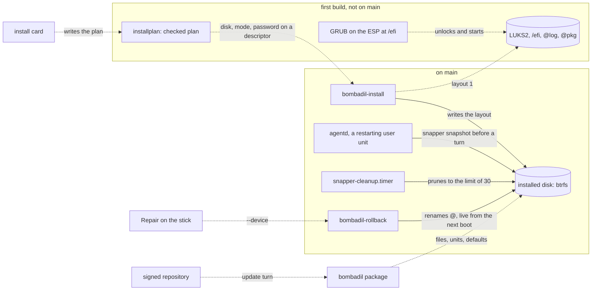

# The installed OS

> **Status:** Partly shipped. On `main`: the installer takes the kernel from the system it copies and turns on lingering for `user`, so that coding sessions outlive the session that started them, restore points are made for snapper's number cleanup, with a limit of 30 that its cleanup timer enforces and no hourly ones, and `agentd`, the bar and `mako` restart as user units. Only on the first-build branch, which is not on `main`: the encrypted layout, the guided install, the refresh, `bombadil-rollback --device`, remote control, the GRUB screen and the extra test modes. Designed only: the install card, packages, the repository, updates, repair, and the rest of piece 4.  
> **Code:** on `main` it builds on `iso/airootfs/usr/local/bin/bombadil-install`, `iso/airootfs/usr/local/bin/bombadil-rollback`, `iso/airootfs/usr/local/bin/bombadil-setup`, `iso/airootfs/usr/local/bin/bombadil-smoke`, `iso/packages.x86_64`, `iso/profiledef.sh`, `scripts/build-iso.sh`, `scripts/test-vm.sh`, `scripts/wsl-vm.sh`, `src/bombadil/snapshots.py`, `src/bombadil/agentd.py`, `src/bombadil/launcher.py`, `src/bombadil/providers.py`, `src/bombadil/sysmap.py`, `iso/airootfs/etc/greetd/config.toml`, `iso/airootfs/etc/skel/.config/hypr/hyprland.lua`, `iso/airootfs/etc/systemd/`, `share/grub/bombadil/`, `tests/test_iso_profile.py` and `tests/test_snapshots.py`. The first build is on an open draft pull request and is not on `main`; the branch already contains `main` at `7176e55`. Its files are named under "On the first-build branch".  
> **Design:** [Bombadil, installed](../design/installed-os-brief.md), [the page](../design/pages/bombadil-installed.html)  
> **Verified:** 2026-11-09 against `main` at `ca7f80a`, the commit every `file:line` for `main` below is read at. The unmerged first build was not read again on that date: what the page says of it was read on 2026-11-08 at its tip `7b856d1` (its files and its diff against `main`), a merge commit that already holds `main` at `7176e55`: it is 17 commits ahead of `main` at that commit and none behind. The files only the branch owns are the same as at `0863ba3`, the branch's tip before the merge. Its tests and its VM modes were not run, and `main`'s tests and VM checks were read, not run, for this page.

The installed OS is meant to be Bombadil as a system a person installs on a disk, the way they would install Debian or Windows, and not only as a system that runs from a USB stick. The stick will be the door: it will try, install, repair, reinstall and erase (designed), and everything that lasts will live on the installed machine. It exists because every earlier design (undo, updates as a turn, promises that survive a restart) assumes an installed machine, and because four choices cannot be changed by an update once strangers have installed: the disk layout, encryption, where GRUB lives, and which files a package owns.

The work stands in three states. The branch name is in the [roadmap](../roadmap.md); the commits below let you read it without the name (`git show 7b856d1:<path>`).

| State | What it holds |
|---|---|
| **On `main`** (`ca7f80a`) | The plain installer (`bombadil-install DISK [--yes]`: GPT, a btrfs root with `@`, `@home`, `@snapshots`, the ESP at `/boot`); the kernel taken from the system being copied, which is the first commit of piece 1; `bombadil-rollback N`; restore points made with `--cleanup-algorithm number` under a limit of 30 that `snapper-cleanup.timer` (turned on) enforces, with no hourly ones; `agentd`, the bar and `mako` as restarting user units; lingering for `user`, which the installer turns on; turn numbers and the session id that last across a restart of the daemon; `MODE=installed` in `scripts/test-vm.sh` and the smoke checks for the units and the pruning. |
| **Only on the first-build branch** (`7b856d1`, not on `main`) | The encrypted layout (LUKS2, the ESP at `/efi`, `@log`, `@pkg`, nested home subvolumes), a guided and a planned install, the refresh that keeps the home, `bombadil-rollback --device`, the GRUB screen, `bombadil remote`, the stick's extra packages, and the test modes and tests for them. |
| **Designed only** (no code anywhere) | The install card (piece 3), packages (2), hardware on the stick (5), the repository (6), updates as a turn (7), a start that puts itself back (8), next to Windows (9), repair, reinstall and erase from the stick (10), a copy somewhere else (11), Secure Boot and TPM (12), a Bombadil you carry (13), and the rest of piece 4: the other timers, the 100 changed pairs, the lid lock and greetd's password. |

## How it works

### On `main` at `ca7f80a`

`bombadil-install DISK [--yes]` is one bash script of 98 lines, run by hand from the live image. Before it touches the disk it finds the kernel in the root it is about to copy, `/usr/lib/modules/*/vmlinuz`, and stops if there is none (`bombadil-install:14-15`); it does not read the boot medium (`/run/archiso/bootmnt`), which copy-to-RAM unmounts. It makes a GPT disk with a 1 GiB ESP and a btrfs root with `@`, `@home` and `@snapshots` (`:16-23`), copies the running live system with `cp -ax /. /mnt/` (:32), mounts the ESP at `/boot` and copies the kernel onto it (:39-41), so the kernel and its initramfs (:48-52) are still outside every restore point. It writes `fstab` so `/` mounts by the name `@` (:43-46), makes a snapper config `root` for `/` and none for `/home` (:67), and runs `grub-install --removable` (:79) without calling `efibootmgr`, which the brief reads as GRUB on the fallback path only. Only `.claude`, `.claude.json`, `.codex` and `.config/bombadil` come along from the live home (:84-88). The result has an empty password for `user` (:60), lingering turned on for `user` (:61-63; the installer deletes `bombadil-live.service` from the copy at :35-38, and on the stick that unit runs `loginctl enable-linger user`), no encryption, UTC and the host name `bombadil` (:56-57), and no file under `/usr/share/bombadil` that a package owns (`scripts/build-iso.sh:11-23`). The installer has no time zone question: the system prompt tells the agent to set the zone with `sudo timedatectl set-timezone <Area/City>` when the person names their zone or city (`src/bombadil/providers.py:48-49`), and nothing records that choice.

Retention is set up, and the timer does the pruning. The installer runs `snapper -c root set-config TIMELINE_CREATE=no NUMBER_CLEANUP=yes NUMBER_LIMIT=30` and enables `snapper-cleanup.timer` (:71-72), and `Snapshots.create` passes `--cleanup-algorithm number` (`src/bombadil/snapshots.py:45-46`), so each turn's restore point is one snapper may prune, the limit its cleanup timer enforces is 30, and no hourly ones are taken. Nothing is deleted when a restore point is made, so more than 30 can exist between two runs of the timer, and the smoke checks the config and the timer, not a deletion ([restore points](restore-points.md#retention-and-pruning)). `@.undone-*`, which `bombadil-rollback` leaves at the top level (:13-14), is pruned by nothing, and the brief's 100 changed pairs are not built.

`agentd`, the bar and `mako` are user units with `Restart=always`, started by the Hyprland start hook (`hyprland.lua:9-10`); [the session stays alive](session-services.md) owns that design. Turn numbers last across restarts (`src/bombadil/agentd.py:299-300`), and so do the session id and the session's model, which `agentd` keeps in `$XDG_RUNTIME_DIR/bombadil/agentd-state.json` (:402-425): a restart of the daemon by systemd keeps the conversation, a reboot does not, and a later login does not either where lingering is off (with lingering the runtime directory outlives a logout, which is systemd's behaviour; [what a restart keeps](session-services.md#what-a-restart-keeps-and-loses)). Coding sessions run in scopes of their own, which lingering keeps through a compositor crash or a logout ([the session stays alive](session-services.md#coding-sessions-stay-alive), [coding sessions](coding-sessions.md)). See [ISO and install](iso-and-install.md) and [restore points](restore-points.md).

### On the first-build branch (read at `7b856d1`, not on `main`)

The branch rewrites `bombadil-install` as sourced functions (1,045 lines) and adds `src/bombadil/installplan.py`, `src/bombadil/remote.py`, `install/carry.list`, `iso/airootfs/usr/local/bin/bombadil-grub-config`, `iso/airootfs/etc/grub.d/000_bombadil_screen`, boot entries `04` and `05`, and `tests/test_installer.py`, `tests/test_installplan.py` and `tests/test_remote.py`. It also changes `bombadil-rollback`, `bombadil-smoke`, `scripts/test-vm.sh`, `scripts/build-iso.sh`, `scripts/wsl-vm.sh`, `scripts/build-in-container.sh`, `iso/packages.x86_64`, `iso/profiledef.sh`, `src/bombadil/launcher.py`, `src/bombadil/snapshots.py` (it gains `label_from_hook`, which `bombadil snapshot --hook` uses), `bin/bombadil`, `share/grub/bombadil/README.md`, `scripts/vm-tools/README.md`, the link that enables `systemd-timesyncd` (`iso/airootfs/etc/systemd/system/sysinit.target.wants/systemd-timesyncd.service`) and the tests `tests/test_boot_console.py`, `tests/test_iso_profile.py` and `tests/test_launcher.py`; it carries its own `docs/INSTALLED-OS.md` too. The branch contains `main` (its tip is a merge commit), so it has everything `main` has: the user units, `--cleanup-algorithm number` in `Snapshots.create` and `MODE=installed`. What follows is what the branch adds or changes.

- **Ways to run it.** With no argument at a terminal it asks which disk, a password twice, a time zone and a computer name, then the disk's name typed in full (`guided`). `--plan FILE [--password-fd N]` is what the card will run. `DISK [--yes]` still means no password and no encryption. `--refresh DISK` replaces the system and keeps the home. The word "install" in the pill opens the terminal flow in the details drawer, on the stick only (`launcher.py` `_install`).
- **Guards (`probe`).** It refuses without `/sys/firmware/efi`, the disk the stick started from (found from `archisosearchuuid` on the kernel command line, so it holds after copy-to-RAM), an install image, a disk with anything mounted and a disk under 16 GB. `installplan --disks` lists the disks and says why one is not offered. A disk with Windows on it is offered with a note and erased like any other once its name is typed; a refresh refuses it.
- **Layout.** GPT with the ESP at `/efi`. With a password, p2 is LUKS2 (argon2id, 256 MiB, 1000 ms) with three keyslots: the password, a random key file in the initramfs (pbkdf2) and a recovery key from `systemd-cryptenroll`; each is tried with `cryptsetup open --test-passphrase` before the filesystem is made. btrfs `@`, `@home`, `@snapshots`, `@log`, `@pkg`, and nested subvolumes in `@home` (`HOME_SUBVOLS`: `.cache`, `.local/state/bombadil`, `.claude`, `.codex`, `.local/share/claude`, `.config/chromium`, `.local/share/bombadil/browser`, `Projects`). `fstab` names disks by UUID and `/` by the subvolume name `@`.
- **Boot.** The kernel comes from the image's `/usr/lib/modules/*/vmlinuz` (`newest_kernel`, the rule `main` has in two lines) into `@/boot`, with a default and a fallback initramfs (`systemd`, `microcode`, `sd-encrypt`, and `/etc/crypttab` with `x-initrd.attach`). GRUB's core, modules and `grub.cfg` are on the ESP, written by `grub-install` twice (`--bootloader-id=Bombadil`, then `--removable`) and `bombadil-grub-config`, which also cuts GRUB's "Loading" lines. `000_bombadil_screen` and the font and `background.png` the installer puts on the ESP set the mark behind the password prompt. `verify` reads it back before the install is called done: every kernel module, `grub.cfg` opening the disk just locked, the key inside the initramfs.
- **Account and records.** One password for the disk and `user`; none leaves `user` without one, as on `main`. It writes `/var/lib/bombadil/install.json`, keeps the recovery key in `/var/lib/bombadil/recovery-key` (mode 600) and prints it once at the end of a guided install. snapper gets configs `root` and `home` (`TIMELINE_CREATE=no`, `NUMBER_CLEANUP=yes`, `NUMBER_LIMIT=30`), and `snapper-cleanup.timer`, `fstrim.timer` and `systemd-timesyncd` are enabled. Restore point one is "Bombadil <version>, as installed"; programs installed on the stick come as a second one from the stick's package cache (`replay_stick_packages`).
- **Refresh.** It reads and checks first (no `@`, `@home` or `@snapshots`, no home, Windows, or under 10 GB free is refused), renames `@` and `@snapshots` to `@.before-refresh-<stamp>` and `@snapshots.@.before-refresh-<stamp>`, copies a fresh system into `@`, keeps the name, zone, locale, keymap, machine id, Wi-Fi, SSH host keys, key file, recovery key and the account's password hash, lists the programs the old system had that the image lacks in `/var/lib/bombadil/refresh-<stamp>.txt`, and empties the ESP last without reformatting it. A stop before the boot files change puts the old system back; a later stop leaves `var/lib/bombadil/install-incomplete` and the next run starts over from the system still aside.
- **Undo from outside.** `bombadil-rollback --device DEV N|refresh` makes the snapshot beside `@` first and swaps it in with `mv --exchange` where the system has it. It refuses a restore point with no kernel of its own when the system on the disk keeps its kernel in `/boot` (layout 1; `bombadil-rollback:60-62`), so a system from before layout 1, whose kernel is on the ESP, is not refused. `refresh` puts back the newest whole `@.before-refresh-*`, refuses one with no `boot/vmlinuz-linux` (:47), and keeps the other as `@.after-refresh-<stamp>`.
- **Stick and build.** `cryptsetup`, `amd-ucode`, `intel-ucode`, `parted` and `tmux` join the packages; `systemd-timesyncd` is enabled; `build-iso.sh` ships `install/` and a `VERSION` file, drops boot entries `02` to `09` unless `BOMBADIL_TEST_ENTRIES` is set, and reads the image back (`verify_image`); `profiledef.sh` drops `-E ztailpacking`, whose comment says erofs-utils 1.9.4 zeroed the last block of some files.
- **Remote control (outside the brief).** `bombadil remote [start [FOLDER]|status|url|show|stop]` runs Claude Code's `claude remote-control` in a detached `tmux` session `bombadil-remote`, in `~/Projects/remote`, with permission questions off and a `UserPromptSubmit` hook that runs `bombadil snapshot --hook` (a restore point labelled `turn: remote: <prompt>`). The word "remote" in the pill starts it.
- **Where it differs from the brief.** `/etc/crypttab` instead of `/etc/crypttab.initramfs`; the password slot costs 1000 ms where the brief says 2 to 3 seconds; one more nested subvolume (`.local/share/bombadil/browser`); the old snapshots are `@snapshots.@.before-refresh-<stamp>`; the terminal flow asks four things where the card will ask two.

### Designed only

Each item is decided in the brief and has no code anywhere, on `main` or on the branch.

- **Packages.** A pacman package will own every file Bombadil ships: the tree at `/usr/share/bombadil`, commands in `/usr/bin` (`build-iso.sh:16` links eleven at the Verified commit, including `bombadil-signal`, `bombadil-mail` and `bombadil-mail-host`), units in `/usr/lib/systemd`, with the two provider CLIs installed by `npm` as the one exception until piece 7. Defaults will live in `/usr` and change with each update, and the person's own settings will be short files that load them. A file another package owns will change by a numbered step, or by a drop-in. Existing installs will move by one refresh, never by `pacman --overwrite`.
- **The install card.** The chip "Install on this computer" will open a card that draws the disks as bars, never offers the stick or a disk in use, and asks for one password. Time zone, keyboard, computer name and what comes along will be one line each with "change". The red button will name the disk, and no model call will sit between it and the disk: the agent may fill the card and never press it.
- **The rest of "months, not minutes".** The brief decides more than `main` has: `paccache.timer` and a monthly scrub; a daily timer that prunes `@.undone-*` and `@.before-refresh-*` older than 14 days; `smartd`; swap on zram; the screen locking on lid close; greetd's `default_session` asking for the password, so a crash or a logout never reopens an unlocked desktop; and retention of 100 changed pairs where `main` sets a limit of 30 restore points.
- **Repository, updates, repair.** Stage one will be a local `/etc/pacman.d/bombadil.conf` with `SigLevel = Optional TrustAll` that nothing public reads; stage two a signed public repository on a release tagged `repo`, a `bombadil-keyring` package and a workflow that builds, signs and tests before it uploads (testing first, stable after 3 days with no revert). "update" will install the two keyrings, run `-Su` inside one restore point, then the numbered layout steps, and say what needs a restart. Installing one program will not upgrade the system, which will change the prompt line at `src/bombadil/providers.py:45`; `main` keeps `-Syu` there and only makes the agent say, in one plain sentence before it runs, that it also updates every other package (`:45-47`, asserted at `tests/test_iso_profile.py:28-31`). A start that fails twice will put itself back; a disk that will not start will get Repair, "Reinstall, keep my files" and Erase from the stick.

### How the parts connect

Solid lines exist on `main`. Dotted lines are not on `main`: the plan, the layout, GRUB at `/efi` and `--device` are built in the first build, and the card, the package, the repository and Repair are designed only.

### The thirteen pieces

The pieces of the brief, in its order (effort S, M or L, from the brief):

| # | Piece | Effort | State |
|---|---|---|---|
| 1 | The disk that lasts: layout v1, and a refresh that keeps your home | L | Partly shipped. On `main`: the kernel comes from the copied system (`bombadil-install:14-15`), the brief's first commit. On the first-build branch, not on `main`: the layout, encryption, plan, guards, refresh, `--device` and the tests. Not built: `bombadil-vm refresh` still updates in place (`scripts/wsl-vm.sh:153`). Nothing of the branch was run here. |
| 2 | Bombadil as packages, with homes that follow its releases | M to L | Designed. |
| 3 | The install card | M to L | Designed. The branch has the terminal flow, `installplan --disks` and the pill word; no card, chip, `install` message or tool. It builds on `capture_disks`, `CardHost.qml` and `PasswordField.qml`, which are on `main`. |
| 4 | Months, not minutes | M | Partly shipped. On `main`: restore points made with `--cleanup-algorithm number` under a limit of 30, no hourly points and `snapper-cleanup.timer` to enforce the limit (`bombadil-install:71-72`, `snapshots.py:45-46`); `agentd`, the bar and `mako` as restarting user units; turn numbers across restarts (`agentd.py:299-300`). Designed only: the rest, as listed above. |
| 5 | Hardware on the stick | S to M | Designed. The branch adds microcode and `cryptsetup`; none of the brief's hardware packages is in `iso/packages.x86_64`. |
| 6 | The signed repository and the download page | M | Designed. There is no `.github/` directory and no workflow. |
| 7 | Updates as a turn | M | Designed (passenger piece 6, which no piece of work owns). |
| 8 | A start that fails puts itself back | M to L | Designed. |
| 9 | Next to Windows | L | Designed. It comes after whole-disk installs (the owner's answer to question 3, 30 Sep 2026). |
| 10 | Repair, reinstall and erase from the stick | M | Designed. Reinstall is piece 1's `--refresh`; `bombadil-rollback --device` is on the branch, not on `main`. |
| 11 | A copy somewhere else, and a move to another computer | L | Designed. |
| 12 | Secure Boot and TPM | M to L | Designed. |
| 13 | A Bombadil you carry | S | Designed. Most of it arrives with pieces 1 and 3; the branch records `target_kind` (`internal` or `usb`). |

### Decided and still open

- **Order (the brief).** Pieces 1 and 2 first, because they are what no later update can fix (the disk, and the path every later fix travels). Pieces 3 to 6 must all land before any public download. Until then only the owner installs, through the terminal and a VM. See [build these first](../design/installed-os-brief.md#build-these-first) and [after these, in order](../design/installed-os-brief.md#after-these-in-order).
- **Decided by the owner on 30 Sep 2026.** A locked disk by default, a full Bombadil on a USB drive as well as the stick, and whole disks first with next to Windows after.
- **Still open.** The geo-IP service, whether the Claude Code binary may be redistributed, the ISO staying under 4 GiB, and the clock when travelling. The brief marks the Argon2 cost (256 MiB, 1000 ms on the branch), the offline replay of the stick's packages and GRUB opening the slot as unmeasured or untested; the branch's VM modes are written and were not run here.

## Interfaces other pieces depend on

**What the design builds on in `main`**

| Existing piece | What the design does there |
|---|---|
| `bombadil-install:16-23`, `:43-46`, `:67` | On `main`: GPT, `@`, `@home`, `@snapshots`, `fstab` by subvolume name, snapper config `root`. The branch adds `@log`, `@pkg`, nested home subvolumes and LUKS2 and keeps `bombadil-install DISK --yes` for `bombadil-smoke:508` and `scripts/wsl-vm.sh:108`. |
| `bombadil-install:14-15`, `:39-41`, `:48-52`, `:74-80` | On `main`: the kernel found in the copied root, the ESP at `/boot` with the kernel and a `default` initramfs preset on it, hidden GRUB menu, `grub-install --removable`. The branch moves the ESP to `/efi`, puts the kernel in `@/boot` and adds a named firmware entry and a `fallback` image. |
| `bombadil-install:56-64`, `:84-88`, `bombadil-setup:6`, `:24`, `:30` | On `main`: UTC, host name `bombadil`, `passwd -d user`, lingering for `user` (`:61-63`), `greetd NetworkManager` enabled, four carried paths (`bombadil-setup` writes `~/.config/bombadil/config.toml` when `agentd` is not running, `:6`, `:24`, and restarts the `agentd` unit, `:30`). The branch takes password, zone and name from a plan, enables timesyncd and reads the carry paths from `carry.list`. |
| `bombadil-rollback:7`, `:13-15` | Finds the root with `findmnt -no SOURCE /`, moves `@` to `@.undone-<time>`, snapshots `@snapshots/N/snapshot` into `@`. The branch adds `--device`; piece 8 will do the same rename in the initramfs. |
| `src/bombadil/snapshots.py:34`, `:40-47`, `:66`, `bombadil-install:71-72` | `available` needs `snapper` and `/etc/snapper/configs/root`; `create` runs `snapper create --print-number --cleanup-algorithm number`, so snapper may prune the restore point; the installer sets `NUMBER_LIMIT=30` and no hourly points and enables `snapper-cleanup.timer`; `rollback` runs `bombadil-rollback`. Piece 4 will build the rest on this (100 changed pairs, pruning `@.undone-*`). |
| `src/bombadil/agentd.py:298-300`, `:402-425`, `:1548-1549`, `:1556`, `:1779`, `:2283` | `session_id` starts empty (`:298`) and is kept with the session's model in `$XDG_RUNTIME_DIR/bombadil/agentd-state.json` (`:402-425`), so a restart of the daemon keeps the conversation, and a reboot or an install does not (a later login does not either where lingering is off); the turn count is read back from `turns.jsonl` and the `turn` marker file at start (`:299-300`); the `setup` message carries `actions` (`:1548-1549`), which `_describe` builds (`:1556`) and `setup_action` answers (`:1779`); the restore point description is `turn:<n>: ` and the first 60 characters of the prompt (`:2283`). Piece 3 will add an `install` action and save `session_id` where a reboot and the install keep it. |
| `src/bombadil/launcher.py:734`, `:787-788`, `:937`, `:989-994` | `undo.json` marker, "Undo starts once Bombadil is installed" when `/run/archiso` exists, `_battery`, and `_lock`, which needs `hyprlock`, in no package list. Pieces 1, 3 and 4 will use or change them. |
| `src/bombadil/providers.py:45-49` | The prompt line for installing programs: `sudo pacman -Syu --noconfirm --needed`, never `-Sy` alone, and a plain sentence first that it updates every other package (`:45-47`). Piece 7 will change that line itself. The prompt also says the agent can set the time zone with `sudo timedatectl set-timezone <Area/City>` when the person names it (`:48-49`); on `main` nothing records the choice, and `timezone_source` in `install.json` is first build only. |
| `src/bombadil/sysmap.py:767`, `shell/CardHost.qml`, `share/qml/Bombadil/PasswordField.qml:15` | `capture_disks` reads `lsblk` (no `TRAN` or `PKNAME`) and `findmnt`; `CardHost` holds one picture; `PasswordField` hides text. Piece 3 will build the card on them. |
| `iso/airootfs/etc/greetd/config.toml`, `iso/airootfs/etc/sudoers.d/bombadil` | `initial_session` and `default_session` run `start-hyprland` (through `systemd-cat`) as `user`; `user` has `NOPASSWD: ALL`. Piece 4 will change `default_session`; the agent's sudo will stay. |
| `iso/airootfs/etc/skel/.config/hypr/hyprland.lua:7-18`, `:71`, `:103`, `bombadil-install:59` | Copied into the home once, so an edit reaches no installed home. The `hyprland.start` hook imports the session's environment and restarts the `agentd`, bar and `mako` user units (`:10`), starts `foot --server` for the coding sessions' windows (`:12`, no unit), then hands Mail's unit its display variables and restarts it (`:13-16`); Super+Ctrl+Escape restarts the shell unit (`:71`); line 103 sends Thunderbird's windows to a hidden workspace; the window rule `bombadil-sessions` (`:82-90`) floats and centres a coding session's window. The skel skill links (`.claude/skills`, `.agents/skills`) are copied once too. Piece 2 will turn the file into a stub that loads a shipped part. |
| `iso/airootfs/etc/systemd/user/bombadil-agentd.service`, `bombadil-shell.service`, `mako.service.d/restart.conf`, `bombadil-brain.service:13`, `bombadil-mail.service:14`, `iso/airootfs/etc/systemd/system/bombadil-brain-watch.service:19` | The brain and mail units and the brain watcher are `Restart=on-failure`; the brain and mail units start with the user manager (`default.target.wants`): at boot where lingering is on, at the first login otherwise. The `agentd`, shell and `mako` units are `Restart=always`, have no `default.target.wants` link and are started by the Hyprland hook. All the user units set `StartLimitIntervalSec=0` under `[Unit]`. Piece 2 will move the `ExecStart` of the units that run Bombadil's own commands (`agentd`, the shell, the brain, the brain watcher and mail) from `/usr/local/bin` to `/usr/bin` and give them to the package; the `mako` drop-in sets no `ExecStart`, because the unit itself comes from the `mako` package. See [the session stays alive](session-services.md). |
| `src/bombadil/brain/watch.py:8-19`, `tests/vm/btrfs-kernel.sh:1-5` | The watcher mounts the top level (`subvolid=5`) privately and maps `/@home` back to `/home`, so nested subvolumes under `/home` are covered; the VM test lays out `@`, `@home` and `@snapshots` as `bombadil-install` does on `main`, plus a nested `@home/user/Projects`. |
| `scripts/build-iso.sh:11-23`, `iso/pacman.conf`, `iso/airootfs/etc/systemd/system/pacman-init.service:7-8` | The tree is copied into the image, eleven commands are linked from `/usr/local/bin`, `npm` fills `/usr`; `[core]` and `[extra]` only; a bare `pacman-key --populate`. Pieces 2 and 6 will add `[bombadil]` and a keyring. |
| `iso/packages.x86_64:4-10`, `iso/profiledef.sh:10` | `grub`, `efibootmgr`, `btrfs-progs`, `snapper` and `linux-firmware` are listed; microcode and `cryptsetup` are not; boot is UEFI only. `thunderbird` is listed (`:52`), and so is `zellij` (`:33`), which the coding sessions run in. `iso/airootfs/etc/thunderbird/policies/policies.json` is a file Bombadil ships in `/etc`. |
| `iso/efiboot/loader/entries/`, `scripts/test-vm.sh:35`, `:75`, `scripts/wsl-vm.sh:91` | Entry 03 installs to `/dev/vda` without asking (`bombadil.smoke=install`, run at `bombadil-smoke:508`); the ISO is a `-cdrom`, and the test VMs boot OVMF with no persisted variables (a read-only code image at `test-vm.sh:35`, `-bios` at `wsl-vm.sh:91`). `wsl-vm.sh refresh` is an in-place update, not the installer's `--refresh`. |
| `share/grub/bombadil/` | Theme and background exist; nothing on `main` installs them, although the README in that folder describes the installer doing so. |

**Interfaces of the first build and of the designed pieces**

The status column says where each one is: "first build" is on the branch and not on `main`; "planned" is designed only.

| Name | What it is | Status |
|---|---|---|
| `bombadil-install --plan FILE [--password-fd N]` | JSON plan with the keys `disk`, `mode`, `timezone`, `timezone_source`, `keymap`, `hostname`, `carry`, `encrypt`, `kind`; `src/bombadil/installplan.py` refuses a `password` key, unknown keys and a carry path not on `carry.list`; the password never goes in argv or the plan | first build |
| `bombadil-install` with no argument, `python3 -m bombadil.installplan --disks` | The guided flow at a terminal (`bombadil-install DISK [--yes]` stays as on `main`); the list of disks and why one is not offered | first build |
| `bombadil-install --refresh DISK [--yes] [--password-fd N]` | A fresh system under the same home; old `@` and `@snapshots` kept as `@.before-refresh-<stamp>` and `@snapshots.@.before-refresh-<stamp>`; extra programs in `/var/lib/bombadil/refresh-<stamp>.txt` | first build |
| `bombadil-rollback --device DEV N\|refresh` | For the stick; refuses a restore point with no kernel of its own when the system on the disk keeps its kernel in `/boot` (`bombadil-rollback:60-62`) | first build |
| `bombadil-grub-config`, `/etc/grub.d/000_bombadil_screen` | Writes `/efi/grub/grub.cfg` (`BOMBADIL_GRUB_CFG` overrides) and cuts GRUB's "Loading" lines; the font and picture before the password prompt | first build |
| `BOMBADIL_TEST_ENTRIES=1`, `MODE=install-encrypted`, `MODE=refresh OLD_ISO=...`, `BOMBADIL_INSTALL_LEAVE_MOUNTED`, `BOMBADIL_INSTALL_GRUB_SERIAL` | Test boot entries, `scripts/test-vm.sh` modes and installer switches for the VM tests (`MODE=update` is planned). `MODE=installed`, which boots the disk the last install run left, is on `main` (`scripts/test-vm.sh:7`, `:80-87`). | first build |
| `bombadil remote ...`, `bombadil snapshot [--hook]`, the words `remote` and `install` | Remote control and a restore point by hand or from a hook; the pill words | first build |
| `{"type": "install", "plan": ...}`, setup action id `install`, `install_card(disk, keep_windows, size)` | The card's socket message (`agentd` runs `!sudo bombadil-install --plan ...`) and the `os-mcp` tool that fills the card and cannot press it | planned |
| `where()` in `src/bombadil/system.py` | Returns "live", "installed" or "dev" | planned |
| `packaging/bombadil/PKGBUILD`, `bombadil.install`, `/usr/share/bombadil/migrate/NNN-*.sh` | The package, and numbered steps for files other packages own | planned |
| `src/bombadil/homefix.py`, `hyprland.lua.before-split` | Numbered home steps run by `agentd`, the old file kept aside | planned |
| `/etc/pacman.d/bombadil.conf`, `bombadil-keyring` | Repository servers and keys | planned |
| `bombadil-boot-ok.service`, `boot_ok` in `grubenv`, kernel argument `bombadil.rollback=N` | Bad-start rollback | planned |

## Where state lives

| Where | What it holds | State |
|---|---|---|
| `/etc/snapper/configs/root`, `snapper-cleanup.timer` | The `root` config with `NUMBER_LIMIT=30` and `TIMELINE_CREATE=no`, written by the installer (`bombadil-install:67-72`) | on `main` |
| `@snapshots`, mounted at `/.snapshots` | The restore points (`bombadil-install:46`, `:96`) | on `main` |
| `@.undone-<time>` at the btrfs top level | The root an undo replaced (`bombadil-rollback:13-14`); nothing prunes it | on `main` |
| `/boot` (the ESP) | The kernel, the initramfs and GRUB, outside every restore point | on `main`; the branch moves it to `/efi` and `@/boot` |
| `iso/airootfs/etc/systemd/user/` on the image, `/etc/systemd/user/` on the installed system | The `agentd`, shell, `mako`, brain and mail user units; the installer copies the live `/etc` | on `main` |
| `/etc/claude-code/managed-settings.d/50-bombadil.json`, `/etc/codex/config.toml`, `/etc/codex/requirements.toml` | The hooks of the coding tools that run `bombadil-signal`, so the dots beside the pill follow a session; they arrive with the copied `/etc` ([coding sessions](coding-sessions.md#the-hooks)) | on `main` |
| `/var/lib/systemd/linger/user` | Lingering for `user`: the user's systemd, and with it the coding sessions' scopes, keeps running after a compositor crash or a logout. The installer touches it (`bombadil-install:61-63`); on the stick `bombadil-live.service` runs `loginctl enable-linger user`. A machine installed before those lines has no such file ([the session stays alive](session-services.md#updating-a-running-system)) | on `main` |
| `$XDG_RUNTIME_DIR/bombadil/agentd-state.json` | Provider, session id and session model; survives a restart of the daemon, not a reboot (`agentd.py:402-425`) | on `main` |
| `~/.local/state/bombadil/` (`turns.jsonl`, `turn`, `undo.json`) | The turn log, the number of the last turn begun, and the undo marker (`agentd.py:300`, `launcher.py:734`) | on `main` |
| `/var/lib/bombadil/install.json` | `layout`, `date`, `image_version`, `mode`, `encrypted`, `target_kind`, `timezone`, `timezone_source` (`detected`, `chosen`, `unset`), `packages_brought`, `recovery_key_pending`, `kept_aside` | first build |
| `/var/lib/bombadil/recovery-key`, `/var/lib/bombadil/install-incomplete` | Recovery key (mode 600, until the first-start card has shown it, which does not exist); marker of an install that stopped | first build |
| `@.before-refresh-<stamp>`, `@snapshots.@.before-refresh-<stamp>`, `@.after-refresh-<stamp>`, `/var/lib/bombadil/refresh-<stamp>.txt` | The system a refresh put aside, the one a rollback put aside, and the programs the image lacks | first build |
| `/usr/share/bombadil/install/carry.list`, `/usr/share/bombadil/VERSION` | One home path per line, read by the installer; the image's date and commit | first build |
| `/etc/mkinitcpio.conf.d/bombadil.conf`, `/etc/crypttab`, `/etc/cryptsetup-keys.d/root.key`, `/etc/default/grub.d/bombadil.cfg` | Initramfs, unlock and GRUB screen files written by the installer | first build |
| `/efi/grub/` | GRUB's core, modules, `grub.cfg`, `grubenv`, the font and the picture | first build |
| tmux session `bombadil-remote`, `~/Projects/remote` | The remote-control session and its folder | first build |
| `~/.local/state/bombadil/session.json` | `agentd`'s `session_id`, kept across a reboot and the install | planned |
| `~/.local/state/bombadil/home.json` | The record of the numbered home steps | planned |
| `/etc/pacman.d/bombadil.conf` | Repository servers | planned |

## Principles it keeps

- [Full access with undo](../principles.md#full-access-with-undo): the password will be no wall between the agent and the machine (`user` keeps `NOPASSWD: ALL`), and undo will take the kernel back. The trap is a layout that leaves the kernel and initramfs outside the root undo swaps (as the ESP at `/boot` does on `main`), or that leaves logs or the package cache inside it.
- [Recovery without the broken part](../principles.md#recovery-without-the-broken-part): undo, bad-start rollback and Repair will need no network, model or desktop; `bombadil-rollback --device`, in the first build and not on `main`, needs none. The trap is a Repair that calls `agentd`, or a rollback list kept in a file rewritten on the FAT ESP.
- [Nothing runs unseen](../principles.md#nothing-runs-unseen): updates will happen on the person's word, as a turn, with a receipt; on `main` the agent is already told to say, before an install that updates every package, that it does. The trap is a timer that installs updates, or a card step that erases a disk without naming it.
- [Plain files stay the truth](../principles.md#plain-files-stay-the-truth): `install.json` and `carry.list` (first build, not on `main`) and short user files that load shipped defaults (designed) are the records. The trap is state only a database holds, or an update that rewrites a file in the person's home.
- [Records before models](../principles.md#records-before-models): the disk list reads `lsblk` (`capture_disks` on `main`, `installplan --disks` in the first build) and the card's probe will add `blkid` and the battery, with no model. The trap is a model call on the path that erases a disk.
- [Stupidly simple](../principles.md#stupidly-simple): the card will ask two questions, which disk and one password. The trap is a partition editor or a settings screen, or carrying the terminal flow's four questions over to the card.

## Extending it

**Carry one more path from the live home into an installed system**

1. On `main`: add the path to the `for f in ...` list at `bombadil-install:84`.
2. In the first build, not on `main`: add one line to `install/carry.list`. `installplan.py` reads that file and refuses a `carry` entry that is not on it, and `carry()` in the branch's `bombadil-install` copies the entries that exist on the stick.

**Keep a nested subvolume in the home out of home restore points** (first build, not on `main`)

1. Add the path, relative to the home, to `HOME_SUBVOLS` in the branch's `bombadil-install`.
2. `prepare_home` makes it with `make_subvolume`, which copies a folder that already has files into a subvolume beside it and swaps it in, so a stop leaves the files where they were.

**Keep a different number of restore points** (`main`)

1. Change `NUMBER_LIMIT` at `bombadil-install:71`. Only an install made afterwards gets the value; an installed machine keeps its own `/etc/snapper/configs/root`.
2. Update the two places that name 30: `tests/test_iso_profile.py:151-156` and the smoke check `snapshots-are-pruned` (`bombadil-smoke:550`). See [restore points](restore-points.md) for the readers' limits (what undo can reach).

**Make another service come back when it dies** (`main`)

1. Add `iso/airootfs/etc/systemd/user/<name>.service` with `Restart=always`, `RestartSec=1` and `StartLimitIntervalSec=0` under `[Unit]`, as the three units do ([the session stays alive](session-services.md)).
2. Add its name to the `systemctl --user restart` line of the `hyprland.start` hook (`hyprland.lua:10`).
3. Add it to the unit list in `test_the_daemon_the_bar_and_the_notifications_come_back_when_they_die` (`tests/test_iso_profile.py:118-131`) and to `units_active` and a `revives` check in `bombadil-smoke` (`:227-233`).

**Keep these when you change `bombadil-install`**

- `bombadil-install DISK --yes`, which `bombadil-smoke` and `scripts/wsl-vm.sh` run.
- The name-based mount of `/` and the `@` swap in `bombadil-rollback`.
- The text that tests read on `main`. `tests/test_iso_profile.py:52-76` runs the GRUB loop that sits before `grub-install`; `tests/test_boot_console.py:100-105` needs `cp -ax /. /mnt/` before `mkdir -p /mnt/boot`; `tests/test_iso_profile.py:151-156` asserts `set-config TIMELINE_CREATE=no NUMBER_CLEANUP=yes NUMBER_LIMIT=30`, `systemctl enable snapper-cleanup.timer` and `create-config` before `set-config`; `:159-166` asserts `cp "$kernel" /mnt/boot/vmlinuz-linux`, the `kernel=$(ls -d /usr/lib/modules/*/vmlinuz` line before `sgdisk -Z "$disk"`, and no `bootmnt`. The branch's rewrite (`install -Dm644 "$kernel" "$target/boot/vmlinuz-linux"`, `newest_kernel`, `snapper_setup`) changes those lines, and the branch's `tests/test_iso_profile.py` and `tests/test_boot_console.py` already read the new ones (the GRUB loop test moved to `tests/test_installer.py`).
- The lingering line (`mkdir -p /var/lib/systemd/linger && touch /var/lib/systemd/linger/user`, `:61-63`): the installer deletes `bombadil-live.service`, which turns lingering on for the stick, so without this line an installed machine has none. Only the smoke's `dev-linger` reads it back; no unit test pins it.
- The `-Syu` prompt line and its sentence (`tests/test_iso_profile.py:28-31`), which piece 7 will change.
- `bombadil.smoke` as the last argument of entry 02, which `scripts/wsl-vm.sh:97` edits.
- The account `user` and `/home/user`.

## Tests

On `main`, read and not run for this page:

- `tests/test_iso_profile.py` reads the image's files and the installer by text: the three restart units (`:118-131`), the start hook that imports the session's environment before it restarts them (`:134-141`), `bombadil-setup` restarting `agentd` through `systemctl --user restart bombadil-agentd` and `bombadil provider` printing that command for the person to run when `agentd`'s socket is not there (`bin/bombadil:448`; the test at `:144-148` only checks that both files contain the text), the snapper limit and timer (`:151-156`) and the kernel rule (`:159-166`).
- `tests/test_snapshots.py:16` checks that `create` passes `--cleanup-algorithm number`. `tests/test_providers.py:284` checks that the prompt tells the agent how to set the time zone. `tests/test_agentd.py` covers the state kept across a restart of the daemon (`:197`, `:222`, `:302`), where the state file lives and what it ignores (`:245`, `:253`), and turn numbers across restarts (`:1240`).
- `bombadil-smoke` checks the units in three ways (`:227-233`). `agentd-comes-back`, `bar-comes-back` and `notifications-come-back` kill the unit's process and wait for a new one. `agentd-answers-again` and `bar-layer-again` wait for the daemon to answer and for the bar's layer to be back. `services-are-units` checks that the three units are active. On the installed system it also checks `snapshot-is-prunable` and `snapshots-are-pruned` (`:549-550`) before the undo; the second reads the config and the timer, and does not wait for a deletion. `dev-linger` (`:260`, in every mode) asks `loginctl show-user user -p Linger` and so covers the installer's lingering line on the installed disk; [the session stays alive](session-services.md#tests) lists the other checks of the coding sessions.
- `MODE=install scripts/test-vm.sh` installs to a scratch disk, boots it and tests undo; `MODE=installed scripts/test-vm.sh` boots the disk the last install run left, for an undo round trip that was cut short (`scripts/test-vm.sh:6-7`, `:80-87`). Both need an ISO from `scripts/build-iso.sh`.
- Run the Python tests with `pytest tests/test_iso_profile.py`, one file at a time ([developing](../contributing/development.md)).

On the first-build branch, written and not run here: `tests/test_installer.py` sources the installer's functions with the disk tools replaced by shims; `tests/test_installplan.py` and `tests/test_remote.py` cover the plan and remote control. `tests/test_iso_profile.py` gains checks that the stick carries the packages the installer calls, that `systemd-timesyncd` is enabled in the image, that the image is built without `ztailpacking` and read back, and that every script added to the path or to GRUB is executable; `tests/test_launcher.py` gains the words `install` and `remote`. `scripts/test-vm.sh` gains `MODE=install-encrypted` and `MODE=refresh OLD_ISO=...` and attaches the ISO as a USB disk with 8 GB; `bombadil-smoke` gains the modes `install-encrypted`, `refresh` and `refreshed`, and `layout_checks`. Still to run: the brief's VM checks (`findmnt -R /run/archiso` on a USB-attached ISO with 8 GB, GRUB opening an Argon2 slot, the offline replay) and a refresh from an older image.

## Known gaps

- **Pruning stops at the restore points.** `@.undone-*` is pruned by nothing on `main` (`bombadil-rollback:13-14`). On the branch nothing prunes `@.before-refresh-*` either, although the guided refresh says the old system is kept for 14 days, and nothing deletes `/var/lib/bombadil/recovery-key`.
- **The installer on `main` is the plain layout.** No encryption, an empty password for `user`, and the kernel on the ESP outside every restore point (`bombadil-install:39-41`, `:60`).
- **`bombadil-vm refresh` updates in place.** It does not call the installer's `--refresh` (`scripts/wsl-vm.sh:153`).
- **The GRUB theme is wired by neither.** `main` installs nothing from `share/grub/bombadil/`, and the branch installs `background.png` and the font but not `theme.txt`.
- **Locking needs a package.** `launcher._lock` needs `hyprlock`, which no package list has (`launcher.py:989-994`).
