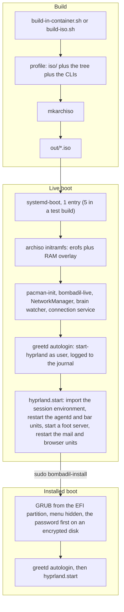
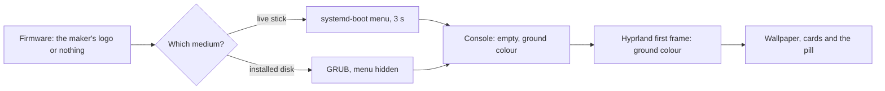
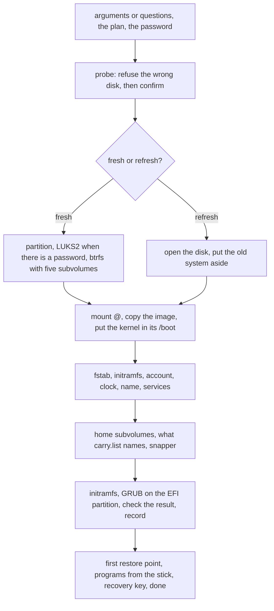
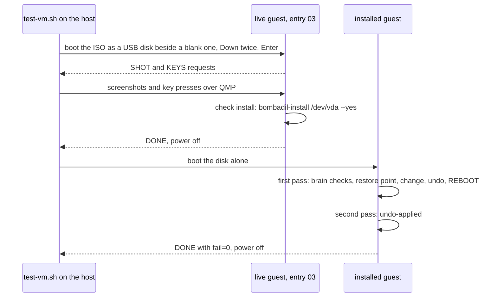

# ISO and install

> **Status:** Shipped  
> **Code:** `iso/profiledef.sh`, `iso/packages.x86_64`, `iso/pacman.conf`, `iso/airootfs/`, `iso/efiboot/loader/`, `iso/airootfs/etc/default/grub.d/zz-bombadil-console.cfg`, `iso/airootfs/etc/systemd/user/bombadil-agentd.service`, `iso/airootfs/etc/systemd/user/bombadil-shell.service`, `iso/airootfs/etc/systemd/user/bombadil-brain.service`, `iso/airootfs/etc/systemd/user/bombadil-mail.service`, `iso/airootfs/etc/systemd/user/bombadil-browserd.service`, `iso/airootfs/etc/systemd/system/bombadil-connect.service`, `iso/airootfs/usr/lib/sysusers.d/bombadil-connect.conf`, `iso/airootfs/etc/skel/.config/hypr/hyprland.lua`, `iso/airootfs/etc/thunderbird/policies/policies.json`, `iso/airootfs/etc/systemd/system/bombadil-live.service`, `iso/airootfs/etc/claude-code/managed-settings.d/50-bombadil.json`, `iso/airootfs/etc/codex/config.toml`, `iso/airootfs/etc/codex/requirements.toml`, `iso/airootfs/usr/local/bin/bombadil-install`, `iso/airootfs/usr/local/bin/bombadil-setup`, `iso/airootfs/usr/local/bin/bombadil-smoke`, `iso/airootfs/usr/local/bin/bombadil-rollback`, `iso/airootfs/usr/local/bin/bombadil-grub-config`, `iso/airootfs/etc/grub.d/000_bombadil_screen`, `install/carry.list`, `src/bombadil/installplan.py`, `scripts/build-iso.sh`, `scripts/build-in-container.sh`, `scripts/console-palette.py`, `scripts/make-wallpaper.py`, `scripts/qmp.py`, `scripts/run-vm.sh`, `scripts/test-vm.sh`, `scripts/dev-session.sh`, `scripts/wsl-vm.sh`, `scripts/bombadil-vm.cmd`, `scripts/vm-tools/update-in-place`, `share/grub/bombadil/`, `share/zellij/config.kdl`, `tests/test_iso_profile.py`, `tests/test_boot_console.py`, `tests/test_installer.py`, `tests/test_installplan.py`, `tests/vm/btrfs-kernel.sh`  
> **Design:** [Foundation choices, sections 1 to 3](../design/foundation-choices.md#1-base-distro--arch); [Boot and the wallpaper](../design/boot-and-wallpaper.md) (the reasoning for the quiet console, with before and after pictures); [Bombadil, installed](../design/installed-os-brief.md) (the redesign of the installer and the disk: Partly shipped, and [Installed OS](installed-os.md) says which parts are on `main`); [Mail, in Bombadil's own view](../design/everyday-work-brief.md#1-mail-in-bombadils-own-view) (why Thunderbird is on the image); [Messages and connections](../design/messages-and-connections.md) (what the connection service needs on the machine; [the piece](connect.md) and [its contract](../CONNECT.md) say how it works); [Coding sessions](coding-sessions.md) and [Building on Bombadil](../design/dev-brief.md) (what `zellij`, the hook files, the `foot` server and lingering are for)  
> **Verified:** 2026-11-09 against `main` at `ca7f80a`; the changes since, up to `7d37bc5`, were added and checked on 2026-11-12 and read again on 2026-11-13 (the dated paragraphs below say what each check covered)

The ISO is an archiso profile in `iso/`. `scripts/build-iso.sh` fills it with the repository's own tree and the two provider CLIs and hands it to `mkarchiso`. The image boots a live Hyprland session that is also the installer's source: `bombadil-install` copies the system image under the live overlay onto a GPT disk with a btrfs root, inside LUKS2 when a password is given, so that undo has subvolumes to swap from the first install ([What `bombadil-install` does](#what-bombadil-install-does)). From the boot loader to the desk the console is set to print nothing and to use the design system's ground colour ([Boot and the console](#boot-and-the-console-from-power-on-to-the-desk)). The image also carries what [Mail](mail.md) needs on the machine: Thunderbird, its policy file, a user unit and a skill ([What the image adds for mail](#what-the-image-adds-for-mail)). It carries the user units that keep `agentd` and the bar running, which Hyprland's start hook restarts with the session's environment ([What the image adds for the session's services](#what-the-image-adds-for-the-sessions-services); [Session services](session-services.md) owns the reasons), and no notification daemon: the bar answers for the session bus's notification name. For [coding sessions](coding-sessions.md) it carries `zellij`, the managed hook files of Claude Code and Codex, a `foot` server, a window rule and lingering for `user` ([What the image adds for coding sessions](#what-the-image-adds-for-coding-sessions)). For [Messages and connections](connect.md) it carries a system unit that runs the connection service as an account of its own, a user unit for the browser service, two Python packages and a skill ([What the image adds for connections](#what-the-image-adds-for-connections)). A kernel argument turns the same image into a self-test, `bombadil-smoke`, which the VM scripts judge from the serial log.

[Foundation choices](../design/foundation-choices.md#1-base-distro--arch) gives the reasons for the shape: Arch, because the agent works best with a plain, imperative system (`pacman -S`, edit a file, restart a service); btrfs with snapper as the undo that stands in for a permission wall; Hyprland first; and a VM as the first target, with an ISO meant to boot real hardware too (nothing in the repository records a boot on hardware, see [Known gaps](#known-gaps)).

Shipped means the build, the live boot, the quiet console, the session's user units, the image's parts for coding sessions and for connections, the installer as coded on `main` (a guided, a planned and a whole-disk install, plain or encrypted, and a refresh that keeps the home folder), the smoke test and the QEMU and Windows launchers, checked by `tests/test_iso_profile.py`, `tests/test_boot_console.py`, `tests/test_installer.py`, `tests/test_installplan.py`, the hook-file test in `tests/test_dev.py` and by the smoke test in a VM. The redesign of the installed system is Partly shipped: its layout, the planned and guided install, the refresh, the GRUB screen and the restarting user units are on `main`; the install card, Bombadil as packages and the rest of the brief are Designed. [Installed OS](installed-os.md) says which parts are on `main` and owns the detail, and [What the installer does not do yet](#what-the-installer-does-not-do-yet) lists what is left.

The change from `ca7f80a` to `f0485c2` was added and checked on 2026-11-09, and the rest of the page was not read again: the installer carrying the desk's places and what Tips has taught, the smoke's eight checks of the name and voice card, the line numbers that moved (the smoke after line 458 by 25 lines, the installer from line 85 by 2, and the anchors into `agentd.py`, `launcher.py` and `paths.py`), and the counts that follow. It was checked by reading both scripts, which pass `bash -n`, and by running `tests/test_iso_profile.py` (34 tests, all passed); no ISO was built and no VM was booted.

The change from `f0485c2` to `24c836c` was added and checked on 2026-11-09, and the rest of the page was not read again: the connection service's system unit, its account and its link, the browser service's user unit and its link, the two packages added and `mako` taken out with its drop-in, the start hook without `mako` and with the browser service, the new section on what the image adds for connections, the skill's links, the smoke's 21 new checks and the one it dropped (`notifications-come-back`), the counts that follow, the dev session's connection service, and the line numbers that moved (the smoke after line 29, the start hook and the rules in `hyprland.lua`, `iso/packages.x86_64`, and the anchors into `agentd.py` and `launcher.py`). It was checked by reading the two unit files, the sysusers file, the package list, the smoke, `scripts/build-iso.sh` and `scripts/dev-session.sh`, the three scripts passing `bash -n`, and by running `tests/test_iso_profile.py` (46 tests, all passed, the one that runs `systemd-sysusers` on a scratch root among them); no ISO was built and no VM was booted.

The change from `24c836c` to `7d37bc5` was added and checked on 2026-11-12, and the rest of the page was not read again: the installer's layout and its guided, planned, encrypted and refresh forms, `bombadil-grub-config` and the GRUB screen, the carry list, the packages added (`cryptsetup`, `parted`, `amd-ucode`, `intel-ucode` and `tmux`) and the `systemd-timesyncd` link, the build's `install/` copy, version file, test entries only in test builds and read-back of the image, the erofs options, boot entries 04 and 05, the smoke's added modes and groups (the idle cost, the layout checks, the encrypted install, the refresh), the modes of `scripts/test-vm.sh` and the changes to `scripts/wsl-vm.sh`, the pill's global shortcuts and `bombadil terminal`, the tests, and the line numbers that moved (every anchor into the installer, the smoke, `scripts/test-vm.sh`, `scripts/build-iso.sh`, `iso/profiledef.sh`, `iso/packages.x86_64`, `hyprland.lua`, `snapshots.py`, `launcher.py`, `agentd.py` and `bin/bombadil`). It was checked by reading the installer, `bombadil-rollback`, `bombadil-grub-config`, `000_bombadil_screen`, the smoke, the three VM scripts, the two build scripts, the package list and the boot entries, those scripts passing `bash -n`, and by running `tests/test_iso_profile.py` (51 tests), `tests/test_boot_console.py` (8), `tests/test_snapshots.py` (1), `tests/test_installer.py` (114 passed, 3 skipped because `shellcheck` is not installed), `tests/test_installplan.py` (50), `tests/test_remote.py` (39), `tests/test_brand.py` (5), the two ISO tests of `tests/test_brain_service.py` and the `managed_hooks` test of `tests/test_dev.py`, all passing. No ISO was built and no VM mode was booted, so what the page says about LUKS, GRUB, btrfs, snapper and the VM modes is what the code and its tests say, not something seen on a disk.

The same state, `7d37bc5`, was read again on 2026-11-13: the function table against the installer line by line, the smoke's modes, groups and check counts against the script (the 117 common checks and the totals of 181, 182, 146, 146, 150, 157, 120 and 165 were counted again), the boot entries, and the `file:line` references into the installer, the smoke, the VM and build scripts, `hyprland.lua` and the Python sources. `tests/test_iso_profile.py` (51), `tests/test_boot_console.py` (8), `tests/test_installplan.py` (50), `tests/test_snapshots.py` (1), `tests/test_brand.py` (5) and `tests/test_installer.py` (114 passed, 3 skipped) were run again and pass. Eight statements were corrected: the lines of Mail's paths, what `refresh_open` changes, the restore points of the `home` snapper config, the recovery key's first start (nothing shows it), whose `undo.json` `carry` removes, which of the three idle slices the check judges, what `tests/desktop/idle.py` holds to 10 percent, and what `layout-carry-list` looks at. Nothing was built and no VM mode was booted.

On this page a reference such as `bombadil-install:594` or `bombadil-smoke:727` means line 594 of `iso/airootfs/usr/local/bin/bombadil-install` or line 727 of `iso/airootfs/usr/local/bin/bombadil-smoke`; the same holds for `bombadil-setup`, `bombadil-rollback` and `bombadil-grub-config`. Every other path is relative to the repository root, unless a table says otherwise. Every line number is as of `7d37bc5`.

## How it works

### From the repository to an installed machine



| Stage | What happens | Section below |
|---|---|---|
| Build | The profile is assembled in a work directory and `mkarchiso` writes one ISO to `out/`. | The build |
| Live boot | UEFI firmware starts systemd-boot, archiso mounts the image with a RAM overlay, systemd creates the session user, greetd logs it in, and Hyprland's start hook restarts the user units that run `agentd` and the bar. Nothing on the live system survives power-off. | Boot flow |
| Quiet start | From the boot loader to the desk the console is set to print nothing and to use the desk's ground colour. | Boot and the console |
| First run | With no provider chosen, `agentd` asks in the pill which AI to use and signs in through the browser panel. When the sign-in turns ready and there is no `persona.toml`, the pill then asks for a name and a voice. | Boot flow |
| Install | `bombadil-install` asks which disk (or reads a plan, or takes a disk name), erases it, copies the system image onto btrfs, inside LUKS2 when there is a password, brings what `install/carry.list` names from the live home, and installs GRUB. `--refresh` replaces the system on a disk that has Bombadil and keeps its home folder. | What `bombadil-install` does |
| Installed boot | GRUB boots straight in (an encrypted disk asks for its password there, once), greetd logs `user` in, and the same Hyprland session starts. | Boot flow |

### The build

`scripts/build-iso.sh` reads `WORK` (default `/tmp/bombadil-work`) and `OUT` (default `out/` in the repository root) and does these things.

| Step | What | Where |
|---|---|---|
| 1 | Deletes and recreates `$WORK/profile`, then copies `iso/` into it with `cp -a`. | `scripts/build-iso.sh:8-10` |
| 2 | Copies `bin`, `src`, `shell`, `share`, `install` and `iso/packages.x86_64` into `airootfs/usr/share/bombadil/` of the profile: the whole tree, so the live system and the installer both have it. `install/` holds `carry.list`, the home paths the installer brings along. | `scripts/build-iso.sh:11-14` |
| 3 | Writes `VERSION` into that folder: the date (from `SOURCE_DATE_EPOCH`, else the current time) and the short commit (from `BOMBADIL_COMMIT`, which `scripts/build-in-container.sh` passes because the container cannot read the checkout, else `git rev-parse`, else `unknown`). The installer records it and names the first restore point after it. | `scripts/build-iso.sh:15-18` |
| 4 | Unless `BOMBADIL_TEST_ENTRIES` is set, deletes the boot entries `02` to `09` from the profile (`rm -f .../0[2-9]-*.conf`), so a release has the one entry that boots, and the entries that run the VM tests are only in builds made for them. | `scripts/build-iso.sh:19-23` |
| 5 | Links `agentd`, `bombadil`, `bombadil-app`, `bombadil-browser`, `bombadil-os-mcp`, `bombadil-shell`, `bombadil-signal`, `bombadil-brain`, `bombadil-brain-watch`, `bombadil-mail`, `bombadil-mail-host`, `bombadil-connect` and `bombadil-browserd` in `airootfs/usr/local/bin` to `/usr/share/bombadil/bin/<name>`. The five scripts `bombadil-setup`, `-install`, `-smoke`, `-rollback` and `-grub-config` are real files in `iso/airootfs/usr/local/bin`. | `scripts/build-iso.sh:24-27` |
| 6 | Unless `BOMBADIL_NO_CLIS` is set, runs `npm install -g --no-fund --no-audit --allow-scripts=@anthropic-ai/claude-code --prefix <profile>/airootfs/usr @anthropic-ai/claude-code @openai/codex`, so both CLIs are in the image and first run only has to sign in. The line sets `--allow-scripts` for `@anthropic-ai/claude-code` only. | `scripts/build-iso.sh:28-32` |
| 7 | Runs `mkarchiso -v -w $WORK/build -o $OUT <profile>`. | `scripts/build-iso.sh:33` |
| 8 | Reads the image back (`verify_image`): takes `airootfs.erofs` out of the newest ISO with `xorriso`, mounts it read-only and compares it with the tree `mkarchiso` built from (`diff -rq`), and stops with an error when a file differs. It runs only as root, with `xorriso` and that tree there, and prints a `Note:` line saying the image was not read back when it cannot. | `scripts/build-iso.sh:35-56` |

`scripts/build-in-container.sh` runs that script inside an `archlinux:base` container (`docker`, else `podman`; `CONTAINER_RUNTIME` and `BOMBADIL_BUILD_IMAGE` override). The container is `--privileged`, mounts the repository at `/src`, installs `archiso git nodejs npm`, and builds with `WORK=/tmp/bombadil-work OUT=/src/out`. It passes the proxy variables, host networking when `BOMBADIL_HOST_NET` is set, and a pacman cache when `PACMAN_CACHE` names a directory. It also passes `BOMBADIL_COMMIT` (the checkout's short commit, `unknown` when git cannot answer) and, when set, `BOMBADIL_TEST_ENTRIES` (`scripts/build-in-container.sh:18-20`). An `SSL_CERT_FILE` is mounted into the container and also set there as `CURL_CA_BUNDLE` and `NODE_EXTRA_CA_CERTS`. `SOURCE_DATE_EPOCH` defaults to the time of the last commit (the current time when git cannot answer), so the ISO's label and version carry the commit's date.

`iso/profiledef.sh` is the archiso profile definition.

| Setting | Value |
|---|---|
| `iso_name`, `iso_publisher`, `iso_application` | `bombadil`, `Bombadil`, `Bombadil live` |
| `iso_label`, `iso_version` | `BOMBADIL_<YYYYMM>` and `<YYYY.MM.DD>`, both from `SOURCE_DATE_EPOCH` or the current time |
| `bootmodes` | `uefi-x64.systemd-boot.esp` and `uefi-x64.systemd-boot.eltorito`: x86_64 UEFI only, no BIOS boot |
| `install_dir`, `arch` | `arch`, `x86_64` |
| `airootfs_image_type`, `airootfs_image_tool_options` | `erofs`, with `-zlzma,109` and no `-E ztailpacking`: the comment at `iso/profiledef.sh:14-15` says erofs-utils 1.9.4 wrote zeros over the last block of some incompressible files with it, kernel modules among them, and nothing complained until a driver failed to load. The build reads the image back and the installer reads every kernel module back for the same reason |
| `pacman_conf` | `pacman.conf`: the configuration `mkarchiso` installs the packages with. It enables `core` and `extra` only, with `SigLevel = Required DatabaseOptional`. |
| `file_permissions` | `/etc/shadow` 0400, `/etc/sudoers.d/bombadil` 0440, the five scripts in `/usr/local/bin` (`bombadil-setup`, `-install`, `-smoke`, `-rollback` and `-grub-config`) and `/etc/grub.d/000_bombadil_screen` 0755 (`iso/profiledef.sh:20-25`), and the directories `/usr/share/bombadil/bin/`, `/usr/lib/node_modules/@anthropic-ai/` and `/usr/lib/node_modules/@openai/` 0755. The comment at `iso/profiledef.sh:26` gives the reason: `mkarchiso` copies airootfs without modes, so everything that runs must be listed. `tests/test_iso_profile.py` holds every file the overlay puts in `usr/local/bin` or `etc/grub.d` to a 0755 line here |

### What the image contains

The 57 packages in `iso/packages.x86_64` (one per line). The file has seven `#` comments, the connections one over two lines. Six name a group (base system, graphics and session, agents, mail, connections, archiso live) and one sits above `poppler`. Three give a reason: the one above `poppler` (`pdftotext` and `pdftoppm`, for the brain's search and first pages), the mail comment (Thunderbird is the engine behind the Mail window, run unseen; it names `docs/MAIL.md`) and the connections comment (the connection service speaks to Slack with `httpx` and to the work tools with the official MCP client, and notifications are the shell's own server, so there is no `mako`; it names `docs/CONNECT.md`). The Group column below is this page's grouping, not the file's:

| Group | Packages | What in the repository uses them |
|---|---|---|
| Base | `base`, `linux`, `linux-firmware`, `amd-ucode`, `intel-ucode` | the system; the two microcode packages are what the installed initramfs's `microcode` hook embeds (`bombadil-install:477`), which is why GRUB's separate early image is switched off (`GRUB_EARLY_INITRD_LINUX_STOCK`, `bombadil-install:550-551`) |
| Disk and install | `btrfs-progs`, `cryptsetup`, `gptfdisk`, `parted`, `dosfstools`, `snapper`, `grub`, `arch-install-scripts`, `mkinitcpio`, `efibootmgr` | `bombadil-install` calls `sgdisk`, `wipefs`, `partprobe`, `mkfs.fat`, `mkfs.btrfs`, `btrfs`, `snapper`, `arch-chroot`, `mkinitcpio`, `lsinitcpio`, `grub-install`, `grub-mkfont` and, through `bombadil-grub-config`, `grub-mkconfig`; with a password also `cryptsetup` and `systemd-cryptenroll`. It writes `/etc/fstab` itself and does not call `genfstab`. No script in `iso/` or `scripts/` calls `parted` or `efibootmgr` (`partprobe` is in the `parted` package, which is Arch's packaging and not something a file here shows); `grub-install --bootloader-id=Bombadil` is what makes the firmware entry. `tests/test_iso_profile.py` holds the list to what the installer calls |
| Network and access | `networkmanager`, `sudo`, `git`, `openssh` | NetworkManager is enabled; `sudo` carries the passwordless rule. `openssh` is installed and no `sshd` unit is enabled. |
| Session | `hyprland`, `xdg-desktop-portal-hyprland`, `greetd`, `quickshell`, `qt6-wayland`, `qt6-declarative`, `qt6-5compat` | the compositor, the autologin (`start-hyprland`) and the bar |
| Runtime | `pyside6`, `python`, `python-pip`, `python-cryptography` | `agentd`, generated apps, the kit's `Vault` (`src/bombadil/appkit/native/vault.py`) |
| Desktop tools | `grim`, `slurp`, `wl-clipboard`, `libnotify`, `foot`, `tmux`, `zellij`, `nautilus` | `grim` (screenshots, `src/bombadil/hypr.py`), `wl-clipboard` (`wl-copy`, which puts a reply's words on the clipboard for a web page's notification, `src/bombadil/notifications.py:49`), `libnotify` (`notify-send`, `src/bombadil/mcp_server.py:131`; the smoke's `notification-becomes-a-notice` runs it as a page's stand-in), `foot` (the terminal panel, the details drawer's terminal programs, `SUPER + Return`, which runs `bombadil terminal` and so a plain `foot` (`src/bombadil/hypr.py:227-251`), and the viewer window of a coding session: `footclient --no-wait` against the server `hyprland.lua` starts, or a plain `foot` when no server socket exists, `src/bombadil/dev.py`), `zellij` (the invisible host of a coding session, `src/bombadil/dev.py`; [What the image adds for coding sessions](#what-the-image-adds-for-coding-sessions)), `tmux` (the detached session that keeps `claude remote-control` running, `src/bombadil/remote.py:182-183`; [Installed OS](installed-os.md#remote-control-and-the-restore-point-by-hand)), `nautilus` (the files panel). No repository code calls `slurp`. The list has no notification daemon: the bar's own server answers on the session bus ([What the image adds for connections](#what-the-image-adds-for-connections)). |
| Browser | `chromium` | the browser panel |
| Documents | `poppler` | `pdftotext` for the brain's text search (`src/bombadil/brain/describe.py`) and `pdftoppm` for the first page of a PDF in the Brain window (`share/apps/brain/app.py`); both are looked up with `shutil.which` ([the brain](brain.md)) |
| Sound | `pipewire`, `pipewire-audio`, `pipewire-alsa`, `pipewire-pulse`, `wireplumber`, `alsa-utils`, `sof-firmware` | the `audio-output` smoke check |
| Fonts | `inter-font`, `noto-fonts`, `noto-fonts-emoji` | `Theme.fontFamily` is `Inter` |
| Agents | `nodejs`, `npm` | the provider CLIs run on node; `bombadil-setup` installs a missing one with `npm` |
| Mail | `thunderbird` | the engine Mail runs unseen (`src/bombadil/mail/engine.py` starts it); [What the image adds for mail](#what-the-image-adds-for-mail) |
| Connections | `python-mcp`, `python-httpx` | the connection service's two libraries: `httpx` for Slack's Web API (`src/bombadil/connect/slack.py`) and the official MCP client for the work tools (`src/bombadil/connect/mcpconn.py`), which imports `httpx2` as well (that `python-mcp` brings it is a statement about that package, which no file here shows; the smoke's `connect-python-installed` imports it); [What the image adds for connections](#what-the-image-adds-for-connections) |
| Live image | `mkinitcpio-archiso`, `archinstall` | `mkinitcpio-archiso` provides the `archiso` initramfs hook. No script in the repository calls `archinstall`. |

On top of the packages the image holds:

- the Bombadil tree at `/usr/share/bombadil` (`bin`, `src`, `shell`, `share`, `install`, `packages.x86_64` and `VERSION`) and the links in `/usr/local/bin`;
- the two provider CLIs under `/usr` (an npm prefix: `/usr/lib/node_modules/@anthropic-ai/`, `/usr/lib/node_modules/@openai/`);
- the overlay in `iso/airootfs/`, catalogued under Interfaces below.

### What the image adds for mail

[Mail](mail.md) owns the service, the add-on, the window and the tools. The image owns what has to be on the machine before the first login. The service, the add-on and the window come with the tree (`src/bombadil/mail/`, `share/mail/extension/`, `share/apps/mail/`), not with the overlay.

| What | Where | What it does |
|---|---|---|
| `thunderbird` | `iso/packages.x86_64:56` | the engine. `src/bombadil/mail/engine.py:620-624` finds the program named by `BOMBADIL_MAIL_THUNDERBIRD`, else `thunderbird` on `PATH`, and `start` (line 714) runs it |
| Policy file | `iso/airootfs/etc/thunderbird/policies/policies.json` | `DisableAppUpdate`, `DisableTelemetry` and `DontCheckDefaultClient`, each `true`: no update check, no telemetry, no question about being the default mail program |
| User unit | `iso/airootfs/etc/systemd/user/bombadil-mail.service`, enabled by a link in `etc/systemd/user/default.target.wants/` | runs `/usr/local/bin/bombadil-mail` for the user's systemd manager. `Restart=on-failure`, `RestartSec=2`, `StartLimitIntervalSec=0` (it is never given up on), `Nice=5` (behind the desktop) |
| Session hook | the `hyprland.start` handler in `iso/airootfs/etc/skel/.config/hypr/hyprland.lua:15-18` | `systemctl --user import-environment WAYLAND_DISPLAY HYPRLAND_INSTANCE_SIGNATURE XDG_CURRENT_DESKTOP && systemctl --user restart bombadil-mail.service`. The unit starts at login, before the session has a screen, and Thunderbird needs one |
| Window rule | rule `mail-engine`, `hyprland.lua:111-115` | a window whose class matches `(?i)^(.*\.)?thunderbird.*$` opens on `special:mail-engine silent`: never focused, and a workspace that is not in `hypr.PANELS`, so nothing offers or toggles it |
| Program links | `scripts/build-iso.sh:25` | `bombadil-mail` and `bombadil-mail-host` in `/usr/local/bin`; Thunderbird starts the host for the add-on (`bin/bombadil-mail-host`) |
| Skill | links `iso/airootfs/etc/skel/.claude/skills/bombadil-mail` and `.agents/skills/bombadil-mail` | both point at `/usr/share/bombadil/share/skills/bombadil-mail`, the skill for the five `mail_*` tools, for Claude and for Codex |

With no account the service runs and does not start Thunderbird (its status reads "Mail is off until an account is added.", `src/bombadil/mail/service.py:405,2054`). The image holds no account, no Thunderbird profile and no mail data. By default the profile is `~/.local/share/bombadil/mail`, the database `~/.local/state/bombadil/mail.db` and the attachment files `~/.local/state/bombadil/mail` (`src/bombadil/paths.py:125-136`). The installer copies `/etc`, so the unit, its link, the policy file and the skills links reach an installed system with no change to `bombadil-install`; it does not carry those home folders ([Known gaps](#known-gaps)).

### What the image adds for the session's services

[Session services](session-services.md) owns why the daemon and the bar are units and what the person sees when one dies. The image owns the unit files and the hook that starts them.

| What | Where | What it does |
|---|---|---|
| Agent daemon unit | `iso/airootfs/etc/systemd/user/bombadil-agentd.service` | runs `/usr/local/bin/agentd`. `Restart=always`, `RestartSec=1`, `KillMode=process` (the apps the daemon started keep running when only the daemon restarts), `TimeoutStopSec=5`; `StartLimitIntervalSec=0` under `[Unit]`, so a daemon that keeps failing is never given up on |
| Bar unit | `iso/airootfs/etc/systemd/user/bombadil-shell.service` | runs `/usr/local/bin/bombadil-shell`, the wrapper that starts Quickshell on `shell/shell.qml` with the kit's QML module on its import path (`bin/bombadil-shell`). `After=bombadil-agentd.service`, `Restart=always`, `RestartSec=1`, `TimeoutStopSec=5`; `StartLimitIntervalSec=0` under `[Unit]` |
| Session hook | the `hyprland.start` handler, `iso/airootfs/etc/skel/.config/hypr/hyprland.lua:9-10` | `systemctl --user import-environment && systemctl --user restart bombadil-agentd bombadil-shell`. The import comes first because `WAYLAND_DISPLAY` and the Hyprland signature exist only in the session, not in the user manager |
| Restart key | `SUPER + CTRL + Escape`, `hyprland.lua:83` | `systemctl --user restart bombadil-shell`: the bar's own unit restarts, so a second Quickshell does not race the first |

The agentd and shell units have no `[Install]` section and no link in `etc/systemd/user/default.target.wants/`: only the hook starts them, once the session exists. The brain, mail and browser units are the other pattern: a link enables them and they start at login ([mail](#what-the-image-adds-for-mail), [the brain](brain.md), [connections](#what-the-image-adds-for-connections)). `tests/test_iso_profile.py` holds the two restart policies and the hook's order to what is written here, and the smoke test kills each of the two programs and waits for systemd to bring it back (`user services` in [the smoke test](#the-smoke-test)).

### What the image adds for coding sessions

[Coding sessions](coding-sessions.md) owns how a session starts, what the dots beside the pill show and what the hooks report; [Building on Bombadil](../design/dev-brief.md) is the brief. The image owns what has to be on the machine for it. `src/bombadil/dev.py`, the dots and the hook program come with the tree (`src/`, `shell/`, `bin/`), not with the overlay.

| What | Where | What it does |
|---|---|---|
| `zellij` | `iso/packages.x86_64:37` | the invisible host of a session: `dev.py` starts it as `zellij --config <share/zellij/config.kdl> attach --create-background <name>` and attaches the viewer the same way (`src/bombadil/dev.py:428,525`) |
| zellij settings | `share/zellij/config.kdl`, at `/usr/share/bombadil/share/zellij/config.kdl` with the tree | no key bindings, mode `locked`, no frames, no start-up tips, `on_force_close "detach"`, `session_serialization false` and the host notification protocol `osc99`. They are read only through `--config`, so a person's own zellij configuration is not touched |
| Program link | `scripts/build-iso.sh:25` | `bombadil-signal` in `/usr/local/bin`: the program the hooks below run, which hands an event to `agentd` and returns at once (`bin/bombadil-signal`) |
| `foot` server | the `hyprland.start` handler, `hyprland.lua:13-14` | `hl.exec_cmd("foot --server")`, so a session's window opens through `footclient` and rises at once. It is a plain process, not a unit ([Principles](#principles-it-keeps)). Without the server's socket (`$XDG_RUNTIME_DIR/foot-<WAYLAND_DISPLAY>.sock`), or when `footclient` fails, `dev.py` starts a plain `foot` (`src/bombadil/dev.py:527-531,802-805`) |
| Window rule | rule `bombadil-sessions`, `hyprland.lua:94-102` | a window whose class matches `^(bombadil-session-.*)$` floats, centred, at `(monitor_w*0.86) (monitor_h*0.8)`: large in the middle, clear of the pill. The window is only a viewer: closing it leaves the session running |
| Claude Code hooks | `iso/airootfs/etc/claude-code/managed-settings.d/50-bombadil.json` | nine events: `SessionStart`, `UserPromptSubmit`, `PreToolUse` (matcher `AskUserQuestion`), `PermissionRequest`, `PostToolUse`, `Notification`, `Stop`, `StopFailure` and `SessionEnd`. Each runs `bombadil-signal claude` with `"async": true` |
| Codex hooks | `iso/airootfs/etc/codex/requirements.toml` | seven events: `SessionStart`, `UserPromptSubmit`, `PermissionRequest`, `PostToolUse`, `Stop`, `Interrupt` and `SessionEnd`. Each runs `bombadil-signal codex`: the first five with `async = true`, the last two with `timeout = 2`. The file also sets `check_for_update_on_startup = false`, and its comment says a managed hook runs with no trust prompt |
| Codex settings | `iso/airootfs/etc/codex/config.toml` | `notify = ["bombadil-signal", "codex-notify"]`, `check_for_update_on_startup = false` and `[tui] notification_method = "osc9"`. The file's comment gives the reason these are in `/etc` and that the skel has no `.codex`: a skel copy never updates, and Codex writes project trust into the user's own file |
| Lingering | `bombadil-live.service` (live), `bombadil-install:594` (installed) | the unit (`After=systemd-logind.service`) runs `loginctl enable-linger user`; the installer's chroot block makes `/var/lib/systemd/linger/user`. Lingering keeps the user's systemd manager, and every session's scope in it, running through a compositor crash or a logout |
| Smoke checks | `bombadil-smoke:348-382` | 19 `dev-*` checks, which run in every mode, `undo` included ([the smoke test](#the-smoke-test)) |

That Claude Code reads `/etc/claude-code/managed-settings.d/*.json`, that Codex reads `/etc/codex/config.toml` and `requirements.toml` and runs the hooks set there, and what each setting does in those tools are the vendors' behaviour, and no file here shows it ([Boot flow](#boot-flow) lists them). The smoke's `dev-hooks-parse` parses the Claude Code file and `requirements.toml`, and `test_managed_hooks_cover_the_events_the_dots_need` in `tests/test_dev.py` reads what the three files hold; neither runs either tool.

### What the image adds for connections

[Connect](connect.md) owns the connection service, the browser service, the cards and the agent's tools, and [its contract](../CONNECT.md) says what each side may do. The image owns what has to be on the machine before the first login. The two commands, the code they run and the skill's text come with the tree (`bin/`, `src/bombadil/connect/`, `src/bombadil/browserd/`, `share/skills/bombadil-connect/`), not with the overlay.

| What | Where | What it does |
|---|---|---|
| Python libraries | `iso/packages.x86_64:57-60` | `python-httpx` for Slack's Web API and `python-mcp` for the work tools ([the package table](#what-the-image-contains) says which file uses which) |
| No notification daemon | `iso/packages.x86_64` has no `mako`, and `etc/systemd/user/mako.service.d/restart.conf` is gone | The bar's own notification server answers for `org.freedesktop.Notifications` on the session bus, so a web page's notification reaches the line above the pill; a second owner of the name would take it away. `wl-clipboard` (the card's "Copy and open") and `libnotify` (`notify-send`) stay. `tests/test_iso_profile.py` holds the package list, `hyprland.lua` and the files of the skel, `etc/systemd`, `etc/xdg` and `etc/greetd` free of a notification daemon's name, and no D-Bus service file claims the name |
| System unit | `iso/airootfs/etc/systemd/system/bombadil-connect.service`, enabled by a link in `etc/systemd/system/multi-user.target.wants/` | runs `/usr/local/bin/bombadil-connect` as `User=bombadil-connect`. `Restart=on-failure`, `RestartSec=2`, `StartLimitIntervalSec=0` under `[Unit]` (nothing depends on it, so it is never given up on), `MemoryMax=300M`, `WantedBy=multi-user.target`. Its environment names `BOMBADIL_CONNECT_SOCKET=/run/bombadil-connect/connect.sock` and `BOMBADIL_CONNECT_STATE=/var/lib/bombadil-connect`, which are the defaults of `connect_socket()` and `connect_state()` (`src/bombadil/paths.py:143-150`), where `agentd` and the shell look; a test holds the unit's two values equal to those defaults |
| Its directories | the same unit | `RuntimeDirectory=bombadil-connect` with mode 0755, because `connect.sock` is mode 0666 and the service checks each peer's uid itself, so the person's own programs have to be able to walk to it; `StateDirectory=bombadil-connect` with mode 0700, so only the account opens the database that holds the tokens |
| Its sandbox | the same unit | `NoNewPrivileges`, `ProtectSystem=strict`, `ProtectHome=yes`, `PrivateTmp`, `PrivateDevices`, `ProtectKernelTunables`, `ProtectKernelModules`, `ProtectControlGroups`, an empty `CapabilityBoundingSet`, `RestrictNamespaces`, `RestrictRealtime`, `RestrictSUIDSGID`, `LockPersonality` and `RestrictAddressFamilies=AF_UNIX AF_INET AF_INET6`. It sets no `ProtectProc`, `ProcSubset`, `PrivateUsers` or `PrivatePIDs`: before it performs anything the service reads `/proc/<pid>` of the process that pressed and that process's cgroup, to refuse a press from inside an agent's turn (the unit's comment), and a test holds those four, `PrivateNetwork` and `DynamicUser` out of the file. What each key does is systemd's; the smoke's `connect-unit-hardened` reads seven of them back from the loaded unit |
| Account | `iso/airootfs/usr/lib/sysusers.d/bombadil-connect.conf` | one line, `u bombadil-connect - "Bombadil connections" - -`: a system account with a group of its own, no login and no home. A test reads the line and, where `systemd-sysusers` is installed, runs it on a scratch root and reads back an id under 1000, the home `/` and a `nologin` shell. That systemd makes the account at boot from this file is its behaviour, and the smoke's `connect-user-exists` checks the result on the image |
| Browser service | `iso/airootfs/etc/systemd/user/bombadil-browserd.service`, enabled by a link in `etc/systemd/user/default.target.wants/` | runs `/usr/local/bin/bombadil-browserd` for the user's systemd manager. `After=graphical-session.target`, `Restart=on-failure`, `RestartSec=2`, `StartLimitIntervalSec=0`, `KillMode=process` (a browser it started for a page may be the person's, and keeps running when only the service restarts) |
| Session hook | the `hyprland.start` handler, `hyprland.lua:19-22` | `systemctl --user import-environment WAYLAND_DISPLAY HYPRLAND_INSTANCE_SIGNATURE XDG_CURRENT_DESKTOP && systemctl --user restart bombadil-browserd.service`. The unit starts at login, before the session has a screen, and opening a page for it needs the session's display and its Hyprland instance, as Thunderbird needs a screen for mail |
| Program links | `scripts/build-iso.sh:25` | `bombadil-connect` and `bombadil-browserd` in `/usr/local/bin`; each unit's `ExecStart` is the link of its own name |
| Skill | links `iso/airootfs/etc/skel/.claude/skills/bombadil-connect` and `.agents/skills/bombadil-connect` | both point at `/usr/share/bombadil/share/skills/bombadil-connect`, the skill for the agent's five connection tools, for Claude and for Codex |
| Smoke checks | `bombadil-smoke:35-37`, `125` and `481-553` | 23 checks, 13 of them in every mode, `undo` included ([the smoke test](#the-smoke-test)) |

The image holds no connection and no token: nothing in `iso/` names one. With no connection the service runs and answers a status call with `state` `ok` (the smoke's `connect-unit-answers`). What the account closes is the directory, not the machine: `user` has passwordless `sudo` on this image, so an agent that runs as `user` and uses it can still read the directory, as the unit's comment and the smoke's `connect_state_closed` say too ([Known gaps](#known-gaps)). The installer copies the image's root, so the unit, its link, the sysusers file, the browser unit and the skill links reach an installed system with no change to `bombadil-install`.

### Boot flow

Some statements here and below describe what an upstream tool does, which no file in this repository shows: the `archiso` hook finding the medium, mounting the erofs image and adding the RAM overlay (live row 2); `mkarchiso` replacing `%INSTALL_DIR%` and `%ARCHISO_UUID%` in the boot entries (the boot menu below); `start-hyprland` coming with the `hyprland` package (live row 5); the user's systemd manager starting a unit that has a link in `default.target.wants/` (live row 6); systemd reading `StartLimitIntervalSec` from `[Unit]` and ignoring it under `[Service]` (the session's services section above); `systemd-sysusers` making the connection service's account from `usr/lib/sysusers.d/bombadil-connect.conf` at boot, and systemd applying the `[Service]` keys of that unit, which the smoke reads back with `systemctl show` (the connections section above); systemd matching `ConditionKernelCommandLine=bombadil.smoke` also against `bombadil.smoke=` with a value (`install`, `install-encrypted`, `refresh`, `undo` and `refreshed`; live row 8); `grub-install --bootloader-id=Bombadil` making a firmware boot entry and `--removable` writing `EFI/BOOT/BOOTX64.EFI` (installed row 1); what GRUB, `cryptsetup`, `systemd-cryptenroll` and the `sd-encrypt` hook do with an encrypted disk (installed rows 1 and 3, and [Installed OS](installed-os.md#how-the-disk-is-opened) for the account of it); the kernel line that `grub-mkconfig` writes, its reading of the drop-ins in `/etc/default/grub.d/`, and Arch's own `GRUB_CMDLINE_LINUX_DEFAULT`, which only the test's copy of Arch's defaults shows (`loglevel=3 quiet`, installed row 3); Thunderbird reading the policy file from `/etc/thunderbird/policies/` (the mail section); Claude Code reading `/etc/claude-code/managed-settings.d/*.json`, Codex reading `/etc/codex/config.toml` and `/etc/codex/requirements.toml` and running a hook set there with no trust prompt (the comment in `requirements.toml` says so), `footclient` coming with the `foot` package, `zellij` doing what `share/zellij/config.kdl` asks of it, and systemd honouring a `/var/lib/systemd/linger/user` that the installer made by hand (the coding sessions section; installed row 4); systemd-boot drawing a text menu and printing `Boot in` on the serial console (the boot menu below); what each kernel parameter does in the kernel, and where GRUB's `Loading` lines come from and that no setting hides them (the console section).

**The live ISO.**

| Order | What | Where |
|---|---|---|
| 1 | UEFI firmware starts systemd-boot. `loader.conf` has `timeout 3`, `default 01-bombadil.conf` and `beep off`. | `iso/efiboot/loader/loader.conf` |
| 2 | The kernel and initramfs come from `/arch/boot/x86_64/` on the medium. The `archiso` hook finds the medium by `archisosearchuuid`, mounts the erofs image and puts a RAM overlay over it, capped by `cow_spacesize=2G`. The initramfs is built with `HOOKS=(base udev microcode modconf kms archiso block filesystems keyboard)` and zstd. | `iso/efiboot/loader/entries/`, `iso/airootfs/etc/mkinitcpio.conf.d/archiso.conf`, `iso/airootfs/etc/mkinitcpio.d/linux.preset` |
| 3 | systemd starts. `systemd-firstboot.service` is masked (a link to `/dev/null`), so nothing asks for a locale, time zone or host name. The image already holds `/etc/hostname` (`bombadil`), `/etc/locale.conf` (`en_US.UTF-8`), `/etc/locale.gen`, `/etc/vconsole.conf` (`KEYMAP=us`) and `/etc/localtime` (UTC). | `iso/airootfs/etc/` |
| 4 | `pacman-init.service` runs `pacman-key --init` and `--populate`, ordered `Before=bombadil-live.service`. `bombadil-live.service` (`After=systemd-logind.service`, `Before=greetd.service`) creates `user` (`useradd -m -G wheel,video,input,audio`, which copies `/etc/skel`) if it is missing, runs `passwd -d user` and then `loginctl enable-linger user` ([coding sessions](#what-the-image-adds-for-coding-sessions)). `NetworkManager.service`, `systemd-timesyncd.service` (a link in `sysinit.target.wants/`: the clock), `bombadil-brain-watch.service` (the brain's root file watcher, `After=local-fs.target`) and `bombadil-connect.service` (the connection service, [connections](#what-the-image-adds-for-connections)) are enabled by links. On the live system `/home` is not a btrfs mount, so the watcher logs `not watching` and stays up; the unit's own comment says it is meant to. | `iso/airootfs/etc/systemd/system/`, `src/bombadil/brain/watch.py:1019-1020,1393` |
| 5 | greetd runs. `display-manager.service` is a link to `greetd.service`. `[initial_session]` (and `[default_session]`) run `sh -c 'exec systemd-cat -t hyprland start-hyprland'` as `user` on vt 1 with no greeter. Hyprland's start-up text therefore goes to the journal (`journalctl -t hyprland`) and the console stays empty. | `iso/airootfs/etc/greetd/config.toml` |
| 6 | Hyprland reads `~/.config/hypr/hyprland.lua`. Its `hyprland.start` handler runs `systemctl --user import-environment && systemctl --user restart bombadil-agentd bombadil-shell`: the session's environment first, then the two user units ([the session's services](#what-the-image-adds-for-the-sessions-services)). It starts no notification daemon: the bar answers for the session bus's notification name. It then starts `foot --server` with `hl.exec_cmd`, a plain process through which the coding sessions' windows open ([coding sessions](#what-the-image-adds-for-coding-sessions)), hands `bombadil-mail.service` the session's display variables and restarts it ([mail](#what-the-image-adds-for-mail)), and does the same for `bombadil-browserd.service` ([connections](#what-the-image-adds-for-connections)). The brain's user service `bombadil-brain.service` is not started from there: a link in `etc/systemd/user/default.target.wants/` enables it for the user's systemd manager ([the brain](brain.md)), and `bombadil-mail.service` and `bombadil-browserd.service` have the same link. The agentd and shell units have no link: only the handler starts them. | `iso/airootfs/etc/skel/.config/hypr/hyprland.lua:7-24`, `iso/airootfs/etc/systemd/user/` |
| 7 | First run. `agentd` is "chosen" only when `~/.config/bombadil/config.toml` exists or `BOMBADIL_PROVIDER` is set (`src/bombadil/agentd.py:3474`, `src/bombadil/config.py:35-36`). On a fresh live boot neither is true, so its setup state is `choose` and the pill offers Claude and Codex. The sign-in then opens the provider's page in the browser panel ([browser and sign-in](browser-and-signin.md)). When it turns ready and `~/.config/bombadil/persona.toml` does not exist, `agentd` puts the name and voice card up in place of the "Signed in" line and writes the defaults at once ([the voice](voice.md)); the word `voice` brings the card back. `bombadil-setup` is the terminal fallback. | `src/bombadil/config.py`, `iso/airootfs/usr/local/bin/bombadil-setup` |
| 8 | With `bombadil.smoke` on the kernel line, `bombadil-smoke.service` runs the smoke test: `ConditionKernelCommandLine=bombadil.smoke`, `After=greetd.service`, wanted by `graphical.target`. | `iso/airootfs/etc/systemd/system/bombadil-smoke.service` |

The live image has snapper but no snapper configuration, so `Snapshots.available` is false. When undo is asked there and `/run/archiso` exists, the pill answers "Undo starts once Bombadil is installed. The live system keeps no restore points."; with no `/run/archiso` it answers "Undo is off here: this system keeps no restore points." (`src/bombadil/launcher.py:908-911`; [restore points](restore-points.md)). `iso/airootfs/etc/bombadil/config.toml` sets the system defaults `provider = "claude"` and `snapshots = true`.

> **Warning: the live ISO has a root shell with no password on a serial console.** The drop-in <code>iso/airootfs/etc/systemd/system/serial-getty&#64;ttyS0.service.d/autologin.conf</code> logs in `root` on `ttyS0`. It matters on a boot that has a serial console, which the test entries 02 to 05 add with `console=ttyS0,115200`; `scripts/wsl-vm.sh` relies on it to run the installer without a window. The installer removes the drop-in from the installed system.

**An installed system.**

| Order | What | Where |
|---|---|---|
| 1 | UEFI firmware starts GRUB from the EFI partition: by the firmware entry named `Bombadil` when the firmware kept it, and otherwise from the fallback path `EFI/BOOT/BOOTX64.EFI`, which the second `grub-install` (`--removable`) writes. The first (`--bootloader-id=Bombadil`) only warns when the firmware will not keep an entry; the installer's comment says firmware forgets entries after an update or a flat battery. On an encrypted disk GRUB asks for the password here, on a screen with the mark behind it when the font could be made ([What GRUB shows](installed-os.md#what-grub-shows)). | `bombadil-install:759-763` |
| 2 | GRUB reads `grub.cfg` from the EFI partition (`/efi/grub/grub.cfg`, written by `bombadil-grub-config`). The menu is hidden with a one second timeout, so the machine boots straight in; the installer's comment says the menu appears when Esc is held at power-on. | `bombadil-install:545-548,765`, `iso/airootfs/usr/local/bin/bombadil-grub-config` |
| 3 | The kernel and initramfs come from `/boot` of the root subvolume `@`, so a restore point holds the pair that goes with its modules; GRUB reads them as `/@/boot/...` and the installer checks `grub.cfg` for that. `/efi` holds GRUB itself. The initramfs is the systemd one, with the hooks `base systemd autodetect microcode modconf kms keyboard sd-vconsole block filesystems` (and `sd-encrypt` before `filesystems` on an encrypted disk), made as a default and a fallback image; the `archiso.conf` drop-in is deleted and the preset names no config. The fstab names the disks by UUID and mounts `/` by the subvolume name `@`, without a `subvolid`. The kernel line is `grub-mkconfig`'s own output (`root` and `rootflags` are not readable in the repository) plus the parameters of the `zz-bombadil-console.cfg` drop-in, which the installer copied with the rest of the image ([the console](#boot-and-the-console-from-power-on-to-the-desk)). | `bombadil-install:462-474,476-504,798-813`, `iso/airootfs/etc/default/grub.d/zz-bombadil-console.cfg` |
| 4 | systemd starts with `greetd`, `NetworkManager`, `systemd-timesyncd`, `fstrim.timer` and `snapper-cleanup.timer` enabled. `pacman-init`, `bombadil-live` and the serial autologin are gone. `user` exists with the password the install was given (also the disk's) or, when it was given none, an empty one, and a linger flag (`/var/lib/systemd/linger/user`, which keeps coding sessions running through a compositor crash or a logout). The copy of the image also holds the brain's two units, the mail unit with its link, the browser unit with its link, the connection service's unit with its link, the agentd and shell units, Thunderbird's policy file and the managed Claude Code and Codex files (`/etc/claude-code/managed-settings.d/50-bombadil.json`, `/etc/codex/config.toml` and `/etc/codex/requirements.toml`); `/home` is the btrfs subvolume `@home`, which is what the watcher requires. | `bombadil-install:434-440,450-457,583-605`, `src/bombadil/brain/watch.py:1019` |
| 5 | greetd logs `user` in and starts `start-hyprland` through `systemd-cat -t hyprland`, as in the live boot. Hyprland reads the `hyprland.lua` the installer copied from `/etc/skel`. Its start hook imports the session's environment and restarts the `bombadil-agentd` and `bombadil-shell` units through `systemctl --user`, starts `foot --server`, then restarts the mail and browser units with the session's display. | `iso/airootfs/etc/greetd/config.toml`, `hyprland.lua:7-24` |
| 6 | First run. If the live session had signed in, `~/.config/bombadil/config.toml` came along, `agentd` is chosen and the pill asks nothing. The rest of `~/.config/bombadil` comes with it (`persona.toml`, when the live session made one), and so do the desk's places and Tips' state, `~/.local/state/bombadil/desk.toml` and `tips.json`, so the first week of Tips does not begin again: `install/carry.list` names them, with `.claude`, `.claude.json`, `.codex`, `Apps` and `.config/chromium`, unless a plan carries fewer ([The plan and what comes along](installed-os.md#the-plan-and-what-comes-along)). Otherwise the pill asks, as on the live system. | `bombadil-install:657-680` |

`bombadil-smoke.service` is still installed, but only runs when the kernel line has `bombadil.smoke`; the `undo` smoke mode depends on that.

### The boot menu

A release ISO's systemd-boot menu has one entry, `01-bombadil.conf`. A build made with `BOMBADIL_TEST_ENTRIES=1` has four more, `02` to `05`; without it `scripts/build-iso.sh` deletes `0[2-9]-*.conf` from the profile (`scripts/build-iso.sh:19-23`). Every entry carries `archisobasedir=%INSTALL_DIR% archisosearchuuid=%ARCHISO_UUID% cow_spacesize=2G`; `mkarchiso` fills in the two placeholders.

| Entry file | Menu title | Extra kernel arguments | What it does |
|---|---|---|---|
| `01-bombadil.conf` | `Bombadil` | the nine quiet-console parameters ([the console](#boot-and-the-console-from-power-on-to-the-desk)) | The normal live boot, selected after three seconds, with a quiet console. |
| `02-bombadil-serial.conf` | `Bombadil (serial console, smoke test)` | `console=tty0 console=ttyS0,115200 bombadil.smoke` | A live boot with the console on the screen and on the serial port, running the live smoke mode, then powering off. |
| `03-bombadil-install-test.conf` | `Bombadil (serial console, smoke test and install to /dev/vda)` | `console=tty0 console=ttyS0,115200 bombadil.smoke=install` | The live smoke mode, then `bombadil-install /dev/vda --yes`, then power off. |
| `04-bombadil-install-encrypted-test.conf` | `Bombadil (smoke test: install to /dev/vda with a password)` | `console=tty0 console=ttyS0,115200 bombadil.smoke=install-encrypted` | The common checks, then `bombadil-install --plan` on `/dev/vda` with a fixed test password on a file descriptor, then power off. The host types the password at GRUB on the next start. |
| `05-bombadil-refresh-test.conf` | `Bombadil (smoke test: refresh the Bombadil on /dev/vda)` | `console=tty0 console=ttyS0,115200 bombadil.smoke=refresh` | On a disk an older ISO installed: plants a marker in its home folder and its system, runs `bombadil-install --refresh /dev/vda --yes`, then power off. |

> **Warning: entries 03, 04 and 05 write to a disk without asking.** After their checks they run `bombadil-install /dev/vda --yes` (entry 03, `iso/airootfs/usr/local/bin/bombadil-smoke:727`), `bombadil-install --plan /tmp/smoke-plan.json` with a password (entry 04, `:742`) and `bombadil-install --refresh /dev/vda --yes` (entry 05, `:765`). `--yes` and a plan file skip the typed confirmation (`confirm`, `bombadil-install:176-181`), so the first virtio disk is wiped (03 and 04) or has its system replaced (05) with no prompt. The installer refuses a target that is not a whole disk, is under 16 GB, holds an ISO, has something mounted or is the stick (`probe`, `bombadil-install:139-173`), and nothing else asks whether this is the disk meant: a 40 GB scratch disk passes. The entries are only in builds made with `BOMBADIL_TEST_ENTRIES=1`, and their menu titles name `/dev/vda` but do not say what happens to it. Do not pick them in a VM that has a disk you want to keep. `scripts/run-vm.sh --disk` refuses to attach a disk larger than 100 MB to the ISO for this reason (`scripts/run-vm.sh:31-37`, `FORCE=1` overrides). Any call of `bombadil-install DISK --yes` erases the same way.

The VM scripts depend on these files by text. `scripts/test-vm.sh` waits for systemd-boot's countdown (`Boot in`) in the serial log and then presses `Down` `MENU_DOWN` times: once for entry 02 (the `live` mode), twice for 03, three times for 04 and four times for 05 (the order is the `sort-key`; `scripts/test-vm.sh:147,156,176,210`). `MODE=refresh` boots an older ISO's own entry 03 with two (`:172`). `scripts/wsl-vm.sh` waits for the same countdown, then presses `Down` once and `e`, `End` and `Backspace` 15 times at the end of entry 02's options line to delete ` bombadil.smoke` (`scripts/wsl-vm.sh:97`), so `bombadil.smoke` must stay the last argument of that entry.

### Boot and the console, from power-on to the desk

The design wants every screen from power-on to the desk in the design system: the ground `#101214`, with nothing printed unless a start fails. [Boot and the wallpaper](../design/boot-and-wallpaper.md) holds the reasoning and the before and after pictures. This section lists what makes each stage as built. The kernel parameters, the greetd line and Hyprland's ground colour are made by files of this piece; the wallpaper is drawn by the bar ([shell](shell.md)).



| Stage | What is on the screen | Made by |
|---|---|---|
| Firmware | the maker's logo, or nothing | the machine; nothing in the repository changes it |
| Boot loader, live | systemd-boot's text menu for three seconds, the first entry boots by itself | `iso/efiboot/loader/loader.conf` (`timeout 3`, `default 01-bombadil.conf`) |
| Boot loader, installed | GRUB, hidden unless Esc is held at power-on; on an encrypted disk its password prompt, on the ground with the mark behind it | `GRUB_TIMEOUT_STYLE=hidden`, `GRUB_TIMEOUT=1`, `GRUB_TERMINAL_OUTPUT=console` (`grub_defaults`, `bombadil-install:545-548`) and, for the password screen, `/etc/default/grub.d/bombadil.cfg` and `/etc/grub.d/000_bombadil_screen` (`grub_theme`, `bombadil-install:520-541`; [What GRUB shows](installed-os.md#what-grub-shows)). Only `background.png` of `share/grub/bombadil/` is used; `theme.txt` is not wired (Known gaps). |
| Kernel and start-up | an empty console in the ground colour | the parameters below, and greetd's line |
| Hyprland's first frame | the ground colour | `background_color = 0xff101214` in `hyprland.lua:47` |
| The desk | the wallpaper under the cards and the pill | `shell/Wallpaper.qml` draws `share/wallpaper/bombadil.png` (made by `scripts/make-wallpaper.py` from the colour tokens), or the image named in `~/.config/bombadil/wallpaper` |

**The kernel parameters.** Entry 01 and the GRUB drop-in carry the same nine, in the same order. What each does in the kernel is as the design note describes it; no file here shows it.

| Parameter | What the note says it does |
|---|---|
| `quiet` | the kernel prints no start-up messages |
| `loglevel=3` | only errors |
| `systemd.show_status=error` | systemd lists a unit on the console only when it fails |
| `rd.udev.log_level=3` | the same for udev in the initramfs |
| `vt.global_cursor_default=0` | no blinking cursor on an empty screen |
| `logo.nologo` | no kernel logo |
| `vt.default_red`, `vt.default_grn`, `vt.default_blu` | the console's 16 colours, each a list of 16 bytes: the output of `scripts/console-palette.py`. Colour 0, the console's background, is `bg` (`#101214`); colour 7, its text, is `fg` (`#e6e8eb`); colours 1 to 4 are `bad`, `good`, `warn` and `info`, so a failure that does print is in the system's colours |

**Where they are set.**

| File | What it does |
|---|---|
| `iso/efiboot/loader/entries/01-bombadil.conf` | the live boot: the parameters follow `cow_spacesize=2G` |
| `iso/airootfs/etc/default/grub.d/zz-bombadil-console.cfg` | an installed system: `GRUB_CMDLINE_LINUX_DEFAULT="$GRUB_CMDLINE_LINUX_DEFAULT quiet ..."` adds to the line and never replaces it. `grub-mkconfig` reads the drop-ins after `/etc/default/grub`, in name order, so the `zz-` keeps this one last. The live boot does not read the file: systemd-boot uses the entry. |
| `iso/efiboot/loader/entries/02-bombadil-serial.conf`, `03-bombadil-install-test.conf`, `04-bombadil-install-encrypted-test.conf`, `05-bombadil-refresh-test.conf` | no `quiet` and no palette, because the VM tests read kernel output on the serial console (`tests/test_boot_console.py` names entries 02 and 03; 04 and 05 have none by their files) |
| `iso/airootfs/etc/greetd/config.toml` | `default_session` and `initial_session` run `sh -c 'exec systemd-cat -t hyprland start-hyprland'`. The file's comment gives the reason: Hyprland writes a banner and start-up debugging to its standard output until its config is read, and greetd's standard output is the console on tty1. The text goes to the journal (`journalctl -t hyprland`), so a Hyprland that fails to start shows an empty screen and its text is in the journal. |
| `iso/airootfs/etc/skel/.config/hypr/hyprland.lua` | `misc.background_color = 0xff101214`. The format is `0xAARRGGBB`: `0x101214` would have alpha `00`, which Hyprland draws as black (the file's comment). |
| `iso/airootfs/etc/skel/.config/bombadil/wallpaper` | comments only: a file that does not exist when the bar starts is not watched, so the shipped file lets the first picture of the person's own take effect with no restart (`shell/Wallpaper.qml`, header comment). A system installed before the file shipped needs it created and the bar started again. |

`bombadil-install` copies the drop-in with the rest of the image (`cp -a "$image/." "$target/"`, `bombadil-install:425`, or `cp -ax /.` when no image is mounted, `:428`) and removes nothing under `grub.d` (`tests/test_boot_console.py` holds the copy step to that); it adds `bombadil.cfg` there when the font for the password screen could be made (`grub_theme`). On an installed system the kernel line is, in order: `BOMBADIL_INSTALL_CMDLINE` when set (`bombadil-install:559-561` puts it first in `GRUB_CMDLINE_LINUX_DEFAULT` of `/etc/default/grub`), the stock `GRUB_CMDLINE_LINUX_DEFAULT` (`tests/test_installer.py:135-150` holds a copy of Arch's defaults, which has `loglevel=3 quiet`; that Arch's `grub` ships this value is not shown by a file here), then the drop-in's nine. `quiet` and `loglevel=3` therefore appear twice on stock defaults, which `tests/test_boot_console.py` expects (one more `quiet` than the base). Because the drop-in is part of `/etc`, the installed boot of a VM test carries the quiet parameters as well, behind the test's own arguments.

`scripts/console-palette.py` reads the colour tokens of `share/qml/Bombadil/Theme.qml`. Its `PALETTE` list names the 16 console colours: a name is a Theme token, a `#hex` is a tone no token names. `--table` prints the 16 colours, one a line.

**Still on the screen.** The firmware's logo, the live stick's text menu (systemd-boot draws no pictures) and, on an encrypted disk, GRUB's password prompt. The design note records GRUB's own `Loading Linux` and `Loading initial ramdisk` lines for a moment after the firmware logo, written into `grub.cfg` by `grub-mkconfig`, and says Arch's `grub` has no setting that hides them. The installer therefore writes `grub.cfg` through `bombadil-grub-config` (`bombadil-install:765`), which runs `grub-mkconfig` in the C locale and deletes every `echo 'Loading ...'` line from the file (`iso/airootfs/usr/local/bin/bombadil-grub-config`); a `grub-mkconfig` run by hand writes them back. What the screen shows was not looked at in a VM for this page. There is no Plymouth: nothing in `iso/` or `scripts/` names it, and the note gives the reason.

**What checks it.** `tests/test_boot_console.py` (text checks, no boot; see Tests). In a VM the screen between the loader and the desk is meant to be `#101214` with no text; nothing in the repository checks that automatically, and the note's pictures are from a VM. Under emulation without KVM a whole boot takes minutes and the early framebuffer does not show in a QMP screendump, so the note took the console frames by starting the ISO's kernel and initramfs directly, with the entry's options plus `break=premount`, and a screendump through `scripts/qmp.py` (a method this page did not run).

### What `bombadil-install` does

`bombadil-install` is one bash script with `set -euo pipefail`, written as functions: the tests source it and call them, and run directly it does the install (`bombadil-install:1075-1089`). [Installed OS](installed-os.md) owns the layout it makes, the plan file, the refresh and an undo from outside; this section lists the steps in the order `run` calls them (`bombadil-install:1037-1073`). It runs four ways:

| Command | What it does |
|---|---|
| `bombadil-install` | At a terminal with no arguments: lists the disks, asks which one, a password, a time zone and a name for the computer, writes a plan file and goes on as `--plan` does (`guided`, `bombadil-install:939-1022`; the choice is made at `:1078`). It ends by asking for the stick to be taken out, then restarts. |
| `bombadil-install --plan FILE [--password-fd N]` | What the install card will run (designed). `src/bombadil/installplan.py` checks the plan against the command line and refuses what disagrees. The password comes on file descriptor N, never in an argument or a file. |
| `bombadil-install DISK [--yes]` | A whole disk with no password and no encryption, as the VM tests use it. Unless `--yes` is there it asks for the disk's name to be typed. |
| `bombadil-install --refresh DISK [--yes] [--password-fd N]` | Puts a fresh system on a disk that already holds Bombadil and keeps its home folder; the password opens an encrypted disk. |



| # | Function | What it does | Lines |
|---|---|---|---|
| 1 | `parse_args`, `load_plan`, `read_password` | Reads the command line. `load_plan` runs `python3 -m bombadil.installplan` with `install/carry.list` and evaluates the shell assignments it prints (each value was matched against a strict pattern and quoted by the module); a wrong plan stops here with status 2. `read_password` reads one line from the descriptor and refuses an empty one, one longer than 254 characters (all GRUB can take) and one with a character outside space to `~` (the boot screen could not type it). A password turns encryption on unless the plan says no. | 60-114 |
| 2 | `probe` | Before anything changes, refuses: a computer that did not start in UEFI mode, a missing tool, a target that is not a whole disk, the USB stick the system started from (found from `archisosearchuuid` on the kernel line, `stick_disk`, `:120-127`), a disk under 16 GB, one that holds an ISO and one with anything mounted. Then looks for the image (`/run/archiso/airootfs` when mounted; otherwise the install copies the running system, and a warning says so) and finds the newest `/usr/lib/modules/*/vmlinuz` of it, so a missing kernel stops the run while nothing has changed. It reads the version from `/usr/share/bombadil/VERSION`. | 139-173 |
| 3 | `confirm` | Unless `--yes` or a plan file is there, prints `This erases DISK. Type the disk name to continue:` (`This replaces the system on DISK.` for a refresh) and exits 1 unless the typed text equals `DISK`. | 176-181 |
| 4 | `partition` (fresh) | `wipefs -a` and `sgdisk -Z`, then `sgdisk -n1:0:+1G -t1:ef00 -n2:0:0 -t2:8300` (type `8309` when encrypted): partition 1 is a 1 GiB EFI system partition and partition 2 takes the rest. `partprobe` and `udevadm settle` follow, `find_partitions` takes the two partitions from `lsblk` (not from a naming rule, so `nvme`, `mmcblk` and `by-id` paths all work) and `mkfs.fat -F32 -n BOMBADIL` makes the EFI partition. | 193-205 |
| 5 | `make_luks` (with a password) | `cryptsetup luksFormat --type luks2` with Argon2id at `LUKS_MEMORY` (262144 KiB) and `LUKS_ITER_TIME` (1000 ms), both overridable (`BOMBADIL_LUKS_MEMORY`, `BOMBADIL_LUKS_ITER_TIME`); a 64-byte key file as a second slot, cheap and preferred, so the initramfs opens the disk without asking again; and a recovery key from `systemd-cryptenroll --recovery-key` as the third. Each way in is tried with `cryptsetup open --test-passphrase` before anything is put on the disk. The disk is then opened as `/dev/mapper/root`. | 209-238 |
| 6 | `make_filesystem` | `mkfs.btrfs -f -L bombadil` on the root device (the mapper, or partition 2) and the subvolumes `@`, `@home`, `@snapshots`, `@log` and `@pkg` at the top level. | 240-249 |
| 7 | `refresh_open`, `refresh_aside`, `refresh_keep`, `refresh_restore` | A refresh does these in place of 4 to 6. `refresh_open` reads and checks the disk: an EFI partition, no Windows, `@`, `@home` and `@snapshots`, a home folder, at least 10 GB free, and the password for a LUKS2 disk. The one change it can make is a key-file slot added to an encrypted disk whose old system has no `/etc/cryptsetup-keys.d/root.key` (`new_keyfile`, `bombadil-install:315-317`); it puts nothing aside yet. `refresh_aside` takes an old kernel from the EFI partition into the old system's own `/boot` when it was there, renames `@` to `@.before-refresh-<time>` and `@snapshots` to `@snapshots.@.before-refresh-<time>`, and makes new ones (and `@log` and `@pkg` when the disk had none). `refresh_keep` copies what belongs to the computer from the old system (`REFRESH_KEEP`: the Wi-Fi connections, name, clock, locale, keyboard, machine id, SSH host keys, the linger flag, the recovery key and the key file), keeps the account's password hash and lists the programs the old system had that the image does not. `refresh_restore` puts the old system back when a stop comes before the boot files are replaced. [Installed OS](installed-os.md#the-three-operations) lists what each refuses and keeps. | 263-411 |
| 8 | `mount_root`, `copy_system` | Mounts `@` with `compress=zstd`. Copies the read-only image under the live overlay with `cp -a "$image/." "$target/"` (`:425`): the same clean system for everyone, without what the stick's own session wrote. With no image mounted it warns and copies the running system with `cp -ax /.` (`:428`), then removes its journal, keyring, root's home, NetworkManager state and package cache. Removes live-only state: `/home/*`, `/boot`, `/etc/machine-id`, `/var/lib/systemd/random-seed`, the `archiso.conf` drop-in, the <code>serial-getty&#64;ttyS0.service.d</code> directory, the pacman keyring and the units `bombadil-live` and `pacman-init` with their links (`:434-440`). Marks the new system unfinished (`/var/lib/bombadil/install-incomplete`, until `record` removes it), puts the kernel found in step 2 at `/boot/vmlinuz-linux` of the new root (`:444`) and copies `vconsole.conf` and `locale.conf` from the stick. | 415-447 |
| 9 | `mount_extras`, `write_fstab` | Mounts `@home`, `@log`, `@pkg` and the EFI partition (`/efi`, `umask=0077`). Writes `/etc/fstab` itself (it does not call `genfstab`): disks by UUID, every subvolume by name (`subvol=@`, no `subvolid`, because undo swaps a snapshot in under the name `@`), `/.snapshots` from `@snapshots`, and `/efi`. | 450-474 |
| 10 | `write_initramfs_config` | Writes `/etc/mkinitcpio.conf.d/bombadil.conf`: `HOOKS=(base systemd autodetect microcode modconf kms keyboard sd-vconsole block filesystems)` with `sd-encrypt` before `filesystems` on an encrypted disk, and `COMPRESSION="zstd"`. For an encrypted disk it also sets `FILES=(/etc/cryptsetup-keys.d/root.key)`, puts the key file there (mode 0400) and writes `/etc/crypttab` with `x-initrd.attach`, so the initramfs opens the disk with the key file and the password is asked once, at GRUB. Replaces `/etc/mkinitcpio.d/linux.preset` with a `default` and a `fallback` preset with the kernel and images in `/boot` and no `ALL_config` (a preset that names a config makes `mkinitcpio` skip the drop-ins where these hooks are). | 476-504 |
| 11 | `configure` | In `arch-chroot`: `systemd-machine-id-setup` when the copy has none; the time zone, keyboard and computer name from the plan (a zone left out is UTC, a name left out is `bombadil-` and four characters of the machine id, and a refresh keeps the old system's three); `pacman-key --init` and `--populate`; `user` (uid 1000, `wheel,video,input,audio`) made if missing, with its home from `/etc/skel` (`useradd -m`, or `cp -a /etc/skel/.` when a copy of the running system has the account and no home); the linger flag, so coding sessions outlive a compositor crash or a logout (`:594`); and `systemctl enable greetd NetworkManager systemd-timesyncd fstrim.timer snapper-cleanup.timer` (`:595`). The password goes to `chpasswd` on standard input; with none, `passwd -d user` leaves the account's password empty; a refresh keeps the old account's hash. | 566-606 |
| 12 | `prepare_home`, `carry` | Makes each folder of `HOME_SUBVOLS` (`:44-45`) a btrfs subvolume in `@home`, so that a restore point of the home would skip it (none is taken yet; `make_subvolume`, `:610-644`); on a refresh it first adds the skeleton files the kept home lacks (`cp -an`, `:651`). `carry` copies the paths of `install/carry.list` that the plan keeps and that exist in the stick's home, brings the Wi-Fi connections joined on the stick (a fresh install only) and removes `undo.json` from the new home, since the restore-point number of a home kept through a refresh means nothing in the new system. | 646-680 |
| 13 | `snapper_setup` | In the chroot: `snapper create-config` for `root` and for `home`, with the `/.snapshots` snapper makes deleted and an empty directory left for the `@snapshots` mount, and `TIMELINE_CREATE=no NUMBER_CLEANUP=yes NUMBER_LIMIT=30` on both configs: no hourly restore points, and the newest 30 numbered ones kept by `snapper-cleanup.timer` (enabled in step 11). Only the `root` config gets a restore point per turn: `Snapshots.create` makes it with `-c root` and `--cleanup-algorithm number`, which is what puts it under that limit (`src/bombadil/snapshots.py:55-57`). The `home` config is made and waits: nothing takes a restore point of `/home` yet ([restore points](restore-points.md)). Mounts `@snapshots` on `/.snapshots` with mode 750. | 683-704 |
| 14 | `boot`, `grub_defaults`, `grub_theme` | `mkinitcpio -P`. `grub_defaults` sets `GRUB_TIMEOUT_STYLE=hidden`, `GRUB_TIMEOUT=1`, `GRUB_TERMINAL_OUTPUT=console`, `GRUB_DISTRIBUTOR="Bombadil"` and `GRUB_EARLY_INITRD_LINUX_STOCK=""` (the initramfs carries the microcode, so a separate early image would load it twice), `GRUB_ENABLE_CRYPTODISK=y` on an encrypted disk and, when set, the serial console (`BOMBADIL_INSTALL_GRUB_SERIAL`, so the test host sees GRUB's prompt) and `BOMBADIL_INSTALL_CMDLINE` (put in front of `GRUB_CMDLINE_LINUX_DEFAULT`; the VM tests boot the installed disk with the serial console and the smoke argument). `verify_system` checks the modules and boot files before anything is replaced; on a refresh the EFI partition is then emptied with `find -delete`, not formatted again, so its identifier stays. `grub-install --target=x86_64-efi --efi-directory=/efi --boot-directory=/efi` runs twice, with `--bootloader-id=Bombadil` (a failure only warns) and with `--removable`. `grub_theme` puts the password screen's picture and a font made from the system's Inter on the EFI partition, and `bombadil-grub-config` writes `/efi/grub/grub.cfg`. | 520-563, 745-766 |
| 15 | `verify_system`, `verify`, `record` | `check_modules` reads every compressed kernel module back (`zstd -t`): a damaged stick or a bad copy would show up first as a driver missing months later. The kernel and both initramfs images must be in `/boot`, and on an encrypted disk `lsinitcpio` must show the key, `crypttab` and `systemd-cryptsetup`. After GRUB is written, `verify` reads `grub.cfg` back: GRUB and the fallback loader are on the EFI partition, the kernel line has `rootflags=subvol=@`, the kernel and initramfs are read from `/@/boot`, there is a fallback entry, the filesystem's default subvolume is the top level and, when encrypted, `grub.cfg` opens the disk that was just locked. `record` writes `/var/lib/bombadil/install.json` (layout, date, image version, mode, whether encrypted, kind of disk, time zone and its source, programs brought from the stick, whether the recovery key is still to be shown, what was kept aside), removes the unfinished marker, and keeps the recovery key (mode 0600) in `/var/lib/bombadil/recovery-key`. Nothing shows that file yet: no code reads it or `recovery_key_pending`, and the first-start card that will show it is designed ([Installed OS](installed-os.md#the-account-and-the-records)). | 771-853 |
| 16 | `snapshot`, `replay_stick_packages`, `show_recovery_key` | Makes restore point 1, `Bombadil <version>, as installed`. Installs, from the package files the stick already downloaded and with `pacman -U` (no network), the programs the stick installed since it started, and makes a second restore point for them. In a guided run the recovery key is shown on file descriptor 3, which the main block keeps because everything else goes through `tee` into the log. A run from a plan shows it nowhere, and an encrypted install keeps the key in `/var/lib/bombadil/recovery-key` either way (step 15). The line the guided run prints when it cannot show the key says the first start will; no first start shows it yet ([Known gaps](#known-gaps)). The run ends with `Installed. Take out the USB stick, then Restart.` | 706-741, 1026-1035, 1062-1072 |
| 17 | `cleanup` | Runs on exit. Copies the log to `/var/log/bombadil-install.log` on the new system (mode 0600), syncs and unmounts the target, unless `BOMBADIL_INSTALL_LEAVE_MOUNTED` is set and the run succeeded (`scripts/wsl-vm.sh` uses it to add a line to the installed home before it unmounts). A refresh that stopped before the boot files changed puts the old system straight back. Closes the LUKS mapping and removes the key file's copy in `/run/bombadil-install`. Says in a sentence where the run stopped: before anything changed, after the disk was erased (run it again), or during a refresh (what was put back, or how to put the old system back). | 855-890 |

What it does not do: install packages from the network (there is no `pacstrap`: the installed system has the image's packages, and the ones the stick itself installed since it started), carry a home path that is not on `install/carry.list`, ask for a password on a plain install, keep another operating system (a Windows disk is listed with a note, a fresh install erases it after the disk's name is typed, and a refresh refuses it, `bombadil-install:281`), or call `efibootmgr`. The restore-point side of this layout (what `@snapshots` and the name-based mount are for, and `bombadil-rollback`) is in [restore points](restore-points.md), and the parts of the redesign that have no code are under [What the installer does not do yet](#what-the-installer-does-not-do-yet).

### The smoke test

`bombadil-smoke` checks a booted machine and prints one `BOMBADIL-SMOKE:` line per event to `/dev/console` (and so to the serial port when the kernel has one). It ends by powering the machine off, so a VM run is judged from its log. The mode comes from the kernel argument (`iso/airootfs/usr/local/bin/bombadil-smoke:26`). This page holds the catalogue of checks; [Testing the whole system in a VM](../contributing/vm-testing.md) covers the host side (`scripts/test-vm.sh`), the protocol between the host and the guest, the traps and what to do when a check fails, and [Development](../contributing/development.md#the-iso-smoke) describes the layers of tests around it.

| Kernel argument | Mode | What runs | Ends with |
|---|---|---|---|
| `bombadil.smoke` | `live` (printed when the value is empty) | the common checks, then the mail checks on the fake engine, then the notification checks and the connection checks on the fake engine, then the sign-in checks, with the name and voice card among them, when no provider is chosen yet (otherwise a `SKIP signin` line); the idle cost is the last common check | `DONE`, power off |
| `bombadil.smoke=install` | `install` | the same, then `install-refuses-the-stick` (when the host attached the ISO as a USB disk: asked to install onto it, `bombadil-install` must say it is the USB stick it started from), then `check install`: `bombadil-install /dev/vda --yes` with `BOMBADIL_INSTALL_CMDLINE` set to `console=tty0 console=ttyS0,115200 bombadil.smoke=undo` | `DONE`, power off |
| `bombadil.smoke=install-encrypted` | `install-encrypted` | the common checks, the mail block and the notification and connection block, but not the sign-in block (the mode plants a sign-in of its own); then `booted-in-uefi`, `install-refuses-the-stick` and `install-encrypted`: `bombadil-install --plan /tmp/smoke-plan.json --password-fd 3` with a fixed test password, `BOMBADIL_INSTALL_GRUB_SERIAL=1` and the installed system's kernel argument `bombadil.smoke=undo` | `DONE`, power off; the host types the password at GRUB on the next start |
| `bombadil.smoke=refresh` | `refresh`, on a disk an older ISO installed | the same common, mail and notification and connection checks, then `refresh-plant` and `refresh-runs`: `bombadil-install --refresh /dev/vda --yes` with the next start's argument `bombadil.smoke=refreshed` | `DONE`, power off |
| `bombadil.smoke=undo` | `undo`, on the installed disk | the common checks without the mail block on the fake engine, without the notification and fake-engine connection checks and without the sign-in checks. First pass: the brain checks, then `grub-menu-hidden`, the layout checks (`layout_checks`), `snapshots-available`, `snapshot-turn`, `restore-point-has-a-kernel` (the restore point `snapshot-turn` made holds `boot/vmlinuz-linux`), `change-system`, `snapshot-is-prunable` (`snapper list` holds a restore point whose cleanup algorithm is `number`; `snapshot-turn` has just made one), `snapshots-are-pruned` (`NUMBER_LIMIT="30"` and `TIMELINE_CREATE="no"` in `/etc/snapper/configs/root`, and `snapper-cleanup.timer` enabled), `undo`, then a phase file and `systemctl reboot`. Second pass: the common checks again, `undo-applied`, `undo-kernel-matches-modules` (`/usr/lib/modules/$(uname -r)` is there, so the kernel that started goes with the restored root) and `undo-layout-kept` (`/` is still the subvolume `@` and `/boot` still holds the kernel). | `REBOOT` after the first pass, `DONE` after the second, power off |
| `bombadil.smoke=refreshed` | `refreshed`, on the refreshed disk | the common checks, the mail block and the notification and connection block, the layout checks, then the refresh checks (`refresh-kept-the-home-folder` and the seven that follow it), then `refresh-undo`: `bombadil-rollback refresh` and a reboot, which brings the old system back from the same GRUB | `REBOOT` after the first pass; the old system starts and the host reads only its `hyprland-running` |

Any other value runs the common checks, the mail block and the notification and connection block, and none of the others. A count of the `check` calls of the script, with each loop unrolled, with both example apps and the Brain app present and no provider chosen, gives 181 checks in `live` mode, 182 in `install` mode, 146 in `install-encrypted`, 146 in `refresh`, 150 on the first pass of `undo` (157 on an encrypted disk), 120 on the second and 165 on the first pass of `refreshed`; `install` and `install-encrypted` have one more where the stick is a USB disk, which `scripts/test-vm.sh` makes it. The 117 common checks are:

| Group | Checks | What they prove |
|---|---|---|
| image | `user-exists`, `tools-installed`, `brain-tools-installed`, `pyside6-imports`, `pacman-mirror`, `claude-cli`, `codex-cli`, `os-mcp-lists-tools`, `os-mcp-lists-pictures` | the user; at least one of the programs `Hyprland quickshell python3 chromium agentd bombadil bombadil-app bombadil-os-mcp` on `PATH` (`tools-installed` runs `command -v` with all eight names, which exits 0 when any one is found, so it does not prove that each is there); both `bombadil-brain` and `bombadil-brain-watch` on `PATH` (`brain-tools-installed` looks for each in a loop and fails on the first one missing, `bombadil-smoke:32`; a test pins the text of that loop); PySide6's `QtQml` and `QtQuick`, an active `Server =` line in the mirror list, both CLIs answering `--version`, and `show_panel` and `system_map` in the MCP tool list |
| session | `greetd-active`, `hyprland-running`, `agentd-socket`, `quickshell-running`, `hypr-config-ok`, `bar-layer`, `virtual-display-size`, `audio-output`, `agentd-status` | autologin reaches Hyprland; the daemon and the bar run; `hyprctl configerrors` is empty; the `bombadil-bar` layer exists; no `Virtual-*` monitor is narrower than 1280 px (a hypervisor or a pinned window may cap it below 1920x1080; the 640x480 that QEMU can report as the preferred mode fails); a sound sink other than PipeWire's dummy exists |
| panels | `browser-panel`, `browser-window`, `browser-shown`, `browser-hide`, `screenshot` | `show_panel` brings Chromium into `special:browser` (`browser-window` and `browser-shown` read Hyprland), and `grim` writes a picture. `browser-hide`, and `browser-hide-again` and `browser-hide-third` in the pill group, prove only that the `hide_panel` call returns without `"isError": true` (`mcp_call`, `bombadil-smoke:51-55`); no check reads Hyprland to confirm that these three hides took the panel away. `signin-fake-panel-away` (line 613) later reads that the drawer is not shown, but after a sign-in, not after these calls. Of the hides, only `app-hide` and `mail-window-hide` read Hyprland afterwards (`app_hidden`, line 119), and `signin-slid-out` waits for agentd's setup state to report the panel hidden (`slid_out`, line 318). |
| apps | `create-app`, `app-window`, `app-shown`, `app-status`, `app-skill-installed`, `create-second-app`, `second-app-window`, `apps-have-own-drawers`, `second-app-shown`, `app-hide`, `example-<name>`, `-shown`, `-status` for `memory` and `password-manager` | `create_app` opens a native window in its own drawer, a second app gets its own, the skill is linked for both CLIs, the two example apps open |
| pictures | `picture-network`, `-boot`, `-disks`, `-sound`, `-screens`, `picture-service` | `system_map` captures each kind from this machine and the bar reports drawing it; the `boot` answer must also hold at least three lines that start with a time (`bombadil-smoke:167`). Before the pictures the script waits up to 240 seconds for the load average to fall below 1.5 (`calm`, `bombadil-smoke:150`) and prints `NOTE the machine was still busy when the pictures were taken` when it did not. `picture()` asks again when a capture answered "Could not read": up to three tries, with `BOMBADIL_BUDGET_SCALE` 1, then 4, then 12, each retry after `wait_for 90 calm`, and the try and its scale go in the check's log; an answer in any other wrong shape fails at once |
| the pill | `pill-shortcuts-registered`, `super-tap-then-launcher`, `launcher-without-model`, `browser-hide-again`, `alt-space-then-launcher`, `browser-hide-third`, `terminal-with-a-drawer-showing`, `terminal-drawer-shown`, `super-return-terminal`, `super-return-puts-the-drawer-away`, `bang-turn-running`, `super-escape-stops`, `stop-in-history` | the bar has registered its two global shortcuts (`hyprctl globalshortcuts` lists `bombadil:pill-release` and `bombadil:pill-press`, `bombadil-smoke:180-181`), a Super tap and Alt+Space open the pill, a launcher word opens the browser with no model, `SUPER + Return` with the browser panel showing opens a `foot` that is not on a special workspace and puts the panel away, `!sleep 300` runs and Super+Escape stops it. Before each of the three key groups the script waits up to 240 seconds for the load average to fall below 1.5 (`calm`, defined once at `bombadil-smoke:150`, waited for at lines 182, 201 and 212) and prints `NOTE the machine was still busy when the keys went in` when it did not; it asks the host for the screenshots `after-super-tap` and `after-alt-space` |
| mail, image and unit | `mail-tools-installed`, `mail-skill-installed`, `thunderbird-runs`, `mail-unit-enabled`, `mail-unit-active`, `mail-unit-answers` | `thunderbird`, `bombadil-mail` and `bombadil-mail-host` on `PATH`, looked for one by one (line 33); the skill's `SKILL.md` readable under `.claude/skills/bombadil-mail` and `.agents/skills/bombadil-mail` (line 124); `thunderbird --version` answering within 90 seconds; the user unit enabled and active; and `bombadil mail status` answered by the service on its socket (lines 439-443; on the live system there is no account yet) |
| connections, image and unit | `connect-tools-installed`, `connect-python-installed`, `mako-is-not-installed`, `connect-skill-installed`, `connect-user-exists`, `connect-unit-enabled`, `connect-unit-active`, `connect-unit-hardened`, `connect-unit-answers`, `connect-state-is-closed`, `browserd-unit-enabled`, `browserd-unit-active`, `browserd-unit-answers` (13 checks) | `bombadil-connect`, `bombadil-browserd`, `notify-send` and `wl-copy` on `PATH`, looked for one by one (line 35); `httpx`, `httpx2` and the `mcp` client imported by Python (line 36); no `mako` on `PATH` (line 37); the skill's `SKILL.md` readable under `.claude/skills/bombadil-connect` and `.agents/skills/bombadil-connect` (line 125); the account exists with a `nologin` shell; the system unit enabled and active; the loaded unit says `User=bombadil-connect`, `NoNewPrivileges=yes`, `ProtectSystem=strict`, `ProtectHome=yes`, `PrivateTmp=yes`, `RuntimeDirectoryMode=0755` and `MemoryMax=314572800`, the 300M as bytes (`connect_hardened`); a status call from the person's own process through `connect.sock` answers `state` `ok`; `/var/lib/bombadil-connect` is `bombadil-connect:700` and the person's `ls` of it fails (the directory's mode, not a wall: [Known gaps](#known-gaps)); the browser unit is enabled and active, and `bombadil-browserd` answers a status call with an `up` that is a boolean (`bombadil-smoke:481-539`, the checks at 530-539) |
| user services | `agentd-comes-back`, `agentd-answers-again`, `bar-comes-back`, `bar-layer-again`, `services-are-units` (`bombadil-smoke:245-255`) | `revives UNIT` reads the unit's main pid, kills it with `kill -9` and waits up to 90 seconds for a different one, for `bombadil-agentd` and `bombadil-shell`; after the daemon is back `bombadil status` must answer again within 60 seconds, and after the bar is back the `bombadil-bar` layer must exist again within 60 seconds; `units_active` checks that both units are active |
| details drawer | `details-drawer`, `details-window`, `details-has-keyboard`, `details-esc-closes`, `details-reopen`, `details-reopen-shown`, `details-again`, `details-again-closes`, `details-third`, `details-third-shown`, `pill-esc-closes-details`, `open-unit`, `open-unit-window`, `open-unit-has-keyboard`, `open-unit-esc-closes` | the drawer takes the keyboard and every way out closes it |
| coding sessions | `dev-tools`, `dev-hooks-parse`, `dev-linger`, `dev-project`, `dev-start`, `dev-zellij`, `dev-scope`, `dev-slice`, `dev-window`, `dev-window-size`, `dev-close-window`, `dev-window-gone`, `dev-lives-on`, `dev-back-by-name`, `dev-window-again`, `dev-end`, `dev-ended`, `dev-scope-gone`, `dev-in-history` (`bombadil-smoke:348-382`, above the mail block) | a shell session on a project, which needs no provider login, so it runs on a fresh VM. At least one of `zellij foot footclient bombadil-signal` is on `PATH` (`dev-tools` runs `command -v` with all four names, which exits 0 when any one is found, so it does not prove that each is there); the Claude Code hook file and `requirements.toml` parse; `loginctl show-user user -p Linger` says `yes`; `~/Projects/smoke` is made as a git repository with one empty commit. `bombadil ask "shell smoke"` answers `Started shell on Smoke`, a zellij session `bombadil-smoke-shell` is listed within 20 seconds, the scope `bombadil-dev-smoke-shell-*.scope` is active within 20 seconds and the slice `bombadil-dev-smoke.slice` is active. A floating window of class `bombadil-session-smoke-shell` appears within 60 seconds and is at least 70% of the monitor's width (screenshot `session`). Hyprland closes it, the window is gone and the zellij session still lives; `shell smoke` answers `Back to shell on Smoke` and a window is there again. `end shell smoke` answers `Ended shell on Smoke`, the zellij session and the scope go, and `bombadil history` holds the line |
| idle cost ([the piece](idle-cost.md)) | `idle-cpu` (`bombadil-smoke:649-715`, last of the common checks) | after the guest has been calm and left alone for 30 more seconds, Hyprland, `quickshell`, `agentd` and the brain are watched together in three slices of `IDLE_CPU_SECONDS` (10 seconds each), and the median of the three slices' totals (the second smallest, in whatever order the slices came) must be under `IDLE_CPU_LIMIT` (30 percent of one core). Any one slice may hold a beat of the stone's knock for a need standing for the person, which this VM's software compositor pays for with a few cores for a few seconds; a loop that never ends is in every slice. The check fails too when Hyprland or `quickshell` is not running. The limit is for this VM: the script's comment says the same stack uses about a tenth of that on real hardware, and `tests/desktop/idle.py` holds the bar, `agentd` and the brain (not the compositor, which it only reports) to 10 percent of a core |

These groups run only in some modes:

| Group | Checks | What they prove |
|---|---|---|
| mail on the fake engine, every mode but `undo` | 17 checks, `mail-engine-window-hidden`, `mail-engine-window-keeps-the-keyboard`, `mail-engine-browser-hide`, `mail-agentd-signed-in`, `mail-fake-starts`, `mail-status`, `mail-accounts-listed`, `mail-new-mail-is-a-notice`, `mail-notice-on-the-line`, `mail-word-opens-window`, `mail-launcher-without-model`, `mail-window`, `mail-window-shown`, `mail-window-status`, `mail-window-hide`, `mail-unit-restored` and `mail-agentd-unit-again` (`bombadil-smoke:444-478`) | two `foot` windows with the app ids `Thunderbird` and `org.mozilla.Thunderbird` land on `special:mail-engine`, which is not shown, and leave the keyboard with the pill (the word typed next still reaches it). The setup line owns the pill's line until an AI is signed in, and a notice waits behind it, so `restart_agentd` starts `agentd` on the stand-in provider first (`mail-agentd-signed-in`) and `agentd_unit_again` puts the unit's `agentd` back at the end (`mail-agentd-unit-again`). The live system has no mail account, so `fake_mail` stops the unit and starts the service on its fake engine (`BOMBADIL_MAIL_ENGINE=fake`, a scratch database and files under `/tmp/smoke-mail`). On the sample mail: `bombadil mail accounts` lists the fake's sample account, agentd sends a `notice` with `source` `mail`, a line and actions, the bar's `line state` reports it shown, the word `mail` opens `bombadil-app-mail` in `special:app-mail` and the window reports ok, and `restore_mail` puts the unit back. `MAIL-LOG:` lines print the last 30 lines of `/tmp/smoke.mail.log` |
| notifications and connections on the fake engine, every mode but `undo` | 10 checks, `mako-is-not-running`, `notifications-owner-is-the-shell`, `notification-agentd-signed-in`, `notification-becomes-a-notice`, `notification-agentd-unit-again`, `connect-fake-starts`, `connect-status`, `connect-connections-listed`, `connect-messages-listed` and `connect-unit-restored` (`bombadil-smoke:540-553`) | no `mako` process runs; `busctl --user status org.freedesktop.Notifications` shows `Comm=quickshell`, the shell's own server. `notify-send -a Teams "Priya Shah" "Legal just signed off"` stands in for a web page's notification: agentd sends a `notice` with `source` `notify` and a line that holds that text, and the bar's `line state` reports it shown with actions (`notice_from_agentd` and `notice_on_the_line`, which the mail checks use with `mail`). As with mail, the notice waits behind the setup line until an AI is signed in, so `notification-agentd-signed-in` starts `agentd` on the stand-in provider and `notification-agentd-unit-again` puts the unit's back. The live system has no connection, so `fake_connect` puts a drop-in in `/run/systemd/system/bombadil-connect.service.d/` that sets `BOMBADIL_CONNECT_ENGINE=fake` and a scratch `BOMBADIL_CONNECT_STATE` under the unit's own state directory (`/var/lib/bombadil-connect/smoke-fake`), restarts the unit and waits for its socket. `status`, `connections` and `messages` calls from the person's own process then answer, the last two with a non-empty list, and `restore_connect` takes the drop-in and the scratch folder away and restarts the unit, so no sample reaches the real database |
| sign-in, in `live` and `install` when no provider is chosen | 28 `signin-*` checks and `agentd-restored` (`bombadil-smoke:568-570,596-645`, inside the block at lines 566 to 647, with the voice checks between them) | agentd asks which AI, the real Codex and Claude pages open (or the offline line shows) and are called off, and a round trip, a pasted code, a closed panel, a timeout and no internet run against a stand-in login. When a login is called off its page is put away: `signin-page-put-away` (no tab on the login's `/authorize` address), `signin-a-tab-stays` (another tab in its place, because the browser's last tab is never closed: that would quit it and leave the panel waiting for a window) and `signin-browser-stays` (the browser window is still there). `restart_agentd` stops the `bombadil-agentd` unit first (line 299) and starts its own `agentd` with stand-in providers, and `agentd-restored` (`agentd_unit_again`, lines 337-341) starts the unit again. The block runs only when `~/.config/bombadil/config.toml` does not exist and the mode is `install`, `live` or empty (lines 560-566; `install-encrypted` and `refresh` plant a sign-in of their own and do not run it): on a machine with a provider chosen the script prints `BOMBADIL-SMOKE: SKIP signin: a provider is already chosen here, and these checks would change it` and runs none of them, because they pick other providers, cancel their logins and delete the config file at their end. `scripts/test-vm.sh` fails a run whose first log has that line. |
| name and voice card, in the same modes, inside the sign-in block | 8 checks, `no-persona-before-voice`, `voice-signin`, `voice-card-asked`, `voice-panel-away`, `voice-name-saved`, `voice-default-merry`, `voice-word-answered` and `voice-agentd-restored` (`bombadil-smoke:572-595`, after `shot signin-choose`) | with no `persona.toml` yet, `restart_agentd` starts `agentd` on the stand-in login; when that sign-in turns ready `agentd` writes the defaults (`voice = "merry"`) and puts the card up, and the browser panel goes away. The host takes two pictures of the card a few seconds apart (`voice-card`, `voice-card-settled`). The smoke types a name and Enter and waits for `persona.toml` to hold the name with the voice still `merry`, then takes a picture (`voice-saved`). It asks for the pill and types the word `voice`; the history must hold `voice: Opened the voice card`, and a picture follows (`voice-word`). It presses Esc, deletes the stand-in's marker and `config.toml`, and `restart_agentd` starts the daemon again with no stand-in environment, so the real logins that follow start from a system with no provider chosen. The block leaves `persona.toml` behind; [Testing the whole system in a VM](../contributing/vm-testing.md#traps) says what follows |
| the brain, first pass of `undo` only | `brain-watch-active`, `brain-service-active`, `brain-status`, `brain-watching`, `brain-turn-writes`, `brain-why-turn`, `brain-you-write`, `brain-why-you`, `brain-rename`, `brain-rename-keeps-thing`, and `brain-window`, `brain-window-shown`, `brain-window-status` when `share/apps/brain/main.qml` is on the image (`bombadil-smoke:799-828`) | on the installed disk, where the watcher has btrfs to watch: the root service and the user service are active and the watcher reports `watching`; a file a `!` turn writes is named `Made by the machine in turn N` and a file the person writes `You made it`; a rename keeps the thing's id; the Brain window opens from its drawer and reports ok |

The `install`, `refresh`, `undo` and `refreshed` checks are named in the modes table above; these rows say what the install, layout and refresh checks prove.

| Group | Checks | What they prove |
|---|---|---|
| the install step, in `install`, `install-encrypted` and `refresh` | `install-refuses-the-stick`, `install`; `booted-in-uefi`, `install-encrypted`; `refresh-plant`, `refresh-runs` (`bombadil-smoke:717-766`) | what the installer must refuse and what it must do, from the live system. The stick is the first USB disk `lsblk` shows (a CD has none, and the check is then skipped). `install-encrypted` plants a sign-in, an `Apps` demo and a `Notes` folder in the stick's home and a plan that carries only `.claude` and `.config/bombadil`; the layout checks then show the sign-in came and `Apps` and `Notes` did not. `refresh-plant` mounts the top level of the old disk and puts a marker, a sign-in and a project in its home folder and a computer name and a marker in its system, and the stick gets a sign-in of its own, which must not replace the home folder's; `refresh-runs` then runs `bombadil-install --refresh /dev/vda --yes` |
| layout, in the first pass of `undo` and in `refreshed` | 12 checks, `layout-record`, `layout-root`, `layout-home`, `layout-snapshots`, `layout-log`, `layout-pkg`, `layout-efi`, `layout-boot-in-root`, `layout-grub-on-efi`, `layout-snapper`, `layout-home-subvolumes` and `layout-time-sync`, and 7 more when `install.json` says the disk is encrypted: `layout-encrypted`, `layout-three-ways-in`, `layout-key-in-initramfs`, `layout-recovery-key-waits`, `layout-record-encrypted`, `layout-hostname` and `layout-carry-list` (`layout_checks`, `bombadil-smoke:769-794`) | what an installed disk looks like from inside: the record says layout 1; the five subvolumes are mounted by name and the EFI partition at `/efi` as `vfat`; `/boot` is not a mount and holds the kernel and both initramfs images; the EFI partition holds the fallback loader and a `grub.cfg` that reads `/@/boot/vmlinuz-linux`; snapper has `root` and `home` configs and the root config's limit is 30; five of the home's nested subvolumes exist (`.cache`, `.claude`, `.codex`, `.config/chromium` and `Projects`); `systemd-timesyncd` is enabled. On an encrypted disk: LUKS2, three ways in, the key file in the initramfs, the recovery key waiting with mode 600, the record saying so with the zone and its source from the plan, the plan's computer name, and the sign-in the plan carried is there while the `Apps` demo and the `Notes` folder the plan left out are not (`layout-carry-list`; it does not look for anything else in the home) |
| the refreshed disk, in `refreshed` | 8 checks, `refresh-kept-the-home-folder`, `refresh-kept-the-sign-in`, `refresh-home-is-the-users`, `refresh-kept-the-computer-name`, `refresh-is-the-new-system`, `refresh-old-system-kept`, `refresh-record` and `refresh-home-restore-points`, then `refresh-undo` (`bombadil-smoke:851-870`) | the planted marker and project are in the home folder, the sign-in is the home folder's and not the stick's, the files belong to uid 1000, the computer's name is the old one's, the marker planted in the old system is not in the new one, `@.before-refresh-*` holds the old system, `install.json` says `refresh` with something kept aside, and `snapper -c home list` answers. `refresh-undo` runs `bombadil-rollback refresh` and reboots, and the phase file `~/.bombadil-smoke-phase` stops it doing so twice |

The script talks to the host through its own output. The host side is `scripts/test-vm.sh`; `scripts/vm-tools/vmsmoke` answers the same lines in a running VM.

| Line | Meaning |
|---|---|
| `BOMBADIL-SMOKE: START mode=<mode>` | a run begins |
| `BOMBADIL-SMOKE: PASS <name>` | a check passed |
| `BOMBADIL-SMOKE: FAIL <name>: <last 300 characters of its log>` | a check failed; its full log is `/tmp/smoke.<name>.log` |
| `BOMBADIL-SMOKE: SHOT <name>` | the host takes a screenshot to `out/test/<run>-<name>.png`, once; `<run>` is the name of the boot: `live`, `live-install`, `installed`, `old-install`, `refresh` or `refreshed` (the pattern is at `scripts/test-vm.sh:117`) |
| `BOMBADIL-SMOKE: KEYS <boot>-<n> <qcode>...` | the host presses these keys over QMP, once per `<boot>-<n>`; `meta_l+esc` is a chord. `<boot>` is the first 8 characters of the kernel's boot id (`bombadil-smoke:84-87`; the host's pattern is at `scripts/test-vm.sh:126`), so the numbers start again after the undo reboot and the host still sends them |
| `BOMBADIL-SMOKE: DIAG ...`, `NOTE ...`, `SKIP signin: ...`, `AGENTD-LOG: ...`, `MAIL-LOG: ...` | diagnostics. After each of the first four failed checks of a run, `DIAG <name> windows: [...]` (Hyprland's clients with class, workspace and pid) and `DIAG <name> programs: ...` (the pids of `Hyprland`, `quickshell`, `foot`, `footclient`, `zellij` and `agentd`, and the number of `chromium` processes; `diag`, `bombadil-smoke:10-17`). Lines for a Super tap that did nothing or a word that did not reach the pill. The `DIAG browser ...` lines that `browser_diag` prints when `signin-page-again` fails (the browser's command lines, the windows, the targets of its debugging port and the profile's singleton files, `bombadil-smoke:324-332`). `NOTE the machine was still busy when the pictures were taken` and `NOTE the machine was still busy when the keys went in`; `SKIP signin` when the sign-in block is skipped; the last 60 lines of the `agentd` log; and the last 30 lines of the mail service's log |
| `BOMBADIL-SMOKE: REBOOT pass=<n> fail=<m>` | the first pass of `undo`, or of `refreshed`, is about to reboot |
| `BOMBADIL-SMOKE: DONE pass=<n> fail=<m>` | the run ends; `test-vm.sh` exits 0 only when every log has `fail=0`, no `FAIL` line exists and the first log has no `SKIP signin` line (a fresh ISO must run the sign-in checks; `scripts/test-vm.sh:221-224`). `MODE=refresh` is judged by its own rule (`:214-219`): the refreshed log must hold a `REBOOT` line with `fail=0`, the `old-install` and `refresh` logs a `DONE` line with `fail=0`, and none may hold a `FAIL` line |

Without a host that answers, `shot` and `keys` only sleep (`SHOT_WAIT` and `KEYS_WAIT`, 8 seconds by default), and the checks that need key presses fail. `BOMBADIL_SMOKE_NO_POWEROFF` set to any non-empty value stops the final power off and the reboot.

`MODE=install scripts/test-vm.sh` runs the whole path across three boots:



`MODE=install-encrypted scripts/test-vm.sh` boots entry 04 (`Down` three times) and reads `PASS install-encrypted` from its log, then boots the disk alone with a USB keyboard (OVMF does not see a virtio one) and types the password each time GRUB's `Enter passphrase` prompt shows; it fails when GRUB never asked, or when a second prompt (the initramfs's own) shows (`scripts/test-vm.sh:153-165`). `MODE=refresh OLD_ISO=old.iso scripts/test-vm.sh` needs an older ISO with its install entry. It installs the disk with that ISO (as a CD with 4 GB, because the old installer takes its kernel from the stick's own mount, which copy-to-RAM removes), boots this ISO's entry 05 (`Down` four times) to refresh it, boots the refreshed disk, whose checks end in `refresh-undo` and a reboot, and waits for the old system's `hyprland-running`; it fails when a `layout-` or `refresh-` check of the refreshed system shows after the reboot, which means the undo did not take (`scripts/test-vm.sh:166-191`).

`MODE=installed scripts/test-vm.sh` boots only the disk the last `install` or `install-encrypted` run left, in `out/test/disk.qcow2`, and exits 2 when that file is missing. It still looks up an ISO first: the lookup at `scripts/test-vm.sh:19` runs in every mode, so with no `out/*.iso` and no `ISO` set the script stops there with `ls`'s error and status 2, before it checks the firmware or the disk. It copies the previous `installed.serial.log` to `installed-first.serial.log`, and when that log shows GRUB's `Enter passphrase` prompt it types the password again, as the run that made the disk did; it judges the log of this boot alone (`scripts/test-vm.sh:192-207`). [Testing the whole system in a VM](../contributing/vm-testing.md) covers the host side of these runs. It is for an undo round trip that was cut short, for example an emulator that died as the guest rebooted: the guest remembers its phase in `~/.bombadil-smoke-phase`, so this boot is the second pass, which runs `undo-applied`.

### Running it in QEMU

```sh
scripts/build-in-container.sh   # or scripts/build-iso.sh on an Arch host with archiso
scripts/run-vm.sh               # live boot of the newest out/*.iso
scripts/run-vm.sh --disk        # live boot with a blank 40G disk at out/bombadil.qcow2, seen as /dev/vda
sudo bombadil-install           # inside the VM, in a terminal (Super + Return): asks for the disk, a password, a time zone and a name
sudo bombadil-install /dev/vda  # or name the disk: no password, no encryption; asks for the disk's name to be typed
scripts/run-vm.sh --installed   # boot the installed disk, no ISO
```

`scripts/run-vm.sh` needs KVM (`-enable-kvm`) and one of three OVMF firmware paths (`edk2-ovmf` or `ovmf`). It opens a GTK window with `virtio-vga-gl` (`GL=0` swaps in `virtio-vga` and software rendering), a virtio keyboard and tablet, an Intel HDA sound card, and user-mode networking that forwards `127.0.0.1:2222` on the host to guest port 22. The image enables no `sshd`, so that forward only helps after something starts one in the guest. QEMU is named `Bombadil`; `out/vm/qmp.sock` takes `scripts/qmp.py` commands (see Interfaces), and `out/vm/serial.sock` and `out/vm/serial.log` hold the serial console. `MEM` (6G), `SMP` (4), `RES` (1600x900), `GL` (1) and `SSH_PORT` (2222) size it.

`scripts/test-vm.sh` is the headless counterpart. It boots the newest ISO (or `ISO`) with the firmware as a read-only code image and, where the machine's firmware comes as a code file and a variable file, a copy of the variable file at `out/test/OVMF_VARS.fd`, so that the boot entry GRUB makes is kept from one boot of a disk to the next (`scripts/test-vm.sh:41-51`). It shows a VNC display on `127.0.0.1:99` (`VNC`) and uses KVM when `/dev/kvm` is writable; without it, software emulation with a CPU that lacks AVX (`QEMU_CPU`, default `Nehalem`), because Mesa's JIT crashed on the emulated AVX2. It picks the smoke entry by pressing Down over QMP when the boot menu's countdown shows on the serial console. A `live` run attaches the ISO as a CD and gives the VM 4 GB. The install modes attach it as a USB disk (`qemu-xhci` with `usb-storage`) and give the VM 8 GB, which is how the installer meets copy-to-RAM on a real stick, where the stick is not mounted by the time the install starts (`scripts/test-vm.sh:53-60`); `RAM` sets the memory in every mode. `MODE` is `live` (default), `install`, `install-encrypted`, `refresh` (it needs `OLD_ISO`, an older ISO with its install entry) or `installed` (it boots the disk the previous install run left and still needs an ISO in `out/` or `ISO` set, because the ISO lookup runs in every mode; see the end of [the smoke test](#the-smoke-test)). The install modes and `refresh` stop with status 2 when the ISO has no entry for them (`need_entries`, `scripts/test-vm.sh:139-141`): build it with `BOMBADIL_TEST_ENTRIES=1`. `TIMEOUT` is 2400 seconds per boot. Output goes to `out/test/`. [Testing the whole system in a VM](../contributing/vm-testing.md) owns the host side of the run, and [Development](../contributing/development.md) covers the layers of tests and the tools in `scripts/vm-tools/` that drive a running VM.

`scripts/dev-session.sh` is the third way: on an existing Hyprland desktop with `quickshell` (and `pyside6` only if you want to create apps), it starts `agentd`, `bombadil-mail`, the connection service and the bar from the checkout, with `PATH` pointing at `bin/`, `BOMBADIL_SHARE` at `share/` and `BOMBADIL_PROVIDER` defaulting to `fake`. Unless `BOMBADIL_MAIL_ENGINE` is set to something other than `fake`, mail runs on its fake engine with its database, files, press log and socket (`BOMBADIL_MAIL_DB`, `BOMBADIL_MAIL_FILES`, `BOMBADIL_PRESS_LOG`, `BOMBADIL_MAIL_SOCKET`) in a scratch folder that the script removes on exit, so nothing reaches the mail of a Bombadil that is also installed on the machine (`scripts/dev-session.sh:9-20`). Connections get the same treatment: unless `BOMBADIL_CONNECT_ENGINE` is set to something other than `fake`, the script puts the service's socket and state (`BOMBADIL_CONNECT_SOCKET`, `BOMBADIL_CONNECT_STATE`) in a scratch folder of its own, lets in only the uid that runs the session (`BOMBADIL_CONNECT_UIDS`, which defaults to that uid) and starts `bin/bombadil-connect` on its fake engine before `agentd`, so that `agentd`'s first look at it finds it; with any other value it starts no service and the system unit's is the one in use (`scripts/dev-session.sh:21-32`). It starts no browser service. There is no ISO, no installer and no restore point unless the machine already has a snapper `root` config.

### The Windows launcher

`scripts/bombadil-vm.cmd` and `scripts/wsl-vm.sh` build, install and run the ISO in a QEMU window on a Windows host: QEMU with KVM runs inside a WSL distro and the window is shown through WSLg. `scripts/wsl-vm.sh` is generic: it also runs on any Arch host, as root.

- `scripts/bombadil-vm.cmd` is the entry point. It checks that a dedicated WSL distro answers (the distro's name is set in the file), creates it with `wsl --install archlinux --name <name> --no-launch` when it does not, and runs `bash scripts/wsl-vm.sh <arguments>` in it as root, with the checkout as the working directory. The file's comment names the way to remove everything: unregister that distro.
- `scripts/wsl-vm.sh` must run as root. `setup` installs `archiso qemu-desktop edk2-ovmf git nodejs npm python` if any is missing, loads `kvm_intel` (when `/proc/cpuinfo` has `vmx`) or `kvm_amd` only when `/dev/kvm` does not exist and records the module name in `/etc/modules-load.d/kvm.conf`, and sets git's `safe.directory` (`scripts/wsl-vm.sh:26-36`). `sync_tree` clones the checkout once into a tree on the distro's Linux filesystem (`BOMBADIL_TREE`) and moves that clone, detached, to the commit the checkout is on, because a Windows checkout loses symlinks and executable bits. Uncommitted changes are therefore not built.
- `iso_key` hashes the git trees of `bin`, `src`, `shell`, `share`, `iso`, `install` and `scripts/build-iso.sh` (`scripts/wsl-vm.sh:46`). When the key matches `out/.iso-key` and an ISO exists, the build is skipped, so a commit that only touches documents or VM scripts reuses the last ISO. The build sets `BOMBADIL_TEST_ENTRIES=1` (`:53`), because the install below boots test entry 02, which a release build leaves out.

| Argument | What it does |
|---|---|
| none | Boots the installed disk. When `out/.installed` or the disk is missing, it builds and installs first. It says when the checkout has moved on from what the disk was built from. |
| `live` | Builds if needed and boots the live ISO. The disk is not touched. |
| `refresh` | Keeps the disk and moves it to this checkout in place. Stops the VM, takes a `qemu-img snapshot` named `before-refresh-<time>-<rev>`, boots the disk and runs `scripts/vm-tools/update-in-place --reboot HEAD`. The login, apps and files on the disk stay. This is a shortcut for a development VM and not the installer's `bombadil-install --refresh`, which lays a whole fresh system on the disk and keeps the home (`MODE=refresh scripts/test-vm.sh` tests that one; `scripts/wsl-vm.sh:151-155`). The tool moves the Bombadil tree and the system files the profile owns outright (the Chromium policy, `/etc/environment`, the MIME defaults, `bombadil-browser.desktop`, the icon folders `usr/share/icons/hicolor` and `usr/share/pixmaps`, and the scripts `bombadil-setup`, `bombadil-install`, `bombadil-rollback` and `bombadil-smoke`) and adds a `/usr/local/bin` link for each program in `bin/` that has none; packages, `bombadil-grub-config` and `etc/grub.d`, GRUB defaults, the pacman mirror list, systemd units, the managed Claude Code and Codex files and the person's own files, such as `hyprland.lua`, are not part of it (`SYSTEM` in `scripts/vm-tools/update-in-place:23-26`). |
| `reinstall` | Rebuilds if the checkout changed the ISO's inputs, asks (type `wipe`; `--yes` or `BOMBADIL_YES=1` skips the question), renames the old disk to `bombadil.qcow2.before-reinstall` and installs again. |
| `build` | Builds the ISO only. |
| `stop` | Presses the ACPI power button over QMP and waits up to 60 seconds, then kills QEMU. |

The install runs without a window. It boots the ISO's entry 02, edits its kernel line over QMP to delete ` bombadil.smoke` (`Down`, `e`, `End`, 15 `Backspace`, `Enter`), which leaves a root shell on the serial port, and types a line into it (`scripts/wsl-vm.sh:109-111`): `bombadil-install /dev/vda --yes` with `BOMBADIL_INSTALL_CMDLINE='console=tty0 console=ttyS0,115200'` and `BOMBADIL_INSTALL_LEAVE_MOUNTED=1`, which keeps the new system mounted at `/mnt` so that the same line can append an `hl.monitor` line for `Virtual-1` at `RES` to the installed `hyprland.lua` (a QEMU window reports its starting size, often 640x480, as the preferred mode), then `sync && umount -R /mnt` and `poweroff`. It is the plain form of the installer: the disk is not encrypted and `user` has no password. `MEM` defaults to 5G and `GL` to 0 here. In the window, Ctrl+Alt+F toggles full screen; the Windows key opens the Start menu, so Alt+Space opens the pill. When the log of WSLg's window link shows its helper exiting repeatedly, the script warns and says to run `wsl --shutdown` and start again.

### Full access: where it is configured

| What | Where | Value |
|---|---|---|
| Passwordless sudo | `iso/airootfs/etc/sudoers.d/bombadil`, mode 0440 from `file_permissions` | `user ALL=(ALL) NOPASSWD: ALL` |
| The account | `bombadil-live.service` (live) and `configure` in `bombadil-install` (installed, `bombadil-install:583-605`) | `user` in `wheel,video,input,audio`. The live system gives it an empty password (`passwd -d user`). An installed system gives it the password the person typed when the install asked for one, which is also the disk's (`chpasswd`, `:600-604`), and an empty one when none was given (a plain install, `passwd -d user`, `:604`); a refresh keeps the old account's hash. Both also set lingering for `user`, so its systemd manager runs with no one logged in ([coding sessions](#what-the-image-adds-for-coding-sessions)) |
| No login screen | `iso/airootfs/etc/greetd/config.toml` | `initial_session` and `default_session` both run `sh -c 'exec systemd-cat -t hyprland start-hyprland'` as `user`; the file's comment says there is no login screen and no separate user |
| The CLIs without approval prompts | `src/bombadil/providers.py` ([agentd](agentd.md)) | Claude with `--permission-mode bypassPermissions --dangerously-skip-permissions`; Codex with `--dangerously-bypass-approvals-and-sandbox`; the system prompt tells the agent it has full access with passwordless sudo |
| The safety net | the installed layout and `bombadil-rollback` | [restore points](restore-points.md) |

Anyone at the keyboard of an installed machine that is running is root: greetd starts the session without asking for the password, and sudo asks for none. A password chosen at install protects the disk at rest and nothing else. With one, the disk is encrypted and GRUB asks for it once when the computer starts; with none (the plain form, and the live system) nothing is encrypted and the account's password is empty. No screen lock exists: `hyprlock`, which `launcher._lock` runs, is not installed (`src/bombadil/launcher.py:1122-1127`), although the guided install says the password "unlocks the screen" (`bombadil-install:921`; Known gaps). That is the stance of the product, not an oversight, with two changes designed: greetd asking for the password and the screen locking on lid close ([What the installer does not do yet](#what-the-installer-does-not-do-yet), [Installed OS](installed-os.md#designed-only)).

### What is in `/etc/skel`

`iso/airootfs/etc/skel/` is the repository's part of what a home starts from: the overlay is laid on the packages' own `/etc/skel`, and the `bash` package adds its own dotfiles there (a statement about that package, which no file here shows). It is copied when `useradd -m` creates the live user and again when the installer makes the installed one (`useradd -m` in `configure`, `bombadil-install:584`, or `cp -a /etc/skel/. /home/user/` when a copy of the running system has the account and no home, `:589`). A refresh keeps the home it finds and adds the skeleton files that home lacks, never replacing one (`cp -an`, `:651`).

| Path in the home | What it is |
|---|---|
| `.config/hypr/hyprland.lua` | The Hyprland session: monitors (`preferred` and a 1920x1080 rule for `Virtual-1`), the `hyprland.start` handler (it imports the session's environment and restarts `bombadil-agentd` and `bombadil-shell`, starts `foot --server`, then restarts `bombadil-mail.service` and `bombadil-browserd.service`), the look (gaps 6 and 12, border 1, rounding 12, blur, `dwindle`, `background_color = 0xff101214` for the desk ground), the animation curve and the slide animations (the `layers` animation is off, `hyprland.lua:59`, so the bar changes size when a picture resizes it instead of sliding), the binds and the window rules. |
| `.config/bombadil/wallpaper` | Comments only. A path of an image on a line of its own replaces the standard picture under the desk ([Boot and the console](#boot-and-the-console-from-power-on-to-the-desk)). |
| `.config/chromium-flags.conf` | `--no-first-run`, `--no-default-browser-check`, `--password-store=basic`, for a Chromium started any other way than by the browser panel. |
| `.claude/skills/bombadil-apps` | A link to `/usr/share/bombadil/share/skills/bombadil-apps`, the app skill for Claude. |
| `.agents/skills/bombadil-apps` | The same link, for Codex. |
| `.claude/skills/bombadil-mail`, `.agents/skills/bombadil-mail` | Links to `/usr/share/bombadil/share/skills/bombadil-mail`, the mail skill, for Claude and for Codex. |
| `.claude/skills/bombadil-connect`, `.agents/skills/bombadil-connect` | Links to `/usr/share/bombadil/share/skills/bombadil-connect`, the connections skill, for Claude and for Codex. |

The binds in `hyprland.lua`:

| Bind | Does |
|---|---|
| `SUPER + B`, `SUPER + T`, `SUPER + F` | toggle the special workspaces `browser`, `terminal`, `files` |
| `SUPER + Q` | close the window |
| `SUPER + Return` | `bombadil terminal`: puts away any drawer but the terminal's own, then starts `foot` without Hyprland's initial-workspace token, so the window opens on the desktop and not inside a drawer that was showing (`src/bombadil/hypr.py:227-251`) |
| tap `SUPER_L` or `SUPER_R` (fires on release) | the global shortcut `bombadil:pill-release`: the pill takes the keyboard |
| `ALT + space` | the global shortcut `bombadil:pill-press`, for a VM window that keeps the Windows key |
| `SUPER + Escape` | `bombadil stop` |
| `SUPER + CTRL + Escape` | `systemctl --user restart bombadil-shell`: restarts the bar's unit, so no second Quickshell races the first |

The two pill shortcuts are global shortcuts that the bar registers (`shell/PillKeys.qml`, loaded once and only under Hyprland), so the key reaches the pill in the bar's own process. `bombadil pill` would be a Python start and a round trip through `agentd`, and on a busy machine the first letters typed after a tap went to the window underneath before the pill had the keyboard. Hyprland does nothing, and says nothing, for a shortcut nobody registered, and the bar listens to one edge of each (the release of a tap, the press of Alt+Space), so a bind in `hyprland.lua` and its shortcut in `PillKeys.qml` change together. `tests/test_iso_profile.py:64-86` holds the names and the edges together, and the smoke's `pill-shortcuts-registered` asks Hyprland for its list of shortcuts before a key depends on them (`bombadil-smoke:180-181`).

The window rules: generated apps (`^(bombadil-app-.*)$`) float, centred, `540 660`; `bombadil-browser`, `bombadil-terminal`, `org.gnome.Nautilus` and `bombadil-details` open `silent` into `special:browser`, `special:terminal`, `special:files` and `special:details`; the `bombadil-sessions` rule floats a coding session's window (`^(bombadil-session-.*)$`) centred at `(monitor_w*0.86) (monitor_h*0.8)` ([coding sessions](#what-the-image-adds-for-coding-sessions)); the `mail-engine` rule sends Thunderbird's windows to `special:mail-engine silent` ([mail](#what-the-image-adds-for-mail)). The skills links resolve only on a system with the tree at `/usr/share/bombadil`.

### What the installer does not do yet

The installer above is what `main` has of [the installed OS](installed-os.md), which owns the state of each piece. [Bombadil, installed](../design/installed-os-brief.md) designs more, and none of it has code anywhere:

| Designed | What `main` does instead |
|---|---|
| The install card, over `--plan` | The plan file with its guards, and a terminal flow that asks for a disk, a password, a time zone and a name. There is no card and no first-start card for the recovery key: a plan run keeps the key in `/var/lib/bombadil/recovery-key` and nothing shows it. |
| Bombadil as packages, then a signed repository, so installed machines can update | A copied tree, links and npm, owned by no package. A machine gets a later Bombadil by a refresh with a later ISO. |
| Next to another system | A fresh install erases the whole disk, Windows included, once its name is typed; a refresh refuses a disk with Windows on it (`bombadil-install:281`). |
| A daily prune of `@.undone-*`, `@.before-refresh-*` and `@.after-refresh-*` after 14 days | Nothing prunes them, although the guided refresh says the old system is kept for 14 days (`bombadil-install:995`). |
| greetd asking for the password, and the screen locking on lid close | greetd opens the session with no password, and nothing can lock the screen. |
| Repair, reinstall and erase from the stick, and a start that puts itself back after two failures | The stick installs and refreshes. `bombadil-rollback --device DEV` undoes from outside by hand, and undo is a command or the pill's word. |

Foundation choices, section 1, says an old snapshot can be booted from the bootloader. On `main` undo is a rename of subvolumes and a restart, and `iso/packages.x86_64` has no `grub-btrfs`; the installed-OS brief keeps it that way.

## Interfaces other pieces depend on

**Commands**

| Command | Arguments and variables | Does |
|---|---|---|
| `bombadil-install` | no arguments at a terminal (guided); `--plan FILE [--password-fd N]`; `DISK [--yes]`; `--refresh DISK [--yes] [--password-fd N]`. Variables: `BOMBADIL_INSTALL_CMDLINE`, `BOMBADIL_INSTALL_GRUB_SERIAL`, `BOMBADIL_INSTALL_LEAVE_MOUNTED`, `BOMBADIL_INSTALL_LOG` (`/tmp/bombadil-install.log`), `BOMBADIL_LUKS_MEMORY`, `BOMBADIL_LUKS_ITER_TIME`; the tests also point `BOMBADIL_TARGET` (`/mnt`), `BOMBADIL_SRC`, `BOMBADIL_SHARE`, `BOMBADIL_CARRY_LIST`, `BOMBADIL_CMDLINE_FILE`, `BOMBADIL_EFI_SYSFS`, `BOMBADIL_MODULES`, `BOMBADIL_NM_CONNECTIONS`, `BOMBADIL_STICK_CACHE` and `BOMBADIL_ZONEINFO` elsewhere | installs the live system to a disk, or puts a fresh system on a disk that holds Bombadil and keeps its home ([What `bombadil-install` does](#what-bombadil-install-does)) |
| `python3 -m bombadil.installplan` | `--plan FILE`, `--disk DISK`, `--mode fresh\|refresh`, `--carry-list FILE`, `--zoneinfo DIR`; `--disks [--stick DISK] [--lsblk FILE]` | checks a plan against the command line and prints shell assignments the installer evaluates, or lists the disks a person can pick from (`src/bombadil/installplan.py:264-273`; [Installed OS](installed-os.md#the-plan-and-what-comes-along)) |
| `bombadil-setup` | `[--first-run]` | picks the provider and signs in from a terminal; the `--first-run` branch has no caller |
| `bombadil-rollback` | `[--device DEV] N` or `[--device DEV] refresh` | makes snapper snapshot `N` the root from the next boot, or puts back the system a refresh moved aside; `--device` works from another system (the stick), with the btrfs device already unlocked ([restore points](restore-points.md)) |
| `bombadil-grub-config` | none; `BOMBADIL_GRUB_CFG` (`/efi/grub/grub.cfg`) | writes GRUB's menu file with `grub-mkconfig` in the C locale and deletes its `Loading` lines; the installer runs it, and so should a person who changes a kernel argument |
| `bombadil-smoke` | kernel argument `bombadil.smoke` (live), `bombadil.smoke=install`, `=install-encrypted`, `=refresh`, `=undo` or `=refreshed`; `BOMBADIL_SMOKE_NO_POWEROFF`, `SHOT_WAIT`, `KEYS_WAIT`, `IDLE_CPU_SECONDS` (10), `IDLE_CPU_LIMIT` (30) | the boot-time self-test |
| `scripts/build-iso.sh` | `WORK`, `OUT`, `BOMBADIL_NO_CLIS`, `BOMBADIL_TEST_ENTRIES`, `BOMBADIL_COMMIT`; `SOURCE_DATE_EPOCH` is read by `iso/profiledef.sh` | builds the ISO; without `BOMBADIL_TEST_ENTRIES` it removes boot entries 02 to 09 (`scripts/build-iso.sh:19-23`) |
| `scripts/build-in-container.sh` | `CONTAINER_RUNTIME`, `BOMBADIL_BUILD_IMAGE`, `SOURCE_DATE_EPOCH`, `BOMBADIL_COMMIT`, `BOMBADIL_TEST_ENTRIES`, `BOMBADIL_HOST_NET`, `HTTP_PROXY`, `HTTPS_PROXY`, `NO_PROXY` and their lowercase forms, `SSL_CERT_FILE`, `PACMAN_CACHE` | builds it in a container |
| `scripts/console-palette.py` | `[--table]` | prints the three `vt.default_*` parameters from `share/qml/Bombadil/Theme.qml`, or the 16 console colours one a line |
| `scripts/make-wallpaper.py` | `[--out FILE] [--width N] [--height N] [--no-stone]` | draws `share/wallpaper/bombadil.png` from the colour tokens; needs `pillow`, `numpy` and `cairosvg` (its header) |
| `scripts/run-vm.sh` | `[--disk\|--installed] [QEMU_ARGUMENT...]`; `MEM`, `SMP`, `RES`, `GL`, `SSH_PORT`, `FORCE` | a QEMU window; every argument after the first goes to `qemu-system-x86_64` |
| `scripts/qmp.py` | `SOCK send-keys QCODE[+QCODE]...`, `SOCK screenshot FILE.png`, `SOCK powerdown` | a small QMP client that `test-vm.sh` and `wsl-vm.sh` call and that works on the socket `run-vm.sh` leaves at `out/vm/qmp.sock`: `send-keys` presses each argument in turn and a `+` joins keys into a chord (`meta_l+esc`); `screenshot` writes `FILE.png` and leaves `FILE.png.ppm` beside it; `powerdown` presses the ACPI power button |
| `scripts/test-vm.sh` | `ISO`, `MODE` (`live`, `install`, `install-encrypted`, `refresh` or `installed`), `OLD_ISO` (for `refresh`), `RAM`, `TIMEOUT`, `QEMU_CPU`, `VNC` | the headless smoke run |
| `scripts/dev-session.sh` | `BOMBADIL_PROVIDER` (default `fake`), `BOMBADIL_MAIL_ENGINE` (default `fake`), `BOMBADIL_CONNECT_ENGINE` (default `fake`), `BOMBADIL_CONNECT_UIDS` (default the uid that runs it) | agentd, the mail service, the connection service and the bar on an existing desktop |
| `scripts/vm-tools/update-in-place` | `[--reboot] [--no-system] [--from URL] REF`; `BOMBADIL_TREE` | moves an installed VM to a git ref without reinstalling; carries `bin src shell share`, `bombadil-smoke` and the `SYSTEM` files |
| `scripts/wsl-vm.sh`, `scripts/bombadil-vm.cmd` | `[live\|refresh\|reinstall\|build\|stop] [--yes]`; `BOMBADIL_TREE`, `MEM` (5G), `SMP`, `GL` (0), `RES`, `BOMBADIL_YES` | the Windows and WSL launcher |

**Units and files the image owns** (paths under `iso/airootfs/`)

| Path | Role |
|---|---|
| `etc/systemd/system/pacman-init.service` | live only: initialise and populate the pacman keyring |
| `etc/systemd/system/bombadil-live.service` | live only: create `user` with an empty password and enable lingering for it (`loginctl enable-linger user`), `After=systemd-logind.service` and `Before=greetd.service` |
| `etc/systemd/system/bombadil-smoke.service` | live and installed: runs `bombadil-smoke` when the kernel line has `bombadil.smoke` |
| `etc/systemd/system/bombadil-brain-watch.service` | live and installed: the brain's root file watcher (`/usr/local/bin/bombadil-brain-watch`), `After=local-fs.target`, `Restart=on-failure`; stays up on a root that is not btrfs and says it is not watching ([the brain](brain.md)) |
| `etc/systemd/user/bombadil-brain.service` | live and installed: the brain's user service (`/usr/local/bin/bombadil-brain`), `Restart=on-failure`, `WantedBy=default.target` |
| `etc/systemd/user/bombadil-agentd.service` | live and installed: the agent daemon (`/usr/local/bin/agentd`); `Restart=always`, `RestartSec=1`, `KillMode=process`, `TimeoutStopSec=5`, `StartLimitIntervalSec=0` under `[Unit]`. It has no `[Install]` section and no link in `default.target.wants/`: the `hyprland.start` handler starts it ([the session's services](#what-the-image-adds-for-the-sessions-services), [Session services](session-services.md)) |
| `etc/systemd/user/bombadil-shell.service` | live and installed: the bar (`/usr/local/bin/bombadil-shell`); `After=bombadil-agentd.service`, `Restart=always`, `RestartSec=1`, `TimeoutStopSec=5`, `StartLimitIntervalSec=0` under `[Unit]`. No `[Install]` section and no link: the handler starts it |
| `etc/systemd/user/bombadil-mail.service` | live and installed: the mail service (`/usr/local/bin/bombadil-mail`), which keeps Thunderbird unseen; `Restart=on-failure`, `RestartSec=2`, `StartLimitIntervalSec=0`, `Nice=5`, `WantedBy=default.target`; restarted by the `hyprland.start` handler with the session's display ([mail](#what-the-image-adds-for-mail), [Mail](mail.md)) |
| `etc/systemd/user/bombadil-browserd.service` | live and installed: the browser service (`/usr/local/bin/bombadil-browserd`); `After=graphical-session.target`, `Restart=on-failure`, `RestartSec=2`, `StartLimitIntervalSec=0`, `KillMode=process`, `WantedBy=default.target`; restarted by the `hyprland.start` handler with the session's display ([connections](#what-the-image-adds-for-connections)) |
| `etc/systemd/system/bombadil-connect.service` | live and installed: the connection service (`/usr/local/bin/bombadil-connect`) as `User=bombadil-connect`, with a sandbox, `MemoryMax=300M`, `Restart=on-failure`, `RestartSec=2`, `StartLimitIntervalSec=0` and `WantedBy=multi-user.target` ([connections](#what-the-image-adds-for-connections), [Connect](connect.md)) |
| `usr/lib/sysusers.d/bombadil-connect.conf` | live and installed: the account that unit runs as, a system user with no login and no home |
| `etc/thunderbird/policies/policies.json` | live and installed: `DisableAppUpdate`, `DisableTelemetry` and `DontCheckDefaultClient`, all `true` |
| `etc/claude-code/managed-settings.d/50-bombadil.json` | live and installed: Claude Code's managed hooks, nine events, each `bombadil-signal claude` ([coding sessions](#what-the-image-adds-for-coding-sessions)) |
| `etc/codex/requirements.toml` | live and installed: Codex's managed hooks, seven events, each `bombadil-signal codex`, and `check_for_update_on_startup = false` (same section) |
| `etc/codex/config.toml` | live and installed: Codex's system defaults, `notify`, `check_for_update_on_startup = false` and `notification_method = "osc9"` (same section) |
| `etc/systemd/system/display-manager.service` | a link to `greetd.service` |
| `etc/systemd/system/systemd-firstboot.service` | a link to `/dev/null`: masked |
| `etc/systemd/system/multi-user.target.wants/`, `graphical.target.wants/`, `sysinit.target.wants/`, `etc/systemd/user/default.target.wants/` | links that enable `NetworkManager`, `bombadil-live`, `pacman-init`, `bombadil-brain-watch`, `bombadil-connect`, `bombadil-smoke` and `systemd-timesyncd` (the last in `sysinit.target.wants/`, so a clock is kept on the live and the installed system) and (for the user) `bombadil-brain`, `bombadil-mail` and `bombadil-browserd`. The agentd and shell units have no link |
| <code>etc/systemd/system/serial-getty&#64;ttyS0.service.d/autologin.conf</code> | live only: the drop-in of the `ttyS0` serial getty, root autologin |
| `etc/greetd/config.toml` | the autologin, through `systemd-cat -t hyprland`; see Boot and the console |
| `etc/default/grub.d/zz-bombadil-console.cfg` | the quiet-console parameters for an installed system's GRUB. The live boot does not read it (systemd-boot uses entry 01); the image carries it so that the installer's copy of `/etc` brings it |
| `etc/grub.d/000_bombadil_screen` | the script `grub-mkconfig` runs before `00_header` asks for a disk password: it loads the Inter font and the mark's picture from the EFI partition and switches GRUB to the graphical terminal. It prints nothing unless `GRUB_TERMINAL_OUTPUT` is `gfxterm`, which the installer sets (`/etc/default/grub.d/bombadil.cfg`) only after it has made the font; mode 0755 in `file_permissions` (`iso/profiledef.sh:25`) |
| `etc/sudoers.d/bombadil` | passwordless sudo |
| `etc/bombadil/config.toml` | system defaults, `provider = "claude"` and `snapshots = true`; `~/.config/bombadil/config.toml` overrides them ([agentd](agentd.md)) |
| `etc/environment` | `BROWSER=/usr/local/bin/bombadil-browser` |
| `etc/xdg/mimeapps.list`, `usr/share/applications/bombadil-browser.desktop` | `http`, `https` and HTML open with `bombadil-browser` ([browser and sign-in](browser-and-signin.md)) |
| `etc/chromium/policies/managed/bombadil.json` | Chromium's managed policy (same page) |
| `etc/pacman.d/mirrorlist` | two active mirrors, so the first install needs no mirror hunt |
| `etc/mkinitcpio.conf.d/archiso.conf`, `etc/mkinitcpio.d/linux.preset` | the live initramfs; the installer deletes the first, rewrites the second and writes `bombadil.conf` beside the first's place (`write_initramfs_config`, `bombadil-install:476-504`) |
| `etc/hostname`, `etc/locale.conf`, `etc/locale.gen`, `etc/vconsole.conf`, `etc/localtime` | `bombadil`, `en_US.UTF-8`, `en_US.UTF-8 UTF-8`, `KEYMAP=us`, UTC |
| `usr/share/icons/hicolor/scalable/apps/bombadil.svg`, `bombadil-symbolic.svg`, `usr/share/pixmaps/bombadil.svg` | the mark as an icon |
| `etc/skel/` | the home's starting files, among them `hyprland.lua` (its start hook restarts the agentd and shell units, starts `foot --server` and restarts the mail and browser units) and the links to the app skill, the mail skill and the connections skill; see What is in `/etc/skel` |
| `usr/local/bin/bombadil-setup`, `-install`, `-smoke`, `-rollback`, `-grub-config` | the five scripts |
| `efiboot/loader/loader.conf`, `efiboot/loader/entries/*.conf` (under `iso/`, not `airootfs/`) | the live boot menu: entry 01 and, in a test build only, entries 02 to 05 |
| `install/carry.list` (at the repository root; `scripts/build-iso.sh:14` ships it to `/usr/share/bombadil/install/`) | the paths of the stick's home folder that an install brings along, one per line ([Installed OS](installed-os.md#the-plan-and-what-comes-along)) |

## Where state lives

| What | Where | Notes |
|---|---|---|
| Build output | `out/*.iso`; `$WORK/profile` and `$WORK/build` | `out/` is ignored by git; `WORK` defaults to `/tmp/bombadil-work` |
| The tree on the image | `/usr/share/bombadil/`, links in `/usr/local/bin`, the CLIs under `/usr` | no package owns them |
| The live system's writable layer | a RAM overlay, `cow_spacesize=2G` | gone at power-off; only what `bombadil-install` carries survives |
| An installed disk | partition 1 FAT32 at `/efi`; partition 2 btrfs labelled `bombadil` (inside LUKS2 when there is a password) with `@` at `/` (the kernel is in `@/boot`), `@home` at `/home`, `@snapshots` at `/.snapshots`, `@log` at `/var/log` and `@pkg` at `/var/cache/pacman/pkg`, and nested subvolumes in `@home` (`HOME_SUBVOLS`, `bombadil-install:44-45`) | one btrfs volume; the EFI partition is outside it and is never rolled back. Each undo adds `@.undone-<YYYYmmdd-HHMMSS>` in the top level (`bombadil-rollback:64-67`); each refresh adds `@.before-refresh-<time>` and `@snapshots.@.before-refresh-<time>` (`bombadil-install:320-367`), and putting the old system back adds `@.after-refresh-<time>` (`bombadil-rollback:39-54`); nothing prunes any of them ([Installed OS](installed-os.md#the-layout), [restore points](restore-points.md)) |
| The snapper configs | `/etc/snapper/configs/root` and `/etc/snapper/configs/home` | made at install by `snapper create-config`; the root config's existence is what `Snapshots.available` tests (`src/bombadil/snapshots.py:45`). The installer then sets `TIMELINE_CREATE=no`, `NUMBER_CLEANUP=yes` and `NUMBER_LIMIT=30` in both (`bombadil-install:692,700`) and enables `snapper-cleanup.timer` (`:595`) |
| The login and the provider choice | `~/.claude`, `~/.claude.json`, `~/.codex`, `~/.config/bombadil` | carried from the live home by the installer, because `install/carry.list` names them (`carry`, `bombadil-install:657-680`); the last holds `config.toml` and the name and voice in `persona.toml` ([the voice](voice.md)) |
| The desk's places and what Tips has taught | `~/.local/state/bombadil/desk.toml`, `~/.local/state/bombadil/tips.json` (`src/bombadil/paths.py:102-103,110-112`) | made by `agentd`, not by the image; `install/carry.list` names these two files and the rest of that folder stays behind ([the desk](desk.md), [agentd](agentd.md)) |
| What an install brings along | `install/carry.list`, shipped to `/usr/share/bombadil/install/carry.list` | eight paths of the stick's home: the four above, the two desk files, `Apps` and `.config/chromium`. A line is added to it and the installer needs no change (`tests/test_installer.py:406`); a refresh brings only what the home it keeps lacks ([Installed OS](installed-os.md#the-plan-and-what-comes-along)) |
| The session config | `~/.config/hypr/hyprland.lua` | copied once from `/etc/skel` |
| The picture under the desk | `~/.config/bombadil/wallpaper` | copied once from `/etc/skel` with comments only; the installer carries the live copy with `.config/bombadil` |
| GRUB's menu file | `/efi/grub/grub.cfg`, written by `bombadil-grub-config` (`grub-mkconfig` in the C locale, less its `Loading` lines) from `/etc/default/grub` and `/etc/default/grub.d/` | written at install (`bombadil-install:765`); GRUB, its modules, this file and `grubenv` are all on the EFI partition, which GRUB reads before an encrypted disk is unlocked (`grub-install --boot-directory=/efi`, `:762-763`). Write it again with `bombadil-grub-config`, not `grub-mkconfig` |
| The GRUB screen | `/efi/grub/themes/bombadil/background.png` and `inter-16.pf2`; `/etc/default/grub.d/bombadil.cfg` | put there at install, and only when the font could be made (`grub_theme`, `bombadil-install:520-541`); without it GRUB keeps its plain screen |
| The install record | `/var/lib/bombadil/install.json`, `/var/log/bombadil-install.log` (mode 0600), `/var/lib/bombadil/recovery-key` (mode 0600), `/var/lib/bombadil/install-incomplete` | written by `record` and `cleanup` (`bombadil-install:815-890`); the marker is there until `record` removes it, and the recovery key, which nothing shows yet because the first-start card is designed ([Installed OS](installed-os.md#the-account-and-the-records)) |
| The brain's watcher | `/run/bombadil-brain`, `/var/lib/bombadil-brain` (mode 0700) | the unit's `RuntimeDirectory` and `StateDirectory`; what is in them is [the brain's](brain.md) |
| The mail service | `mail.sock` in the runtime directory (`/run/user/<uid>/bombadil/`); by default `~/.local/state/bombadil/mail.db`, `~/.local/state/bombadil/mail` and the Thunderbird profile `~/.local/share/bombadil/mail` | made by the service, not by the image; none of these paths is in the installer's carry list, and what is in them is [Mail's](mail.md) (`src/bombadil/paths.py:121-136`) |
| The connection service | `connect.sock` in `/run/bombadil-connect/` (mode 0755), the database in `/var/lib/bombadil-connect/` (mode 0700, the account's) | made by the service under the unit's `RuntimeDirectory` and `StateDirectory`, not by the image; what is in them is [Connect's](connect.md). Both are in the root and not in `/home`: the installer copies the image (the running system's root only when no image is mounted), so what the stick's own service wrote there does not come along, and no line of `bombadil-install` names them |
| Lingering | `/var/lib/systemd/linger/user` | made by `loginctl enable-linger user` in `bombadil-live.service` on the live system and by `configure` in `bombadil-install` (`:594`) on the installed one, and a refresh keeps the flag (`:385`); it keeps the user's systemd manager, and with it the coding sessions' scopes, running with no one logged in |
| Coding sessions | `~/Projects`, `~/.local/state/bombadil/dev` (`src/bombadil/paths.py:78-84`) | made by `agentd`, not by the image; neither is in the installer's carry list, and what is in them is [Coding sessions'](coding-sessions.md) |
| Smoke state | `/tmp/smoke.<name>.log`, `/tmp/smoke.png`, `/tmp/smoke.agentd.log`, `/tmp/smoke.mail.log`, `/tmp/smoke-mail/` (the fake mail engine's scratch database and files), `/tmp/smoke.notify.log`; `/tmp/smoke-plan.json` (the plan the `install-encrypted` mode installs from) and `/run/smoke-top` (where the `refresh` mode mounts the old disk to plant its marker); `/run/systemd/system/bombadil-connect.service.d/fake.conf` and `/var/lib/bombadil-connect/smoke-fake/` (the connection service's fake engine and its scratch state, both taken away by `connect-unit-restored`); `~/Projects/smoke` (the git repository with one empty commit that `dev-project` makes); `~/.bombadil-smoke-phase`; `/etc/bombadil-smoke-marker` | the phase file is in the home because the home is not rolled back; the marker is the system change that undo must take back |
| Host side of a VM run | `out/vm/` (`qmp.sock`, `serial.sock`, `serial.log`), `out/bombadil.qcow2`, `out/test/` (serial logs, screenshots, `disk.qcow2`, the firmware's `OVMF_VARS.fd`) | |
| Launcher state | `out/.iso-key`, `out/.installed`, `out/bombadil.qcow2.before-reinstall`, `qemu-img` restore points inside the qcow2, a clone of the checkout in `BOMBADIL_TREE` | |

## Principles it keeps

- [The person is a passenger](../principles.md#the-person-is-a-passenger) and [quiet at rest](../principles.md#quiet-at-rest): the image reaches the pill with nothing in the way: `systemd-firstboot` is masked, greetd logs in at once, the installed GRUB menu is hidden (on an encrypted disk it asks for the password once, and the key file in the initramfs means nothing after it asks again), the console prints nothing between the loader and the desk, and first run happens in the pill. The trap is a login screen, a boot menu that waits, a question before the pill, or a unit or program that writes to the console (the greetd line and `quiet` are what keep it empty).
- [Full access, with undo instead of guard rails](../principles.md#full-access-with-undo): `user` has `NOPASSWD: ALL` and, unless the install chose a password, an empty one, and the guard is the layout the installer builds (`@`, `@home`, `@snapshots`, `@log` and `@pkg`, snapper configs named `root` and `home`, `/` named `@` in the fstab, and the kernel inside `@/boot` so a restore point carries its own). The trap is adding a prompt where a restore point belongs, or keeping state outside `@` so that undo cannot carry it: the EFI partition is outside it on purpose, because it holds GRUB and nothing a restore point must bring back.
- [Recovery never goes through the part that broke](../principles.md#recovery-without-the-broken-part): `bombadil-rollback` is a bash script over btrfs and needs no `agentd`, model or desktop (with `--device` it runs from the stick on a disk that will not start, and `refresh` puts back what a refresh moved aside), and the `undo` smoke mode checks the swap across a reboot. The trap is mounting `/` by `subvolid` (undo swaps a snapshot in under the name `@`) or moving the rollback behind the daemon.
- [Every piece degrades](../principles.md#degrade-and-recover): the live image has snapper but no config, so undo says it starts once Bombadil is installed instead of failing; the brain's watcher stays up on the live root and says it is not watching instead of restart-looping; the mail service runs with no account and does not start Thunderbird until there is one; an `agentd` or bar that dies is started again by systemd after a second, and the connection service and the browser service after two seconds, while the pill, the cards and the turns carry on without the connection service (the unit's comment); `bombadil-setup` signs in with no daemon; the installer copies the image, or the running system when no image is mounted, and needs no network (it installs what the stick itself added from the package files already downloaded, with `pacman -U`). The trap is an install step or boot unit that needs the network, `agentd` or a model.
- [Nothing runs on its own that the person cannot see and stop](../principles.md#nothing-runs-unseen): `bombadil-smoke.service` has `ConditionKernelCommandLine`, so it never runs on an ordinary boot, and the test entries say so in their titles and are in a test build only (`scripts/build-iso.sh:19-23`). Background programs that belong to the image are units (`bombadil-brain-watch` and `bombadil-connect`, and the user units `bombadil-agentd`, `bombadil-shell`, `bombadil-brain`, `bombadil-mail` and `bombadil-browserd`), which `systemctl` lists and stops. A coding session runs in a transient `bombadil-dev-<project>-<role>-<run>.scope` unit, where systemd can make one, and `systemctl --user` lists that too. The one exception is `foot --server`: the `hyprland.start` handler starts it with `hl.exec_cmd`, it is not a unit, and nothing starts it again if it dies. Coding sessions tolerate that, because their windows fall back to a plain `foot`. The trap is a unit that runs a test or a destructive step without the person's own kernel argument (entries 03, 04 and 05 already erase or replace a disk without asking and are not a pattern to copy), or a daemon started the way `foot --server` is, directly with `hl.exec_cmd("program")` instead of through a unit: `systemctl` does not list it and nothing starts it again when it dies. Do that only for a helper that something else can do without.
- [Plain files stay the truth](../principles.md#plain-files-stay-the-truth): the overlay is plain files in `iso/airootfs/`, `scripts/build-iso.sh` adds the tree, the links and the CLIs from the repository, and the installer's output is text (`fstab`, `crypttab`, GRUB defaults, a preset, `install.json`). The trap is a build step that writes something not derivable from the repository, so that what is in the repository is not what is in the image.

## Extending it

**Add a package to the ISO**

1. Add its name on its own line to `iso/packages.x86_64`, under the `#` comment group of `iso/packages.x86_64` it belongs to. The build installs from `core` and `extra` only (`iso/pacman.conf`); a package from another repository needs a section for that repository added there first.
2. If a service must run, put an enable link in `iso/airootfs/etc/systemd/system/<target>.wants/`, as `NetworkManager.service` is linked in `multi-user.target.wants/`. A unit for the user's own session goes in `etc/systemd/user/` with a link in `etc/systemd/user/default.target.wants/`, as `bombadil-brain.service` and `bombadil-mail.service` do. That unit starts at login, before Hyprland has a screen: a program that needs the display must be handed the session's variables and restarted once Hyprland is up, as the `hyprland.start` handler does for `bombadil-agentd` and `bombadil-shell` after `import-environment` (`hyprland.lua:9-10`), for the mail unit (`hyprland.lua:15-18`) and for the browser unit (`hyprland.lua:19-22`). `bombadil-agentd.service` and `bombadil-shell.service` show the other pattern: no `[Install]` section and no link, and only the handler starts them. The installer copies the image, `/etc` included, so the installed system gets the units and links with no change to `bombadil-install` (which enables `greetd`, `NetworkManager`, `systemd-timesyncd`, `fstrim.timer` and `snapper-cleanup.timer` itself, `bombadil-install:595`). A unit that must exist only on the live system also goes into the removal loop at `bombadil-install:437-440`.
3. If a file you add must run or be private, add a `file_permissions` line in `iso/profiledef.sh`. Files a package owns need nothing.
4. To stop it being dropped, add an assertion like `test_there_is_sound` to `tests/test_iso_profile.py`, which reads the list through `_packages()`. If a program must be on `PATH` after boot, add a check of its own to the always-run block of `bombadil-smoke`, for example `check NAME bash -c 'command -v PROGRAM'`. Adding the name to `tools-installed` (`bombadil-smoke:30`) proves nothing, because `command -v A B C` exits 0 when any one name is found; `dev-tools` (`bombadil-smoke:363`) is built the same way. A program that `bombadil-install` or the initramfs needs belongs in the set `test_the_stick_carries_everything_the_installer_calls` holds (`tests/test_iso_profile.py:107`); a tool the installer calls is also one `probe` looks for before it touches the disk (`bombadil-install:139-173`).
5. Rebuild. A machine that is already installed does not get the package from the list until it is refreshed with the later ISO (`bombadil-install --refresh` lays the image's system on the disk and keeps the home); `scripts/vm-tools/update-in-place` carries no packages (the agent can still install one with `pacman`, which its system prompt tells it to). `scripts/wsl-vm.sh` notices the change because `iso_key` hashes `iso/`.

**Add a program to the image**

1. Put the program in `bin/`. `scripts/build-iso.sh:14` copies `bin/` into `/usr/share/bombadil/bin`, and `file_permissions` sets that directory to 0755 (`iso/profiledef.sh:27`).
2. Add its name to the `for b in ...` list at `scripts/build-iso.sh:25`. Without it there is no link in `/usr/local/bin` and the program is not on `PATH` on a fresh image. `scripts/vm-tools/update-in-place` links every program in `bin/` that has no link (line 73), so an installed VM needs no edit.
3. For a script that must run as root and live in `iso/airootfs/usr/local/bin` (as the five scripts do), add a `file_permissions` line (`iso/profiledef.sh:20-25` show the pattern) and add its path to `SYSTEM` in `scripts/vm-tools/update-in-place:23-26`, so that a `refresh` carries it ([restore points](restore-points.md) says the same for a root script; `bombadil-grub-config` is one of the five and is not in `SYSTEM`). A script for `etc/grub.d/` needs the same line, because `grub-mkconfig` skips a file there that is not executable; `test_every_script_the_image_adds_to_the_path_or_to_grub_is_executable` holds both folders to it.
4. Add a check to `bombadil-smoke` that looks for the name on its own, in the loop style of `brain-tools-installed` (`bombadil-smoke:32`), `mail-tools-installed` (line 33) and `connect-tools-installed` (line 35); `tools-installed` proves nothing for one more name. Add a separate check instead of a name in the brain loop: `tests/test_brain_service.py` pins the text `bombadil-brain bombadil-brain-watch; do command -v`.

**Add a provider CLI to the image**

The provider's own side (its class in `src/bombadil/providers.py`, its sign-in, its launcher words) is in [agentd](agentd.md#add-a-provider), which owns the whole recipe; see also [os-mcp](os-mcp.md#change-how-a-cli-is-told-about-the-server-or-add-a-provider) and [browser and sign-in](browser-and-signin.md#extending-it). The edits that belong to this piece:

1. `scripts/build-iso.sh:30-31`: add the npm package to the `npm install -g` line, so the CLI is in the image and first run only has to sign in. The line carries `--allow-scripts=@anthropic-ai/claude-code`, set for that one package; a CLI with an install script of its own needs its own `--allow-scripts=<package>` entry there, and the smoke check of step 5 is what shows whether it works (the flag's behaviour is npm's and was not run here).
2. `iso/profiledef.sh:28-29`: when the CLI comes from an npm scope the image does not have yet, add `/usr/lib/node_modules/@<scope>/` with `0:0:755`, because `mkarchiso` copies airootfs without modes.
3. `iso/airootfs/usr/local/bin/bombadil-setup`: the `select provider in claude codex` list (line 10), the install `case` (lines 11-14) and the login `case` (lines 26-29).
4. `install/carry.list`: add the CLI's credential path, relative to the home, on a line of its own. Without it an installed system starts signed out of that CLI. The installer needs no change for that; add the CLI's state folder to `HOME_SUBVOLS` (`bombadil-install:44-45`) as well when a restore point of the home must not roll its conversation back, as it does for `.claude` and `.codex` (nothing takes a restore point of the home yet, so this readies the folder for the day something does).
5. `bombadil-smoke:104-105`: add a check like `claude-cli` (`as_user NAME --version`).

**Add a smoke check**

1. Open `iso/airootfs/usr/local/bin/bombadil-smoke` and choose the block. Above the first `if [[ "$mode" != "undo" ]]` block (line 444) it runs in every mode. Inside the mail block (lines 444 to 478) it runs in every mode but `undo`: the place for a check that stops the mail unit and runs the service on its fake engine. The connections block (lines 481 to 554) has its checks that run in every mode first (lines 530 to 539) and, inside its own guard (lines 540 to 554), the ones that run in every mode but `undo`: the place for a check that puts the connection service on its fake engine through a drop-in and then restores the unit. The sign-in block (lines 566 to 647) runs in `live` and `install` only, and only when no provider is chosen (lines 560 to 566): the place for a check that restarts `agentd` or changes the provider; the name and voice checks sit at its start (lines 572 to 595), before the real logins. The idle-cost check (lines 649 to 715) follows. Then come the blocks for one mode each: `install`, `install-encrypted` and `refresh` (lines 725 to 766), the `undo` block (lines 796 to 849) and the `refreshed` block (lines 851 to 870). `layout_checks` (lines 769 to 794) is what `undo` and `refreshed` both run, so a check of what an install made, on every installed disk, belongs there; the first pass of `undo` is where a check that needs the installed btrfs layout belongs, as the brain checks do.
2. Write `check NAME COMMAND...`. `NAME` is the word in `PASS NAME` and `FAIL NAME` and the log key `/tmp/smoke.NAME.log`; keep it lower case with hyphens and unique. The command passes by exiting 0. Wrap anything slow in `wait_for SECONDS COMMAND...`, which retries once a second. Run anything that must see the session through `as_user COMMAND...`.
3. Reuse the helpers in the script: `hypr_json KIND`, `has_client 'PYTHON-EXPRESSION'`, `special_shown NAME`, `active_is CLASS`, `has_layer NAME`, `mcp_call TOOL 'JSON'`, `agentd_send 'JSON'`, `history_has TEXT`, `launcher_ran WORD TEXT COUNT`, `revives UNIT` (kills a user unit's main process and waits for systemd to start another). `has_client` evaluates the Python expression once per Hyprland client, which the expression sees as `c`, and passes when it is true for any of them: `has_client 'c["class"]=="bombadil-browser"'`. `launcher_ran` passes when `launcher_done WORD TEXT` is greater than COUNT, so take `before=$(launcher_done WORD TEXT)` before the action and pass `"$before"` as COUNT. `mcp_call` passes when the tool answers without `"isError": true`, so it proves a call returned, not what the call did: follow it with a check that reads the result, as `app-shown` follows `create-app`.
4. For a screenshot, call `shot NAME`: lower-case letters, digits and hyphens only, because the host matches `SHOT [a-z0-9-]*` (`scripts/test-vm.sh:117`) and cuts the name at the first other character. For key presses, call `keys QCODE...`: lower-case qcodes, digits, `_` and `+`, because the host matches `KEYS [0-9a-f]*-[0-9]* [a-z0-9_+ ]*` (`scripts/test-vm.sh:126`); the function adds the boot id and the running number itself.
5. If the check needs a package or file, put it in the image first (the recipes above). If the fact is static, add a test to `tests/test_iso_profile.py` as well, which fails sooner.
6. Run `bash -n iso/airootfs/usr/local/bin/bombadil-smoke`. The script is baked into the image and `scripts/test-vm.sh` boots the newest `out/*.iso` (or `ISO`), so rebuild the ISO first (`scripts/build-in-container.sh`) and then run `scripts/test-vm.sh`; run on the old ISO, it shows none of the added check. On an installed VM, commit the change, run `scripts/vm-tools/update-in-place REF`, which carries `bombadil-smoke` into the guest, and then `scripts/vm-tools/vmsmoke`. `vmsmoke` refuses on a VM that already has a provider chosen (`~/.config/bombadil/config.toml`) unless `FORCE=1`; its own comment gives the sign-in checks as the reason (they restart `agentd` with stand-in providers, and `codex login` revokes a stored Codex login). The smoke skips those checks itself where a provider is chosen (`SKIP signin`, `bombadil-smoke:560-566`), so with `FORCE=1` on such a VM they are skipped, not run, and the other checks still run. The name and voice checks also fail on a VM that already has `~/.config/bombadil/persona.toml`, because `no-persona-before-voice` wants it absent ([the traps](../contributing/vm-testing.md#traps)). Run it as `scripts/vm-tools/with-scratch vmsmoke` on a scratch copy (with `FORCE=1` when the copy has a provider) or with `FORCE=1` on a disposable VM ([Development](../contributing/development.md) describes the VM tools). Every `check` counts in `DONE pass=<n> fail=<m>`, and the run fails on any `FAIL`.

**Change what the image tells Claude Code or Codex**

1. A setting for every machine goes in `iso/airootfs/etc/claude-code/managed-settings.d/50-bombadil.json` (Claude Code's managed hooks), in `iso/airootfs/etc/codex/requirements.toml` (Codex's managed hooks) or in `iso/airootfs/etc/codex/config.toml` (Codex's defaults; the person's own `~/.codex/config.toml` sits above them, as the file's comment says). It does not go in the skel: a skel copy is made once and never updated, and Codex writes project trust into the user's own file. `tests/test_dev.py` asserts that the skel has no `.codex`.
2. To add a hook event, put it in both hook files the same way, each running `bombadil-signal claude` or `bombadil-signal codex`. What the event means to the dots is decided in `bin/bombadil-signal` and `src/bombadil/dev.py` ([Coding sessions](coding-sessions.md) owns that). Add the event to the list in `test_managed_hooks_cover_the_events_the_dots_need`.
3. The installer copies the image, `/etc` included, so an installed system gets the files with no change to `bombadil-install`; `scripts/vm-tools/update-in-place` does not carry them ([Known gaps](#known-gaps)).
4. Run `python3 -m pytest -q tests/test_dev.py -k managed_hooks`. It and the smoke's `dev-hooks-parse` read the files and run neither tool: whether Claude Code or Codex accepts a setting is theirs to say.

**Add a first-run step**

There is no registry of first-run steps. The step belongs in one of these places, by what it does:

1. The person's first run, which is choosing the AI and signing in: `agentd`'s setup states, in `src/bombadil/agentd.py` and `src/bombadil/signin.py`. Follow the steps in [browser and sign-in](browser-and-signin.md#extending-it). `bombadil-setup` is the terminal fallback; keep it in step by editing its `select provider in claude codex` list and its `npm install` lines.
2. A root action once per live boot: add a oneshot unit to `iso/airootfs/etc/systemd/system/` with `WantedBy=multi-user.target` and an enable link in `multi-user.target.wants/`, the way `bombadil-live.service` and `pacman-init.service` are written. Order it `Before=greetd.service` if the session needs its result. Because the installer copies the image's `/etc`, add the unit to the loop `for u in bombadil-live pacman-init` and to the `rm -f` line (`bombadil-install:437-440`) if it must not exist on the installed system.
3. A root action once at install time: add the command to the chroot block of `configure` (`bombadil-install:572-597`), which runs with `bash -e`, or after it for files on the target (`$target`, `/mnt` unless `BOMBADIL_TARGET` says otherwise). A refresh runs the same block over the home it keeps, so the command must be safe to run twice.
4. An action at every login: add `hl.exec_cmd(...)` to the `hyprland.start` handler of `iso/airootfs/etc/skel/.config/hypr/hyprland.lua`. It reaches only homes made after the change (see the next recipe). A program that must stay up belongs in a user unit instead, restarted from the handler with `systemctl --user restart` after the environment is imported, as `bombadil-agentd` is ([Add a package to the ISO](#extending-it), step 2).
5. Cover it with a `check` in `bombadil-smoke` and, for a file, a path-based test in `tests/test_iso_profile.py`.

**Add a file to the home a user starts with**

1. Put the file under `iso/airootfs/etc/skel/` at its path relative to the home: `etc/skel/.config/example/app.conf` becomes `~/.config/example/app.conf`. A symlink stays a symlink (the skills links are examples). Put nothing personal or secret there: it ships in the public image.
2. `mkarchiso` copies airootfs without modes. If the file needs another mode, add its image path (`/etc/skel/...`) to `file_permissions` in `iso/profiledef.sh`.
3. It reaches the live session's home (`useradd -m` in `bombadil-live.service`) and the installed home (`useradd -m` in `configure`, `bombadil-install:584`, or `cp -a /etc/skel/. /home/user/`, `:589`). It reaches a home that already exists only as a file that home lacks: a refresh adds missing skeleton files and never replaces one (`cp -an`, `:651`), so a changed line in an existing skeleton file never reaches a machine installed earlier.
4. To carry something the person made on the live system into the installed one, add its path, relative to the home, on a line of its own in `install/carry.list`; `desk.toml` and `tips.json` are there as examples, and the installer needs no change. Use that for the person's own data, not for defaults. Add the path to `test_the_installed_system_keeps_the_desks_places_and_what_tips_has_taught` in `tests/test_installer.py:419`, which holds the shipped list to what it should carry. A path that a restore point of the home must not roll back (a conversation, a cache) also goes in `HOME_SUBVOLS` (`bombadil-install:44-45`), which matters once something takes such a restore point.
5. Test it by reading the file by path, as `test_the_pill_opens_from_super_and_from_alt_space` does for `hyprland.lua` and `test_the_file_new_systems_ship_holds_only_comments_so_the_standard_picture_shows_and_can_be_watched` in `tests/test_wallpaper.py` does for the `wallpaper` file, or with a booted check like `app-skill-installed` (`bombadil-smoke:123`).

**Add or change a boot entry**

1. Add `iso/efiboot/loader/entries/NN-name.conf` with `title`, `sort-key`, `linux`, `initrd` and an `options` line that begins `archisobasedir=%INSTALL_DIR% archisosearchuuid=%ARCHISO_UUID% cow_spacesize=2G`, as the five entries do; `mkarchiso` fills the placeholders. `loader.conf` names the default entry (`default 01-bombadil.conf`).
2. The menu order is the `sort-key`, and the VM scripts count from the default entry: `MENU_DOWN=1` for entry 02 (`scripts/test-vm.sh:210`), `2` for entry 03 (`:147`), `3` for entry 04 (`:156`) and `4` for entry 05 (`:176`), and one `down` before the edit in `scripts/wsl-vm.sh:97`; `MODE=refresh` also boots the older ISO's entry 03 with `2` (`:172`), where the order was 01, 02, 03. An entry that sorts before one of these silently changes which entry those scripts boot; change the scripts with it. A test entry takes a number from 02 to 09, because a release build deletes `0[2-9]-*.conf` (`scripts/build-iso.sh:19-23`): an entry numbered 10 or above would ship.
3. Keep `bombadil.smoke` the last argument of entry 02: `scripts/wsl-vm.sh:97` deletes it with 15 `backspace` presses.
4. Entries 02 to 05 carry no `quiet` and no palette, because the VM tests read kernel output on the serial console; `tests/test_boot_console.py:70-74` holds entries 02 and 03 to it and looks at no other entry. An entry that should be quiet carries the nine parameters under Boot and the console.
5. A test entry that a `MODE` of `scripts/test-vm.sh` boots needs `bombadil.smoke=<mode>` in its options, because `need_entries` finds the entry by that text in the ISO (`scripts/test-vm.sh:139-141`).

**Change the quiet console or its colours**

1. For a colour, change the token in `share/qml/Bombadil/Theme.qml` or an entry of `PALETTE` in `scripts/console-palette.py` (a name is a Theme token, a `#hex` is a tone no token names). If the ground (`bg`) changes, also change `background_color` in `iso/airootfs/etc/skel/.config/hypr/hyprland.lua:47` (`0xAARRGGBB`, alpha `ff`) and the hard-coded `0x10`, `0x12` and `0x14` in `tests/test_boot_console.py:59-60,96`: the tests compare every other colour with the token and fail on these. A change to `fg`, `bad`, `good`, `warn` or `info` needs none of that.
2. Run `scripts/console-palette.py`. Paste its line (`vt.default_red=... vt.default_grn=... vt.default_blu=...`) over the old one in `iso/efiboot/loader/entries/01-bombadil.conf` and in `iso/airootfs/etc/default/grub.d/zz-bombadil-console.cfg`. `scripts/console-palette.py --table` lists the 16 colours.
3. To add or drop another kernel parameter of the quiet start, change both files the same way. Entry 01 (from `quiet` on) and the drop-in must carry the same parameters in the same order, and `tests/test_boot_console.py` fails when they differ. Dropping one also means removing it from the `QUIET` tuple (`tests/test_boot_console.py:42-43`); adding one after `quiet` passes.
4. Keep `quiet` and the palette out of entries 02 to 05, which the VM tests read on the serial console; `test_the_serial_smoke_entries_keep_their_kernel_output` fails if 02 or 03 gains them and looks at no other entry (`tests/test_boot_console.py:70-74`).
5. Run `python3 -m pytest -q tests/test_boot_console.py`. It reads files as text (one test also sources the drop-in in `sh`) and boots nothing, so look at a real boot in a VM ([Boot and the wallpaper](../design/boot-and-wallpaper.md) says what each stage should show).

## Tests

| File | What it covers |
|---|---|
| `tests/test_iso_profile.py` | 51 tests. Twenty-three on the base image and the session: the sound packages are in `packages.x86_64`; the mirror list has only `https` `Server` lines and the agent's system prompt carries the `pacman -Syu --noconfirm --needed` rule and the sentence that an install that upgrades the system says so; `hyprland.lua` binds exactly a tap on each Super key (on release) and Alt+Space to the global shortcuts `bombadil:pill-release` and `bombadil:pill-press`, and no line outside a comment runs `bombadil pill`; the bar's `shell/PillKeys.qml` registers those two shortcuts, each on the edge its bind fires, once and only under Hyprland, and the smoke asks Hyprland for them before it taps a key; `hyprland.lua` turns the `layers` animation off and binds `SUPER + Return` to `bombadil terminal` and not to a plain `foot`; the system prompt tells the agent a replaced kernel needs a restart; the stick's package list holds every tool the installer calls and both microcode packages (`cryptsetup`, `mkinitcpio`, `parted`, `efibootmgr`, `amd-ucode` and `intel-ucode` among them); `systemd-timesyncd` is enabled by a link in `sysinit.target.wants/`; `tmux` is in the list; the image is built without erofs tail packing; the build reads the image back and compares it with its tree; every script in `usr/local/bin` and `etc/grub.d` has a `0:0:755` line in `file_permissions`; the two user units restart on exit (`Restart=always`, `StartLimitIntervalSec=0` under `[Unit]` and not under `[Service]`, `KillMode=process` and the `ExecStart` paths of the daemon and the bar); the `hyprland.start` handler imports the environment before it restarts the two units and `SUPER + CTRL + Escape` restarts `bombadil-shell`; `bombadil-setup` runs `systemctl --user restart bombadil-agentd` and `bin/bombadil provider` tells the person to run it when there is no `agentd` socket (`bin/bombadil:456`), and the test checks only that the text is in both files; the installer sets `NUMBER_LIMIT=30` and enables the cleanup timer after `create-config`; the installer takes the kernel from the copied system, finds it before `sgdisk -Z` and never mentions `bootmnt`; the smoke's `KEYS` ids carry the boot id and match the host's pattern; the sign-in gate (two tests, one of which runs the gate's lines in bash with and without a config file); the smoke stops the unit before it starts its own `agentd` and checks the units with a function. Eleven on mail: `thunderbird` is in the list; `policies.json` holds exactly the three `true` keys; `bombadil-mail.service` has `ExecStart=/usr/local/bin/bombadil-mail`, `Restart=on-failure`, `StartLimitIntervalSec=0` and `WantedBy=default.target`, and its link in `default.target.wants/` points at `../bombadil-mail.service`; the `for b in` loop of `scripts/build-iso.sh` holds `bombadil-mail` and `bombadil-mail-host`, and every name in it is a file in `bin/`; the mail skill names the five `mail_*` tools and both skel links point at it; the skill never tells the agent to run what only the person may (the ops `bombadil.mail.service` refuses to a turn); the smoke script checks `mail-skill-installed`; `scripts/dev-session.sh` sets the four mail variables before it starts `agentd`; the `mail-engine` window rule takes Thunderbird's class names and no others, opens them on `special:mail-engine silent`, and that workspace is not in `hypr.PANELS`; the `hyprland.start` handler imports the display variables and restarts the unit; the smoke script parses and names twelve mail checks and the fake engine. Five on the smoke's pictures, which run the smoke's own `picture()` function in bash with `os-mcp` stood in for: a capture that gave up is asked again with the scales 1, 4 and 12 and a calm wait before each retry; one that works the first time is asked once at scale 1; one that never answers fails after three tries; an answer in the wrong shape fails at once with no retry, and a `boot` answer must still hold three timed lines; and the smoke waits for calm before its pictures and defines `calm` once. Twelve on connections: the package list has `python-mcp`, `python-httpx`, `wl-clipboard` and `libnotify` and no notification daemon; nothing in `hyprland.lua`, the skel, `etc/systemd`, `etc/xdg` or `etc/greetd` starts, configures or names one, and no D-Bus service file claims the name; `bombadil-connect.service` has its user, its command, its state and runtime directories with their modes, the sandbox keys, none of the six it must not have, an environment equal to the paths `agentd` and the shell use by default and no `BOMBADIL_CONNECT_ENGINE`, and its link; the sysusers file has one `u` line for that user, and `systemd-sysusers` run on a scratch root makes a system account with the home `/` and a `nologin` shell; `bombadil-browserd.service` has its command, `Restart=on-failure`, `After=graphical-session.target`, `KillMode=process` and its link, and the start hook imports the display variables before it restarts it; the `for b in` loop of `scripts/build-iso.sh` holds `bombadil-connect` and `bombadil-browserd`, and each unit starts the link of its own name, which is an executable in `bin/`; the connections skill names the five tools and the six launcher words of the contract and the kinds a press can ask for, and both skel links point at it; it never tells the agent to send, repeats mail's sentence for "send it" word for word, names no op that is the person's and shows no token; the smoke script has the skill check and names 21 of its 23 checks (not the two that put `agentd` on its stand-in provider and back), the fake engine, its scratch folder and `restore_connect`, and asks of the loaded unit what the file says; `scripts/dev-session.sh` sets the connection variables, starts the service before `agentd` and parses; and the desktop test starts the session bus and the service on the fake engine before `agentd` and the shell |
| `tests/test_boot_console.py` | eight tests that read files as text, one of which also sources the drop-in in `sh`; none boots anything: the palette is the design system's with the ground as colour 0; entry 01 is quiet and carries the palette; entries 02 and 03 have no `quiet` and no palette (no test looks at entries 04 and 05); the drop-in has the same parameters as entry 01 and adds to the line; the drop-in sorts after every other `grub.d` file and appends when sourced; the installer's copy step leaves `grub.d` alone; greetd's two sessions run `start-hyprland` through `systemd-cat` as `user` on vt 1; `background_color` in `hyprland.lua` is `0xff` plus the ground |
| `tests/test_installer.py` | 101 test functions that run as 117 cases; the three that run `shellcheck` over the scripts skip where it is not installed. The installer's functions and `bombadil-rollback` run against temporary folders with stand-in tools, with no disk: what the installer refuses (the wrong disk, the stick, a short or mounted disk, a bad plan, a bad password), what it writes (`fstab`, `crypttab`, the initramfs configuration and preset, GRUB's defaults and screen, `grub.cfg` through `bombadil-grub-config`), what the carry list brings, what a refresh keeps and never replaces, the password and the recovery key, the check of the result and the questions of the guided flow, and undo, including the undo of a refresh. What needs a disk (partitioning, LUKS, btrfs, GRUB itself) is for the VM modes |
| `tests/test_installplan.py` | 50 tests of `src/bombadil/installplan.py`: a plan is checked against the command line and refused where it disagrees, the carry list is read and held inside the home folder, the shell assignments are quoted, and the disks a person can pick from are listed with the reason for each one that is missing |
| `tests/test_snapshots.py` | one test: `Snapshots.create` passes `--cleanup-algorithm number`, which is what puts a turn's restore point under the limit the installer sets ([restore points](restore-points.md)) |
| `tests/test_brain_service.py` | two tests read the image: `bombadil-brain.service` (`ExecStart`, `WantedBy=default.target`) with its link and the `for b in` loop of `scripts/build-iso.sh` for `bombadil-brain` and `bombadil-brain-watch`; and `bombadil-smoke` parses (`bash -n`) and holds the text of the brain's `command -v` loop |
| `tests/test_theme.py` | one test reads `hyprland.lua`, `scripts/dev-session.sh` and `tests/desktop/driver.py`: none starts `quickshell -p .../shell.qml` without the kit path, and `scripts/build-iso.sh` names `bombadil-shell` |
| `tests/test_mail_engine.py` | one test holds the `mail-engine` rule of `hyprland.lua` to `engine._WINDOW_CLASS` and `ENGINE_WORKSPACE` |
| `tests/test_dev.py` | one test of the file reads the image's hook files: `test_managed_hooks_cover_the_events_the_dots_need` holds eight Claude Code events to `bombadil-signal claude` with `"async": true` and the matcher `AskUserQuestion` of the ninth, `PreToolUse`, the seven Codex events to `bombadil-signal codex`, `/etc/codex/config.toml` (`notify`, `check_for_update_on_startup` false, `osc9`) and that the skel has no `.codex`. It parses the files and runs neither tool. The rest of the file is [Coding sessions'](coding-sessions.md) |
| `tests/test_wallpaper.py` | the picture against the tokens, the host in the shell, and that the skel `wallpaper` file holds only comments; 7 of its 14 tests need PySide6 (five) or Pillow, numpy and cairosvg (two) ([shell](shell.md) owns the wallpaper) |
| `tests/test_brand.py` | the icons in `iso/airootfs/usr/share/` and `pixmaps/` (no SVG mask, same tile) and the GRUB theme in `share/grub/bombadil` |
| `tests/vm/btrfs-kernel.sh` | not the ISO: boots Arch's own kernel on a btrfs disk laid out as `bombadil-install` laid it out when the script was written (`@`, `@home`, `@snapshots`, plus `@home/user/Projects` as a nested subvolume) and runs a `run.sh` as root in it, for kernel behaviour such as the brain's fanotify watcher (`tests/vm/samples/brain-watch/`); needs docker or podman and QEMU. It has no `@log` or `@pkg` and none of the other nested subvolumes of `HOME_SUBVOLS`, so it is a near layout and not the installer's whole one; a change to the installer's layout needs the same change there |
| `iso/airootfs/usr/local/bin/bombadil-smoke` | the booted machine, run by `scripts/test-vm.sh` (needs QEMU; [Testing the whole system in a VM](../contributing/vm-testing.md)) |

```sh
python3 -m pytest -q tests/test_iso_profile.py
python3 -m pytest -q tests/test_boot_console.py
python3 -m pytest -q tests/test_snapshots.py
python3 -m pytest -q tests/test_installer.py tests/test_installplan.py
python3 -m pytest -q tests/test_brain_service.py -k "iso or smoke"
python3 -m pytest -q tests/test_dev.py -k managed_hooks
for f in iso/airootfs/usr/local/bin/bombadil-{install,setup,rollback,smoke,grub-config} iso/airootfs/etc/grub.d/000_bombadil_screen scripts/*.sh; do bash -n "$f"; done
ruff check scripts/qmp.py scripts/console-palette.py scripts/make-wallpaper.py
tests/vm/btrfs-kernel.sh tests/vm/samples/layout   # prints the subvolume layout; needs docker or podman and QEMU
scripts/test-vm.sh                # live mode
MODE=install scripts/test-vm.sh   # live, install, installed boot, undo across a reboot
MODE=install-encrypted scripts/test-vm.sh   # the installer with a password: GRUB asks for it once, nothing asks again
MODE=refresh OLD_ISO=old.iso scripts/test-vm.sh   # install with an older ISO, refresh the disk, boot it, put the old system back
```

No pytest test boots the image, runs the build or touches a disk. Text checks cover the user units (the brain's, the mail service's and the browser service's with their links, and the restart policy of `bombadil-agentd` and `bombadil-shell`), the connection service's system unit, its account and its link, the `for b in` link list of `scripts/build-iso.sh`, the smoke script's syntax and its brain, mail, connection, sign-in gate, key-id, unit and picture lines, the boot entries (02 and 03 only), the drop-in, greetd's config, the Hyprland rules, start hook and pill shortcuts, the installer's snapper and kernel lines, the contents of the Claude Code and Codex hook files, and the connections skill with its links. `tests/test_installer.py` runs the installer's functions and `bombadil-rollback` (see its row). What needs a disk (partitioning, LUKS, btrfs, GRUB itself) and what a booted system does are covered only by the VM modes, which need QEMU, as are the other units (`bombadil-brain-watch.service` among them) and the permissions of files that are not scripts. So are `zellij` in the package list, `foot --server`, the `bombadil-sessions` window rule and what the `dev-*` checks prove: no pytest test names them, and the only trace of `share/zellij/config.kdl` is a test in `tests/test_dev.py` that the file exists. On 2026-11-09, at `ca7f80a`, the 32 tests of `tests/test_iso_profile.py`, the eight of `tests/test_boot_console.py`, the five of `tests/test_brand.py`, the one of `tests/test_snapshots.py`, the two ISO tests of `tests/test_brain_service.py` (`-k "iso or smoke"`), the one `managed_hooks` test of `tests/test_dev.py`, all 54 of `tests/test_theme.py` and 7 of the 14 of `tests/test_wallpaper.py` (the other 7 skipped: PySide6 is missing for five and Pillow for two) passed. No ISO was built or booted in that check. At `f0485c2`, on 2026-11-09, the 34 tests of `tests/test_iso_profile.py` passed (the two added are the carry loop's); the other files were not run again. At `24c836c`, on 2026-11-09, the 46 tests of `tests/test_iso_profile.py` passed (the twelve added are the connections'), the one that runs `systemd-sysusers` among them; the other files were not run again. On 2026-11-12, at `7d37bc5`, the 51 tests of `tests/test_iso_profile.py`, the eight of `tests/test_boot_console.py`, the five of `tests/test_brand.py`, the one of `tests/test_snapshots.py`, the 50 of `tests/test_installplan.py`, the two ISO tests of `tests/test_brain_service.py` and the one `managed_hooks` test of `tests/test_dev.py` passed, and in `tests/test_installer.py` 114 passed and 3 were skipped, because `shellcheck` is not installed; `bash -n` parsed the five scripts, `000_bombadil_screen` and `scripts/*.sh`. The other files were not run again. No ISO was built and no VM mode was booted, so nothing here observed LUKS, GRUB, btrfs or snapper on a disk. [Development](../contributing/development.md) describes the layers of tests, and [Testing the whole system in a VM](../contributing/vm-testing.md) the VM run.

## Known gaps

| Gap | Evidence |
|---|---|
| The password is optional. With none, `user` has an empty password, nothing is encrypted and `sudo` asks for nothing, and the guided flow asks a second yes before it goes on. With one, greetd's `default_session` still opens a session without asking for it. | `bombadil-install:583-605,926-928`; `iso/airootfs/etc/greetd/config.toml:8-10`; `iso/airootfs/etc/sudoers.d/bombadil` |
| The guided flow tells the person the password "unlocks the screen", and no screen lock exists: `launcher._lock` needs `hyprlock`, which no package list has. | `bombadil-install:921`; `src/bombadil/launcher.py:1122-1127` |
| The recovery key is shown only by a guided run. A run from a plan keeps it in `/var/lib/bombadil/recovery-key` and sets `recovery_key_pending` in `install.json`, and nothing shows it: no code under `src/`, `shell/`, `share/` or `bin/` reads the file or the field. The installer's own text says the new system keeps the key "until its first start shows it". | `bombadil-install:849-852,1070`; [Installed OS](installed-os.md#known-gaps) |
| A changed line in an existing skel file never reaches an installed machine: the home is copied once, and a refresh adds only the skeleton files the home lacks. | `bombadil-install:584,589,651` |
| Nothing prunes the roots an undo or a refresh puts aside (`@.undone-<time>`, `@.before-refresh-<time>`, `@.after-refresh-<time>`, and the snapshots volume that goes with the second), so each leaves a whole subvolume on the disk, although the guided refresh says the old system is kept for 14 days. | `bombadil-rollback:48,66`; `bombadil-install:330,995`; [restore points](restore-points.md) |
| Only `background.png` of the GRUB theme in `share/grub/bombadil` is used, with a font the installer makes from the system's Inter, for the password screen. `theme.txt` is wired by nothing, so the menu shown when Esc is held is GRUB's plain one. | `share/grub/bombadil/README.md:24-27`; `bombadil-install:520-541` |
| `scripts/vm-tools/update-in-place` looks for `Loading Linux` in the serial log after a reboot and presses Enter when it is absent. The `grub.cfg` that `bombadil-grub-config` writes has no such line, so the tool presses Enter on every reboot of a disk the current installer made. | `scripts/vm-tools/update-in-place:81`; `iso/airootfs/usr/local/bin/bombadil-grub-config` |
| The quiet console is read as text only: no test or check boots the ISO and looks at the screen between the loader and the desk. | `tests/test_boot_console.py`; no console check in `bombadil-smoke` |
| `scripts/vm-tools/update-in-place` carries no systemd unit, no package, no sysusers file, no Thunderbird policy file, no skel file, no managed Claude Code or Codex file and no GRUB file (`SYSTEM` has no `etc/systemd`, `usr/lib/sysusers.d`, `etc/thunderbird`, `etc/skel`, `etc/claude-code`, `etc/codex`, `etc/grub.d`, `etc/default/grub.d` or `usr/local/bin/bombadil-grub-config`), so a VM installed before the brain's two units, Mail, the agentd and shell units, connections or coding sessions existed gets the programs (links, `bombadil-signal`, `bombadil-connect` and `bombadil-browserd` among them) and the tree (`share/zellij/config.kdl` among it) after a `refresh` but not the units, the connection service's account, `python-mcp`, `python-httpx`, `thunderbird`, `zellij`, lingering for `user`, the policy file, the hook files, the skills' links or the changed `hyprland.lua`. That file is the person's own, so it keeps starting `agentd`, the bar and `mako` with `hl.exec_cmd`, and it has no `foot --server` and no `bombadil-sessions` window rule, while the copied `bombadil-setup` and `bombadil-smoke` (`SYSTEM` carries both) assume the units: on such a VM `bombadil-setup` restarts a `bombadil-agentd` that does not exist, the smoke's service checks fail, and so do the `dev-*` checks (no hook files, no lingering, no `zellij`) and the connection checks (no unit, no account, no libraries). | `scripts/vm-tools/update-in-place:23-26,73` |
| The installer carries the eight paths of `install/carry.list` (`.claude`, `.claude.json`, `.codex`, `.config/bombadil`, `desk.toml` and `tips.json` of `.local/state/bombadil`, `Apps` and `.config/chromium`). The mail service's profile, database and files are not among them, so a mail account set up in the live session is not on the installed system. Nor is any coding-session state (`~/Projects`, `~/.local/state/bombadil/dev`), or anything else in `~/.local/state/bombadil` (the turn log, for one). | `install/carry.list`; `src/bombadil/paths.py:78-84,125-136` |
| The connection service's state directory is closed to the person's own processes and is not closed to `sudo`: `user` has passwordless `sudo`, so an agent that runs as `user` and uses it can read the database with the tokens. The unit's comment and the smoke's `connect_state_closed` say so; the smoke checks the directory's owner and mode and that the person's `ls` fails, not that `sudo` is refused. | `iso/airootfs/etc/systemd/system/bombadil-connect.service:10-11`; `bombadil-smoke:507-509`; `iso/airootfs/etc/sudoers.d/bombadil` |
| Nothing shows that Thunderbird honours `iso/airootfs/etc/thunderbird/policies/policies.json`: `tests/test_iso_profile.py` compares the file with the three expected keys, and `thunderbird-runs` only runs `thunderbird --version`. | `tests/test_iso_profile.py`; `bombadil-smoke:439` |
| The provider CLIs are unpinned npm installs that no package owns. | `scripts/build-iso.sh:28-32`; [known issues](../known-issues.md) |
| `archinstall` is in the package list and no script calls it; `efibootmgr` is installed and not called. | `iso/packages.x86_64:14,63` |
| `bombadil-setup --first-run` has no caller. | `iso/airootfs/usr/local/bin/bombadil-setup:7` |
| The smoke's `install`, `install-encrypted` and `refresh` modes hard-code `/dev/vda`, the refresh plant mounts `/dev/vda2`, and boot entries 03 to 05 write to it without asking. | `bombadil-smoke:727,742,752,765`; `iso/efiboot/loader/entries/03-bombadil-install-test.conf`, `04-bombadil-install-encrypted-test.conf`, `05-bombadil-refresh-test.conf` |
| The smoke checks `tools-installed` and `dev-tools` pass when any one of their programs is found (eight for the first; `zellij`, `foot`, `footclient` and `bombadil-signal` for the second), so a missing program does not fail them. A missing `zellij` still fails the later `dev-*` checks. | `bombadil-smoke:30,363` |
| The four `browser-hide` checks (`browser-hide`, `browser-hide-again`, `browser-hide-third`, `mail-engine-browser-hide`) pass when the `hide_panel` call returns without an error, whether or not the panel left the screen. | `bombadil-smoke:51-55,112,199,207,456` |
| `scripts/run-vm.sh` says host port 2222 reaches the guest's ssh, and the image enables no `sshd`. | `scripts/run-vm.sh:9,24`; no `sshd` link in the `.wants` directories under `iso/airootfs/etc/systemd/system/`; `bombadil-install:595` |
| `scripts/wsl-vm.sh refresh` updates the installed Bombadil in place and does not call the installer's `--refresh`, so what the Windows launcher calls a refresh is not what `MODE=refresh` tests. | `scripts/wsl-vm.sh:151-155`; `scripts/vm-tools/update-in-place` |
| The image is exercised only in QEMU. Nothing in the repository boots it on hardware, and the x86_64 UEFI boot modes rule out BIOS machines. | `scripts/test-vm.sh`, `iso/profiledef.sh:10` |
