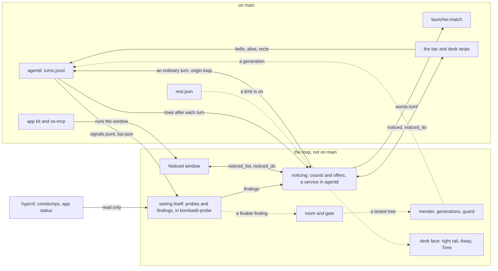

# The loop

> **Status:** In progress  
> **Code:** none of this is on `main`. It builds on `src/bombadil/agentd.py`, `src/bombadil/launcher.py`, `src/bombadil/providers.py`, `src/bombadil/config.py`, `src/bombadil/paths.py`, `src/bombadil/rest.py`, `src/bombadil/finder.py`, `src/bombadil/notices.py`, `src/bombadil/desk.py`, `src/bombadil/watch.py`, `src/bombadil/snapshots.py`, `src/bombadil/mcp_server.py`, `src/bombadil/apps.py`, `src/bombadil/appkit/`, `src/bombadil/brain/witnesses.py`, `shell/shell.qml`, `shell/DeskState.qml`, `shell/StatusLine.qml`, `share/skills/bombadil-apps/SKILL.md`, `scripts/build-iso.sh`, `packaging/bombadil/root/usr/bin/bombadil-smoke`, `share/hypr/bombadil.lua` and `packaging/bombadil/root/usr/lib/systemd/user/`. Files added by the unmerged branch, which has the first two pieces (`main` has none of them): `src/bombadil/loop/`, `share/apps/noticed/`, `shell/LoopState.qml`, `shell/NoticedChip.qml`, `shell/NoticedCard.qml`, `bin/bombadil-probe` and `iso/airootfs/etc/systemd/user/bombadil-probe.service`. The gate, the mender, generations, the growth of components and processes and the desk face have no code on the branch or on `main`; of growth, only putting a word away after 28 days is built, on the branch.  
> **Design:** [Bombadil tends itself](../design/self-improvement-brief.md), [the page](../design/pages/bombadil-tends-itself.html)  
> **Verified:** 2026-11-08 against `main` at `7176e55`: no code of this piece is on `main`, and each statement about `main` was checked against it on that date. The unmerged work was read at its head `05a5ebf` (still its head on 2026-11-08), through its own notes and its source files. Its tests were run on 2026-10-01 from an exported copy without PySide6, and were collected again on 2026-11-08 without being run: the 1,273 tests of its own loop files and the 457 of the shared files it changes (`test_agentd`, `test_launcher`, `test_providers`, `test_watch`, `test_iso_profile`) passed on the first date, and the four Qt files (`test_noticed_app`, `test_noticed_with_service`, `test_loop_qml`, `test_loop_fixes_bar_qml`) skipped. The headless desktop test was not run. On 2026-11-12, against `main` at `7d37bc5`, these statements about `main` were read in the code and corrected: the desk's right rail and its feeds, the launcher's Tips words, `summon`, the bar's input mask, the image's copy, its `VERSION` stamp and the programs it links, and the smoke test's line numbers; the rest of the page still rests on `7176e55`.

The loop is meant to let Bombadil keep itself in good shape without becoming a chore for the person. It will count the requests the person keeps typing and offer, once and on a small chip beside the pill, to turn a repeat into something smaller. It will check its own state for bugs, fix what it can prove while the person is away, and write up what it cannot for the project. It exists because Bombadil's faults are found by hand as of 2026-10-01, by someone testing in a VM and relaying what they hit, and because history that was not recorded cannot be recovered later. The design holds itself to a budget: in an ordinary week, no line above the pill (except a put-back), no mark on the dot, no card raised on its own, at most three new offers and no new word to learn.

## What it will do

- **Noticing (built on an unmerged branch).** The ledger in `turns.jsonl` will keep what a later count needs: a lasting `id`, `seconds`, `origin`, `tools`, `cost` and a row for `stop`, and `model` as the provider reports it (`main` already writes a `model` key, as the model the provider was set to), and old rows will stay readable. A typed prompt that went to the model will count as an ask; `!` lines, sign-ins, private things, pasted text over 300 characters and turns that were stopped, failed or undone within 60 s will not. Asks will be grouped with no model, from their words, a verb class, the apps and panels they name and the route the turn took. Three asks on two days within 21 days, and worth building, will become one offer: at most one new offer a day and three a week, "Not now" returning only when the count has doubled or after 30 days, and two silent expiries or two Nevers in a row resting every offer for 30 days. The bar rises from 3 to 5 asks when fewer than 3 of the last 10 offers were taken (`asks_needed` in `src/bombadil/loop/offers.py`). Counts will live in `loop.db`, read from `turns.jsonl` by byte offset 150 rows to a transaction, by a service inside agentd (`LoopService`, one background worker that owns the database) that is never on a turn's path. The service counts when agentd starts, about 2 s after the last of a burst of new rows, and at least every 10 minutes; while a client is connected it reads the prober's findings about every 20 s; and it records an offer as shown only while no turn runs, nothing is queued and the bar has said `hello` (`DEBOUNCE`, `INGEST_EVERY`, `FINDINGS_EVERY` and `_idle` in `src/bombadil/loop/service.py`). On the branch an offer can build only a word (a row in `words.toml` that opens an app or a panel and runs nothing else, at most 30 active ones) or a new app (an ordinary turn that the person's tap starts). The other forms the brief lists (a card, a widget, a routine, a watcher, a preference) are designed, and each waits for its builder. One optional model call may name or split a group about to be offered; the branch ships it switched off. The Noticed window, a kit app, lists what they ask most, what changed (each with Undo), what it found, what they said no to and the words made. Once a day the service will put away every word not used for 28 days and write an `improve` row for it, whose Undo brings the word back (`_sweep` in `src/bombadil/loop/service.py`, `put_away` and `words_unused` in `src/bombadil/loop/words.py`).
- **The chip and its card (built on an unmerged branch).** A small chip beside the pill says how many things wait, and a card above it says what they are (`shell/LoopState.qml`, `shell/NoticedChip.qml`, `shell/NoticedCard.qml`).
  - **When it shows.** The chip reads `noticed N` and sits right of the pill, past the right desk strips when they are shown, or above the pill when there is no room. It is visible only while N is more than 0, Noticed is not hidden, no turn runs and agentd is connected, and it never turns up by itself while the pill has the keyboard; one already up stays. N is the number of rows waiting, which `LoopService._state` builds: at most one offer, plus the findings not yet reported, plus the reports held for sending. It is not capped at the three rows the card shows.
  - **How the card opens and closes.** Resting the pointer on the chip for 250 ms peeks the card, which closes 300 ms after the pointer has left the chip and the card. A click keeps the card up, gives the pill the keyboard and sends `noticed_do` with op `open`, which opens the Noticed window; a second click, Esc, a turn starting, the pill giving the keyboard back or agentd going away puts a kept card away. The words `noticed`, `open noticed` and `show noticed` also keep it up, and `hide noticed` hides the chip and the card until one of those words is said.
  - **What the card shows.** It is 300 px wide and titled Noticed, with one line of why such as "1 idea · 1 thing it found", at most three rows, then "Resting offers until <day>" while offers rest, and "Lately: N changes this week" with a See all button that opens the window. A row shows the person's own words, how often, one line of what would happen, one button (`BUTTONS` in `src/bombadil/loop/service.py`: "Make the word" for form A, "Make an app" for D, "Got it" when the thing already has a word, "Send to the project" for a finding, "See the report" for a held one), a quiet "Not now" and "Never", and up to two "Other ways". Pressing the button is the ask: no second question follows.
- **Seeing itself (built on an unmerged branch).** 23 probes, pure functions over `hyprctl` JSON, the bar's rectangles, coredumps and the ledger, will look for a drawer that took no keyboard, stacked app windows, a window under the bar, a monitor under 1024 px and a Super tap that left the pill without the keyboard. An invariant will count only when it is red again 500 ms later; an event, a crash or a drift counts at its first sighting, and friction at three sightings on two days (or at one sighting with another probe firing within five minutes). A probe that goes red and then green on its retry three times in a week is left out and becomes a finding about itself (`src/bombadil/loop/findings.py`). A finding will keep an evidence bundle under `findings/<fp>/`. When the person asks, it will become a report built from typed fields with at most three log lines, opened as a prefilled new-issue page in the browser panel; the person will press Submit and no token will be stored. The bar will send `hello`, `alive`, its rectangles, `focus_ack`, `focus_cancel` and `friction`, and agentd will answer `ping`. The prober, `bombadil-probe`, is a user unit that agentd starts and that outlives it. It looks when Hyprland says a window opened or closed or a panel slid in or out (the layout checks run about a second later, the drawer's about two seconds after it opens), and once a minute while the person is away (no prompt for 10 minutes, or the screen locked); it reads coredumps at most every 5 minutes and, while the person is away, runs the idle doctor once a day (`src/bombadil/loop/runner.py`). Fixtures cover five of the six bugs found by hand; the one left, Chromium's first-run dialog, is a report by design. `main` runs agentd and the bar as user units with `Restart=always` (`bombadil-agentd.service` and `bombadil-shell.service`, see [the session stays alive](session-services.md)), which the brief names as the way restarts and failed units become signals at all; the branch predates them, because it last merged `main` at `3d9bc36`.
- **The room and the gate (designed).** A fixed program in `/usr/lib/bombadil/fixed/`, root-owned and shipped in the image, will judge every candidate fix and the fixer cannot edit it. The new test must fail on the base commit and pass on the candidate, no test may be removed, weakened or skipped, no protected path may change (the loop, probes, gate, guard, existing tests, sudoers, managed settings, the fence, snapshots, rollback, installer, CI) and a fix will be at most 5 files and 200 lines. Tiers will run from ruff and pytest through offscreen QML tests to the room: a second agentd and bar on scratch `BOMBADIL_STATE`, `BOMBADIL_RUNTIME` and `BOMBADIL_SOCKET`. The other provider will review read-only. The room is unproven: whether a headless Hyprland starts on a VM's software rendering is unchecked, and without it focus and layout bugs in the bar stay reports.
- **The mender, generations and the guard (designed).** One tap on Start mending, once, will write `bombadil-mend.timer` with the person's own words and the budget inside it, listed in Autopilot ([riding brief](../design/passenger-brief.md)) with Pause and Stop. A fenced coding session with role `mender` ([coding sessions](coding-sessions.md)) will work in a clone while the person is away, at most 3 starts and 2 landings a day. It will fix its own words and data, its apps and kit extras, and Bombadil's code that the gate can prove; compositor config, boot, `/etc`, sudoers, packages, vendor bugs and the loop itself will be reports. A passing fix will be exported as a generation under `~/.local/share/bombadil/gen/<sha>/` and switched by a `current` link, with `previous` kept. `bombadil-guard`, outside every generation, will check agentd, the bar and a few other signs for 10 minutes after a landing, and flip back on three reds in a row, a coredump of a Bombadil program or a failed unit. Undo will flip the link with no model.
- **Growth (designed; putting a word away is built on an unmerged branch).** New kit components will go only into an overlay named `BombadilExtra` and never replace `Theme` or `AppWindow`, at most 2 a week and 12 in all. Processes will be `bombadil-*` user units with an `[X-Bombadil]` record, at most 8, each an Autopilot row. On the branch a word unused for 28 days is put away once a day, and Undo or the `bring_back` op brings it back and starts the 28 days again (`_sweep` in `src/bombadil/loop/service.py`, `put_away` and `bring_back` in `src/bombadil/loop/words.py`). A widget or a unit unused for 28 days will be put away with Bring back in the same way, and a kit component unused for 60 days will be archived and stay loadable; those parts are designed. The loop will write no skills, notes or lessons for the agent to read.
- **The desk face (designed).** Noticed will be a desk widget at the top of the right rail (bottom up: Needs you, Away, Machine, Noticed) that starts as its strip. On `main` a widget can be folded to its strip by hand and the set of folded ones starts empty, so a `noticed` widget would need to start in it (the `desk.py` row below). A night's changes will merge into one Away row, "Changed 2 things about itself", Time in the [brain](brain.md) will show `kind: "improve"` rows in the machine's orange, and Watching will show a "Mending" row while a fix runs. The chip and its peek card beside the pill belong to the first piece and are built on the branch (see the chip above). On `main` the right rail holds Needs you, Away, Machine and Tips (`DeskState.widgetIds`), and Away has its feed, agentd's `away` message. The Tips card ([Tips](tips.md), built) holds the rail's top slot until Noticed becomes a rail widget.

## How it works

Counting and offering run inside agentd as `LoopService`, beside the turns and never on their path. Checking runs in its own user unit, `bombadil-probe`, so that it outlives an agentd crash and can see it. Both write `loop.db`, and the bar draws what they found as the chip and its card.

Solid lines are built on the unmerged branch, and the boxes under "on main" say what exists on `main` at `7176e55`. Dotted lines are designed only: the loop reads `rest.json` so that a rest is never taken for a fault, and the branch does not read it yet.

**What it builds on in `main`**

| Existing piece | What the loop does there |
|---|---|
| `src/bombadil/agentd.py`: `AgentD._log`, `_log_line`, `_local`, `_poke` | Noticing will read the rows appended to `paths.turns_log()` (the shapes are in [agentd](agentd.md#the-turn-log)). A model row has `t`, `prompt`, `result`, `ok`, `snapshot`, `provider`, `model`, `session`, `stopped`, `summary`, `read`, `details`, `n`, `unit`, `started` and `files`, and `requeued: true` when the account's limit stopped the turn (the ask then runs again, as a second row with the same prompt); it has no `id`, `seconds`, `origin`, `tools` or `cost`. `model` is `self.provider.model` when the row is written: the model the provider was set to (the Sonnet default in `config.DEFAULT_MODELS`, a model the config names, or the session's "use opus"), `null` for a `!` line or when none is set, and never the model the CLI reported. A `kind: "local"` row has `prompt`, `action`, `target`, `result` and `ok`; besides launcher words it is written for a desk gesture, a background job, a press on Send (`action: "press"`), a model switch (`action: "model"`, from "use opus" or "use sonnet"), a rest word or a switch on the AI card (`rest`) and a picture. A `kind: "signin"` row has `provider`, `result` and `reason`. The word `stop` and the `stop` message write no row. `n` is `self.turns`, which goes on across restarts (`_last_turn`, and the `turn` file of the state directory), but `self.next_id`, the queue id, restarts at 0 with every agentd, and no row has an `id`. A turn's log is `turns/<ms>-<queue id>.jsonl` in the state directory, which is where the route of a turn will be read from. `_log_line` has no hook, where the branch's calls `_loop_hook("row", ...)`; the brain is told after the row (`_poke`). Ledger v2 adds the missing fields here (on the branch), whose `_log` also writes `read`, `unit` and `files`, and whose `n` also goes on across restarts, so the two sides agree on those fields. Both sides write a `model` key (`main`: the model the provider was set to; the branch: the model Claude's CLI reported, or for Codex the one asked for, from the `meta` event, in `_turn_keys`), so a merge must pick one. |
| `src/bombadil/providers.py`: `Claude._events`, `Claude.command`, `Provider.limit` | `Claude._events` yields a `meta` event holding `rate_limit` (from the CLI's `rate_limit_event`), a `limit` and a `retry` event, and its `result` event keeps `ok`, `text`, `session_id`, `subtype`, `terminal_reason`, `num_turns`, `api_error_status`, `api_error` and `api_error_code`. agentd keeps `rate_limit` only in `_seen`, to decide with `Provider.limit` whether the turn was refused for the account's limit, so no row holds it, and nothing of model, cost or usage is parsed. Ledger v2 and the quota rule need them, and the branch parses them into `meta` (`model`, `cost`, `usage`, `rate_limit`, `drift`). `command` passes `--permission-mode bypassPermissions --dangerously-skip-permissions`, so a mender needs permissions from its role. |
| `src/bombadil/launcher.py`: `match`, `normalize`, `_key`, `known_apps`, `entries` | Text folding starts from `normalize` and `_key`, and named things come from `known_apps`, `PANEL_WORDS` and the widget words. `match(text, app_list, busy)` is exact: with an app Passwords, "show me my passwords" returns None (a model turn) and "passwords" opens it (run on `main` at `7176e55`). Mail's words (`MAIL_WORDS`) are matched before the person's own apps, so an app called Mail never stands in for the window. "use opus" and "use sonnet" (`MODEL_WORDS`, action `model`) are matched with the core commands, before apps, as are the Tips words (`TIPS_COMMANDS`: `tips`, `help`, `what can you do`, [Tips](tips.md#the-words-that-open-the-app)), and volume up, volume down, mute and unmute (`UTILITY_COMMANDS`) after the apps and panels. `words.toml` would be one more table, matched after everything else, that can only open or show; the branch's `means()` asks `match` what a phrase already does, so after a merge it would call the model words "a command" and the volume words "a utility word", and no made word could take them. `entries()` also feeds the finder (`finder.things()`), whose docstring names the person's own words as a later source; the branch's `entries()` adds a `noticed` command and no word. |
| `src/bombadil/paths.py`: `state_dir`, `runtime_dir`, `socket_path`, `config_dir`, `data_dir`, `turns_log` | `loop/` would sit in the state directory beside `turns.jsonl`, which `desk.py` documents as outside the restore points ([restore points](restore-points.md)). `words.toml` would go in the config directory and generations in the data directory. The room would point a second agentd and bar at scratch `BOMBADIL_STATE`, `BOMBADIL_RUNTIME` and `BOMBADIL_SOCKET`. |
| `shell/shell.qml`: `QueueChips`, `SetupChips`, `FoundChips`, `AiCard`, `stripsLeft`, `stripsRight`, the input `mask` | The input `mask` holds one `Region` per item that takes clicks (thirteen: `cardHost`, `statusLine`, `personaCard`, `foundChips`, `setupChips`, `chips`, `sessionChips`, `appChips`, `aiCard`, `widgetsCard`, `pillBox`, `stripsLeft`, `stripsRight`), so the chip and its card need one each (the branch puts the chip right of the pill, past the right strips when they are shown, and above the pill when there is no room). The layer namespace is `bombadil-bar`. The bar passes each line from its `Socket` to `PillState.handle` and `DeskState.handle`. It sends no `hello`, `alive`, rectangles, `focus_ack` or `friction`, and agentd has no `ping`. The branch reports five rectangles (`statusLine`, `chips`, `pillBox`, `noticedChip`, `noticedCard`), none of them `foundChips` or `aiCard`, which `main` gained after the branch last merged it. |
| `src/bombadil/desk.py`: `WIDGETS`, `Desk.apply`; `shell/DeskState.qml` | The right rail holds `needs`, `away`, `machine` and `tips`. `machineModel`, `awayModel` and `tipsModel` are filled by agentd's `machine` (`src/bombadil/vitals.py`), `away` and `tips` messages. Noticed would be one more entry, and `launcher._widget_action` already builds "show NAME" and "hide NAME" from `WIDGETS` ([desk](desk.md)). A card can be folded to its strip by hand: `Desk.stripped` (the `stripped` key of `desk.toml` and of the `desk` message), the `fold` and `unfold` ops with a widget, and a `show` or a move gives the card back; `DeskState.stripped` holds it in the shell, and `shell/DeskDrag.qml`, `DeskRail.qml` and `DeskStrips.qml` drag a card. `Desk` starts with nothing folded, so the strip-first start the brief wants for Noticed is a default that `main` does not have. |
| `src/bombadil/mcp_server.py`: `OsTools._register`; `src/bombadil/appkit/tools.py`: `register`, `create_app`, `check_app` | A tool is added with `@t(name, description, properties)`, so `asks` goes here and stays read-only; `_register` ends with `cardtools.register`, `mail_tools.register` (the five `mail_*` tools) and the app kit's `register`, which comes last, and the branch puts `asks` before them. A new app would be made through `create_app`, which writes it, loads it and returns the check; `check_app` checks it again ([os-mcp](os-mcp.md)). A turn's log keeps `[mail text not kept]` in place of what `mail_read` and `mail_search` returned (`MAIL_NOT_KEPT`), so reading a turn's log for its route does not read a mail. |
| `src/bombadil/appkit/engine.py`: `qml_dirs`; `share/skills/bombadil-apps/SKILL.md` | `qml_dirs()` lists the checkout's `share/qml`, then the installed one, and `BombadilExtra` would be a third. The skill says "Use exactly these four imports", which would become five. |
| `src/bombadil/apps.py`: `builtin_dir`, `app_dir` | A built-in app is looked up in `share/apps`, which holds two kit apps, `brain/` and `mail/`. `apps.RESERVED` names `mail`, which nothing may replace, because Send there is the person's press; any other built-in is replaced by an app of the person's own with the same name. The Noticed window, a third built-in kit app, would be `share/apps/noticed/`, found as the branch's service finds it, through `apps.load` ([app kit](app-kit.md)). |
| `src/bombadil/watch.py`: `history_lines` | `paths.is_turn_row` accepts only a row with no `kind` or `kind: "turn"`, and `history_lines` skips every other row except `kind: "local"`, so `bombadil history` hides `kind: "improve"` and `kind: "signin"` rows. The branch shows an improve row as a dim line instead, so the two need reconciling. |
| `src/bombadil/snapshots.py`: `Snapshots.undo_last_turn` | Bare `undo` takes back only a snapshot whose description starts with `turn:` (line 79). A loop landing is not a snapshot, so its Undo is its own. `create` passes `--cleanup-algorithm number` and the installer keeps the newest 30 ([the session stays alive](session-services.md#restore-points-do-not-pile-up)), so the `snapshot` number of an old ledger row may name a restore point that no longer exists. |
| `scripts/build-iso.sh`; `share/hypr/bombadil.lua` | The image copies `bin`, `src`, `shell`, `share`, `install` and the package list to `/usr/share/bombadil` with no `.git`, writes a `VERSION` stamp (the date and the commit, which the installer records), and links thirteen programs into `/usr/local/bin` (the branch adds `bombadil-probe` to that list and a `VERSION` stamp of its own to the copy, and conflicts in the script). On `main` at `7176e55` agentd, the bar and mako run as systemd user units with `Restart=always`, and Hyprland's start hook restarts them (`share/hypr/bombadil.lua` runs `systemctl --user import-environment && systemctl --user restart bombadil-agentd bombadil-shell mako` from `hl.on("hyprland.start")`; see [the session stays alive](session-services.md)). Four bombadil user units exist: `bombadil-agentd.service` and `bombadil-shell.service` have no `[Install]` section and `StartLimitIntervalSec=0`; `bombadil-brain.service` and `bombadil-mail.service` start at login (`WantedBy=default.target`, `Restart=on-failure`). The branch's `bombadil-probe.service` also has no `[Install]` section, and agentd starts it. |
| `packaging/bombadil/root/usr/bin/bombadil-smoke` | The VM smoke test checks the agentd socket with `test -S` (`agentd-socket`, line 95), Hyprland's `configerrors` (`hypr-config-ok`, 98), the `bombadil-bar` layer (`bar-layer`, 99) and that `bombadil-details` takes the keyboard (`details-has-keyboard`, 227). It also kills agentd, the bar and mako and waits for each to come back (`agentd-comes-back`, `bar-comes-back`, `notifications-come-back`) and checks that the three are active units (`services-are-units`). The branch's probes repeat the first four as pure functions (`drawer-focus`, `hypr-config`, `bar-layer`, `agentd-ping`) and add `bar-alive` and `bar-restarts` for the bar; none is on `main`, and the branch's smoke test has no unit checks. |
| `src/bombadil/rest.py`, `src/bombadil/finder.py` | `rest.json` in the state directory (`rest.path()`) holds `{"hand": ..., "providers": {"<name>": {"why", "kind", "until", "since"}}}`, and `rest.read()` drops a lapsed limit; a comment in `rest._save` names the loop as a reader. The branch reads neither it nor `requeued`: it decides that a failed turn was a limit from the provider's words and the row's `rate_limit` (`probes.py`). `finder.read_asks` reads `turns.jsonl` for the person's asks by its own rule (no `kind`, not `stopped` or `requeued`, `ok` true, no `!` or `[from app` prefix), a second definition of an ask beside the loop's origin rule ([the resting state](poor-man-switch.md)). |
| `src/bombadil/agentd.py`: `_persons`, `_was_agent`; `src/bombadil/notices.py` | agentd tells a client that is a process inside an agent's turn from the person: such a prompt is queued with `asked_by: "agent"`, and notice chips, dismissals and the press on Send refuse it. The branch handles `noticed_do` from any client (`LoopService.on_message`), so a process in a turn could tap `accept` for the person. `notices.py` gives any service a line above the pill (`Notices.post`, and the `notice` and `notice_end` messages); the loop must not use it for an offer. |
| `src/bombadil/brain/witnesses.py`: `TurnsLog.read_new` | The brain reads turn rows by `n` and skips every row that is not a turn (`paths.is_turn_row`), so `improve` rows never reach it. Time, where the design shows them, has no code: `share/apps/brain/` has no such view ([brain](brain.md)). |

## Interfaces it adds

Status is as in [documenting your piece](../contributing/documenting.md#the-shape-of-a-page): In progress (on the branch) means built on the unmerged branch and not on `main`, and Designed means no code anywhere.

| Name | What it is | Status |
|---|---|---|
| Ledger v2 in `turns.jsonl` | On a model row `v`, `id`, `seconds`, `origin`, `tools`, `cost`, `usage`, `rate_limit`, `drift`, and `model` (`main` also writes a `model` key, with a different meaning: see the `agentd.py` row), and `n`, `started`, `unit`, `read` and `files`, which `main` also writes (see the `agentd.py` row); `requeued`, which `main` writes, the branch does not know. On a `local` row `v`, `verb`, `via`, `word`, `of`, `of_snapshot`. A row for `stop`. The brief also names `undone_by`; the branch works it out from the undo rows | In progress (on the branch) |
| `kind: "improve"` rows | The trail of what the loop changed: `t`, `v`, `id`, `what`, `title`, `group`, `undo` (an op: `remove_word`, `trash_app` or `bring_back_word`), `undone`, and `of`, the `id` of the change that an undo or a bring back row answers, which the window's list of changes and its Undo read. Read by the Noticed window on the branch, by Away and Time in the design | In progress (on the branch); Away and Time are Designed |
| `origin` on a `prompt` message | `typed`, `button`, `app`, `session`, `routine`, `loop`, `retry`, `cli` | In progress (on the branch) |
| Bar to agentd | `hello`, `alive`, `rects`, `focus_ack`, `focus_cancel`, `friction` | In progress (on the branch) |
| Any client to agentd | `ping`, answered by `pong` | In progress (on the branch) |
| Agentd to the bar | `summon` carrying an `id` (on `main` it carries an optional `text` and an optional `tip`, and no `id`); a `local` event that may carry `undo_msg`, the message the line's Undo sends in place of the machine's undo | In progress (on the branch) |
| Noticed messages | `noticed`, `noticed_open`, `noticed_result`, `noticed_full` to clients; `noticed_state`, `noticed_list`, `noticed_do` from them, with ops `open`, `accept`, `not_now`, `never`, `got_it`, `other_ways`, `preview`, `report`, `send`, `undo`, `bring_back`, `forget_asks`, `clear_found`, `hide`, `show` | In progress (on the branch) |
| Files in `paths.loop_dir()` | `loop.db`, `signals.jsonl`, `bar.json`, `agentd.json`, `doctor.json`, `findings/<fp>/`, `reports/<fp>.md` and an optional `config.toml` (`[offers]`, `[refine]`). Default `~/.local/state/bombadil/loop`, env `BOMBADIL_LOOP` | In progress (on the branch) |
| `words.toml` | At `paths.words_file()`, rows `[[word]]` with `phrase`, `opens`, `made`, `from_group`, `away`, at most 30 active (`MAX_WORDS`; a word put away does not count). `opens` is an app or a panel; the brief adds a card and a desk face. A word unused for 28 days is put away once a day (`away = true`) and matches nothing until it is brought back | In progress (on the branch) |
| Pill words | `noticed`, `open noticed`, `show noticed`, `hide noticed` (launcher action kind `noticed`) | In progress (on the branch) |
| Commands | `bombadil loop asks`, `status`, `replay`, `report`, `forget`, `probe`; `bombadil probe`; `bombadil doctor [--live]` | In progress (on the branch) |
| os-mcp tool `asks` | Read-only, optional `limit`: what the person asks most | In progress (on the branch) |
| `bombadil-probe`, `bombadil-probe.service` | The prober and its user unit (`Restart=always`, idle priority), started by agentd's loop service | In progress (on the branch) |
| `share/apps/noticed/` | The Noticed window, a kit app | In progress (on the branch) |
| `BOMBADIL_BUILD` | Optional; read by the bar for the `build` field of its `hello` | In progress (on the branch) |
| `BOMBADIL_MACHINE` | Optional word naming the machine kind in a report | In progress (on the branch) |
| `VERSION` | The build a report names; `scripts/build-iso.sh` writes it at the top of the shared tree | In progress (on the branch) |
| Smoke checks | `loop-agentd-json`, `loop-bar-hello`, `loop-bar-alive`, `coredump-handler`, `loop-probe-unit-active`, `loop-status-answers`, `loop-doctor-live`, `loop-asks-tool` in `bombadil-smoke` | In progress (on the branch) |
| `bombadil check`, `bombadil-check`, `bombadil-room`, `/usr/lib/bombadil/fixed/`, `tests/new/` | The gate, the room and the fixed part | Designed |
| `bombadil-mend.timer` | User unit with an `[X-Bombadil]` section; the words "stop mending", "pause mending" and "hold everything" | Designed |
| `~/.local/share/bombadil/gen/<sha>/`, `current`, `previous`, `bombadil-guard` | Generations, the link and the guard service | Designed |
| `BombadilExtra` under `~/.local/share/bombadil/qml`, `bombadil-loop.slice` | The kit overlay and the slice for `bombadil-*` units | Designed |
| A `noticed` entry in `desk.WIDGETS` | The right-rail card, the Away row, `improve` rows in Time | Designed |

## Where state lives

The first two rows are `main`'s own files; every other file here is the branch's, and `main` has none of them. The loop's files sit in `paths.loop_dir()`, in the state directory, and `words.toml` in the config directory: both are in the home folder, which a restore point does not cover ([restore points](restore-points.md)). The loop has no socket of its own: its messages travel over agentd's.

| Path | Holds | Written by |
|---|---|---|
| `paths.state_dir()/turns.jsonl` | the ledger, and the `improve` rows of the trail | agentd only (`_log_line`); the service hands its own rows to that writer |
| `paths.state_dir()/turns/<ms>-<id>.jsonl` | a turn's events, read for the route of a turn | agentd |
| `paths.loop_dir()/loop.db` with `-wal` and `-shm` | counts, groups, offers, what the person said no to, findings, the byte offset read so far in `turns.jsonl`, and whether Noticed is hidden | the service in agentd and the prober, both writers of one WAL file |
| `signals.jsonl`, `bar.json`, `agentd.json` in the loop directory | what the bar and agentd say about themselves | agentd |
| `doctor.json` | the last idle doctor | the prober |
| `findings/<fp>/` | the evidence bundle of a finding | the prober |
| `reports/<fp>.md` | the report held for sending | the service, when the person asks for the report |
| `trash/<name>-<time>` | the folder of an app made for an offer, after its Undo | the service |
| `config.toml` | optional numbers (`[offers]`, `[refine]`) | the person |
| `paths.words_file()` (`words.toml`, in the config directory) | the words made, at most 30 | the service; the launcher reads it |
| `bombadil-probe.service` | the prober's user unit: `Restart=always`, `RestartSec=5`, `Nice=15`, idle CPU and I/O scheduling, no `[Install]` section | started by agentd with `systemctl --user start` |

The loop directory is made 0700, and `loop.db`, its `-wal` and `-shm` and `reports/` are kept owner-only (files 0600, directories 0700, older ones tightened) because they hold the person's own words: `src/bombadil/loop/db.py` does this for the directory and the database files (`connect`, `private_dir`), and `src/bombadil/loop/report.py` for `reports/` and the 0600 report file (`hold`). A damaged `loop.db` is never replaced: the service says so once on stderr and counts nothing until the person deletes it with its `-wal` and `-shm`, after which `turns.jsonl` is counted again from the top and what was said no to, what was offered and what was forgotten are lost.

## Principles it keeps

- [Nothing runs on its own that the person cannot see and stop](../principles.md#nothing-runs-unseen): fixing will run on one standing yes, kept as a unit the person can pause and stop, and an offer will never start anything. The trap is a hidden timer, or letting a count or a probe start work, or taking a tap from any client: the branch accepts `noticed_do` from every client, where `main`'s agentd tells a process inside an agent's turn from the person for a press, a notice chip and a typed prompt.
- [Records answer before models](../principles.md#records-before-models): counts will read what the machine already writes, and no model counts. A fixed program decides whether a fix may land; the other provider's read-only review can only block it. The trap is asking a model to group asks; the one optional call may only name or split a group, never add a member.
- [Only the person's own press reaches other people](../principles.md#the-persons-press-reaches-people): nothing will leave until the person presses Send to the project. That opens the project's new-issue page with the report in its address, so the report reaches GitHub when the page loads, and runs one unauthenticated search of the project's public issues for the report's fingerprint (`report.already_reported`, called from `LoopService._send_report`). Nothing is posted until the person presses Submit on that page, and no token is stored. The trap is a stored token, an auto-filed issue or the person's words in a report.
- [Quiet at rest](../principles.md#quiet-at-rest): a chip while something waits, never a popup, a sound, a mark on the dot or a digest. The one line the loop may ever put above the pill is a guard's put-back. The trap is letting the chip's number grow into a mark on the dot, or putting an offer on the line, which `notices.py` makes one call away.
- [Recovery never goes through the part that broke](../principles.md#recovery-without-the-broken-part): the guard and a first line in the Lifeboat ([ux brief](../design/ux-brief.md)) will sit outside every generation, and the fixer cannot edit its judges. The trap is an undo that runs from the tree a bad fix replaced.
- [Every piece degrades](../principles.md#degrade-and-recover): counting and probes will never be on a turn's path, and either can die while turns carry on. The trap is a turn, an undo or the pill waiting on `loop.db`.

## Extending it

None of this is on `main`: the names are the unmerged branch's, and the steps come from its own notes, checked against its code.

**A new thing a repeat can become (a form)**

1. Add a `Form` to `FORMS` in `src/bombadil/loop/forms.py`: the plain sentence the card shows, and in `needs` the name of the piece that builds it. A form whose `needs` is not in `BUILT` is never offered, and `forms.available` names the piece it waits for.
2. Add that name to `BUILT` once the builder exists. At the branch's head it holds `words` and `create_app`.
3. Teach `LoopService` to run it: a button in `BUTTONS` and a branch in `_accept`, both in `src/bombadil/loop/service.py`.
4. Write the change into the trail with `_improve` and an `undo` that names an op, and add that op to `_op_undo` and to `UNDOABLE`, so the Noticed window can offer Undo for it.
5. Cover it in `tests/test_loop_forms.py` and `tests/test_loop_service.py`.

**A new check**

1. Write a function over the `Observation` in `src/bombadil/loop/probes.py` and register it with `@probe(id, component, kind, title, what, needs)`. It returns `red()`, `green()` or `unchecked()`, and it only reads: no socket, no process, no file, and no window title, prompt or path in what it reports.
2. If it needs data no `Observation` field holds, add the field, a collector of the same name to `Collectors` in `src/bombadil/loop/runner.py` and the field to `COLLECTED`. A collector never raises and never waits past its own deadline.
3. Add a bad and a fixed fixture under `tests/fixtures/loop/probes/`, red on the bug and green on the fix, and a test in `tests/test_loop_probes.py`.

**A new surface (another shell, or a command)**

Speak the messages in the interface table: `noticed_state`, `noticed_list` and `noticed_do` from the client, `noticed` and `noticed_full` back. `_noticed_do` in `bin/bombadil`, which `bombadil loop forget` uses to send the op `forget_asks`, is the smallest client.

## Tests

The tests are on the unmerged branch, not on `main`. They run as the others do ([development](../contributing/development.md)): `pytest tests/test_loop_service.py` runs one file. The Qt files skip without PySide6.

| Covers | Files |
|---|---|
| The ledger and the rows agentd writes | `tests/test_loop_ledger.py`, `tests/test_loop_ledger_rows.py` (a real `AgentD` run, with a sample kept in `tests/fixtures/loop/ledger_v2.jsonl`) |
| Counting, grouping and offers | `tests/test_loop_habits.py`, `test_loop_route.py`, `test_loop_forms.py`, `test_loop_offers.py`, `test_loop_store.py`, `test_loop_refine.py`; the habits and store tests also use the synthetic corpus in `tests/fixtures/loop/golden_*` |
| Words and the service | `tests/test_loop_words.py`, `tests/test_loop_service.py` |
| What the bar says, probes, findings and the prober | `tests/test_loop_signals.py`, `test_loop_probes.py` (the five fixtures), `test_loop_findings.py`, `test_loop_runner.py` |
| Reports, versions, commands and the `asks` tool | `tests/test_loop_report.py`, `test_loop_versions.py`, `test_loop_cli.py`, `tests/test_mcp_asks.py` |
| The chip, the card and the window (PySide6) | `tests/test_loop_qml.py`, `test_loop_fixes_bar_qml.py`, `tests/test_noticed_app.py`, `tests/test_noticed_with_service.py` |
| Fixes from review, one test per defect | `tests/test_loop_fixes_bar.py`, `test_loop_fixes_reports.py`, `test_loop_fixes_service.py`, `test_loop_fixes_store.py` |
| Shared files the branch changes | `tests/test_agentd.py`, `test_launcher.py`, `test_providers.py`, `test_watch.py`, `test_iso_profile.py` |

Step 10 of `tests/desktop/driver.py` on the branch seeds three asks on three days, waits for the chip, clicks it and presses the offer; it runs through `tests/desktop/run.sh`, which needs Docker and a `claude` binary, and it was not run for this page. The real Hyprland and a browser taking the issue page are not covered by any test.

## Known gaps

Each is read from the branch's code at `05a5ebf` unless it says `main`.

- No fix is made by the loop. `Finding.fixable` is `False` for every finding (`src/bombadil/loop/findings.py`), and `bombadil check`, `bombadil-room` and `bombadil-guard` appear nowhere in the branch's `bin/`, `src/`, `iso/`, `scripts/`, `shell/` or `share/`.
- An offer can build only a word or a new app: `BUILT` in `src/bombadil/loop/forms.py` holds `words` and `create_app`, the card, widget, routine, watcher and preference forms wait for their builders, and the kit-part and fix forms are `offered=False`.
- `LoopService.on_message` takes `noticed_do` from any client, where `AgentD._persons` on `main` refuses a process inside an agent's turn for a notice chip, a dismissal and the press on Send.
- Neither `rest.json` nor `requeued` is read anywhere in `src/bombadil/loop/`: `not_ours` in `src/bombadil/loop/probes.py` tells a limit from the provider's words and the row's `rate_limit`.
- The optional model call in `src/bombadil/loop/refine.py` is off unless the loop's `config.toml` turns it on, and it has not been checked on both providers.
- A machine with no user systemd has no prober: `start_prober` in `src/bombadil/loop/service.py` runs `systemctl --user start`, and `bombadil loop status` then reports the prober as not running or not known.
- A damaged `loop.db` stops all counting until the person deletes it, and deleting it loses what was said no to (`src/bombadil/loop/db.py`).
- The branch cannot be merged without hand work; the files are named under "Expect hand merging" below.

## Before you build on it

- **Order (the brief).** 1 noticing (M, first because history cannot be recovered), 2 seeing itself (M to L), then 3 the room and the gate (starting with a spike: does a second headless Hyprland run in a VM), 4 the mender, generations and the guard, 5 growth, 6 the desk face. Pieces 1 and 2 come first and follow the app kit. The mender needs the coding sessions' fence, out-of-sight sessions, a conversation id that outlives a reboot and a login, a build stamp, a clone, pytest and ruff in the image, and the Lifeboat line. `main` saves `AgentD.session_id` in `agentd-state.json` under `paths.runtime_dir()`, so the conversation survives a restart of agentd (systemd brings the daemon back), but not a reboot or a new login. Its quota rule (start below half of each window) needs the rate-limit event in the ledger row: `main` parses it (`Claude._events`) and keeps it only for the limit decision, and the branch writes it as `rate_limit`.
- **Waits on the owner.** Every default is confirmed (options 1a, 2a and 3a chosen and the plan approved on 30 Sep 2026). Open for the owner, later: whether other people's Bombadils should ever report to the owner's repository, and whether anyone but the owner should default to find-and-report only. The thresholds stay guesses until four weeks of real offers are counted. The branch hard-codes the project's own repository as the default target of the issue link (`report.issue_url`), so a fork changes that before it ships reports.
- **Waits on checks.** Replay a real `turns.jsonl` and hand-label 100 pairs: grouping must reach 90% precision on "same request". The branch's numbers come from a synthetic corpus and no real result is recorded. The brief also lists a headless Hyprland in a VM, managed settings that outrank `.claude/settings.json` (which allows `Bash(sudo *)`, line 27), coredump storage on the installed image and the fast model answering a fixed JSON shape on both providers. The branch's notes list what no test of theirs reached: a real Hyprland for the chip and card, the prober unit starting under a user manager, and Chromium taking the issue page.
- **Expect hand merging.** The branch last merged `main` at `3d9bc36`, and `main` has moved on since. A trial merge into `7176e55` (`git merge-tree` with `3d9bc36` as the base, nothing written) reports conflicts in nine source files (`src/bombadil/agentd.py` with 12 hunks, `providers.py` with 3, because both sides add a `meta` event, `launcher.py`, `mcp_server.py`, `bin/bombadil`, `scripts/build-iso.sh`, `shell/shell.qml`, `shell/PillState.qml`, `shell/StatusLine.qml`) and in `README.md`, `docs/ARCHITECTURE.md` and five test files (`tests/desktop/driver.py`, `test_iso_profile.py`, `test_launcher.py`, `test_providers.py` and `test_watch.py`). `paths.py`, `watch.py` and `bombadil-smoke` merge without a conflict although both sides add code there. Merged text still needs care. Both sides write a `model` key into a model row. The branch starts its app turn with `agentd.handle(prompt, None)` (no client), and on `main` `handle` asks `_persons(writer)` first, where `_peer_pid(None)` raises `AttributeError`, so the app form would fail. The branch also answers any `access` but `ready` with "needs you to sign in", which the `resting` access on `main` makes untrue.
- **Meets the resting state.** While the AI rests (`rest.json`), counting and probes need no model and go on. A turn the limit stopped (`requeued: true`) is not a failed ask and not a finding, the optional naming call and an offer that starts a turn should wait for the limit, and the design of the poor man switch says a rest is never a finding ([the resting state](poor-man-switch.md), [its brief](../design/poor-man-switch-brief.md)). The branch reads neither `rest.json` nor `requeued`.
- **Do not break.** The fields already in a `turns.jsonl` row and the `kind: "local"` rows, which `bombadil history` prints as `HH:MM  prompt: result` and the VM smoke test matches (`launcher_done`). The exactness of `launcher.match`: a word may only open or show and never shadows an app, a panel or a command. Bare `undo` meaning the machine's last turn. `bombadil-rollback`, which stays plain bash. The smoke checks named above, which the probes are measured against.

## When it ships

The status and the Verified line change, the tables here are checked against `main` again, the [roadmap](../roadmap.md) row is updated and the brief gets its status line, as [documenting your piece](../contributing/documenting.md) asks. Until then each piece that ships changes the status and the tables here.
