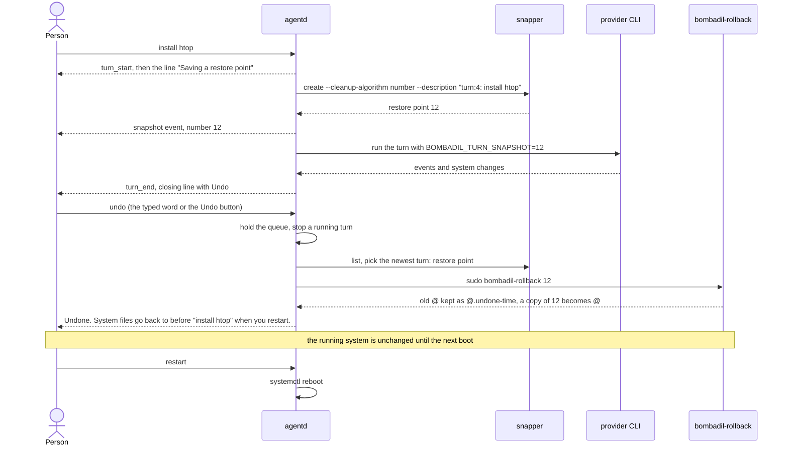
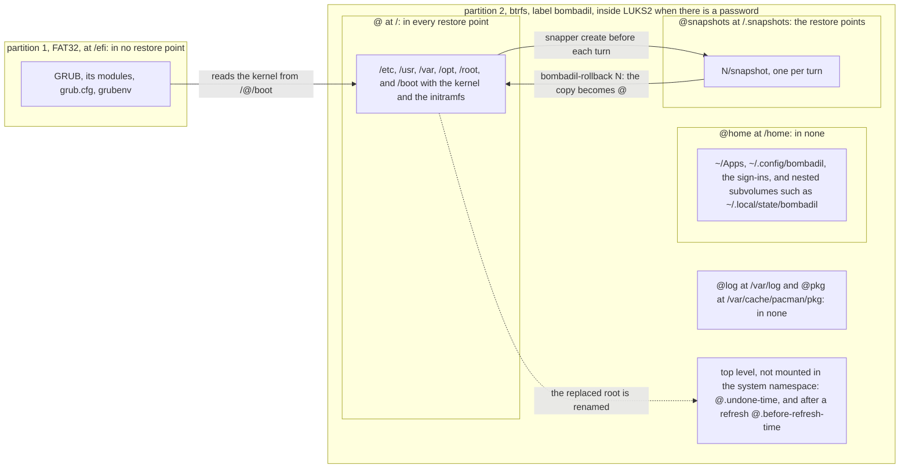

# Restore points

> **Status:** Partly shipped. On `main`: one root restore point per turn, pruned to the newest 30 by snapper's number cleanup with no hourly points, the `undo` word and button, the `rollback` tool, `bombadil undo`, `bombadil snapshot` (by hand, and as the hook of a remote-control session), `bombadil-rollback` with `--device` and `refresh`, and the installed layout the swap needs (layout 1): the kernel and initramfs in the root so they go back with a restore point, `@log` and `@pkg` beside `@`, nested subvolumes in `@home`, optional LUKS2, a baseline restore point at install, and a refresh that puts the old system aside and can put it back. Not built: the pair design with 100 changed pairs kept, pruning of `@.undone-*` and `@.before-refresh-*`, restore points of `/home` (its snapper config exists and nothing takes or undoes them), undo that applies at once, and the start that puts itself back. Each is marked designed below.
> **Code:** `src/bombadil/snapshots.py`, `packaging/bombadil/root/usr/bin/bombadil-rollback`, `packaging/bombadil/root/usr/bin/bombadil-install`, `packaging/bombadil/root/usr/bin/bombadil-grub-config`, `src/bombadil/launcher.py`, `src/bombadil/mcp_server.py`, `src/bombadil/agentd.py`, `src/bombadil/config.py`, `src/bombadil/paths.py`, `src/bombadil/rest.py`, `bin/bombadil`, `src/bombadil/narrate.py`, `src/bombadil/watch.py`, `src/bombadil/providers.py`, `src/bombadil/remote.py`, `shell/PillState.qml`, `shell/StatusLine.qml`, `shell/DeskState.qml`, `iso/profiledef.sh`, `packaging/bombadil/root/usr/bin/bombadil-setup`, `packaging/bombadil/root/usr/bin/bombadil-smoke`, `scripts/test-vm.sh`, `src/bombadil/brain/ingest.py`, `src/bombadil/brain/witnesses.py`, `iso/packages.x86_64`, `packaging/bombadil/root/etc/bombadil/config.toml`, `packaging/bombadil/root/etc/sudoers.d/bombadil`, `tests/test_installer.py`, `tests/test_remote.py`
> **Design:** [UX brief, rule 4](../design/ux-brief.md#the-rules), [Foundation choices, section 1](../design/foundation-choices.md#1-base-distro--arch), [Installed OS brief, rule 7 and piece 1](../design/installed-os-brief.md#the-rules)
> **Verified:** 2026-11-12 against `main` at `7d37bc5` for what the installer, `bombadil-rollback`, `bombadil snapshot` and the installed layout changed: what is covered, retention and pruning, the by-hand path, the installed-OS section, the interfaces and state that name them, the tests and the known gaps about them. The installer, the rollback script, the smoke and their tests were read, not run: no VM was booted for this check. The rest of the page (the turn, the launcher, the pill and the agent's tools) was checked on 2026-11-08 against `main` at `7176e55`. On 2026-11-13 every `file:line` anchor on the page, in the code and in the tests, was read again against the code of `7d37bc5`, and the ones into `snapshots.py`, `agentd.py` and `bin/bombadil` were read with the sentence they support; the rest of that part was not checked again.

A restore point is a btrfs snapshot of the root subvolume that `agentd` takes through snapper before each turn runs. Saying `undo` makes the newest one the root again, and the swap applies at the next boot, not at once. This is what stands in for permission prompts: the agent has full access, and the person can go back.

## What is built and what is designed

On `main` (details under [How it works](#how-it-works) and in [the table of what the installed-OS design has built](#what-the-installed-os-design-has-built-and-what-is-still-designed)): one restore point of the root per turn, pruned to the newest 30 by snapper's number cleanup with no hourly points, the `undo` word and button, the `rollback` tool, `bombadil undo`, `bombadil snapshot`, `bombadil-rollback` with `--device` and `refresh`, and the installed layout the swap needs. Designed, not built ([known gaps](#known-gaps) and the table linked above say where each stands): the pair design with the last 100 changed pairs kept, pruning of `@.undone-*` and `@.before-refresh-*`, restore points of `/home` (its snapper config exists and nothing takes or undoes them), undo that applies at once, and the start that puts itself back.

## How it works

The person mostly sees "restore point" (`agentd` says "Saving a restore point"); the one line for a snapper failure says "undo point" (`agentd.py:2846`). The code, the snapper commands and the os-mcp tools say "snapshot". Other functions named `snapshot` (`Desk.snapshot`, `Jobs.snapshot`, `sysmap.snapshot`) return state tables and have nothing to do with this piece.

### What a restore point is

- One snapper snapshot in the snapper config `root`, made by `Snapshots.create` with `sudo snapper -c root --jsonout create --print-number --cleanup-algorithm number --description <text>` (`src/bombadil/snapshots.py:51-58`: the arguments are at 56-57, and the subprocess call is in `_snapper`, 47-49). It is taken before the turn, and none is taken after it. Every restore point made through `Snapshots.create`, the turn's, the one the agent's `snapshot` tool takes and the one `bombadil snapshot` takes, is therefore one that snapper's number cleanup may delete (see Retention and pruning).
- Its description is `turn:<n>: <first 60 characters of the prompt>`, for example `turn:4: install htop` (`src/bombadil/agentd.py:2844`). A `!` line keeps its `!`. `<n>` is `AgentD.turns`. At start it is the larger of the number of the last turn in `turns.jsonl` (older rows without a number count in order) and the number in the `turn` file of the state folder, which each turn writes before snapper runs (`agentd.py:400,2825-2827,3370-3417`). Numbers therefore go on across restarts and across an undo, also past a turn that was cut off before it wrote its row. Undo never reads `<n>`: it uses snapper's own number and the `turn:` prefix.
- It is taken after `turn_start` has gone out and the number is taken, and before the provider CLI starts, for every turn that gets that far: model turns and `!` lines alike (`agentd.py:2815-2848`). The line above the pill says "Saving a restore point" while snapper works, and "Waiting for Claude" (or Codex) once the CLI is up (`agentd.py:2842,2906`).
- Its number goes out as a `snapshot` event, into the turn's row in `turns.jsonl` as `snapshot`, and into the CLI's environment as `BOMBADIL_TURN_SNAPSHOT` (`agentd.py:2848,2882-2885,3163`).

The rest of the turn is in [agentd.md](agentd.md#one-turn); this page covers the restore point step and what follows from it.

### When a turn gets no restore point

| Case | What happens | Where |
|---|---|---|
| `snapper` is not on `PATH`, or `/etc/snapper/configs/root` is missing: the live ISO (snapper is in the image, no config exists), a development machine, the tests | `Snapshots.available` is false, the turn skips the step, and `undo` says so | `snapshots.py:42-45`, `iso/packages.x86_64:14` |
| `snapshots = false` in the config (read by `agentd` only) | `agentd` builds `_NoSnapshots`, with `available = False`; the os-mcp tools and `bombadil undo` still work (see known gaps) | `agentd.py:3492,3526-3527` |
| A model turn whose provider CLI is not installed | the turn ends with an `error` event before this step, and takes no number | `agentd.py:2819-2824` |
| `snapper` exits non-zero | an `error` event, "no undo point for this turn: snapper failed (...)", and the turn runs without one | `agentd.py:2844-2846` |
| Any other failure inside `create` (no `sudo`, output that is not a number) | the exception reaches `_worker`, which ends the turn with an `error` event; the number was taken, so it is not reused | `agentd.py:2760-2762` |
| A launcher word or another local action (`open`, `stop`, `undo`, `restart`, a picture) | not a turn, so no restore point | `agentd.py:672-701` |
| The AI cannot be asked: `access` is anything but `ready`, for example signed out, offline, or resting (the account's limit used up, or paused by hand) | a prompt that needs the model waits in the queue and no turn starts; a `!` line still runs, with its restore point | `agentd.py:2721-2731`; `tests/test_agentd_rest.py`, `test_a_typed_command_and_launcher_words_still_work_while_it_rests` |

Other moments make a restore point with another description:

| Moment | Description | Reached by `undo` | Pruned |
|---|---|---|---|
| The agent's `snapshot` tool | whatever the agent passes | only if it starts with `turn:` | yes |
| `bombadil snapshot [WORDS]` in a terminal | `turn: <words>`, or `turn: by hand` with no words; it prints `restore point <n>` | yes | yes |
| `bombadil snapshot --hook`, the hook of a remote-control session | `turn: remote: <the first 60 characters of the prompt>` (`snapshots.label_from_hook`), or `turn: remote` when the prompt cannot be read | yes | yes |
| The installer, when it has finished | `Bombadil <version>, as installed`, and after it, when programs from the USB stick were brought, `Brought from the USB stick: <up to five names>` | no, there is no `turn:` | no, no cleanup algorithm |
| A package update the agent runs (`sudo pacman -Syu`, which brings a newer `bombadil` too) | none of its own: pacman takes no restore point, and the restore point of the turn the update runs in covers it; one run by hand is covered by nothing ([Installed OS](installed-os.md#building-a-package-and-serving-an-update)) | with the turn | with the turn |

`bombadil snapshot` clears the undo marker first, as a turn from the pill does, so that "undo" in the pill takes this turn back and does not skip it (`bin/bombadil:466-483`; a pending marker is kept, see below). It never fails: with no snapper it prints nothing, and on an error it prints one line to standard error (`no restore point: ...`, or `undo marker: ...` when the marker could not be cleared), and the exit status is 0 in every case, because a non-zero hook would stop the prompt it is taken for (`tests/test_remote.py`: `test_taking_a_restore_point_by_hand_never_fails_the_prompt_it_is_a_hook_for`). The hook is in the settings of the folder that `bombadil remote` makes (`remote.FOLDER_SETTINGS`, `remote.py:81-84`, with no permission questions), so every prompt typed from the other device takes a restore point and `undo` in the pill takes back what a remote session did. The sentence for such a point reads `before “remote: <prompt>”`, because the launcher cuts only the first `turn:` (`_snapshot_prompt`, `launcher.py:533-537`). The two the installer takes are never reached by the `undo` word and stay for good. The first is the one to go back to, by its number (`sudo snapper -c root list` shows it), to get the system as it was installed.

### A turn and a later undo



### Undo, step by step

1. The person types `undo`, `undo that`, `undo it` or `undo the last change` (`launcher.py:52`), or clicks `Undo` on the closing line, which sends `{"type": "local", "action": "undo"}` (`shell/PillState.qml:932-935`, `agentd.py:734-737`). A typed line goes through `launcher.match` (`agentd.py:672-701`). It is lowercased, trimmed of `. ! ? , ; :` at both ends, and stripped of spaces, hyphens and underscores, so it must equal one of the four words, in ASCII only (`launcher.normalize`, `_key`, `_lookup`; `undo-that` and `undo_it` match too). A question mark does not stop it: `undo?` runs undo, because only `restart`, `shutdown`, `desk` and `widgets` are sent to the agent when the line ends in `?` (`launcher.py:406`). A leading `!` makes it a shell line. No model is involved. A longer sentence such as "undo the docker install" goes to the agent (`tests/test_launcher.py:83`).
2. `AgentD.local` raises `_hold` so no queued turn starts, takes the `_exclusive` lock and, if a turn is running, stops it and waits until it is gone. The running turn is therefore taken back too, and its restore point is the newest one (`agentd.py:1824-1838`, `test_undo_during_a_turn_takes_back_that_turn_even_with_one_queued`).
3. `Launcher._undo` refuses when `available` is false, reads the marker `undo.json`, lists up to 200 restore points and picks the newest one whose description starts with `turn:` and whose number is below the marker's (`launcher.py:907-937`).
4. `Snapshots.rollback` runs `sudo bombadil-rollback <number>`. Its output is captured because, inside os-mcp, stdout is the JSON-RPC stream (`snapshots.py:68-78`).
5. `bombadil-rollback` mounts the btrfs top level (`subvolid=5`) of the device `/` is on, or of the one `--device` names, on a temporary directory. It refuses and changes nothing when `@snapshots/<n>/snapshot` does not exist (`no snapshot <n>`, exit 1), and when the current `@` has a kernel of its own in `/boot` and the restore point has none (`restore point <n> has no kernel of its own and cannot start`, exit 1; `bombadil-rollback:56-62`). Otherwise it makes a `btrfs subvolume snapshot` of the restore point beside `@` as `@.new-<YYYYmmdd-HHMMSS>` (without `-r`, so the root is writable; if this fails, `@` is as it was) and swaps it in under the name `@`, keeping what was there as `@.undone-<YYYYmmdd-HHMMSS>` (`swap_in`, `bombadil-rollback:30-37,63-67`). The swap is one `mv --exchange` where the system has it, so there is no moment with no `@`; where it does not, it is two renames. It unmounts on exit.
6. `Launcher._undo` writes `undo.json` and returns the sentence for the pill. `agentd` broadcasts `local` events, appends the action to `turns.jsonl` (`kind: "local"`) and tells the next model turn what happened without it (`agentd.py:1841-1868,2865-2869`).
7. The root is mounted by subvolume name, not by id, so that a snapshot swapped in under the name `@` is the one found: `write_fstab` gives `/` the options `subvol=@,compress=zstd` and says in its comment that undo swaps a snapshot in under that name (`bombadil-install:461-474`), and `verify` refuses an install whose `grub.cfg` has no `rootflags=subvol=@` or whose default subvolume is not the top level (`bombadil-install:800-809`). Nothing restarts by itself: the person says `restart`, which runs `systemctl reboot` (`launcher.py:1129-1130`).

**When it applies:** on the next boot, never at once. The docstring (`snapshots.py:69`), the script (`bombadil-rollback:2,67`), the sentence the pill shows and the VM check below all say so. The mechanism is inferred, not shown by a file in the repository: a mount stays bound to its subvolume when the subvolume is renamed or exchanged, so the running kernel keeps the replaced `@` until the next boot. What the next boot reads is checked as text by the installer's `verify`: the `grub.cfg` must start the system with `rootflags=subvol=@` and read the kernel and the initramfs from `/@/boot` (`bombadil-install:800-809`). `grub.cfg` itself comes from `grub-mkconfig`, run through `bombadil-grub-config` (`bombadil-grub-config:13`), and no generated file is in the tree. The kernel is in the restore point, so the next boot starts the kernel that goes with the restore point's modules. The effect is recorded: the VM run in Tests booted into the swapped-in `@` (`undo-applied`).

**Between the undo and the restart.** The running root still holds what was undone, so a restore point taken before the restart would bring it back. `undo.json` records the boot id (`/proc/sys/kernel/random/boot_id`), and while it matches, the undo is pending (`launcher.py:851-888,1177-1181`):

- a turn does not clear the marker (`Launcher.clear_undo`, called from `AgentD.turn`, skips a pending one);
- an `undo` says "Already undone" and rolls nothing back when a `turn:` restore point numbered above the marker's is newer than the marker's `covered` (`launcher.py:915-924`). A turn that ran since counts, because the restart takes it back too; so do the restore points of turns an earlier undo already took back, because undo removes none. Every rollback writes a new marker without `covered`. Repeated undos with no turn between therefore alternate: the first two each go one turn further back, then "Already undone", one further back, "Already undone", and so on (see known gaps);
- after the restart the marker is no longer pending. Each further `undo` goes one turn further back, until a turn runs and `clear_undo` removes the marker.

**A turn the limit refused before it changed anything.** `AgentD.turn` reads the marker with `Launcher.undo_marker` before `clear_undo` removes it (`agentd.py:2836-2839`). When the account's limit ends the turn and no step of it changed anything, the turn's restore point is empty, and `Launcher.skip_restore_point` is called with its number and the marker that was read (`agentd.py:3023-3024`, `launcher.py:890-905`):

- with a marker: it is written back, so the next `undo` goes on from where it was. A marker still pending gets `covered` raised to the empty point, so that point does not count as a turn since, and no "Already undone" is said for it;
- with no marker: one is written for the empty point itself (`what` empty, `boot` null, so not pending), and the next `undo` starts below it.

The point stays in snapper. A turn that was not stopped goes back to the front of the queue and runs again when the limit lifts, as a turn of its own with its own number and restore point (`agentd.py:2496-2518`). A turn the limit stopped after it changed something keeps its restore point as the one `undo` takes back. Only the launcher words skip the empty point (see known gaps). The resting state itself is in [the poor man switch](poor-man-switch.md).

**The ways in are not equal.**

| Way in | Path | Writes `undo.json` | A repeat |
|---|---|---|---|
| The four words typed in the pill or sent with `bombadil ask undo` (`bin/bombadil:420-421`: the line goes through `launcher.match` like a typed one), or the Undo button | `AgentD.local`, `Launcher._undo` | yes | before the restart, they alternate between one turn further back and "Already undone", as above; after it, one turn further back each time |
| Any other sentence that means undo | the agent calls `rollback` with no number (its system prompt says to): `Snapshots.undo_last_turn`, which skips the running turn's own restore point (`BOMBADIL_TURN_SNAPSHOT`) | no | each asking is a turn with a restore point of its own, which the next asking picks: see known gaps |
| `bombadil undo` in a terminal (not `bombadil ask undo`, which is the row above) | `bin/bombadil:442-445`, `Snapshots.undo_last_turn` | no | the same restore point each time, until a turn runs and its restore point is the newest |
| `rollback` with a `number`, or `sudo bombadil-rollback N` | any snapshot by number | no | not applicable |

The by-hand path needs no model, no network, and neither `agentd` nor the shell, so it works from a terminal (reaching one from a text console was not checked):

```sh
sudo snapper -c root list        # numbers and descriptions: what Snapshots.list reads
sudo bombadil-rollback 12        # restore point 12 is the root from the next boot
```

From the USB stick, for a system that no longer starts, `sudo bombadil-rollback --device DEV 12` does the same to the btrfs device `DEV` (already unlocked with `cryptsetup open` if the disk is encrypted); without `--device` it reads the device `/` is on (`bombadil-rollback:6-9,19`). A number that is not a restore point is refused, and so is one that has no kernel when the root has one (step 5).

`bombadil-rollback` keeps the replaced root as `@.undone-<time>` at the btrfs top level, so, in its own words, an undo can itself be undone by hand. No command in the repository does that.

### Undoing a refresh

A refresh (`bombadil-install --refresh`) puts the old system aside before it copies the new one in, and `bombadil-rollback refresh` puts it back. The refresh renames `@` to `@.before-refresh-<stamp>` and `@snapshots` to `@snapshots.@.before-refresh-<stamp>`, then makes a new `@` and a new, empty `@snapshots` (`refresh_aside`, `bombadil-install:320-367`). `@home`, `@log` and `@pkg` stay where they are. So the refreshed system starts with no restore points of its own but the baseline it takes at the end, and `undo` never reaches the turns of the old system: they are in the old `@snapshots`, aside, and the installer deletes the old `undo.json`, whose number means nothing now (`carry`, `bombadil-install:656-679`).

`sudo bombadil-rollback [--device DEV] refresh` swaps the newest whole system that a refresh put aside back in as `@`, and its restore points back in as `@snapshots`; the refreshed system and its restore points are kept as `@.after-refresh-<stamp>` and `@snapshots.after-refresh-<stamp>` (`bombadil-rollback:39-54`). A system counts as whole when it has `etc/fstab` and `usr/lib/modules` and no `var/lib/bombadil/install-incomplete`, the marker a refresh writes into a system it has not finished (a refresh that stopped part way leaves a half-made one, which is never chosen). It refuses, with exit 1, when there is none, or when the old system has no kernel in its `/boot`. A refresh of a disk from before layout 1 copies the kernel from the EFI partition into the old system's `/boot` first, and points the old `fstab` at `/efi`, so that the old system can start from the new GRUB. Like an undo, it applies at the next boot, and the words `undo` and `bombadil undo` do not do it. It is a command for the stick or the terminal, and the guided installer tells the person the old system is kept for 14 days (see known gaps).

### What is covered



This is the layout `bombadil-install` writes (layout 1, `bombadil-install:13-19`, `partition` at 193-205, `make_filesystem` at 240-249, `write_fstab` at 462-474): a 1 GiB EFI partition at `/efi`, and a second partition that is btrfs, inside LUKS2 when the install was given a password, with `@`, `@home`, `@snapshots`, `@log` and `@pkg` at the top level. `@` is mounted at `/`, and the kernel and the initramfs are in its own `/boot`, with no `/boot` mount of their own. GRUB is on the EFI partition and reads the kernel from `/@/boot`. `snapper -c root` is created on `/`, with the `@snapshots` subvolume mounted at `/.snapshots` in place of snapper's own and a limit of 30 numbered restore points (see Retention and pruning). `@log` and `@pkg` sit beside `@` because undo swaps `@` for a snapshot: the logs and the package cache are the same before and after.

| Where | In a restore point | What it means |
|---|---|---|
| `/etc`, `/usr`, `/var` (the pacman database, systemd units, state), `/opt`, `/root` | yes | an undo takes back installs, config edits and services |
| `/boot`: the kernel, `initramfs-linux.img` and the fallback image | yes | they are in `@`, put there by the installer, which takes the kernel of the system it copies (the newest `/usr/lib/modules/*/vmlinuz` by version, never one from the boot medium; `bombadil-install:132-137,444`) and makes the initramfs with a preset that names `/boot` (`write_initramfs_config`, `bombadil-install:476-504`, pinned by `test_the_kernel_and_initramfs_are_made_in_the_roots_own_boot_folder`). A restore point holds the kernel with its modules, so an undo after a kernel update does not pair a newer kernel with older modules. That a later `pacman` upgrade writes its new kernel to the same `/boot` is mkinitcpio's behaviour and is not shown by a file here |
| `/var/log` (`@log`) and `/var/cache/pacman/pkg` (`@pkg`) | no | the journal and the downloaded packages survive an undo, and an undo does not take back what the logs recorded |
| `/home` (`@home`): `~/Apps`, `~/.config/bombadil`, the sign-ins copied by the installer (`.claude`, `.claude.json`, `.codex`) | no | an undo never deletes the person's files, apps or sign-in, and never brings back a file deleted from home. Inside `@home` the installer makes nested subvolumes for what a restore point of the home folder must skip (`HOME_SUBVOLS`: `.cache`, `.local/state/bombadil`, `.claude`, `.codex`, `.local/share/claude`, `.config/chromium`, `.local/share/bombadil/browser`, `Projects`; `bombadil-install:44-45`, `prepare_home` at 646-654). No restore point of `/home` is taken, so they change nothing for undo |
| `~/.local/state/bombadil`: `undo.json`, `turns.jsonl`, `turn`, `turns/`, `desk.toml`, `brain.db`, `rest.json`, `mail.db` | no | it is home, so the marker, the logs, the desk, the brain's index, a pause or limit of the AI (`src/bombadil/rest.py:71`) and the mail service's notes (drafts, marks, receipts) survive the swap |
| `/efi`: GRUB's core and modules, `grub.cfg`, `grubenv` (FAT) | no | an undo does not change the menu file; it changes which kernel the same entry loads, because the entry reads `/@/boot`. The agent installs with `pacman -Syu`, which also updates every other package (`providers.py:43-48`), so an install turn can replace the kernel; on a layout 1 disk that goes back with the undo. A disk from before layout 1 is another case (see known gaps) |
| `/.snapshots` | not part of itself | restore points survive an undo, including those newer than the one chosen |

### Retention and pruning

On `main`, restore points are pruned to the newest 30, and no hourly points are made.

- **Each point is marked for pruning.** `Snapshots.create` passes `--cleanup-algorithm number` (`snapshots.py:56-57`), so a restore point is one of snapper's numbered snapshots. Snapper's other algorithms (`timeline`, `empty-pre-post`) are named per snapshot too ([snapper manual](http://snapper.io/manpages/snapper.html)); no restore point is made under them.
- **The installer sets the limit and turns the timer on.** `snapper_setup` runs in a chroot of the new system: `snapper --no-dbus -c root create-config /`, then `snapper --no-dbus -c root set-config TIMELINE_CREATE=no NUMBER_CLEANUP=yes NUMBER_LIMIT=30` (`bombadil-install:687,691`), and `configure` runs `systemctl enable ... snapper-cleanup.timer` (`bombadil-install:594`). `TIMELINE_CREATE=no` turns the hourly points off: the turn's restore points are the timeline. A refresh runs both steps again on its new root (`bombadil-install:1073-1076`), so a refreshed machine has the limit and the timer. The same step makes a snapper config `home` with the same three values (`bombadil-install:692-699`); no code takes a restore point of the home folder, so the config only waits.
- **The timer enforces the limit, not the creation.** `create` deletes nothing; snapper's cleanup runs when `snapper-cleanup.timer` fires, so more than 30 can exist between two runs. The smoke checks that a restore point shows `"cleanup": "number"` in `snapper list` (`snapshot-is-prunable`), and that the config holds `NUMBER_LIMIT="30"` and `TIMELINE_CREATE="no"` with the timer enabled (`snapshots-are-pruned`, `bombadil-smoke:949-950`); the layout checks add that both configs exist and that `root` has the limit 30 (`layout-snapper`, `bombadil-smoke:894`). It does not wait for a cleanup to delete anything. The snapper manual also describes a minimum age (`NUMBER_MIN_AGE`) that spares young snapshots from the number cleanup; the installer leaves it at the template's value, and this was not checked on a machine.

Not pruned:

- `@.undone-<time>`, one per undo (`bombadil-rollback:66-67`), is removed by nothing.
- `@.before-refresh-<stamp>` and its `@snapshots.@.before-refresh-<stamp>`, one pair per refresh (`bombadil-install:320-367`), and the `@.after-refresh-<stamp>` pair that `bombadil-rollback refresh` leaves, are removed by nothing. The guided refresh tells the person the old system is kept for 14 days (`bombadil-install:1009`); no code deletes it after that or after any other time.
- A restore point made with no cleanup algorithm stays for good: the two the installer takes (`bombadil-install:705-707`, called at 736 and 1067), or one made by hand with `snapper create`.
- A machine that is updated and not refreshed keeps the config it was installed with. An installer from before the limit enabled only `greetd` and `NetworkManager`, so nothing in the repository runs the cleanup there, and none of the package's migrate steps runs `set-config`. A refresh is what applies the settings to such a machine, because it makes a new root with a new config; by hand it takes `sudo snapper -c root set-config ...` and `systemctl enable --now snapper-cleanup.timer`.

What undo can reach is bounded by what snapper keeps, about the newest 30 numbered restore points on an installed machine (the two the installer takes are outside the count), and then by the readers. The launcher looks at up to 200 (`launcher.py:914`), so on an installed machine it is never the limit. `undo_last_turn` (the agent's `rollback` with no number and `bombadil undo`) and `list_snapshots` read the newest 20 (`snapshots.py:60,87`), so they see 20 of the 30.

Designed, not on `main`: the fuller design is a pre and post pair for every turn, pairs with no change dropped at the end of the turn, the last 100 changed pairs kept instead of 30 restore points, and `@.undone-*` and `@.before-refresh-*` pruned (the installed OS brief says by a daily timer, older than 14 days). See [the UX brief's decisions](../design/ux-brief.md#decisions-i-picked-a-default-for) and [the installed OS brief](../design/installed-os-brief.md#after-these-in-order). What is on `main` of it is in [the roadmap](../roadmap.md).

### How undo is explained to the person

Every sentence below is written by `agentd`, the launcher or the shell, with no model. The design says undo must say exactly what it covered ([UX brief, rule 4](../design/ux-brief.md#the-rules)). On `main` that means the turn it took back, named by its prompt, and the two areas: system files change at the restart, home and apps do not. It does not list files.

| Moment | What the person sees | Where |
|---|---|---|
| A restore point is being saved | the live line "Saving a restore point" | `agentd.py:2842` |
| Snapper failed | "no undo point for this turn: snapper failed (...)" | `agentd.py:2846` |
| A turn changed something and was not stopped | the closing line stays until the next prompt, with `Undo` and `Details`. A stopped turn gets no sticky line and no `Undo` button; its restore point still exists and the word `undo` still works. While a notice waits (new mail, a draft that is ready, a warning), the sticky line gives way after 12 seconds, or at once for a warning, and takes the button with it; the word still works. A step that no restore point can undo (formatting a disk, deleting under home) shows "can’t be undone" | `shell/StatusLine.qml:74-76,219-243`, `shell/PillState.qml:509` (`sticky = changed && !stopped`), `agentd.py:3026-3028`, `narrate.py:450-486` |
| A turn the account's limit stopped, and that goes back in the queue | the closing line says what it changed and when it carries on, or, when it changed nothing, the resting line with no `Undo`; one that changed something keeps `Undo` and `Details`. `undo` skips an empty restore point | `shell/PillState.qml:493,509,681`, `agentd.py:3015-3024,3177-3184` |
| A step that no restore point can undo is running | the line above the pill gets a red edge, with the exact command under it; the desk's Now card gets a red edge and the caption "can't be undone · Esc stops it" | `shell/StatusLine.qml:23-29`, `shell/DeskState.qml:601-604` |
| A turn that changed something is done and was not stopped | the desk's Now card says "done in N s · Undo is above the pill" | `shell/DeskState.qml:611` |
| An undo went through | "Undone. System files go back to before “<prompt>” when you restart. Your home folder and apps stay as they are." The line stays 15 seconds instead of 5, and longer while a picture the person asked for is up | `launcher.py:938-939`, `shell/PillState.qml:528`, `shell/StatusLine.qml:74-76` |
| An undo asked again before the restart, after turns | "Already undone: when you restart, system files go back to before “<prompt>”, and that takes back everything since too." | `launcher.py:923-924` |
| An undo that cannot go back | "Nothing to undo yet." (no earlier `turn:` restore point); on the live ISO "Undo starts once Bombadil is installed. The live system keeps no restore points."; with `snapshots = false` or no snapper config on an installed system "Undo is off here: this system keeps no restore points." | `launcher.py:934,908-911` |
| In a terminal | `bombadil history` ends each turn with "(restore point N)", a turn the limit cut off and its rerun as two rows; `bombadil watch`, which the closing line's `Details` opens, shows a dim "restore point N" line for the `snapshot` event and the dim status line "Saving a restore point" | `src/bombadil/watch.py:285,64-65,76-77` |
| The next model turn | its prompt starts with "[Done by the user without you since your last turn: 'undo': Undone. ...]" | `agentd.py:1865,2865-2869` |

The agent is told in its system prompt to use `rollback` when the person says undo (`providers.py:43-44`). The narrator words that tool call as "Undoing the last change" and marks it as a system step (`narrate.py:925-926`); a `bombadil undo` in a shell line gets the same words (`narrate.py:645-646`).

### What the installed-OS design has built, and what is still designed

The [installed OS brief](../design/installed-os-brief.md) treats the installed machine as the product and decides, in [piece 1](../design/installed-os-brief.md#1-the-disk-that-lasts-layout-v1-and-a-refresh-that-keeps-your-home) and the pieces after it, how restore points change; the [UX brief](../design/ux-brief.md#decisions-i-picked-a-default-for) decides what undo covers and when it applies. As of 2026-11-12 `main` has the layout, the encryption, the baseline restore point, the `--device` and `refresh` forms of `bombadil-rollback` and the refresh of piece 1, and the number cleanup with a limit of 30 and no hourly points (part of piece 4, see Retention and pruning). The table lists each row of the design and what `main` does with it; [the installed OS page](installed-os.md) lists all thirteen pieces.

| Designed | On `main` |
|---|---|
| Layout 1: top-level `@`, `@home`, `@snapshots` plus `@log` and `@pkg` beside `@`, and nested subvolumes inside `@home` for what a home restore point skips | built (`make_filesystem`, `prepare_home`, `bombadil-install:240-249,645-653`). No code takes a restore point of the home folder, so the nested subvolumes are unused |
| Encryption: partition 2 is LUKS2 with btrfs inside, three keyslots (the password GRUB opens, a key file in the initramfs so the password is typed once, and a recovery key shown once) | built, when the install is given a password (`make_luks`, `bombadil-install:217-238`; the smoke's `layout-three-ways-in`). With no password the disk is plain btrfs and the account has none (`passwd -d user`, `bombadil-install:603`), so encryption follows from giving a password: the guided install asks for one and takes a second yes for none |
| A snapper config for `/home` (`snapper -c home create-config /home`, `TIMELINE_CREATE=no`) for undo of home files | the config is made (`bombadil-install:692-699`). Not built: the taking of a restore point of `/home`, and every word and tool that would undo it; `Snapshots` is built for `root` only |
| The ESP at `/efi`, the kernel and initramfs in `@/boot` so every restore point carries its own kernel, GRUB on the ESP | built (`write_fstab`, `write_initramfs_config`, `boot`, `bombadil-install:462-474,476-504,747-768`) |
| `bombadil-rollback` refuses a snapshot with no `boot/vmlinuz-linux`, and gains `--device DEV` for use from the install stick | built (`bombadil-rollback:6-9,56-62`). The refusal applies only where the current root has a kernel of its own |
| Snapshot 1, "Bombadil <version>, as installed", and one for programs brought from the stick | built (`snapshot`, `bombadil-install:705-707`, called at 736 and 1067), with no cleanup algorithm and no `turn:` prefix |
| A refresh that keeps the home folder and the old system aside, and a way back | built (`refresh_*`, `bombadil-rollback refresh`; see Undoing a refresh). Not built: the removal of the old system after 14 days |
| Undo that applies at once for files under `/etc` and home, with "redo" | not built: every undo applies at the next boot |
| A start that fails twice puts itself back, the boot menu lists restore points, a Repair mode on the stick, a rescue page on tty2 | not built: `bombadil-rollback`, run by hand and from the stick with `--device`, is the only recovery, and no bootloader entry names a restore point (`iso/packages.x86_64` has no `grub-btrfs`) |

## Interfaces other pieces depend on

The full tool list is in [os-mcp.md](os-mcp.md#the-tool-catalogue).

| Name | Kind | What it is |
|---|---|---|
| `snapshot` (`description`, required) | os-mcp tool | creates a restore point with that exact description; returns `snapshot <n>` or `snapshots unavailable on this system` (`mcp_server.py:111-114`) |
| `list_snapshots` | os-mcp tool | the newest 20 as `{number, description}`; snapper's number 0 is left out (`mcp_server.py:116-118`) |
| `rollback` (`number`, optional) | os-mcp tool | with a number: `bombadil-rollback <number>`, returns `rolled back, reboot to apply` or `snapshots unavailable`. Without: `undo_last_turn`, returns `rolled back to snapshot <n> (<description>), reboot to apply` or `nothing to undo` (`mcp_server.py:120-127`) |
| `undo`, `undo that`, `undo it`, `undo the last change` | launcher words | `Launcher._undo`, matched with the folding described in Undo step 1 (the table of all launcher words is in [agentd.md](agentd.md#launcher-words)) |
| `{"type": "local", "action": "undo"}` | socket message, client to `agentd` | what the Undo button sends. For a typed launcher word, `agentd` sends the same message back to the typing client as an acknowledgement, ahead of the `local` start and done events (`agentd.py:699`, `tests/test_agentd.py:360`) |
| `local` event with `action: "undo"`, phase `start` then `done` (`ok`, `text`) | socket event | "Undoing the last change", then the sentence. It also carries `target` and `verb` (`agentd.py:1847-1860`) |
| `snapshot` event, `number` | socket event | the restore point was saved |
| `turn_start` event, `snapshot` | socket event field | always `null`: the event goes out before snapper runs, and the number arrives later in the `snapshot` event (`agentd.py:2815,2848`) |
| `turn_end` event, `changed` | socket event field | `bool(narrator.done)`, true when a step of the turn changed something (`agentd.py:3027`; `false` on the early ends at 2816-2817 and 2846-2847). With `stopped` false it keeps the closing line and its `Undo` button |
| `turn_end` event, `irreversible` | socket event field | `narrator.irreversible`: a step that no restore point can undo. The closing line then shows "can’t be undone" (`agentd.py:3027`, `shell/PillState.qml:491`, `shell/StatusLine.qml:225-231`) |
| `status.snapshots` | socket message field | `Snapshots.available`; `bombadil status` prints it, and no shell file reads it (`agentd.py:824`) |
| `snapshot` and `n` in a `turns.jsonl` row | file fields | the turn's restore point number, or null, and the turn's number, the `<n>` of its description (`agentd.py:3160-3175`; a turn the limit cut off has `requeued: true` and its own `snapshot`, and its rerun is another row). The brain keeps `snapshot` in the turn's metadata and drops it when it is not an integer (`brain/ingest.py:601`, `brain/witnesses.py:268-269`) |
| `BOMBADIL_TURN_SNAPSHOT` | environment variable | set by `agentd` on the CLI of a turn that has a restore point; forwarded to os-mcp through `providers.MCP_ENV` so the Codex server sees it (`providers.py:544-547,584`) |
| `bombadil undo` | command | `Snapshots.undo_last_turn`, exit 1 with `nothing to undo` (`bin/bombadil:442-445`) |
| `bombadil snapshot [WORDS]`, `bombadil snapshot --hook` | command | takes a restore point labelled `turn: <words>` or `turn: by hand`, or, with `--hook`, labelled from the `{"prompt": ...}` on standard input as `turn: remote: <prompt>` (`snapshots.label_from_hook`); clears the undo marker first; exits 0 whatever happens (`bin/bombadil:466-483`, `snapshots.py:25-33`) |
| `sudo bombadil-rollback [--device DEV] N` | command, `packaging/bombadil/root/usr/bin/bombadil-rollback` | the swap, for any snapshot number; `--device` names the btrfs device when it is not the running root (from the stick), already unlocked if encrypted. Exit 1 for a number that is not a restore point and for one with no kernel where the root has one; exit 2 for an unknown option |
| `sudo bombadil-rollback [--device DEV] refresh` | command | puts the newest whole system a refresh moved aside back as `@`, with its restore points ([Undoing a refresh](#undoing-a-refresh)) |
| `Bombadil <version>, as installed`, `Brought from the USB stick: ...` | restore point descriptions | made by the installer with no cleanup algorithm; `undo` skips them, `bombadil-rollback <n>` can go back to the first |
| `snapshots` | config key, boolean, default `true` | `/etc/bombadil/config.toml` ships `snapshots = true`; `~/.config/bombadil/config.toml` overrides it; read once when `agentd` starts (`config.py:25,52`, `agentd.py:3485,3492`). Only `agentd` reads it: it decides the turn restore points, the launcher's undo and `status.snapshots`. The os-mcp tools and `bombadil undo` build `Snapshots()` without it (`mcp_server.py:42`, `bin/bombadil:443`) |
| `Snapshots(config_name="root", runner=subprocess.run, configs_dir=/etc/snapper/configs)` | Python class | the one Python class that runs snapper. `agentd`, os-mcp and `bombadil undo` use it. The installer runs the `snapper` command itself and not this class; the smoke checks `snapshots-available` and `snapshot-turn` go through it (`bombadil-smoke:944-945`). `runner` and `configs_dir` are seams a test can use, but `available` also needs `snapper` on `PATH` (`shutil.which`, `snapshots.py:45`), so a test that goes through `runner` patches that too, as `tests/test_snapshots.py` does (it passes `runner` and `configs_dir`). Two more tests pass `configs_dir` (`tests/test_appkit_tools.py:28`, `tests/test_launcher.py:196`); the rest subclass it or use `agentd._NoSnapshots` |
| `Snapshots.available`, `.create`, `.list(limit=20)`, `.rollback`, `.undo_last_turn(before=None)` | methods | what everything above calls |
| `Launcher.undo_marker()`, `Launcher.skip_restore_point(snapshot, before)` | methods | `AgentD.turn` reads the marker before `clear_undo` and, when the account's limit ended the turn and no step of it changed anything, hands the turn's restore point number and that marker to the second (`agentd.py:2838-2839,3023-3024`, `launcher.py:890-905`) |

## Where state lives

| What | Where | Notes |
|---|---|---|
| The restore points | snapper config `root` at `/etc/snapper/configs/root`; the snapshots at `/.snapshots/<n>/snapshot` | `@snapshots` is its own subvolume, mounted with mode 750 (`snapper_setup`, `bombadil-install:701-702`) |
| The pruning settings | `NUMBER_CLEANUP="yes"`, `NUMBER_LIMIT="30"` and `TIMELINE_CREATE="no"` in `/etc/snapper/configs/root`, and the unit `snapper-cleanup.timer` enabled in the installed system | set by the installer on each new root, at an install and at a refresh (`bombadil-install:594,691`). The config is under `/etc`, so it is in every restore point; a machine installed with an earlier installer and only updated in place was not given them (see Retention and pruning) |
| The root an undo replaced | `@.undone-<YYYYmmdd-HHMMSS>` at the btrfs top level, not mounted in the system's mount namespace | nothing in the repository removes it. The brain watcher mounts the top level read-only in a namespace of its own (`src/bombadil/brain/watch.py:925-945`, [brain](brain.md)), where it can see this folder |
| The system a refresh replaced, and its restore points | `@.before-refresh-<YYYYmmdd-HHMMSS>` and `@snapshots.@.before-refresh-<YYYYmmdd-HHMMSS>` at the btrfs top level; after a `bombadil-rollback refresh`, `@.after-refresh-<stamp>` and `@snapshots.after-refresh-<stamp>` hold the refreshed one | nothing removes them. `/var/lib/bombadil/install.json` of the refreshed system names the two in `kept_aside` (`record`, `bombadil-install:817-867`). The old `fstab.bombadil-backup` is deleted once the refresh has finished (`bombadil-install:1080`) |
| The unfinished-install marker | `/var/lib/bombadil/install-incomplete` in a root the installer is still making | written before anything is copied into a new `@` and removed by `record`; `bombadil-rollback refresh` never picks a system that has it |
| The undo marker | `~/.local/state/bombadil/undo.json`: `snapshot`, `what`, `boot`, `t`, and `covered` once set | home, so it survives the swap; the directory is `paths.state_dir()`. A marker written by `skip_restore_point` for an empty point has `what` empty and `boot` null |
| The turn log | `~/.local/state/bombadil/turns.jsonl` | each turn row carries `snapshot` and `n`; `bombadil history` prints it as "(restore point N)" (see [agentd.md](agentd.md#the-turn-log)) |
| The last turn number begun | `~/.local/state/bombadil/turn` | one number, written before snapper runs; with the log's last `n` it is where the next `turn:<n>` starts (`agentd.py:3396-3417`). The number is also the brain's key for the turn, `turn:<n>` (`brain/ingest.py:561`, read back in `brain/focus.py:154`), which is why `_begun` (`agentd.py:3401-3402`) keeps the number of a turn that crashed before its row, since its restore point and the brain already carry it: two turns with one number would share one thing in the brain |
| The per-turn event log | `~/.local/state/bombadil/turns/<ms>-<turn>.jsonl` | holds the `snapshot` event; `bombadil watch` replays it, and the closing line's `Details` opens it. `<turn>` is the queue id (`AgentD.next_id`, which starts again at 1 when `agentd` starts), not the `n` of the description (`agentd.py:407,2807`, `watch.py:306-309`) |
| The setting | `/etc/bombadil/config.toml`, `~/.config/bombadil/config.toml` | |
| The conversation and the session's model | `$XDG_RUNTIME_DIR/bombadil/agentd-state.json` (`paths.runtime_dir()`): `provider`, `session_id`, `model` | in no restore point. `agentd` writes it after a turn that worked, when `session_id` is dropped and when the model is switched, and reads it when it starts (`agentd.py:523-551`), so a restart of the daemon keeps the conversation. The runtime directory does not survive a reboot (its own docstring says so, `agentd.py:529-530`), so the reboot that applies an undo loses it |
| In memory | `AgentD._hold`, `AgentD.notes`, `AgentD.turn_logs` | gone when `agentd` restarts; `AgentD.turns` is rebuilt from the two files above, and `AgentD.session_id` is reloaded from `agentd-state.json` |

## Principles it keeps

- [Full access, with undo instead of guard rails](../principles.md#full-access-with-undo): every turn that reaches the restore point step on a system with snapper and its `root` config gets one, so nothing in front of the agent asks permission. A snapper failure lets the turn run without one and shows an `error` event. The trap: adding a confirmation before something undo could reverse, or adding a way to change the root outside `AgentD.turn`, which takes no restore point. The other trap is claiming more than undo does: it covers the root only, and only as far back as snapper keeps, which is about the newest 30 restore points.
- [Recovery never goes through the part that broke](../principles.md#recovery-without-the-broken-part): `undo` is a launcher word that `agentd` answers without the model, and `bombadil undo` and `sudo bombadil-rollback` need neither `agentd` nor the shell, and `bombadil-rollback --device` needs not even the installed system, only the btrfs device. The trap: sending undo through the agent. An undo run by the agent is itself a turn with a restore point of its own, and rolling back to that one does nothing; `BOMBADIL_TURN_SNAPSHOT` and the `before` argument of `undo_last_turn` make it skip that one.
- [Records answer before models, and the machine explains itself](../principles.md#records-before-models): the undo sentence is built from the restore point's description and the marker. The trap: letting a model word it, or putting something in a restore point description that is not the person's own prompt.
- [Every piece degrades, and nothing waits on a model it does not need](../principles.md#degrade-and-recover): without snapper or its config every method is a no-op that reports `available = False`, and a snapper failure is an `error` event, not a lost turn. The trap: raising anything other than `subprocess.CalledProcessError` from `create` (the turn ends), or calling snapper on the event loop (it can take a second).
- [Plain files stay the truth](../principles.md#plain-files-stay-the-truth): the marker, the turn number and the turn log are small files in `~/.local/state/bombadil`, outside every restore point so they survive the swap. The trap: putting state that must outlive an undo under `/etc` or `/var`, where undo takes it back; `src/bombadil/desk.py` documents the same rule for `desk.toml`. A second trap is changing how turns are numbered: the number in `turn:<n>` is shared with the brain's turn keys, so it must stay unique across crashes and restarts.

## Extending it

### Change the retention limit

Pruning is already on `main` (see Retention and pruning); these steps change it.

1. The limit is the installer's. Edit `NUMBER_LIMIT=30` in the `set-config` line (`bombadil-install:691`), and the matching lines in `tests/test_iso_profile.py` (`test_the_installed_system_prunes_its_restore_points_and_takes_no_hourly_ones`) and in the smoke check `snapshots-are-pruned` (`bombadil-smoke:950`, which looks for `NUMBER_LIMIT="30"`). Keep the `set-config` after `create-config` and keep `systemctl enable ... snapper-cleanup.timer` (`bombadil-install:594`): without the timer nothing runs the cleanup. The `home` config has its own copy of the line (`bombadil-install:699`); change it too, or leave it, since nothing takes restore points of home. The installed OS brief cuts the hourly timeline on purpose, so leave `TIMELINE_CREATE=no`.
2. A machine that is already installed keeps its config until it is refreshed, because a refresh runs `snapper_setup` on its new root and none of the package's migrate steps runs `set-config`. By hand it takes `sudo snapper -c root set-config NUMBER_LIMIT=<n>`; for every machine without a refresh it needs a migrate step that runs `set-config` (the three steps there are `001-pacman-repo.sh`, `002-os-release-logo.sh` and `003-browser-env.sh`; [Installed OS](installed-os.md#the-three-ways-a-file-changes)).
3. Keep the readers in line with the limit: the launcher reads up to 200 restore points (`launcher.py:914`), the agent's `rollback` and `list_snapshots` and `bombadil undo` the newest 20 (`snapshots.py:60,87`). A limit above 20 is out of their reach.
4. Still to build: pruning `@.undone-*` and `@.before-refresh-*` (with their `@snapshots.*`), and a cleanup algorithm for the two restore points the installer takes (`bombadil-install:705-707`). The subvolumes are not snapper's: deleting one needs the top level mounted the way `bombadil-rollback:21-23` does it, and no existing unit or script does this. Whether the installer's baseline should stay for good is a choice for whoever changes it.
5. Test the argument list of `create` as `tests/test_snapshots.py::test_a_turns_restore_point_is_one_snapper_may_prune` does: `configs_dir=tmp_path` holding a file named `root`; `snapper` found, by patching `snapshots.shutil.which` (`monkeypatch.setattr(snapshots.shutil, "which", lambda name: "/usr/bin/snapper")`); and `runner=` returning an object whose `.stdout` is `"7\n"`. Without the second, `available` is false and `create` returns `None` before it reaches the runner, so the test records nothing. The installer lines are asserted as text by `tests/test_iso_profile.py`, which runs no snapper; only the smoke on a real disk checks the config and the timer.

### Add another moment that takes a restore point

1. Choose the description prefix. `undo` picks only descriptions that start with `turn:`. Another prefix shows in `list_snapshots`, can be rolled back by number, and is skipped by `undo`. To let undo reach it, change the three `startswith("turn:")` tests: `launcher.py:918` (the turns that count as covered by a pending undo, for "Already undone"), `launcher.py:930` (the restore point the launcher picks) and `snapshots.py:90` (the agent's `rollback` and `bombadil undo`), and change `_snapshot_prompt` (`launcher.py:533-537`), which cuts the prefix off for the sentence.
2. Inside `agentd`: call `self.snaps.create(description)` through `asyncio.to_thread`, only when `self.snaps.available`, and catch `subprocess.CalledProcessError` as `agentd.py:2844-2846` does. Say it on screen: the turn sends a `status` event, then a `snapshot` event.
3. From the agent: nothing to add. The `snapshot` tool takes any description, and the narrator words it "Saving a restore point" (`narrate.py:921-922`).
4. From a script on the machine: `bombadil snapshot <words>`, which goes through `Snapshots.create`, is pruned and is reached by `undo`; or, for a hook that is handed `{"prompt": ...}` on standard input, `bombadil snapshot --hook`, as `remote.FOLDER_SETTINGS` does. A script that runs `sudo snapper -c root create --description "<text>"` itself, as the installer does, makes a point with no cleanup algorithm, which is never pruned; add `--cleanup-algorithm number` to put it under the limit (see Retention and pruning).
5. If the moment can run while an undo waits for its restart, remember the rule in `launcher.py:851-853`: a restore point taken then holds the undone changes.
6. Test with a recording fake, as `RecordingSnaps` in `tests/test_agentd.py:643-661`: subclass `agentd._NoSnapshots`, set `available = True`, record `create`.

### Add a recovery path that works without the model

1. Pick how it is reached.
   - An exact word: add it to `CORE_COMMANDS` (`launcher.py:50-61`; these are checked before app names, so they always mean the same thing). Add a method `Launcher._<kind>` that returns `(ok, one plain sentence)`; `Launcher.run` finds it by name (`launcher.py:630-637`). Add the `doing` and `failed` strings (`launcher.py:586,618`). If it must end the running turn first, add the kind to the tuple in `AgentD.local` (`agentd.py:1824`). The button form works without more code, because `_action` accepts the kinds of `CORE_COMMANDS`, `BRAIN_COMMANDS` and `UTILITY_COMMANDS` (`agentd.py:3344-3349`). If the word changes the system, also add its kind to the tuple `("restart", "shutdown", "desk", "widgets")` in `launcher.match` (`launcher.py:406`), or the line "<word>?" runs it too (`undo?` does run undo), and add a `"<word>?"` row to `test_everything_else_goes_to_the_agent`; see [agentd](agentd.md#add-a-launcher-word). Add the kind to `NO_COMPLETE` if Tab should never land on it (`launcher.py:175`).
   - A terminal command that needs no `agentd`: add a branch to `main()` in `bin/bombadil`, like `undo` (`bin/bombadil:442-445`).
   - A root script: put it in `packaging/bombadil/root/usr/bin/`; the package gives it its mode (`package()` in the PKGBUILD) and it reaches an installed machine with the next update. `user` runs it with `sudo`, which asks no password (`packaging/bombadil/root/etc/sudoers.d/bombadil`).
2. Depend on nothing that can be the broken part: no model, no network, no Quickshell, and for a command or a script no `agentd`. Read what it needs from files and btrfs.
3. Say in one plain sentence what it did and what it did not cover, as `_undo` does.
4. Record it. `AgentD.local` logs launcher actions to `turns.jsonl` and tells the next turn (`agentd.py:1865-1868`); a terminal command or a script does neither, so a recovery that matters to the next turn must write its own marker, as `undo.json` does.
5. Test a word in `tests/test_launcher.py` (the parameter table at the top, and a fake like `Snaps`) and in `tests/test_agentd.py` (`test_launcher_words_never_start_a_turn`). A script is run without a disk by `tests/test_installer.py`, which puts shims for `btrfs`, `mount`, `umount` and `findmnt` first on the `PATH` and reads the folder tree they leave (`run_rollback`); only the VM smoke runs it on a real disk, so add a step to the `undo` mode of `bombadil-smoke` too (`bombadil-smoke:910-958`).
6. Not built: the rescue page on tty2 and the start that puts itself back. They are designed in the briefs linked above.

## Tests

| What | Where |
|---|---|
| The four words match, and sentences with undo in them go to the agent | `tests/test_launcher.py`: `test_exact_words_open_locally` (the `undo` and `Undo that` rows), `test_everything_else_goes_to_the_agent` |
| One turn further back on the first two undos, the marker, "Already undone" after a turn, no restore points | `tests/test_launcher.py`: `test_undo_goes_back_one_turn_at_a_time_until_a_new_turn`, `test_a_turn_before_the_restart_does_not_bring_back_what_was_undone`, `test_undo_without_restore_points_says_so` |
| The tools, and `undo_last_turn` skipping the running turn's restore point | `tests/test_mcp_server.py`: `test_snapshot_and_undo`, `test_undo_inside_a_turn_skips_that_turns_snapshot` |
| The restore point comes after `turn_start`, can be stopped, and an undo during a turn takes that turn back before a queued one starts | `tests/test_agentd.py`: `test_turn_start_comes_before_the_restore_point`, `test_stop_while_the_restore_point_is_saved_ends_the_turn_before_its_cli`, `test_undo_during_a_turn_takes_back_that_turn_even_with_one_queued`, `test_launcher_words_never_start_a_turn` |
| The turn number, and so the `turn:<n>` of a restore point, goes on across restarts and past a turn cut off by a crash | `tests/test_agentd.py`: `test_turn_numbers_go_on_across_restarts`, `test_rows_of_other_kinds_are_not_turns`, `test_a_restarted_agentd_numbers_its_next_turn_and_restore_point_after_the_last`, `test_a_turn_cut_off_by_a_crash_keeps_its_number`, `test_a_row_cut_short_by_a_crash_does_not_swallow_the_next` |
| A turn the limit refused before it changed anything is skipped by `undo`: the marker is put back, or written for the empty point, and a pending marker covers it | `tests/test_launcher_rest.py`: `test_a_turn_refused_at_once_is_skipped_by_undo_and_the_one_before_it_is_taken_back`, `test_the_undo_the_user_had_made_before_the_refused_turn_carries_on_from_where_it_was`, `test_an_undo_the_restart_has_applied_is_put_back_too_so_the_next_undo_goes_one_turn_further`, `test_a_pending_undo_stays_and_covers_the_empty_point_so_it_adds_no_extra_press`; through `AgentD`, `tests/test_agentd_rest.py`: `test_the_refused_turns_empty_restore_point_is_not_what_undo_takes_back` |
| `snapshots` defaults to true | `tests/test_config.py`: `test_defaults` |
| Every restore point from `Snapshots.create` is made under snapper's number cleanup | `tests/test_snapshots.py`: `test_a_turns_restore_point_is_one_snapper_may_prune` (the command line, through a fake `runner`: `--cleanup-algorithm number`, `--print-number`, the description last) |
| The installer limits the restore points to 30, makes no hourly ones, enables the cleanup timer and takes the kernel from the root it copies; the agent installs with `pacman -Syu` and is told a replaced kernel needs a restart | `tests/test_iso_profile.py`: `test_the_installed_system_prunes_its_restore_points_and_takes_no_hourly_ones` (the installer's `set-config` and timer lines as text, and that they come after `create-config`), `test_the_installer_takes_the_kernel_from_the_system_it_copies_not_from_the_boot_medium`, `test_pacman_has_an_active_mirror_and_the_agent_upgrades_as_it_installs`, `test_the_agent_is_told_a_replaced_kernel_needs_a_restart`; `tests/test_installer.py`: `test_the_newest_kernel_is_the_one_that_is_installed`. On a real disk, the smoke checks `snapshot-is-prunable` and `snapshots-are-pruned` (`bombadil-smoke:949-950`) |
| The layout the swap needs: `fstab` names the disks by identifier and the system by `subvol=@`, with `@log`, `@pkg`, the ESP at `/efi` and no `/boot` mount; the kernel and initramfs are made in the root's own `/boot`; a folder becomes a nested subvolume with the same files; a new `@` is marked unfinished before anything is copied into it | `tests/test_installer.py`: `test_fstab_names_disks_by_identifier_and_the_system_by_subvolume`, `test_the_kernel_and_initramfs_are_made_in_the_roots_own_boot_folder`, `test_a_folder_with_files_becomes_a_subvolume_with_the_same_files_and_no_leftover`, `test_the_new_system_is_marked_unfinished_before_anything_is_copied_into_it`. `verify` is run on a fixture of a finished install that holds the `rootflags=subvol=@` and `/@/boot/...` lines it looks for (`_finished_install`); no test takes those lines away to see it refuse |
| `bombadil-rollback`, run with shims that stand in for `btrfs`, `mount`, `umount` and `findmnt` and a folder tree for the top level: the restore point is put in as `@` and the old root kept as `@.undone-*`; one with no kernel is refused and nothing changes; a system from before the kernel moved still undoes; a number that is not a restore point is refused; the copy is made before the root moves, so a failed copy leaves the root alone; an undo that stopped between two renames is finished by the next; it works where `mv --exchange` fails | `tests/test_installer.py`: `test_undo_puts_the_restore_point_in_as_the_system_and_keeps_the_old_one`, `test_undo_refuses_a_restore_point_with_no_kernel_to_start_and_changes_nothing`, `test_a_system_from_before_the_kernel_moved_into_the_root_still_undoes`, `test_undo_of_a_restore_point_that_does_not_exist_is_refused`, `test_undo_takes_the_snapshot_before_it_moves_the_system_so_a_failure_leaves_the_system_alone`, `test_undo_finishes_when_an_earlier_one_stopped_with_no_system_in_place`, `test_undo_works_where_the_system_cannot_exchange_two_names_in_one_step` |
| Undoing a refresh puts the old system and its restore points back, is refused with nothing to go back to, and never picks a half-made system | `tests/test_installer.py`: `test_undoing_a_refresh_puts_the_old_system_and_its_restore_points_back`, `test_undoing_a_refresh_with_nothing_to_go_back_to_is_refused`, `test_undoing_a_refresh_goes_back_to_the_whole_system_not_to_a_half_made_one` |
| A refresh: a disk already on layout 1 keeps its logs and package cache, an older one gets them and is told, the old `fstab` is pointed at `/efi` and its old text kept, a refresh that stops before the boot files change puts the old system straight back and says so, and the installer's words match what happened | `tests/test_installer.py`: `test_refresh_of_a_disk_that_is_already_layout_1_keeps_its_logs_and_package_cache`, `test_refresh_of_an_older_disk_makes_the_logs_and_package_subvolumes_and_notes_it`, `test_the_old_fstab_is_pointed_at_the_new_boot_partition_and_its_old_text_is_kept_to_go_back`, `test_a_refresh_that_stops_before_the_boot_files_change_puts_the_old_system_straight_back`, `test_a_refresh_that_put_everything_back_says_so`, `test_what_the_installer_says_when_it_stops_is_what_happened` |
| A hook prompt becomes the label of a restore point `undo` can find, and `bombadil snapshot --hook` never fails and starts a new history | `tests/test_remote.py`: `test_a_hook_prompt_becomes_the_label_of_a_restore_point_undo_can_find`, `test_taking_a_restore_point_by_hand_never_fails_the_prompt_it_is_a_hook_for`, `test_a_turn_from_a_remote_session_starts_a_new_history_so_the_pills_undo_takes_that_turn_back` |
| The closing line: `Undo` and `Details` after a turn that changed something, `Undo` sends the `local` message without also opening the details, no `Undo` after a stop, `Undo` while disconnected keeps the line and says why, the red edge on the line while a step no restore point can undo runs | `tests/test_pill_qml.py`: `test_a_turn_streams_its_steps_and_closes_with_undo`, `test_undo_on_the_line_does_not_also_open_details`, `test_an_irreversible_step_is_red_and_says_so_after` (the edge only), `test_stop_says_what_it_stopped_and_offers_no_undo`, `test_undo_while_disconnected_keeps_the_line_and_says_why`; `tests/test_notice_qml.py`: `test_a_warning_is_read_over_a_closing_line_that_would_stay_for_good` (no `Undo` button while a warning has the line), `test_news_waits_behind_a_sticky_line_and_comes_when_it_gives_way`, `test_a_sticky_line_with_no_notice_waiting_stays_with_its_undo` |
| The desk's Now card: "done in N s · Undo is above the pill" only when the turn changed something, and the red edge with the caption "can't be undone · Esc stops it" | `tests/test_desk_qml.py`: `test_now_follows_a_whole_turn`, `test_the_done_line_only_promises_undo_when_there_is_one`, `test_an_irreversible_step_is_red_with_its_words_even_when_no_step_is_marked_current`; `tests/test_desk_cards_qml.py`: `test_a_step_no_restore_point_can_undo_is_red_with_its_caption_under_the_command` |
| The wording in a terminal: "restore point N" in `bombadil watch` and in `bombadil history`, and the `rollback` tool step worded as "Undoing the last change" | `tests/test_watch.py`: `test_details_show_each_step_its_command_and_output` (line 24), `test_history_lists_turns_and_launcher_actions` (line 69), `test_history_ends_a_requeued_turn_with_its_cut_off_line` (a cut-off turn and its rerun, restore points 5 and 6); `tests/test_narrate.py`: `test_tools_in_plain_words` (the `rollback` row, line 81) |
| The word typed into the real pill, through the real bar and `agentd`: a `local` event with `action` `undo` and phase `done` comes back. The container has no snapper, so only the "Undo is off here" branch runs, and the check asserts that the event arrives, not its text | `tests/desktop/driver.py`, step 6 (lines 552-560), run by `tests/desktop/run.sh` ([development](../contributing/development.md#the-desktop-test)) |
| The whole path on a real btrfs disk: install, a restore point, a change under `/etc`, `bombadil undo`, a reboot, the change gone, the kernel that started matching its modules, and the root still `subvol=/@` with its kernel in `/boot`. The layout of the installed disk, and a refresh with its way back | the `undo` mode of `packaging/bombadil/root/usr/bin/bombadil-smoke`, run by `MODE=install scripts/test-vm.sh` (plain btrfs) and `MODE=install-encrypted` (LUKS2); `MODE=installed` boots the disk the last run left, for the second boot. In order: `layout_checks` (the mounts of `@`, `@home`, `@snapshots`, `@log`, `@pkg` and `/efi`, the kernel and initramfs in the root's `/boot`, GRUB on the EFI partition reading `/@/boot/vmlinuz-linux`, both snapper configs and the limit 30 on `root`, five of the nested home subvolumes, and with encryption LUKS2, three keyslots and the key in the initramfs, `bombadil-smoke:881-908`), `restore-point-has-a-kernel`, `change-system`, `undo`, then after the reboot `undo-applied`, `undo-kernel-matches-modules` and `undo-layout-kept` (`bombadil-smoke:945-957`). `MODE=refresh OLD_ISO=old.iso scripts/test-vm.sh` installs with an older ISO, plants a marker, a sign-in and a project in its home, refreshes with this ISO, and checks that the home, the sign-in, the computer's name and the account's ownership are kept, that the old system is aside and the record names it, and that `snapper -c home list` works; it then runs `bombadil-rollback refresh`, reboots, and the host sees the old system's own session come up (`bombadil-smoke:1022-1064`). [VM testing](../contributing/vm-testing.md#running-it) has the modes. The mode that this page's recorded run used (build `1ed8f46`, 2026-09-27) passed `snapshots-available`, `snapshot-turn`, `undo` and, after the reboot, `undo-applied`; since that build `bombadil-rollback`, the installer (layout, kernel, fstab, encryption, refresh) and the smoke were rewritten, so that run records nothing of what is on `main`, and none of the modes above was run for this page |

```sh
python3 -m pip install -e '.[dev]'    # pytest and pytest-asyncio: the agentd tests need the second
python3 -m pytest -q tests/test_launcher.py tests/test_launcher_rest.py tests/test_mcp_server.py tests/test_config.py -k "undo or snapshot or config"
python3 -m pytest -q tests/test_agentd.py tests/test_agentd_rest.py -k "restore_point or undo or launcher_words or turn_numbers or rows_of_other or restarted_agentd_numbers or crash"
python3 -m pytest -q tests/test_snapshots.py tests/test_watch.py tests/test_narrate.py tests/test_iso_profile.py tests/test_installer.py tests/test_remote.py
python3 -m pip install -e '.[dev,apps]'    # adds PySide6, which the QML rows need
python3 -m pytest -q tests/test_pill_qml.py tests/test_notice_qml.py tests/test_desk_qml.py tests/test_desk_cards_qml.py
```

Setting up a checkout is in [development](../contributing/development.md#set-up); the VM tools are in [development](../contributing/development.md) and the installer in [iso-and-install](iso-and-install.md). The QML test files skip when PySide6 is missing (`pytest.importorskip` at the top of each), and PySide6 is in the `apps` extra, not in `dev`: without the second install their rows skip silently.

The tests replace snapper with fakes that override `available`, `list` and `rollback` (or `create`); `tests/test_snapshots.py` runs the command line of `Snapshots.create` through a fake `runner`. Only the VM run exercises the command lines of `.list` and `.rollback` and the parsing of snapper's JSON. `tests/test_installer.py` runs `bombadil-rollback` and the installer's functions with shims, so a folder tree stands for the btrfs top level; only the VM run shows real subvolumes, a real `mv --exchange` on them, and what GRUB then boots. Nothing runs snapper's cleanup, so no check shows a restore point past the limit being deleted. That run uses `bombadil undo`, so the launcher's marker is covered by unit tests only; `tests/vm/btrfs-kernel.sh` boots a VM on the installer's layout for the brain's watcher, and no sample there runs snapper or `bombadil-rollback`. No test undoes three times before a restart: `test_undo_goes_back_one_turn_at_a_time_until_a_new_turn` stops after two, so the alternation in known gaps is unseen. No test covers the export of `BOMBADIL_TURN_SNAPSHOT` into the CLI's environment (`agentd.py:2882-2885`) or its place in `providers.MCP_ENV` (`providers.py:546`): `tests/test_mcp_server.py` clears the variable at line 103 and sets it by hand at line 116, and asserts in `MCP_ENV` only `BOMBADIL_TURN` and `BOMBADIL_SOCKET` (line 428) and `BOMBADIL_BUDGET_SCALE` (line 434), so dropping the export (both providers) or the `MCP_ENV` entry (the Codex server, which starts with only the variables listed there) passes every test, and the agent-run undo then picks the running turn's own restore point and changes nothing. No test covers the snapper failure branch (`CalledProcessError` giving "no undo point for this turn", `agentd.py:2844-2846`; see [known issues](../known-issues.md)), the 15-second undo line (`PillState.qml:528`; the `15000` at `tests/test_pill_qml.py:917` is for receipts) or the closing row's "can’t be undone" label (`test_an_irreversible_step_is_red_and_says_so_after` only takes a screenshot when `BOMBADIL_SCREENS` is set). The "restore point N" wording has three `tests/test_watch.py` tests named above and four assertions: line 37 (`bombadil watch`), line 78 and lines 228-229 (`bombadil history`, restore points 5 and 6). The dim "Saving a restore point" line of `bombadil watch` (`watch.py:76-77`) has no test.

## Known gaps

Each gap is checked in code. Gaps that other pages also list are linked, not repeated: see [known issues](../known-issues.md).

| Gap | Evidence |
|---|---|
| Home is in no restore point. A file deleted under home or a change to `~/Apps` is not taken back, and the undo sentence says so only after the fact. Before the step runs, `_irreversible` marks `rm`, `find -delete` and `find -exec rm` under home as "can’t be undone"; other shell commands that change home, such as `mv` or `cp` over a file, are not marked. The mail service's drafts, marks and receipts are in home too (`paths.mail_db()`), and the agent's mail tools are narrated as lines that claim no change, so a turn that only drafts mail gets no `Undo` | `bombadil-install:44-45,462-474,692-699`, `narrate.py:450-486,972-983`, `paths.py:140-141` |
| A disk installed before layout 1 has its kernel and initramfs on the EFI partition at `/boot`, outside `@`, until it is refreshed. An undo there after a kernel update can pair a newer kernel with older modules, and `bombadil-rollback` lets it through because its kernel check applies only where the current root has a kernel of its own. The agent installs with `pacman -Syu`, which also updates every other package, so an install turn can replace the kernel, which makes this case likelier. On a layout 1 disk the kernel is in every restore point, and the case does not arise | `bombadil-rollback:56-62`, `bombadil-install:320-367`, `providers.py:43-48`, `tests/test_installer.py`: `test_a_system_from_before_the_kernel_moved_into_the_root_still_undoes`; [known issues](../known-issues.md) |
| Nothing removes `@.undone-<time>`, one per undo, `@.before-refresh-<stamp>` with its `@snapshots.*`, one pair per refresh, or a restore point made with no cleanup algorithm (the two the installer takes), so free space still shrinks with use. The guided refresh tells the person the old system is kept for 14 days, and nothing deletes it then or later. A machine that is updated and not refreshed keeps the config it was installed with, and an installer from before the limit did not enable the cleanup timer | `bombadil-rollback:66-67`, `bombadil-install:705-707,1009`; Retention and pruning above; [known issues](../known-issues.md) |
| Only the launcher words keep the marker. After the agent's `rollback` or `bombadil undo` and before the restart, the next turn takes a restore point of the root that still holds the undone changes, and the next undo picks it, which silently replaces the first undo. Run with a fake list: an install turn (restore point 1), an undo turn (2) rolled back to 1, a second undo turn (3) rolled back to 2. With `bombadil undo` and a turn in between, the same happens. Two terminal undos in a row, with no turn between, roll back to the same restore point twice. A turn the limit refused at once leaves an empty restore point that only the launcher skips: `undo_last_turn` picks it, and `bombadil undo` or the agent's `rollback` then report a rollback that changes nothing | `launcher.py:907-939` against `snapshots.py:80-93`, `mcp_server.py:123-127`, `bin/bombadil:442-445` |
| A turn that changed nothing keeps its restore point, because the point is taken before anything is known about the turn, and nothing removes it afterwards except snapper's number cleanup, which deletes the oldest points past the limit of 30 whether or not their turns changed anything, so a run of turns that changed nothing pushes the restore points of earlier changes out. `Launcher._undo` picks the newest `turn:` point without asking whether the turn changed anything, so after a question the first `undo` rolls back to a point equal to the running root and says "Undone. System files go back to before “<the question>”"; the person has to ask again. Run through `AgentD` with a recording fake: one turn "tell me a joke", then `undo`, rolled back restore point 1. Only a turn the limit refused at once is skipped (`skip_restore_point`); the design drops every pair with no change at the end of the turn (Retention and pruning above) | `agentd.py:2838-2848`, `launcher.py:925-937` |
| An undo does not remove the restore points of the turns it took back. After an undo, a restart and a later turn, the first `undo` rolls back to that turn's restore point, and the next `undo` after it can pick the restore point of the turn already undone, so it reports taking that turn back while changing almost nothing. Run with the fake: rolled back 3, then 4, then 3. These points also count toward the limit of 30 | `launcher.py:925-937` |
| Before the restart, repeated undos alternate between rolling back and "Already undone", though no turn ran. The check for turns that ran since counts the restore points of turns an earlier undo took back, because undo removes none, and every rollback writes a marker without `covered`. Run with a fake of four restore points, no turn between and the boot id fixed: undo 1 rolled back to 4, undo 2 to 3, undo 3 said "Already undone" and rolled nothing back, undo 4 rolled back to 2, undo 5 said "Already undone" again. The person sees a sentence about turns since that is not true, and must ask twice to go back one turn | `launcher.py:915-937`; `tests/test_launcher.py` stops after two undos |
| Where the system cannot exchange two names in one step (`mv --exchange` fails), the swap is two renames, and a stop between them leaves no `@`: the next start has no root until `bombadil-rollback` is run again (from the stick, with `--device`), which then finishes it. The copy is made before the first rename, so a failed `btrfs subvolume snapshot` leaves `@` as it was. Whether the exchange works on a btrfs subvolume of a real system is shown only by the VM undo, and was not run for this page | `bombadil-rollback:30-37,63-67`, `tests/test_installer.py`: `test_undo_works_where_the_system_cannot_exchange_two_names_in_one_step`, `test_undo_finishes_when_an_earlier_one_stopped_with_no_system_in_place` |
| `snapshots = false` in `~/.config/bombadil/config.toml` is lost when the provider is chosen or changed, because `save_user` rewrites the file with only `provider`, `model`, `explain` and the `[models]` table. Run: the setting read back as `true` | `config.py:62-78`, called from `agentd.py:2312` and `bin/bombadil:456`. A third writer, `packaging/bombadil/root/usr/bin/bombadil-setup:24` (the branch used when `agentd` is not running; it then ends with `systemctl --user restart bombadil-agentd`), overwrites the file with the `provider` line alone, which drops `model`, `explain` and `[models]` as well |
| The baseline restore point `Bombadil <version>, as installed` is skipped by `undo`, which reaches only descriptions that start with `turn:`, so the first `undo` goes back to the start of the first turn and no further; the baseline is reached only by its number, with `sudo bombadil-rollback <n>`. It, and `Brought from the USB stick: ...`, carry no cleanup algorithm and stay for good | `bombadil-install:705-707,1081`, `launcher.py:930`, `snapshots.py:90` |
| `rollback` called by the agent reports a failed swap as `CalledProcessError: Command ... returned non-zero exit status 1`; the script's own message ("no snapshot N") is captured and dropped. The launcher shows it, through `_reason` | `snapshots.py:77`, `mcp_server.py:214-215`, `launcher.py:637,1191-1201` |
| The restart that applies an undo starts a conversation with no memory of the earlier one, because `session_id` is kept only under the runtime directory (`agentd-state.json`), which a reboot clears. A restart of the daemon alone keeps it | `agentd.py:523-551`; [known issues](../known-issues.md) |
| `snapshots = false` reaches `agentd` only. On an installed system with it set, the agent's `snapshot`, `list_snapshots` and `rollback` tools and `bombadil undo` still work, because `OsTools` and the `undo` command build `snapshots.Snapshots()` without reading the config, while the launcher word answers "Undo is off here" | `mcp_server.py:42`, `bin/bombadil:443`, `agentd.py:3492`, `config.py:52` |
| `status.snapshots` is sent and no shell file reads it, so nothing on screen says whether restore points are being kept until `undo` is asked | `agentd.py:824`, no match in `shell/` |
| The UX brief asks that the `Undo` button not fade while the person looks away ([decisions](../design/ux-brief.md#decisions-i-picked-a-default-for)). A notice that waits makes the sticky closing line give way after its 12 seconds, and a warning replaces it at once, and the button goes with the line; the word `undo` still works. The desk's Now card builds "Undo is above the pill" from `changed` alone, so it does not know whether the button is still there | `shell/StatusLine.qml:74-76,222`, `shell/PillState.qml:510`, `shell/DeskState.qml:611`; `tests/test_notice_qml.py` asserts the button is gone while a notice has the line |

## When it ships

The status here becomes Shipped when the designed parts above are on `main`, or when the briefs drop the ones that will not be built. Then the Status and Verified lines are dated again, the row of [the roadmap](../roadmap.md) and the status blocks of [the UX brief](../design/ux-brief.md) and [the installed OS brief](../design/installed-os-brief.md) say the same, and so do the status columns that repeat it in [the architecture overview](../ARCHITECTURE.md), [the docs index](../README.md) and [the design index](../design/README.md). A dated line goes into [the history](../history.md). Each part that lands leaves the table under [Known gaps](#known-gaps) and the designed rows of [the installed-OS table](#what-the-installed-os-design-has-built-and-what-is-still-designed), and moves into [How it works](#how-it-works) and the interface tables. [Session services](session-services.md) repeats the retention and the unbuilt pair design and changes with it.
