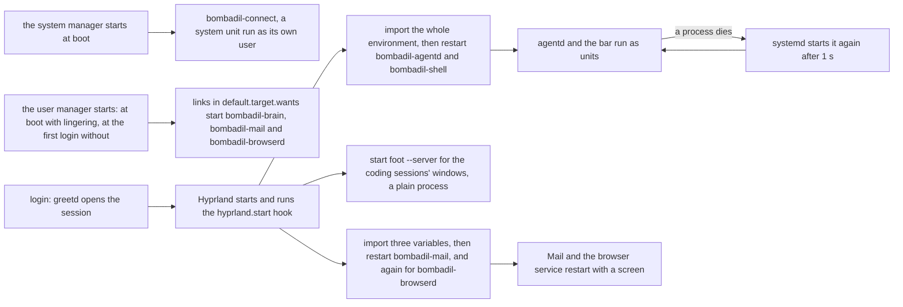
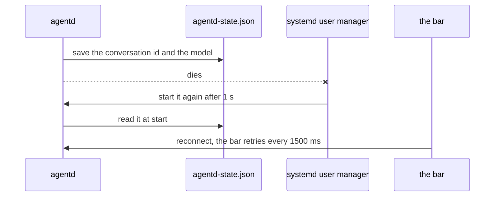

# The session stays alive

> **Status:** Partly shipped. On `main`: five user units (the agent daemon, the bar, the brain, Mail and the browser service) and one system unit of its own user (the connection service), the start hook that restarts four of the user units at each login and starts a `foot` server, the pill key (the bar answers it itself), the terminal key, the stop key and the key that restarts the bar, the scope each coding session runs in and the lingering that keeps the user's systemd through a compositor crash, restore points pruned to the newest 30, the installer's kernel rule, retention and lingering (a refresh sets the last two again), and Sonnet as the default Claude model with the words `use opus` and `use sonnet`. Designed, not built: the rescue page on tty2 and the panic key, restore points as pre and post pairs with the last 100 changed pairs kept, and the pruning of `@.undone-<time>`.
> **Code:** `iso/airootfs/etc/systemd/user/bombadil-agentd.service`, `iso/airootfs/etc/systemd/user/bombadil-shell.service`, `iso/airootfs/etc/systemd/user/bombadil-brain.service`, `iso/airootfs/etc/systemd/user/bombadil-mail.service`, `iso/airootfs/etc/systemd/user/bombadil-browserd.service`, `iso/airootfs/etc/systemd/user/default.target.wants/`, `iso/airootfs/etc/systemd/system/bombadil-live.service`, `iso/airootfs/etc/systemd/system/bombadil-connect.service`, `iso/airootfs/usr/lib/sysusers.d/bombadil-connect.conf`, `iso/packages.x86_64`, `iso/airootfs/etc/skel/.config/hypr/hyprland.lua`, `iso/airootfs/etc/claude-code/managed-settings.d/50-bombadil.json`, `iso/airootfs/etc/codex/`, `bin/bombadil`, `bin/bombadil-shell`, `bin/bombadil-signal`, `bin/bombadil-connect`, `bin/bombadil-browserd`, `iso/airootfs/usr/local/bin/bombadil-install`, `iso/airootfs/usr/local/bin/bombadil-rollback`, `iso/airootfs/usr/local/bin/bombadil-setup`, `iso/airootfs/usr/local/bin/bombadil-smoke`, `scripts/build-iso.sh`, `scripts/test-vm.sh`, `scripts/vm-tools/update-in-place`, `src/bombadil/agentd.py`, `src/bombadil/dev.py`, `src/bombadil/procs.py`, `src/bombadil/paths.py`, `src/bombadil/vitals.py`, `src/bombadil/brain/actors.py`, `src/bombadil/jobs.py`, `src/bombadil/rest.py`, `src/bombadil/away.py`, `src/bombadil/snapshots.py`, `src/bombadil/config.py`, `src/bombadil/launcher.py`, `src/bombadil/hypr.py`, `src/bombadil/providers.py`, `src/bombadil/narrate.py`, `src/bombadil/watch.py`, `shell/shell.qml`, `shell/PillKeys.qml`, `shell/DevState.qml`, `tests/test_iso_profile.py`, `tests/test_installer.py`, `tests/test_pill_keys_qml.py`, `tests/test_hypr.py`, `tests/test_dev.py`, `tests/desktop/driver.py`
> **Design:** [Foundation choices](../design/foundation-choices.md), [the UX brief, rule 7](../design/ux-brief.md#the-rules) and [the installed OS brief, piece 4](../design/installed-os-brief.md#after-these-in-order)
> **Verified:** 2026-11-09 against `main` at `ca7f80a`, and for what `main` changed since, 2026-11-12 against `main` at `7d37bc5`. The tests and the VM checks were read, not run, and what `systemd`, `loginctl` and `foot` do on their own is marked as theirs where the page relies on it. Re-checked at `7d37bc5` by reading the code: the pill and terminal keys (`hyprland.lua`, `shell/PillKeys.qml`, `hypr.py`), the installer's kernel, retention, lingering and home rules and what a refresh keeps, the `MODE=installed` host logic, and the smoke's key checks; every `file:line` anchor was moved to its place at `7d37bc5` through the diff and the ones in the changed paragraphs were looked at. The rest of the page was not checked again.

Bombadil's interface is the pill, and the agent that answers it can edit the shell, the compositor config and `agentd` itself. If the daemon behind the pill or the bar that draws it dies, the person is left with a desktop and no way to ask for anything. So the daemon and the bar run as systemd user services that start again when they die, a hook in the Hyprland config starts them at login, and restore points are pruned so the safety net does not grow without bound. The bar owns the notification name itself, so no notification daemon is a unit. The brain, Mail, the browser service and the connection service are units of their own that nothing waits on. This page also says what keeps a coding session running through a restart of the daemon or the bar ([coding sessions](coding-sessions.md) owns the rest of that piece), and holds the installer's kernel rule, the rule for how the agent installs software, the model the agent runs on, and how a change to any of these reaches a system that is already running.

## What is built and what is designed

On `main`: the five user units and the connection service's system unit, the start hook with its `foot` server, the four keys, the scope and slice that each coding session runs in with the lingering and the window rule behind them, restore points pruned to the newest 30, the installer's kernel rule, the install command the agent is told to use, and Sonnet as the default Claude model with the words `use opus` and `use sonnet`. Designed, with no code anywhere (the UX brief decides them, and [known gaps](#known-gaps) lists them): the rescue page on tty2 and the panic key, restore points as pre and post pairs with the last 100 changed pairs kept, and the pruning of `@.undone-<time>`.

## How it works

The user manager starts the units that are enabled by a link: at boot where lingering is on (the live image, and a disk installed since the lingering lines went into the installer), at the first login otherwise (`loginctl`'s documented behaviour for a lingering user, not shown by a file here). Hyprland's start hook, at each login, restarts the rest after handing them the session's environment. From then on systemd, not `agentd` or the bar, brings a dead part back. The connection service is not a user unit: the system manager starts it at boot, as a user of its own.



### The five units

The five are user units, and their files are in `iso/airootfs/etc/systemd/user/`. The image lays the directory at `/etc/systemd/user/` and the installer copies it with the rest of the live system ([what `bombadil-install` does](iso-and-install.md#what-bombadil-install-does)). The connection service is not one of them: it is a system unit, described after the list.

| Unit | What it runs | Restart policy | Started by |
|---|---|---|---|
| `bombadil-agentd.service` | the agent daemon, `/usr/local/bin/agentd` ([agentd](agentd.md#starting-it)) | `Restart=always`, `RestartSec=1`, `TimeoutStopSec=5`, `KillMode=process` | the hook only: the unit has no `[Install]` section |
| `bombadil-shell.service` | the bar and pill, `/usr/local/bin/bombadil-shell`; `After=bombadil-agentd.service` ([shell](shell.md)) | `Restart=always`, `RestartSec=1`, `TimeoutStopSec=5` | the hook only: no `[Install]` section |
| `bombadil-brain.service` | `/usr/local/bin/bombadil-brain` ([the brain](brain.md)) | `Restart=on-failure`, `RestartSec=2`, `Nice=5` | the user manager: `[Install] WantedBy=default.target` and a link in `default.target.wants/` |
| `bombadil-mail.service` | `/usr/local/bin/bombadil-mail` ([Mail](mail.md)) | `Restart=on-failure`, `RestartSec=2`, `Nice=5` | the user manager, by the same kind of link, and then the hook restarts it at each login |
| `bombadil-browserd.service` | `/usr/local/bin/bombadil-browserd` ([the browser service](browser-and-signin.md#the-browser-service)); `After=graphical-session.target` | `Restart=on-failure`, `RestartSec=2`, `KillMode=process` | the user manager, by the same kind of link, and then the hook restarts it at each login |

Every unit, the connection service's included, sets `StartLimitIntervalSec=0` under `[Unit]`. systemd reads that key only there; under `[Service]` it is ignored, and its default of five starts in ten seconds would end a crash loop with no pill at all (the comment in `test_the_daemon_and_the_bar_come_back_when_they_die` says both). A daemon that keeps failing is still better than none.

Why each one is a unit:

- **`bombadil-agentd.service`**: systemd starts it again if it dies, with the environment the hook imported into the user manager (the smoke's comment on `restart_agentd` calls it "the normal environment"). `KillMode=process` is explained by the unit's own comment: the apps it started keep running when it restarts, and only the daemon stops.
- **`bombadil-shell.service`**: it runs the `bombadil-shell` wrapper, which puts the app kit's QML module on Quickshell's import path. A bare `quickshell -p shell/shell.qml` starts a bar whose colours are all undefined ([shell](shell.md#theme-and-why-the-shell-starts-through-binbombadil-shell)). `/usr/local/bin/bombadil-shell` is a link made by the `for b in ...` list in `scripts/build-iso.sh:25`.
- **No unit for notifications.** The shell's own `NotificationServer` owns `org.freedesktop.Notifications` on the session bus ([connect.md](connect.md)), so `mako` is not in `iso/packages.x86_64` and the image has no unit or drop-in for it. The smoke checks that `mako` is neither installed nor running and that the bar owns the name (`mako-is-not-installed`, `mako-is-not-running`, `notifications-owner-is-the-shell`).
- **`bombadil-brain.service`, `bombadil-mail.service` and `bombadil-browserd.service`**: nothing depends on them, and each unit's comment says a failure leaves the pill, the turns and the apps as they are (the browser service's says the panel and the turns carry on, and the Slack setup says the browser service is not running until it is back). Each unit's comment gives the reason for `StartLimitIntervalSec=0`: five quick failures, such as a locked disk at login, would otherwise leave it stopped. The comments say "until the next login", which was written before lingering: with lingering a login does not start the brain, and the hook's restart is what starts Mail and the browser service again. `bombadil-browserd.service` has `KillMode=process`, because the unit's comment says a page it opened may have started the person's browser, which keeps running when only the service restarts. Like Mail it starts before the session has a screen, so the hook hands it one ([Who starts them](#who-starts-them)).

### The connection service, a system unit

`bombadil-connect.service` is the one unit here that is not a user unit. It is a system unit (`iso/airootfs/etc/systemd/system/bombadil-connect.service`, enabled by a link in `multi-user.target.wants/`) that runs `/usr/local/bin/bombadil-connect` as the system user `bombadil-connect`, an account with no login and no home that `iso/airootfs/usr/lib/sysusers.d/bombadil-connect.conf` makes. The reason is the keys it holds: its state directory, `/var/lib/bombadil-connect`, is mode 0700 for that user, so the person's own programs cannot open it. The unit's comment says the person has `sudo` on this image, so an agent that uses it still can.

The rest of the unit has the shape of the others: `Restart=on-failure`, `RestartSec=2` and `StartLimitIntervalSec=0`, `MemoryMax=300M`, and the sandboxing keys systemd offers (`NoNewPrivileges`, `ProtectSystem=strict`, `ProtectHome`, `PrivateTmp`, `RestrictAddressFamilies=AF_UNIX AF_INET AF_INET6` and more), but not `ProtectProc`, `ProcSubset`, `PrivateUsers` or `PrivatePIDs`: the unit's comment says the service looks in `/proc/<pid>` of whoever pressed, and reads its cgroup, to refuse a press from inside an agent's turn. The hook does not touch the unit, because it needs nothing from the session. A service that dies leaves the pill, the cards and the turns as they are, and `agentd` says "Connections are not running yet" until it is back (the unit's comment). What the service keeps and does is in [connect.md](connect.md), and its contract in [CONNECT.md](../CONNECT.md).

### Who starts them

The `hyprland.start` handler in `iso/airootfs/etc/skel/.config/hypr/hyprland.lua` (lines 9-24) runs four commands. Comments are left out here:

```lua
hl.on("hyprland.start", function()
    hl.exec_cmd("systemctl --user import-environment && systemctl --user restart bombadil-agentd bombadil-shell")
    hl.exec_cmd("foot --server")
    hl.exec_cmd("systemctl --user import-environment WAYLAND_DISPLAY HYPRLAND_INSTANCE_SIGNATURE XDG_CURRENT_DESKTOP"
        .. " && systemctl --user restart bombadil-mail.service")
    hl.exec_cmd("systemctl --user import-environment WAYLAND_DISPLAY HYPRLAND_INSTANCE_SIGNATURE XDG_CURRENT_DESKTOP"
        .. " && systemctl --user restart bombadil-browserd.service")
end)
```

The first command imports the environment with no names and then restarts the daemon and the bar. With no names `systemctl --user import-environment` copies the whole environment of the calling process into the user manager (systemd's documented behaviour, not shown by a file here), so a unit started afterwards, and one restarted after a crash, has the session's variables. `WAYLAND_DISPLAY` and the Hyprland signature exist only inside the session, not in the user manager (the comment in `test_the_session_starts_them_after_handing_over_its_environment` says so).

The second command starts `foot --server`, one terminal server for the coding sessions' windows, "so a session's window rises at once" (the file's comment). It is not a unit: no unit runs it and nothing restarts it if it dies, and as a client of the compositor it goes when the compositor does (foot's behaviour, not shown by a file here). `Dev._viewer` opens a session's window through `footclient` only when the server's socket, `$XDG_RUNTIME_DIR/foot-$WAYLAND_DISPLAY.sock`, exists (`foot_server()`, `dev.py:802-805`) and `footclient` is installed; otherwise, or when `footclient` fails, it starts a plain `foot` for that window (`dev.py:514-532`).

The third and fourth commands are the same two lines for two units: each imports three variables by name and restarts a unit that starts with the user manager, `bombadil-mail.service` and `bombadil-browserd.service`. Mail's unit starts before the session has a screen, and the Thunderbird it keeps unseen needs one (the file's comment, which says "at login"; [Mail](mail.md)). The browser service starts before the session has a screen too, and opening a page needs this session's Wayland display to start Chromium on and its Hyprland instance to slide the panel in (the file's comment; [the browser service](browser-and-signin.md#the-browser-service)). The hook does not touch `bombadil-brain.service`, and it starts no notification daemon: the file's comment says the bar's `NotificationServer` owns `org.freedesktop.Notifications` and a second owner would take web pages' notifications away from the line. Nor does it touch the connection service, a system unit.

On the installed system the hook is the only thing in this repository that starts the daemon and the bar at login: `systemctl restart` also starts a unit that is not running (systemd's documented behaviour), and no link or `[Install]` section of these units starts them. Other things start them on purpose:

- `bombadil-setup` runs `systemctl --user restart bombadil-agentd` after it signs in with no daemon to ask (`bombadil-setup:30`).
- `scripts/dev-session.sh` starts `bin/agentd` and `bombadil-shell` by hand on a development desktop ([development](../contributing/development.md#run-a-dev-session-against-a-checkout)).
- The smoke stops the daemon's unit, starts its own `agentd` with `setsid -f agentd` (another provider, a fake sign-in) and starts the unit again afterwards (`restart_agentd`, `agentd_unit_again` in `bombadil-smoke`).

A second `agentd` takes over the socket path and leaves the first running with no socket: `AgentD.serve` removes whatever file is at that path. That is why the smoke stops the unit first.

### The keys

| Key | Does | Needs `agentd` |
|---|---|---|
| Super (tap) or Alt+Space | the pill takes the keyboard, and a second tap gives it back. Hyprland fires the bar's global shortcuts `bombadil:pill-release` and `bombadil:pill-press` (`hyprland.lua:68-79`, `shell/PillKeys.qml`), and the bar calls `PillState.summon` itself ([how a tap reaches the pill](#how-a-tap-reaches-the-pill)) | no |
| Super+Return | `bombadil terminal`: a terminal on the desktop, with a drawer that shows put away first and Hyprland's workspace token left out of its environment, so it does not open inside the drawer (`hyprland.lua:66-67`, `Hyprland.open_terminal`, `hypr.py:227`) | no |
| Super+Esc | `bombadil stop`: ends the running turn and everything it started, `sudo` commands too (`hyprland.lua:80-81`). A command that Stop ended reads `stopped` in `bombadil watch` and in the details drawer, not `failed (exit -2)` | yes |
| Super+Ctrl+Esc | `systemctl --user restart bombadil-shell`, for a bar that hangs (`hyprland.lua:82-83`) | no |

Alt+Space exists for a host that keeps the Super key: a virtual machine's window on Windows opens the host's Start menu (the file's comment).

**Super+Return.** A window that opens while a drawer shows (a special workspace: the details, the files, an app) lands inside that drawer and leaves with it, which is what a plain `foot` bind did. `Hyprland.open_terminal` reads the focused monitor, puts away the special workspace that shows unless it is the terminal's own, and starts `foot` without `HL_INITIAL_WORKSPACE_TOKEN` in its environment (`hypr.py:227-254`). The method's docstring gives the reason for the second step: Hyprland stamps every process it starts with the workspace that showed when the keys went down and opens that process's first window there for a few seconds, so putting the drawer away alone is not enough. When Hyprland cannot be asked the terminal opens anyway. The bind does not go through `agentd`: `bombadil terminal` (`bin/bombadil:428-431`) calls the method itself.

#### How a tap reaches the pill

The tap and Alt+Space are Hyprland global shortcuts answered inside the bar's own process. `hyprland.lua` binds a release of Super to `hl.dsp.global("bombadil:pill-release")` and Alt+Space to `hl.dsp.global("bombadil:pill-press")`. `shell/PillKeys.qml` registers a `GlobalShortcut` for each name (appid `bombadil`), `shell/shell.qml` loads it once and only under Hyprland, and each shortcut calls `pill.summon("")`, the function that the `summon` event from `agentd` also reaches (`PillState.handle`). A bind that ran `bombadil pill` instead would be a Python start and a round trip through the daemon, and the lua's comment says that on a busy machine the first letters typed after the tap went to the window underneath before the pill had the keyboard. Two things matter when changing it:

- A name says which edge the bar listens to: the tap fires on release (the bind has `release = true`) and Alt+Space on press. Hyprland does nothing, and says nothing, for a name no client registered, and there is no fallback on purpose: a fallback that also ran `bombadil pill` would bring the slow path back. The guards are `test_the_shortcuts_the_keys_fire_are_the_ones_the_bar_registers_on_the_edge_it_listens_to`, which reads the names and edges out of the lua and the QML, and the smoke's `pill-shortcuts-registered`, which asks `hyprctl globalshortcuts` for both names before a key depends on them; a tap that did nothing prints that list in its `DIAG` line (`bombadil-smoke:180-181,192`).
- The bar makes each shortcut once. `PillKeys.qml`'s comment says the protocol refuses a second registration of the same appid and name and the client that comes second crashes, which a copy per screen would be; the protocol's behaviour was not checked here, and `test_the_shortcuts_the_keys_fire_are_the_ones_the_bar_registers_on_the_edge_it_listens_to` asserts the single `Loader` that loads it.

`bombadil pill` works, for scripts and for a session without Hyprland (the headless desktop test); it sends `summon` to the daemon (`bin/bombadil:426-427`).

The word `stopped` is for the exit codes -2, -15 and -9. A command's exit code is minus the number of the signal that ended it, and Stop sends SIGINT, then SIGTERM, then SIGKILL (`STOP_CODES` in `watch.py:24`, used at `watch.py:90-93`). Any other code still reads `failed (exit N)`. How Stop finds and ends the processes is in [agentd](agentd.md#stop).

`bombadil stop` (what Super+Esc runs) and `bombadil pill` (no key runs it) each write one message to `agentd`'s socket (`send` in `bin/bombadil:138-156`, with a 2 s timeout). With no daemon they print `agentd is not running (<reason>)` to standard error and exit 1. While `agentd` is down Super+Esc does nothing, and the keys that still act are the tap and Alt+Space (the bar answers them, though the pill they open has no daemon to talk to), Super+Return, and Super+Ctrl+Esc, which goes to systemd; no key restarts the daemon (see [known gaps](#known-gaps)). The pill's key states are in [the shell](shell.md#keyboard-focus).

### Coding sessions stay alive

A coding session ([coding sessions](coding-sessions.md)) is the vendor's own tool in a zellij session that `agentd` starts. It is not a unit of this page. It has to outlive `agentd`, the bar and the compositor, so it runs in a transient systemd scope of its own.

| Part | What it is | Where |
|---|---|---|
| The scope | `Dev._launch_now` runs `systemd-run --user --scope --quiet --collect --expand-environment=no --unit=bombadil-dev-<project>-<role>-<run> --slice=bombadil-dev-<project>.slice -- zellij ... attach --create-background bombadil-<project>-<role> --close-on-exit -- bombadil dev run <key>`. The scope is outside `bombadil-agentd.service`, the bar and the compositor, so a restart of the daemon, of the bar (Super+Ctrl+Esc) or a crash of the compositor is meant to leave the session running. The daemon unit's `KillMode=process` is not what does it. Only a restart of `agentd` has a check, and that one runs with no scope (see [what is checked](#what-is-checked-and-what-is-not)) | `dev.py:423-454`, the flags are `procs.SCOPE` (`procs.py:137`) |
| The slice | One slice per project. The `-` of the project's name is replaced by `_` (systemd reads a `-` in a slice name as a level of nesting), so the slice sits directly under `bombadil-dev.slice` (`vitals.DEV_SLICE`), where the brain and the Machine card look for it by name | `dev.py` (`_launch_now`), `vitals.py:58,94`, `brain/actors.py:22` |
| No scope | When `procs.scope_supported()` is false (`BOMBADIL_NO_SCOPE=1`, no `/run/systemd/system`, or `systemd-run --scope true` failing) the session starts with no unit (`s.unit = ""`). The guarantee above is the scope's. The one thing that shows a session with no scope surviving anything is the desktop check, which stops and starts a plain `agentd` in a container with no systemd (`tests/desktop/driver.py:2539`, and the driver's comment at line 772 says there is no systemd); it says nothing about a restart of the bar or a crash of the compositor | `procs.py:140-153`, `dev.py:423-454` |
| Lingering | Keeps the user's systemd, and so the scopes, through a compositor crash or a logout (the reason the unit comments give; what `loginctl` does for a lingering user is systemd's, not shown by a file here). On the live image `bombadil-live.service` runs `loginctl enable-linger user` (`After=systemd-logind.service`). The installer touches `/var/lib/systemd/linger/user` in the chroot step `configure`, in a fresh install and in a refresh, because `copy_system` removes `bombadil-live.service` from the copy | `bombadil-live.service:4,10`, `bombadil-install:438-440,592-594` |
| The window | A viewer of class `bombadil-session-<slug>` on the zellij session, through `footclient` when [the `foot` server](#who-starts-them) is up. The Hyprland rule `bombadil-sessions` floats it, centres it and sizes it to `(monitor_w*0.86) (monitor_h*0.8)`. Closing it leaves the session running, and typing the session's name opens a viewer again | `dev.py:514-532`, `hyprland.lua:94-102` |
| The end | A session ends when its tool exits (the zellij session is made with `--close-on-exit`), on `end <name>` (`Dev.end`, which runs `zellij kill-session` and then `systemctl --user stop <unit>.scope`), or at a reboot. A restart of `agentd` or of the bar, or a crash of the compositor, is not meant to end it: the scope is outside all three | `dev.py:331-352` |

#### What is checked and what is not

A restart of `agentd` is exercised once, with no scope: the desktop driver's check `sessions outlive an agentd restart` stops a plain `agentd` and starts it again with two sessions open, in a container with no systemd, so `scope_supported()` is false and its sessions have no scope. Nothing exercises a session in its scope through a restart of the daemon by systemd, a restart of the bar, a crash of the compositor or a logout. Those rest on the scope and on lingering, which are systemd's behaviour, and no test or smoke check does any of them: the smoke's `dev-lives-on` closes only the viewer window and checks that the zellij session is still listed ([Tests](#tests)). [Coding sessions](coding-sessions.md#hosting) says the same.

What the restart keeps is in the next section.

### What a restart keeps and loses

`AgentD` writes `{"provider", "session_id", "model"}` to `<runtime dir>/agentd-state.json` and reads it in `serve` (`agentd.py:522-548`). `<runtime dir>` is `$BOMBADIL_RUNTIME`, else `$XDG_RUNTIME_DIR/bombadil`, else `/run/user/<uid>/bombadil` (`paths.runtime_dir`). The file is written after a turn that worked, when a dead conversation is cleared, and after `use opus` or `use sonnet`.



| | After systemd restarts the daemon, or the hook does at a login | After a reboot, or a later login where lingering is off |
|---|---|---|
| The conversation (`session_id`) | kept, when the saved provider is the running one; a different provider's state is ignored | lost. The state file is under the runtime dir, which a reboot clears (`test_the_state_file_lives_where_a_reboot_clears_it`). A later login clears it only where lingering is off, because the runtime dir goes with the user manager that lingering keeps (systemd's behaviour, not shown by a file here): on the live image and on a disk installed since the lingering lines the file survives a logout. The code's comment at `agentd.py:526-527` says "a reboot or a new login" and was written before lingering |
| The session's model (`use opus`) | kept, for Claude and only `opus` or `sonnet` | lost, on the same terms: the configured or default model applies again |
| The turn number | kept: the larger of the last turn in `turns.jsonl` and the number in the `turn` file (`agentd.py:398`) | kept: both files are in the state dir in the home |
| The queue of waiting prompts and the notes for the next turn | lost: `AgentD.pending` and `AgentD.notes` are in memory (`agentd.py:402,411`) | lost |

The coding sessions, and the other state that grew around the daemon, answer differently:

| | After the daemon or the bar restarts, or the compositor crashes | After a reboot |
|---|---|---|
| The coding sessions: the tool, its zellij session and its scope | meant to be kept and running, by the scope ([what is checked](#what-is-checked-and-what-is-not)). The registry is `~/.local/state/bombadil/dev/sessions.json` (`paths.dev_dir()`), written by `agentd`. `Dev._load` keeps a session alive when its `boot` equals `/proc/sys/kernel/random/boot_id`, which a restart by systemd or by the start hook does not change. Every 3 s `agentd._dev_watch` calls `Dev.check`, which marks a session `failed` ("Stopped unexpectedly") when zellij does not list it and its state has not changed for 20 s (`PENDING_SECONDS`); if zellij cannot be asked, no session is taken for gone | every live session becomes `asleep` ("Stopped by a restart") and resumes by name with the tool's own conversation id |
| The dots beside the pill | kept while the daemon is away: `DevState.lost()` clears only the line, and `agentd` sends the `dev` snapshot again when the bar reconnects (`_greet`, `agentd.py:644-665`) | come back from the registry, dim |
| Hook events from `bombadil-signal` while the daemon is away | wait in `~/.local/state/bombadil/dev/signals.jsonl`; `dev.take_spool` reads and removes the file when the daemon starts (`agentd._dev_signals`) | the file is in the home and is kept until the daemon reads it |
| The Away card | lost: it is in memory. `away.json` in the state folder keeps only `seen_at`, when the person last saw it | lost; `seen_at` is kept |
| A provider's limit and a hand pause | kept in `rest.json` in the state folder (`rest.py`), until the limit lapses | kept, by the same file |
| Running jobs and timers | keep running through a restart of the daemon or the bar. Each is a transient user unit, `bombadil-job-<id>` or `bombadil-timer-<id>`, started with `systemd-run --user` and no scope (`jobs.py:161-162`, `jobs.py:356-366`), so it belongs to the user manager and not to `agentd`. `serve` calls `_jobs_kick` (`agentd.py:593`) and `Jobs` reads the records in `~/.local/state/bombadil/jobs/` again, so a job still running is counted again ([the jobs registry](desk.md#the-jobs-registry)) | the records stay, a job's unit does not: the first look finds a unit that is gone with no exit status and forgets the record without a word (`jobs.py:395-398`) |
| The desk's layout | kept in `desk.toml` in the state folder, which `Desk.load` reads at start (`paths.desk_file()`) | kept, by the same file |

While the daemon is away the bar says `Waiting for agentd…` and retries every 1500 ms (`shell/shell.qml:226,764`). Tests: `test_a_restarted_daemon_keeps_the_conversation_and_the_turn_count`, `test_a_dead_conversation_is_not_brought_back_by_a_restart` and `test_saved_state_that_is_not_for_this_daemon_is_ignored`.

### Restore points do not pile up

On an installed system every model turn and every `!` line starts with a btrfs snapshot, the undo button. A turn gets one only where snapper and `/etc/snapper/configs/root` exist and `snapshots` is not false; the live ISO, a development machine and a failed snapper call take none ([when a turn gets no restore point](restore-points.md#when-a-turn-gets-no-restore-point)).

- `Snapshots.create` passes `--cleanup-algorithm number` (`snapshots.py:54-57`). Its comment says that without it nothing ever deletes the snapshot, and they pile up for good.
- The installer sets `TIMELINE_CREATE=no NUMBER_CLEANUP=yes NUMBER_LIMIT=30` on the `root` config (`snapper_setup`, `bombadil-install:692`) and enables `snapper-cleanup.timer` in the same chroot step as lingering (`configure`, `bombadil-install:595`). So an installed system takes one restore point per turn and no hourly ones, and snapper keeps at most 30 numbered snapshots, when its cleanup timer runs.

How snapper then prunes is snapper's behaviour, and no file in this repository shows it. Snapper's manual describes a minimum age (`NUMBER_MIN_AGE`) that spares young snapshots from the number cleanup, and the cleanup runs when the timer fires, not when a snapshot is made, so more than 30 can exist between runs. Neither was checked on a machine. The smoke checks the flag on a snapshot, the config values and the enabled timer; it does not wait for a deletion (`snapshot-is-prunable` and `snapshots-are-pruned`, `bombadil-smoke:836-837`). What is not pruned, and the readers' limits, are in [retention and pruning](restore-points.md#retention-and-pruning).

### The installer

`bombadil-install` copies the running system to a btrfs disk, either onto a freshly partitioned disk or, with `--refresh`, as a new system beside the home folder that is already there ([what it does](iso-and-install.md#what-bombadil-install-does), [the installed OS](installed-os.md)). Four of its rules belong here, and so does what a refresh does to a machine that an older installer made.

- **The kernel comes from the copied system.** `probe` looks up the newest `/usr/lib/modules/*/vmlinuz` of the image that is copied (`newest_kernel`, `bombadil-install:132-137`, called at line 166) before `partition` touches the disk (`bombadil-install:193-205`), and `copy_system` installs it as `/boot/vmlinuz-linux` of the new root (line 444), so the kernel sits in `@`, inside every restore point, and not on the EFI partition. `newest_kernel`'s comment says the kernel is the image's, because the live session may have upgraded its own. The script never reads the boot medium: `test_the_installer_takes_the_kernel_from_the_system_it_copies_not_from_the_boot_medium` asserts that `bootmnt` does not appear in it, and the test's comment gives the reason, that with `copytoram` (a USB stick with RAM to spare) the medium is unmounted by the time a kernel would be copied from it, which stopped the earlier script after the disk was wiped. A system with no `/usr/lib/modules/*/vmlinuz` stops in `probe` with `Error: No kernel found under <image>/usr/lib/modules` and exit status 1 (`bombadil-install:166`), before anything on the disk is changed. The older script stopped at its `ls` with exit status 2.
- **The retention is set once per system, at install** (`snapper_setup` and `configure`, `bombadil-install:595,692`), as described under [Restore points do not pile up](#restore-points-do-not-pile-up). A refresh runs both again on its new root.
- **Lingering is turned on for `user`.** `configure` touches `/var/lib/systemd/linger/user` (`bombadil-install:594`), because `copy_system` deletes `bombadil-live.service`, the unit that turns it on for the stick, from the copy (`bombadil-install:438-440`). `test_the_account_lingers_so_coding_sessions_outlive_the_session_that_started_them` runs `configure` in both modes and looks for the `touch`. See [Coding sessions stay alive](#coding-sessions-stay-alive).
- **The units and the hook arrive with the copy.** The units come with the copied tree (`cp -a "$image/." "$target/"`, or `cp -ax /. "$target/"` when no image is mounted, `bombadil-install:425,428`). In a fresh install the home does not exist yet, so the account and its home, `hyprland.lua` included, come from `/etc/skel` in `configure` (`bombadil-install:582-591`). A refresh keeps the home that is there: `prepare_home` copies the skeleton into it with `cp -an` (`bombadil-install:651`), which adds only the files the home lacks, so a refreshed machine keeps its own `~/.config/hypr/hyprland.lua` ([Updating a running system](#updating-a-running-system)).

### Software the agent installs

The rule for installing software is in the agent's system prompt, not in the installer: nothing in the repository blocks `pacman -Sy`. `providers.system_prompt()`, which both CLIs get on every turn, tells the agent to install with `sudo pacman -Syu --noconfirm --needed <packages>` and never `pacman -Sy` alone, because Arch breaks on a partial upgrade. It also tells the agent to say in one plain sentence, before it runs, that this updates every other package, and to tell the person a restart is needed if an upgrade replaced the kernel, because until then `modprobe` cannot load modules (`providers.py:45-48`).

`narrate.py` words the step as `Updating the system and installing X` while it runs and `Updated the system and installed X` when it is done, for `-Syu`, `-Su` and `--sysupgrade` with package names (`narrate.py:370-379`). A bare update reads `Updating the system`.

### Models

Claude turns run on Sonnet. `config.DEFAULT_MODELS` has one entry, `claude` = `claude-sonnet-5-5`, so Codex keeps its CLI's own default. [agentd](agentd.md#models) owns the rest of the mechanism; this is what the session depends on.

| Part | What it is |
|---|---|
| The configuration | `Config.model_for(provider)` returns the `[models]` entry for the provider, else the bare `model` key when the provider is the configured one, else `DEFAULT_MODELS`, else nothing (`config.py:28-32`). A `[models]` value that is not a non-empty string is dropped |
| The words | `launcher.MODEL_WORDS`: `use opus`, `switch to opus`, `use claude opus`, `opus please`; `use sonnet`, `switch to sonnet`, `use claude sonnet`, `sonnet please`, `back to sonnet`. They must be the whole line, ignoring case and end punctuation: a sentence such as "use opus to write me a poem" goes to the agent. The launcher only recognises them; `agentd` does the switch (`_switch_model`, `agentd.py:554-562`) with no model call and no restore point |
| The ids | `config.CLAUDE_MODELS`: `opus` is `claude-opus-5-5` and `sonnet` is `claude-sonnet-5-5` |
| When it applies | from the next message: a turn that is running finishes on the model it started with. The answer is `Using Opus from the next message. Say "use sonnet" to go back.` (for Sonnet, `Using Sonnet from the next message.`) |
| Codex | refused with a sentence and nothing changes: `Opus is a Claude model; this machine is set to use codex.` (`Sonnet is ...` for the other word) |
| How long it lasts | through a restart of the daemon, by the state file above; not through a reboot, nor through a later login where lingering is off ([what a restart keeps](#what-a-restart-keeps-and-loses)). It is never written to `config.toml` |

Picking a provider (`AgentD.choose`) writes the user's `config.toml` through `config.save_user`, which keeps `[models]` and `explain` and writes a bare `model` only when the provider stays the same and the configuration already names one. When the provider changes, the session's model and conversation id are dropped and the other provider starts on its configured or default model.

### Updating a running system

`hyprland.lua` lives in `/etc/skel`, which `useradd -m` and the installer copy into a home when they create it. A change to the units, the hook or the coding tools' settings reaches a machine by one of two routes, and neither copies the hook into a home that already has one.

A refresh (`bombadil-install --refresh`) builds a new root from the new image and keeps the home. The units, the account file `usr/lib/sysusers.d/bombadil-connect.conf` and the managed settings in `etc/claude-code` and `etc/codex` come with the copied tree, and `configure` and `snapper_setup` run again on the new root, so lingering and the snapper limit are set again (`bombadil-install:594,692`; [The installer](#the-installer)). `prepare_home` adds to the kept home only the files it lacks (`cp -an`, `bombadil-install:651`), so the home's own `~/.config/hypr/hyprland.lua` stays as it was, and a refreshed machine runs a new unit set with whatever hook it had.

`scripts/vm-tools/update-in-place` moves less. It copies none of the skeleton, the files in `etc/systemd`, the account file `usr/lib/sysusers.d/bombadil-connect.conf`, the coding tools' managed settings in `etc/claude-code` and `etc/codex`, or anything under `/var/lib/systemd`: its `SYSTEM` list (lines 23-26) names none of them. Its header says the person's `~/.config/hypr/hyprland.lua` goes by hand, and [the VM tools README](../../scripts/vm-tools/README.md) says the same of `iso/` changes and files under `/etc`. What the tool does move is `bin`, `src`, `shell` and `share` in `/usr/share/bombadil`, the smoke script and, unless `--no-system` is given, the files in `SYSTEM`, which include `bombadil-install` and `bombadil-rollback`. It also links every program of `bin/` that has no link in `/usr/local/bin`, so a program such as `bombadil-shell`, `bombadil-signal`, `bombadil-connect` or `bombadil-browserd` reaches an older install (`update-in-place:73`; [the VM tools](../contributing/development.md#the-vm-tools); `scripts/wsl-vm.sh refresh` runs it, see [the Windows launcher](iso-and-install.md#the-windows-launcher)).

On a machine updated in place, and for the hook on a refreshed one, a change to a unit or to the hook therefore goes in this order:

1. Copy the unit files, and a link in `default.target.wants/` if there is one, to `/etc/systemd/user/`, then run `systemctl --user daemon-reload`. For the connection service, a system unit, copy `bombadil-connect.service` to `/etc/systemd/system/` with its link in `multi-user.target.wants/` and `bombadil-connect.conf` to `/usr/lib/sysusers.d/` (`systemd-sysusers` makes the account from it, systemd's behaviour, not shown by a file here), install `python-mcp` and `python-httpx`, which it runs on and which `update-in-place` does not move (its header lists packages among what it does not move), and run `systemctl daemon-reload`.
2. Copy `hyprland.lua` to `~/.config/hypr/`. A machine updated in place keeps the older file until then: with no `foot --server` line, so a coding session's window starts a plain `foot` each time, and with no `bombadil-sessions` window rule, so the window is not floated, centred and sized (`hyprland.lua:13-14`, `:94-102`). The older file also has no restart of `bombadil-browserd.service` after the session's display is imported (`hyprland.lua:19-22`), which the hook's comment says opening a page needs. An older file from before the keys became global shortcuts runs `bombadil pill` for the tap and Alt+Space, so the tap needs a Python start and `agentd` to answer (the comment in the new file says that on a busy machine the first letters typed after a tap went to the window underneath), and it runs a plain `foot` for Super+Return, which opens inside a drawer that shows (`hyprland.lua:66-79`; [how a tap reaches the pill](#how-a-tap-reaches-the-pill)). The bar's side of the shortcuts needs no copy: `shell/PillKeys.qml` is in `/usr/share/bombadil/shell`, which the tool replaces.
3. On a machine installed before the lingering lines went into the installer and then only updated in place, create `/var/lib/systemd/linger/user`, as `bombadil-install:594` does, or run `loginctl enable-linger user`, as the live image's unit does. A refresh sets it, and nothing else in the repository adds it to an installed machine afterwards.
4. Copy `etc/claude-code/managed-settings.d/50-bombadil.json`, `etc/codex/config.toml` and `etc/codex/requirements.toml` to `/etc/`, which is where the coding tools' hooks that run `bombadil-signal` are set. The wrapper `bombadil dev run` reports only a session's exit (`dev.run`, `dev.py:842-875`; the report is `dev.py:871-872`), so without these files the dots beside the pill do not follow what the tool is doing.
5. Start the session again (log out and in, or reboot). The hook runs only at `hyprland.start`, so a copied `hyprland.lua` does nothing until then.

The order matters. A `hyprland.lua` that restarts `bombadil-agentd`, copied before the unit exists, makes the restart of `bombadil-agentd` fail, and nothing starts a daemon. Units copied before the hook leave the older hook, which ran a bare `agentd`, `bombadil-shell` and `mako` that no unit supervises.

## Interfaces other pieces depend on

| Name | Kind | What it is |
|---|---|---|
| `bombadil-agentd.service`, `bombadil-shell.service`, `bombadil-brain.service`, `bombadil-mail.service`, `bombadil-browserd.service` | user units | the five units above |
| `bombadil-connect.service`, the account `bombadil-connect` | a system unit and a system user | [the connection service](#the-connection-service-a-system-unit); the account comes from `/usr/lib/sysusers.d/bombadil-connect.conf` |
| `systemctl --user import-environment [NAMES]` | command | run by the hook: with no names for the first command, with `WAYLAND_DISPLAY HYPRLAND_INSTANCE_SIGNATURE XDG_CURRENT_DESKTOP` for Mail's and again for the browser service's |
| `foot --server` | command | run by the hook, with no unit; the windows of the coding sessions use it through `footclient` ([Who starts them](#who-starts-them)) |
| `systemctl --user restart bombadil-agentd` | command | run by `bombadil-setup` (`bombadil-setup:30`); printed by `bombadil provider` when there is no daemon socket and it only wrote the choice (`bin/bombadil:456`) |
| `systemctl --user restart bombadil-shell` | command | what Super+Ctrl+Esc runs |
| `systemd-run --user --scope ... --unit=bombadil-dev-<project>-<role>-<run> --slice=bombadil-dev-<project>.slice` | command | how `Dev._launch_now` starts a coding session; the flags before `--unit` are `procs.SCOPE` ([Coding sessions stay alive](#coding-sessions-stay-alive)) |
| `bombadil-dev-<project>-<role>-<run>.scope`, `bombadil-dev-<project>.slice`, `bombadil-dev.slice` | transient user units | a coding session's scope, its project's slice and their parent; `systemctl --user stop <unit>.scope` is how `Dev._kill` ends a hung one |
| `bombadil-signal` | command | `bin/bombadil-signal`, linked into `/usr/local/bin` by `scripts/build-iso.sh:25`: what the coding tools' hooks run; with no daemon it leaves the event in `signals.jsonl` |
| `bombadil-connect`, `bombadil-browserd` | commands | `bin/bombadil-connect` and `bin/bombadil-browserd`, linked into `/usr/local/bin` by the same list: what the connection service's unit and the browser service's unit run |
| `loginctl enable-linger user` | command | run by `bombadil-live.service` on the live image |
| `journalctl --user -u bombadil-agentd` | command | named in the line that `bombadil ask` and `bombadil status` print when no daemon answers (`talk`, `bin/bombadil:68`) |
| `bombadil pill`, `bombadil stop` | commands | send `summon` and `stop` to `agentd` (`bin/bombadil:424-427`) |
| Super (tap), Alt+Space, Super+Return, Super+Esc, Super+Ctrl+Esc | keys | the table under [The keys](#the-keys) |
| `use opus`, `use sonnet` and the other words of `launcher.MODEL_WORDS` | launcher words | [Models](#models) |
| `provider`, `model`, `[models]`, `snapshots` | config keys | [agentd](agentd.md#configuration) lists them all |
| `claude-sonnet-5-5`, `claude-opus-5-5` | model ids | `config.DEFAULT_MODELS` and `config.CLAUDE_MODELS` (`config.py:14,16`) |
| `agentd-state.json` | file | the conversation and the session's model, [below](#where-state-lives) |
| `--cleanup-algorithm number` | snapper argument | passed by `Snapshots.create` |
| `TIMELINE_CREATE=no NUMBER_CLEANUP=yes NUMBER_LIMIT=30`, `snapper-cleanup.timer` | snapper config keys and a system unit | set by `snapper_setup` and enabled by `configure` (`bombadil-install:692,595`) |
| `sudo pacman -Syu --noconfirm --needed <packages>` | the install command the agent is told to run | `providers.py:45-48` |
| `STOP_CODES` | tuple, `(-2, -15, -9)` | the exit codes that `bombadil watch` words as `stopped` (`watch.py:24`) |

## Where state lives

| What | Where | Notes |
|---|---|---|
| The five user unit files | `/etc/systemd/user/`, with links in `/etc/systemd/user/default.target.wants/` for the brain, Mail and the browser service | in the root subvolume, so a restore point holds them and an undo takes a change to them back |
| The connection service's unit and account | `/etc/systemd/system/bombadil-connect.service`, linked in `/etc/systemd/system/multi-user.target.wants/`, and `/usr/lib/sysusers.d/bombadil-connect.conf` | in the root subvolume as well. The service's own socket and state directory are in [connect.md](connect.md) |
| The start hook | `~/.config/hypr/hyprland.lua`, copied from `/etc/skel` when the home is made | in the home, which no restore point covers; an update does not copy it again |
| The environment the units get | the user manager's own environment | filled by `import-environment` at each session start; not a file |
| The `foot` server | a process of the session, socket `$XDG_RUNTIME_DIR/foot-$WAYLAND_DISPLAY.sock` | started by the hook; no unit, so nothing brings it back |
| The coding sessions' scopes and slices | the user manager, as transient units `bombadil-dev-<project>-<role>-<run>.scope` and `bombadil-dev-<project>.slice` | gone at a reboot; outside the daemon, the bar and the compositor, so a restart of any of them is not meant to end a session ([what is checked](#what-is-checked-and-what-is-not)) |
| Jobs and timers | the user manager, as transient units `bombadil-job-<id>` and `bombadil-timer-<id>`, with their records, logs and exit files in `~/.local/state/bombadil/jobs/` and the desk's layout in `~/.local/state/bombadil/desk.toml` | the units are gone at a reboot, the files stay; kept through a restart of the daemon ([the jobs registry](desk.md#the-jobs-registry)) |
| Lingering | `/var/lib/systemd/linger/user` | made by `loginctl enable-linger user` on the live image and touched by the installer on the disk |
| The coding sessions' registry and the hooks' spool | `~/.local/state/bombadil/dev/sessions.json` and `signals.jsonl` | in the home: `sessions.json` is written by `agentd` alone, `signals.jsonl` by `bombadil-signal` and `dev.send_signal` while the daemon is away |
| A provider's limit or pause, and when the Away card was last seen | `~/.local/state/bombadil/rest.json` and `away.json` | in the state dir, so a restart and a reboot keep them (`src/bombadil/rest.py`, `src/bombadil/away.py`) |
| The conversation id and the session's model | `<runtime dir>/agentd-state.json` | kept across a restart of the daemon, cleared by a reboot, and by a later login only where lingering is off |
| The turn number | `<state dir>/turn` and `<state dir>/turns.jsonl` | see [agentd](agentd.md#where-state-lives) |
| The retention settings | `NUMBER_CLEANUP`, `NUMBER_LIMIT` and `TIMELINE_CREATE` in `/etc/snapper/configs/root`, and `snapper-cleanup.timer` enabled | set once by the installer |
| The settings | `/etc/bombadil/config.toml` (`provider`, `snapshots`) and `~/.config/bombadil/config.toml` (`provider`, `model`, `[models]`) | the person's file is written when a provider is picked |
| The model ids | `config.DEFAULT_MODELS` and `config.CLAUDE_MODELS` | in code, not in a file |

## Principles it keeps

- [Recovery without the broken part](../principles.md#recovery-without-the-broken-part): systemd restarts the daemon and the bar when they die, and Super+Ctrl+Esc restarts the bar through systemd, not through the bar or `agentd`. The traps: a unit with `StartLimitIntervalSec` under `[Service]` or left out, which ends a crash loop after five starts, and a restart that is a message to `agentd`. Super+Esc and the pill key are such messages, which is why [a hung daemon has no key](#known-gaps). A coding session runs in a scope outside all three, so none of their restarts is meant to end it; the trap is starting a session as a plain child of `agentd`, which a restart of the daemon could take with it.
- [Every piece degrades, and nothing waits on a model it does not need](../principles.md#degrade-and-recover): the brain, Mail, the browser service and the connection service are units of their own that are never given up on, and a failure of any of them leaves the pill, the turns and the apps as they are. The trap: making the daemon, the bar or a turn wait for one of them, with `Requires=`, `After=` or a blocking connect.
- [Full access with undo](../principles.md#full-access-with-undo): on an installed system every turn takes a restore point, and the number cleanup keeps their count bounded. The traps: a restore point made with no `--cleanup-algorithm`, which nothing deletes, and a `NUMBER_LIMIT` that does not fit the readers (the agent's tool and `bombadil undo` look at the newest 20, the launcher at the newest 200).
- [Plain files stay the truth](../principles.md#plain-files-stay-the-truth): an update does not rewrite the person's home, so `hyprland.lua`, copied from `/etc/skel` once, keeps the hook it was made with. A default the person does not edit belongs in the image (`/etc`, `/usr`), not in the home skeleton. The trap: neither reaches an installed machine without the manual steps under [Updating a running system](#updating-a-running-system), so a change to either says how to apply it by hand. The session's model is never written to the person's `config.toml`.
- [One machine one conversation](../principles.md#one-machine-one-conversation): a restart of the daemon keeps the conversation through the state file. The trap: state that matters and lives only in memory, as the queue does.

## Extending it

### Add a service the session must keep alive

1. Write `iso/airootfs/etc/systemd/user/<name>.service`. Put `StartLimitIntervalSec=0` under `[Unit]`. Use `Restart=always` for a part the person cannot do without, as the daemon and the bar do, and `Restart=on-failure` for a part nothing depends on, as the brain and Mail do.
2. Decide who starts it. If it can start with the user manager and no screen, give it `[Install] WantedBy=default.target` and a link `default.target.wants/<name>.service` pointing at `../<name>.service`, as the brain, Mail and the browser service have. If it needs the session's screen, leave out `[Install]` and add the unit to the restart line that follows the bare `import-environment` in `hyprland.lua`. If it starts with the user manager but needs a screen, import the variables it needs by name and restart it from the hook, as Mail's and the browser service's commands do. If it holds something the person's own programs must not read, make it a system unit of its own user instead, as the connection service is ([above](#the-connection-service-a-system-unit)): the unit in `iso/airootfs/etc/systemd/system/` with a link in `multi-user.target.wants/`, and a `sysusers.d` file for the account.
3. If it runs a program from `bin/`, add the program to the `for b in ...` list in `scripts/build-iso.sh:25`, so that `/usr/local/bin/<name>` links to `/usr/share/bombadil/bin/<name>`.
4. Test it. Add the unit to the list in `test_the_daemon_and_the_bar_come_back_when_they_die` (that test asserts `Restart=always`; a unit with `on-failure` needs a test of its own beside `test_the_mail_service_is_a_user_unit_that_starts_at_login_and_is_never_given_up_on` and `test_the_browser_service_is_a_user_unit_that_starts_at_login_after_the_session_and_is_never_given_up_on`), and to the hook assertion in `test_the_session_starts_them_after_handing_over_its_environment`. In `bombadil-smoke` add `check <name>-comes-back revives <unit>` and the unit to `units_active` (`bombadil-smoke:245-255`).
5. Machines that already exist need the unit and the hook by hand, in the order under [Updating a running system](#updating-a-running-system).

### Change the model words or the default

1. The phrases are `launcher.MODEL_WORDS` and the display names `launcher.MODEL_TITLES`. The target (`opus`, `sonnet`) must be a key of `config.CLAUDE_MODELS`, whose values are the ids passed to the CLI. `_load_state` accepts only those keys. The hint `Say "use sonnet" to go back.` is written for `opus` in `_switch_model`.
2. The default is `config.DEFAULT_MODELS`. Codex has no entry and keeps its CLI's default.
3. `_switch_model` refuses every model word when the provider is not Claude. Supporting another provider means changing that check and what `_load_state` accepts.
4. Test the words in the tables of `tests/test_launcher.py` (`test_exact_words_open_locally` and `test_everything_else_goes_to_the_agent`) and the switch in `tests/test_agentd.py`. See [add a launcher word](agentd.md#add-a-launcher-word).

### Change the retention

The limit is the installer's: `NUMBER_LIMIT=30` in `bombadil-install:692`, pinned by `test_the_installed_system_prunes_its_restore_points_and_takes_no_hourly_ones` and by the smoke check `snapshots-are-pruned`. [Change the retention limit](restore-points.md#change-the-retention-limit) has the steps, including a machine that is already installed.

### Change what the hook does

Edit `hyprland.lua`, keep `import-environment` before the restart it serves, and update `test_the_session_starts_them_after_handing_over_its_environment`. A system that already exists keeps its copy of the file, so say in the change how to apply it by hand. A command that starts a plain process, as `foot --server` does, is not supervised: if it must come back when it dies, make it a unit instead.

### Change how a coding session is kept alive

1. The command is in `Dev._launch_now` (`dev.py:423-454`) and the shared flags are `procs.SCOPE` (`procs.py:137`). Keep the scope outside `bombadil-agentd.service`, and keep the names `bombadil-dev-<project>-<role>-<run>.scope` and `bombadil-dev-<project>.slice`: the brain reads them with `DEV_SLICE` in `brain/actors.py:22` and the Machine card with `_SESSIONS_UNIT` and `DEV_SLICE` in `vitals.py:58,94`.
2. `Dev._kill` has to stop what the launch started: `zellij kill-session`, then `systemctl --user stop <unit>.scope`.
3. `tests/test_dev.py` sets `BOMBADIL_NO_SCOPE=1` in its `projects` fixture (`tests/test_dev.py:70`), which every test that starts a session uses, so no unit test sees the scope command. The VM smoke does: `dev-scope`, `dev-slice`, `dev-lives-on` and `dev-scope-gone` ([Tests](#tests)).
4. A machine that already exists keeps its hook and, if it was installed before the lingering lines, has no `/var/lib/systemd/linger/user`: [Updating a running system](#updating-a-running-system) has the steps.

## Tests

| What | Where |
|---|---|
| Each unit restarts on exit: `Restart=always`, `StartLimitIntervalSec=0` under `[Unit]` and not under `[Service]`, `KillMode=process`, the `ExecStart` of the daemon and the bar | `tests/test_iso_profile.py`: `test_the_daemon_and_the_bar_come_back_when_they_die` |
| The hook imports the environment before it restarts, starts no bare `agentd`, and Super+Ctrl+Esc restarts the unit | `test_the_session_starts_them_after_handing_over_its_environment` |
| The pill keys are global shortcuts: the binds name `bombadil:pill-release` and `bombadil:pill-press` and start no process, the names are the ones the bar registers on the edge it listens to, and `shell.qml` loads `PillKeys` once, under Hyprland only | `tests/test_iso_profile.py`: `test_the_pill_opens_from_super_and_from_alt_space`, `test_the_pill_keys_start_no_process_the_first_letters_would_wait_for`, `test_the_shortcuts_the_keys_fire_are_the_ones_the_bar_registers_on_the_edge_it_listens_to` |
| A tap summons the pill on release, Alt+Space on press and not again on release, each tap is one summon, and there are no shortcuts without Hyprland. Quickshell's `GlobalShortcut` is stood in for; the real `PillKeys` and `PillState` load | `tests/test_pill_keys_qml.py` |
| Super+Return runs `bombadil terminal`, a terminal opens on the desktop, a drawer that shows is put away first, the terminal does not carry Hyprland's workspace token, and the terminal drawer is left showing for the terminal that opens in it | `tests/test_iso_profile.py`: `test_super_return_opens_a_terminal_that_does_not_belong_to_the_drawer_showing`; `tests/test_hypr.py`: `test_a_terminal_opens_on_the_desktop_when_no_drawer_shows`, `test_a_drawer_that_shows_is_put_away_before_the_terminal_opens`, `test_the_terminal_does_not_carry_hyprlands_workspace_token`, `test_the_terminal_drawer_is_left_showing_for_the_terminal_that_opens_in_it` |
| The hook hands Mail's unit its screen, and Mail's unit has its `default.target.wants` link | `test_the_session_hands_the_mail_unit_its_screen_before_thunderbird_needs_one`, `test_the_mail_service_is_a_user_unit_that_starts_at_login_and_is_never_given_up_on` |
| The browser service's unit starts at login after the graphical session, restarts on failure, keeps `KillMode=process` and has its link, and the hook imports the display before it restarts it | `test_the_browser_service_is_a_user_unit_that_starts_at_login_after_the_session_and_is_never_given_up_on` |
| The connection service is a system unit of its own user with a closed state directory, its account cannot log in and has no home, the build links its command and the browser service's, and the image carries no notification daemon and nothing that starts one | `test_the_connection_service_is_a_system_unit_of_its_own_user_with_a_closed_state_directory`, `test_the_connection_service_user_is_a_system_account_that_cannot_log_in_and_has_no_home`, `test_the_build_links_the_connection_services_commands_into_usr_local_bin`, `test_the_image_has_what_connections_run_on_and_no_notification_daemon`, `test_nothing_on_the_image_starts_or_configures_a_notification_daemon` |
| The brain's unit has its `ExecStart`, `WantedBy=default.target` and its link in `default.target.wants/` | `tests/test_brain_service.py`: `test_the_iso_starts_the_brain_and_puts_both_programs_on_path` |
| `bombadil-setup` and `bombadil` restart the daemon through systemd | `test_setup_and_the_cli_restart_the_daemon_through_systemd` |
| The smoke replaces the daemon through its unit and checks the units with a function | `test_the_smoke_replaces_agentd_through_its_unit_and_checks_the_units_with_a_function` |
| The installer sets the limit and the timer, takes the kernel from the system it copies before it erases the disk, and turns lingering on in a fresh install and in a refresh | `tests/test_iso_profile.py`: `test_the_installed_system_prunes_its_restore_points_and_takes_no_hourly_ones`, `test_the_installer_takes_the_kernel_from_the_system_it_copies_not_from_the_boot_medium`; `tests/test_installer.py`: `test_the_account_lingers_so_coding_sessions_outlive_the_session_that_started_them` |
| The agent is told the install command and the restart after a kernel upgrade | `test_pacman_has_an_active_mirror_and_the_agent_upgrades_as_it_installs`, `test_the_agent_is_told_a_replaced_kernel_needs_a_restart` |
| The wording of an install that updates the system | `tests/test_narrate.py`: `test_shell_commands_in_plain_words` (the `pacman -Syu` rows), `test_an_install_that_updates_the_system_is_summed_up_as_both` |
| `create` passes `--cleanup-algorithm number` | `tests/test_snapshots.py`: `test_a_turns_restore_point_is_one_snapper_may_prune` |
| The default model, `[models]`, the bare `model` and a provider switch that keeps `[models]` | `tests/test_config.py`: `test_claude_defaults_to_sonnet_and_codex_to_its_own_default`, `test_models_are_set_per_provider_and_a_bare_model_is_for_the_configured_one`, `test_switching_provider_keeps_the_models`; `tests/test_providers.py`: `test_claude_is_asked_for_sonnet_unless_the_config_says_otherwise` |
| The model words match whole lines only | `tests/test_launcher.py`: `test_exact_words_open_locally`, `test_everything_else_goes_to_the_agent` |
| The switch, its survival of a restart, the Codex refusal, and no model written to the config | `tests/test_agentd.py`: `test_use_opus_and_use_sonnet_switch_the_model_for_the_next_turns`, `test_a_switched_model_survives_a_restart_of_the_daemon`, `test_use_opus_says_so_when_the_machine_runs_another_provider`; `tests/test_agentd_signin.py`: `test_choosing_claude_starts_it_on_sonnet_and_a_model_switch_is_not_written_to_the_config` |
| The state file: a restart keeps the conversation and the count, a dead conversation is not brought back, another provider's state is ignored, the file is where a reboot clears it | `tests/test_agentd.py`: `test_a_restarted_daemon_keeps_the_conversation_and_the_turn_count`, `test_a_dead_conversation_is_not_brought_back_by_a_restart`, `test_saved_state_that_is_not_for_this_daemon_is_ignored`, `test_the_state_file_lives_where_a_reboot_clears_it` |
| A command that Stop ended reads `stopped` | `tests/test_watch.py`: `test_a_command_that_stop_ended_reads_stopped_not_failed` |
| A booted machine | `iso/airootfs/usr/local/bin/bombadil-smoke`, run by `scripts/test-vm.sh`: `agentd-comes-back` and `bar-comes-back` (each kills the unit's main process with `kill -9` and waits up to 90 s for a different one), `agentd-answers-again` (waits up to 60 s for `bombadil status` to answer) and `bar-layer-again` (waits up to 60 s for the `bombadil-bar` layer), `services-are-units` (the two are active), the keys (`super-tap-then-launcher`, `alt-space-then-launcher`, and `super-escape-stops` with `stop-in-history`: Super+Esc ends a running `!sleep 300` and the history says it was stopped), `agentd-restored` (in the sign-in block: the unit's daemon replaces the smoke's own), and, on the installed disk, `snapshot-is-prunable` and `snapshots-are-pruned` |
| The keys on a booted machine | the same smoke, in every mode (`bombadil-smoke:174-215`): `pill-shortcuts-registered` (`hyprctl globalshortcuts` lists both names, waited for up to 60 s, because Hyprland does nothing for a name the bar has not registered), `super-tap-then-launcher` and `alt-space-then-launcher` (the key and then the word `browser` typed, and the browser drawer shows), and for Super+Return `super-return-terminal` (a `foot` window that is not on a special workspace) and `super-return-puts-the-drawer-away` (the drawer that showed is gone). When the tap does nothing it logs a `DIAG` line that says whether the bind or the pill failed |
| The connection service, the browser service and notifications on a booted machine | the same smoke, every mode: `connect-user-exists` (the account has the shell `nologin`), `connect-unit-enabled`, `connect-unit-active`, `connect-unit-hardened` (the loaded unit's `User`, `NoNewPrivileges`, `ProtectSystem`, `ProtectHome`, `PrivateTmp`, `RuntimeDirectoryMode` and `MemoryMax`), `connect-unit-answers` (`status` answered to the person's own process), `connect-state-is-closed` (`/var/lib/bombadil-connect` is mode 0700 for that user and the person's own process cannot list it), `browserd-unit-enabled`, `browserd-unit-active`, `browserd-unit-answers` and `mako-is-not-installed`; outside the `undo` mode also `mako-is-not-running` and `notifications-owner-is-the-shell`. The checks that need a connection run the unit on its fake engine for a moment and put it back ([connect.md](connect.md)) |
| A coding session's scope, lingering and window | the same smoke, in every mode (`bombadil-smoke:363-381`): `dev-tools` (`zellij`, `foot`, `footclient` and `bombadil-signal` are on the path), `dev-linger` (`loginctl show-user user -p Linger` says `yes`), `dev-scope` and `dev-slice` (a `bombadil-dev-smoke-shell-*.scope` and `bombadil-dev-smoke.slice` are active), `dev-window` (the viewer is floating) and `dev-window-size` (it is most of the screen, which is what the size in the `bombadil-sessions` rule is for), `dev-lives-on` (the zellij session is still listed after its window is closed), `dev-end` and `dev-scope-gone` (`end shell smoke` removes the zellij session and the scope) |
| Sessions and a restart of the daemon | `tests/test_dev.py`: `test_agentd_restarting_keeps_running_sessions` (a second `Dev` on the same registry finds the session alive, and marks it `failed` once zellij loses it), `test_after_a_restart_sessions_are_asleep_and_resume_by_id` (another boot id makes it `asleep`); `tests/test_sessions_qml.py`: `test_the_line_and_next` (`lost` clears the line and keeps the dots); the desktop driver's check `sessions outlive an agentd restart` (`tests/desktop/driver.py:2539`), which stops and starts a plain `agentd` with two sessions open, in a container with no systemd and so with no scope ([what is checked](#what-is-checked-and-what-is-not)) |
| Every command the build links has a file in `bin/` | `tests/test_iso_profile.py`: `test_the_build_links_mails_commands_into_usr_local_bin` reads the `for b in ...` list of `scripts/build-iso.sh`, `bombadil-signal` included |

```sh
python3 -m pip install -e '.[dev]'    # pytest and pytest-asyncio: the agentd tests need the second
python3 -m pytest -q tests/test_iso_profile.py tests/test_snapshots.py tests/test_config.py
python3 -m pytest -q tests/test_launcher.py -k "exact_words_open_locally or everything_else_goes_to_the_agent"
python3 -m pytest -q tests/test_providers.py tests/test_narrate.py tests/test_watch.py
python3 -m pytest -q tests/test_agentd.py tests/test_agentd_signin.py -k "restarted_daemon or state_file or saved_state or dead_conversation or use_opus or switched_model or choosing_claude"
MODE=install scripts/test-vm.sh       # the booted checks, then the install and the undo round trip
MODE=installed scripts/test-vm.sh     # boots the disk the last install run left
```

`MODE=installed` boots the disk the last `MODE=install` or `MODE=install-encrypted` run left, and exits 2 when there is none; for an encrypted disk it types the password to GRUB's prompt again (`scripts/test-vm.sh:192-205`). The installed system remembers its phase in `~/.bombadil-smoke-phase`: after an undo round trip that was cut short it is the second boot, which checks `undo-applied`, and after one that finished it runs the first pass again (`bombadil-smoke:796-848`). Every mode except `refresh` makes the host fail a run whose first log has a `SKIP signin` line, which the smoke prints on a machine that already has a provider chosen (`scripts/test-vm.sh:222-223`; [VM testing](../contributing/vm-testing.md#running-it)). The smoke's other checks are listed in [the smoke test](iso-and-install.md#the-smoke-test), and what a VM run covers is in [VM testing](../contributing/vm-testing.md#what-it-covers).

No test pins the brain unit's `Restart=on-failure` or `StartLimitIntervalSec=0`; the smoke checks only that the service is active, on the installed disk (`brain-service-active`). Nothing presses Super+Ctrl+Esc: the bind is pinned as text by `test_the_session_starts_them_after_handing_over_its_environment`, and the smoke presses Super, Alt+Space, Super+Return and Super+Esc only. No test checks the order of the hook's commands in a running Hyprland, or that `import-environment` reaches a restarted unit; the smoke shows that a killed unit comes back and answers. No test or smoke check restarts the bar, crashes the compositor or logs out while a session runs in its scope, or restarts the daemon through systemd with one.

## Known gaps

| Gap | Evidence |
|---|---|
| A hung `agentd`, alive and not answering, is not restarted, and no key restarts it. A unit is restarted when its process exits, and this one has no `WatchdogSec`. Super+Esc needs the daemon (`bombadil stop` sends `stop` to it); the pill key does not, since the bar takes the tap itself, so with a hung daemon the pill still opens, and nothing answers what is typed in it; Super+Ctrl+Esc restarts only the bar | `iso/airootfs/etc/systemd/user/bombadil-agentd.service`, `hyprland.lua:68-83`, `bin/bombadil:138-156` |
| A restart of the daemon drops the queue of waiting prompts and the notes for the next turn. The prompts that were waiting for an account's limit to lift are among them ([the poor man switch](poor-man-switch.md)) | `agentd.py:402,411` |
| `update-in-place` moves neither the units (the user units and the connection service's system unit with its account file), `hyprland.lua` nor the coding tools' managed settings, so a machine updated that way keeps its old hook and units until they are copied by hand, and a refresh keeps the home's `hyprland.lua` too: an older hook has no `foot --server` line, no `bombadil-sessions` window rule, no restart of the browser service, no `bombadil terminal` bind for Super+Return and runs `bombadil pill` for the tap | `scripts/vm-tools/update-in-place:23-26`, `bombadil-install:651`, `hyprland.lua:13-14,19-22,66-79,94-102` |
| A machine installed before the lingering lines and only updated in place has no `/var/lib/systemd/linger/user`: `update-in-place` moves nothing under `/var/lib/systemd`, and only a refresh sets it again. The lingering is what the comments in `bombadil-live.service` and `bombadil-install` give as the reason coding sessions outlive a compositor crash or a logout | `bombadil-install:594`, `scripts/vm-tools/update-in-place:23-26` |
| No unit test pins the scope command (the `projects` fixture of `tests/test_dev.py:70` sets `BOMBADIL_NO_SCOPE=1`), the lingering lines or the window rule, and nothing checks the hook's `foot --server` line: `dev-tools` checks that `zellij foot footclient bombadil-signal` are installed, and no check asks whether the `foot` server runs. Only the VM smoke covers the scope, the slice, the lingering and the window rule (`dev-scope`, `dev-slice`, `dev-linger`, `dev-window`, `dev-window-size`) | `tests/test_dev.py:70`, `bombadil-smoke:363-372` |
| A session in its scope is never taken through a restart of the daemon by systemd, a restart of the bar, a crash of the compositor or a logout by any check. `dev-lives-on` closes only the viewer window, and the desktop check restarts a plain `agentd` with no scope. What keeps a session through those rests on the scope and on lingering | `bombadil-smoke:374-376`, `tests/desktop/driver.py:2539`, `procs.py:140-153` |
| The rescue page on tty2 and the panic key (the Super+Ctrl+Backspace menu in the UX brief) do not exist: `hyprland.lua` binds no such key, and nothing in `iso/`, `src/`, `bin/`, `shell/`, `scripts/` or `share/` names a tty2 page | `hyprland.lua:62-83`, `iso/airootfs/etc/greetd/config.toml`, [the UX brief's decisions](../design/ux-brief.md#decisions-i-picked-a-default-for) |
| A machine installed before the installer set the limit keeps its old snapper config until a refresh, which runs `snapper_setup` again; `update-in-place` runs no `set-config` | `bombadil-install:692`, `scripts/vm-tools/update-in-place:64` |
| `@.undone-<time>` is removed by nothing, and the restore point `update-in-place` takes has no cleanup algorithm, so the number cleanup never deletes it | `bombadil-rollback:3-4,66-67`, `scripts/vm-tools/update-in-place:64`, the comment at `snapshots.py:54-55` |
| Retention is one snapshot per turn and the newest 30, where the UX brief decides pre and post pairs with the last 100 changed pairs kept | `snapshots.py:54-57`, `bombadil-install:692`, [the UX brief's decisions](../design/ux-brief.md#decisions-i-picked-a-default-for) |
| No check waits for a cleanup to delete a snapshot, so the pruning itself is unseen: only the flag, the config values and the timer are checked | `bombadil-smoke:836-837` |
