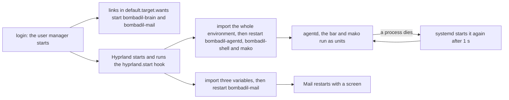
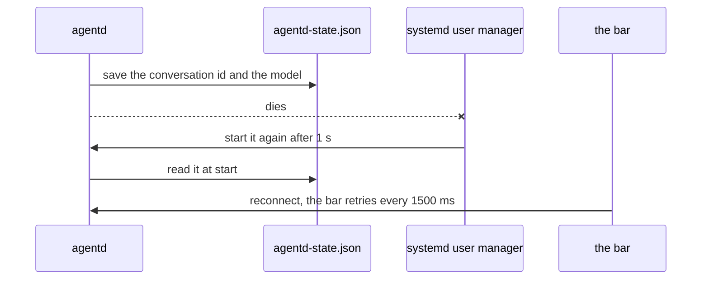

# The session stays alive

> **Status:** Partly shipped. On `main`: five user units (the agent daemon, the bar, notifications, the brain and Mail), the start hook that restarts four of them at each login, the pill key, the stop key and the key that restarts the bar, restore points pruned to the newest 30, the installer's kernel rule, and Sonnet as the default Claude model with the words `use opus` and `use sonnet`. Designed, not built: the rescue page on tty2 and the panic key, restore points as pre and post pairs with the last 100 changed pairs kept, and the pruning of `@.undone-<time>`.
> **Code:** `iso/airootfs/etc/systemd/user/bombadil-agentd.service`, `iso/airootfs/etc/systemd/user/bombadil-shell.service`, `iso/airootfs/etc/systemd/user/mako.service.d/restart.conf`, `iso/airootfs/etc/systemd/user/bombadil-brain.service`, `iso/airootfs/etc/systemd/user/bombadil-mail.service`, `iso/airootfs/etc/systemd/user/default.target.wants/`, `iso/airootfs/etc/skel/.config/hypr/hyprland.lua`, `bin/bombadil`, `bin/bombadil-shell`, `iso/airootfs/usr/local/bin/bombadil-install`, `iso/airootfs/usr/local/bin/bombadil-setup`, `iso/airootfs/usr/local/bin/bombadil-smoke`, `scripts/build-iso.sh`, `scripts/test-vm.sh`, `scripts/vm-tools/update-in-place`, `src/bombadil/agentd.py`, `src/bombadil/snapshots.py`, `src/bombadil/config.py`, `src/bombadil/launcher.py`, `src/bombadil/providers.py`, `src/bombadil/narrate.py`, `src/bombadil/watch.py`, `tests/test_iso_profile.py`
> **Design:** [Foundation choices](../design/foundation-choices.md), [the UX brief, rule 7](../design/ux-brief.md#the-rules) and [the installed OS brief, piece 4](../design/installed-os-brief.md#after-these-in-order)
> **Verified:** 2026-11-08 against `main` at `7176e55`

Bombadil's interface is the pill, and the agent that answers it can edit the shell, the compositor config and `agentd` itself. If the daemon behind the pill or the bar that draws it dies, the person is left with a desktop and no way to ask for anything. So the daemon, the bar and the notification daemon run as systemd user services that start again when they die, a hook in the Hyprland config starts them at login, and restore points are pruned so the safety net does not grow without bound. This page also holds the installer's kernel rule, the rule for how the agent installs software, the model the agent runs on, and how a change to any of these reaches a system that is already running.

## How it works

At login the user manager starts the units that are enabled by a link, and Hyprland's start hook restarts the rest after handing them the session's environment. From then on systemd, not `agentd` or the bar, brings a dead part back.



### The five units

Four of the five are unit files in `iso/airootfs/etc/systemd/user/`; for `mako` only the drop-in `mako.service.d/restart.conf` is there, and the unit it adjusts comes from the `mako` package. The image lays the directory at `/etc/systemd/user/` and the installer copies it with the rest of the live system ([what `bombadil-install` does](iso-and-install.md#what-bombadil-install-does)).

| Unit | What it runs | Restart policy | Started by |
|---|---|---|---|
| `bombadil-agentd.service` | the agent daemon, `/usr/local/bin/agentd` ([agentd](agentd.md#starting-it)) | `Restart=always`, `RestartSec=1`, `TimeoutStopSec=5`, `KillMode=process` | the hook only: the unit has no `[Install]` section |
| `bombadil-shell.service` | the bar and pill, `/usr/local/bin/bombadil-shell`; `After=bombadil-agentd.service` ([shell](shell.md)) | `Restart=always`, `RestartSec=1`, `TimeoutStopSec=5` | the hook only: no `[Install]` section |
| `mako.service` with the drop-in `mako.service.d/restart.conf` | notifications | the drop-in sets `Restart=always` and `RestartSec=1` | the hook; the package's own unit, which is not in this repository, may add ways of its own |
| `bombadil-brain.service` | `/usr/local/bin/bombadil-brain` ([the brain](brain.md)) | `Restart=on-failure`, `RestartSec=2`, `Nice=5` | login: `[Install] WantedBy=default.target` and a link in `default.target.wants/` |
| `bombadil-mail.service` | `/usr/local/bin/bombadil-mail` ([Mail](mail.md)) | `Restart=on-failure`, `RestartSec=2`, `Nice=5` | login, by the same kind of link, and then the hook restarts it |

Every unit, and the drop-in, sets `StartLimitIntervalSec=0` under `[Unit]`. systemd reads that key only there; under `[Service]` it is ignored, and its default of five starts in ten seconds would end a crash loop with no pill at all (the comment in `test_the_daemon_the_bar_and_the_notifications_come_back_when_they_die` says both). A daemon that keeps failing is still better than none.

Why each one is a unit:

- **`bombadil-agentd.service`**: systemd starts it again if it dies, with the environment the hook imported into the user manager (the smoke's comment on `restart_agentd` calls it "the normal environment"). `KillMode=process` is explained by the unit's own comment: the apps it started keep running when it restarts, and only the daemon stops.
- **`bombadil-shell.service`**: it runs the `bombadil-shell` wrapper, which puts the app kit's QML module on Quickshell's import path. A bare `quickshell -p shell/shell.qml` starts a bar whose colours are all undefined ([shell](shell.md#theme-and-why-the-shell-starts-through-binbombadil-shell)). `/usr/local/bin/bombadil-shell` is a link made by the `for b in ...` list in `scripts/build-iso.sh:16`.
- **`mako.service`**: the drop-in has no `ExecStart`, so the unit it adjusts is not in this repository: it can only come from the `mako` package (`iso/packages.x86_64:30`). What that unit sets is upstream behaviour this page cannot vouch for. The smoke check `notifications-come-back` kills `mako`'s main process and waits for a different one, which shows that a unit by that name exists on a built image.
- **`bombadil-brain.service` and `bombadil-mail.service`**: nothing depends on them, and each unit's comment says a failure leaves the pill, the turns and the apps as they are. Each unit's comment gives the reason for `StartLimitIntervalSec=0`: five quick failures, such as a locked disk at login, would otherwise leave it stopped until the next login.

### Who starts them

The `hyprland.start` handler in `iso/airootfs/etc/skel/.config/hypr/hyprland.lua` (lines 9-16) runs two commands. Comments are left out here:

```lua
hl.on("hyprland.start", function()
    hl.exec_cmd("systemctl --user import-environment && systemctl --user restart bombadil-agentd bombadil-shell mako")
    hl.exec_cmd("systemctl --user import-environment WAYLAND_DISPLAY HYPRLAND_INSTANCE_SIGNATURE XDG_CURRENT_DESKTOP"
        .. " && systemctl --user restart bombadil-mail.service")
end)
```

The first command imports the environment with no names and then restarts the daemon, the bar and `mako`. With no names `systemctl --user import-environment` copies the whole environment of the calling process into the user manager (systemd's documented behaviour, not shown by a file here), so a unit started afterwards, and one restarted after a crash, has the session's variables. `WAYLAND_DISPLAY` and the Hyprland signature exist only inside the session, not in the user manager (the comment in `test_the_session_starts_them_after_handing_over_its_environment` says so).

The second command imports three variables by name and restarts `bombadil-mail.service`. Mail's unit starts at login, before the session has a screen, and the Thunderbird it keeps unseen needs one (the file's comment; [Mail](mail.md)). The hook does not touch `bombadil-brain.service`.

On the installed system the hook is the only thing in this repository that starts the daemon, the bar and `mako` at login: `systemctl restart` also starts a unit that is not running (systemd's documented behaviour), and no link or `[Install]` section of these units starts them. Other things start them on purpose:

- `bombadil-setup` runs `systemctl --user restart bombadil-agentd` after it signs in with no daemon to ask (`bombadil-setup:30`).
- `scripts/dev-session.sh` starts `bin/agentd` and `bombadil-shell` by hand on a development desktop ([development](../contributing/development.md#run-a-dev-session-against-a-checkout)).
- The smoke stops the daemon's unit, starts its own `agentd` with `setsid -f agentd` (another provider, a fake sign-in) and starts the unit again afterwards (`restart_agentd`, `agentd_unit_again` in `bombadil-smoke`).

A second `agentd` takes over the socket path and leaves the first running with no socket: `AgentD.serve` removes whatever file is at that path. That is why the smoke stops the unit first.

### The keys

| Key | Does | Needs `agentd` |
|---|---|---|
| Super (tap) or Alt+Space | `bombadil pill`: the pill takes the keyboard, and a second tap gives it back (`hyprland.lua:59-65`) | yes |
| Super+Esc | `bombadil stop`: ends the running turn and everything it started, `sudo` commands too (`hyprland.lua:66-67`). A command that Stop ended reads `stopped` in `bombadil watch` and in the details drawer, not `failed (exit -2)` | yes |
| Super+Ctrl+Esc | `systemctl --user restart bombadil-shell`, for a bar that hangs (`hyprland.lua:68-69`) | no |

Alt+Space exists for a host that keeps the Super key: a virtual machine's window on Windows opens the host's Start menu (the file's comment).

The word `stopped` is for the exit codes -2, -15 and -9. A command's exit code is minus the number of the signal that ended it, and Stop sends SIGINT, then SIGTERM, then SIGKILL (`STOP_CODES` in `watch.py:24`, used at `watch.py:90-93`). Any other code still reads `failed (exit N)`. How Stop finds and ends the processes is in [agentd](agentd.md#stop).

`bombadil pill` and `bombadil stop` each write one message to `agentd`'s socket (`send` in `bin/bombadil:130-148`, with a 2 s timeout). With no daemon they print `agentd is not running (<reason>)` to standard error and exit 1. While `agentd` is down only Super+Ctrl+Esc works, because it goes to systemd; no key restarts the daemon (see [known gaps](#known-gaps)). The pill's key states are in [the shell](shell.md#keyboard-focus).

### What a restart keeps and loses

`AgentD` writes `{"provider", "session_id", "model"}` to `<runtime dir>/agentd-state.json` and reads it in `serve` (`agentd.py:376-425`). `<runtime dir>` is `$BOMBADIL_RUNTIME`, else `$XDG_RUNTIME_DIR/bombadil`, else `/run/user/<uid>/bombadil` (`paths.runtime_dir`). The file is written after a turn that worked, when a dead conversation is cleared, and after `use opus` or `use sonnet`.



| | After systemd restarts the daemon | After a reboot or a later login |
|---|---|---|
| The conversation (`session_id`) | kept, when the saved provider is the running one; a different provider's state is ignored | lost: the code's own comment says a reboot or a later login clears the runtime dir (`agentd.py:380-381`, `test_the_state_file_lives_where_a_reboot_clears_it`) |
| The session's model (`use opus`) | kept, for Claude and only `opus` or `sonnet` | lost: the configured or default model applies again |
| The turn number | kept: the larger of the last turn in `turns.jsonl` and the number in the `turn` file (`agentd.py:281`) | kept: both files are in the state dir in the home |
| The queue of waiting prompts and the notes for the next turn | lost: `AgentD.pending` and `AgentD.notes` are in memory (`agentd.py:285,294`) | lost |

While the daemon is away the bar says `Waiting for agentd…` and retries every 1500 ms (`shell/shell.qml:121,480`). Tests: `test_a_restarted_daemon_keeps_the_conversation_and_the_turn_count`, `test_a_dead_conversation_is_not_brought_back_by_a_restart` and `test_saved_state_that_is_not_for_this_daemon_is_ignored`.

### Restore points do not pile up

On an installed system every model turn and every `!` line starts with a btrfs snapshot, the undo button. A turn gets one only where snapper and `/etc/snapper/configs/root` exist and `snapshots` is not false; the live ISO, a development machine and a failed snapper call take none ([when a turn gets no restore point](restore-points.md#when-a-turn-gets-no-restore-point)).

- `Snapshots.create` passes `--cleanup-algorithm number` (`snapshots.py:43-46`). Its comment says that without it nothing ever deletes the snapshot, and they pile up for good.
- The installer sets `TIMELINE_CREATE=no NUMBER_CLEANUP=yes NUMBER_LIMIT=30` on the `root` config and enables `snapper-cleanup.timer` (`bombadil-install:67-69`). So an installed system takes one restore point per turn and no hourly ones, and snapper keeps at most 30 numbered snapshots, when its cleanup timer runs.

How snapper then prunes is snapper's behaviour, and no file in this repository shows it. Snapper's manual describes a minimum age (`NUMBER_MIN_AGE`) that spares young snapshots from the number cleanup, and the cleanup runs when the timer fires, not when a snapshot is made, so more than 30 can exist between runs. Neither was checked on a machine. The smoke checks the flag on a snapshot, the config values and the enabled timer; it does not wait for a deletion (`snapshot-is-prunable` and `snapshots-are-pruned`, `bombadil-smoke:493-495`). What is not pruned, and the readers' limits, are in [retention and pruning](restore-points.md#retention-and-pruning).

### The installer

`bombadil-install` copies the running system to a btrfs disk ([what it does](iso-and-install.md#what-bombadil-install-does)). Two of its rules belong here, and so does what it carries over.

- **The kernel comes from the copied system.** Lines 11-15 look up the newest `/usr/lib/modules/*/vmlinuz` before `sgdisk -Z` touches the disk, and line 41 copies it to `/mnt/boot/vmlinuz-linux`. The script's comment gives the reason: with `copytoram` (a USB stick with RAM to spare) the boot medium is unmounted by the time the kernel would be copied from it. Under `set -e` a copy from the medium would stop the script after the disk is wiped and copied and before the `arch-chroot` block (the comment in `test_the_installer_takes_the_kernel_from_the_system_it_copies_not_from_the_boot_medium` says the earlier script did), so no initramfs and no bootloader would be installed. The installer looks the kernel up first, so a missing kernel stops the install with the disk intact. A system with no `/usr/lib/modules/*/vmlinuz` stops at line 14: `ls` fails and `set -e` with `pipefail` ends the script with `ls`'s own error and exit status 2. `No kernel found under /usr/lib/modules` and exit 1 (line 15) are printed only for a match that is not a regular file. Row 2 of the table in [what `bombadil-install` does](iso-and-install.md#what-bombadil-install-does) says the same.
- **The retention is set once, at install** (`bombadil-install:67-69`), as described under [Restore points do not pile up](#restore-points-do-not-pile-up).
- **The units and the hook arrive with the copy.** The units come with the copied tree (`cp -ax /. /mnt/`, line 32), and `hyprland.lua` comes from the chroot block's `cp -aT /etc/skel /home/user` (line 59).

### Software the agent installs

The rule for installing software is in the agent's system prompt, not in the installer: nothing in the repository blocks `pacman -Sy`. `providers.system_prompt()`, which both CLIs get on every turn, tells the agent to install with `sudo pacman -Syu --noconfirm --needed <packages>` and never `pacman -Sy` alone, because Arch breaks on a partial upgrade. It also tells the agent to say in one plain sentence, before it runs, that this updates every other package, and to tell the person a restart is needed if an upgrade replaced the kernel, because until then `modprobe` cannot load modules (`providers.py:45-48`).

`narrate.py` words the step as `Updating the system and installing X` while it runs and `Updated the system and installed X` when it is done, for `-Syu`, `-Su` and `--sysupgrade` with package names (`narrate.py:370-379`). A bare update reads `Updating the system`.

### Models

Claude turns run on Sonnet. `config.DEFAULT_MODELS` has one entry, `claude` = `claude-sonnet-5-5`, so Codex keeps its CLI's own default. [agentd](agentd.md#models) owns the rest of the mechanism; this is what the session depends on.

| Part | What it is |
|---|---|
| The configuration | `Config.model_for(provider)` returns the `[models]` entry for the provider, else the bare `model` key when the provider is the configured one, else `DEFAULT_MODELS`, else nothing (`config.py:28-32`). A `[models]` value that is not a non-empty string is dropped |
| The words | `launcher.MODEL_WORDS`: `use opus`, `switch to opus`, `use claude opus`, `opus please`; `use sonnet`, `switch to sonnet`, `use claude sonnet`, `sonnet please`, `back to sonnet`. They must be the whole line, ignoring case and end punctuation: a sentence such as "use opus to write me a poem" goes to the agent. The launcher only recognises them; `agentd` does the switch (`_switch_model`, `agentd.py:408-417`) with no model call and no restore point |
| The ids | `config.CLAUDE_MODELS`: `opus` is `claude-opus-5-5` and `sonnet` is `claude-sonnet-5-5` |
| When it applies | from the next message: a turn that is running finishes on the model it started with. The answer is `Using Opus from the next message. Say "use sonnet" to go back.` (for Sonnet, `Using Sonnet from the next message.`) |
| Codex | refused with a sentence and nothing changes: `Opus is a Claude model; this machine is set to use codex.` (`Sonnet is ...` for the other word) |
| How long it lasts | through a restart of the daemon, by the state file above; not through a reboot or a later login. It is never written to `config.toml` |

Picking a provider (`AgentD.choose`) writes the user's `config.toml` through `config.save_user`, which keeps `[models]` and `explain` and writes a bare `model` only when the provider stays the same and the configuration already names one. When the provider changes, the session's model and conversation id are dropped and the other provider starts on its configured or default model.

### Updating a running system

`hyprland.lua` lives in `/etc/skel`, which `useradd -m` and the installer copy into a home when they create it. Nothing in `scripts/vm-tools/update-in-place` copies the skeleton again or the files in `etc/systemd/user`: its `SYSTEM` list (lines 23-26) names neither. Its header says the person's `~/.config/hypr/hyprland.lua` goes by hand, and [the VM tools README](../../scripts/vm-tools/README.md) says the same of `iso/` changes and files under `/etc`. What the tool does move is `bin`, `src`, `shell` and `share` in `/usr/share/bombadil`, the smoke script and, unless `--no-system` is given, the files in `SYSTEM`. It also links every program of `bin/` that has no link in `/usr/local/bin`, so a program such as `bombadil-shell` reaches an older install ([the VM tools](../contributing/development.md#the-vm-tools); `scripts/wsl-vm.sh refresh` runs it, see [the Windows launcher](iso-and-install.md#the-windows-launcher)).

A change to a unit or to the hook therefore goes in this order:

1. Copy the unit files, and a link in `default.target.wants/` if there is one, to `/etc/systemd/user/`, then run `systemctl --user daemon-reload`.
2. Copy `hyprland.lua` to `~/.config/hypr/`.
3. Start the session again (log out and in, or reboot). The hook runs only at `hyprland.start`, so a copied `hyprland.lua` does nothing until then.

The order matters. A `hyprland.lua` that restarts `bombadil-agentd`, copied before the unit exists, makes the restart of `bombadil-agentd` fail, and nothing starts a daemon. Units copied before the hook leave the older hook, which ran a bare `agentd`, `bombadil-shell` and `mako` that no unit supervises.

## Interfaces other pieces depend on

| Name | Kind | What it is |
|---|---|---|
| `bombadil-agentd.service`, `bombadil-shell.service`, `mako.service`, `bombadil-brain.service`, `bombadil-mail.service` | user units | the five units above |
| `systemctl --user import-environment [NAMES]` | command | run by the hook: with no names for the first command, with `WAYLAND_DISPLAY HYPRLAND_INSTANCE_SIGNATURE XDG_CURRENT_DESKTOP` for Mail's |
| `systemctl --user restart bombadil-agentd` | command | run by `bombadil-setup` (`bombadil-setup:30`); printed by `bombadil provider` when there is no daemon socket and it only wrote the choice (`bin/bombadil:415`) |
| `systemctl --user restart bombadil-shell` | command | what Super+Ctrl+Esc runs |
| `journalctl --user -u bombadil-agentd` | command | named in the line that `bombadil ask` and `bombadil status` print when no daemon answers (`talk`, `bin/bombadil:60`) |
| `bombadil pill`, `bombadil stop` | commands | send `summon` and `stop` to `agentd` (`bin/bombadil:389-392`) |
| Super (tap), Alt+Space, Super+Esc, Super+Ctrl+Esc | keys | the table under [The keys](#the-keys) |
| `use opus`, `use sonnet` and the other words of `launcher.MODEL_WORDS` | launcher words | [Models](#models) |
| `provider`, `model`, `[models]`, `snapshots` | config keys | [agentd](agentd.md#configuration) lists them all |
| `claude-sonnet-5-5`, `claude-opus-5-5` | model ids | `config.DEFAULT_MODELS` and `config.CLAUDE_MODELS` (`config.py:14,16`) |
| `agentd-state.json` | file | the conversation and the session's model, [below](#where-state-lives) |
| `--cleanup-algorithm number` | snapper argument | passed by `Snapshots.create` |
| `TIMELINE_CREATE=no NUMBER_CLEANUP=yes NUMBER_LIMIT=30`, `snapper-cleanup.timer` | snapper config keys and a system unit | set and enabled by `bombadil-install:67-69` |
| `sudo pacman -Syu --noconfirm --needed <packages>` | the install command the agent is told to run | `providers.py:45-48` |
| `STOP_CODES` | tuple, `(-2, -15, -9)` | the exit codes that `bombadil watch` words as `stopped` (`watch.py:24`) |

## Where state lives

| What | Where | Notes |
|---|---|---|
| The four unit files and the `mako` drop-in | `/etc/systemd/user/`, with links in `/etc/systemd/user/default.target.wants/` for the brain and Mail | in the root subvolume, so a restore point holds them and an undo takes a change to them back. The `mako` unit itself comes from the package |
| The start hook | `~/.config/hypr/hyprland.lua`, copied from `/etc/skel` when the home is made | in the home, which no restore point covers; an update does not copy it again |
| The environment the units get | the user manager's own environment | filled by `import-environment` at each session start; not a file |
| The conversation id and the session's model | `<runtime dir>/agentd-state.json` | kept across a restart of the daemon, cleared by a reboot or a later login |
| The turn number | `<state dir>/turn` and `<state dir>/turns.jsonl` | see [agentd](agentd.md#where-state-lives) |
| The retention settings | `NUMBER_CLEANUP`, `NUMBER_LIMIT` and `TIMELINE_CREATE` in `/etc/snapper/configs/root`, and `snapper-cleanup.timer` enabled | set once by the installer |
| The settings | `/etc/bombadil/config.toml` (`provider`, `snapshots`) and `~/.config/bombadil/config.toml` (`provider`, `model`, `[models]`) | the person's file is written when a provider is picked |
| The model ids | `config.DEFAULT_MODELS` and `config.CLAUDE_MODELS` | in code, not in a file |

## Principles it keeps

- [Recovery without the broken part](../principles.md#recovery-without-the-broken-part): systemd restarts the daemon, the bar and the notification daemon when they die, and Super+Ctrl+Esc restarts the bar through systemd, not through the bar or `agentd`. The traps: a unit with `StartLimitIntervalSec` under `[Service]` or left out, which ends a crash loop after five starts, and a restart that is a message to `agentd`. Super+Esc and the pill key are such messages, which is why [a hung daemon has no key](#known-gaps).
- [Every piece degrades, and nothing waits on a model it does not need](../principles.md#degrade-and-recover): the brain and Mail are units of their own that are never given up on, and a failure of either leaves the pill, the turns and the apps as they are. The trap: making the daemon, the bar or a turn wait for either, with `Requires=`, `After=` or a blocking connect.
- [Full access with undo](../principles.md#full-access-with-undo): on an installed system every turn takes a restore point, and the number cleanup keeps their count bounded. The traps: a restore point made with no `--cleanup-algorithm`, which nothing deletes, and a `NUMBER_LIMIT` that does not fit the readers (the agent's tool and `bombadil undo` look at the newest 20, the launcher at the newest 200).
- [Plain files stay the truth](../principles.md#plain-files-stay-the-truth): an update does not rewrite the person's home, so `hyprland.lua`, copied from `/etc/skel` once, keeps the hook it was made with. A default the person does not edit belongs in the image (`/etc`, `/usr`), not in the home skeleton. The trap: neither reaches an installed machine without the manual steps under [Updating a running system](#updating-a-running-system), so a change to either says how to apply it by hand. The session's model is never written to the person's `config.toml`.
- [One machine one conversation](../principles.md#one-machine-one-conversation): a restart of the daemon keeps the conversation through the state file. The trap: state that matters and lives only in memory, as the queue does.

## Extending it

### Add a service the session must keep alive

1. Write `iso/airootfs/etc/systemd/user/<name>.service`. Put `StartLimitIntervalSec=0` under `[Unit]`. Use `Restart=always` for a part the person cannot do without, as the daemon and the bar do, and `Restart=on-failure` for a part nothing depends on, as the brain and Mail do.
2. Decide who starts it. If it can start at login with no screen, give it `[Install] WantedBy=default.target` and a link `default.target.wants/<name>.service` pointing at `../<name>.service`, as the brain and Mail have. If it needs the session's screen, leave out `[Install]` and add the unit to the restart line that follows the bare `import-environment` in `hyprland.lua`. If it starts at login but needs a screen, import the variables it needs by name and restart it from the hook, as Mail's command does.
3. If it runs a program from `bin/`, add the program to the `for b in ...` list in `scripts/build-iso.sh:16`, so that `/usr/local/bin/<name>` links to `/usr/share/bombadil/bin/<name>`.
4. Test it. Add the unit to the list in `test_the_daemon_the_bar_and_the_notifications_come_back_when_they_die` (that test asserts `Restart=always`; a unit with `on-failure` needs a test of its own beside `test_the_mail_service_is_a_user_unit_that_starts_at_login_and_is_never_given_up_on`), and to the hook assertion in `test_the_session_starts_them_after_handing_over_its_environment`. In `bombadil-smoke` add `check <name>-comes-back revives <unit>` and the unit to `units_active` (lines 202-213).
5. Machines that already exist need the unit and the hook by hand, in the order under [Updating a running system](#updating-a-running-system).

### Change the model words or the default

1. The phrases are `launcher.MODEL_WORDS` and the display names `launcher.MODEL_TITLES`. The target (`opus`, `sonnet`) must be a key of `config.CLAUDE_MODELS`, whose values are the ids passed to the CLI. `_load_state` accepts only those keys. The hint `Say "use sonnet" to go back.` is written for `opus` in `_switch_model`.
2. The default is `config.DEFAULT_MODELS`. Codex has no entry and keeps its CLI's default.
3. `_switch_model` refuses every model word when the provider is not Claude. Supporting another provider means changing that check and what `_load_state` accepts.
4. Test the words in the tables of `tests/test_launcher.py` (`test_exact_words_open_locally` and `test_everything_else_goes_to_the_agent`) and the switch in `tests/test_agentd.py`. See [add a launcher word](agentd.md#add-a-launcher-word).

### Change the retention

The limit is the installer's: `NUMBER_LIMIT=30` in `bombadil-install:68`, pinned by `test_the_installed_system_prunes_its_restore_points_and_takes_no_hourly_ones` and by the smoke check `snapshots-are-pruned`. [Change the retention limit](restore-points.md#change-the-retention-limit) has the steps, including a machine that is already installed.

### Change what the hook does

Edit `hyprland.lua`, keep `import-environment` before the restart it serves, and update `test_the_session_starts_them_after_handing_over_its_environment`. A system that already exists keeps its copy of the file, so say in the change how to apply it by hand.

## Tests

| What | Where |
|---|---|
| Each unit restarts on exit: `Restart=always`, `StartLimitIntervalSec=0` under `[Unit]` and not under `[Service]`, `KillMode=process`, the `ExecStart` of the daemon and the bar | `tests/test_iso_profile.py`: `test_the_daemon_the_bar_and_the_notifications_come_back_when_they_die` |
| The hook imports the environment before it restarts, starts no bare `agentd`, and Super+Ctrl+Esc restarts the unit | `test_the_session_starts_them_after_handing_over_its_environment` |
| The hook hands Mail's unit its screen, and Mail's unit starts at login through its link | `test_the_session_hands_the_mail_unit_its_screen_before_thunderbird_needs_one`, `test_the_mail_service_is_a_user_unit_that_starts_at_login_and_is_never_given_up_on` |
| The brain's unit has its `ExecStart`, `WantedBy=default.target` and its link in `default.target.wants/` | `tests/test_brain_service.py`: `test_the_iso_starts_the_brain_and_puts_both_programs_on_path` |
| `bombadil-setup` and `bombadil` restart the daemon through systemd | `test_setup_and_the_cli_restart_the_daemon_through_systemd` |
| The smoke replaces the daemon through its unit and checks the units with a function | `test_the_smoke_replaces_agentd_through_its_unit_and_checks_the_units_with_a_function` |
| The installer sets the limit and the timer, and takes the kernel from the system it copies, before it erases the disk | `test_the_installed_system_prunes_its_restore_points_and_takes_no_hourly_ones`, `test_the_installer_takes_the_kernel_from_the_system_it_copies_not_from_the_boot_medium` |
| The agent is told the install command and the restart after a kernel upgrade | `test_pacman_has_an_active_mirror_and_the_agent_upgrades_as_it_installs`, `test_the_agent_is_told_a_replaced_kernel_needs_a_restart` |
| The wording of an install that updates the system | `tests/test_narrate.py`: `test_shell_commands_in_plain_words` (the `pacman -Syu` rows), `test_an_install_that_updates_the_system_is_summed_up_as_both` |
| `create` passes `--cleanup-algorithm number` | `tests/test_snapshots.py`: `test_a_turns_restore_point_is_one_snapper_may_prune` |
| The default model, `[models]`, the bare `model` and a provider switch that keeps `[models]` | `tests/test_config.py`: `test_claude_defaults_to_sonnet_and_codex_to_its_own_default`, `test_models_are_set_per_provider_and_a_bare_model_is_for_the_configured_one`, `test_switching_provider_keeps_the_models`; `tests/test_providers.py`: `test_claude_is_asked_for_sonnet_unless_the_config_says_otherwise` |
| The model words match whole lines only | `tests/test_launcher.py`: `test_exact_words_open_locally`, `test_everything_else_goes_to_the_agent` |
| The switch, its survival of a restart, the Codex refusal, and no model written to the config | `tests/test_agentd.py`: `test_use_opus_and_use_sonnet_switch_the_model_for_the_next_turns`, `test_a_switched_model_survives_a_restart_of_the_daemon`, `test_use_opus_says_so_when_the_machine_runs_another_provider`; `tests/test_agentd_signin.py`: `test_choosing_claude_starts_it_on_sonnet_and_a_model_switch_is_not_written_to_the_config` |
| The state file: a restart keeps the conversation and the count, a dead conversation is not brought back, another provider's state is ignored, the file is where a reboot clears it | `tests/test_agentd.py`: `test_a_restarted_daemon_keeps_the_conversation_and_the_turn_count`, `test_a_dead_conversation_is_not_brought_back_by_a_restart`, `test_saved_state_that_is_not_for_this_daemon_is_ignored`, `test_the_state_file_lives_where_a_reboot_clears_it` |
| A command that Stop ended reads `stopped` | `tests/test_watch.py`: `test_a_command_that_stop_ended_reads_stopped_not_failed` |
| A booted machine | `iso/airootfs/usr/local/bin/bombadil-smoke`, run by `scripts/test-vm.sh`: `agentd-comes-back`, `bar-comes-back` and `notifications-come-back` (each kills the unit's main process with `kill -9` and waits up to 90 s for a different one), `agentd-answers-again` (waits up to 60 s for `bombadil status` to answer) and `bar-layer-again` (waits up to 60 s for the `bombadil-bar` layer), `services-are-units` (the three are active), the keys (`super-tap-then-launcher`, `alt-space-then-launcher`, and `super-escape-stops` with `stop-in-history`: Super+Esc ends a running `!sleep 300` and the history says it was stopped), `agentd-restored` (in the sign-in block: the unit's daemon replaces the smoke's own), and, on the installed disk, `snapshot-is-prunable` and `snapshots-are-pruned` |

```sh
python3 -m pip install -e '.[dev]'    # pytest and pytest-asyncio: the agentd tests need the second
python3 -m pytest -q tests/test_iso_profile.py tests/test_snapshots.py tests/test_config.py
python3 -m pytest -q tests/test_launcher.py -k "exact_words_open_locally or everything_else_goes_to_the_agent"
python3 -m pytest -q tests/test_providers.py tests/test_narrate.py tests/test_watch.py
python3 -m pytest -q tests/test_agentd.py tests/test_agentd_signin.py -k "restarted_daemon or state_file or saved_state or dead_conversation or use_opus or switched_model or choosing_claude"
MODE=install scripts/test-vm.sh       # the booted checks, then the install and the undo round trip
MODE=installed scripts/test-vm.sh     # boots the disk the last install run left
```

`MODE=installed` boots the disk the last install run left: after an undo round trip that was cut short it is the second boot, which checks `undo-applied`, and after one that finished it runs the first pass again (`scripts/test-vm.sh:80-87`, `bombadil-smoke:456-504`). Every mode makes the host fail a run whose first log has a `SKIP signin` line, which the smoke prints on a machine that already has a provider chosen (`scripts/test-vm.sh:93-94`; [VM testing](../contributing/vm-testing.md#running-it)). The smoke's other checks are listed in [the smoke test](iso-and-install.md#the-smoke-test), and what a VM run covers is in [VM testing](../contributing/vm-testing.md#what-it-covers).

No test pins the brain unit's `Restart=on-failure` or `StartLimitIntervalSec=0`; the smoke checks only that the service is active, on the installed disk (`brain-service-active`). Nothing presses Super+Ctrl+Esc: the bind is pinned as text by `test_the_session_starts_them_after_handing_over_its_environment`, and the smoke presses Super, Alt+Space and Super+Esc only. No test checks the order of the hook's two commands in a running Hyprland, or that `import-environment` reaches a restarted unit; the smoke shows that a killed unit comes back and answers.

## Known gaps

| Gap | Evidence |
|---|---|
| A hung `agentd`, alive and not answering, is not restarted, and no key restarts it. A unit is restarted when its process exits, and this one has no `WatchdogSec`. Super+Esc and the pill key need the daemon; Super+Ctrl+Esc restarts only the bar | `iso/airootfs/etc/systemd/user/bombadil-agentd.service`, `hyprland.lua:59-69`, `bin/bombadil:130-148` |
| A restart of the daemon drops the queue of waiting prompts and the notes for the next turn. The prompts that were waiting for an account's limit to lift are among them ([the poor man switch](poor-man-switch.md)) | `agentd.py:285,294` |
| `update-in-place` moves neither the units, the drop-in nor `hyprland.lua`, so a machine updated that way keeps its old hook and units until they are copied by hand | `scripts/vm-tools/update-in-place:23-26` |
| A machine installed before the installer set the limit keeps its old snapper config: the installer runs once, and `update-in-place` runs no `set-config` | `bombadil-install:67-69`, `scripts/vm-tools/update-in-place:64` |
| `@.undone-<time>` is removed by nothing, and the restore point `update-in-place` takes has no cleanup algorithm, so the number cleanup never deletes it | `bombadil-rollback:13-14`, `scripts/vm-tools/update-in-place:64`, the comment at `snapshots.py:43-44` |
| Retention is one snapshot per turn and the newest 30, where the UX brief decides pre and post pairs with the last 100 changed pairs kept | `snapshots.py:43-46`, `bombadil-install:68`, [the UX brief's decisions](../design/ux-brief.md#decisions-i-picked-a-default-for) |
| No check waits for a cleanup to delete a snapshot, so the pruning itself is unseen: only the flag, the config values and the timer are checked | `bombadil-smoke:493-495` |
