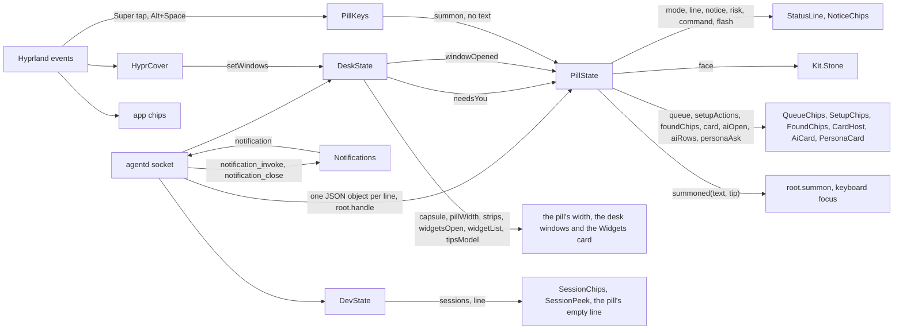
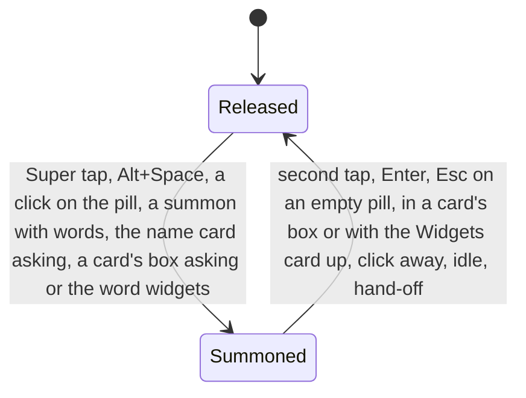
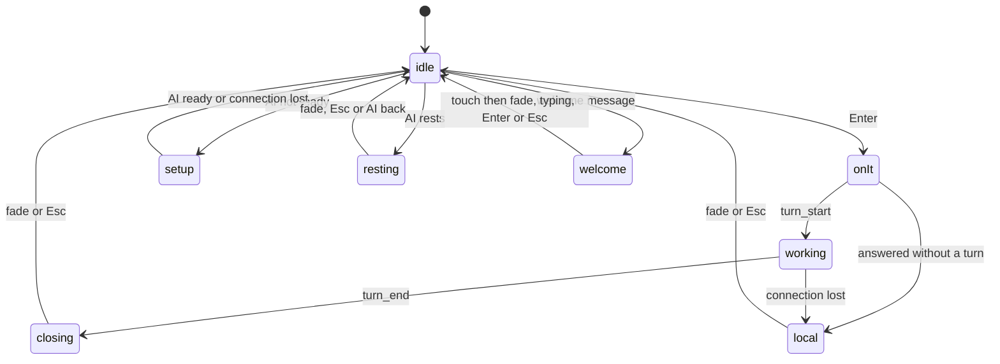

# The shell

> **Status:** Partly shipped
> **Code:** `shell/shell.qml`, `shell/PillState.qml`, `shell/StatusLine.qml`, `shell/QueueChips.qml`, `shell/SetupChips.qml`, `shell/FoundChips.qml`, `shell/NoticeChips.qml`, `shell/AiCard.qml`, `shell/WidgetsCard.qml`, `shell/PersonaCard.qml`, `shell/LineButton.qml`, `shell/PillKeys.qml`, `share/qml/Bombadil/Stone.qml` (the mark, as the pill draws it), `shell/HyprCover.qml`, `shell/Wallpaper.qml`, `shell/CardHost.qml` (hosting only), `shell/MessageFace.qml`, `shell/TaskFace.qml`, `shell/ListFace.qml`, `shell/Draft.qml`, `shell/DraftBar.qml`, `shell/CardBox.qml`, `shell/CardButton.qml`, `shell/CardScroll.qml`, `shell/ScrollThumb.qml`, `shell/Notifications.qml`, `shell/DevState.qml`, `shell/SessionChips.qml`, `shell/SessionPeek.qml`, `shell/DeskState.qml`, `shell/DeskRail.qml`, `shell/DeskRails.qml` and `shell/DeskStrips.qml` (hosting only), `shell/TipsCard.qml` (hosting only), `bin/bombadil-shell`, `iso/airootfs/etc/skel/.config/hypr/hyprland.lua`, `iso/airootfs/etc/systemd/user/bombadil-shell.service`, `iso/airootfs/etc/systemd/user/bombadil-agentd.service`, `iso/airootfs/etc/skel/.config/bombadil/wallpaper`, `share/qml/Bombadil/Theme.qml` (the motion tokens and the reduced-motion switch only)
> **Design:** [UX brief](../design/ux-brief.md#the-rules), [Bombadil's voice](../design/voice-brief.md), [The Bombadil mark](../design/identity-brief.md#the-stone), [The poor man switch](../design/poor-man-switch-brief.md#the-pill-while-the-ai-rests), [Building on Bombadil](../design/dev-brief.md) (the dots above the pill's left end; [Coding sessions](coding-sessions.md) is the page of the piece), [Boot and the wallpaper](../design/boot-and-wallpaper.md), [Messages and connections](../design/messages-and-connections.md) (the cards and the notification server), [the pill's states in the design system](../design-system/README.md#the-pills-states), [Tips and the desk's defaults](../design/tips-and-desk-defaults-brief.md) (the Tips card and the words a tip puts in the pill; [Tips](tips.md) is the page of the piece)
> **Verified:** 2026-11-12 against `main` at `7d37bc5`, for what changed in the shell between `7d17600` and `7d37bc5`, read in the code and the tests and not run: the bar's own global shortcuts for Super and Alt+Space (`shell/PillKeys.qml`, its `Loader` in `shell/shell.qml`, `PillState.summon` and the binds in the Hyprland config), `Kit.Stone` in the kit (the face table, the motion, the knock as a cue, `animate`, `ink` and `small`), the `tip` flag of a summon with `summonText`, `_typed` and `draftFor`, the Tips card as the shell hosts it (`shell/TipsCard.qml`, `shell/DeskRail.qml`, `shell/DeskStrips.qml` and the `tips` parts of `shell/DeskState.qml`), the Widgets card's sixth row, the seconds counter of `shell/StatusLine.qml`, the setup line that `PillState.lost()` clears, `open: false` entries in the pill's mirror of the launcher, `SUPER + Return` and `bombadil terminal`, the launcher's two-second wait for a frame, what the installer copies from the skeleton and the carry list, and the tests, the desktop idle watch and the smoke checks that cover them. The `file:line` anchors into `shell/shell.qml`, `shell/PillState.qml`, `shell/StatusLine.qml`, `shell/DeskState.qml`, `src/bombadil/agentd.py`, `src/bombadil/launcher.py`, `iso/airootfs/etc/skel/.config/hypr/hyprland.lua`, `tests/test_pill_qml.py`, `tests/test_theme.py` and `tests/desktop/driver.py` were moved to `7d37bc5` by following each one through the changes between the two commits and reading the old and the new line together; the ones the change had rewritten were read again. Nothing was run. The test counts of the files that changed (`tests/test_pill_qml.py`, `test_stone_qml.py`, `test_rest_qml.py`, `test_widgets_card_qml.py`, `test_theme.py` and `test_iso_profile.py`) are counted from the source with each parametrised list expanded, because pytest and PySide6 were not installed to collect them; the figure for `test_theme.py` follows the 38 files in `shell/` (the earlier 54 already differed from the 37 of `7d17600`); the Widgets card's 440 px is worked out from its layout and from the 320 px that its test measures for four rows; the frame times, the limits and the share of a frame's cost that the page gives are taken from [what the desk costs when nothing is happening](../IDLE-COST.md) and were not measured; and no desktop test, ISO or virtual machine was started, so the shortcuts' firing in Hyprland, the idle watch and the smoke's `pill-shortcuts-registered` and `idle-cpu` checks are what the code says they do. The rest of the page was not read again, and keeps the check it had before: 2026-11-09 against `main` at `ca7f80a`: every statement about `shell/shell.qml`, `shell/PillState.qml`, `shell/StatusLine.qml`, `shell/QueueChips.qml`, `shell/SetupChips.qml`, `shell/NoticeChips.qml`, `shell/HyprCover.qml`, `shell/DeskState.qml`, `shell/DeskRail.qml`, `shell/DevState.qml`, `shell/SessionChips.qml` and `shell/SessionPeek.qml`, the motion numbers of `shell/Stone.qml`, the Hyprland config, the three units and the installer's copy of the config folder, `AgentD._greet` and `dev_action`, `launcher.entries` and the launcher lines the gaps name, the test counts and test names, the desktop driver and the smoke's check names was re-read at that commit, line numbers included. The parts about `AiCard.qml`, `FoundChips.qml`, `CardHost.qml` and `Wallpaper.qml` keep their check at `7176e55`: `git diff` shows no change in those files up to `f0485c2` (`CardHost.qml` changed after it, below), and only some of their line numbers were read again. What changed in the shell between `ca7f80a` and `f0485c2` was added and checked against `f0485c2`: the welcome line and the name card (`shell/PersonaCard.qml` and the parts of `shell/shell.qml`, `shell/PillState.qml` and `shell/StatusLine.qml` that serve them), the two idle monitors, the reduced-motion switch in `share/qml/Bombadil/Theme.qml` and what reads it in the shell and the desk, and the stone's lean. The line numbers into `shell/shell.qml`, `shell/PillState.qml`, `shell/StatusLine.qml`, `shell/DeskState.qml`, `src/bombadil/agentd.py`, `src/bombadil/launcher.py`, `iso/airootfs/usr/local/bin/bombadil-install` and `tests/desktop/driver.py` were moved to `f0485c2`. What changed in the shell between `f0485c2` and `24c836c` was added and checked against `24c836c`: the bar's own notification server (`shell/Notifications.qml`), the card host and its three faces with the box, the button and the draft rules they share, the messages the shell reads and sends for them, the keyboard rules for a card's box, the width a card asks for, the units the start hook restarts (`mako` is gone) and the tests and checks that cover them. The line numbers into `shell/shell.qml`, `shell/PillState.qml`, `iso/airootfs/etc/skel/.config/hypr/hyprland.lua`, `src/bombadil/agentd.py`, `src/bombadil/launcher.py`, `tests/test_pill_qml.py` and `tests/desktop/driver.py` were moved to `24c836c`. What changed in the shell between `24c836c` and `7d17600` was added and checked against `7d17600`: the Widgets card (`shell/WidgetsCard.qml` and the parts of `shell/shell.qml`, `shell/PillState.qml` and `shell/DeskState.qml` that serve it), `keep` in the pill's mirror of the launcher, and the tests and the desktop checks that cover them. The line numbers into `shell/shell.qml`, `shell/PillState.qml`, `shell/DeskState.qml`, `src/bombadil/agentd.py`, `src/bombadil/launcher.py`, `tests/test_pill_qml.py` and `tests/desktop/driver.py` were moved to `7d17600`, and the rest of the page was not read again

The shell is the whole visible interface at login: one Quickshell program that draws a pill at the bottom of every screen, with the line and the chips above it (the line also says what other services ask agentd to say, such as new mail, and agentd's welcome when the person arrives; a card above the line asks once what to call the person, [the welcome line and the name card](#the-welcome-line-and-the-name-card)), a row of chips above its left end while coding sessions exist (a chip per project with a dot per session, [the session dots](#the-session-dots)), the stone at its left end (a click on it opens the AI card), a card above the pill where each desk widget is set to Keep, When needed or Off (the word `widgets` opens it, [the Widgets card](#the-widgets-card)), the picture host (which also holds the cards of the person's messages, tasks and connections: [the cards of the connections](#the-cards-of-the-connections)), the windows of the desk and the wallpaper under everything. The bar also owns the desktop's notification name and passes each notification to agentd ([the notification server](#the-notification-server)). It keeps no conversation: it turns what agentd says into what is on screen and sends back what the person types or clicks. It exists so that something true is on screen the moment Enter is pressed, and so that stop, undo and the launcher words never wait for a model. The states for an AI that is out of plan or paused are described here from the shell's side and in [the poor man switch](poor-man-switch.md) from agentd's; notices are described here and in [mail](mail.md); the welcome line and the name card are described here from the shell's side and in [Bombadil's voice](voice.md) from agentd's; the cards, their box and button, and the notification server are described here from the shell's side and in [connect.md](connect.md) and [the contract](../CONNECT.md) from the service's and agentd's; the Widgets card is described here from the shell's side and in [the desk](desk.md#your-desk-keep-when-needed-off) from the desk's and agentd's; the Tips card is hosted here ([the Tips card](#the-tips-card)) and described in [the desk](desk.md#the-tips-card) and in [Tips](tips.md#the-tips-card-on-the-desk).

## How it works



**Start.** On `hyprland.start` Hyprland imports the session's environment into the user manager and restarts two user units: `systemctl --user import-environment && systemctl --user restart bombadil-agentd bombadil-shell`. It starts no notification daemon: the bar's own server owns the name ([the notification server](#the-notification-server)). It starts one `foot --server`, so that a coding session's window rises at once ([coding-sessions.md](coding-sessions.md)). Then it hands Mail's user unit this session's screen and restarts it (`systemctl --user import-environment WAYLAND_DISPLAY HYPRLAND_INSTANCE_SIGNATURE XDG_CURRENT_DESKTOP && systemctl --user restart bombadil-mail.service`, `hyprland.lua:7-24`; [mail.md](mail.md)) and does the same for the browser service's (`bombadil-browserd.service`; [connect.md](connect.md)). The two units start again about a second after they die (`Restart=always`, `RestartSec=1`; [session-services.md](session-services.md)). `bombadil-shell.service` is `After=bombadil-agentd.service` and its `ExecStart` is `/usr/local/bin/bombadil-shell`, the wrapper `bin/bombadil-shell`: it puts `share/qml` on `QML2_IMPORT_PATH`, gives Qt two seconds instead of 100 ms to wait for the compositor's answer to a frame ([Theme, and why the shell starts through `bin/bombadil-shell`](#theme-and-why-the-shell-starts-through-binbombadil-shell)) and runs `quickshell -p <root>/shell/shell.qml`. `shell.qml` makes one `PillState`, one `DeskState`, one `DevState` and one notification server (`Notifications.qml`, in a `Loader` of its own) for the whole session and one `PanelWindow` per screen (`Variants { model: Quickshell.screens }`). The line, the chips, the session dots and the stone read the same state on every screen. What differs per screen is the keyboard, the pill's width, the desk's strips and, for the welcome line and the name card, whether they show (only on the screen that had the focus when they came). `shell.qml` also makes two `IdleMonitor` blocks ([the welcome line and the name card](#the-welcome-line-and-the-name-card)), a `Wallpaper` ([the wallpaper](#the-wallpaper)) and, on Hyprland, one `PillKeys` that registers the bar's global shortcuts for the pill ([Keyboard focus](#keyboard-focus)).

**Connecting.** The socket path is `$BOMBADIL_SOCKET`, else `$XDG_RUNTIME_DIR/bombadil/agentd.sock`. A comment in `shell.qml` says a Quickshell `Socket` that failed to connect does not retry, so each attempt is a fresh `Socket` made from the `link` component. While `root.connected` is false a 1500 ms `Timer` (running from the start) destroys the last socket and makes the next. When the connection state changes, the shell sets `root.connected` and `deskState.connected`; a connect sets `pillState.connected`, and a drop calls `pillState.lost()`, `deskState.lost()` and `devState.lost()`. agentd greets each client that connects with `status`, `entries`, `setup`, a `notice` for each notice nobody has ended, the card of a connection that is still open (a `card` message), each draft that a press left half done (a `proposal` message), the `dev` snapshot (the coding sessions), the Tips card (a `tips` message when Tips is on, which `DeskState` keeps as `tipsModel`: [the Tips card](#the-tips-card)) and, while there is one, the `away` card (`AgentD._greet`, `src/bombadil/agentd.py:644-665`, [agentd.md](agentd.md#the-socket)), and `DeskState` asks for `desk get` as soon as it is connected, so a restarted bar is told what is running without any state of its own.

**Handling.** `SplitParser` hands each line to `root.handle`, which parses it (a line that is not JSON is dropped) and gives the object to `pillState.handle`, `deskState.handle`, `devState.handle` (which reads only `dev` messages) and the notification server's `handle` (which reads only `notification_invoke` and `notification_close`). The three state objects emit `outgoing(msg)`, and so does the notification server (a `Connections` in `shell.qml` passes it on); `root.write` sends it as one JSON line and does nothing while the socket is down. The pill's methods that send (`stop`, `unqueue`, `undo`, `details`, `setupAction`, `openThing`, `noticeAction`, `dismissNotice`, `openFound`, `setAi`, the opening half of `toggleAi` and, for a card, `openReply`, `press` and `cardAction`) check `_offline()` first and flash "Not connected to the agent yet." on the line; `submit` says the same as a `local` line and keeps the typed text; `closeDetails` stays silent, and so do `proposalEdit`, `proposalShown` and the messages `dismissCard` sends, which go only while connected ([the cards of the connections](#the-cards-of-the-connections)). So a click while disconnected is answered, not lost. The methods of the voice (`presence`, `personaAnswer` and `personaSkip`) do not check: the name card cannot be up while disconnected (`lost()` takes it away), and a `presence` sent while the socket is down is dropped by `root.write`.

**Hyprland.** Three things come from the compositor and not from agentd. The app chips are built from `Hyprland.toplevels` whose workspace is named `special:app-<name>`, refreshed on the raw events `openwindow`, `closewindow` and `movewindowv2`, with the shown workspace tracked from `activespecial`. What puts an app's window in that workspace is `src/bombadil/appkit/placement.py` (see [app-kit.md](app-kit.md)): before the window first maps, `prepare()` adds a runtime window rule named `bombadil-app-<name>` that floats and centres it at its own size, shrunk to the screen, with `workspace = special:app-<name>`. The static `bombadil-apps` rule in `hyprland.lua` floats and centres every `bombadil-app-*` window at 540 by 660 and names no workspace. `HyprCover` reports where the windows are to `DeskState.setWindows`, which decides whether the desk's cards fold and whether the pill becomes a capsule, and emits `windowOpened` when the list grew (`shell.qml:124` connects it to `pillState.windowOpened()`, which puts a picture away: [the picture host](#the-picture-host)). The app chips send nothing to the desk. The third is `PillState.fullscreen`, which `shell.qml` binds to whether the focused monitor's active workspace has a full-screen window (`hasFullscreen`, `shell.qml:54`); a welcome line is dropped while it is true ([the welcome line and the name card](#the-welcome-line-and-the-name-card)).

### The bar window

| Property | Value | `shell/shell.qml` |
|---|---|---|
| One window per screen | `Variants` over `Quickshell.screens`, each a `PanelWindow` | 329-332 |
| Edges | anchored left, right and bottom: as wide as the screen | 346 |
| Layer and name | `WlrLayer.Overlay`, namespace `bombadil-bar` | 356-357 |
| Background | `"transparent"` | 348 |
| Height | `column.implicitHeight + 24` (the column has 12 px margins) | 347 |
| Exclusive zone | `64 + (appChips.visible ? appChips.implicitHeight + column.spacing : 0) + (sessionRow.visible ? sessionRow.implicitHeight + column.spacing : 0)`: the pill's 52 plus 12 below it, plus the app chips row and the session chips row while they show, each with the column's 8 px spacing | 370-371 |
| Input mask | a `Region` of `cardHost`, `statusLine`, `personaCard` (only while visible), `foundChips` (only while visible), `setupChips` (only while visible), `chips`, `sessionChips` (only while visible), `appChips`, `aiCard` (only while visible), `widgetsCard` (only while visible), `pillBox`, `stripsLeft` and `stripsRight` | 373-388 |

The window is as wide as the screen and transparent, so the mask is what lets clicks beside and above the pill reach the windows behind it. A control that is not listed in `mask` receives no clicks. `personaCard`, `foundChips`, `setupChips`, `sessionChips`, `aiCard` and `widgetsCard` are the entries guarded by `visible`; the comment on `personaCard`, on `setupChips` and on `sessionChips` gives the reason (a hidden item keeps its last place). `SessionPeek` is not in the mask on purpose: it takes no clicks. `cardHost`, `statusLine`, `chips` and `appChips` also hide themselves and have no guard (see [Known gaps](#known-gaps)). `NoticeChips` sit inside `statusLine`, so its entry covers them. `DeskStrips` is zero wide and high when it has nothing to show, so that the mask takes no room for it (its own comment).

The `ColumnLayout` (`id: column`, 12 px margins, 8 px spacing) stacks these twelve items, top to bottom:

| Item | Is | Width limit |
|---|---|---|
| `cardHost` | a `Loader` for `CardHost.qml`, set up with `setSource`, so a picture or a card that will not load or draw (a failure in `CardHost.qml`, in one of its faces or in the kit's `Diagram`) costs the cards and not the bar; the `Bombadil` module itself is not isolated this way (see [Theme](#theme-and-why-the-shell-starts-through-binbombadil-shell)); `maxHeight` is 60% of the screen; its `suppressed` follows `win.capsule` and the Widgets card, and its `onThisScreen` says whether this screen draws a card of a connection ([the cards of the connections](#the-cards-of-the-connections)) | `max(360, win.pictureMax)`, and no more than the card asks for: 560 for a message or a task, 480 for a list (`CardHost.preferredWidth`) |
| `statusLine` | `StatusLine.qml`, which also draws a notice and its `NoticeChips`, and a welcome line on the screen that shows it | `max(360, win.pillMax)` |
| `personaCard` | `PersonaCard.qml`, the name and voice card, shown while agentd's question is open and this screen is the one that had the focus when it came ([the welcome line and the name card](#the-welcome-line-and-the-name-card)) | `Layout.fillWidth` with a maximum of 620 |
| `foundChips` | `FoundChips.qml`, shown while the found line shows ([While the AI rests](#while-the-ai-rests)) | `min(max(360, win.pillMax), column.width)` |
| `setupChips` | `SetupChips.qml`, shown while the setup line or the resting line shows and no notice covers it | `Kit.Theme.pillMaxWidth` |
| `chips` | `QueueChips.qml` | `max(360, win.pillMax)` |
| `sessionPeek` | `SessionPeek.qml`, a hovered dot's last lines, shown only while a dot is hovered ([The session dots](#the-session-dots)) | its own `implicitWidth` (220 to 420) |
| `sessionRow` | an `Item` holding `sessionChips` (`SessionChips.qml`), shown while `devState.sessions` is not empty; the chips sit 14 px from its left edge, so over the pill's left end | `win.pillMax` |
| `appChips` | one chip per running app | `Kit.Theme.pillMaxWidth` |
| `aiCard` | `AiCard.qml`, 360 wide, opened by a click on the stone ([The AI card](#the-ai-card)) | its own 360 |
| `widgetsCard` | `WidgetsCard.qml`, 360 wide, opened by the word `widgets` and drawn only on the screen whose pill holds the keyboard ([The Widgets card](#the-widgets-card)) | its own 360 |
| `pillBox` | the pill: stone, text field, hint, clock | `win.pillMax` |

`win.pillMax` is `deskState.pillWidth` on the screen the desk lives on and `Kit.Theme.pillMaxWidth` (900) on the others; `win.pictureMax` is `deskState.pictureWidth` there, which is the pill's width except beside a window, where a picture may take up to 560 px (less where the rails leave less room, never under 360; [cards and pictures](cards-and-pictures.md)). On the desk's screen a window sharing the stage narrows the pill to 360, and a full-screen window turns it into a capsule of 100 px with the stone and the clock only: the field is hidden and disabled, "nothing can be typed blind" (`shell.qml:759`), and the picture is put away ([the picture host](#the-picture-host)). The widths come from `DeskState` ([desk.md](desk.md)). The desk's strips (`stripsLeft`, `stripsRight`) are children of this window, placed beside the pill. The desk's rails are separate windows (`DeskRails`, namespaces `bombadil-desk-left` and `bombadil-desk-right`, on `WlrLayer.Bottom`). They stop above the bar's exclusive zone: `deskState.rowZone` is bound to the `exclusiveZone` of the bar on the desk's screen (64 when there is none), so a row of chips above the pill shortens the rails (`shell.qml:148-152`).

The pill (`pillBox`, `Kit.Theme.pillHeight` high, `glassPill`) holds, left to right:

- the stone slot, 24 px wide. While a turn can be stopped (`pillState.stoppable`) and the pointer is over it (not in the capsule), the stone gives way to a `Stop` button (a 9 px accent square and the word) and the slot widens to the button's width plus 16 px, on an `accentSoft` wash. A tap on the slot calls `pillState.stop()` while `stoppable`, else `pillState.toggleAi()` (`shell.qml:747`), which opens the AI card; the pointer is a hand over it at all times.
- the text field. Its placeholder is "Starting" while the face is `starting`, else "Waiting for agentd…" while not connected, else, while a coding session waits for the person, `devState.line` and `   ⇥` in `accentInk` (such as "reviewer on Acme: run the migration?"), else `pillState.restHint` (agentd's `rest.hint`, such as "Open or find anything. Asks wait for 15:00.", only while the AI rests) or "Ask anything" (`shell.qml:763-769`). A ghost row draws the rest of a name that Tab would complete, in `faint`.
- a hint `↵ <name>` when the typed words exactly name something the launcher opens ([the launcher mirror](#the-launcher-mirror-in-pillstate)).
- the clock, `HH:mm`, refreshed every 30 s.

The border is one rule, first match wins: `accent` while `pillState.busy`, `borderActive` while this screen's pill holds the keyboard, `badLine` when the face is `offline`, else `border`. It is `Kit.Theme.pillBorder` wide and its colour change takes `Kit.Theme.slow` (300 ms, 0 under reduced motion).

### Keyboard focus

On Hyprland the pill takes keys only while it is summoned. `root.summonedOn` holds the name of the one screen whose pill has the keyboard (`""` for none), so only one pill holds it at a time.



| Compositor | Not summoned | Summoned |
|---|---|---|
| Hyprland (`HYPRLAND_INSTANCE_SIGNATURE` is set) | `WlrKeyboardFocus.None` | `WlrKeyboardFocus.OnDemand`, plus a `HyprlandFocusGrab` on the window |
| Any other (the headless sway test) | `OnDemand` | `Exclusive` |

The comment at `shell.qml:358-365` gives the reasons: the grab gives the pill the keyboard at once and a click anywhere else takes it away; going from `OnDemand` back to `None` makes Hyprland hand the keyboard to the window the person was in; and `Exclusive` is never used on Hyprland because Hyprland ends any grab when a layer turns exclusive, so the keys went to the window under the pointer. No pytest test runs the focus, mask or layer rules, and the desktop test and the smoke exercise them only in part (see [Tests](#tests)).

| Input | What happens | Made by |
|---|---|---|
| Tap `Super` | the pill on the focused monitor takes the keyboard; a second tap gives it back | bind `SUPER + SUPER_L` and `SUPER + SUPER_R` with `{ release = true }` fires the global shortcut `bombadil:pill-release`, which the bar registered itself (`shell/PillKeys.qml`, `onReleased`). It calls `pillState.summon("")` in the bar's own process, so there is no `bombadil pill` to start and no round trip through agentd, and the first letters typed after the tap reach the pill; `PillState` emits `summoned("", false)`; `root.summon("", false)` toggles `summonedOn` (the focused monitor, else the first screen). `bombadil pill` still sends `{"type": "summon"}` with no text, which agentd broadcasts, and does the same |
| `Alt+Space` | the same | bind `ALT + space` fires `bombadil:pill-press`, which listens to the press (`onPressed`) and not to the release that follows it |
| Tap `Super` or `Alt+Space` while the name card is up and this screen holds the keyboard | the keys go to the pill's field and the card stays; the tap does not give the keyboard back | `root.summon("", false)` calls `pillState.focusPill()` when `personaAsk` is set and `summonedOn` is this screen, and the `Connections` on `pillState` in the bar window (`onFocusPill`) focuses the field |
| The name card asking | the card comes up on the focused screen and takes the keyboard there at once, on every compositor; a second ask does not toggle it away | agentd's `persona_ask`; `PillState` emits `asked()`; `onAsked` calls `root.summonKeep()`, which sets `cardKeys`, `cardOn` and `summonedOn` |
| A card's box asking | the bar on the card's screen takes the keyboard and the box has it, with the cursor after its words; a second ask does not toggle the keyboard away. A card asks when the person pressed Reply (a chip on a notice, a button on a card, a row that opens a thread) and the card with a draft that comes of it arrives within 8 s (`askGrace`), and when the person clicks in a box. A card an agent opened, a card that arrives more than 8 s after a Reply and Mail's Reply (which opens a window) ask for nothing | `PillState.cardKeys()`: `_takeCard` calls it for a card whose draft is not the agent's (`by` is not `agent`) after `noticeAction` (a `reply` on a notice whose `source` is `connect` or `notify`), `cardAction` (`open` with a row) or `openReply` noted the time (`_askedAt`); a click in a box calls it through `wantKeys()`. `shell.qml` turns it into `root.cardKeysWanted(name)` for the card's screen (`root.cardScreen`, else the focused one), where `onCardKeysWanted` sets `boxNext` and `summonedOn` and `focusBox()` gives the keys to the face's box through `cardHost.item.focusBox()`, else to the pill's field (`shell.qml:89, 96-104, 390-420`) |
| The word `widgets` | the Widgets card opens above the pill and the pill on the screen that holds the keyboard when agentd asks (else the focused monitor's) takes the keyboard and keeps it, with the keys in its field. The Enter that sent the word had given the keyboard back a moment before; a second `widgets` does not toggle it away | agentd's `widgets` message (`op` `open`); `DeskState` emits `widgetsRequested`; `onWidgetsRequested` calls `pillState.closeAi()` and `root.takeKeyboard()`, which clears `cardKeys` and sets `summonedOn` to `focusedScreenName()`; with no screen to hold it the card is closed again (`shell.qml:127-131, 292`) |
| A summon with words | the pill on the focused monitor takes the keyboard and the words replace what was typed, with the cursor at the end. With `tip` set (a tip's button) the words fill an empty pill and never replace words the person typed and has not sent; the pill then keeps what it held and its cursor where it was. Words an earlier tip put there and nobody changed are replaced, so a second press is never silent, and a tip's words that end in an ellipsis go in without it and with a space after them. It never gives the keyboard back, so a repeat does not toggle. A name card that held the keys there gives them to the pill | a client sends `{"type": "summon", "text": "About ~/lease.pdf: "}` (the Brain's Ask about this does, `share/apps/brain/app.py:554`; [agentd.md](agentd.md#messages-a-client-sends)), or the same with `"tip": true` and the tip's `id` (the Tips card's button and the Tips app's: [the Tips card](#the-tips-card), [Tips](tips.md#the-pill-and-a-tips-words)); `PillState` emits `summoned(text, tip)`; `root.summon(text, tip)` stores `root.draft` and `root.draftTip` and sets `summonedOn`; `takeDraft()` of the summoned window asks `PillState.draftFor` what the field takes (`summonText`, `_typed`) and applies it |
| Click on the pill | summons that screen (Hyprland only; elsewhere the layer takes clicks `OnDemand` by itself) and puts the keys in the pill's field, taking them from the name card if it held them | `TapHandler` on `pillBox` and on the field call `focusPill()`, which clears `root.cardKeys` and calls `summonHere()` |
| `Enter` | sends the line as a `prompt`, clears the field and gives the keyboard back. A blank line, or one typed while disconnected, sends nothing and keeps the field and the keyboard; it also ends a welcome line | `onAccepted`: `pillState.submit(text)` returns true or false, and false calls `pillState.dismissWelcome()` |
| `Esc` with the Widgets card up | puts the card away and gives the keyboard back, whatever else is going on. The card can be up while a turn runs (a launcher word does not wait for one), so the first `Esc` closes the card and a second one stops the turn | `onEscapePressed`: `widgetsCard.shown` is tested first, then `deskState.closeWidgets()` and `release()` |
| `Esc` while a turn runs or a sign-in is under way, with no Widgets card up | sends `stop`; the pill keeps the keyboard | `pillState.stoppable` |
| `Esc` with the AI card open and no turn to stop | puts the card away and gives the keyboard back | `onEscapePressed`: `pillState.closeAi()`, `release()` |
| Typing a character | puts the AI card and the Widgets card away and ends a welcome line | `onTextChanged` calls `pillState.dismissWelcome()`, `pillState.closeAi()` and `deskState.closeWidgets()` when the field is not empty |
| `Esc` with text typed | clears the text | `onEscapePressed` |
| `Esc` on an empty pill | puts the line, the welcome line and the picture away, sends `close_details`, gives the keyboard back | `dismiss()`, `dismissWelcome()`, `closeDetails()`, `release()` |
| `Tab` | in an empty pill while any coding session exists: asks agentd for the next session that waits (`{"type": "dev", "action": "next"}`) and gives the keyboard back; agentd brings that session to the front, or answers with a line such as "Nothing needs you." (`AgentD.dev_action`); with text typed, or with no session: types the rest of the suggested name | `devState.next()`, `root.release()`, else `pillState.completion(text)` (`shell.qml:791-799`) |
| `Esc` in a card's box, or on a button or a row of a message, task or list card | closes the card: agentd is told it was put away, an empty draft goes with it and one with words in it stays as a draft agentd keeps; a keyboard the box held goes back to the windows | `Keys.onEscapePressed` in `CardBox` and in each face; `pillState.dismissCard()` ([the cards of the connections](#the-cards-of-the-connections)) |
| `Enter`, `Tab` and `Shift+Tab` in a card's box | `Enter` is a new line in a box of several lines and does nothing in a box of one: nothing in a box sends, only the card's button does. `Tab` and `Shift+Tab` go to the next or the previous thing on the card (the boxes, the buttons that can be pressed, a row that opens something) and are never a character of the message | `CardBox` |
| `Return` or `Space` on a card's button, an openable row, the × or the "I looked" tick (a button and a row take the keypad's `Enter` too) | presses it. A button that is not live takes neither a click nor a key | `CardButton`, `ListFace`, `CardHost`, `DraftBar` |
| Click anywhere else | the focus grab clears and the keyboard goes back | `HyprlandFocusGrab.onCleared` calls `release()` |
| Nothing typed for 20 s, or for 60 s with text in the pill, or for 120 s while the person is in a card's box (it has the keys or words in it: `pillState.composing`) | the keyboard goes back; the text stays. Typing in a card's box starts the wait again (`typing()`). The wait does not run while the name card or the Widgets card shows | the `idle` `Timer`, restarted by `onTextChanged` and by `onTyping` (`shell.qml:473-483`) |
| Details, a setup chip (not Cancel, Resume or Try again), a notice chip, a found chip, a picture's box that names a turn | the keyboard goes back before the window or the drawer opens, so it can take it | `PillState.handOff()`, which `shell.qml` connects to `release()` |
| `Super+Escape` | `bombadil stop`: ends the turn and everything it started. Nothing in the shell is involved | bind in `hyprland.lua` |
| `Super+Ctrl+Escape` | restarts the bar: systemd stops it and starts it again | bind: `systemctl --user restart bombadil-shell` |

`PillKeys` is made once, in a `Loader` that is active only on Hyprland (`shell.qml:108-111`): a client that registers a name a second time is refused and crashes, so it is not made per screen, and elsewhere there is no compositor to fire the shortcuts. Hyprland does nothing, and says nothing, for a shortcut name the bar has not registered, and each name listens to one edge (a tap to the release, Alt+Space to the press), so the names and the edges in `hyprland.lua` and in `PillKeys.qml` change together; `tests/test_iso_profile.py` holds them together and the VM smoke asks `hyprctl globalshortcuts` whether the bar registered them before it taps a key ([Tests](#tests)).

`Esc`, `Enter` and `Tab` reach the field only while the pill holds the keyboard; while the name card holds it, they reach the card's field instead, and while a card's box holds it, that box. When none does, `Esc` goes to the window in front, and `Super+Escape` is the way to stop from anywhere. When the pill is summoned and its screen's face is `rest`, the stone shows `listening`; the hollow `resting` face does not lean. While the AI rests, any summon also says the resting line again when the line is free, and when the current line goes if it is not, but never over the found line (`PillState.summon`, `PillState.qml:385-392`: the bar's own shortcuts and agentd's relayed `summon` both end there).

### The pill's modes

`PillState.mode` is what the line shows. `optimistic` is a flag inside `working`: "On it" was drawn on Enter, before agentd confirmed a turn.



The diagram is the main path. The rest, from `PillState.qml`: Enter from `closing`, `local` or `welcome` goes to `onIt` as it does from `idle`. `turn_start` goes to `working` from any mode, and a `status` event inside a turn rewrites the line without leaving `working`. An answer agentd gives without the model (a `local` event, or an error with no turn) makes mode `local` from `idle`, `closing` or `setup`. A turn that is queued and ends before it starts goes from `onIt` to `closing`. When a line fades or `Esc` puts it away while the AI is not ready, the setup line comes back instead of `idle`. A setup that becomes ready with a line to say ("Signed in to Claude. Ask me for anything.") goes to `local` for 8 s; one that follows `resting` says "Claude is back. Running your 3 waiting asks." the same way, and `PillState` keeps that line as a flash over the turn it starts (`_backLine`). `resting` is also entered from `closing`, `local`, `setup` and `working` ([While the AI rests](#while-the-ai-rests)). `welcome` is entered only from `idle` ([the welcome line and the name card](#the-welcome-line-and-the-name-card)). A notice is not a mode: it shows over `idle`, or over any mode but `working` when it is a warning ([Notices](#notices)).

| Mode | When | What shows | Leaves when |
|---|---|---|---|
| `idle` | nothing to say | no line: `StatusLine` has height 0 and opacity 0, and its timer is stopped (a notice alone shows the line but does not start the timer) | any of the rows below |
| `working` | `submit` (as `onIt`, the line "On it"), or `turn_start`, or a `status` message that reports a running turn the bar did not know of (the line "Working") | the live line, one line long, its seconds counter from the first second, and an edge: amber for `risk` `system`, red for `irreversible`. A marked step also shows its exact `command`, its `because` and its `after`. A `local` answer shows over the line as a flash and the line comes back | `turn_end`, a `local` answer when no turn was confirmed, `lost()` |
| `closing` | `turn_end` | the first of these that applies: the stop line when the turn was stopped (agentd's `line`, else "Stopped."); for a turn the limit stopped halfway (`requeued`), agentd's `line` (what it changed, and when it carries on) as a plain step line, never an error; when the turn had an error and its result was not ok or there was none, the error's first two lines with a red edge; the result text (up to four lines); the summary; "Done." (a turn with an error and an ok result shows the result); "can't be undone" after an irreversible step; a click on the line is Details. Details and Undo (while `sticky`) are also buttons, but only when the turn `changed` something or was `irreversible` | the fade, `Esc`, the next prompt or turn |
| `local` | an answer agentd gave without the model, an error with no turn, "Lost touch with the agent. Reconnecting.", "Not connected to the agent yet.", or the one-time "ready" line | the text; a red edge for an error | the fade, `Esc`, the next prompt |
| `setup` | `setup` message whose state is not ready (`choose`, `signed_out`, `offline`, `signing_in`) | the setup line and the `SetupChips`; a red edge when its tone is `error` | the state becomes ready, or the connection is lost (`lost()` puts the mode back to `idle` and clears the line: chips under a dead agentd answer nobody, and the next agentd sends the setup again) |
| `welcome` | a `welcome` message while the mode is `idle` and nothing else holds the line | agentd's words as a plain step line, on the one screen that shows it | the fade (8 s after the first touch, 15 s for a first hello, at most 30 s after it appeared), typing, Enter or Esc in the pill, a `persona_ask`, `lost()`, or anything that takes the line: a prompt, a turn, an answer or an error from agentd, the setup line |
| `resting` | a `setup` message with state `resting` (when it flips or its words change), a summon while resting, an ask typed while resting, or `_putLineAway` when the resting line was owed (a turn or a line with Undo held it); also the line of what was found | the setup line of the resting state, as a plain step line with no red edge, the `SetupChips` under it (Resume, Raise the limit, Try again) or the found line with the `FoundChips` | the fade (12 s), `Esc`, a turn, state `ready`, or a sign-in problem (mode `setup`) |

`ready` is `setupState` of `""`, `"ready"` or `"checking"`. While it is false, a typed line is still sent as a `prompt`, no "On it" is drawn, and agentd queues it (a line that starts with `!` is the exception and runs). `resting` (`setupState` `"resting"`) is not ready either and is handled before that case in `submit`: the prompt is sent and waits as a chip, and the resting line shows instead of "On it". A turn has the line while it runs: a `setup` message that arrives mid-turn is stored, and while the AI is still not ready the setup line comes back when the turn's line goes (`_putLineAway`); a ready "Signed in" line that arrives mid-turn is not shown later. The "Signed in" line is said once to a bar that saw the state change, and never to a bar that has just started.

### The stone

`Kit.Stone` (`share/qml/Bombadil/Stone.qml`) draws the mark in the pill's left slot: a 24 by 24 item with an 18 px rounded Reuleaux triangle and a lowercase b cut through it. It is in the app kit and not in `shell/` because the tip scenes draw it too ([Tips](tips.md#kitstone-and-the-internal-components), [the app kit](app-kit.md#internal-components)); three properties exist for them and are off in the pill: `animate: false` paints a face at once in its colour and runs nothing (a scene writes the pose frame by frame), `ink` draws the whole stone in the primary or the secondary text colour with no state colour, and `small` is the 16 px drawing of the identity brief. `test_small_and_ink_and_animate_leave_the_pills_stone_as_it_was` pins that the pill's stone is as it was. `PillState.face` decides the face (first match wins, in this order), and `shell.qml` changes `rest` to `listening` on the screen that holds the keyboard (`shell.qml:735`). For its first `settle` (400 ms) the stone is painted the resting green whatever its face says, then follows it (`Stone.qml:71-73`): the comment says the scene graph dropped a colour change made in the first frames after the bar started, so a face that went `starting` and then `rest` stayed orange. A bar that connects within 400 ms never shows the orange.

| `face` | `PillState.face` gives it when | Stone |
|---|---|---|
| `starting` | not connected, agentd has not answered since the bar started, and the 15 s `booting` timer in `shell.qml` is running | orange, rolling, after the first 400 ms; the placeholder says "Starting" |
| `offline` | not connected, and agentd was seen or the boot window is over | broken red outline with the b as a red line |
| `needs` | `needsYou` (the desk sets it while a coding session waits), or mode `setup` with state `choose`, `signed_out` or `offline` | amber. The knock is a cue: two knocks and a breathing glow on a 1.6 s beat for 9.6 s (six beats) when the need appears, then amber and still with the glow held at 0.45, and one more beat every five minutes while the need stands |
| `working` | `busy`, `optimistic`, mode `working`, or setup state `signing_in` | orange, a third of a turn per second about the b, which stays still |
| `resting` | `setupState` is `resting`, or mode `closing` and the turn was cut off by the limit (`requeued`); checked after `needs` and `working` and before `stopped` and `done`, so a waiting coding session still shows `needs` while the AI rests, and the stone does not hop | a whole 1.5 px outline in `muted` over a 30% `muted` fill, the b cut in `ground`, still (`Stone.qml:215-233`) |
| `stopped` | mode `closing` and the turn was stopped | a 12 px muted (grey) rounded square: the shape of the Stop button's square, not its orange |
| `done` | mode `closing`, not stopped, not an error | green, one 700 ms hop, then still |
| `rest` | otherwise, including a closing line that is an error | green, still |
| `listening` | `rest` on the screen whose pill holds the keyboard (`shell.qml:735`) | green, leaning 6 degrees toward the text |

The motion, from `Stone.qml`: the roll holds 300 ms, turns 120 degrees in 550 ms on the curve (0.55, 0, 0.3, 1) and holds 150 ms; the knocks tip 8 degrees (192, 160, 160 and 160 ms, then a 928 ms wait); the glow runs 0.25 to 0.6 to 0.25 in 560 and 1040 ms and reaches 16 px from the stone's centre, past the 24 px slot into the pill's padding; the lean eases over 240 ms on (0.16, 1, 0.3, 1) (`Stone.qml:115-117`). `stopped`, `offline` and `resting` are shapes of their own (`drawn` is false for them, `Stone.qml:58`), and nothing in them moves.

The knocks and the glow play only while the stone is cueing (`Stone.qml:285-331`). The cue runs for `cueMs`, 9600 ms (six beats of 1.6 s), when the face turns to `needs`; then the stone rests amber with the glow held at 0.45, the value reduced motion holds it at, and every `remindMs`, 300000 ms (five minutes), one beat of 1.6 s plays and it rests again. A face that leaves `needs` and comes back plays the whole cue again, and with reduced motion the stone never knocks. The knock is a cue because an animation that never ends makes the bar draw a frame every 16 ms for as long as it runs, and a need can stand for an hour; on a compositor that draws in software that is a core or more of an idle computer ([what the desk costs when nothing is happening](../IDLE-COST.md)). `test_the_knock_is_a_cue_that_ends_and_comes_back_as_one_beat` and `test_a_new_need_knocks_again_and_reduced_motion_never_does` pin it. The b is drawn in `ground` (default `Kit.Theme.glassPill`), so it reads as a cut only on a flat surface of that colour. With `reducedMotion` the roll becomes an opacity pulse (to `Kit.Theme.pulseLow` and back, 500 ms each way), the knock stops and the glow is held at 0.45, the hop becomes a 600 ms fade in from 0.3, and the lean is instant. `shell.qml` reads `BOMBADIL_REDUCE_MOTION=1` into `root.reducedMotion` and writes it to `Kit.Theme.reducedMotion` (a `Binding`, `shell.qml:38`), the one switch the whole interface reads ([Motion](../MOTION.md)); the stone and `Wallpaper` are handed `Kit.Theme.reducedMotion` (`Wallpaper` then shows its picture and its dimming without a fade). Nothing in the repository sets that variable. The look is explained in [the design system](../design-system/README.md#the-mark-and-its-states) and why in [the identity brief](../design/identity-brief.md#the-stone).

### The line above the pill

`StatusLine.qml` shows `pill.line` (or `pill.flash` over it) while `mode` is not `idle` (a `welcome` only on the screen where `here` is true) or a flash is up, and shows the newest notice when `pill.noticeShown` ([Notices](#notices)).

| What | Value | Where |
|---|---|---|
| Seconds counter | a 250 ms `Timer` that runs only while the line is shown, not held by a picture (below) and not just a notice with no line under it; the counter shows while working from 1 s on, in tabular figures. `seconds` is 0 unless the mode is `working`, because a `Text` whose string changes asks its window to be drawn again even while it is hidden, and a number that kept counting behind a setup line made the bar draw a frame a second for as long as the machine sat idle ([what the desk costs when nothing is happening](../IDLE-COST.md)) | `StatusLine.qml:31-34, 59-80, 141-149` |
| A turn's closing line stays | `fadeAfter`, 12000 ms after `turn_end` | `PillState.qml:87, 510` |
| A receipt picture after the closing line | both restart their clock; `fadeAfter` is raised to at least 15000 ms | `PillState.qml:207` |
| A local answer | 5000 ms; after an undo that finished 15000 ms; after a picture that finished 8000 ms | `PillState.qml:528-529` |
| The resting line, and the line of what was found | 12000 ms each; the empty field carries the state after that | `PillState.qml:610-623` |
| "Signed in" line, and "Claude is back..." after a rest | 8000 ms | `PillState.qml:694-695` |
| "Lost touch with the agent. Reconnecting." | 8000 ms | `PillState.qml:863` |
| "Not connected to the agent yet." after Enter while disconnected | 4000 ms | `PillState.qml:809-810` |
| A flash over a running turn (a launcher answer, an error with no turn, a stop), and the answer to a click while disconnected | 3500 ms; 8000 ms for the answer to `why` | `PillState.qml:90, 474, 498, 522, 873` |
| When a line fades | mode `closing`, `local` or `resting`, not `sticky` (a waiting notice overrides `sticky`), `pictureStays` false, no line or picture hovered on any screen (`hovers` is 0), and `fadeAfter` passed; checked on the 250 ms tick | `StatusLine.qml:68-77` |
| A welcome line | not by the row above: it waits for the first key or pointer movement, then goes `fadeAfter` later (8000 ms, 15000 ms for a first hello), and at the latest `welcomeMax` (30000 ms) after it appeared; a hovered line holds it; checked on the same tick | `PillState.qml:137, 552, 563-566`, `StatusLine.qml:78` |
| A picture the person asked for | keeps the finished line it came with: `pictureStays` is true while `card` is set (a picture, or a card of a connection) and is neither a receipt nor half drawn. The line does not fade and the timer sleeps (it runs only while a turn works or a flash is up) until the picture goes. Esc puts the line away with the picture; after the × the line fades by the row above: on the next tick if `fadeAfter` has already passed since `lineAt`, and when it passes if not. A receipt fades with its line | `PillState.qml:98`, `StatusLine.qml:66-67` |
| `sticky` | a turn that changed something and was not stopped keeps its line, with Undo, until the next prompt, Undo (`undo()`, `PillState.qml:934`), Esc (`_putLineAway`, `PillState.qml:949-951`) or, once `fadeAfter` has passed, the fade when a notice waits (`notices.length > 0`); typing `undo` still works | `PillState.qml:509`, `StatusLine.qml:71-75` |
| Fades and growth | opacity `Kit.Theme.normal` (200 ms); height `Kit.Theme.fast` (120 ms); both are 0 under reduced motion | `StatusLine.qml:46-47` |

Layout rules in the same file: while working the line is one line (`NoWrap`, `maximumLineCount` 1; two lines for a flash) and the agent's own words (`source` `agent`) show their newest end: `newest()` cuts them at a word, with a "…" before it, as many words as fit (`Text.ElideLeft` is left to cut one word that alone fills the line); in the other modes it wraps to at most four lines. The edge is `bad` for a working step of risk `irreversible` and for an error outside a running turn, `warn` for risk `system`. `because` shows on hover, and always on a marked step; `after` shows only on a marked step. Undo and Details are `LineButton`s (a 24 px high text button), shown in a row that exists only for a closing line that `changed` or was `irreversible`.

### Chips

| Chips | Component | From | A click |
|---|---|---|---|
| Queued prompts, grey, "next" (or when it will run while the AI rests) and the text, and an ×. Objects named `queuedChip` | `QueueChips.qml` | `pill.queue`: replaced by every `status`, added by a `queued` event, removed by `unqueued` and by the `turn_start` of that turn | the × calls `pill.unqueue(turn)`: sends `unqueue` and drops the chip at once (not while disconnected) |
| Setup choices under the setup line, and the button under the resting line. Objects named `setupChip` | `SetupChips.qml` | `pill.setupActions`, from the `setup` message: `[{id, label, style}]`. Visible only while mode is `setup` or `resting`, and not while a notice covers the line | `pill.setupAction(id)`: hands the keyboard off unless `id` is `cancel`, `resume` or `retry`, then sends `setup_action` |
| Up to three things found on this computer for a kept ask. Objects named `foundChip` | `FoundChips.qml` | `pill.foundChips`, from the `found` message ([While the AI rests](#while-the-ai-rests)) | `pill.openFound(id)`: hands the keyboard off, sends `found_open`, drops the chips |
| The chips of a notice, its count and its ×. Objects named `noticeChip`, `noticeMore`, `noticeDismiss` | `NoticeChips.qml`, placed by `StatusLine.qml` | `pill.notice`, from the `notice` message ([Notices](#notices)) | `pill.noticeAction(notice, id)` or `pill.dismissNotice(id)` |
| One chip per project, with a dot per coding session | `SessionChips.qml`, placed by `shell.qml` | `devState.projects`, from the `dev` message ([The session dots](#the-session-dots)) | a dot: `devState.open(key)`; the folded chip opens |
| One chip per running app, with a × | in `shell.qml` | `Hyprland.toplevels` on workspaces named `special:app-<name>`, sorted by name; the title is the window's title | the chip runs `hl.dsp.workspace.toggle_special("app-<name>")` through `Hyprland.dispatch`; the × runs `bombadil-app close <name>` |

A setup chip's `style` is `big` (46 px high, at least 132 wide, 17 px semibold), `primary` (30 px, raised, accent border) or anything else (30 px, quiet). The chip shown for the app whose workspace is on screen has an accent border. The setup chips are built by agentd (`AgentD._describe`): a big chip for each provider on first boot, "Sign in" and "Use <provider> instead" when signed out, "Show sign-in", "Open it again" and "Cancel" during a sign-in, "Wi-Fi" and "Try again" when offline, and, while the AI rests, "Resume <provider>" after a pause by hand, "Raise the limit" for a spending limit or a limit with no time, and "Try again" after that (a limit with a time has no chip). Their flow is in [browser-and-signin.md](browser-and-signin.md).

### The session dots

The coding sessions are agentd's ([Coding sessions](coding-sessions.md); the design is [Building on Bombadil](../design/dev-brief.md)). The bar only draws them: one `DevState` that reads agentd's `dev` message, a chip per project with a dot per session, a peek over a hovered dot, and the one line the pill says while a session waits.

`DevState.qml` is plain QtQuick with no Quickshell type, so tests load it offscreen. `shell.qml` makes one for the session (`shell.qml:193-196`); its `foldAbove` stays at its default of 3. `handle(ev)` reads only a `dev` message: `sessions`, `attention` (the keys that wait for the person, in Tab's order), `line` and `front` (the session whose window is in front; kept, and nothing in the shell reads it). Its other properties are `peeked` (the session whose dot is hovered) and `expanded` (the folded chip was opened). `SessionChips.qml` and `SessionPeek.qml` take it as `required property var dev`.

| Part | What it does |
|---|---|
| Where | `sessionRow` is an `Item` in the bar's column between the queue chips and the app chips (`shell.qml:605-622`): `Layout.fillWidth` with a maximum of `win.pillMax`, so as wide as the pill, and `SessionChips` sits at `x` 14 in it. The chips are therefore above the pill's left end and not beside it (the desk's strips keep the row beside the pill). The row shows only while `devState.sessions` is not empty. `SessionPeek` is the item above it, with a left margin taken from the chips' `x`. The row adds to the exclusive zone and to the mask, and the desk's rails stop above it ([The bar window](#the-bar-window)) |
| A chip | one per project, `Kit.Theme.chipHeight` high on `glassChip`, with the project's title (cut at 120 px) and a 10 px dot for each of its sessions. The border is `borderStrong` while a session of that project waits (it is in `attention`), else `border` |
| The fold | with more than `foldAbove` projects the chips fold into one: `N projects`, and ` · M waiting` while `M` sessions wait. A click on it sets `expanded` and shows the project chips; `expanded` goes back to false when the projects fall to three or fewer |
| A dot's look | `DevState.look(s)`, first match wins: `working` (state `working`) is `accent` and its opacity pulses between `Kit.Theme.pulseLow` and 1, 600 ms each way; `turn` (state `asked`, or `done` and not yet seen) is `accentInk` with a 16 px halo ring; `failed` is `bad`; `asleep` (state `asleep`, or the session is not alive) is `borderActive` at 0.7 opacity; any other is `muted`. A session the person started by hand (`yours`) is a ring in its colour and not a disc |
| The peek | `SessionPeek.qml`, while a dot is hovered (a `HoverHandler` with a 4 px margin sets `peeked`): the session's title, state words such as `Claude · working` (with ` · yours` or ` · own copy`) and its last three lines, in at most five lines and a box 220 to 420 px wide. agentd builds the lines from the tool's hooks, never by a model (the file's comment). It takes no clicks and is not in the input mask |
| A click | `DevState.open(key)` sends `{"type": "dev", "action": "open", "key"}`, or `action` `why` for a red dot that is not alive, which shows the session's last screen. A `TapHandler` with a 4 px margin makes it. agentd's `dev_action` (`src/bombadil/agentd.py:990-1006`) answers with a `local` event, `action` `session`, which the pill shows as a line |
| The line | while any session waits, `devState.line` (such as "reviewer on Acme: run the migration?", or "api and reviewer are waiting") is the empty field's text, followed by `   ⇥` and drawn in `accentInk` ([The bar window](#the-bar-window)); it wins over the rest hint and loses only to "Starting" and "Waiting for agentd…". `Tab` in an empty pill sends `{"type": "dev", "action": "next"}` ([Keyboard focus](#keyboard-focus)). The stone's `needs` face (one session waiting or more) and the Needs you card (two or more) come from the same message through `DeskState` ([desk.md](desk.md)) |
| Lost connection | `DevState.lost()` clears only `line`: the sessions live on in their own scopes, so the dots stay until agentd is back and says otherwise |

The dots take their colour and state from agentd's hooks, and nothing in the shell starts or ends a session: a click brings one to the front or shows why it stopped, and the words that start or end one (`claude acme`, `end reviewer`) are launcher words typed in the pill ([the launcher mirror](#the-launcher-mirror-in-pillstate)).

### While the AI rests

When agentd's `setup` message has state `resting` (a provider refused an ask because the plan or the spending is used up, or the person paused it), `PillState.resting` is true and the shell says so and shows what still works. `PillState` keeps the message's `rest` object (`provider`, `why`, `kind`, `until`, `when`, `hint`, `note`, `wait`) and the shell uses `hint` and `wait`. The state, `rest.json`, the pause and resume words and the finder are agentd's: see [the poor man switch](poor-man-switch.md) and [agentd.md](agentd.md).

| What | What the shell does | Where |
|---|---|---|
| The line | shows the `setup` line as a plain step line (never red) for 12 s: when the state flips or says something new, on a summon, and on an ask typed while resting. A running turn, or a closing line with Undo, holds it back (`_restOwed`) until that line goes | `PillState.qml:606-611, 660-695, 409-417, 812-818` |
| The stone | face `resting`, the hollow grey stone, also for the closing line of a turn the limit stopped | `PillState.qml:159-168` |
| The button | the `SetupChips` under the line | `SetupChips.qml:12` |
| The empty field | says `rest.hint`, unless a coding session waits for the person (its line wins) | `shell.qml:763-766` |
| The queue | each waiting chip says `rest.wait` ("15:00", "Thu 09:00", "paused") instead of "next"; an app's ask `[from app notes] ...` reads "Notes: ..."; "On it" does not show for an ask that waits; a launcher word or a `!` command does not wait | `QueueChips.qml:33, 40`, `PillState.qml:902-913` |
| A turn the limit stopped | `turn_end` with `requeued`: the line says what it changed and when it carries on, with Undo and Details if it changed something, and no error; the resting line takes over when it is put away | `PillState.qml:493-503` |
| Back | `setup` ready after resting says "Claude is back. Running your 3 waiting asks." for 8 s, and keeps it as a flash over the turn it starts | `PillState.qml:452-453, 694-695` |
| What was found | the `found` message, while resting: `{turn, line, matches: [{id, kind, label, hint}]}`, at most three whole matches. `foundShown` is true while the line on screen is `found.line`; `FoundChips` draws the matches under it, a hovered chip holds the line (`hovers`), and a press sends `found_open` and clears them. Nothing opens by itself. A found is dropped when its ask leaves the queue, when the state changes, when the connection is lost, and is ignored when it is late (the ask already left) or a newer ask of the person's is waiting | `PillState.qml:647-662, 890-899`, `FoundChips.qml` |

### The AI card

A tap on the stone while no turn runs calls `pillState.toggleAi()`: it opens `AiCard.qml` and sends `{"type": "ai", "op": "get"}`. agentd answers with an `ai` message of `rows: [{name, title, state, text, on, enabled, current}]` and sends it again on every change. The card is 360 wide, draws one row per AI (the title, "· ready") with a 36 by 20 switch, orange when on, and shows only while `aiOpen` is true and there is a row. A switch that is not `enabled` (not signed in, not installed) is dimmed and inert. A tap on a switch sends `{"type": "ai", "op": "pause" | "resume", "provider": name}` (the same as typing "pause claude"); the row follows the next `ai` message, not the tap. The card goes on a second tap on the stone, on `Esc`, on typing, when a turn starts (the stone is Stop) and when the connection is lost; letting the keyboard go does not close it. Its fades take `Kit.Theme.normal` and `Kit.Theme.fast`, so they are instant under reduced motion. The design is in [the brief](../design/poor-man-switch-brief.md#the-switch).

### The Widgets card

The word `widgets` opens a card above the pill where the person sets each desk widget to Keep, When needed or Off. What the three states mean, which widget can take which, the words and what agentd does with a press are in [the desk](desk.md#your-desk-keep-when-needed-off); this is the shell's side. agentd lists the rows and says what each can be, `DeskState` keeps them and `WidgetsCard.qml` draws them, so the shell decides nothing about which part a widget may take.

| Part | What it does |
|---|---|
| Where | an item of the bar's column between `aiCard` and `pillBox` (`shell/shell.qml:692-698`), centred and 360 wide (`implicitWidth`), with its own entry in the input mask, guarded by `visible` ([The bar window](#the-bar-window)). It adds nothing to the exclusive zone and touches nothing in the desk's rails |
| Which screen | the one whose pill holds the keyboard: the bar window gives it `active: win.summoned`. `shown` is `active`, `DeskState.widgetsOpen` and at least one row in `widgetList`; with no row there is no card. A screen that does not hold the keyboard draws nothing, though `widgetsOpen` stays true |
| Shape | the AI card's: `glassLine`, `radiusLine` and a 1 px `border`, with margins of 12 px (18 on the left). A title row 24 px high (the word "Widgets" and a × 24 px wide), one row of 56 px for each widget (its name and the three-part control on the first 24 px, the question it answers under them in `muted`, one line cut with an ellipsis) and "Reset the desk" 28 px high. The card is its column's height plus 24 px, so the six rows the desk lists make it 440 px high. The raised part (`Kit.Theme.raised`) is the one `DeskState.stateOf` gives; a part the widget cannot take is `faint`, and neither it nor the part the widget is already in takes a press or a hover. Nothing on the card is orange |
| Motion | its opacity follows `Kit.Theme.normal` and its height `Kit.Theme.fast`, so under reduced motion it comes and goes at once. A card on its way out takes no press |
| What it reads | `DeskState.widgetsOpen`, `widgetList` and `stateOf(id)`. `widgetList` is `[{id, title, question, can}]` from the `widgets` field of agentd's `desk` message, and `DeskState._cleanWidgets` drops a row for an unknown widget, one with no title and one with no state it can take. `stateOf` is `off` for a put-away widget, else `keep` for a kept one, else `needed` (`shell/DeskState.qml:141`) |
| What it sends | a press on a part calls `DeskState.setWidget(id, state)`, which sends `{"type": "desk", "op": "set", "widget", "state"}` only while connected, for a widget on the card, a state in its `can` and not the state it is already in. "Reset the desk" calls `resetDesk()`, which sends `{"type": "desk", "op": "reset"}` while connected. A press never moves the raised part: `kept` and `hidden` change when agentd's next `desk` message says so. The press remembers the widget and the state under the pointer when it went down, so rows that reorder before the release cannot send it for another row. agentd answers each with one sentence on the line above the pill (a `local` event with `action` `desk`), which the pill draws as any local answer |
| Opening | agentd sends `{"type": "widgets", "op": "open"}` when the person types `widgets` or the agent's `desk` tool asks for it. `DeskState.handle` sets `widgetsOpen` and emits `widgetsRequested` every time, even with the card up, and does not wait for a drag (`shell/DeskState.qml:479-482`). `onWidgetsRequested` in `shell.qml` puts the AI card away, makes the pill take the keyboard (`root.takeKeyboard()`) and closes the card again when no screen can hold it |
| Closing | nothing from agentd's side: closing is the shell's own. The card goes when the pill lets go of the keyboard (`onSummonedOnChanged` in `shell.qml`: `Esc`, a click elsewhere, a tap on Super, an Enter that sends words, the drawer taking the keyboard), on `Esc` before anything else the pill's `Esc` does, when text is typed, when the AI card opens (one card over the pill at a time), on the ×, and when the connection is lost (`DeskState.lost()` and `onConnectedChanged`) |
| The keyboard | `takeKeyboard()` clears `cardKeys` and sets `summonedOn` to `focusedScreenName()`: the screen that holds the keyboard when agentd asks (an ask that comes while the pill is open), else the focused monitor's, which is where the Enter that sent the word gave the keyboard back. It never toggles the keyboard away as a tap on Super does, so a second `widgets` leaves it where it is. A press on the card leaves the focus in the pill's field. The pill's idle timer does not run while the card shows, so the keyboard stays for as long as the card is read ([Keyboard focus](#keyboard-focus)) |
| The picture | the picture host hides itself while the card shows (`CardHost.suppressed`) and comes back when it goes ([the picture host](#the-picture-host)) |

### Notices

Another service can say a line above the pill through agentd (`src/bombadil/notices.py`: new mail, a draft that is ready, a receipt, a message from a connection, a notification another program posted; [mail.md](mail.md), [connect.md](connect.md)). agentd keeps at most four, sends `notice` (`id`, `source`, `line`, `tone`, `actions`, `ttl`, `at`; again with the same `id` when it changes) and `notice_end`, and ends a notice by its `ttl` itself: the shell never expires one.

| What | What the shell does | Where |
|---|---|---|
| Which shows | `PillState.notices` is sorted errors first, then newest; `notice` is the first. `noticeShown` is true when there is one, no flash is up, and the mode is `idle`, or the tone is `error` and the mode is not `working`. So news waits for a free line, a warning takes the line from a finished turn, an answer, the setup line and the resting line, and only a running turn holds it back | `PillState.qml:55-66, 724-732` |
| How it looks | its `line` in the line's rectangle, with a red edge and `badInk` text for tone `error` and no edge otherwise; at the right end `NoticeChips`: up to three chips (a `primary` one has an `accent` border), a `+N` count of the others waiting, and a ×. Under 520 px wide (a window shares the stage) the chips go in a row under the words | `StatusLine.qml:20-36, 127-131, 151-169`, `NoticeChips.qml` |
| A chip | `noticeAction(id, action)` hands the keyboard off and sends `notice_action {id, action}`; for `reply` on a notice whose `source` is `connect` or `notify` it also notes the time, so that the card that comes of it takes the keyboard ([Keyboard focus](#keyboard-focus)). A chip brings its own notice's id, so a notice that took the line a moment ago is never handed a chip drawn for the one before. The × sends `notice_dismiss {id}` for the notice that was on the line when the press began, and removes it at once | `PillState.qml:774-794`, `NoticeChips.qml:73-81` |
| Ending | `notice_end` removes it, unless the pointer is on it: then it stays, without chips, until the pointer leaves, unless the press that ended it was the person's | `PillState.qml:754-772` |
| What it takes | text made plain (control and direction characters become spaces) and at most 400 characters, at most three chips with labels of at most 40 characters, a tone of `step`, `ask`, `done` or `error`, an id that is a number; at most 8 held | `PillState.qml:712-752` |
| Lost connection | `lost()` drops them; agentd sends the live ones again to the next connection | `PillState.qml:845-847` |
| For tests | `quickshell ipc call line state` prints `{mode, line, flash, noticeShown, notices, card}` (`card` is `null` or `{id, type, title, draft}`, and `draft` is `null` or `{proposal, state, ready}`); `desk inject` takes a `notice` or `notice_end` only on a bar started with `BOMBADIL_BAR_INJECT=1` | `shell.qml:163-190`, `PillState.qml:796-803` |

A mail draft goes only by the Send button in the Mail window, which sends `press` to agentd; the line and its chips send no `press` and no `mail-tool`. A draft of a message or a task goes by the Send, Create or Comment button on its card, which the person presses ([the cards of the connections](#the-cards-of-the-connections)). The chips of a new-mail notice are Reply, which makes a draft and shows it, and Open, which shows the mail (`src/bombadil/mail/watch.py:206-222`).

### The notification server

`shell/Notifications.qml` is the bar's own server for the desktop's notification name, `org.freedesktop.Notifications`, in place of a separate notification daemon: the image has none and the start hook starts none ([The Hyprland config the ISO ships](#the-hyprland-config-the-iso-ships)). It draws nothing. `shell.qml` makes one for the session in a `Loader` with `source: "Notifications.qml"`, so a Quickshell without the service costs the notifications and nothing else. A `Binding` gives it `link`, which is `root.connected`, and a `Connections` writes its `outgoing` to the socket (`shell.qml:73-84`). What the person sees of a notification, and what Reply and Open do with it, are agentd's ([connect.md](connect.md), [the contract](../CONNECT.md)): it posts a notice with `source` `notify`, which the shell draws as any notice ([Notices](#notices)), and a Reply on it opens a card ([the cards of the connections](#the-cards-of-the-connections)).

| What | What the server does |
|---|---|
| What it says it can do | actions and a body, and nothing else: no markup, no links, no images, no inline reply and no persistence across a restart of the bar (`keepOnReload` is false). Chromium sends clicks and actions only to a server that advertises `actions`, so that one matters (the file's comment) |
| A notification arrives | it is kept tracked, so that it can still be acted on (Quickshell destroys one that is not tracked as the signal returns), and sent to agentd as `{"type": "notification", "id", "app", "summary", "body", "urgency", "icon", "actions"}`. `urgency` is `low`, `normal` or `critical`; `actions` are at most 8 of `{id, label}`; every text is cut at 2000 characters and passed on as it came, since agentd makes it plain |
| The same id again | an app updating a notification: the one held under that id is let go and the new one is kept and sent |
| agentd is away | the notification waits and goes once when `link` turns true. One that agentd lost with a restart is not sent again, because it would be a notice for something the person may have seen |
| How many are held | at most 64: the 65th makes the oldest be dismissed |
| `notification_invoke {id, action?}` | invokes the named action, else the notification's `default` one (for a browser tab, bringing the tab forward), then lets the notification go. With no action to take it is dismissed instead. An `id` that is not a number, or not held, does nothing |
| `notification_close {id}` | dismisses it: the app is told it was put away |
| An app closes its own | it is let go; a later word from agentd about it finds nothing |

### The welcome line and the name card

agentd says two things in Bombadil's own voice and the shell only draws them: a line when the person arrives or comes back, and a card that asks once what to call the person and in which voice. The words, when agentd says them and the `persona.toml` they come from are agentd's ([Bombadil's voice](voice.md)). The shell's side is one mode of the line, one card, two idle monitors and some rules for the keyboard. The messages are in [Messages the shell reads](#messages-the-shell-reads) and [Messages the shell sends](#messages-the-shell-sends).

| Part | What it does |
|---|---|
| Where | the welcome is the line itself, in mode `welcome` ([the pill's modes](#the-pills-modes)). `PersonaCard` is the item after `statusLine` in the bar's column, filling the column up to 620 px, with a guarded entry in the input mask ([The bar window](#the-bar-window)) |
| Which screen | the one that had the focus when it came. `shell.qml` notes the focused monitor's name in `root.cardOn` when the card asks and in `root.welcomeOn` when a welcome takes the line (`PillState.welcomeShown`), and each bar window passes `cardHere` and `welcomeHere` on as `here` to `PersonaCard` and `StatusLine`. Both show on every screen before the first of either comes, and again when their screen is unplugged |
| A welcome that is dropped | `PillState._welcome` shows a welcome only when it has words, the mode is `idle`, no turn runs (`busy`, `optimistic`), no flash is up, no card is up, no full-screen window is in front (`fullscreen`) and no error notice holds the line. Anything else drops it: it is not queued, and no `welcomed` goes back, so agentd does not count it as said. News that is not an error waits behind a welcome and comes back when it ends |
| A welcome's clock | it stays until the first key or pointer movement after it appeared, then `fadeAfter` longer (8 s, or 15 s when agentd says `first`), and never longer than `welcomeMax` (30 s) after it appeared. A hover on the line holds it, and counts as the first touch. The bar cannot see keys typed into other windows, so a second `IdleMonitor` (timeout 1 s, `respectInhibitors: false`, enabled only while a welcome waits for its first touch) calls `touched()` on the first activity after a pause of a second. `StatusLine`'s 250 ms tick asks `welcomeDone(now)` and calls `dismissWelcome()` |
| Away and back | the first `IdleMonitor` times out after `BOMBADIL_IDLE_SECONDS` seconds, else 300, and honours inhibitors, so a video being watched counts as present. `onIsIdleChanged` calls `pillState.presence(isIdle)`, which sends `presence`; agentd reads the same variable to work out how long the person was away. The `bar` message says whether the person is idle at that moment |
| The card | agentd's line (else "What should I call you?"), a name field, a row per voice and a hint: "Enter keeps `<voice name>` · Up and Down to change · Esc skips", "Enter saves · Esc skips" when agentd sent no voices, and in red "A name is up to three words" after a refused Enter. It opens as `personaAsk` is set and starts from what agentd sent: that name in the field and the voice agentd names highlighted (the first row when none matches) |
| The name field | placeholder "Your name", at most 24 characters, and only what agentd accepts in a name (a letter first, then letters, marks, spaces, hyphens, apostrophes and dots). The text, trimmed and with inner spaces collapsed, fills each voice's sample at its `{n}` as ", Name" (no name, nothing). More than three words is refused on Enter and nothing is sent |
| A voice row | a radio dot, the voice's `name`, its sample welcome (its `card` with the typed name) and, in italics, how it ends a reply (`reply`). Every text on the card is drawn as plain text, because names and samples come from outside |
| Keys on the card | Up and Down, Tab and Shift+Tab move the highlight. Enter, the keypad's too, calls `personaAnswer(name, voice)` and the card closes; Esc calls `personaSkip()`. A click on a row picks it and asks for the keyboard, and a click on the field asks for it too (`wantKeys`) |
| How the card folds | on Enter or Esc; when agentd sends `persona` (another bar answered); when a prompt is sent from the pill (`submit` calls `personaSkip()` first and the prompt runs, agentd having saved the defaults when it asked); and when the connection is lost (`lost()` drops it, and agentd asks again on the next connection while the question is open). Its fades take `Kit.Theme.normal` and `Kit.Theme.fast` |
| The keyboard | `PillState.asked` calls `root.summonKeep()`: `cardKeys` turns true and `cardOn` and `summonedOn` become the focused screen, so the card takes the keyboard at once, on every compositor, and never toggles it away as `summon()` does. A screen that already held the keyboard sees no `summonedChanged`, so a `Connections` on `pillState` hands it to the card once the card shows. When a screen turns summoned its card gets the keys if `cardKeys` is true and it shows, else the pill's field does. A click on the pill or its field (`focusPill()`), a Super tap while the card holds the keyboard there, and a summon with words clear `cardKeys` and put the keys in the pill's field: the card stays up. A click on a row or on the card's field sets `cardKeys` again. The 20 s release does not run while the card shows. When the card folds, the pill's field takes the focus and a keyboard the card held (`cardKeys`) goes back to the windows |
| The word `voice` | typed in the pill, it is a launcher word answered by agentd ([the launcher mirror](#the-launcher-mirror-in-pillstate)): agentd asks the card again with the saved name and voice filled in |

### The launcher mirror in `PillState`

`PillState.entries` is the `entries` message: the names the launcher opens (`kind` `app`, `project`, `session`, `panel`, `widget` or `command`, each with `words`; the projects and sessions are agentd's `dev` names, such as `claude acme`, so Tab completes them and the hint shows for them too). `completion(text)` returns the rest of a name for Tab, and `exact(text)` names what an exact word would open, drawn as `↵ <name>`. Both mirror `launcher.py`: only spaces, hyphens and underscores fold away (`_key`), a line that starts with `!` is never a word, a question mark at the end keeps a widget or `desk` for the agent, and a widget's name counts only after one of `open`, `show`, `close`, `hide` (and not after `open` or `show` for an entry that says `open: false`, which Tips does: those words are the Tips app's and a command entry answers them, [Tips](tips.md#the-words-that-open-the-app); `_opens`) or, for a widget whose entry has `keep` set (the widgets on the Widgets card, `WIDGETS[w].listed` in `launcher.py`), `keep`. After `keep` the tail ` on the desk` or ` on my desk` is left out (`_keepTails`), so `keep machine on the desk` shows `↵ Machine` and `keep mach` completes with Tab, while `keep calendar` and `keep alive` are for the agent. The hint exists so the person sees that a word opens here without the model. It is a hint: agentd decides.

### The picture host

`CardHost.qml` draws `pill.card` (a diagram from `show_card`, `system_map` or a receipt) above the line with the kit's `Diagram`: a title, "from this machine" or "drawn by the agent" (or "drawing…" while partial), a close ×, the diagram in a scrolling `Flickable`, and one `say` sentence. A card of a connection has the same frame, with the card's `via` in the place of the note on where a picture came from and a face in the place of the diagram ([the cards of the connections](#the-cards-of-the-connections)). It keeps the last card while it fades out. Its height is not animated: the bar's window is as tall as its contents, so a height that grew over a few frames would resize the window every frame, and Hyprland's layer animation would swing the pill with each resize (the file's comment; `hyprland.lua` turns that animation off, [below](#the-hyprland-config-the-iso-ships)). The card takes its room at once, fades in and rises 14 px inside it, and gives the room back once it has faded out. `PillState` takes a card from an `event` `card` or from a `card` message (types `diagram`, `message`, `task` and `list`; `{id, gone}` takes one back). One card is shown at a time and a newer one replaces it. A box that names something calls `pill.openThing(target)`, which sends `open` (or `details` for a turn). What a card holds and how it is validated is in [cards-and-pictures.md](cards-and-pictures.md).

| What happens | What it does to the picture |
|---|---|
| `Esc` (`dismiss()`) | puts the picture away (through `dismissCard()`), and a finished line with it |
| the × (`dismissCard()`) | puts the picture away and nothing else on the line. The line follows its own rules ([the line](#the-line-above-the-pill)): a `sticky` closing line stays with its Undo. The comment at `PillState.qml:97` says Esc or × puts both away; the code of the × (`PillState.qml:226-240`) does not. For a message, task or list card it also tells agentd: `{"type": "card_action", "card", "action": "dismiss"}`, and for a draft that is open, is not a notification's and has an empty box, `{"type": "proposal", "op": "discard", "id"}`; a draft with words in it stays and agentd keeps it. A keyboard the box held goes back to the windows. Nothing is sent while the connection is down |
| `turn_start` | clears it, unless the person is writing in its box (`composing`) |
| a picture word that failed to draw (`local`, `action` `picture`, `phase` `done`, `ok` false) | puts the old one away, unless the person is writing in its box |
| a launcher open that finished ok (`local`, `phase` `done`, `ok` true, `verb` `open`, `action` `brain`, `app` or `panel`) | puts it away (unless the person is writing in its box), so it is not over the window that opened. A hide, a close, a failed open and a click on a box (`action` `open`) keep it |
| a window opening on the stage (`DeskState.windowOpened`, `shell.qml:124`, `PillState.windowOpened()`) | puts it away through `dismissCard()`, unless it is half drawn, the person is writing in its box (`composing`), it was drawn in the last 2500 ms (`windowGrace`: the window is probably what the same ask opened) or the person clicked a box in it in the last 5000 ms (`clickGrace`: the window is what the click opened) (`PillState.qml:355-368`) |
| the connection lost while it is half drawn | takes it away |
| a full-screen window on this screen, or the Widgets card up (`CardHost.suppressed`, bound to `win.capsule || widgetsCard.shown` in `shell.qml:527`) | hides it and gives its room back; it is still there and comes back when the window goes or the card is put away. A picture may take 60% of the screen, and with the card under it a small screen would lose its top |
| the line it came with fading | a receipt goes with its line; a picture the person asked for and a card of a connection stay ([the line](#the-line-above-the-pill)) |

### The cards of the connections

Three kinds of card come from the person's connections ([connect.md](connect.md), the contract in [CONNECT.md](../CONNECT.md)): a `message` (the last messages of a thread and a box to reply in), a `task` (an item of a work tool, its fields and a button) and a `list` (rows with marks and buttons: the unread messages, "Connected here"). agentd checks each with `cards.py` before the bar gets it ([cards and pictures](cards-and-pictures.md)). `PillState` takes only the kinds in `cardKinds` (`diagram`, `message`, `task`, `list`) and, for the three kinds that come from connections, only a card with a string `id`, because a face keys its box on it. One card is shown at a time, whatever its kind. `CardHost` keeps the frame (the title, the card's `via`, the ×, the one `say` sentence) and holds the body in a `Loader` chosen by the card's `type`, which builds a face when the card comes and drops it when another kind does, so a box or a timer is never one card's left-over in the next. Every word on a face is another person's and is drawn as plain text, never as markup.

| Part | What it does |
|---|---|
| `MessageFace.qml` | the messages of the thread (who, or "You", when, and a dot for each unread one) in a scroll that starts at the newest message and is not rebuilt when only the draft changed; the reply box (`CardBox`, "Reply in `<where>`"); `DraftBar` under it; and "Open in `<via>`" beside the button when the card has a way out and the receipt of a sent reply does not already open the page. A card with no reply has no box and only its way out. A card whose reply is of kind `copy` (made from a notification) has the same box and a button "Copy and open" that sends nothing: `copyOpen` sends `card_action` `copy_open` with the typed words, and agentd puts them on the clipboard and brings the page forward |
| `TaskFace.qml` | the service's status and why, then each field as a labelled row: a box where the field has `edit` (several lines for `text`, one line for the rest, with the hint "YYYY-MM-DD" for `date`), plain words where only the service can change it. The button says "Create" or "Comment". The boxes' words go to agentd as one object, `{key: text}`, with "" for a box nobody typed in and, as they were, the draft's other fields |
| `ListFace.qml` | a row each: a mark that is a shape as well as a colour (`ok` a tick in green, `warn` a triangle in amber, `bad` a cross in red, `new` a dot in orange, `gone` a dash with a dim title, `active` a ring in blue), a title, a line under it (two lines at most), when, and up to two buttons. A button sends `card_action` with its `id` and the row's. A row with `opens` opens on a click, `Enter` or `Space`: kind `card` sends `card_action` `open` with the row's id (agentd knows what the row stands for), anything else goes through `openThing` |
| `CardBox.qml` | the box the person writes in: plain text, a light wash of the ink for the selection (the orange belongs to the button that sends), three to eight lines for a reply and one line for a one-line field (a pasted line break becomes a space there), a scroll past that. `edited` is the person typing, pasting or deleting; `setText` puts words in from outside and is not an edit. A box whose draft is being sent, or was, is read-only and shows what is there. The keys are in [Keyboard focus](#keyboard-focus) |
| `CardButton.qml` | a button in three tones: quiet (a plain edge), `primary` (an orange edge) and `send` (the person's press: an orange ring, drawn only while it can be pressed); `compact` in a list row. A button that is not live is dimmed and takes neither a click nor a key |
| `CardScroll.qml`, `ScrollThumb.qml` | a face's own column: as tall as its contents up to the face's `maxHeight`, then a scroll with a thin mark at the edge that takes no clicks and is not there when everything fits. It is the face's scroll and not the host's, so what must stay in view (the box and the button) is not inside what scrolls |
| `Draft.qml`, `DraftBar.qml` | what the box and the button do together, and what is drawn under the box: below |

A message or a task is at most 560 wide and a list at most 480 (`CardHost.preferredWidth`, which the `cardHost` item in `shell.qml` reads), and never wider than `max(360, win.pictureMax)`. The card is at most `maxHeight` high (60% of the screen) and a face gets `max(160, maxHeight - 120)` of it. A message's or a task's scroll takes what the box and the button leave, never less than two rows; a list's scroll takes all of it.

A card of a connection is drawn on one screen and a picture on every one. A message or a task has a box, and two boxes for one draft would be two people typing into one (the comment in `shell.qml`). `root.cardScreen` is set when the card's id changes, to the screen that holds the keyboard, else the focused one, and cleared when the card goes; `shell.qml` binds each host's `onThisScreen` to it, and every screen draws the card when `cardScreen` names a screen that is not plugged in. A `diagram` is drawn on every screen whatever `cardScreen` says. Only the screen that draws the box tells the pill whether the person is in it (`Draft._compose`), since another screen's face holds a stale mirror of the card and never has the focus.

While the person is in a box (`PillState.composing`: the box has the keyboard, or has words in it) the card is not taken away by what takes a picture away: the next turn, a failed picture, a launcher open or a window opening ([the picture host](#the-picture-host)). A card nobody has typed in goes as a picture does.

What the box and the button do together is `Draft.qml`, which draws nothing, and the shell reports what the card has drawn so that agentd lights the button only for what is on the screen:

| What | What the shell does |
|---|---|
| The first key in a box with no draft | asks agentd for one, `{"type": "proposal", "op": "open", "kind", "target"}` (`PillState.openReply`). What was typed meanwhile is kept and sent once the card comes again with the draft's id |
| Typing | 150 ms after the last key, `{"type": "proposal", "op": "edit", "id", "content"}`: the words in the box, as text for a reply and as the object of field values for a task. Nothing is sent while the socket is down |
| What the card drew | 200 ms after the last key and on the frame that holds the words (the window's `frameSwapped`, and after 500 ms at the latest if no frame comes), `{"type": "proposal", "op": "shown", "id", "content"}`; an `edit` always goes before it. It is also said when the card is first drawn and whenever agentd hands the bar the whole card again (`cardEpoch`), as it does for the open card when a bar reconnects |
| agentd's word on the draft | a `proposal` message: the open card takes the draft's `state`, `ready`, `fingerprint`, `receipt`, `warnings` (plain, at most 240 characters each) and `note`. Its `content` goes into the boxes only for a draft the person has not typed in and whose boxes are empty or just opened: a person who is typing is never written over, and one who emptied the box does not get the old words back from a late answer. Characters agentd took out because they draw as nothing (a paste from a page often has some) come back as the cleaned words while the box still holds exactly what was pasted. A draft that is `discarded` takes the card away |
| The button | live only while agentd says the draft is `ready` and its `state` is `open`, the boxes hold exactly the draft's content (the fields that have no box as the draft has them) and that has been so for 300 ms (`armDelay`), so that a click on its way to something else when the card changed does not press. While live it has the orange ring and, beside it, "Yours: Send" (or Create, or Comment) in `accentInk`; when it cannot be pressed it is dimmed and says nothing about why. Nothing but agentd's word lights it |
| A press | `{"type": "press", "kind", "id", "fingerprint"}`, with the fingerprint agentd last gave for the content on the screen, once per draft until agentd answers: the button is dim from the press on (`pressOut`), so a second click sends nothing. It is the person's: nothing in the shell presses on a `card`, a `proposal` or a notice arriving |
| agentd's answer | `press_result`. `ok` makes the card say `sent`, with the receipt's line (else "Sent.") and a button "Open in `<service>`" when the receipt has a page. A refusal shows agentd's line under the button in red, until the person types in the box again or another card comes. An `unknown_outcome` makes the card say `unknown`, with agentd's words for it, and the button waits until the person ticks "I looked in `<service>`", then presses again with `"again": true` |
| A dropped connection | a press that was out when the socket dropped shows "I lost touch with the agent while that went, so I can't tell whether it did." under the button. When the connection is back the press is no longer waited on and agentd's state of the draft decides: a press that went is refused, one that did not may be made again |
| A notification's card | no draft: nothing goes to agentd as an edit or a press, the button is "Copy and open", quiet and with no ring, and it is live while the box has words |

`DraftBar` draws under the box the warnings (plain sentences on an amber box), what became of the press (the sending line, the receipt, the unknown outcome and its tick), agentd's `note`, the red line of a press agentd turned away, and then the button.

### The wallpaper

`shell/Wallpaper.qml` is a `Scope` that `shell.qml` makes once. For each screen it opens a window on `WlrLayer.Background` (namespace `bombadil-wallpaper`, `ExclusionMode.Ignore` so that it reaches the screen's edge under the bar's zone, an empty `mask` so that it takes no clicks) in the ground colour `Kit.Theme.bg`, and the picture fades in over it once (`Kit.Theme.slow`), so a slow, missing or broken picture leaves the plain ground. The standard picture is `share/wallpaper/bombadil.png`, found with `Quickshell.shellPath("../share/wallpaper/bombadil.png")`: `Qt.resolvedUrl("../share/...")` from `shell/` gives a dead end (`qrc:/qs-blackhole`), because Quickshell hides what lies outside the shell's folder. [Boot and the wallpaper](../design/boot-and-wallpaper.md) has the reasons, how the picture is drawn and the pictures.

| The `wallpaper` file in the config folder | The desk shows |
|---|---|
| missing, empty, or only `#` lines | the standard picture, undimmed |
| the last line that is not a `#` comment starts with `/`, `~/` or `file://` | that image, cropped to fill the screen (`PreserveAspectCrop`), with a layer of `Kit.Theme.bg` over it at opacity `dim` (0.6) |
| that line is anything else (an image written into the file is the usual case) | the standard picture, and a `console.warn` that names the file and never what is in it |
| the image will not load | the standard picture on that screen, undimmed; the next change of the choice tries again |

The config folder is `$BOMBADIL_CONFIG`, else `$XDG_CONFIG_HOME/bombadil`, else `~/.config/bombadil`, the folder `paths.config_dir` gives agentd. A `FileView` with `watchChanges` reloads the file when it changes. The skeleton ships the file with only comments in it, because a file that does not exist cannot be watched (the comment in `Wallpaper.qml`): with it there, a first path is noticed with no restart; where the file did not exist when the bar started, a first one needs the bar started again (`Super+Ctrl+Escape`). `dim` is 0.6 so that the muted text keeps a contrast of 4.5 on the quietest glass (`glassChip`) over a pure white picture; `tests/test_wallpaper.py` works that out from the tokens. `reducedMotion` takes the fade-in and the fade of the dim to 0.

### The desk's hosts

`shell.qml` hosts the desk and does not draw it: `DeskState` (fed by the same messages), a `DeskRails` per screen (inactive on all but the desk's screen), the two `DeskStrips` in the bar window, and `HyprCover`. The desk's screen is the one `desk.toml` names, else the first. `HyprCover` is the compositor-facing half: it asks Hyprland where the windows are and gives `desk.setWindows` the list. The Away card, which agentd's `away` message fills, has a strip chip like the other cards: `back · N things`, or `back · nothing new` for a count of zero (`DeskState._stripOf` and `_applyAway`, `shell/DeskState.qml:430-431, 950`). A tap on the card's title or the line under it, or on one of its rows, sends `{"type": "away", "op": "seen"}` and agentd takes the card away (`DeskState.awaySeen`, `DeskRail.qml`); a tap on a strip chip calls `DeskState.stripClicked` (`DeskStrips.qml:63`), which opens the Tips app for the `tips` chip and does nothing for the others, as the code's comment says: they are not wired to a press ([the Tips card](#the-tips-card)). The card's own rules are in [desk.md](desk.md). The Widgets card is a desk surface too, but an item of the bar's column and not of a rail ([The Widgets card](#the-widgets-card)).

A card or a strip can be dragged (the drag, a drop and the desk's rules for it are in [desk.md](desk.md)), and that puts three things on the host. A drag reports screen coordinates, and a layer-shell window cannot ask where it sits, so each window says: `shell.qml` gives each `DeskStrips` an `origin` of `Qt.point(0, deskState.screenHeight - win.height)` (`shell.qml:490, 497`), the bar window's top-left, and `DeskRail` gives its `DeskDrag` handle the rail's own (`desk.railX(side)` and `T.railTop`). Every rail window stays up for as long as a drag lasts, an empty one too (`DeskRail.shown` follows `desk.dragging`), so the window the drag began in does not go. And `DeskStrips` draws the ghost chip of a card held over the row outside its own item, so it neither moves the pill nor widens what the bar's input mask holds.

| Part | What it does (`shell/HyprCover.qml`) |
|---|---|
| Refresh | `Hyprland.refreshMonitors()` and `refreshToplevels()`, then a `settle()` 40 ms later, and again 250 ms later for a slow answer |
| Events that refresh | `openwindow`, `closewindow`, `movewindow`, `movewindowv2`, `workspace`, `workspacev2`, `activespecial`, `activespecialv2`, `fullscreen`, `monitoradded`, `monitorremoved`, `focusedmon`, `changefloatingmode` |
| Polling | every 300 ms (`pollMs`) while any window is on the stage, because nothing reports a window being dragged |
| `settle()` | takes windows on the desk screen's active workspace or its shown special workspace, drops unmapped and hidden ones, and gives each `{x, y, w, h, kind, fullscreen}` in screen coordinates; `kind` is `panel` for a special workspace; `fullscreen` is true for Hyprland's states 2 and 3 |
| Startup | if the monitor's own answer has not arrived, it asks again every 100 ms, at most 20 times |
| Without Hyprland | does nothing; `qs ipc call desk cover` stands in |

### The Tips card

Tips is the seventh desk widget (`tips`, on the right rail after Machine) and the card is a desk card: `DeskRail.qml` hosts `TipsCard.qml` in its `tipsFace` component, 300 by 290 px for every tip (`DeskState.tipsHeight`), and its strip chip, which `DeskStrips.qml` draws, says `tips` with no dot (`DeskState._stripOf`). What the card says, how a tip is picked and what counts as tried are agentd's and the desk's ([Tips](tips.md#the-tips-card-on-the-desk), [the desk](desk.md#the-tips-card)); this is the shell's side.

| Part | What it does |
|---|---|
| What it reads | `DeskState.tipsModel`, from agentd's `tips` message (`DeskState._applyTips`): `present` true with a `card` of `id`, `line`, `words`, `marks`, `why`, `index`, `count` and `tip`, the whole row the card draws its picture from with `Kit.TipScene` ([the app kit](app-kit.md#internal-components)). `_cleanTip` drops a card with no `id` or no `line`, keeps at most three marks and takes every word as plain text. `present` false makes it `null`; a message with a `list` is the Tips app's answer, goes to that app's own connection and leaves the card alone. `lost()` clears it and the greeting brings it back |
| When it shows | `tipsPresent`, which is `tipsWanted` (a card to say, the widget not put away, and the setup state `ready` or `resting`) once the desk has been calm (`tipsCalm`: the pill's mode `idle` with nothing to stop, the desk's phase `idle`, no name card asked). Once it is up it stays through turns and lines, and goes the moment it is no longer wanted. It folds away with the words it last said, as the cards of rows do. [The contract](../TIPS.md) has the table of when |
| What a press does | an arrow or the wheel calls `tipsTurn(dir)` and sends `{"type": "tips", "op": "turn", "dir"}`; the title, the picture and "All tips ›" call `tipsOpen(id, play)` and send `{"type": "tips", "op": "open", "id", "play"}` (the Tips app on that tip, playing from the picture), and so does a press on the strip chip (`stripClicked`, with no tip named); the button calls `tipsTry(id)`, which sends `{"type": "summon", "text", "tip": true, "id"}` for the card's own tip and for one with words only, so nothing goes for a card that has gone; the × calls `putAway("tips")`, which sends `desk` `set` with state `off` at once, kept or not. The card changes when agentd's next `tips` message says so, never on the press. Nothing on the card runs a tip: the words wait in the pill ([Keyboard focus](#keyboard-focus)) and the person's own Enter runs them |
| Motion | none of its own: the arrows and the × fade in over 120 ms while the pointer is on the card and a turn crossfades the picture, the line and the button over 200 ms, both through the Theme's durations and so instant under reduced motion. The card never plays, loops or turns by itself |

### Theme, and why the shell starts through `bin/bombadil-shell`

The bar's files that draw (`shell.qml`, `StatusLine`, `QueueChips`, `SetupChips`, `FoundChips`, `NoticeChips`, `AiCard`, `WidgetsCard`, `PersonaCard`, `LineButton`, `CardHost`, `MessageFace`, `TaskFace`, `ListFace`, `DraftBar`, `CardBox`, `CardButton`, `CardScroll`, `ScrollThumb`, `Wallpaper`, `DevState`, `SessionChips` and `SessionPeek`) import the kit as `import Bombadil as Kit` and read `Kit.Theme.<token>`: colours (`glassPill`, `glassLine`, `glassChip`, `borderActive`, `accent`, `warn`, `bad`, `good`, `fg`, `muted`, `faint` and the rest), sizes (`pillHeight`, `radiusPill`, `chipHeight`, `pillMaxWidth`, `promptSize`, `lineSize`), type (`fontFamily`, `monoFamily`) and motion (`fast`, `normal` and `slow`, which read 0 under reduced motion, and `pulseLow`), the switch `reducedMotion` and `duration(ms)`, which is `ms` or 0 ([Motion](../MOTION.md)), and the `alpha()` helper the resting stone's fill uses. The desk's files (`DeskState`, `DeskCard`, `DeskRail`, `DeskRails`, `DeskStrip`, `DeskStrips`, `NowCard`, `RowsCard` and `TipsCard`) read `shell/DeskTheme.js` as `T` instead, a `.pragma library` script of plain values that cannot import a directory; `DeskState`, `DeskCard`, `DeskRail` and `DeskStrips` also import the kit, to wrap the durations they take from `T` in `Kit.Theme.duration(...)` and, in `DeskCard`, to hold the ring still under reduced motion. `tests/test_theme.py` keeps the 25 of its 33 values that have a token equal to that token; `railMargin`, `railTop`, `railBottom`, `cardGap`, `stripGap`, `foldMs`, `unfoldDelayMs` and `washMs` are layout and timing values with no token, and nothing compares them. `PillState`, `PillKeys`, `Draft`, `Notifications`, `HyprCover` and `DeskDrag` use no theme values. `Stone` is a file of the kit itself and reads `Theme` directly.

Quickshell resolves a singleton only from the shell's own directory or from the import path, and a bare `quickshell -p shell/shell.qml` starts a bar whose colours are all undefined (`tests/test_theme.py:133`). So `bin/bombadil-shell` sets `QML2_IMPORT_PATH` to `<root>/share/qml` (keeping what was already there), finds `<root>` with `readlink -f` so the ISO's symlink in `/usr/local/bin` still reaches `/usr/share/bombadil`, exports `QT_WAYLAND_FRAME_CALLBACK_TIMEOUT` as 2000 unless the environment already has a value (a person's own, 0 included, is kept) and `exec`s `quickshell -p <root>/shell/shell.qml "$@"`. Qt gives a compositor 100 ms to answer a frame and draws the window again when the answer is late; a compositor that draws in software needs longer than that for a full-screen frame (about 350 ms at 1920x1080 in the virtual machine), so the wallpaper, a window that never changes, was drawn again as each frame came back and kept Hyprland drawing too, more than three cores with nothing on screen. The kit's apps get the same value from `appkit/engine.py` ([what the desk costs when nothing is happening](../IDLE-COST.md); `test_the_shell_waits_longer_than_qt_does_for_a_slow_compositor_to_answer_a_frame`). Every starter uses it: `bombadil-shell.service` (its `ExecStart` is `/usr/local/bin/bombadil-shell`, and it is reached from the Hyprland start hook and the rescue bind), `scripts/dev-session.sh` and `tests/desktop/driver.py`. A test fails if `hyprland.lua`, `scripts/dev-session.sh` or `tests/desktop/driver.py` calls `quickshell -p ...shell.qml` itself.

### The Hyprland config the ISO ships

`iso/airootfs/etc/skel/.config/hypr/hyprland.lua` is the session's whole Hyprland config. `bombadil-live.service` creates the session user with `useradd -m`, which fills the home folder from `/etc/skel` when it makes the home. `bombadil-install` builds an installed home from the skeleton only when the installed system has none (`cp -a /etc/skel/. /home/user/`, `bombadil-install:586-591`), and a refresh adds only the skeleton files a kept home lacks (`cp -an`, `prepare_home`, `:651`), so a file the home already has is never replaced ([the installed system](installed-os.md)). greetd starts `start-hyprland` as that user ([iso-and-install.md](iso-and-install.md)).

| Part | Lines | What it does |
|---|---|---|
| Monitors | 2-5 | any output at its preferred mode; `Virtual-1` forced to 1920x1080@60 because a QEMU guest reports the host window's size as its preferred mode |
| Start | 7-24 | `hyprland.start` runs `systemctl --user import-environment && systemctl --user restart bombadil-agentd bombadil-shell`: the two are user units that need the session's environment first (`WAYLAND_DISPLAY`, and `HYPRLAND_INSTANCE_SIGNATURE`, which the bar reads), and the hook starts no `agentd` or `quickshell` itself and no notification daemon: the bar's `NotificationServer` owns `org.freedesktop.Notifications`, and a second owner (`mako`, `dunst`) would take web pages' notifications away from the line (the comment in the file). It also runs `foot --server` (line 14): one foot server for the coding sessions' windows, so that a session's window rises at once. Pinned by `test_the_session_starts_them_after_handing_over_its_environment` (the import comes before the restart) and `test_the_daemon_and_the_bar_come_back_when_they_die` (the units' restart settings); `test_nothing_on_the_image_starts_or_configures_a_notification_daemon` pins the missing daemon. Then `systemctl --user import-environment WAYLAND_DISPLAY HYPRLAND_INSTANCE_SIGNATURE XDG_CURRENT_DESKTOP && systemctl --user restart bombadil-mail.service`: Mail's user unit starts at login, before this session has a screen, and the Thunderbird it keeps unseen needs one (the comment in the file). Pinned by `test_the_session_hands_the_mail_unit_its_screen_before_thunderbird_needs_one`. The browser service's user unit gets the same two commands with `bombadil-browserd.service` (it also starts at login, and opening a page needs the session's Wayland display and its Hyprland instance; the comment in the file); pinned by `test_the_browser_service_is_a_user_unit_that_starts_at_login_after_the_session_and_is_never_given_up_on` |
| Look | 26-55 | gaps 6 inside and 12 outside, 1 px borders (`rgba(d97757ee)` active, `rgba(2a2f36ee)` inactive), `dwindle`, rounding 12, blur size 6 with 2 passes, background `0xff101214` (the ground until the wallpaper is up, in `0xAARRGGBB`: without the alpha byte Hyprland draws black), `follow_mouse = 1`; Hyprland's logo and splash off (`disable_hyprland_logo`, `disable_splash_rendering`); the keyboard layout fixed to `us` (`input.kb_layout`, line 49), which a fork for another layout changes; the `ease` curve (0.16, 1) (0.3, 1) for windows, special workspaces (`slidevert`) and fades |
| Layer animation | 56-59 | `hl.animation({ leaf = "layers", enabled = false })`: the bar is a layer, and Hyprland slid it whenever a picture resized it (the file's comment), so layers take their new size at once. Pinned by `test_hyprland_does_not_slide_the_bar_when_a_picture_resizes_it` |
| Panel keys | 61-67 | `SUPER + B`, `T`, `F` toggle the special workspaces `browser`, `terminal` and `files`; `SUPER + Q` closes the window; `SUPER + Return` runs `bombadil terminal` (`Hyprland.open_terminal`, `src/bombadil/hypr.py:227-254`), which puts away any drawer that shows except the terminal's own and starts `foot` without Hyprland's initial-workspace token, because a plain `foot` opened inside the drawer that showed and went with it. Pinned by `test_super_return_opens_a_terminal_that_does_not_belong_to_the_drawer_showing` |
| Pill key | 68-79 | `SUPER + SUPER_L` and `SUPER + SUPER_R` with `{ release = true }` fire `hl.dsp.global("bombadil:pill-release")`, and `ALT + space` fires `bombadil:pill-press`: global shortcuts the bar registers in `shell/PillKeys.qml`. The comment says a Super tap fires on release and Hyprland drops it when another key, a click or a drag happened meanwhile; that `bombadil pill` is a Python start and a round trip through agentd, and on a busy machine the first letters typed after the tap went to the window underneath, so the bar answers in its own process; and that a shortcut's name says which edge the bar listens to and Hyprland does nothing, silently, for a name the bar has not registered, so the two change together. Alt+Space is for hosts where Super never arrives, such as a VM window on Windows, where the Windows key opens the Start menu. Pinned by `test_the_pill_opens_from_super_and_from_alt_space`, `test_the_pill_keys_start_no_process_the_first_letters_would_wait_for` and `test_the_shortcuts_the_keys_fire_are_the_ones_the_bar_registers_on_the_edge_it_listens_to` |
| Stop and rescue | 80-83 | `SUPER + Escape` runs `bombadil stop`; `SUPER + CTRL + Escape` runs `systemctl --user restart bombadil-shell`: it restarts the unit and starts no second `quickshell` beside the old one (pinned by `test_the_session_starts_them_after_handing_over_its_environment`) |
| Window rules | 85-109 | `bombadil-apps` (class `^(bombadil-app-.*)$`: float, centre, 540 by 660); `bombadil-sessions` (class `^(bombadil-session-.*)$`: float, centre, `(monitor_w*0.86) (monitor_h*0.8)`, the window of a coding session, which is only a viewer); `panel-browser`, `panel-terminal`, `panel-files` and `panel-details` put the classes `bombadil-browser`, `bombadil-terminal`, `org.gnome.Nautilus` and `bombadil-details` on `special:browser`, `special:terminal`, `special:files` and `special:details`, all `silent` |
| Mail engine | 111-115 | `mail-engine` puts every window whose class matches `(?i)^(.*\.)?thunderbird.*$` on `special:mail-engine`, `silent`: Mail's engine is never seen and takes no focus. The workspace is not one of `hypr.PANELS`, so nothing offers or toggles it. Pinned by `test_thunderbirds_windows_go_silently_to_a_workspace_nobody_opens` |

The colours in this file are literals that repeat `Theme.qml` values. Only `background_color` is checked, against Theme `bg`, by `tests/test_boot_console.py::test_hyprlands_own_background_is_the_opaque_ground`. The two border colours (`d97757ee` and `2a2f36ee`, Theme `accent` and `border` with an alpha byte) are pinned by no test. `tests/test_theme.py` reads the file only to reject a launch of `quickshell` that bypasses `bin/bombadil-shell`. The image installs no notification daemon and the config starts none (`test_the_image_has_what_connections_run_on_and_no_notification_daemon`, `test_nothing_on_the_image_starts_or_configures_a_notification_daemon`): notifications are the bar's own ([the notification server](#the-notification-server)).

## Interfaces other pieces depend on

### Messages the shell reads

Field lists are in [agentd.md](agentd.md#messages-agentd-sends). This table says what the shell does with them. Two more objects have no column: `DevState` reads only the `dev` message (see its row) and the notification server reads only `notification_invoke` and `notification_close` (see their row).

| Message | `PillState` | `DeskState` |
|---|---|---|
| `status` (type) | `connected = true`, `busy`, `provider`, `queue` (rows may carry `wait`); a busy status that names a turn the bar is not following starts the "Working" line; the first one of a connection makes the bar send `bar` | resumes or clears the plan it follows |
| `entries` | `entries`, for Tab and the `↵` hint | |
| `setup` | `state` (including `resting`), `line`, `tone`, `actions` and, while resting, `rest` (`provider`, `title`, `phase`, `view` are not read) | |
| `ai` | `aiRows`, the rows of the AI card ([The AI card](#the-ai-card)) | |
| `found` | `found`, the chips of what was found, while resting ([While the AI rests](#while-the-ai-rests)) | |
| `welcome` | mode `welcome` with `text`, if nothing holds the line; `first` picks how long it stays; answers `welcomed` ([The welcome line and the name card](#the-welcome-line-and-the-name-card)) | |
| `persona_ask` | `personaAsk` (`line`, `name`, `voice`, `current`, `voices`: each `{id, name, card, reply}`): the name card opens, and a welcome on screen ends | |
| `persona` | `personaAsk` becomes null: the card folds | |
| `notice`, `notice_end` | `notices`: add or replace one, end one ([Notices](#notices)) | |
| `machine` | not read | the Machine card ([desk.md](desk.md)) |
| `summon` | `PillState.summon(text, tip)`, which emits `summoned(text, tip)`: `text` when it is a string, else `""`, and `tip` true only when the message says `"tip": true`. An empty text toggles the keyboard, a non-empty one fills the field (a tip's words only an empty pill). The bar's own global shortcuts call the same function with no text, so a tap on Super does not pass through this message ([Keyboard focus](#keyboard-focus)) | |
| `local` (type) | agentd took the typed word: the "On it" becomes the line "…", mode `local` | |
| `queued` (type) | follows the turn id agentd gave the prompt | |
| `event` `queued`, `unqueued` | adds or removes a queued chip (with its `wait` label while resting); `unqueued` also drops a found for that ask | |
| `event` `turn_start` | clears the picture (not a card the person is writing in) and the line fields, "On it", mode `working` | starts following the turn |
| `event` `status` | `text`, `source`, `risk`, `command`, `because`, `after.text`, for the running turn | the risk and command of the step |
| `event` `result`, `error` | kept for the closing line; an error with no turn is a flash or a `local` line | kept for the `now` card |
| `event` `turn_end` | mode `closing`, with Undo while `changed` and not stopped; `requeued` marks a turn the limit stopped | closes the plan; a stopped, failed or `requeued` turn clears it at once |
| `event` `local` | a flash while a turn runs, else mode `local`; picks the fade time; clears the picture (not a card the person is writing in) for a failed picture and for a finished open of `brain`, `app` or `panel` ([the picture host](#the-picture-host)) | |
| `event` `card` | `card` (type `diagram`, partial or whole, `message`, `task` or `list`, or `{id, gone}`) | |
| `card` (type) | the same as the event above, for a card agentd sends on its own and to a bar that connects while one is open ([the cards of the connections](#the-cards-of-the-connections)) | |
| `proposal` | `_takeProposal`: the open card's draft takes agentd's word on it (`state`, `ready`, `fingerprint`, `receipt`, `warnings`, `note`, `content`); a `discarded` draft takes the card away | |
| `press_result` | `_pressResult`: the press is no longer out, and the card says `sent` with its receipt, or `unknown`, or shows agentd's line under the button | |
| `notification_invoke`, `notification_close` | not read (the notification server reads them: [The notification server](#the-notification-server)) | not read |
| `event` `plan`, `tool_result` | not read | the plan and the step's end |
| `desk`, `jobs` | not read | the desk's layout and, in `desk`, `kept` (the widgets on the desk at rest) and `widgets` (the rows of the Widgets card: `{id, title, question, can}`, Tips last), then the Watching rows |
| `tips` | not read | `_applyTips`: the Tips card, or none ([The Tips card](#the-tips-card)); a message with a `list` is left alone |
| `widgets` | not read | `op` `open`: `openWidgets()` and `widgetsRequested`; the shell takes the keyboard for the card ([The Widgets card](#the-widgets-card)). It does not wait for a drag, and nothing closes the card from agentd's side |
| `dev` | not read: `DeskState` sets `PillState.needsYou` from it | `sessions` and `attention` become the Needs you rows (`DeskState._applyDev`); while a row exists, `needsYou` is true and a `Binding` in `DeskState` sets `PillState.needsYou`, so the stone's `needs` face shows. `DevState` reads the whole message (`sessions`, `attention`, `line`, `front`) for the dots, the pill's empty line and Tab ([The session dots](#the-session-dots)) |
| `away` | not read | the "While you were away" card: `rows` of kind `dot` or `plain`, at most six, each with a button `Open` or `Why?` or none, and `count` for the strip's `back · N things` (`DeskState._applyAway`; the card is in [desk.md](desk.md)). A message with no row it can draw takes the card away, and `lost()` clears it |
| `event` `snapshot`, `text`, `tool`, `file_change`, `output`; `card_ack`, `desk-result`, `job-result` | not read | not read |

### Messages the shell sends

| Message | Sent when | From |
|---|---|---|
| `{"type": "prompt", "text"}` | Enter on a non-blank line | `PillState.submit` |
| `{"type": "stop"}` | `Esc` or the Stop button while `stoppable` | `PillState.stop` |
| `{"type": "unqueue", "turn"}` | the × on a queued chip | `PillState.unqueue` |
| `{"type": "local", "action": "undo"}` | the Undo button | `PillState.undo` |
| `{"type": "details", "turn"}` | the Details button, a click on a closing line, a picture's box that names a turn, the title of the `now` card | `PillState.details`, `openThing` |
| `{"type": "close_details"}` | `Esc` on an empty pill, while connected | `PillState.closeDetails` |
| `{"type": "open", "kind", "value"}` | a picture's box that names a file, a service, a package or a page | `PillState.openThing` |
| `{"type": "setup_action", "id"}` | a setup chip (the ids are in [agentd.md](agentd.md#messages-a-client-sends): `provider:<name>`, `signin`, `show`, `cancel`, `wifi`, `resume`, `raise`, `retry`) | `PillState.setupAction` |
| `{"type": "ai", "op": "get"}` | a tap on the stone while no turn runs and the card is closed | `PillState.toggleAi` |
| `{"type": "ai", "op": "pause" \| "resume", "provider"}` | a switch on the AI card | `PillState.setAi` |
| `{"type": "found_open", "turn", "id"}` | a found chip | `PillState.openFound` |
| `{"type": "notice_action", "id", "action"}` | a chip of a notice | `PillState.noticeAction` |
| `{"type": "notice_dismiss", "id"}` | the × of a notice | `PillState.dismissNotice` |
| `{"type": "notification", "id", "app", "summary", "body", "urgency", "icon", "actions"}` | a notification arrived on the session bus (one that arrives while agentd is away goes once, when the connection is back); `urgency` is `low`, `normal` or `critical` and `actions` are `[{id, label}]` ([The notification server](#the-notification-server)) | `Notifications.qml` |
| `{"type": "proposal", "op": "open", "kind", "target"}` | the first key in a card's box that has no draft yet | `PillState.openReply` |
| `{"type": "proposal", "op": "edit", "id", "content"}` | 150 ms after the last key in a box, when what it holds is not what agentd was last told; `content` is text for a reply and an object of field values for a task | `PillState.proposalEdit`, from `Draft.sendEdit` |
| `{"type": "proposal", "op": "shown", "id", "content"}` | the card has drawn exactly that content (the frame that holds it, a card that is drawn first or handed to the bar again) | `PillState.proposalShown`, from `Draft.report` |
| `{"type": "proposal", "op": "discard", "id"}` | a card is put away while its draft is open, is not a notification's and its box is empty | `PillState.dismissCard` |
| `{"type": "press", "kind", "id", "fingerprint"}`, and `"again": true` after a press whose outcome was unknown | the person presses a live Send, Create or Comment on a card; one per draft until agentd answers | `PillState.press`, from `Draft.press` |
| `{"type": "card_action", "card", "action", "row"?, "text"?}` | `open` (a card's "Open in `<service>`", or a list row that opens a card, with its `row`), `copy_open` (with the typed `text`), `dismiss` (Esc or the × on a message, task or list card), or the `id` of a button on a list row (with its `row`) | `PillState.cardAction`, `copyOpen`, `dismissCard` |
| `{"type": "bar", "idle"}` | once per connection, when the first `status` arrives, so that agentd can tell this bar from `bombadil ask` | `PillState.handle` |
| `{"type": "presence", "idle"}` | the first idle monitor says the person went away or came back (after `BOMBADIL_IDLE_SECONDS`, else 300) | `PillState.presence` |
| `{"type": "welcomed", "id"}` | a welcome took the line; nothing is sent for a dropped one | `PillState._welcome` |
| `{"type": "persona", "name", "voice"}` | Enter on the name card | `PillState.personaAnswer` |
| `{"type": "persona_skip"}` | Esc on the name card, or a prompt sent while it is up | `PillState.personaSkip` |
| `{"type": "desk", "op", ...}` | the desk's gestures (a card or a strip dropped on a rail sends `move` with `widget`, `rail` and `rank`, one dropped on the row sends `fold` with the `widget`), and `desk get` on connect | `DeskState` |
| `{"type": "desk", "op": "set", "widget", "state"}`, `{"type": "desk", "op": "reset"}` | a press on a part of the Widgets card (`state` is `keep`, `needed` or `off`), and on "Reset the desk" ([The Widgets card](#the-widgets-card)); `set` with `off` also from the × of the Tips card | `DeskState.setWidget`, `resetDesk`, `putAway` |
| `{"type": "tips", "op": "turn", "dir"}`, `{"type": "tips", "op": "open", "id", "play"}` | an arrow or the wheel on the Tips card (`dir` is 1 or -1); the title, the picture or "All tips ›", or the `tips` strip chip (the Tips app, on the named tip or on none) ([The Tips card](#the-tips-card)) | `DeskState.tipsTurn`, `tipsOpen` |
| `{"type": "summon", "text", "tip": true, "id"}` | the button of the Tips card, for the card's own tip when it has words | `DeskState.tipsTry` |
| `{"type": "vitals", "op": "open", "row"}` | a tap on a Machine row that opens something (the disks) | `DeskState` (`onRowOpen`, `shell/DeskState.qml:38`) |
| `{"type": "dev", "action": "open", "key"}` | the Open button of a Needs you row (`shell/DeskState.qml:32`), a click on a session's dot (`action` `why` instead for a red dot that is not alive), and the Open button of an Away row whose key starts `dev:` (`DeskState._awayAct`, `shell/DeskState.qml:965`) | `DeskState`, `DevState.open` |
| `{"type": "dev", "action": "next"}` | `Tab` in an empty pill while a coding session exists | `DevState.next` |
| `{"type": "away", "op": "seen"}` | a tap on the Away card's title or the line under it, on one of its rows, or one of its buttons (after the button's own send); only while the card is up | `DeskState.awaySeen` (`shell/DeskState.qml:958-960`) |
| `{"type": "jobs", "op", "id"}` | `why`: the Why? button of a Watching row (`shell/DeskState.qml:31`), or of an Away row whose key starts `job:` (`shell/DeskState.qml:966`); `stop` or `dismiss`: the small x of a Watching row, by whether the job is running | `DeskState` |

### Commands, keys and surfaces

| Name | Meaning |
|---|---|
| `bin/bombadil-shell [quickshell options]` | starts the bar; `bombadil-shell.service` runs it as `/usr/local/bin/bombadil-shell` |
| `systemctl --user restart bombadil-shell` | stops the bar and starts it again; `SUPER + CTRL + Escape` runs it, and the start hook runs it with `bombadil-agentd` ([session-services.md](session-services.md)) |
| `scripts/dev-session.sh` | runs agentd and the bar from the checkout on an existing Hyprland desktop: sets `BOMBADIL_PROVIDER` (default `fake`) and `BOMBADIL_SHARE`, points Mail and the connections at their fake engines in scratch folders (unless `BOMBADIL_MAIL_ENGINE` or `BOMBADIL_CONNECT_ENGINE` names another), starts `bin/bombadil-connect` (only on the fake engine), `bin/agentd` and `bin/bombadil-mail`, then `bombadil-shell` ([development.md](../contributing/development.md#run-a-dev-session-against-a-checkout)) |
| `bombadil pill` | sends `summon` with no text through agentd, which broadcasts it to every bar. The Super and Alt+Space binds do not run it (they fire the bar's global shortcuts, [Keyboard focus](#keyboard-focus)); it stays for a terminal and for a session without Hyprland, as the desktop test's |
| `bombadil terminal` | opens a terminal on the desktop and not inside a drawer that shows (`Hyprland.open_terminal`); `SUPER + Return` runs it ([The Hyprland config the ISO ships](#the-hyprland-config-the-iso-ships)) |
| `bombadil stop` | sends `stop`; `SUPER + Escape` runs it |
| `bombadil dev next` | sends `{"type": "dev", "action": "next"}`, the message `Tab` sends in an empty pill while a coding session exists (`bin/bombadil`, `dev_command`; [coding-sessions.md](coding-sessions.md)) |
| `quickshell ipc -p shell/shell.qml call desk state` | the desk's state as JSON, with `kept`, `widgetsOpen` and `widgets` among it (`IpcHandler`, target `desk`) |
| `quickshell ipc -p shell/shell.qml call desk cover '{"windows": [{"x": 0, "y": 560, "w": 500, "h": 160}]}'` | stand-in windows for a session without Hyprland (`fullscreen` is optional) |
| `quickshell ipc -p shell/shell.qml call desk inject '<json message>'` | feeds `root.handle` a message as agentd would send it; a `notice` or `notice_end` is dropped unless the bar was started with `BOMBADIL_BAR_INJECT=1` (`shell.qml:178-183`) |
| `quickshell ipc -p shell/shell.qml call line state` | what the line says as JSON: `{mode, line, flash, noticeShown, notices, card}` (`IpcHandler`, target `line`; the desktop test and the smoke read it) |
| `quickshell ipc -p shell/shell.qml call dev chips` | where the first screen's session chips sit, as JSON: `{visible, x, y, width, height, pillX, pillY, pillWidth}` (`IpcHandler`, target `dev`, from `PanelWindow.chipsGeometry`, `shell.qml:197-204, 350-355`; the desktop test reads it) |
| `bombadil-app close <name>` | run by an app chip's × |
| layer namespaces | `bombadil-bar` (Overlay), `bombadil-desk-left` and `bombadil-desk-right` (Bottom), `bombadil-wallpaper` (Background) |
| special workspaces | `special:app-<name>` for each app, set by the per-app window rule of `src/bombadil/appkit/placement.py` and read by the chips; `special:browser`, `special:terminal`, `special:files`, `special:details` for the panels and the drawer |

### Environment variables

| Variable | Read by | Meaning |
|---|---|---|
| `BOMBADIL_SOCKET` | `shell.qml:212` | the socket path; else `$XDG_RUNTIME_DIR/bombadil/agentd.sock` |
| `HYPRLAND_INSTANCE_SIGNATURE` | `shell.qml:27`, `HyprCover.qml:15` | set by Hyprland; chooses the focus rules and turns `HyprCover` on. It reaches the bar through the user manager's imported environment (the start hook imports it before it restarts `bombadil-shell`); a bar started without it takes the non-Hyprland focus branch (`Exclusive`) |
| `BOMBADIL_REDUCE_MOTION` | `shell.qml:37` | `1` sets `Kit.Theme.reducedMotion`: the stone pulses instead of rolling and knocking, and everything else in the bar and the desk that animates with the kit's durations goes instant ([Motion](../MOTION.md)) |
| `BOMBADIL_IDLE_SECONDS` | `shell.qml:60` | after this many seconds without input the bar tells agentd the person went away; else 300. agentd reads the same variable |
| `QML2_IMPORT_PATH` | set by `bin/bombadil-shell` | gives Quickshell the kit |
| `BOMBADIL_CONFIG` | `shell/Wallpaper.qml` | the config folder that holds the `wallpaper` file; else `$XDG_CONFIG_HOME/bombadil`, else `~/.config/bombadil` |
| `BOMBADIL_BAR_INJECT` | `shell.qml:181` | `1` lets `desk inject` feed the bar a `notice` or `notice_end`; no session of the image sets it, and `tests/desktop/driver.py:34` does |
| `QT_WAYLAND_FRAME_CALLBACK_TIMEOUT` | Qt; set by `bin/bombadil-shell` (and by `appkit/engine.py` for an app) | the milliseconds Qt waits for the compositor's answer to a frame before it draws the window again: 2000 unless the environment already has a value ([Theme, and why the shell starts through `bin/bombadil-shell`](#theme-and-why-the-shell-starts-through-binbombadil-shell)) |
| `BOMBADIL_SCREENS` | the offscreen QML tests (`tests/test_pill_qml.py`, `test_stone_qml.py`, `test_rest_qml.py`, `test_found_qml.py`, `test_notice_qml.py`, `test_connect_cards_qml.py`, `test_sessions_qml.py`, `test_desk_qml.py`, `test_desk_cards_qml.py`, `test_desk_drag_qml.py`, `test_widgets_card_qml.py`, `test_diagram_qml.py`, and Mail's `test_mail_app_qml.py`) | a folder to save a picture of each state in |

## Where state lives

The shell writes no file. It reads the environment variables above (the ones that come from Hyprland reach it through the user manager's imported environment), the socket, Hyprland's state and the `wallpaper` file.

| What | Where |
|---|---|
| The line, the queue, the face, the setup state and `rest`, the picture or the card of a connection and the state of its draft and of a press (`card`, `composeId`, `pressOut`, `pressLine`), `hovers`, the found chips, the notices, the AI card's rows and whether it is open, the welcome line's clock (`touchedAt`, `welcomeId`) and the name card's question (`personaAsk`) | properties of `PillState` in the shell's memory. A restarted bar rebuilds them from agentd's greeting (including the live notices, the resting `setup` and the card of a connection that is still open), and from `status` if a turn is running; a lost connection drops the notices, the found chips, the open AI card, a welcome on screen, a setup line (the mode goes back to `idle`) and the name card (agentd asks the card again on the next connection while its question is open) |
| The coding sessions' dots, the pill's waiting line, which dot is hovered and whether the folded chip is open | properties of `DevState` (`sessions`, `attention`, `line`, `front`, `peeked`, `expanded`) in the shell's memory, rebuilt from the `dev` snapshot in agentd's greeting. A lost connection clears only `line`, so the dots stay while agentd is away (`DeskState.lost()` does clear the Needs you rows) |
| The sessions themselves | agentd's (`src/bombadil/dev.py`): the registry and last screens in `paths.dev_dir()`, the `dev/` folder of its state folder, and the sessions' own systemd scopes and zellij sessions; the shell never reads any of it ([coding-sessions.md](coding-sessions.md)) |
| The Away card | agentd's (`src/bombadil/away.py`): the card in its memory and, in `away.json` in its state folder, when it was last seen; `DeskState.awayModel` holds a copy that `lost()` clears and the greeting brings back ([desk.md](desk.md)) |
| Whether the AI rests, and until when | agentd's, in `rest.json` in its state folder (`src/bombadil/rest.py`); the shell never reads the file and gets the state as the `setup` message's `rest` ([the poor man switch](poor-man-switch.md)) |
| The notices | agentd's stack (`src/bombadil/notices.py`), in its memory; the shell holds a copy ([Notices](#notices)) |
| A card's draft and what became of its press | agentd's (`src/bombadil/proposals.py`; [connect.md](connect.md)). The shell holds the words in the box and a copy of the draft's state in the card, and a draft with words in it outlives the card being put away ([the cards of the connections](#the-cards-of-the-connections)) |
| The notifications held | `Notifications.qml` keeps up to 64, tracked, in the bar's memory until agentd says what became of each; a restart of the bar drops them. agentd keeps the notices made of them ([The notification server](#the-notification-server)) |
| Which screen holds the keyboard, and words an app or a tip put in the pill that no pill has taken yet (and whether they are a tip's) | `root.summonedOn`, `root.draft` and `root.draftTip` in `shell.qml`; each bar window also remembers the words a tip's button put in its field (`win.tipWords`), to tell them from the person's own at the next press |
| Which screen shows the name card and which the welcome line, and whether the keyboard is the card's | `root.cardOn`, `root.welcomeOn` and `root.cardKeys` in `shell.qml` |
| Which screen draws the card of a connection | `root.cardScreen` in `shell.qml` |
| The name and the voice | agentd's, in `persona.toml` in the config folder ([Bombadil's voice](voice.md)); the shell never reads the file and gets the question as `persona_ask` |
| The desk's layout, and what each widget is set to (`kept`, `hidden`) | agentd's `desk.toml` in its state folder, sent as `desk` messages ([desk.md](desk.md)) |
| Whether the Widgets card is open, and its rows | `DeskState.widgetsOpen` and `widgetList` in the shell's memory. The card is open only while the pill holds the keyboard, and a lost connection closes it; the rows come back with the `desk` message that `desk get` brings on every connect |
| The Tips card | `DeskState.tipsModel` in the shell's memory, cleared by `lost()` and sent again in agentd's greeting. What the person has been taught, which tip is next and whether Tips is kept are agentd's ([Tips](tips.md#where-state-lives)) |
| The running apps | Hyprland's special workspaces; the chips read `Hyprland.toplevels` |
| The socket | `$XDG_RUNTIME_DIR/bombadil/agentd.sock`, owned by agentd |
| What keeps the bar running | the user units `bombadil-shell.service` and `bombadil-agentd.service`, in `iso/airootfs/etc/systemd/user/` (`Restart=always`, `RestartSec=1`, `StartLimitIntervalSec=0` in `[Unit]`); the shell and agentd units have no `[Install]` section, and the Hyprland start hook starts them. A unit's state is the user manager's ([session-services.md](session-services.md)) |
| The wallpaper's choice | `wallpaper` in the config folder: the last line that is not a `#` comment names an image, read by `Wallpaper.qml`, which watches the file. The skeleton file (`iso/airootfs/etc/skel/.config/bombadil/wallpaper`) holds only comments. The installer carries the live user's `~/.config/bombadil` to the installed home, because `install/carry.list` names it (`carry`, `iso/airootfs/usr/local/bin/bombadil-install:657-672`): on a fresh install the file comes along and a picture it names under the live home does not, and a refresh keeps the folder the home already has |
| The Hyprland config | `/etc/skel/.config/hypr/hyprland.lua`, copied to `~/.config/hypr/hyprland.lua` when the home folder is made: by `useradd -m` on the stick, and by the installer for an installed system that has no home. A refresh adds only the skeleton files a kept home lacks, and nothing replaces a file the home has |

## Principles it keeps

- [One pill, three things to learn](../principles.md#stupidly-simple): the bar is the pill, the line and chips that appear on demand, and the keys are Super or Alt+Space, Esc and the word `undo`. The AI card is a click on the stone and the Widgets card is the word `widgets`, not controls on the bar. The trap is a second control surface (a button row, a menu, a settings page) in the bar window; look for the version that is a word in the pill.
- [Something true in 200 ms](../principles.md#something-true-in-200-ms): `PillState.submit` draws "On it" and the working face on the keypress and `agentd` confirms later; while the AI rests it draws the resting line at once and never "On it". The trap is waiting for `turn_start`, an animation or a reply before showing a state; every added state needs a line or a face that appears on the event that causes it.
- [Quiet at rest](../principles.md#quiet-at-rest): at rest the screen is the wallpaper, the pill and a still stone, and `StatusLine`'s timer runs only while a line shows and no picture holds it. While any coding session exists the chips row also sits above the pill, and only a working session's dot moves. The resting stone is still, and the resting line fades after 12 s. Every movement means one thing (roll, knock, hop, lean), and none runs without an end: the stone's knock plays for 9.6 s when a need appears and for one beat every five minutes after, a number that is hidden is bound to nothing that changes, and at rest the bar commits a frame every ten seconds at most (what a software compositor pays for is each frame: [what the desk costs when nothing is happening](../IDLE-COST.md)). Under reduced motion every movement in the bar and the desk has a still version: the stone's roll, knock, glow, hop and lean, the wallpaper's fade-in and dim, the fades and growth of the line, the picture, the AI card, the Widgets card, the name card and the chips, and the desk's folds, strips, pill width, wash and ring. A working dot's opacity pulse is the one movement that stays, the same with the switch on or off, as the stone's own still version is. The trap is a movement that means nothing, has no still version or never stops (an `Animation` with `Infinite` loops needs a `running` that goes false): animate with `Kit.Theme.fast`, `normal` and `slow` or `Kit.Theme.duration(ms)`, which read 0 under the switch; `tests/test_motion.py` fails an animation in `shell/` that ignores it ([Motion](../MOTION.md)).
- [Colour says who](../principles.md#colour-says-who): the bar's colours are `Kit.Theme` tokens, the desk's are `DeskTheme.js` values that `tests/test_theme.py` keeps equal to their tokens, and the same test fails a hex literal or a missing `font.family` in any `shell/*.qml`. The trap is using `accent` for decoration: orange means the machine acting, amber a step that touches the system, red a failure or a step that cannot be undone. A resting AI is grey and a plain step line, because nothing failed and nothing is acting; a red line for a limit would say the wrong thing.
- [Recovery never goes through the part that broke](../principles.md#recovery-without-the-broken-part) and [every piece degrades](../principles.md#degrade-and-recover): `Super+Escape` runs `bombadil stop`, which writes to agentd's socket directly, and `Super+Ctrl+Escape` restarts the bar's unit; neither goes through the model or through the shell's QML. systemd starts a dead bar or agentd again after about a second (`Restart=always`; [session-services.md](session-services.md)), so the key is for a bar that hangs and does not exit. The bar reconnects every 1500 ms with a fresh socket, says "Waiting for agentd…" while it waits, and hosts the picture card in a `Loader` so a card that cannot load or draw (`CardHost.qml`, a face or the kit's `Diagram` failing) costs the cards and never the bar; the notification server is hosted the same way, so a Quickshell without the service costs the notifications and nothing else. A wallpaper that is missing or will not load leaves the plain ground. The trap is moving a recovery action into a control that needs the shell to be alive, or a component that fails to load and takes the whole window with it; host anything that depends on a part that can be missing the way `cardHost` is. The `Bombadil` module is not such a part: every file of the bar imports it, which is why the bar starts through `bin/bombadil-shell`.
- [Nothing runs on its own that the person cannot see and stop](../principles.md#nothing-runs-unseen) and [only the person's own press reaches other people](../principles.md#the-persons-press-reaches-people): the resting state is on screen in the stone, the line, the empty field and the queue chips' labels, and its asks wait as chips the person can remove. The found chips only offer: nothing opens until a press, and a notice's chips act only on a press. The shell sends a `press` only from a card's Send, Create or Comment button, which is live only while agentd says the draft is ready and the box holds exactly what it has, and which the person presses (a draft the agent wrote is lit the same way and goes nowhere until then); Mail's Send is a button in the Mail window. The trap is opening, running or sending when a `found`, a `notice`, a `card` or a `proposal` arrives, or a button that does more than its label says.

## Extending it

There is no registry in the shell. `shell.qml` names each component by file name, and the test harness imports the directory, so a file in `shell/` is available by its name.

### Add a pill state, a line field or a face

1. Check that agentd already sends what you need ([agentd.md](agentd.md#events-the-shell-can-receive)). If not, add the event or the field there first.
2. In `shell/PillState.qml` add the property. Set it in `handle(ev)`: a top-level `ev.type` branch for a message, or a `case` in `switch (ev.kind)` for an event. Reset it where the others are reset (`turn_start` and `turn_end` clear `risk`, `command`, `because` and `after`).
3. If it changes the stone, edit the `face` binding. The first match wins, so the order is the precedence (`needs` outranks `working`; `tests/test_pill_qml.py::test_needs_you_outranks_a_running_turn` pins it). A face that only one screen shows is mapped in `shell.qml` as `listening` is (`face: win.summoned && pillState.face === "rest" ? "listening" : pillState.face`). The faces themselves are drawn in `share/qml/Bombadil/Stone.qml`; [the design system's recipe](../design-system/README.md#3-add-a-state-to-the-stone) lists the steps.
4. If it shows on the line, bind it in `shell/StatusLine.qml`: a `Text` with an `objectName`, `font.family: Kit.Theme.fontFamily` and a `visible` rule, or a change to `edge`.
5. Add a test to `tests/test_pill_qml.py` with `bar.send(kind=..., turn=...)`, `bar.call("method", ...)`, `bar.text("name")` and `bar.shown("name")`.

### Add a chip row

1. Copy `shell/QueueChips.qml`: a `RowLayout` with `required property var pill`, a `visible` rule on a `PillState` array (the row hides itself when the array is empty), and a `Repeater` whose delegate is a `Rectangle` of `Kit.Theme.chipHeight` with an `objectName`. Colours come from `glassChip` and `border`; each `Text` sets `font.family`.
2. In `PillState.qml` add the array property, fill it from the message, and add the method the click calls. Guard it with `if (_offline()) return` and send through `outgoing(...)`, as `unqueue` does. Call `handOff()` first if the click opens a window that needs the keyboard, as `setupAction` does.
3. In `shell.qml` add the row to the `ColumnLayout` (`id: column`) at the place it should sit, with `Layout.fillWidth: false`, `Layout.alignment: Qt.AlignHCenter` and a `Layout.maximumWidth`, as the other rows have. Add the row to the window's `mask`: a row outside the mask receives no clicks. For a row that hides itself, write the entry as `Region { item: <id>.visible ? <id> : null }`, as `personaCard`, `setupChips`, `foundChips`, `sessionChips`, `aiCard` and `widgetsCard` do (`shell/shell.qml:377-384`), because a hidden item keeps its last place in the mask. The other self-hiding rows are listed without that guard ([Known gaps](#known-gaps)), so do not copy their entries without checking, by clicking where the row was, that the window behind gets the click. Add its height to `exclusiveZone` only if tiled windows must be kept clear of it, as for the app chips and the session chips (the desk's rails stop above that zone too); the line, the queue chips and the picture are drawn over windows. A row inside an `Item`, as `sessionChips` is in `sessionRow`, gets the `Item`'s own `visible` from the state and not from the child's `visible`: a child is only visible while its parent is, so the row would never come back once hidden (the comment in `shell.qml`).
4. Add the row to `HARNESS` in `tests/test_pill_qml.py`, or the offscreen tests will not see it. A row that is driven by its own state object and not by `PillState`, as the session chips are by `DevState`, has its own `HARNESS` in `tests/test_sessions_qml.py`.

A setup chip needs no shell change: agentd returns `{id, label, style}` from its setup description (`style` of `big`, `primary`, or anything else for the quiet one) and handles the `id` in `setup_action` ([browser-and-signin.md](browser-and-signin.md)). The shell hands the keyboard off for every id except `cancel`, `resume` and `retry`.

### Add a card face

Another kind of card from a connection needs agentd's side first (`cards.py` must accept the type and the connection service must make it: [connect.md](connect.md)). The shell's side:

1. In `shell/PillState.qml` add the type to `cardKinds`. A card of any kind but `diagram` is taken only with a string `id`.
2. Write `shell/<Kind>Face.qml` as a `FocusScope` with `required property var pill`, `property var card` and `property int maxHeight`, and `Keys.onEscapePressed: face.pill.dismissCard()`. Draw every word with `textFormat: Text.PlainText`. Put rows or boxes in a `CardScroll` so that what must stay in view is outside what scrolls, take buttons from `CardButton` and boxes from `CardBox`, and send what a click does through `pill.cardAction(...)` or `pill.openThing(...)`, so that the face never writes to the socket.
3. A face with a box for a draft holds a `Draft` and a `DraftBar` as `MessageFace` and `TaskFace` do, passes `card` to the `Draft`, sets its `current` to what the boxes hold, writes into the boxes on its `write` signal and gives `CardBox.edited` to `draft.changed()`, `escaped` to `pill.dismissCard()` and `taken` to `pill.wantKeys()`. It has a `focusBox()` function that puts the keyboard in its first box: the bar calls it through `CardHost.focusBox()`.
4. In `shell/CardHost.qml` add a `Component` for the face and its line in the `sourceComponent` of the `face` loader, and, if the card needs less than the picture's width, its width in `preferredWidth`.
5. Cover it in `tests/test_connect_cards_qml.py`, which feeds a card made by `cards.accept` into a harness of the pill and the host and records what the bar would send.

### Add a keybind

A bind that needs only Hyprland is one line in `iso/airootfs/etc/skel/.config/hypr/hyprland.lua`, next to the panel keys: `hl.bind("SUPER + X", hl.dsp.exec_cmd("..."))`. The binds already taken are `SUPER` with `B`, `T`, `F`, `Q`, `Return` (`bombadil terminal`), `Escape` and `CTRL + Escape`, the two Super taps and `ALT + space` (these three are the bar's global shortcuts). There is no table of binds; this file is the table.

A bind that must reach the pill has two paths. The quick one is a global shortcut the bar registers itself, as the Super taps and Alt+Space do, so the key does not wait for a process to start or for agentd:

1. In `shell/PillKeys.qml` add a `GlobalShortcut` property with `appid: "bombadil"`, a `name`, and the handler of the one edge it listens to (`onReleased` for a tap, `onPressed` for a key that fires as it goes down) calling a `PillState` method (`keys.pill.summon("")` is the model). A `QtObject` has no default property for children, so each shortcut is a property.
2. Bind it in `hyprland.lua` with `hl.dsp.global("bombadil:<name>")`; a modifier tapped alone needs `{ release = true }`. The name and the edge must be the ones in `PillKeys.qml`: Hyprland does nothing, and says nothing, for a shortcut nobody registered.
3. Cover it: `tests/test_pill_keys_qml.py` stands in for Quickshell's `GlobalShortcut` and fires each registered shortcut on each edge (add the new name to `test_the_bar_registers_the_two_shortcuts_the_binds_name`); `tests/test_iso_profile.py::test_the_shortcuts_the_keys_fire_are_the_ones_the_bar_registers_on_the_edge_it_listens_to` reads the binds and the shortcuts and compares them, and `test_the_pill_opens_from_super_and_from_alt_space` lists the binds that fire one; and the smoke's `pill-shortcuts-registered` check asks `hyprctl globalshortcuts` for the names, which belongs in `iso/airootfs/usr/local/bin/bombadil-smoke` beside a `keys` step that taps the new key in a real session.

The other path is a message that crosses agentd, for a client that is not the bar (a command in a terminal, an app's words in the pill, a tip's button). It is the path `summon` takes:

1. In `bin/bombadil` add a command that calls `send({"type": "<word>"})` (it returns at once, so a bind never hangs) and add its line to the docstring.
2. In `AgentD.handle` (`src/bombadil/agentd.py`) add a branch that broadcasts the message (`summon` is the `elif t == "summon"` branch at `:741-749`, which also passes optional `text` through `_pill_words` and passes a `tip` flag on; [agentd.md](agentd.md)), and add the message to the client-protocol list in the module docstring, where each socket message is documented (`summon` is at lines 17, 19 and 99).
3. In `PillState.handle` add `if (ev.type === "<word>") { <signal>(...); return }` and declare the signal with the arguments it carries (`signal summoned(string text, bool tip)` is declared at `PillState.qml:13`; the branch that takes the message is at `:421`, and it calls `summon(text, tip)` at `:385`, which the bar's own shortcuts call too).
4. In `shell.qml` connect it in the `PillState { }` block, as `onSummoned: (text, tip) => root.summon(text, tip)` is (`shell.qml:48`). The connection must take the signal's arguments.
5. Bind it in `hyprland.lua` with `hl.dsp.exec_cmd("bombadil <word>")`. A modifier tapped alone needs `{ release = true }`.
6. Cover it: add a broadcast test beside `test_key_binds_reach_the_bar` in `tests/test_agentd.py` (it is at `:528` and asserts the `summon` line at `:538`, and `:594` does the same inside another test; `test_a_summon_can_carry_words_for_the_pill` at `:544` is the model for a message with a field); add a `PillState` test: connect the new signal in the `PillState { }` block of `HARNESS` and collect its arguments in a property, as `onSummoned` fills `summons` and `summonTips` and `onHandOff` counts `handOffs` (`tests/test_pill_qml.py:39-50`), then assert on that property; `test_a_summon_can_carry_words_for_the_pill` at `:606` is the model, driven with `bar.send(type="<word>")`; and add a `keys` step to `iso/airootfs/usr/local/bin/bombadil-smoke`, which is where the binds are exercised in a real session. No test pins a bind that runs `bombadil <word>`: `test_the_pill_keys_start_no_process_the_first_letters_would_wait_for` keeps `bombadil pill` out of the file.

The repository file is a skeleton: `useradd -m` copies it only when it makes the home, the installer copies it only when the installed system has no home (a refresh adds files the home lacks and never replaces one), and nothing copies it again, so a changed repository file does not reach a system that is already installed. `update-in-place`, the development tool that copies a checkout into a VM, leaves `~/.config/hypr/hyprland.lua` to be changed by hand (`scripts/vm-tools/update-in-place:14-16`). A shortcut renamed in both files therefore reaches the bar of an installed system but not its Hyprland config, which keeps the old name, and the old bind then does nothing, silently.

### Add a shell component

1. Create `shell/<Name>.qml` with `import QtQuick` and `import Bombadil as Kit`. The alias must be exactly that: `tests/test_theme.py` rejects another. Take colours, sizes and motion from `Kit.Theme`, set `font.family: Kit.Theme.fontFamily` (`monoFamily` for commands) on every `Text` and `TextField`, and write no hex colour and no `"white"` or `"black"`; the test fails the file.
2. Keep logic in plain QtQuick (`PillState`, `DeskState` and `DevState` have no Quickshell type, so pytest loads them). Put `Quickshell.*` types (windows, `Hyprland`, `Socket`) in files the offscreen tests do not load, as `HyprCover.qml`, `DeskRails.qml` and `Wallpaper.qml` do; a file that wraps one Quickshell service can be loaded against a stand-in module instead, as `Notifications.qml` is (`tests/qml/quickshell_stub`, used by `tests/test_connect_cards_qml.py`).
3. If it can fail to load, host it through `Loader { Component.onCompleted: setSource("<Name>.qml", {...}) }` as `cardHost` does.
4. Place it in `shell.qml`: in the bar window's column (and add its `Region` to the mask), or as its own window per screen, as `DeskRails` and `Wallpaper` are, with a `WlrLayershell.namespace` and a `mask`.
5. Test it as `tests/test_pill_qml.py` tests the line: add it to `HARNESS` and give each thing a test looks for an `objectName`. A file that holds Quickshell types is checked as text, as `tests/test_wallpaper.py` does for `Wallpaper.qml`.
6. Nothing else registers it: `scripts/build-iso.sh` copies the `shell` folder whole to `/usr/share/bombadil/shell`.
7. If it animates, ticks or polls, give it an end and a condition that stops it, and bind nothing hidden to a value that changes: the bar's cost at rest is each frame it draws, not what is in it. Run `tests/desktop/idle.py`, which counts the bar's frames and the stack's CPU in three quiet scenes, and add a scene to it when the feature has a state that can last ([what the desk costs when nothing is happening](../IDLE-COST.md)).

### Add a status-line behaviour

- **An added field on a step.** `because` and `after` are the examples. agentd adds the field to the `status` event; `PillState.qml` reads it in `case "status"` and clears it in `turn_start` and `turn_end`; `StatusLine.qml` gets a `Text` with an `objectName` and a `visible` rule that includes `mode === "working"` and `flash === ""`. Test: send a `status` with the field and check `bar.shown("name")` (`test_resting_on_the_line_shows_why_and_a_marked_step_always_does` is the model).
- **Something that happens with time.** Use the 250 ms `Timer` in `StatusLine.qml` (`objectName: "lineTimer"`). Its `running` is `bar.shown`, with no notice alone on the line, less a finished line that a picture holds (`pictureStays`, mode not `working`, no flash), so a behaviour that must tick under a picture the person asked for needs that condition extended. How long a line stays is `PillState.fadeAfter`, set where the line appears together with `lineAt`; a local answer picks its time in the `local` case by `action` and `phase`. A test sets `fadeAfter` small and pumps events (`test_launcher_answers_replace_on_it_and_fade`; `test_a_picture_you_asked_for_keeps_its_line_so_the_picture_does_not_drop_when_the_line_goes` reads `lineTimer`'s `running`).
- **Something hover keeps alive.** Count it in `pill.hovers` the way `StatusLine` and `CardHost` do: add on enter, subtract on leave and in `Component.onDestruction`.
- **Something a hovered chip holds.** `FoundChips` shows the pattern for a control that is not the line: it counts itself once in `pill.hovers` while the pointer is on it and lets go the moment it hides or is destroyed, because a hidden item gets no hover-out.

### Add a notice, or a button under the resting line

Neither needs a change in the shell. A notice is agentd's: a service posts it to the stack in `src/bombadil/notices.py` with a line, a tone (`step`, `ask`, `done` or `error`), up to three chips of `{id, label, style}` and an optional time to live, and the handler of a chip is agentd's too ([mail.md](mail.md) for the one that exists). The shell draws whatever arrives and sends `notice_action` with the chip's id. A button under the resting line is a `setup` action: agentd adds it in `AgentD._describe` and handles its id in `setup_action`; add the id to the list in `PillState.setupAction` that does not hand the keyboard off (`cancel`, `resume`, `retry`) only if its click opens no window.

## Tests

| File | Covers |
|---|---|
| `tests/test_pill_qml.py` (155 cases) | `PillState`, `StatusLine`, `QueueChips`, `SetupChips`, `FoundChips`, `AiCard`, `NoticeChips` and `CardHost` in an offscreen window with a harness that mirrors `shell.qml`'s column: a turn's steps, the closing line and Undo, risk edges, `because` and `after`, flashes, fades and hover, queued chips, setup and sign-in chips, the stone's faces, the launcher's `completion` and `exact` (with `keep` for the widgets on the Widgets card, whose entries come from `launcher.entries()` as agentd sends them), a `summon` with words and the `tip` flag it can carry (what the pill takes from a summon: a tip's words fill an empty pill and never replace typed ones, a second press over the first tip's words replaces them, an ellipsis ends the words and leaves a space, the bar window handing the flag to the pill and taking the draft through `draftFor`), the widget words the pill hints (`open` and `show` for a widget whose open words are the Tips app's are not hinted) and the seconds counter counting only while a turn works, pictures (a picture the person asked for keeps its line and its timer sleeps, a receipt goes with its line, a full-screen window puts the picture away, a launcher open of the Brain, an app or a panel clears it, a failed picture does, a window that opens clears it unless it is new or was just clicked in), a lost connection (a setup line and its chips go with agentd and come back with it), a notice on two screens (the cross puts it away on both, an ended one stays on both while one is read), and the cards of connections at the pill's level (one card at a time whatever its kind, a card of a connection without an `id` not drawn, the card the line state reports, a list row that opens a thread counted as a Reply and a card's own way out not, and what a copy and a dismiss send). `test_rest_qml.py` and `test_found_qml.py` reuse its harness |
| `tests/test_rest_qml.py` (36 cases) | the pill while the AI rests: the line in a step line with no red, the empty field's hint and the 12 s fade, the Resume and Raise buttons, a summon saying it again (and a key summoning the pill as agentd's `summon` does), waiting chips that say when (never "next", never "On it"), an app's ask named by the app, a cut-off turn's closing line, "Claude is back", the stone is `resting` and not the setup `needs` face for the limit, spending and pause states, and `offline` when agentd is gone (a waiting coding session, `needsYou`, still outranks `resting`: [the stone](#the-stone)), and the AI card (rows, switches that pause and resume, a dimmed switch doing nothing, the card closing on a second click, `Esc`, a turn and a lost connection). It reads `shell.qml` as text for the placeholder, the `aiCard` mask entry and the stone's tap |
| `tests/test_found_qml.py` (43 cases) | the found line and its chips: order, at most three whole matches, labels as plain text, a late or stale `found` ignored, the chips going with the line, `found_open` and the keyboard hand-off, nothing sent while offline, a lost connection, long labels, a hovered chip holding the line. It reads `shell.qml` as text for the chips' place and mask entry |
| `tests/test_notice_qml.py` (39 cases) | notices on the line: chips, the order (a warning ahead of news), a turn line or setup line having the line, a warning taking it, a line that ends while read, a press going to the notice it was drawn for, plain one-line text, the limits, a narrow line with the chips under the words, a lost connection, a Reply chip on a notice of a connection or a notification asking for the keyboard once for the card that comes of it (and not for an agent's card, for Mail's Reply or for a card that comes after 8 s), no QML warnings. It reads `shell.qml` as text for the `line` IPC handler and the `BOMBADIL_BAR_INJECT` gate, and checks that nothing in `iso/` sets the variable |
| `tests/test_connect_cards_qml.py` (68 cases) | the three faces and the card host offscreen with `PillState`, fed cards that `cards.accept` made and a stand-in for what agentd does with a draft; what goes to agentd is recorded as the bar would write it and asserted on the exact message. The message card (the thread as plain text, the person's own messages as "You", a long thread scrolling from its newest message, a card with no reply having only its way out); typing and what agentd is told (`edit`, then `shown`, a pause making a second edit, Enter a new line); when the button is lit and what one press sends (the fingerprint, a receipt with a page, a refusal, an outcome that may have gone, a state update never touching what is typed, a pasted text cleaned, an emptied box, a draft the agent changes, the first key with no draft); a notification's card (Copy and open, no send, nothing inherited from the card before); closing (Esc closes the card and an empty draft goes with it, a draft with words stays, a person who is typing is not idle and keeps the card, a card of a connection on one screen and a picture on all, a press that was out when the card went or the socket dropped); the task card (its fields, its boxes sent as an object of field values, the same ring and press); the list card (marks, row buttons, a row that opens, twelve rows scrolling, Tab between the box and the buttons); and `Notifications.qml` loaded against a stand-in for Quickshell's server (what it says it can do, a notification sent whole and kept tracked, the urgency words, invoke, close and a stranger, one an app closed itself, the same id again, one that comes while agentd is away, the 64 held, cut text, no QML warnings). It reads `shell.qml` as text for the notification server's `Loader`, the keyboard hand-over to a card's box, the one-screen binding, the 120 s idle wait while composing, and that the root declares each function and signal once; the layer-shell keyboard and the real notification server on D-Bus do not run here |
| `tests/test_stone_qml.py` (33 tests) | each face of `share/qml/Bombadil/Stone.qml` rendered offscreen and read back by pixel: colours, the resting face (a whole grey outline over a faint fill, unbroken, still, and unlike any other face), the b staying inside the stone in every pose, a third of a turn looking like the start, two knocks, reduced motion, the hop, the 400 ms `settle` (green first, then the face), the glow reaching past the slot; the knock as a cue that ends after its six beats, rests amber with the glow held, comes back as one beat, plays again for a need that appears again and never plays under reduced motion; and the properties of the tip scenes: `animate` off paints at once and runs nothing (and wins over reduced motion), `ink` draws every face in one text colour and still moves as its face says, `small` is the 16 px drawing (the brand's own outline, inside the stone in every pose, squashing about its foot, with its stopped, resting and offline faces), and none of the three changes the pill's stone |
| `tests/test_pill_keys_qml.py` (5 tests) | `PillKeys` with `PillState` offscreen, Quickshell's `GlobalShortcut` stood in for by a type with an `appid`, a `name` and two signals: the bar registers `bombadil:pill-press` and `bombadil:pill-release` and nothing else, a tap summons the pill when Super is let go and not before, Alt+Space when it goes down and not again when it comes up, each tap is one summon the bar toggles, and with no Hyprland there are no shortcuts and no warning. Hyprland's own firing of a shortcut, and a real key reaching it, do not run here |
| `tests/test_sessions_qml.py` (6 tests) | `DevState`, `SessionChips` and `SessionPeek` offscreen, driven by `dev` messages: no chip without sessions, a chip per project and a dot per session with its look (working, turn, failed, asleep), hovering a dot peeks and a click sends `dev open`, a red dot that stopped sends `dev why`, rings for the sessions the person started and the fold above three projects (a click opens it), the line and `next`, and `lost()` clearing the line and keeping the dots. Its harness lays the chips beside a stand-in pill and does not load `shell.qml`, so only the desktop test sees where the chips sit above the pill, and nothing tests the `sessionChips` mask entry |
| `tests/test_welcome_qml.py` (39 cases) | the welcome line, with `PillState` and `StatusLine` offscreen: it takes the line and answers `welcomed`, the first hello stays longer, the clock (a touch, then the fade, the 30 s cap, a hover holding it and counting as the first touch), what drops it instead of queueing it (a turn, a flash, a card, a full-screen window, an error notice) and what ends it, news waiting behind it, the bar's `bar` and `presence` messages once per connection, and a welcome showing on its own screen only. It reads `shell.qml` as text for the two `IdleMonitor` blocks, the `fullscreen` binding and the three calls of `dismissWelcome()`; the monitors themselves and the typing hooks do not run here |
| `tests/test_persona_card_qml.py` (29 cases) | the name card offscreen with `PillState`: its line, field and three voices, the samples rewriting as the name is typed, Up, Down, Tab and Shift+Tab, Enter and the keypad's Enter answering, Esc skipping, a click picking a row or asking for the keyboard, what the field accepts, more than three words refused, a `persona` from another bar and a lost socket folding the card, a prompt from the pill folding it, a welcome yielding to it, one screen only, plain text throughout. It reads `shell.qml` as text for the card's mask entry, `summonKeep()`, the keyboard timer and the `focusPill()` calls; the keyboard hand-off itself does not run here |
| `tests/test_motion.py` (29 cases) | reduced motion for the whole interface: the shell's `Binding` on `Kit.Theme` (read as text and run in a plain engine), the stone's instant lean, the desk's fold, strips, pill width, wash and ring, the kit's spinner and bar, the runtime of apps, and the guard that scans every `shell/*.qml` for an animation that ignores the switch ([Motion](../MOTION.md)) |
| `tests/test_theme.py` (81 cases) | 25 of `DeskTheme.js`'s 33 values equal to their `Theme.qml` token (the layout and timing values have none), the tokens the shell needs, no colour literal and a `font.family` in every `shell/*.qml`, the `Bombadil as Kit` import, `bin/bombadil-shell` as the only way the shell starts and the launcher giving Qt two seconds for the compositor's answer to a frame, keeping a value the person set (a stub `quickshell` prints what it was given) |
| `tests/test_widgets_card_qml.py` (35 cases) | `WidgetsCard` with a real `DeskState` offscreen, laid out as the bar's column lays them out: the rows following the list agentd sends, the card's three states for Machine, the AI card's shape with the sizes, weights and colours the design gives it and nothing orange, Tips last with its three parts and the desk's own words, each of its presses its own message, and the card with the six rows the desk lists still fitting a screen 720 px high, the card there only with the card asked for, a row to draw and the keyboard on its screen, and fading and not snapping; the raised part following the desk and never the press, a part the widget cannot take dimmed and doing nothing, a press asking once, for the widget and the state under the pointer when it went down, a press for what is already so, or beside the parts, sending nothing, each part sending its own message, "Reset the desk" and the ×, the socket going or the card fading out taking no press, and the pill's field keeping the focus whatever is pressed; text cut and not spilled at 360 wide, and everything that takes a press inside the card the mask lets clicks through to. It reads `shell.qml` as text for the card's place in the column and its mask entry, `takeKeyboard()` (which never toggles), the rules that keep the card open only while the pill holds the keyboard (the close on an empty `summonedOn`, the order of `Esc`, typing, the idle timer, the AI card) and the picture's `suppressed` binding; the layer-shell keyboard does not run here. `BOMBADIL_SCREENS` saves a picture of the card in each of Machine's three states |
| `tests/test_desk_qml.py` | `DeskState` driven beside `PillState` by a harness that repeats what `shell.qml` does with a line and lays out its windows; its cases are described in [desk.md](desk.md) |
| `tests/test_desk_drag_qml.py` (41 tests) | dragging cards with real pointer events in the three offscreen windows a drag crosses (a rail's, the other rail's and the bar's), converted to each window's own coordinates as a compositor's grab delivers them: the handles, the grab, the mark and the ghost chip. It reads `shell.qml` as text and pins the two `origin: Qt.point(0, deskState.screenHeight - win.height)` lines and the `active: win.onDesk` lines of the strips (`test_each_bars_strips_are_told_where_their_window_stands_and_whether_the_desk_is_there`). The desk's own rules for a drop are in `test_desk_qml.py` |
| `tests/test_agentd.py` | the agentd side of the binds: `test_key_binds_reach_the_bar` runs `bombadil pill` and checks that agentd broadcasts `summon`, and `test_a_summon_can_carry_words_for_the_pill` checks the `text` (the rest is in [agentd.md](agentd.md)) |
| `tests/test_iso_profile.py` (51 tests) | among others, that `hyprland.lua` fires the global shortcut `bombadil:pill-release` from `SUPER + SUPER_L` and `SUPER + SUPER_R` (as releases) and `bombadil:pill-press` from `ALT + space`, starts no `bombadil pill`, and that `PillKeys.qml` registers exactly those names on the edges the binds use, once, in a `Loader` that is active only on Hyprland, with the smoke asking Hyprland for them before it taps a key; that `SUPER + Return` runs `bombadil terminal` and not a plain `foot`; turns the `layers` animation off, sends Thunderbird's windows to `special:mail-engine` and hands the mail unit and the browser service's unit the session's screen; that `bombadil-agentd.service` and `bombadil-shell.service` restart on exit with `StartLimitIntervalSec=0` in `[Unit]` (`test_the_daemon_and_the_bar_come_back_when_they_die`); that the start hook imports the environment before it restarts the two units and the rescue bind restarts the bar's unit (`test_the_session_starts_them_after_handing_over_its_environment`); and that no notification daemon is in the package list, started by the hook or configured under the image's `etc` (`test_the_image_has_what_connections_run_on_and_no_notification_daemon`, `test_nothing_on_the_image_starts_or_configures_a_notification_daemon`) |
| `tests/test_wallpaper.py` (14 tests) | the picture against the tokens, and the host in the shell as text: `Wallpaper.qml` is on `WlrLayer.Background` with namespace `bombadil-wallpaper`, an empty `mask`, the picture found through `Quickshell.shellPath`, the choice read from the `wallpaper` file in the config folder, the dim worked out from the tokens, the skeleton file holding only comments, the warning that names no content, and a `Wallpaper {` entry in `shell.qml` ([boot and wallpaper](../design/boot-and-wallpaper.md)). The two tests that draw the picture again skip without `numpy`, `pillow` and `cairosvg` |
| `tests/test_boot_console.py` (8 tests) | the boot side, and two checks on the shell's session: `hyprland.lua`'s `background_color` is `0xff` plus Theme `bg`, and the greetd config starts Hyprland through `start-hyprland` as `user` |
| `tests/desktop/run.sh` | the real bar, agentd and the Claude Code CLI against a scripted API (`fake_api.py`) in headless sway inside Docker, driven by keystrokes (`wtype`) and `bombadil pill`, with a PASS or FAIL per check. It asserts agentd's events (`turn_start` under 200 ms after Enter, a step's `risk` and `command`, `queued`, `stopped`, the launcher's local answers, a streamed card), the stone's colour and the picture's glass pixels in screenshots, the drawer's window and focus, the desk's state through `quickshell ipc` and the line's through `call line state`, what a window does to a picture and to the pill's width, the wallpaper's pixels and fallbacks, and no QML errors in the log. For the resting state the CLI hits a scripted 429, and the test asserts the `setup` message and its button, the ask waiting as a chip with nothing sent to the API, the stone's grey pixels, the found line and its chips (read off screenshots), what agentd opens on a `found_open` (the test sends it), the wake by the clock and the paused case; the `ai` rows are read off the socket, not off the card. Its section 14 (`driver.py:1754`) runs Your desk with words only: `widgets` opens the Widgets card above the pill with no model call (read through `call desk state`'s `widgetsOpen`, `kept` and `widgets`, and the card's glass pixels in a screenshot) with Now, Watching, Needs you, Away and Machine and what each can be, `Esc` puts it away, and `keep machine`, `hide machine` twice and `show machine` change `desk.toml` and the bar's desk as agentd says, with the calm Machine message injected. It injects notices (a bar not started for a test refuses them) and watches the fake mail service's new mail reach the line. Its section 31 (`driver.py:2036`) runs messages and connections end to end on the fake connection engine, with a session bus on which a second bar (with its own log) owns the notification name: a notification posted with `busctl` becomes a notice with Reply and Open; a real click on Reply opens the notification's card, the typed words reach its box and Copy and open puts them on the clipboard; a message said to the service becomes a notice and a message card whose empty draft is not lit; typing lights the button only once agentd has the draft and the card has drawn it (read through `call line state`'s `card`); one click on Send is one press and a receipt notice, and a second click sends nothing; the next card opens with an empty box (read off a screenshot); the words `unread` and `connections` open a list; a draft the agent wrote is lit and goes only on the person's click; and a task card built as agentd builds one is drawn. After the checks on the ground it runs the name card with keys only: no `persona.toml` yet, so the card is asked on the first sign-in and found on screen by its light pixels, a typed name and Enter save it, the defaults and the greeted marker are written, the first hello is logged, the word `voice` opens the card again and Down then Enter picks the Plain voice, and the next turn's system prompt carries the name and voice. Its coding-sessions section (`driver.py:2387` on, with keys only and no pointer) runs the real Claude Code in zellij under foot, reads the dots' look off the `dev` messages, checks through `call dev chips` that the chip sits above the pill's left end, that a session's question reaches the `dev` message's `line` and makes the desk state say `needsYou` with the `needs` face, that Tab from the empty pill brings that session's window, and restarts agentd under the running sessions (`driver.py:2529`); no click on a dot or on the fold chip is made. Screenshots of "On it", the Tab ghost, the exact-word hint, the chips and the 12 s fade (`02-on-it-150ms`, `12-queued-chip`) are saved and asserted on by nothing. Headless sway has no pointer of its own: the driver starts a virtual one (`tests/desktop/pointer.py`, a wlroots virtual pointer) in its section 12 and only the card-drag checks, the Away card's tap and section 31's clicks use it (a card dragged between the rails, into the row and back, read off `desk.toml` and screenshots; a tap on the Away card's title puts it away; the Reply chip of a notice, Copy and open, Send and a second click on Send), so still no click on the stone, the AI card, a part of the Widgets card, a voice row of the name card, a found chip or a session's dot is made. Results land in `out/desktop` (override with `OUT=`; `run.sh` empties it first): the screenshots, `driver.log` (one `PASS` or `FAIL` line per check, ending `DONE pass=N fail=M`), `quickshell.log` (and `quickshell-connect.log` for section 31), `events.jsonl` and `results.json`. `run.sh` exits non-zero unless the log says `fail=0`. Then `tests/desktop/idle.py` leaves the stack alone (bar with `WAYLAND_DEBUG=client`, agentd and the brain) and samples 20 s in each of three quiet scenes, the sign-in line alone, something waiting for the person (after the knock's ten seconds) and a job and a window on the stage: each must show the stack under 10% of a core and the bar committing under a quarter of a frame a second; it ends `IDLE-DONE pass=N fail=M` in `idle.log`, which `run.sh` also requires to say `fail=0` ([what the desk costs when nothing is happening](../IDLE-COST.md)). Headless sway answers a frame in microseconds, so it cannot show a compositor that answers late |
| `iso/airootfs/usr/local/bin/bombadil-smoke` | in a booted ISO, among others: `quickshell-running`, `hypr-config-ok`, `bar-layer`, `virtual-display-size`, `super-tap-then-launcher`, `alt-space-then-launcher`, `super-escape-stops`, `details-has-keyboard`, `open-unit-has-keyboard`, `pill-esc-closes-details`, the `signin-*` group, the `voice-*` group and `no-persona-before-voice` (the name card asked on the first sign-in, a typed name and Enter saved in `persona.toml`, the word `voice` answered) and, for mail, `mail-engine-window-hidden`, `mail-engine-window-keeps-the-keyboard` and `mail-notice-on-the-line` (which reads `call line state`). `pill-shortcuts-registered` asks `hyprctl globalshortcuts` whether the bar registered `bombadil:pill-release` and `bombadil:pill-press` before the key steps tap Super and Alt+Space. `idle-cpu` samples Hyprland, the bar, agentd and the brain together after the whole smoke has run, in three slices of 10 s, and fails when the middle one is at or over 30% of a core (a stone that needs the person plays one beat every five minutes, which costs a slice a few cores in that VM and is in one slice at most, so the middle slice is judged: [what the desk costs when nothing is happening](../IDLE-COST.md)). The `dev-*` checks start a shell session on a project, close its window, bring it back by name and end it ([coding-sessions.md](coding-sessions.md)); none reads the dots or the chips. The checks for the session's services kill the main process of a unit with `kill -9` and wait for a new one: `agentd-comes-back`, `agentd-answers-again` (`bombadil status` answers), `bar-comes-back`, `bar-layer-again` (the `bombadil-bar` layer is there again) and `services-are-units` (both units are active). The notification checks are the shell's side of connections: `mako-is-not-installed` and `mako-is-not-running`, `notifications-owner-is-the-shell` (the session bus shows the `quickshell` process holding `org.freedesktop.Notifications`) and `notification-becomes-a-notice` (`notify-send` posts one, agentd says a notice of source `notify` with chips, and `call line state` shows it). No smoke check opens a card or types in its box. `virtual-display-size` fails only for a virtual display narrower than 1280 px |

```sh
python3 -m pip install -e '.[apps,dev]'
pytest -q tests/test_pill_qml.py tests/test_pill_keys_qml.py tests/test_stone_qml.py tests/test_rest_qml.py tests/test_found_qml.py tests/test_notice_qml.py tests/test_connect_cards_qml.py tests/test_widgets_card_qml.py tests/test_theme.py tests/test_wallpaper.py tests/test_iso_profile.py tests/test_boot_console.py
pytest -q tests/test_pill_qml.py -k "stone"
BOMBADIL_SCREENS=/tmp/pill pytest -q tests/test_pill_qml.py     # also saves a picture of each state
CLAUDE_BIN=/path/to/claude tests/desktop/run.sh                 # needs Docker and a self-contained claude binary; output in out/desktop
```

The QML tests skip without PySide6. `tests/conftest.py` puts `share/qml` on `QML2_IMPORT_PATH` for every offscreen test, as `bin/bombadil-shell` does for the real bar, so a new offscreen harness needs no import path of its own. No pytest test loads `shell.qml`: `tests/test_theme.py` and `tests/test_wallpaper.py` read it as text, and `test_rest_qml.py`, `test_found_qml.py`, `test_notice_qml.py`, `test_connect_cards_qml.py`, `test_desk_drag_qml.py`, `test_welcome_qml.py`, `test_persona_card_qml.py`, `test_widgets_card_qml.py`, `test_iso_profile.py` and `test_motion.py` pin single lines of it as text (the `PillKeys` `Loader` and its place before the bars, the `aiCard`, `foundChips`, `personaCard` and `widgetsCard` mask entries, the stone's tap, the placeholder's rest hint, the `line` IPC handler, the `inject` gate, the strips' `origin` and `active` lines, the name card's keyboard calls, the two `IdleMonitor` blocks, the `fullscreen` binding, the `Binding` on `Kit.Theme`, the notification server's `Loader`, the keyboard hand-over to a card's box, the one-screen binding of a card, the idle wait while composing, and the Widgets card's keyboard rules and its `suppressed` binding of the picture), which shows that the lines are there and not that a click gets through. No test reads the `sessionChips` mask entry, the exclusive zone, the placeholder's session line or the Tab branch as text. Its focus rules, input mask, reconnection, app chips and `HyprCover` run only in `tests/desktop` (without Hyprland: `HyprCover` is inactive, the `Exclusive` branch of the focus rule runs, agentd starts before the bar and nothing restarts either) and in the VM smoke. The smoke asserts that a killed bar comes back and shows its layer again (`bar-comes-back`, `bar-layer-again`). No check in either asserts the mask, the bar's reconnection to a returning agentd as such (the coding-sessions section of the desktop test restarts agentd under the running bar and types in the pill afterwards, `driver.py:2529`), the app chips or `HyprCover`'s Hyprland path, and none clicks the stone, the AI card, a part of the Widgets card, a voice row of the name card, a session's dot or a chip of the found line in the real bar (the desktop test does click a notice's Reply chip and a card's buttons, on sway). The focus grab is exercised only by the smoke's Super and Alt+Space steps: a card's box takes the keyboard in the desktop test, on sway, where the layer takes `Exclusive`, and the smoke opens no card, so the grab path of a box under Hyprland runs in no check. The Widgets card is the same: the desktop test opens it by typing `widgets` and closes it with `Esc` on sway, and the smoke opens none. [development.md](../contributing/development.md) describes the layers of tests and the VM tools.

## Known gaps

- The socket path ignores `BOMBADIL_RUNTIME` and has no fallback for an unset `XDG_RUNTIME_DIR` (`shell/shell.qml:212`); agentd honours both (`src/bombadil/paths.py:14-20`: `runtime_dir` takes `BOMBADIL_RUNTIME`, else `XDG_RUNTIME_DIR` with a `/run/user/<uid>` fallback, and `socket_path` takes `BOMBADIL_SOCKET`). With only `BOMBADIL_RUNTIME` set, the two sides look in different places.
- The launcher mirror is smaller than the launcher. `PillState._verbs` has eight verbs (`keep` is the last) and does not drop "the" (`shell/PillState.qml:978`); `launcher.py` accepts `run`, `bring up`, `go to`, `switch to`, `exit`, `kill` and `put away` as well and drops "the" (`src/bombadil/launcher.py:159-161, 223-228`), so `keep the machine` gets no hint. "open the browser" opens the browser but shows no `↵ Browser` hint and no completion. The words `pause` and `resume`, the picture phrases ("how am I connected"), the machine questions, the volume words (`volume up`, `volume down`, `mute` and `unmute`: `UTILITY_COMMANDS`, left out of `entries()` by `NO_COMPLETE`) and the model words (`use opus` and `use sonnet`: `MODEL_WORDS`, which `entries()` never lists) are in `launcher.py` and not in the `entries` message, so they get no hint and no completion either. The words for coding sessions are mirrored in part: `Dev.names()` lists each project, `<tool> <project>` and each named session's role (`src/bombadil/dev.py:261-274`), while `<tool> <project> <role>`, `<role> on <project>`, `end <role>` and the list words (`sessions`, `what's running`) are in `launcher._dev_match` only (`src/bombadil/launcher.py:197-199, 270-311`), and `PillState._verbs` has no `end`, so those get no hint and no completion. The word `widgets` is mirrored bare (a command entry, so `widgets` shows `↵ Widgets`), but `show widgets`, `open my widgets` and the other forms of `CORE_COMMANDS["widgets"]` are launcher words only, because the mirror skips a command after a verb. The words for connections are mirrored in part as well: `entries()` lists `messages` and `connections` (`CONNECT_ENTRIES`), while `slack`, `unread`, `connected`, the longer questions of `CONNECT_VIEWS` and `connect <service>` are in `launcher.py` only (`_connect_action`, `src/bombadil/launcher.py:448`), so those get no hint and no completion.
- The 64 in the bar's `exclusiveZone` (`shell/shell.qml:370`) is a literal, not derived from `Theme.pillHeight` (52) and the 12 px margin; the desk's `rowZone` (`shell/DeskState.qml:220`) and `deskZone`'s fallback (`shell/shell.qml:150`) repeat it as a default. The rails follow the bar's zone when a bar is on the desk's screen, so a change of the pill's height needs only the literal in `exclusiveZone` and the two fallbacks changed.
- A local error line that has no turn does not set `fadeAfter` (`shell/PillState.qml:475`), so it stays as long as the previous line's setting, 15 s after an undo line.
- `BOMBADIL_REDUCE_MOTION` is read once, when the shell starts, and nothing in the repository sets it (`shell/shell.qml:37`; `hyprland.lua`, the units and the installer do not), so reduced motion is off in every session of the image until someone sets the variable and starts the shell again. Hyprland's own animations (windows, special workspaces and fades, set in `hyprland.lua`) do not read it, so a window or a drawer still slides in ([Motion](../MOTION.md)).
- A click on a session's dot and Tab in an empty pill send through `root.write`, which does nothing while the socket is down, and `DevState.open` and `DevState.next` do not check (`shell/DevState.qml:104-111`, `shell/shell.qml:242-244`), so while disconnected they do nothing and say nothing. The pill's own methods answer such a click with "Not connected to the agent yet." (the Handling paragraph of [How it works](#how-it-works)).
- Designed in the briefs and absent from `shell/`: the "this" chip, example chips and the first-day hint (the [Tips brief](../design/tips-and-desk-defaults-brief.md) keeps the first-day line: the Tips card is built and the line is not), a mark on the stone for a waiting notice (`Stone.qml` has no such face; a notice shows only as the line), the "Use Codex until 15:00" button and the warning line before a limit (poor man switch pieces 3 and 4, [poor-man-switch.md](poor-man-switch.md)), battery and music beside the clock, drop and paste onto the pill, voice input (push to talk). The pill's row has the stone, the field, the hint and the clock. The shell draws no desktop notification pop-up of its own: a notification reaches the person as agentd's notice, which `NoticeChips` draws ([the notification server](#the-notification-server)).
- Only the Hyprland start hook starts the units that bring the bar and agentd back (`hyprland.lua:9-10`; `bombadil-agentd.service` and `bombadil-shell.service` have no `[Install]` section, and `default.target.wants` holds only the brain's, Mail's and the browser service's units). `scripts/dev-session.sh` and `tests/desktop/driver.py` run `agentd` and the bar directly, so in a dev session and in the desktop test nothing restarts either when it dies. The units set no watchdog, so systemd restarts a bar that exits and not one that hangs; `Super+Ctrl+Escape` restarts that one (`iso/airootfs/etc/systemd/user/bombadil-shell.service`).
- The two `IdleMonitor` blocks (`shell/shell.qml:59-71`) are pinned as text only (`tests/test_welcome_qml.py`): no test or smoke check shows that Hyprland delivers idle events to them, so the away signal and the welcome's first touch have never run outside an offscreen harness.
- `cardHost`, `statusLine`, `chips` (the queue) and `appChips` hide themselves, yet their entries in the input mask have no `visible` guard (`shell/shell.qml:373-388`), while `personaCard`, `setupChips`, `foundChips`, `sessionChips`, `aiCard` and `widgetsCard` have one because a hidden item keeps its last place (`:368-375`). Whether the unguarded rows leave a dead input area above the pill was not tested: no test loads `shell.qml`'s mask.
- `openThing` hands the keyboard off only for a box that names a turn (`shell/PillState.qml:375-377`). For a file, a service or a package the drawer is opened by agentd and the pill keeps the keyboard if it held it. No test covers a click in a picture while the pill is summoned.
- A `wallpaper` file that does not exist when the bar starts is not watched, so on a home without the skeleton's copy (a system made before the skeleton shipped it) a first file needs the bar started again (the comment in `shell/Wallpaper.qml:13-17`). The desktop test starts from the shipped file and does not try the missing one.
