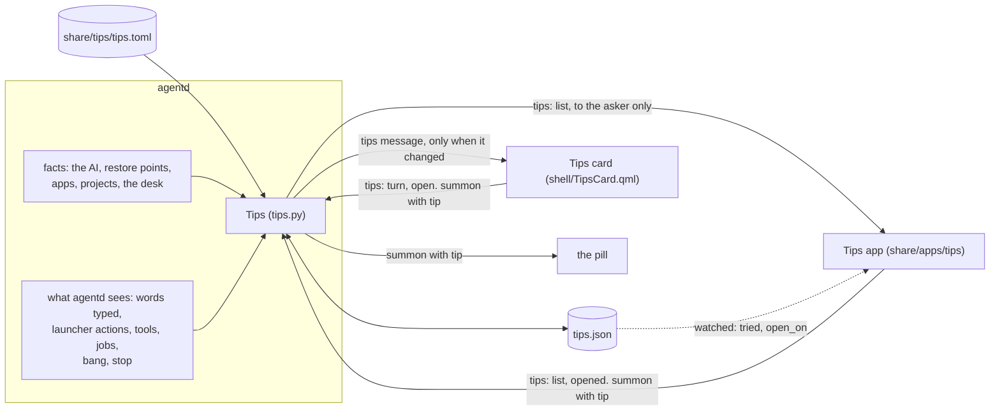
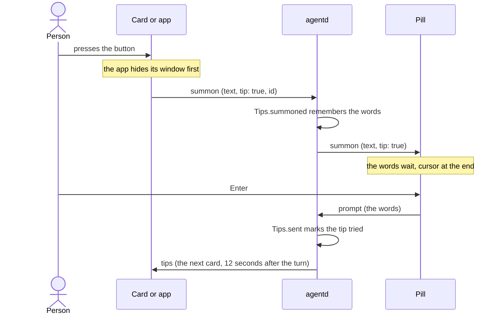
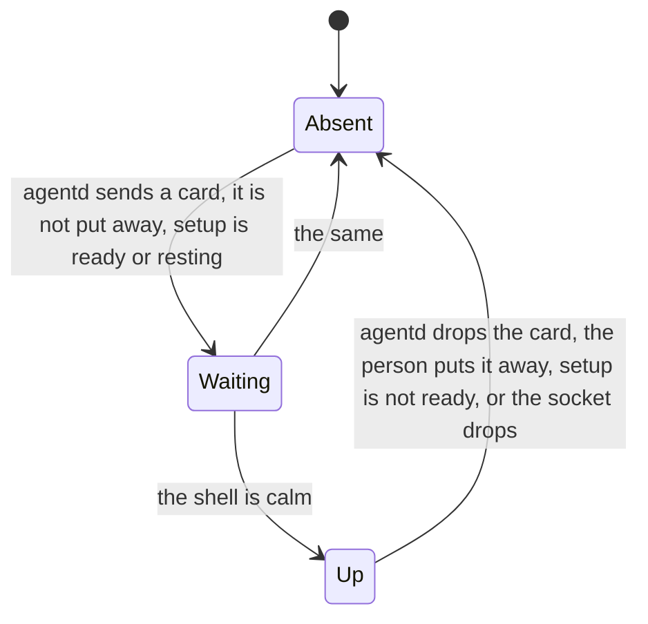
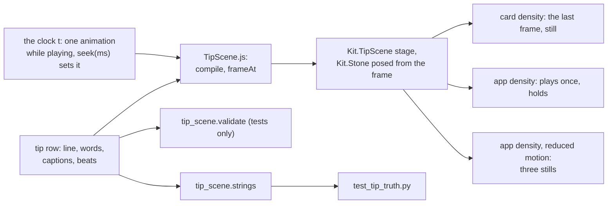

# Tips

> **Status:** Shipped  
> **Code:** `src/bombadil/tips.py`, `share/tips/tips.toml`, `src/bombadil/tip_scene.py`, `share/qml/Bombadil/TipScene.qml`, `share/qml/Bombadil/TipScene.js`, `share/qml/Bombadil/Stone.qml`, `share/apps/tips/`, `shell/TipsCard.qml`, `shell/DeskState.qml`, `shell/DeskRail.qml`, `shell/DeskStrips.qml`, `shell/PillState.qml`, `shell/shell.qml`, `src/bombadil/agentd.py`, `src/bombadil/desk.py`, `src/bombadil/launcher.py`, `src/bombadil/apps.py`, `src/bombadil/appkit/native/agent.py`, `src/bombadil/appkit/check.py`, `src/bombadil/paths.py`, `install/carry.list`, `iso/airootfs/usr/local/bin/bombadil-install`, `tests/test_tips.py`, `tests/test_tip_scene.py`, `tests/test_tip_truth.py`, `tests/test_agentd_tips.py`, `tests/test_tips_card_qml.py`, `tests/test_tips_app_backend.py`, `tests/test_tips_app_qml.py`, `tests/test_tip_scene_qml.py`, `tests/test_stone_qml.py`, `tests/test_installer.py`  
> **Design:** [Tips, and the desk after boot](../design/tips-and-desk-defaults-brief.md), piece 1; the contracts the code comments and tests point to are [TIPS.md](../TIPS.md) and [TIP-SCENES.md](../TIP-SCENES.md)  
> **Verified:** 2026-11-12 against `main` at `7d37bc5`, for what changed since `7d17600`. Read in the code: the Tips parts of `src/bombadil/agentd.py` (the constructor, `_tips_op`, `_tips_open`, `event`, `DESK_SAID`), `Tips.opened` in `src/bombadil/tips.py`, the `tips` widget, `HIDE_NOTES` and the desk words in `src/bombadil/desk.py`, `TIPS_COMMANDS`, `APP_WIDGETS`, `open_tips` and `entries` in `src/bombadil/launcher.py`, `Agent.draft`, `refused_components` and `apps.RESERVED`, `src/bombadil/tip_scene.py`, the vocabulary and the measures of `TipScene.qml`, `TipScene.js` and `Stone.qml` (not read in full), `shell/TipsCard.qml`, the Tips parts of `shell/DeskState.qml`, `shell/DeskRail.qml`, `shell/DeskStrips.qml`, `shell/PillState.qml` and `shell/shell.qml`, `share/apps/tips/app.py`, `main.qml` and `app.toml`, every row of `share/tips/tips.toml` (section, `marks`, `card`, `needs`, and that each has `beats`; the beats themselves were not read beat by beat), and `install/carry.list` with `carry` in `bombadil-install`. Run on 2026-11-12: `tests/test_tips.py` (183 passed, 89 skipped), `tests/test_tip_scene.py` (84 passed), `tests/test_agentd_tips.py` (74 passed, with `pytest-asyncio` taken from a scratch folder because it is not installed), the Tips cases of `tests/test_desk.py` (35), `tests/test_launcher.py` (45) and `tests/test_apps.py` (1), `tests/test_appkit_internal.py` (18 passed, 3 skipped), `tests/test_installer.py` (114 passed, 3 skipped) and `tests/test_installplan.py` (50). Only their opening notes and test names were read, and nothing was run, for `tests/test_tip_truth.py`, `tests/test_tip_scene_qml.py`, `tests/test_stone_qml.py`, `tests/test_tips_card_qml.py`, `tests/test_tips_app_backend.py`, `tests/test_tips_app_qml.py`, `tests/test_pill_qml.py` and `tests/test_widgets_card_qml.py`: PySide6 is not installed here and all eight are skipped as a whole. Of the 89 skipped cases of `tests/test_tips.py`, 88 need PySide6 and are the ones that draw the scenes, and one measures widths with Inter, which the test could not load here. Section 32 of `tests/desktop/driver.py` needs a compositor and was read only. No card, window or scene was looked at on a screen. The rest of the text (the table's rules, the gates, the evidence, `tips.json`, the choice of the card in agentd) was verified on 2026-11-09 against `main` at `f0485c2`, and the `keep` change against `7d17600`; it was not read again except where this page names a change. The brief's account of the card and the app is design and was not checked against code.

Tips teaches a person what they can ask, one line at a time, and only what this machine can really do. A table of twenty one-line tips, `share/tips/tips.toml`, is loaded and checked by `src/bombadil/tips.py`; agentd works out which tips the machine can back, notes which ones the person has tried from what agentd itself sees with no model, and sends clients one `tips` message that names the tip to show. Two things draw it: a still Tips card on the desk's right rail for a new person's first week, or for as long as the person keeps it, and the Tips app, where each tip plays once on a small copy of the screen drawn by `Kit.TipScene`. The brief decides why a tip is one line with the exact words to type, why a tip the machine cannot back is shown nowhere, and why pressing a tip's button runs nothing. The flat pages [TIPS.md](../TIPS.md) and [TIP-SCENES.md](../TIP-SCENES.md) are the contracts and stay where code comments and a test point at them; this page says how the piece works on `main` and links to them for the fields, the vocabulary and the rules instead of copying them.

## How it works



The dotted line is the app reading a file, not a message. The app opens a one-shot connection for each request, so it never counts as a bar.

1. **agentd starts.** `AgentD.__init__` builds one `Tips`, which reads the table once (`read_table`) and `tips.json` (`State`). With `BOMBADIL_TIPS=0` there is none.
2. **It looks at the machine.** `_tips_refresh` reads the folders in a worker (`read_facts`), then adds what only agentd knows: whether restore points exist and the AI's title. It runs when a client connects, when setup or the desk changes, when the apps and the project names change (`APPS_POLL`, every 3 seconds), when a turn ends, when a tip is tried, and before the `open` and `list` ops. One look runs at a time. An exception in it is a line on stderr and costs no client, turn or setup.
3. **It tells clients.** `Tips.message()` chooses the card. `_tips_send` broadcasts it only when it differs from the last message sent, and each client that connects is told once, in the greeting. Even "nothing to say" (`present: false`) is sent once.
4. **It counts what the person does.** When agentd sees something a tip counts, `Tips` marks the tip tried and saves `tips.json`. A tried tip arms a 12 second timer; when it fires, the card moves to the first tip not tried, and if it moved agentd looks again and sends the new card.
5. **The shell draws the card.** `DeskState.handle` keeps the `tips` message as `tipsModel` and decides whether the card shows; `shell/TipsCard.qml` draws it ([The Tips card on the desk](#the-tips-card-on-the-desk)).
6. **The app lists.** The Tips app asks `list` in a one-shot request, draws what agentd answers and nothing else, and plays the tip in front ([The Tips app](#the-tips-app)).
7. **A button press** arrives as `summon` with `tip: true` and the tip's `id`. agentd remembers the words for that tip and broadcasts the summon. Nothing is sent to the model: the person's own Enter does that, as an ordinary ask.

### A press on a tip's button



### The pieces

| File | What it is |
|---|---|
| `share/tips/tips.toml` | The twenty tips, one `[[tip]]` row each, each with its scene in `beats`. The only place a tip's words live |
| `src/bombadil/tips.py` | The table (`load_rows`, `read_table`), what a machine can back (`Facts`, `backed`, `listed`), the placeholders (`fill`, `newest_app`, `newest_project`), `tips.json` (`State`, `parse_state`), the evidence (`local_keys`, `tool_keys`, `job_keys`, `BANG`) and `Tips`. It uses the standard library and the package's `paths` and `apps`, and imports `launcher` only inside `_opens_the_app`, so it stays a leaf of the package; it opens no socket. Every file it reads and the clock are parameters, so the tests hand it text and a date |
| `src/bombadil/agentd.py` | Owns the one `Tips` (`self.tips`), looks at the machine, tells clients, answers the ops, shows the Tips app when asked (`_tips_open`) and feeds `Tips` what it sees. [agentd](agentd.md#tips) describes it from its side |
| `src/bombadil/tip_scene.py` | The vocabulary and the timing of a scene for Python, and the validator. Standard library only. Only the tests import it |
| `share/qml/Bombadil/TipScene.qml`, `TipScene.js` | `Kit.TipScene`, the renderer: `TipScene.js` says what is on the mini screen at any time `t`, `TipScene.qml` draws it |
| `share/qml/Bombadil/Stone.qml` | `Kit.Stone`, the mark, moved out of `shell/` so the scenes can draw it too |
| `share/apps/tips/` | The Tips app: `app.toml`, `main.qml`, `app.py` (the `Backend`), `TipList.qml`, `TipRow.qml`, `Marks.qml`, `PillButton.qml` |
| `shell/TipsCard.qml` | The card's face. `shell/DeskState.qml` holds its model and its presence rules, `shell/DeskRail.qml` loads it, `shell/DeskStrips.qml` passes a press on a strip |
| `src/bombadil/desk.py` | The `tips` widget: what puts it away and keeps it, and the sentences |
| `src/bombadil/launcher.py` | `TIPS_COMMANDS`, the words that open the app, `APP_WIDGETS` and `Launcher.open_tips` |
| `src/bombadil/appkit/native/agent.py` | `Agent.draft`, the app's button |
| `src/bombadil/appkit/check.py`, `src/bombadil/apps.py` | `INTERNAL_COMPONENTS` and `refused_components`, which keep `Kit.Stone` and `Kit.TipScene` out of apps the agent writes; `RESERVED`, which keeps an app called Tips from standing in for the window |
| `src/bombadil/paths.py` | `tips_file()` and `tips_table()` |
| `install/carry.list`, `iso/airootfs/usr/local/bin/bombadil-install` | The carry list names `tips.json`; the installer's `carry` copies it to the installed disk with the desk's file and the sign-in |

### The table

`share/tips/tips.toml` has 6 tips in `start` (Start here), 5 in `work`, 3 in `code` and 6 in `machine` (This machine). Each row has `id`, `section`, `order`, `line`, `words`, `marks`, `needs`, `card`, `tried_when`, `captions` and `beats`; [TIPS.md](../TIPS.md#the-table) says what each field means. Four rows have `marks` and no button (`esc`, `whyhere`, `why`, `undo`), because their words only make sense during a turn or after one. Three have `card = false` (`draw`, `tests`, `code-picture`), because their button would not fit the card's 272 px row, so only the app shows them. Every row has a scene in `beats`, and the test for the table fails on a row without one.

`load_rows` leaves out a row that is wrong instead of half-using it: a gate that does not exist, captions that are not three, evidence nothing sees, a key that is not a field (so a typo such as `need` cannot leave a tip ungated), `beats` that are not a list of tables or that JSON cannot carry, a placeholder other than `ai`, `app` and `project`, or an id used a second time. Two rows with one place in a section are both kept and reported. The problems go to stderr as `tips: ...`. A table that cannot be read gives no tips and agentd goes on. `ordered` puts the sections in their order and each by `order`; the card and the app never shuffle. The loader does not read a scene: that a scene is sound is checked by `tip_scene.validate` in the tests only ([Known gaps](#known-gaps)).

### What this machine can back

A tip is shown only where every gate in its `needs` is met and every `{ai}`, `{app}` and `{project}` in its line and words can be filled (`tips.backed`). A tip that fails is in no list and on no card, not even greyed. `Facts` holds the machine's side.

| Gate | Met when | Set by |
|---|---|---|
| `model` | `Facts.ai` is not empty: an AI is chosen and `access` is `ready` or `resting` (`TIPS_AI_STATES`), so the list does not change while the AI rests | `_tips_refresh` |
| `installed` | `Snapshots.available`: an installed disk with restore points, never the live USB | `_tips_refresh` |
| `app` | `newest_app` finds an app in `~/Apps` whose name fits a button | `read_facts` |
| `project` | `newest_project` finds a folder in `~/Projects` | `read_facts` |
| `sessions` | `bombadil.dev` can be imported | `read_facts`; true on `main`, and no tip needs it |
| `mail`, `noticed` | Always false on `main`: `_tips_refresh` calls `read_facts` without them | No tip needs either |
| `keep` | Always true on `main`: the `keep` argument of `read_facts` defaults to true, because the desk can keep a widget | `read_facts`. The tip `keep` needs it, so all 20 tips can be listed |
| `desk-seen` | A desk card other than Tips has been on the screen | agentd, through `Tips.card_seen`: the Machine card is up (a kept Machine at rest too), the jobs table has rows, a step touches the system, or a plan has two steps or more. Kept in `tips.json` |

`{app}` is the title of the app whose `main.qml` was written last, with its folder name as the fallback. `{project}` is the newest folder in `~/Projects`, and a dot folder is not one. `{ai}` is the AI's title. A name goes into the pill as words, so `fit` takes it only when it starts with a letter or a digit (never `!` or `~`, which would make it a shell command or a path), holds only letters, digits, spaces and a few marks, and is at most 18 characters for an app and 24 for a project. A name that fails is skipped and the next newest is used. An app whose title the launcher answers as a command (Lock, Desk, Mail) is skipped too, because typing it would not open the app; `newest_app` asks `launcher.match`.

### What the person has been taught

`tips.json` is the one file Tips keeps. agentd is its only writer; it is written whole through a temporary file and a rename, so a crash never leaves half a file, and a disk that will not take it never costs the change, which is held in memory until agentd stops. The Tips app watches it and never writes it.

| Key | Meaning |
|---|---|
| `first_ready` | The day setup was first `ready`, set once by `Tips.ready()` from `_set_access`. The first week begins here, and every tip in the table is known from this day |
| `days` | Days on which the person typed in the pill (`Tips.use()`), at most 30 kept. An app's, a helper's or an agent process's prompt is not a day of use |
| `tried` | Tip ids tried, at most 400. A retired id stays, so a reused id could never look tried |
| `known` | Tip ids the person has had in front of them, at most 400. A tip that comes with an update is `new` until the app has listed it, and is never put on the card unasked |
| `open_on` | The tip the Tips app is asked to open on; `""` is its first. The app reads it from the file and says `opened`, and agentd then sets it back to `""` (`Tips.opened`), so a press long ago never moves a window that opens later |
| `desk_seen` | A desk card other than Tips has been on the screen, so the desk tip stays once it has been taught |

Whatever is missing, damaged or edited by hand falls back for that part, and a file that does not parse gives the state of someone who was taught nothing. `known` missing or empty in a file that has begun means every tip is known, so a table that could not be read once does not hide every tip after.

### What counts as tried

A tip is tried when agentd sees, with no model, that the person did it. Showing a tip never counts, and neither does pressing its button. The forms a row may use are a closed list checked when the table loads (`tips._EVIDENCE`), so a tip cannot silently be impossible to try.

| `tried_when` | What counts | Where agentd sees it |
|---|---|---|
| `words` | The words sent are the tip's own words, case, spaces and end marks aside. Also the exact words a button put in the pill for that tip. Words that end in `…` count with more after them | The `prompt` branch of `AgentD.handle`, through `_tips_typed`, for a line the person typed: no `asked_by`, not `[from app NAME]`, not from a process inside an agent's turn |
| `local:<kind>[:<target>]` | A launcher action ran well: `local:desk`, `local:widgets`, `local:picture:disks`, `local:app`, `local:undo`. Closing or hiding an app, a panel, a widget or mail, and keeping a widget, does not count, and neither does a rest that does not pause (`local_keys`). A failed action does not count. A press at the desk (the Tips card's x, the parts and Reset of the Widgets card) is answered on the line the same way but teaches nothing: `event` takes `teaches=False` for it, so only the word `desk` is the tip "Say desk to fold the cards" | `AgentD.event`, for a `local` event in phase `done` with `ok`, except `stop` |
| `local:stop` | Esc (the `stop` or `cancel` message) or the word "stop", while a turn really runs. Undo, restart, shutdown and the setup card's cancel stop a turn too and do not count | `AgentD.stop(by_person=True)` |
| `tool:<name>` | The turn's call of that tool worked: its result came back without an `error`. A call with no id counts at once, and at most 64 calls wait. A tool from an MCP server counts by the part of its name after the last `__`, so `tool:create_app` is the OS tool whatever its prefix | `_tips_tool`, from `_on_event` |
| `job:start[:<kind>]` | A background job of kind `job`, `watch` or `timer` was started | `_job_tool`, the `start` op, through `job_keys` |
| `bang` | A `!` command the person typed. One a helper asked for (`asked_by`) teaches nobody | `AgentD.turn` |

The tip `keep` ("Keep a widget on your desk.") is tried by the word `widgets`, which opens the Widgets card (`local:widgets`), and not by `keep machine`, which `local_keys` leaves out. [TIPS.md](../TIPS.md#what-counts-as-tried) has the same list from the contract's side.

### What agentd says about the card

`Tips.message()` is the one thing agentd says about Tips. Its `card` is the tip the card is on, which stays until it is turned or until that tip can no longer be backed, and then it is the first tip not tried.

- **Present.** `present` is true when an AI is ready, the person has not put Tips away (`Tips.hidden`, which reads `desk.hidden`), and the card has a tip to turn through. Unless the person keeps Tips (`Tips.kept`, which reads `desk.kept`), it is true only in the first week: setup has been ready, fewer than seven days of use (`WEEK_DAYS`) and a Start-here tip is left untried. After seven days of typing in the pill, or once every Start-here tip is tried, `present` goes false.
- **Which tips it turns through.** The Start-here tips that have a `card` button and are `known`. Once Tips is kept, every known tip that has a `card` button. A tip not yet known is left out, so nothing that came with an update is put on the desk unasked.
- **The why line** is the section and the tip's place among the card's tips of that section, as in "Start here · 3 of 6". It follows the machine: a tip that cannot be backed leaves the count too.
- **Turning.** The `turn` op moves one tip on or back and wraps. Twelve seconds (`TIPS_TURN_AFTER`) after a turn that tried a tip ends, or after the word when no turn runs, `advance` moves the card to the first tip not tried. A turn that begins before then cancels the timer and arms it again at its own end, so the card never changes under a turn, and a turn that tried nothing never moves it.

### The Tips card on the desk

The card is the `tips` widget of `src/bombadil/desk.py`: title "Tips", the word `tips`, the right rail, last in the order so it is the top of the rail, the question "What can I ask it to do?" for its row on the Widgets card, and `calm=True`, so a person can keep it ([the desk](desk.md#your-desk-keep-when-needed-off) says what keeping does). `shell/DeskState.qml` keeps the `tips` message as `tipsModel` (a message that is not a card with an id and a line takes the card away) and `shell/TipsCard.qml` draws it on `DeskCard`. [TIPS.md](../TIPS.md#the-tips-card-on-the-desk) has the measures and the rules in full; the rails, strips and folding every card obeys are in [the desk](desk.md).

The card is present only when all of these hold (`DeskState.tipsPresent`):

- agentd says `present: true` with a card. The shell does not look at whether that is the first week or a kept card.
- The person has not put it away: `hidden` has no `tips`.
- Setup is over: the pill's setup state is `ready` or `resting`. The desk does not react to the rest.
- The shell has been calm once: the pill is idle, nothing is stoppable, the desk's plan is idle, no persona card is up and `cardsUp` is false (`tipsCalm`).



Calm is a latch (`_tipsUp`). Once the card is up it stays through turns, lines and the rest, so nobody has it appear under a running turn, and it goes only when `tipsWanted` fails. A card agentd takes away and brings back mid-turn waits for calm again.

The card is 300 x 290 px for every tip, so the cards above it never jump: the title, the why line, a 272 x 153 poster (`Kit.TipScene` at card density, the scene's last frame, loaded only while its face is on show), the line on one row, and a row with the button and "All tips ›". The button is the sentence you would type and its words elide when they do not fit beside "All tips ›", so a long app name never overflows; a tip with no button draws its marks in its place, which are not buttons. The arrows and the x fade in with the pointer (`Kit.Theme.fast`, 120 ms), a turn crossfades two faces (`Kit.Theme.normal`, 200 ms), both are instant under reduced motion, and nothing on the card runs at rest or is the accent orange.

| The person | The card asks | Then |
|---|---|---|
| presses the arrows, or turns the wheel (one notch of 120 for a tip) | `{"type": "tips", "op": "turn", "dir": 1}` or `-1` | agentd sends the card for the next tip. The shell never turns the card itself |
| presses the title or "All tips ›" | `{"type": "tips", "op": "open", "id": "<tip>", "play": false}` | agentd keeps the id as `open_on` and shows the Tips app |
| presses the picture | the same with `"play": true` | the same; the app plays every tip it comes to, so `play` changes nothing there |
| presses the strip the card folds to | `{"type": "tips", "op": "open", "id": "", "play": false}` (`DeskState.stripClicked`) | the app, on the tip it was on |
| presses the button | `{"type": "summon", "text": "<words>", "tip": true, "id": "<tip>"}` (only for the tip on the card, and not for a tip with no words) | agentd remembers the words and tells every bar ([A press on a tip's button](#a-press-on-a-tips-button)) |
| presses the x | `{"type": "desk", "op": "set", "widget": "tips", "state": "off"}` (`DeskState.putAway`) | the Widgets card's Off: kept or not, the card is put away at once |

### The pill and a tip's words

The pill that has the keyboard takes a tip's words with the cursor at the end. A `summon` with `tip: true` fills an empty pill only: words the person typed and has not sent stay (`PillState.draftFor`, applied by `takeDraft` in `shell/shell.qml`), where the Brain's "Ask about this", which has no `tip`, still replaces them. Words an earlier tip's button put there and nobody has changed are not typed words: the next tip replaces them, so turning the card and pressing the next tip's button is never a silent press. The pill remembers what a tip put in (`tipWords`, per screen). A tip's words that end in `…` ("In Tickets, add…") go in with the dots taken off and a space left, so the person finishes the sentence. Enter sends the words as the person's own ask, with its restore point.

### The Tips app

The Tips app is a built-in kit app, `share/apps/tips` (a 960 x 516 window, title "Tips", icon `sparkles`). Left is the stage: `Kit.TipScene` at app density (576 x 324) with its three phase captions under it, then the tip's line, then the button with the exact words and Replay, or the marks for a tip with no button. Right is the list of every tip agentd lists, by section in the table's order, with a heading for each, and a `New` heading for tips an update brought that the person has not seen (a tip in that state is there alone, not in its section as well). A tried tip has a tick. A tip the machine cannot back is not in the list at all, not even greyed: the window shows what agentd lists and nothing else. With nothing listed it says why ("No tips to show on this computer"), and while agentd does not answer it says so ("The agent is not answering").

| What | Does |
|---|---|
| Choosing a tip (a click, Up, Down) | The tip plays once from its start and holds its payoff. Choosing the one in front does nothing |
| Replay, Space | Plays it again. Not shown, and no effect, under reduced motion (the stage is then three stills) or for a tip with no scene |
| Enter, the button | Hides the window first (`App.hide()`), then puts the words in the pill (`Agent.draft(words, id)`). Nothing is sent. A tip with only marks has nothing to press |
| Esc | Hides the window: it is the kit's own key in `AppWindow` |
| Coming forward | Asks agentd for the list once more, unless a request is out or the list is under 1.5 seconds old (`look`). Nothing else asks by itself |

`share/apps/tips/app.py` holds the `Backend`. Every request is a one-shot `QLocalSocket` (`Once`): it connects, writes its line, reads the answer if there is one and closes, because a connection that stays open makes agentd sample the machine for as long as it lasts. While nothing listens at agentd's socket the window asks again every 2 seconds (`RETRY_MS`); where something listens and says nothing it asks every 30 (`QUIET_MS`), because each try holds a socket for up to 5 seconds (`ANSWER_MS`). The kit's `Agent` singleton does not connect until an app looks at its state, so a window that only drafts holds no connection. The `Backend` watches `tips.json` and its folder and never writes it. A change of `tried` ticks one row without moving the list or replaying the tip in front, and asks for the list again, since what a turn tried may have changed what the machine can back. A change of `open_on` is a press on the card: the window shows that tip, plays it, and says `opened`. What agentd lists is cleaned before it is drawn (an id that is not kebab-case, an unknown section, an empty line, a duplicate and anything that is not a string are dropped, over-long text is cut) and every text is drawn as plain text. [TIPS.md](../TIPS.md#the-tips-app) has the rest, including the reduced-motion layout.

`Agent.draft(text)` and `Agent.draft(text, tipId)` (`src/bombadil/appkit/native/agent.py`) open a one-shot connection that writes `{"type": "summon", "text": text, "tip": true}` (plus `"id"` when a tip id is given) and closes when the line is written or after `SHOT_SECONDS` (2). It queues nothing, does nothing while agentd is away and never runs in `check`.

### The scenes

A tip is shown on a small copy of Bombadil's own screen, drawn live from the theme's tokens, instead of a recorded clip. The card shows the last frame as a still poster; the app plays the beats once and holds the last frame; under reduced motion the app shows three stills, one for the end of each phase, with their captions. A scene is a list of beats, a table each, played one after the other: ten drawing kinds (`key`, `type`, `stone`, `line`, `queue`, `window`, `card`, `picture`, `fold`, `hold`) and their modifiers. It runs 6 to 8 seconds and never over 10, with three captions of at most three words. [TIP-SCENES.md](../TIP-SCENES.md#the-ten-beats) has the vocabulary and the timing, and the numbers are in `src/bombadil/tip_scene.py`, mirrored in `TipScene.js`.



A scene is a function of its clock: the frame at any `t` is drawn from the beats alone, so a test or a poster asks for it without waiting. The one thing that moves is `t`, advanced by a single `NumberAnimation` that exists only between `play()` and the end; the scene has no timer, no `Behavior` and no loop, and its mini stone is a `Kit.Stone` with `animate: false` whose pose the scene writes from the frame.

**The truth rule.** A storyboard must not show what the real machine would not say, so every string a scene shows carries one of five tags (`template`, `typed`, `model`, `output`, `caption`). A `template` string is held whole to a sentence the real code says, what is typed is the tip's own words, a `model` string is the agent's reply and is held only to being plain and short, an `output` string to the shape of the real command's output. `tests/test_tip_truth.py` makes the sentences by calling the real code (`narrate`, `launcher`, `desk`, `jobs`, `vitals`, `rest`, `sysmap`, `agentd`, the shell's own QML) and fails, in the scene that shows it, the day a real line changes. A string no code says may be named in `UNTIED` with why; it is empty on `main`. [TIP-SCENES.md](../TIP-SCENES.md#the-truth-rule) has the rule and [the truth test](../TIP-SCENES.md#the-truth-test) what it holds.

### Kit.Stone and the internal components

`Kit.Stone` (`share/qml/Bombadil/Stone.qml`) is the mark, drawn and animated. It moved out of `shell/` because the scenes draw it too, and the pill uses it as `Kit.Stone`. It gained three properties that default to what the pill needs: `animate` (false gates every animation and the settle timer, so a scene draws one frame at a time), `ink` (`"fg"` or `"muted"` draws it in that ink with no state colour) and `small` (the 16 px drawing). `Kit.Stone` and `Kit.TipScene` are in the kit's `qmldir` but are internal: not in the apps skill, and `bombadil-app check` refuses them in an app the agent writes (`INTERNAL_COMPONENTS`), as does every load and reload of an app. The built-in apps under `share/apps` pass (`apps.is_builtin`), which is how the Tips app uses `Kit.TipScene`.

### The words that open the app

`TIPS_COMMANDS` in `src/bombadil/launcher.py`: `tips`, `the tips`, `open tips`, `show tips`, `open the tips`, `show the tips`, `what can you do`, `what can I ask` and `help`, whole sentences only (`help me write a poem` is for the agent). They are answered after the core commands, the model words and the Brain's words, and before the connection words, app names, panels and the desk's widget words, so an app called Help never stands in for them, and a project or session named `tips` does not either (`_fixed_word`). `Launcher.open_tips` brings the window forward if it is open, shows it from the kit's drawer if there is one, and starts it otherwise; the line says "Opened Tips." and, when it fails, "Could not open Tips." An app called Tips is refused (`apps.RESERVED`): the agent never writes tips, and the word and the card must open Bombadil's own window.

`tips` is also the widget's name, and the two have separate sentences. The app's words open the app and change nothing on the desk. The desk's words are `keep tips`, `hide tips` and `put tips away` (`Desk.apply`), and `APP_WIDGETS`, made from `TIPS_COMMANDS`, keeps the desk from answering an open verb for Tips. The word `tips` never brings back a card that was put away, and never undoes "no longer kept": a card comes back by `keep tips` or by the Widgets card. [TIPS.md](../TIPS.md#a-kept-tips-card) has the sentences.

## Interfaces other pieces depend on

[TIPS.md](../TIPS.md#wire-protocol) has every field of the messages, and [agentd](agentd.md#messages-a-client-sends) lists them among the socket's. This section has the names.

### Messages

| Message | Direction | What |
|---|---|---|
| `{"type": "tips", "present": bool, "card": {...} or null}` | agentd to every client | The card. Sent once to each client that connects and to all of them when it differs from the last one sent. `card` has `id`, `line`, `words`, `marks`, `why`, `index`, `count` and `tip`, the whole filled row with its captions and beats |
| `{"type": "tips", "list": [...]}` | agentd to the asker only | The answer to `list`: one entry for each tip this machine can back, in the fixed order, with `id`, `section`, `order`, `line`, `words`, `marks`, `card`, `tried`, `new`, `captions` and `beats`. With Tips off it is `[]` |
| `{"type": "tips", "op": "turn", "dir": 1}` or `-1` | client to agentd | Turn the card one tip on or back. Only the whole numbers 1 and -1 count. The message is sent when the card moved |
| `{"type": "tips", "op": "open", "id": "...", "play": bool}` | client to agentd | Keep `id` as `open_on` (an id this machine cannot back becomes `""`) and call `Tips.on_open`, which asks the launcher to show the Tips app (`_tips_open`, off the event loop, saying nothing). `play` reaches the hook and changes nothing |
| `{"type": "tips", "op": "opened", "id": "..."}` | client to agentd | The Tips app has read the request: `open_on` goes back to `""` when it still is that id, and a newer press stays. Nothing is answered |
| `{"type": "tips", "op": "list"}` | client to agentd | A one-shot: agentd looks at the machine, answers with the list on that connection, and sends the card if the look changed it. Asking is looking, so the tips it listed are `known` after |
| `{"type": "summon", "text": "...", "tip": true, "id": "<tip id>"}` | client to agentd | A tip's button. agentd remembers the words for that tip and broadcasts `{"type": "summon", "text": "...", "tip": true}`; the pill keeps typed words when it takes them. Only the JSON `true` counts as `tip` |
| `{"type": "desk", "op": "set", "widget": "tips", "state": "off"}` | client to agentd | The card's x. agentd keeps it in `desk.toml`, says "Put Tips away. Say tips to see them again." on the line (the ops in `DESK_SAID` are answered there, and teach no tip), sends the desk and then `present: false` |

### Words, components and commands

| Name | What it is |
|---|---|
| `tips`, `the tips`, `open tips`, `show tips`, `open the tips`, `show the tips`, `what can you do`, `what can I ask`, `help` | `TIPS_COMMANDS`: open the Tips app |
| `keep tips`, `hide tips`, `put tips away` | The desk's words for the widget. "Tips stays on the desk.", "Tips is no longer kept. Say tips to open the app." and "Put Tips away. Say tips to see them again." ([the desk](desk.md#your-desk-keep-when-needed-off)) |
| `Kit.TipScene` | `tip`, `density` (`"card"` or `"app"`), `reducedMotion`, `t`, readonly `duration`, `phase`, `playing` and `frame`, `play()`, `replay()`, `seek(ms)` and `finished`. Internal |
| `Kit.Stone` | `face`, the pose (`turn`, `knock`, `lean`, `hopY`, `hopSx`, `hopSy`, `glowOpacity`) and `reducedMotion` as the pill uses them, and `animate`, `ink` and `small`. Internal |
| `Agent.draft(text)`, `Agent.draft(text, tipId)` | An app's button: put words in the pill, send nothing |

### Files, names and limits

| Name | What it is |
|---|---|
| `paths.tips_file()` | `<state dir>/tips.json`, which is `~/.local/state/bombadil/tips.json` unless `BOMBADIL_STATE` or `XDG_STATE_HOME` moves it |
| `paths.tips_table()` | `share/tips/tips.toml` beside the package: the checkout's own, and `/usr/share/bombadil/share/tips/tips.toml` on the image. No environment variable moves it |
| `BOMBADIL_TIPS=0` | Turns Tips off in agentd: nothing is sent, nothing is kept, the ops are ignored except `list`, which is answered with an empty list so the window says there is nothing instead of waiting. `tests/conftest.py` sets it for every test, and `tests/test_agentd_tips.py` turns it on |
| `BOMBADIL_SCREENS` | A test option: the folder the scene, card and app tests save pictures in |
| `TIPS_TURN_AFTER`, `TIPS_AI_STATES`, `DESK_SAID` | In `src/bombadil/agentd.py`: 12 seconds, `ready` and `resting`, and the desk ops (`set`, `keep`, `reset`) that the line answers for |
| `WEEK_DAYS`, `MAX_APP`, `MAX_PROJECT`, `MAX_TRIED`, `MAX_DAYS`, `MAX_SUMMONED` | In `src/bombadil/tips.py`: 7 days of use, 18 and 24 characters, 400 ids, 30 days, and 24 button presses remembered |
| `RETRY_MS`, `QUIET_MS`, `ANSWER_MS`, `FRESH_MS` | In `share/apps/tips/app.py`: 2000, 30000, 5000 and 1500 ms |
| `MAX_SECONDS`, `TARGET_SECONDS`, `MAX_WINDOW_ROWS`, `MAX_QUEUE`, `CAPTIONS`, `CAPTION_WORDS` | In `src/bombadil/tip_scene.py`: 10, (6, 8), 3, 2, 3 and 3 |

## Where state lives

| What | Where | Notes |
|---|---|---|
| The table | `share/tips/tips.toml` | Read once when agentd builds `Tips`, so an edit needs agentd restarted. A plain file in the repository; no tool or skill writes it |
| `tips.json` | `~/.local/state/bombadil/tips.json` | Written by agentd only, all or nothing. It is in the person's home folder, outside the restore points, because undo swaps the system root only ([restore points](restore-points.md)), so an undo never makes Tips forget |
| The installed disk's copy | `~/.local/state/bombadil/tips.json` on the disk | `install/carry.list` names it, and `carry` in `bombadil-install` copies it from the live home with `desk.toml` and the sign-in, when it exists, so the first week does not begin again after an install. A refresh keeps a file the installed home already has ([installer](installed-os.md#the-plan-and-what-comes-along)) |
| Whether Tips is put away or kept | `desk.toml`, in `hidden` and `kept` | The desk's file, which `Tips.hidden` and `Tips.kept` read through `desk.hidden` and `desk.kept` ([the desk](desk.md#your-desk-keep-when-needed-off)) |
| agentd's memory | `Tips._shown`, `_summoned`, `facts`; `_tips_last`, `_tips_timer`, `_tips_calls` | The tip the card is on, the words buttons put in the pill (at most 24), the machine's facts, the last message sent, the 12 second timer and the tool calls waiting for their results. All of it is gone when agentd stops; after a restart the card is the first tip not tried |
| The shell's memory | `DeskState.tipsModel` and `_tipsUp`; `tipWords` in each screen's window in `shell/shell.qml` | The card agentd last sent, whether the calm latch is up, and what a tip's button put in each screen's pill. Gone when the shell restarts, and the shell is told the card again |
| The Tips app's memory | `Backend` in `share/apps/tips/app.py` | The list, the tip in front, the tried ids and the ids that were `new` when listed. It never writes a file |

## Principles it keeps

- [Records before models](../principles.md#records-before-models): what the machine can back and what the person has tried come from the machine and from agentd's own events, never from a model, and a scene may say only what the code says, a tip's own words, or a reply held to the agent's plain register. Showing a tip, or pressing its button, counts for nothing. The trap is marking a tip tried because it was shown, evidence that nothing sees (the loader refuses it), or a `template` string copied by hand that the code no longer says (the truth test fails it).
- [Full access with undo](../principles.md#full-access-with-undo): a tip's button only puts words in the pill, and the person's own Enter sends them as an ordinary ask with its restore point. The app hides its window before it drafts. agentd only remembers the words. The trap is a button, or a `summon` handler, that sends.
- [Quiet at rest](../principles.md#quiet-at-rest): Tips has no line, notice or sound, and its message is sent only when it differs from the last one. The card is a still picture with no timer, and a scene plays once, only inside the app the person opened, and holds. The one timer is the 12 seconds after a tried tip. A tip that came with an update waits as `new` and is not put on the card unasked, the card first appears only when the shell is calm, and after seven days of use it steps aside. The trap is a message sent on every look, a card that turns by itself, or a scene that loops.
- [Colour says who](../principles.md#colour-says-who): a tip is nobody's, so the card and the app draw no accent orange of their own, and a poster draws its stone in ink; on the stage the stone keeps its real colours, and the drawing tests (not run here) hold that no orange shows where it is not working. The trap is a highlighted tip or button in the accent.
- [Degrade and recover](../principles.md#degrade-and-recover): a table that cannot be read gives no tips, a bad row is left out, a damaged `tips.json` starts clean, `_tips_refresh` and `_tips_hello` catch what they raise, a disk that will not take the file costs no change, and a launcher that cannot open the app costs agentd nothing. The window says when agentd is away and asks again. The trap is a Tips failure that costs a client, a turn or a setup.
- [Plain files stay the truth](../principles.md#plain-files-stay-the-truth): the table is a file in the repository, and the agent has no tool that changes it or `tips.json`. `tips.py` reads `~/Apps` and `~/Projects` and never writes there, and the app only watches `tips.json`. The trap is a tool or skill that adds a tip. This is a rule and not a wall: the agent runs as the person and its shell could edit either file, as it can any file.

## Extending it

1. **A tip.** Add a `[[tip]]` row to `share/tips/tips.toml` with an id nobody has used (`tips.json` remembers ids, so a reused id would look tried) and the next `order` in its section. Put every gate it needs in `needs`, write `tried_when` from the list above and give `captions` the default three. Write its scene in `beats`: 6 to 8 seconds, ending on what the tip gives, with every string tagged, the tip's own words typed and every sentence the machine says copied from the code that says it ([TIP-SCENES.md](../TIP-SCENES.md#writing-the-beats-for-a-tip)). A tip for something that is not on `main` is gated by a `needs` flag whose fact stays false until its code is, so no machine that cannot do it is told to ask. To retire a tip, remove its row; its id stays in the files. Then update `SEED` in `tests/test_tips.py`, and `MARKED` or `APP_ONLY` when they apply, because the tests pin the seed, and run `tests/test_tips.py` and `tests/test_tip_truth.py`: between them they fail on a line that does not fit the card, a bad or reused id, a voice rule broken (a `!`, an em dash, "will", "tomorrow" or "later", a line that does not end in `.` or `?`), a button that does not fit the card's row while `card` is true, words that reach nothing, a row without a scene, a scene that is not sound or not 6 to 8 seconds, and a `template` string that is not a sentence the code says. [TIPS.md](../TIPS.md#how-a-tip-is-added) has the rule in full.
2. **A gate.** Add its name to `GATES`, a field to `Facts` and a case to `Facts.has`, and set the fact in `read_facts` (as `sessions` is, with `find_spec`), or in `AgentD._tips_refresh` when only agentd knows it. Add its test to `tests/test_tips.py`.
3. **A kind of evidence.** Add its form to `_EVIDENCE`, build its keys with a function like `local_keys`, and call `Tips.saw(*keys)` where agentd sees the thing, through `_tips_saw`, so a tried tip arms the card's turn. Test it in `tests/test_agentd_tips.py`.
4. **A placeholder.** Add its name to `PLACEHOLDERS`, a field to `Facts`, an entry to the `values` of `fill`, and the reader that fits what it reads to a button, as `fit` does for the apps and the projects.
5. **A section.** Add its name to `SECTIONS` in `src/bombadil/tips.py` and in `share/apps/tips/app.py`; `tests/test_tips_app_backend.py` holds the two equal.
6. **A kind of beat.** Add the drawing key to `DRAWS` and its modifiers to `MODIFIERS` in `src/bombadil/tip_scene.py` with its length in `beat_ms`, the same in `TipScene.js`, draw it in `TipScene.qml` at both densities from the frame alone (no timer, no `Behavior`), give a fixture in `tests/tip_fixtures.py` a use of it, and name it in [TIP-SCENES.md](../TIP-SCENES.md#adding-a-beat-kind), which a test reads.
7. **A word for the app.** Add it to `TIPS_COMMANDS` in `src/bombadil/launcher.py` and its near misses to `tests/test_launcher.py`, so sentences that contain it still go to the agent.
8. **An internal kit component.** Add one entry to `INTERNAL_COMPONENTS` in `src/bombadil/appkit/check.py` and a line under the "Internal" comment in the kit's `qmldir`.
9. **Another thing the app asks agentd.** Build it on `Once` (connect, write, read until the answer, close) and never keep a socket open. The card's face and its widget are added as [the desk's page](desk.md#extending-it) says; Tips is the example.

## Tests

Run the Python files one at a time on a busy machine. The Qt files need PySide6 and skip as a whole without it.

```sh
pytest tests/test_tips.py tests/test_tip_scene.py
pytest tests/test_agentd_tips.py
pytest tests/test_desk.py tests/test_launcher.py tests/test_apps.py -k tips
pytest tests/test_installer.py -k "what_tips_has_taught or nothing_to_carry"
QT_QPA_PLATFORM=offscreen pytest tests/test_tip_truth.py tests/test_tip_scene_qml.py tests/test_stone_qml.py tests/test_tips_card_qml.py tests/test_tips_app_backend.py tests/test_tips_app_qml.py
```

| File | What it covers | Runs here |
|---|---|---|
| `tests/test_tips.py` | The rules over the shipped table (ids, voice, captions, evidence, a scene for every row), the loader's errors, gating by `Facts`, placeholders and the names read from folders, the state round trip and damage, the card (the choice, the why line, turning, the first week, keeping), every kind of evidence, and the app's `opened` clearing `open_on`. No agentd, no model, no socket. With PySide6 it also draws the scenes: every card poster and every stage at its end, with no text under 12 px, nothing clipped, no name or figure of the machine on a poster and no stray orange, and replaying a tip raising no QML error | Yes for the rules (183 passed). 88 drawing cases need PySide6 and are skipped here, and one that measures widths with Inter. The width test measures with Inter at 13 px (Medium for the button) and, where PySide6 or Inter is missing, holds the line to 45 characters and the card's button to 27 instead |
| `tests/test_tip_scene.py` | The validator and the timing: the vocabulary, the values, the tags, the 10 second limit, the captions, `strings`, that `TipScene.js` keeps the vocabulary and timing of `tip_scene.py`, and that `TIP-SCENES.md` names every key | Yes (84 passed) |
| `tests/test_tip_truth.py`, `tests/tip_truth.py` | The truth test: the sentences the real code says, made by calling it, and every string of every scene held to them | No: skipped as a whole without PySide6 (the shell's own QML makes some of the sentences). Read in its opening note and test names only |
| `tests/test_tip_scene_qml.py`, `tests/tip_fixtures.py` | The renderer against seventeen fixture tips that between them use every beat, key and modifier: frames at chosen `t`, the card's and the app's measures, reduced motion's three stills, and that nothing runs while the scene is not playing | No: needs PySide6. Opening note and names only |
| `tests/test_stone_qml.py` | `Kit.Stone`: its faces, its pose, `animate`, `ink` and the 16 px drawing | No: needs PySide6 |
| `tests/test_appkit_internal.py` | `bombadil-app check` and the app load refuse `Stone` and `TipScene` in an app, and let a built-in app use them | Partly: 18 passed, 3 skipped |
| `tests/test_agentd_tips.py` | A real `AgentD` on a socket with the Fake provider or a Python one-liner: the card sent once and only when it changed, the ops (`open` shows the app quietly, `opened` clears the request), the summon, the day of use, the evidence from each source, a press at the desk teaching nothing, a kept Tips and the x, the turn of the card after 12 seconds (patched to 0.4), and Tips off. Nothing calls a model | Yes (74 passed); needs `pytest-asyncio`, from the `dev` extra |
| `tests/test_tips_card_qml.py` | The card drawn offscreen inside the real rail with the real `DeskState`, from messages a real `Tips` builds over the shipped table: its layout, every card tip without overflow, what each press sends, and the presence rules (setup, the rest, turns and lines, the persona card, the x, a window, a narrow screen, a kept Tips) | No: needs PySide6. Opening note and test names only |
| `tests/test_tips_app_backend.py`, `tests/test_tips_app_qml.py`, `tests/tips_app_lab.py` | The app's `Backend` against a fake agentd and a temporary `tips.json` (the list, ticks, the press on the card, one-shot connections and nothing left open, agentd away and back), and the real window driven with mouse and key events, which holds above all that nothing is sent as a prompt | No: need PySide6. Opening notes only |
| `tests/test_desk.py`, `tests/test_launcher.py`, `tests/test_apps.py`, `tests/test_appkit_native.py` | The `tips` widget's words, rail, sentences and keeping; `TIPS_COMMANDS` and the split of the word with the desk; that an app called Tips cannot stand in for the window; `Agent.draft` | The first three yes (35, 45 and 1 cases about Tips passed); `tests/test_appkit_native.py` needs PySide6 for `Agent.draft` and was not run |
| `tests/test_pill_qml.py`, `tests/test_widgets_card_qml.py` | What the pill takes from a summon (`PillState.draftFor`) and that `shell.qml` hands it the tip flag; Tips's row on the Widgets card | No: need PySide6 |
| `tests/test_installer.py`, `tests/test_installplan.py` | The installer's carry step on temporary folders: `tips.json` and `desk.toml` arrive on the disk, a live system with nothing to carry installs all the same, and the shipped carry list is valid | Yes |
| `tests/desktop/driver.py`, section 32 | Agentd with Tips on in a headless sway: the card on the rail, the arrows by a virtual pointer, the button (the summon, no turn), Enter (the turn and the tried tip), the card turning 12 seconds later, the x, the word `tips`, `keep tips`, a press on the picture (the app opens and its `opened` clears the request) | No: needs the desktop test's image and a compositor ([development](../contributing/development.md)). Read only |

`tests/conftest.py` sets `BOMBADIL_TIPS=0`, so no other test hears a card; the sections of the desktop test other than 32 run the same way. How the tests run as a whole is in [development](../contributing/development.md).

What no test shows is the card or the app on Hyprland: how the rail draws the card under floating and special-workspace windows, the Tips app sliding in from its drawer (the desktop test opens it as a window of its own, because the drawers are Hyprland's), the window going away and the pill taking the keyboard in that order, and how long a scene takes at the screen's own frame rate. The truth test catches changed wording, not changed window behaviour, and holds a `model` string only to being plain and short.

## Known gaps

- **The card does not wait for the recovery-key card, which is not built.** `DeskState.cardsUp` is the hook for another card of the first minutes, and nothing in `shell/` sets it; no file in `shell/` or `src/bombadil/` builds a recovery-key card. The name card does hold Tips back (`pill.personaAsk`).
- **Only the Tips strip answers a press.** `DeskStrips.qml` passes every press to `DeskState.stripClicked`, which acts on `tips` and ignores the rest, so the strips of the other cards do nothing when pressed.
- **No tip teaches Mail, the coding sessions or Noticed, and no scene can draw them.** The gates `mail` and `noticed` are always false and no row uses `sessions`, `mail` or `noticed` (`share/tips/tips.toml`). `DRAWS` in `src/bombadil/tip_scene.py` has ten kinds and `CARDS` three (`watching`, `now`, `machine`): there is no beat for a session's dot, the knock of a session that waits, or a Mail window.
- **A scene is checked by the tests and not when agentd loads the table.** `load_rows` checks that `beats` is a list of tables JSON can carry, and no code outside the tests imports `tip_scene`, so an edited table with an unsound beat reaches every client and the renderer draws what it can.
- **Two scenes show less than their tip.** `desk` shows one Now card and not Now and Watching folding, and `keep` shows three rows of the Widgets card, Now, Watching and Machine, where `desk.py` lists six widgets (`share/tips/tips.toml`). [TIP-SCENES.md](../TIP-SCENES.md#the-twenty-scenes) lists the other scenes that show less than their tip; that list was not checked beat by beat.
- **The brief's later ideas are not built.** Nothing in `src/` or `share/` reads a `does` row, so there are no tips per app; the window has no search and no "Watch again" for a real turn ([the brief](../design/tips-and-desk-defaults-brief.md#1-tips-l)).
