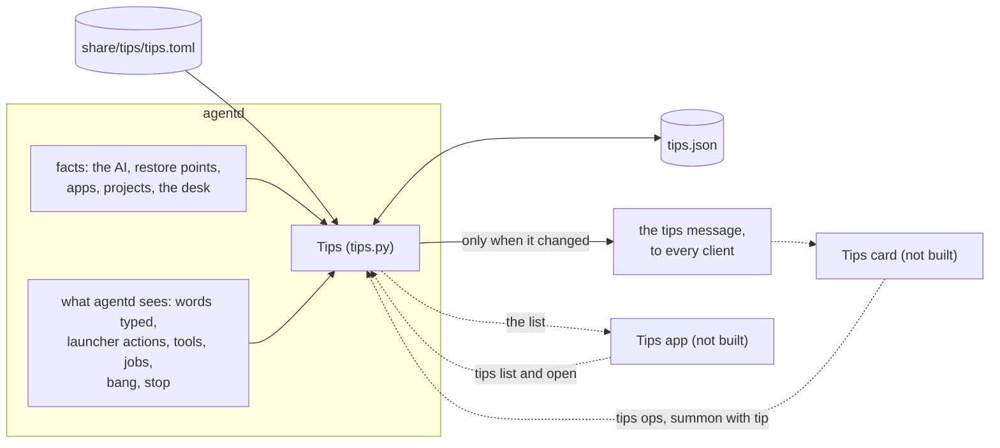

# Tips

> **Status:** Partly shipped  
> **Code:** `src/bombadil/tips.py`, `share/tips/tips.toml`, `src/bombadil/agentd.py`, `src/bombadil/paths.py`, `iso/airootfs/usr/local/bin/bombadil-install`, `tests/test_tips.py`, `tests/test_agentd_tips.py`, `tests/test_iso_profile.py`  
> **Design:** [Tips, and the desk after boot](../design/tips-and-desk-defaults-brief.md), piece 1; the contract the code comments point to is [TIPS.md](../TIPS.md)  
> **Verified:** 2026-11-09 against `main` at `f0485c2`: `src/bombadil/tips.py` and every row of `share/tips/tips.toml` were read in full. The Tips parts of `src/bombadil/agentd.py` were read: the constants, `AgentD.__init__`, `handle` (the `prompt`, `summon` and `tips` branches), `_tips_refresh` and the other `_tips_*` methods, `_set_access`, `event`, `stop`, `turn`, `_job_tool`, `_on_event`, and the places that tell Tips a card was seen. So were `paths.tips_file` and `paths.tips_table`, the widget table and `hidden` in `src/bombadil/desk.py`, the copy loop in `bombadil-install`, and the pill's handling of `summon` in `shell/shell.qml` and `shell/PillState.qml`. That no other file in `shell/`, `share/`, `bin/` or `scripts/` mentions Tips was checked by searching them. Run on 2026-11-09: `tests/test_tips.py` (179 passed, 1 skipped), `tests/test_agentd_tips.py` (65 passed) and the two installer tests in `tests/test_iso_profile.py`. The skipped test needs PySide6 and the Inter font, so the 272 px rule was held to the character bounds here and not measured. The brief's account of the card and the app is design and was not checked against code, and nothing was run on a real desk. The change since `24c836c` was added and checked against `main` at `7d17600`: the `keep` fact is true, the tip `keep` is tried by the launcher word `widgets`, and the desk has a `kept` list (`src/bombadil/desk.py`, `src/bombadil/tips.py`, `share/tips/tips.toml` and the `keep` and `desk-seen` parts of `src/bombadil/agentd.py`); the rest of the text was not read again.

Tips teaches a person what they can ask, one line at a time, and only what this machine can really do. Its data side is a table of twenty one-line tips in `share/tips/tips.toml`, which `src/bombadil/tips.py` loads and checks. agentd works out which tips the machine can back, notes which ones the person has tried from what agentd itself sees with no model, and sends clients one `tips` message that names the tip to show. The brief decides why a tip is one line with the exact words to type, why a tip the machine cannot back is shown nowhere, and why pressing a tip's button runs nothing. The flat page [TIPS.md](../TIPS.md) is the contract and stays where code comments point to it; this page says how the data side works on `main` and does not copy it.

## What is built and what is not

Only the data side of Tips is on `main`. A person on `main` is never shown a tip, because no client reads the `tips` message ([Known gaps](#known-gaps)). Of the five steps the brief gives piece 1, the first (reduced motion, [MOTION.md](../MOTION.md)) and the second (the table and agentd's side, this page) are on `main`.

| Part | State on `main` |
|---|---|
| The table, `share/tips/tips.toml`: twenty rows in four sections | Shipped |
| `src/bombadil/tips.py`: loading and checking, gates, placeholders, `tips.json`, the choice of the card, the evidence | Shipped, tested |
| agentd's `Tips`: the `tips` message, the ops `turn`, `open` and `list`, the `summon` of a tip's button, evidence from agentd's own events, the 12 second turn of the card | Shipped, tested with no model and no window |
| `tips.json`, and its copy to the installed disk by `bombadil-install` | Shipped, tested |
| The Tips card, a desk widget | Not built: `src/bombadil/desk.py` has no `tips` widget and no file in `shell/` reads a `tips` message |
| The Tips app, `share/apps/tips`, and its launcher words | Not built: `share/apps` holds `brain` and `mail`, and `src/bombadil/launcher.py` has no word for Tips |
| The scenes: `Kit.TipScene`, `Kit.Stone` and `docs/TIP-SCENES.md` | Not built: `share/qml/Bombadil/` has neither component, there is no such page, and every row has `beats = []` |
| Keeping a widget on the desk, the Widgets card | Shipped for Machine (piece 2 of the brief): `Desk.kept` in `src/bombadil/desk.py`, `shell/WidgetsCard.qml` and the launcher word `widgets` ([the desk](desk.md#your-desk-keep-when-needed-off)). Tips cannot be kept, because `desk.py` has no `tips` widget, so `Tips.kept` is always false |
| The pill keeping words the person typed when a tip's button fills it | Not built: `shell/shell.qml` replaces them |

What the rest will do, from the brief, is designed and not on `main`:

| Part (designed) | What it will do |
|---|---|
| The Tips card | Sit in the right rail for a person's first week as a still picture, one line and a button with the exact words. It will draw the `card` of the `tips` message, turn on its arrows, and hand the button's words to the pill with `summon` and `tip: true`. It will run nothing itself. Its section is written in [TIPS.md](../TIPS.md) when it is built |
| The Tips app | Open from the word `tips` and from the card, ask agentd for `list` in a one-shot request, and play each tip once |
| The scenes | `Kit.TipScene` will draw each tip's `beats`, so the card has a still picture and the app has a scene |
| Keeping Tips | Let a person keep Tips on the desk after every boot, as they can keep Machine. It needs a `tips` widget in `src/bombadil/desk.py` with `calm=True`, and the Tips card as its face. `Tips.kept` is the hook that reads `desk.kept` |

## How it works



Solid lines run on `main`. Dotted lines are the parts that are not built.

1. **agentd starts.** `AgentD.__init__` builds one `Tips`, which reads the table once (`read_table`) and `tips.json` (`State`). With `BOMBADIL_TIPS=0` there is none.
2. **It looks at the machine.** `_tips_refresh` reads the folders in a worker (`read_facts`), then adds what only agentd knows: whether restore points exist and the AI's title. It runs when a client connects, when setup or the desk changes, when the apps and the project names change (`APPS_POLL`, every 3 seconds), when a turn ends, when a tip is tried, and before the `open` and `list` ops. One look runs at a time. An exception in it is a line on stderr and costs no client, turn or setup.
3. **It tells clients.** `Tips.message()` chooses the card. `_tips_send` broadcasts it only when it differs from the last message sent, and each client that connects is told once, in the greeting. Even "nothing to say" (`present: false`) is sent once.
4. **It counts what the person does.** When agentd sees something a tip counts, `Tips` marks the tip tried and saves `tips.json`. A tried tip arms a 12 second timer; when it fires, the card moves to the first tip not tried, and if it moved agentd looks again and sends the new card.
5. **A button press** arrives as `summon` with `tip: true` and the tip's `id`. agentd remembers the words for that tip and broadcasts the summon. Nothing is sent to the model: the person's own Enter does that, as an ordinary ask.

### The pieces

| File | What it is |
|---|---|
| `share/tips/tips.toml` | The twenty tips, one `[[tip]]` row each. The only place a tip's words live |
| `src/bombadil/tips.py` | The table (`load_rows`, `read_table`), what a machine can back (`Facts`, `backed`, `listed`), the placeholders (`fill`, `newest_app`, `newest_project`), `tips.json` (`State`, `parse_state`), the evidence (`local_keys`, `tool_keys`, `job_keys`, `BANG`) and `Tips`. It uses the standard library and the package's `paths` and `apps`, and imports `launcher` only inside `_opens_the_app`, so it stays a leaf of the package; it opens no socket. Every file it reads and the clock are parameters, so the tests hand it text and a date |
| `src/bombadil/agentd.py` | Owns the one `Tips` (`self.tips`), looks at the machine, tells clients, answers the ops and feeds `Tips` what it sees. [agentd](agentd.md#tips) describes it from its side |
| `src/bombadil/paths.py` | `tips_file()` and `tips_table()` |
| `iso/airootfs/usr/local/bin/bombadil-install` | Copies `tips.json` to the installed disk, with the desk's file and the sign-in |

### The table

`share/tips/tips.toml` has 6 tips in `start` (Start here), 5 in `work`, 3 in `code` and 6 in `machine` (This machine). Each row has `id`, `section`, `order`, `line`, `words`, `marks`, `needs`, `card`, `tried_when`, `captions` and `beats`; [TIPS.md](../TIPS.md#the-table) says what each field means. Four rows have `marks` and no button (`esc`, `whyhere`, `why`, `undo`), because their words only make sense during a turn or after one. Three have `card = false` (`draw`, `tests`, `code-picture`), because their button would not fit the card's 272 px row, so only the app would show them. Every `beats` is empty.

`load_rows` leaves out a row that is wrong instead of half-using it: a gate that does not exist, captions that are not three, evidence nothing sees, a key that is not a field (so a typo such as `need` cannot leave a tip ungated), `beats` that JSON cannot carry, a placeholder other than `ai`, `app` and `project`, or an id used a second time. Two rows with one place in a section are both kept and reported. The problems go to stderr as `tips: ...`. A table that cannot be read gives no tips and agentd goes on. `ordered` puts the sections in their order and each by `order`; the card and the app never shuffle.

### What this machine can back

A tip is shown only where every gate in its `needs` is met and every `{ai}`, `{app}` and `{project}` in its line and words can be filled (`tips.backed`). A tip that fails is in no list and on no card, not even greyed. `Facts` holds the machine's side.

| Gate | Met when | Set by |
|---|---|---|
| `model` | `Facts.ai` is not empty: an AI is chosen and `access` is `ready` or `resting` (`TIPS_AI_STATES`), so the list does not change while the AI rests | `_tips_refresh` |
| `installed` | `Snapshots.available`: an installed disk with restore points, never the live USB | `_tips_refresh` |
| `app` | `newest_app` finds an app in `~/Apps` whose name fits a button | `read_facts` |
| `project` | `newest_project` finds a folder in `~/Projects` | `read_facts` |
| `sessions` | `bombadil.dev` can be imported | `read_facts`; true on `main`, and no tip needs it |
| `mail`, `noticed` | Always false on `main`: `_tips_refresh` calls `read_facts` without them | No tip needs either |
| `keep` | Always true on `main`: the `keep` argument of `read_facts` defaults to true, because the desk can keep a widget | `read_facts`. The tip `keep` needs it, so all 20 tips can be listed |
| `desk-seen` | A desk card other than Tips has been on the screen | agentd, through `Tips.card_seen`: the Machine card is up (a kept Machine at rest too), the jobs table has rows, a step touches the system, or a plan has two steps or more. Kept in `tips.json` |

`{app}` is the title of the app whose `main.qml` was written last, with its folder name as the fallback. `{project}` is the newest folder in `~/Projects`, and a dot folder is not one. `{ai}` is the AI's title. A name goes into the pill as words, so `fit` takes it only when it starts with a letter or a digit (never `!` or `~`, which would make it a shell command or a path), holds only letters, digits, spaces and a few marks, and is at most 18 characters for an app and 24 for a project. A name that fails is skipped and the next newest is used. An app whose title the launcher answers as a command (Lock, Desk, Mail) is skipped too, because typing it would not open the app; `newest_app` asks `launcher.match`.

### What the person has been taught

`tips.json` is the one file Tips keeps. agentd is its only writer; it is written whole through a temporary file and a rename, so a crash never leaves half a file, and a disk that will not take it never costs the change, which is held in memory until agentd stops.

| Key | Meaning |
|---|---|
| `first_ready` | The day setup was first `ready`, set once by `Tips.ready()` from `_set_access`. The first week begins here, and every tip in the table is known from this day |
| `days` | Days on which the person typed in the pill (`Tips.use()`), at most 30 kept. An app's, a helper's or an agent process's prompt is not a day of use |
| `tried` | Tip ids tried, at most 400. A retired id stays, so a reused id could never look tried |
| `known` | Tip ids the person has had in front of them, at most 400. A tip that comes with an update is `new` until the app has listed it, and is never put on the card unasked |
| `open_on` | The tip the Tips app is asked to open on; `""` is its first |
| `desk_seen` | A desk card other than Tips has been on the screen, so the desk tip stays once it has been taught |

Whatever is missing, damaged or edited by hand falls back for that part, and a file that does not parse gives the state of someone who was taught nothing. `known` missing or empty in a file that has begun means every tip is known, so a table that could not be read once does not hide every tip after.

### What counts as tried

A tip is tried when agentd sees, with no model, that the person did it. Showing a tip never counts, and neither does pressing its button. The forms a row may use are a closed list checked when the table loads (`tips._EVIDENCE`), so a tip cannot silently be impossible to try.

| `tried_when` | What counts | Where agentd sees it |
|---|---|---|
| `words` | The words sent are the tip's own words, case, spaces and end marks aside. Also the exact words a button put in the pill for that tip. Words that end in `…` count with more after them | The `prompt` branch of `AgentD.handle`, through `_tips_typed`, for a line the person typed: no `asked_by`, not `[from app NAME]`, not from a process inside an agent's turn |
| `local:<kind>[:<target>]` | A launcher action ran well: `local:desk`, `local:widgets`, `local:picture:disks`, `local:app`, `local:undo`. Closing or hiding an app, a panel, a widget or mail, and keeping a widget, does not count, and neither does a rest that does not pause (`local_keys`). A failed action does not count | `AgentD.event`, for a `local` event in phase `done` with `ok`, except `stop` |
| `local:stop` | Esc (the `stop` or `cancel` message) or the word "stop", while a turn really runs. Undo, restart, shutdown and the setup card's cancel stop a turn too and do not count | `AgentD.stop(by_person=True)` |
| `tool:<name>` | The turn's call of that tool worked: its result came back without an `error`. A call with no id counts at once, and at most 64 calls wait. A tool from an MCP server counts by the part of its name after the last `__`, so `tool:create_app` is the OS tool whatever its prefix | `_tips_tool`, from `_on_event` |
| `job:start[:<kind>]` | A background job of kind `job`, `watch` or `timer` was started | `_job_tool`, the `start` op, through `job_keys` |
| `bang` | A `!` command the person typed. One a helper asked for (`asked_by`) teaches nobody | `AgentD.turn` |

The tip `keep` ("Keep a widget on your desk.") is tried by the word `widgets`, which opens the Widgets card (`local:widgets`), and not by `keep machine`, which `local_keys` leaves out. [TIPS.md](../TIPS.md#what-counts-as-tried) has the same list from the contract's side.

### The card

`Tips.message()` is the one thing agentd says about Tips. Its `card` is the tip the card is on, which stays until it is turned or until that tip can no longer be backed, and then it is the first tip not tried.

- **Present.** `present` is true when an AI is ready, the person has not put Tips away (`Tips.hidden`), and the card has a tip to turn through. Unless the person keeps Tips (`Tips.kept`), it is true only in the first week: setup has been ready, fewer than seven days of use (`WEEK_DAYS`) and a Start-here tip is left untried. After seven days of typing in the pill, or once every Start-here tip is tried, `present` goes false.
- **Which tips it turns through.** The Start-here tips that have a `card` button and are `known`. Once Tips is kept, every known tip that has a `card` button. A tip not yet known is left out, so nothing that came with an update is put on the desk unasked.
- **The why line** is the section and the tip's place among the card's tips of that section, as in "Start here · 3 of 6". It follows the machine: a tip that cannot be backed leaves the count too.
- **Turning.** The `turn` op moves one tip on or back and wraps. Twelve seconds (`TIPS_TURN_AFTER`) after a turn that tried a tip ends, or after the word when no turn runs, `advance` moves the card to the first tip not tried. A turn that begins before then cancels the timer and arms it again at its own end, so the card never changes under a turn, and a turn that tried nothing never moves it.

## Interfaces other pieces depend on

[TIPS.md](../TIPS.md#wire-protocol) has every field of the messages, and [agentd](agentd.md#messages-a-client-sends) lists them among the socket's. This section has the names.

### Messages

| Message | Direction | What |
|---|---|---|
| `{"type": "tips", "present": bool, "card": {...} or null}` | agentd to every client | The card. Sent once to each client that connects and to all of them when it differs from the last one sent. `card` has `id`, `line`, `words`, `marks`, `why`, `index`, `count` and `tip`, the whole filled row with its captions and beats |
| `{"type": "tips", "list": [...]}` | agentd to the asker only | The answer to `list`: one entry for each tip this machine can back, in the fixed order, with `id`, `section`, `order`, `line`, `words`, `marks`, `card`, `tried`, `new`, `captions` and `beats` |
| `{"type": "tips", "op": "turn", "dir": 1}` or `-1` | client to agentd | Turn the card one tip on or back. Only the whole numbers 1 and -1 count. The message is sent when the card moved |
| `{"type": "tips", "op": "open", "id": "...", "play": bool}` | client to agentd | Keep `id` as `open_on` (an id this machine cannot back becomes `""`) and call `Tips.on_open`. No window opens |
| `{"type": "tips", "op": "list"}` | client to agentd | A one-shot: agentd looks at the machine, answers with the list on that connection, and sends the card if the look changed it. Asking is looking, so the tips it listed are `known` after |
| `{"type": "summon", "text": "...", "tip": true, "id": "<tip id>"}` | client to agentd | A tip's button. agentd remembers the words for that tip and broadcasts `{"type": "summon", "text": "...", "tip": true}`. Only the JSON `true` counts as `tip` |

### Files, names and limits

| Name | What it is |
|---|---|
| `paths.tips_file()` | `<state dir>/tips.json`, which is `~/.local/state/bombadil/tips.json` unless `BOMBADIL_STATE` or `XDG_STATE_HOME` moves it |
| `paths.tips_table()` | `share/tips/tips.toml` beside the package: the checkout's own, and `/usr/share/bombadil/share/tips/tips.toml` on the image. No environment variable moves it |
| `BOMBADIL_TIPS=0` | Turns Tips off in agentd: nothing is sent, nothing is kept, the ops are ignored. `tests/conftest.py` sets it for every test, and `tests/test_agentd_tips.py` turns it on |
| `TIPS_TURN_AFTER`, `TIPS_AI_STATES` | In `src/bombadil/agentd.py`: 12 seconds, and `ready` and `resting` |
| `WEEK_DAYS`, `MAX_APP`, `MAX_PROJECT`, `MAX_TRIED`, `MAX_DAYS`, `MAX_SUMMONED` | In `src/bombadil/tips.py`: 7 days of use, 18 and 24 characters, 400 ids, 30 days, and 24 button presses remembered |

## Where state lives

| What | Where | Notes |
|---|---|---|
| The table | `share/tips/tips.toml` | Read once when agentd builds `Tips`, so an edit needs agentd restarted. A plain file in the repository; no tool or skill writes it |
| `tips.json` | `~/.local/state/bombadil/tips.json` | Written by agentd only, all or nothing. It is in the person's home folder, outside the restore points, because undo swaps the system root only ([restore points](restore-points.md)), so an undo never makes Tips forget |
| The installed disk's copy | `~/.local/state/bombadil/tips.json` on the disk | `bombadil-install` copies it from the live home with `desk.toml` and the sign-in, when it exists, so the first week does not begin again after an install ([installer](iso-and-install.md)) |
| agentd's memory | `Tips._shown`, `_summoned`, `facts`; `_tips_last`, `_tips_timer`, `_tips_calls` | The tip the card is on, the words buttons put in the pill (at most 24), the machine's facts, the last message sent, the 12 second timer and the tool calls waiting for their results. All of it is gone when agentd stops; after a restart the card is the first tip not tried |

## Principles it keeps

- [Records before models](../principles.md#records-before-models): what the machine can back and what the person has tried come from the machine and from agentd's own events, never from a model. Showing a tip, or pressing its button, counts for nothing. The trap is marking a tip tried because it was shown, or evidence that nothing sees, which the loader refuses.
- [Full access with undo](../principles.md#full-access-with-undo): a tip's button only puts words in the pill, and the person's own Enter sends them as an ordinary ask with its restore point. agentd only remembers the words. The trap is a button, or a `summon` handler, that sends.
- [Quiet at rest](../principles.md#quiet-at-rest): Tips has no line, notice or sound, and its message is sent only when it differs from the last one. The one timer is the 12 seconds after a tried tip. A tip that came with an update waits as `new` and is not put on the card unasked, and after seven days of use the card steps aside. The trap is a message sent on every look, or a tip that turns the card by itself.
- [Degrade and recover](../principles.md#degrade-and-recover): a table that cannot be read gives no tips, a bad row is left out, a damaged `tips.json` starts clean, `_tips_refresh` and `_tips_hello` catch what they raise, and a disk that will not take the file costs no change. The trap is a Tips failure that costs a client, a turn or a setup.
- [Plain files stay the truth](../principles.md#plain-files-stay-the-truth): the table is a file in the repository, and the agent has no tool that changes it or `tips.json`. `tips.py` reads `~/Apps` and `~/Projects` and never writes there. The trap is a tool or skill that adds a tip. This is a rule and not a wall: the agent runs as the person and its shell could edit either file, as it can any file.

## Extending it

1. **A tip.** Add a `[[tip]]` row to `share/tips/tips.toml` with an id nobody has used (`tips.json` remembers ids, so a reused id would look tried) and the next `order` in its section. Put every gate it needs in `needs`, write `tried_when` from the list above, give `captions` the default three, and leave `beats = []`. A tip for something that is not on `main` is gated by a `needs` flag whose fact stays false until its code is, so no machine that cannot do it is told to ask. To retire a tip, remove its row; its id stays in the files. Then update `SEED` in `tests/test_tips.py`, and `MARKED` or `APP_ONLY` when they apply, because the tests pin the seed, and run the file: it fails on a line that does not fit the card, a bad or reused id, a voice rule broken (a `!`, an em dash, "will", "tomorrow" or "later", a line that does not end in `.` or `?`), a button that does not fit the card's row while `card` is true, and words that reach nothing. [TIPS.md](../TIPS.md#how-a-tip-is-added) has the rule in full.
2. **A gate.** Add its name to `GATES`, a field to `Facts` and a case to `Facts.has`, and set the fact in `read_facts` (as `sessions` is, with `find_spec`), or in `AgentD._tips_refresh` when only agentd knows it. Add its test to `tests/test_tips.py`.
3. **A kind of evidence.** Add its form to `_EVIDENCE`, build its keys with a function like `local_keys`, and call `Tips.saw(*keys)` where agentd sees the thing, through `_tips_saw`, so a tried tip arms the card's turn. Test it in `tests/test_agentd_tips.py`.
4. **A placeholder.** Add its name to `PLACEHOLDERS`, a field to `Facts`, an entry to the `values` of `fill`, and the reader that fits what it reads to a button, as `fit` does for the apps and the projects.
5. **The card and the app.** They are other pieces. The card will be a desk widget fed by the `tips` message, added as [the desk's page](desk.md#extending-it) says, and the app will read the list through the one-shot `list` op. Neither is on `main`.

## Tests

Run one file at a time on a busy machine.

```sh
pytest tests/test_tips.py
pytest tests/test_agentd_tips.py
pytest tests/test_iso_profile.py -k "tips or desks_places or nothing_to_carry"
```

| File | What it covers | Runs here |
|---|---|---|
| `tests/test_tips.py` | The rules over the shipped table (ids, voice, captions, evidence), the loader's errors, gating by `Facts`, placeholders and the names read from folders, the state round trip and damage, the card (the choice, the why line, turning, the first week, keeping) and every kind of evidence. No agentd, no model, no socket | Yes. The width test measures with Inter at 13 px (Medium for the button) and, where PySide6 or Inter is missing, holds the line to 45 characters and the card's button to 27 instead. The reverse test, that the three app-only tips really do not fit the row, needs the font and is skipped |
| `tests/test_agentd_tips.py` | A real `AgentD` on a socket with the Fake provider or a Python one-liner: the card sent once and only when it changed, the ops, the summon, the day of use, the evidence from each source, the turn of the card after 12 seconds (patched to 0.4), and Tips off. Nothing calls a model | Yes; needs `pytest-asyncio`, from the `dev` extra |
| `tests/test_iso_profile.py` | The installer's copy loop, run on two folders: `tips.json` and `desk.toml` arrive on the disk, and a live system with nothing to carry installs all the same | Yes |

`tests/conftest.py` sets `BOMBADIL_TIPS=0`, so no other test hears a card. How the tests run as a whole is in [development](../contributing/development.md). No test shows a card or the app on a real desk, because neither exists.

## Known gaps

- **No client draws Tips.** agentd sends the `tips` message to every client and keeps `tips.json`, but no file in `shell/`, `share/`, `bin/` or `scripts/` mentions Tips, `src/bombadil/desk.py` has no `tips` widget, and `share/apps` holds only `brain` and `mail`. A person on `main` is never shown a tip.
- **A tip's button would replace what the person typed.** `summon` in `shell/shell.qml` sets the pill's text to the words (`takeDraft`), and `shell/PillState.qml` passes only `ev.text`, so nothing reads `tip: true`. The contract says the pill keeps words typed and not sent.
- **Putting Tips away and keeping it cannot happen.** `Tips.hidden` reads `"tips" in desk.hidden` and `Tips.kept` reads `"tips" in desk.kept` (`AgentD.__init__`). `desk.py` has no `tips` widget, so `desk.toml` cannot hold one: `Desk.load` keeps only the ids in `WIDGETS`, and in `kept` only those with `calm=True`. Both are always false and the card's only mode is the first week. `tests/test_agentd_tips.py` sets them by hand.
- **The Tips app is never asked to open.** `AgentD.__init__` builds `Tips` without `on_open`, so the `open` op keeps `open_on` and nothing else.
- **The scenes are empty and the captions are defaults.** Every row has `beats = []`, and every row but `make-an-app` has the captions "You ask", "It works", "You have it" (`tests/test_tips.py`).
- **A very wide name can still overflow the card's row.** The limits for an app and a project name are in characters (`MAX_APP`, `MAX_PROJECT`), and the width test measures one sample name, "Customer Dashboard". A name of 18 wide letters can make the button of `change-app` or `open-app` wider than the 272 px row; this was not measured here, because Inter is not installed. [TIPS.md](../TIPS.md#placeholders) puts the answer on the card, which has to elide the button's words.

## When the rest ships

Each part that lands changes this page: the status and the Verified line, the tables under "What is built and what is not", the card's or the app's own section in [TIPS.md](../TIPS.md), the row in the [roadmap](../roadmap.md) and the status block of the [brief](../design/tips-and-desk-defaults-brief.md), as [documenting your piece](../contributing/documenting.md) asks. The card also adds a widget to [the desk's page](desk.md).
