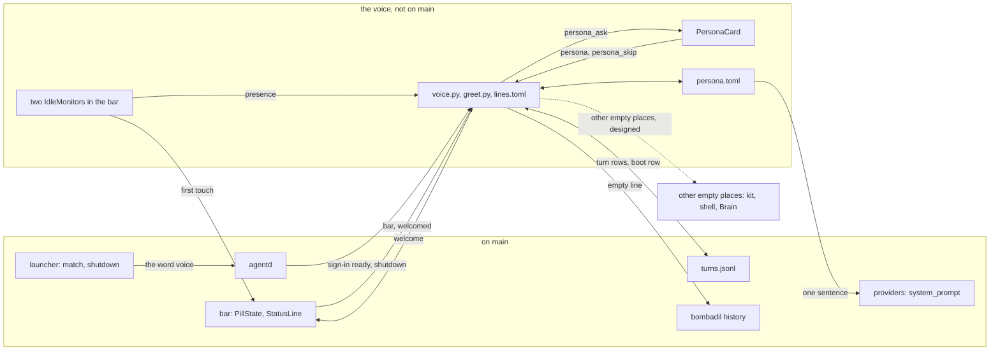

# Bombadil's voice

> **Status:** In progress. Not on `main`: the name and voice card, the welcome line, the goodbye and the greeting words are built on an unmerged branch, and this page describes that branch at its tip, `3e60866`, which contains `main` at `7176e55`. `main` at `7176e55` holds none of the piece, only what it builds on. The kit's `ask` chip, most empty places and the "Set my time zone" chip have no code on any branch; the installer's zone link and `systemd-timesyncd` are built on the installed OS piece's own unmerged branch, not on `main`.
> **Code:** none of this is on `main`. It builds on `src/bombadil/agentd.py`, `src/bombadil/providers.py`, `src/bombadil/launcher.py`, `src/bombadil/narrate.py`, `src/bombadil/watch.py`, `src/bombadil/paths.py`, `src/bombadil/config.py`, `src/bombadil/desk.py`, `shell/PillState.qml`, `shell/StatusLine.qml`, `shell/shell.qml`, `shell/DeskState.qml`, `iso/airootfs/usr/local/bin/bombadil-install`, and `share/qml/Bombadil/EmptyState.qml`, `ItemList.qml` and `DataTable.qml`. The unmerged branch adds `src/bombadil/persona.py`, `src/bombadil/greet.py`, `src/bombadil/greet_sources.py`, `src/bombadil/voice.py`, `shell/PersonaCard.qml` and `share/voice/lines.toml`, and edits `agentd.py`, `providers.py`, `launcher.py`, `narrate.py`, `watch.py`, `paths.py`, `shell/PillState.qml`, `shell/StatusLine.qml`, `shell/shell.qml` and the smoke script `iso/airootfs/usr/local/bin/bombadil-smoke`.
> **Design:** [Bombadil's voice, the brief](../design/voice-brief.md), [the page](../design/pages/bombadils-voice.html)
> **Verified:** 2026-11-08 against `main` at `7176e55`: no code of this piece is on `main`, and every statement about `main` below was re-read at that commit, line numbers included. The unmerged work was read file by file at its tip, `3e60866`, which contains `main` at `7176e55`. Five of its six voice source files are unchanged since this page was first written at `2ebcfb2`; the sixth, `greet_sources.py`, differs only in its turns reader, which skips a turn that the usage limit cut off. A read-only trial merge of that tip into `main` at `7176e55` is clean and gives the tip's own tree. The eight of its ten voice test files that need no Qt (772 tests) and `tests/test_agentd_signin.py` (29 tests) passed from an extracted copy of the tip. The two QML files hold 68 tests, 62 of which skip without PySide6 and were not run. Nothing was run on a real Hyprland.

The voice is meant to be how Bombadil writes to the person: the words of its greetings, its goodbyes and the closing sentence of a reply. It will give Bombadil a name for the person and one of three voices, Merry, Plain or Quiet, chosen once on a small card after the first sign-in, and put one true line above the pill when the person arrives or leaves, and nothing at rest. It exists because the project owner asked for a one-time setup that gives Bombadil a voice and asks what to call the person, and for a format for what the desktop shows at boot or in an empty place. The [passenger brief](../design/passenger-brief.md) hands the words of the welcome line and of empty states to this piece. Speaking aloud is not part of it.

## What it will do

Nothing here can be used from `main`: on `main` the word `voice` goes to the model, because `launcher.match("voice")` returns `None`. Each part says whether the unmerged branch builds it or it is designed only; what the branch does is written as what the piece will do. What `main` has of it is only what the piece builds on (the table under [How it works](#how-it-works)); the nearest thing is one instruction in the system prompt that lets the agent set the time zone.

- **The card** (built on the branch). When sign-in turns ready with a provider chosen and installed and no `~/.config/bombadil/persona.toml`, a card will rise above the pill on the screen that had the focus: one name field and three voice rows, each with a sample welcome that fills in the typed name and a fixed sample closing sentence. Its line will be "Signed in to Claude. What should I call you?" after a fresh sign-in and "What should I call you?" otherwise. Up, Down and Tab will move the highlight, a click will pick a row, Enter will accept and Esc will skip with the defaults (Merry, no name). The defaults will be written when the card is asked, so it is never asked twice, and a prompt sent from the pill while it is up will run as usual.
- **`persona.toml`** (built on the branch). Three keys, read field by field, so a broken file will fall back to the defaults and never stop agentd. A name will be one to three words of at most 24 characters in all (letters, combining marks, hyphens, apostrophes and dots, starting with a letter). It is its own file because `config.save_user` rewrites all of `config.toml` (with the provider, the model, a kept `explain` level and the `[models]` table), and because in the design `memory.md` is loaded by every coding session, where a merry voice would leak into code reviews.
- **The voice reaches the agent** (built on the branch). `providers.system_prompt()` will return the fixed prompt plus a sentence for the chosen voice and a pointer to the file, for both providers. "Call me Lex" and "be less chatty" will be ordinary requests: the agent will edit `persona.toml` with its own tools, narrated as "Changing how I talk to you" with no Undo. A change made through the card will be told to an open conversation through the notes prefix. An agent's edit will add no note, because nothing watches the file, but `system_prompt()` will read the file again each time a command is built. Whether a resumed Claude conversation honours a changed appended prompt is a VM check; the brief records one sandbox in which it did not. A turn after a restart of the daemon resumes the same conversation, because `agentd` keeps its conversation id across one (see [How it works](#how-it-works)).
- **The welcome line** (built on the branch). The bar will send `bar` on its first `status` line after it connects, and agentd will answer with one `welcome` per login about a second later, once sign-in is ready and nothing is running. "Ready" is the access state `ready`: a provider at its limit settles in `resting` on `main`, and neither the card nor a welcome is asked for until that rest lifts. The line will show above the pill in a `welcome` mode, on the screen that had the focus, wait for the first key or pointer movement and fade 8 seconds later (15 for the first hello), or fade 30 seconds after it appeared if untouched. Hover will hold it, and typing, Enter or Esc in the pill will end it. On the first boot of an installed system Merry will say "Welcome home{n}. Undo works from here." and Plain and Quiet "Installed. Undo works from here.", only where snapshots work and only once. On an installed system the first hello after the card takes the place of that line, so it is not said a day late.
  - It will be dropped, not queued, when any other line, a running turn, the card, a full-screen window or an error notice holds the screen. A notice that is no error waits until the welcome has gone.
  - A greeting will count only when the bar answers `welcomed`, so a restart of agentd never replays one. A dropped boot or return line will be tried again at the next hello or return (a boot line only within 15 minutes of agentd starting), but the first hello after the card will not.
- **The greeting engine and its lines file** (built on the branch). `greet.build` will be a pure function of the persona, the time, the facts, the ledger and the lines table, with no randomness and no clock of its own. It will hold the grammar `OPENER[, NAME]. BODY`, the ranking of facts, the ledger rule and the 100-character budget, and no wording: nearly every word of a greeting, a goodbye and an empty place will live in `share/voice/lines.toml`, per voice and moment, so a voice, an invitation or an empty place is a table edit. The goodbye's session clause, the card's question, the answers to the word `voice` and the model's voice sentences will stay in Python (`voice.py`, `agentd.py`, `persona.py`). Merry's invitations will follow the days since setup, never chance: the owner's own line, "Let's go for a walk!", on day 0 and every fourth day.
- **The facts and the ledger** (built on the branch). A ledger will keep a fact from being said twice unless its value changed (a standing count such as updates is said again after seven days). Facts will come from `turns.jsonl`, an updates file and the coding-session registry, and a missing source will say nothing. A turn that was stopped, or that the usage limit cut off and queued again, says nothing. The brief also names the jobs registry, promises and the machine's put-back records: the branch ranks the kinds `putback` and `promise`, but nothing produces them, and nothing reads the jobs registry.
- **The goodbye** (built on the branch). agentd will render the goodbye and send it as the start text of the shutdown, because the launcher's done text, "Shutting down.", is returned after `systemctl poweroff` has run and may never be drawn. When the call succeeds the done text will be the goodbye too; a failed shutdown keeps the launcher's failure text. Restart will keep "Restarting." and only record that it was asked for (`note_restart()`, undone by `forget_restart()` if it fails), so the boot after it gets no hello. Both will wait up to a second for what the clients were sent to go out (`flush()`). Unit tests cover this; none shows that the compositor lives long enough to draw the line, an open VM check.
- **The away signal and return lines** (built on the branch). The bar will run two `IdleMonitor` blocks in `shell/shell.qml`. One, with a 300-second timeout (`BOMBADIL_IDLE_SECONDS`), will send `presence`; agentd will read the same variable to work out how long the person was away, so the two must agree. After 30 minutes or more away, at most one line per half hour will say what happened meanwhile. The other, with a one-second timeout and `respectInhibitors: false`, will be enabled only while a welcome waits for its first touch, and is how the bar notices a key press in another window. No test shows that Hyprland delivers idle events to either (`tests/test_welcome_qml.py` only reads `shell.qml` for both blocks, and `bombadil-smoke` has no idle check). The brief's Away card, which would hold the list and shrink the line to an opener and a count, is registered on the desk on `main` (`src/bombadil/desk.py:47`, `shell/DeskState.qml`) with no face and no feed, so it never shows ([desk](desk.md)).
- **The clock** (partly built, partly designed only). On the branch `greet.tz_set()` is true only when `/etc/localtime` links to a zone other than UTC or GMT that opens, and the environment has no `TZ`; until then greetings will say "Welcome" with no time-of-day word. `main` still links `/etc/localtime` to UTC in the installer (`bombadil-install:56`) and enables no time sync (nothing under `iso/` mentions `timesync`, `ntp` or `chrony`), but its system prompt tells the agent to set a zone the person names with `sudo timedatectl set-timezone <Area/City>` (`providers.py:48-49`). `tz_set()` would turn true once that links `/etc/localtime` to the zone, because it calls `time.tzset()` first, so a zone set while agentd runs counts. The installed OS piece's first build, on its own unmerged branch, links the zone of its plan to `/etc/localtime`, enables `systemd-timesyncd` and records `timezone_source` in `/var/lib/bombadil/install.json` ([installed OS](installed-os.md)); none of that is on `main`. Designed only, with no code on any branch: the first hello carries a "Set my time zone" chip that fills the pill with "set my time zone to ". The voice brief shows the chip on a machine still on UTC; the voice build will show it only while the installed-OS record has `timezone_source` unset ([D-924](../decisions/voice-and-words.md#d-924)).
- **Empty places** (the words are built on the branch and one place, `bombadil history`, uses them; the other places are designed only). The branch's `[empty]` table holds the line of each empty place and `[empty_chip]` its one doorway, read through `greet.empty` and `greet.empty_chip`. Only `bombadil history` calls `greet.empty`, and nothing calls `greet.empty_chip`. Designed only: an `ask` chip on the kit's `EmptyState`, one sentence in the apps skill, the shell's other empty places ("what's running?", "what are you watching?", "what do you know about me?") and the Brain's Focus, Map and Time, with no name and no voice variants.

### The three voices

What each voice says, run through `greet.build` and `greet.goodbye` on the branch for the name `alex`, at 09:00 on the first boot of a day with a time zone set, and with a fixed fact for the news rows. A blank means silence. The closing sentence is what each voice asks of the model's own last sentence (`persona._STYLE`).

| Moment | Merry | Plain | Quiet |
|---|---|---|---|
| First hello, right after the card | "Welcome, alex. Let's go for a walk!" (day 0) | "Welcome, alex." | "Welcome, alex." |
| Ordinary boot, nothing to report | "Good morning, alex. Where to today?" (day 1) | "Good morning, alex." | |
| Boot with news | "Good morning, alex. 214 updates are waiting, 4 of them security fixes." | the same | "214 updates are waiting, 4 of them security fixes." |
| Boot from 00:00 to 04:59 with a zone set | "Late one, alex." | "Welcome, alex." | |
| Boot after three days or more | "Welcome back, alex." and an invitation | "Welcome back, alex." | "Welcome back, alex." |
| Return after 30 minutes to four hours | the news alone: "While you were away: the ISO download finished." | the same | the same |
| Return after four hours or overnight | "Welcome back, alex. While you were away: ..." | the same | the news alone |
| Shutdown | "See you, alex." by day, "Good night, alex." from 20:00 to 04:59 with a zone set, then "batch stops at 14 of 20 and waits for you." | "Shutting down." | "Shutting down." |
| First boot of an installed system | "Welcome home, alex. Undo works from here." | "Installed. Undo works from here." | "Installed. Undo works from here." |
| The model's closing sentence | brisk and friendly; at most one reply in four may end with a short aside from the turn's facts, never after an error or a system change | one or two sentences, no asides, no sign-off | one sentence, no aside, no question at the end |

The time-of-day word needs a zone and the first boot of a day; otherwise the opener is "Welcome". A return line needs at least one fact and is silence without it. With `greet = false` only what failed or was put back is still said, and the goodbye uses Plain's words. Plain's stop clause names the session ("Shutting down. batch stops at 14 of 20."); Quiet's drops it.

### The empty places in the lines table

None has a name or a voice variant. Only `history` is wired on the branch.

| Key | Place | Slots | Doorway chip |
|---|---|---|---|
| `focus_folder` | Focus on an empty folder | `place` | "Find what belongs here" |
| `focus_moved` | Focus on a folder that had one file | `place`, `file`, `target`, `when` | none |
| `focus_links` | Focus on a thing with no links | `since` | "What is this?" |
| `focus_match` | Focus search with no match | `query`, `since` | "Find {query} for me" |
| `map_small` | the Map with few areas | `areas`, `days` | "files" |
| `history`, `history_live` | `bombadil history` with no rows; the `_live` line on a live USB | none | none |
| `needs_you` | Tab on an empty pill, nothing waiting | none | none |
| `running` | "what's running?" | none | "claude {project}" |
| `watching` | "what are you watching?" | none | "Tell me if my disk gets nearly full" |
| `know` | "what do you know about me?" | none | "Remember that…" |
| `app` | an app with no data | `things` | none |
| `apps` | "what apps do I have?" | none | "Make me a password manager" |

## How it works

Solid lines are built on the unmerged branch and the dotted line is designed only: `bombadil history` already takes its empty words from the table, and the other empty places do not. The boxes under "on main" exist at the verified commit. The bar says `bar` on its first `status` line after it connects, not in the socket's connected handler (`shell/PillState.qml` says why: the shell's `write()` drops a message sent there).

Two things on `main` since `969b80b` bear on the piece (as of 2026-11-08).

- **Services.** `bombadil-agentd` and `bombadil-shell` are systemd user services that restart when they die, and Hyprland's start hook restarts them at login ([the session stays alive](session-services.md)). `agentd` keeps its conversation id and the session's model in `agentd-state.json` under the runtime dir across a restart of the daemon, but not across a reboot or a later login (`src/bombadil/agentd.py:376-402`). The `greeted` marker sits in the same directory, which is why a restart of agentd never replays a welcome. What a restart does lose is held in memory: the card that was up (it is not asked again, because the defaults were already written), the welcomes not yet answered and the `notes` told to the next turn.
- **Launcher words.** The `voice` word joins a longer list of exact words: volume up, volume down, mute and unmute in `UTILITY_COMMANDS`, and "use opus" and "use sonnet" in `MODEL_WORDS`, with Claude turns on Sonnet by default.

**What it builds on in `main`** (every line number is at `7176e55`)

| Existing piece | What is there, and what the piece will do with it |
|---|---|
| `src/bombadil/agentd.py`: `AgentD._client` (444) | On connect it sends `status`, the entries, the setup state and every live notice (`self.notices.live()`) to the connecting client, and `handle` has no message that says "I am the bar", so a bar cannot be told from `bombadil ask`. The piece will add `bar`. |
| `AgentD._set_access` (1421) | Sets `access`, broadcasts the setup state and wakes the worker when it is `ready`. A fresh sign-in's ready line is "Signed in to {title}. Ask me for anything." (1524 in `_run_signin`, 1653 in `_watch_external`), and the other ways to `ready` go through `_settle` (1688): it sets `ready` (1693) or, when the provider is at its limit or paused, `resting` (`_enter`, 1700). Its callers say "is ready. Ask me for anything." (1452), "already signed in" (1460) or nothing (1436, 1529, 1789). The end of a rest sets `ready` itself, with the rest's back line (1716). The piece will ask for the card in `_set_access`, in place of the "Signed in" line, when `persona.toml` is missing. |
| `AgentD._local` (1156), `Launcher.doing` (`src/bombadil/launcher.py`, 380), `Launcher._restart` (844), `Launcher._shutdown` (848) | `_local` sends a `local` start event with `doing()` ("Shutting down", 391), runs the launcher, then sends the done event. `_shutdown` runs `systemctl poweroff` (849) and only then returns "Shutting down." (850); `_restart` returns "Restarting." (846). |
| `AgentD.turn`, the notes (2120 to 2124) | `self.notes` (what happened without the model) go in front of the next prompt as `[Done by the user without you since your last turn: ...]`. The piece will add a note for a name or voice changed through the card (`Voice._note`); nothing adds one for an agent's edit of `persona.toml`. |
| `AgentD._log` (2407), `_log_line` (2432) | A turn row has `t`, `prompt`, `result`, `ok`, `snapshot`, `provider`, `model`, `session`, `stopped`, `summary`, `read`, `details`, `n`, `unit`, `started` and `files` (and `requeued` when true): no `made`, no `changed` and no boot row, which the piece will add as the anchor for "since last time". A row whose `kind` is neither absent nor `turn` is no turn (`paths.is_turn_row`, `src/bombadil/paths.py`, 52), so a boot row (kind `local`) stays out of the turn count (`agentd.py`, 2631) and the brain (`brain/witnesses.py`, 207). |
| `src/bombadil/providers.py`: `system_prompt` (33), `Claude.command` (258, 266), `Codex.command` (549, 555) | One fixed prompt with no voice, which both CLIs take on fresh and resumed turns (`--append-system-prompt`, `-c developer_instructions`). It already asks for a closing reply of at most four lines, which the piece may not lengthen, tells the agent to say in one sentence that `pacman -Syu` updates every package, and tells it to set a zone the person names with `sudo timedatectl set-timezone <Area/City>` (48 to 49). |
| `src/bombadil/launcher.py`: `UTILITY_COMMANDS` (81), `match` (231) | Exact words skip the model. `UTILITY_COMMANDS` is checked after app and panel names and holds `wifi`, `sound`, `volume_up`, `volume_down`, `mute`, `unmute`, `brightness` and `battery`; `NO_COMPLETE` (138) keeps the volume and mute words out of Tab. There is no `voice` word: `match("voice")` returned `None` when run on 2026-11-08, so the word goes to the model. |
| `src/bombadil/paths.py`; `src/bombadil/config.py`: `save_user` (62) | `paths.py` has no path for a persona, a ledger, a greeted marker, a lines table, an updates file or the local time link. `save_user` rewrites `config.toml` with the provider, the model, a kept `explain` level and the `[models]` table and nothing else, so the name and voice cannot live there. |
| `src/bombadil/narrate.py`: `tool_step` (958) | A Write or an Edit is narrated "Writing x" or "Editing x" (975, 983) with a done text ("Wrote x", "Edited x"), so an edit of `persona.toml` would end as "Edited persona.toml". The piece will give it a plain step with no Undo. |
| `src/bombadil/watch.py`: `history_lines` (260) | Prints the last 40 rows of `turns.jsonl`: a line per turn row and per `local` row (as `prompt: result`) under a weekday heading, skipping any other kind, and "Nothing yet." when there are none. The piece will skip boot rows and take the empty words from the lines table. |
| `shell/PillState.qml`: `mode` (60), `handle` (185), `dismiss` (669), `fade` (676) | `mode` is `idle`, `working`, `closing`, `local`, `setup` or `resting` (the comment at 56 to 59; `resting` is set at 322, 336 and 344), and `fadeAfter` is 12000 ms (75). The piece will add a `welcome` mode and handle `persona_ask`, `persona` and `welcome`. |
| `shell/StatusLine.qml` (53 to 73) | One timer fades a finished line for `closing`, `local` and `resting` (68), and sleeps while a picture the person asked for holds the line (`pictureStays`, 61). The piece will add `welcome` to the same timer, where the first touch starts the fade. |
| `shell/shell.qml`: `summon` (143), `summonHere` (254), the input `mask` (223 to 234), `SetupChips` (332) | `summon(text)` with no text toggles the keyboard (with words to finish it always takes it), so it cannot give the card the keyboard; `summonHere()` takes it on Hyprland. Every item that takes clicks has a `Region` in the mask (the desk's strips too), and `import Quickshell.Wayland` (11) is there. The piece will add the card to the column and mask, as `SetupChips` is. |
| `src/bombadil/desk.py` (47); `shell/DeskState.qml` (`awayModel` 71, `awayPresent` 134) | The `away` widget is registered ("Away", right rail) and has a model that nothing fills, so it has no face. The piece does not add a face to it. |
| `iso/airootfs/usr/local/bin/bombadil-install` (32, 33, 56, 58, 81 to 85) | `rm -rf /mnt/home/*` (33) clears the copy of the live home that `cp -ax /. /mnt/` (32) made on the target disk, so nothing carries over by itself. The chroot links `/etc/localtime` to UTC (56) and creates `user` with no full name (58). The loop at 81 to 85 copies `.claude`, `.claude.json`, `.codex` and `.config/bombadil` from the untouched live `/home/user` into `/mnt/home/user`, which is how `persona.toml` would survive. No file under `iso/` mentions `timesync`, `ntp` or `chrony`. |
| `share/qml/Bombadil/EmptyState.qml`; `ItemList.qml` (19), `DataTable.qml` (16) | `EmptyState` has `icon`, `title`, `text`, `actionText` and an `action()` signal, and no chip that sends a turn. `ItemList` and `DataTable` default `emptyText` to "Nothing here yet" and "Nothing to show", which the piece keeps as fallbacks. |

## Interfaces it adds (planned)

Every row is on the branch (not on `main`) or planned (no code anywhere). Where each file lives is under [Where state lives](#where-state-lives).

| Name | What it is | Status |
|---|---|---|
| `bar {idle}`, `presence {idle}`, `persona {name, voice}`, `persona_skip`, `welcomed {id}` | Bar to agentd. `bar` is sent once per connection, on the first `status` line. The brief names all but `welcomed` | on the branch |
| `persona_ask {line, name, voice, current, voices}`, `persona {name, voice, greet}`, `welcome {id, text, first}` | agentd to bar: put the card up, fold it, show a line. Each entry of `voices` has `id`, `name`, `card` and `reply`; `current` is true for a reopen with the saved values | on the branch |
| The word `voice` | A local, offline launcher word (`UTILITY_COMMANDS`; also `open voice`, and offered by Tab) that reopens the card with the saved name and voice, under the line "What should I call you, and how should I sound?". It ends as "Opened the voice card.", or with "No bar is open to show the voice card." and a failed row when no bar has said hello. An app or panel of that name wins over it | on the branch |
| `narrate.PERSONA_STEP` | "Changing how I talk to you": a plain step with no Undo and no summary entry, for a Write, an Edit, a Codex file change or a shell command that writes only `persona.toml` | on the branch |
| `persona.note()`, `greet.build`, `greet.goodbye`, `greet.empty`, `greet.empty_chip`, `greet.tz_set`; `PersonaCard.qml`, the `welcome` line mode, two `IdleMonitor` blocks | The text added to the system prompt (a sentence of 13 to 27 words for the voice without a name and 25 to 41 with one, the name clause included, and a pointer of 103 words) and the pure functions of the engine; the card, the line mode in `PillState` and `StatusLine`, and the presence and touch monitors in `shell.qml` | on the branch |
| `share/voice/lines.toml` | Per voice the key `installed` and the sections `first`, `boot`, `night`, `long`, `back`, `away` and `bye`; shared `voices`, `card`, `opener`, `join`, `clause`, `invite`, `fact`, `empty`, `empty_chip` and `reply` | on the branch |
| `BOMBADIL_VOICE_LINES`, `BOMBADIL_GREET_WINDOW`, `BOMBADIL_GREET_DELAY`, `BOMBADIL_IDLE_SECONDS`, `BOMBADIL_UPDATES`, `BOMBADIL_LOCALTIME`, `BOMBADIL_LIVE` | Environment variables the branch reads; its tests set them | on the branch |
| A "Set my time zone" chip | The clock fix on the voice side: a chip on the first hello that fills the pill with "set my time zone to "; the installer side (the zone link, `systemd-timesyncd`, `timezone_source`) is built on the [installed OS](installed-os.md) piece's branch | planned |
| `EmptyState.ask`; one sentence in `share/skills/bombadil-apps/SKILL.md` | A chip whose click sends its label as a turn (a label ending in an ellipsis only fills the pill); the rule that an empty state names what is empty and gives one way to fill it | planned |

## Where state lives

| Path | What it holds | Status |
|---|---|---|
| `~/.config/bombadil/persona.toml` (`paths.persona_file()`) | Keys `name`, `voice` (`merry`, `plain`, `quiet`) and `greet`. Written whole and atomically by `persona.save`; the agent edits it with its own tools | on the branch |
| `~/.local/state/bombadil/said.json` (`paths.ledger_file()`) | The ledger: each fact with its value and day, `setup_day`, `last_boot_day` and `last_return_at`; entries older than 120 days are dropped, except `installed`, which stays so that the first-boot line is said once | on the branch |
| `$XDG_RUNTIME_DIR/bombadil/greeted` (`paths.greeted_marker()`) | The marker that this login was greeted. The runtime dir survives a restart of agentd and is empty after a reboot or at a later login | on the branch |
| `~/.local/state/bombadil/restarting` (`voice._restart_marker()`) | Written before a restart the person asked for and removed at the next boot, which then gets no hello. It is in the state dir because the reboot empties the runtime dir | on the branch |
| `~/.local/state/bombadil/turns.jsonl` | Turn rows gain `made` (the apps the turn created) and `changed` (whether it left a summary). A boot row is written when a boot moment (`boot`, `installed` or `first`) is committed: `greeted` is true once the bar answered `welcomed`, false for a silent boot. The brief names it `{kind: "boot"}`; the branch writes `kind: "local"`, `action: "boot"` | on the branch |
| `share/voice/lines.toml` (`paths.voice_lines()`) | Nearly every word of a greeting, a goodbye and an empty place. Shipped with the tree at `/usr/share/bombadil/share/voice/`, read once and cached; a read that fails is tried again at the next line. `BOMBADIL_VOICE_LINES` points at another file | on the branch |
| The `Voice` object in agentd | The card while it is up (`asking`), the bars that said `bar`, and the welcomes sent and not yet answered (at most 16, and one counts as dropped after 10 seconds). Lost when agentd restarts | on the branch |
| `/var/lib/bombadil/updates.json` | `{count, security}`, read by the branch. Nothing on `main` or on any branch writes it: the producer is the passenger brief's update piece | planned |
| `~/.local/state/bombadil/dev/sessions.json` | The coding-session registry, read by the branch when it exists; the [coding sessions](coding-sessions.md) piece writes it, on its own unmerged branch. "At 14 of 20" reads a `progress {done, total}` key that only that piece's planned `progress` tool would write, so without it the line says "stops" with no count | not on `main` |

## Principles it keeps

- [Quiet at rest](../principles.md#quiet-at-rest): the line will be an arrival or a departure that fades by itself, and a screen at rest must stay wallpaper and a pill. The trap is a nudge, an hourly check-in, a standing welcome, or a greeting that takes over the placeholder.
- [Records before models](../principles.md#records-before-models): every line will be built from the clock, the turn log and the registries, say each fact once, and be silence when nothing is true. The trap is a model-written hello, or a reassurance no receipt backs ("nothing else changed").
- [Degrade and recover](../principles.md#degrade-and-recover): lines will be local templates that work offline at boot, each source will be optional, and a broken `persona.toml` will fall back to defaults. The trap is a reader that raises, or a missing lines table, stopping agentd, a turn or a shutdown.
- [One design language](../principles.md#one-design-language): the voice will change words and never facts, so "On it", the working line, Undo, Details, errors, limits and put-back lines read the same in every voice, and empty places have no voice variants. The trap is a cheerful aside after an error, or a voice that lengthens the one line while working and four after.
- [Plain files stay the truth](../principles.md#plain-files-stay-the-truth): name and voice will live in one small plain file that the agent edits and agentd validates on load. The trap is a second copy of the name in `config.toml` or `memory.md`, or a tool that sets the voice, which the brief cut.
- [Original](../principles.md#original): Merry in spirit only: no rhymes, no verse, no song lines. The trap is the brief's own list: the same line every morning, a name in every sentence, a joke beside a failure.

## Extending it

These steps describe the branch at `3e60866`; none of the code is on `main`.

**Add a voice**

1. Add its id to `VOICES` (`src/bombadil/persona.py`, 20) and a sentence for the model to `_STYLE` (33).
2. In `share/voice/lines.toml`, add its table (`installed` and the sections `first`, `boot`, `night`, `long`, `back`, `away` and `bye`; copy `[plain]` and edit it) and a row under `[voices]`, `[card]` and `[reply]`. A section or key left out means silence for that moment.
3. The card lists its rows from `persona.templates()`, which walks `VOICES`, so it needs no change. Two strings name the three voices in words and need the same edit: the pointer in `persona.note()` (`persona.py`, 147) and `BAD_VOICE` (`src/bombadil/voice.py`, 59).
4. `tests/test_greet.py` checks every voice against the 100-character limit, the rule that the table has no dash and a `!` only in Merry, and that every cell of the table exists. `tests/test_persona.py` pins the list of three ids. Extend both for the voice.

**Add words for an empty place**

1. Put the sentence in `[empty]`, with slots in braces (`{place}`, or `{n:one/many}` with `#` for the number). If the place has one doorway as a chip, put its label in `[empty_chip]`. A `<key>_live` sentence replaces it on a live USB.
2. Ask for it where the place is drawn: `greet.empty("running")`, `greet.empty("app", things="reminders")`. It returns `None` when the table has no such key or a slot is missing: draw nothing, or the fallback, rather than invent a line.
3. Add the key to `EMPTIES` (and its chip to `CHIPS`) in `tests/test_greet.py`. `test_empty_places_follow_the_format` fails for a key that is not listed, a line over 100 characters, a dash or `!`, a line that opens with "Nothing here yet", or a line of more than two sentences.

**Add a source of facts**

1. Write a reader in `src/bombadil/greet_sources.py` that takes its path and its clock, returns `Fact`s and never raises: `[]` for a source that is missing or odd.
2. Give its `kind` a place in `greet.KINDS` (the ranking order; `ALONE` kinds lead the line with no hello, `AWAY` kinds read as "While you were away: ...") and a clause in `[fact]` of the lines table, read through `greet.phrase`.
3. Call it from `Voice._boot_facts` for a boot or `Voice._back` for a return (`src/bombadil/voice.py`), through `_safe`, which turns a reader that raises into no facts.
4. Give each fact a `key`, and a `value` when a count can change: the ledger says a key and value once, and a `standing` fact again after seven days.
5. Test the reader in `tests/test_greet_sources.py` and the line in `tests/test_greet.py`.

**Change what the agent sounds like**

1. Edit `_STYLE`, `_CALLED` (the name clause) or `note()` in `src/bombadil/persona.py`. `providers.system_prompt()` appends `persona.note()` to the fixed prompt for both providers.
2. Keep the voice to one sentence and the name clause conditional ("use it only when greeting or asking"), and leave the fixed prompt's four-line closing rule alone. `tests/test_persona.py` and `tests/test_voice_providers.py` pin the one-sentence voice and the conditional name clause, and `tests/test_providers.py` (491) pins the four-line closing rule of the fixed prompt.

## Tests

The tests are on the branch at `3e60866`. Run them from a copy of that tree, one file at a time, with `python3 -m pytest tests/<file>` (pytest and pytest-asyncio from the `dev` extra in `pyproject.toml`).

| File | Tests | What it covers |
|---|---|---|
| `tests/test_persona.py` | 176 | the name check, defaults on a broken file, the atomic save, the voice sentence and the pointer, the rows of the card |
| `tests/test_greet.py` | 200 | the engine against a golden table of every moment and voice, the budget, the ledger rule, the invitations, the goodbyes, the empty places |
| `tests/test_greet_sources.py` | 93 | the readers for turns, what was made, updates and the coding-session registry, and files that are odd |
| `tests/test_voice.py` | 96 | the agentd side with fake bars, clocks and logs: timing, dropped lines, restarts, the card exchange, the goodbye |
| `tests/test_voice_launcher.py` | 29 | the word `voice` and `bombadil ask voice` |
| `tests/test_voice_narrate.py` | 123 | the plain step for an edit of `persona.toml` |
| `tests/test_voice_providers.py` | 49 | the system prompt in both providers, on a fresh and a resumed turn |
| `tests/test_voice_watch.py` | 6 | `bombadil history` with the empty words and with a boot row |
| `tests/test_persona_card_qml.py` | 29 | the card, offscreen |
| `tests/test_welcome_qml.py` | 39 | the welcome mode and the presence and touch plumbing, offscreen |

The two QML files need PySide6; without it 62 of their 68 tests skip and the rest only read the QML source. Two more checks run outside pytest. `tests/desktop/run.sh` drives the real bar, agentd and the Claude CLI in a headless sway session against a scripted API (it needs docker and a self-contained `claude` binary): the card on the first sign-in, a typed name saved with Enter, the first hello logged as a boot row, the word `voice`, and the name and voice in the next turn's system prompt. `iso/airootfs/usr/local/bin/bombadil-smoke` has checks run by `scripts/test-vm.sh` ([VM testing](../contributing/vm-testing.md)): `no-persona-before-voice`, `voice-signin`, `voice-card-asked` (the card writes the defaults), `voice-panel-away` and `voice-name-saved` (the card has the keyboard after the browser panel leaves), `voice-default-merry`, `voice-word-answered` and `voice-agentd-restored`. They sit in the sign-in block of the script, which on `main` at `7176e55` runs only when `~/.config/bombadil/config.toml` does not exist (it prints `SKIP signin` otherwise) and never in the `undo` boot of the installed system. After the merge they would run in the live-ISO pass on a machine with no provider chosen, and not on the installed system booted by `MODE=install` or `MODE=installed` of `scripts/test-vm.sh`. The script has no check for idle events under Hyprland, for the compositor after `poweroff` or for the first-boot line of an installed system.

## Known gaps

Each is verified in code on the branch at `3e60866` unless it names `main`.

- Nothing produces the kinds `putback` and `promise`, which `greet.KINDS` ranks (`src/bombadil/greet.py`, 33), and nothing reads the jobs registry: `src/bombadil/greet_sources.py` has readers for turns, what was made, updates and the coding-session registry only.
- Only `bombadil history` calls `greet.empty` (`src/bombadil/watch.py`, 284), and nothing calls `greet.empty_chip` (`greet.py`, 163). The other empty places keep their own text: `share/qml/Bombadil/ItemList.qml` (19) and `DataTable.qml` (16) on `main`.
- `/var/lib/bombadil/updates.json` has no writer on any branch (read in `greet_sources.updates`, path in `paths.updates_file`), so the updates fact is never said.
- The dev registry has no writer of `progress`, so the goodbye says "{title} stops" with no count (`src/bombadil/voice.py`, `_stopping`; `greet_sources.dev`); the registry is written only on the coding sessions branch.
- The kit's `EmptyState` has no chip that sends a turn (`share/qml/Bombadil/EmptyState.qml` on `main`), and no code on any branch holds the text "Set my time zone".
- The Away card is registered with no face and no feed (`src/bombadil/desk.py`, 47, and `shell/DeskState.qml`, on `main`; see [desk](desk.md)).
- No test or smoke check shows that Hyprland delivers idle events to either `IdleMonitor` (`tests/test_welcome_qml.py`, 515, only reads `shell.qml`), or that the compositor lives long enough to draw the goodbye after `systemctl poweroff`. No test shows that a resumed Claude conversation honours a changed appended prompt, or that the pill's clock follows a zone set with `timedatectl`.
- No VM check covers the first-boot line of an installed system, "Welcome home" in Merry's words. `iso/airootfs/usr/local/bin/bombadil-smoke` has no check for it, and only `tests/test_voice.py` covers the `installed` moment (`test_the_first_boot_of_an_installed_system_says_so_once`). The voice smoke checks sit in the script's sign-in block, which does not run on the installed system or where a provider is already chosen.
- A welcome shown over a picture the person asked for does not fade until the picture goes: `StatusLine.qml` puts its timer to sleep while `pictureStays` holds (`shell/StatusLine.qml`, 60 to 61, on `main`), `welcomeDone` runs inside that timer, and `PillState._welcome` does not look at the picture. This is read from the code, and no test covers it.

## Before you build on it

- **Order (the brief).** Piece 1, "Bombadil says hello": the card, `persona.toml`, the sentence, the welcome line, the word `voice` and the `narrate` step. Piece 2, "What it knows, and every empty place": sources, the ledger, the away signal, the goodbye, empty places and the clock, return lines last. Both edit `shell/PillState.qml` and `shell/shell.qml`, so they follow native sign-in (on `main`) and rebase over the [coding sessions](coding-sessions.md) placeholder change (not on `main`).
- **Checks first.** The brief's five VM checks: (1) whether a resumed conversation honours a changed appended prompt (if not, the voice goes through the `notes` prefix), (2) whether the card takes the keyboard when the browser panel leaves, (3) whether `IdleMonitor` reports idle under Hyprland (both monitors), (4) how long the compositor survives `systemctl poweroff`, and (5) whether the pill's clock follows `timedatectl`. The smoke script on the branch has checks for the second (named under [Tests](#tests)), and this page records no run of them; nothing checks the others.
- **Waits on the owner.** The brief's three picks (how the setup looks, where the welcome shows, how far the voice reaches) are defaults for the owner to look at, and it records no ruling on them; the branch builds the recommended default of each. Still open in the brief: whether the explain level belongs in `persona.toml`, whether the word `voice` will sit badly beside push-to-talk, and which screen shows the greeting on several monitors (the branch picks the screen that had the focus; [D-516](../decisions/shell-desk-and-widgets.md#d-516)). The brief also lists "who sets the time zone on a live USB with no network" as open; the installed-OS brief answers it as a default, designed only: the zone is detected and never asked, from one geo-IP request when the network first comes up ([D-1220](../decisions/installed-os-and-updates.md#d-1220)). Which service answers ([D-1241](../decisions/installed-os-and-updates.md#d-1241)) and what the clock does when the person travels ([D-1243](../decisions/installed-os-and-updates.md#d-1243)) are open.
- **Where the branch differs from the brief.** The boot row (above). The step reads "Changing how I talk to you", not "Changed how I talk to you". The card takes the keyboard through its own `summonKeep()` in `shell.qml`, not `summonHere()`. A name must start with a letter, which is stricter than the brief's bar on `!` and `/`. The appended text is the voice sentence plus the pointer, where the brief counts one sentence.
- **Merging.** A read-only trial merge (`git merge-tree --write-tree`) of the branch at `046b083` into `main` at `7176e55` conflicts in one file, `docs/README.md`. Every other file merges cleanly, because the branch already merged `main` up to `969b80b`: `src/bombadil/agentd.py`, `launcher.py` (which then holds the volume and mute words and the `voice` entry in `UTILITY_COMMANDS`), `providers.py`, `watch.py`, `narrate.py`, `shell/shell.qml`, `tests/desktop/driver.py` and the smoke script among them. The Python files compile, `launcher.match("voice")` returns the voice action on the merged tree, and the card's keyboard rule is already in the branch's `summon(text)`. The branch's `StatusLine.qml` and `PillState.qml` are what `main` has plus the voice, so the welcome fade runs in the timer described under Known gaps.
- **Before the branch merges.** Its tests, its smoke script and one comment in `shell/PersonaCard.qml` use a real person's first name as sample data. Replace it with a neutral name such as `alex`.
- **Do not break.** The fixed text of `providers.system_prompt()`, which the voice only appends to. "Ask anything" as the resting placeholder, and the plain wording of the working line, receipts, errors, limits, sign-out, offline and put-back lines in every voice. The installer's copy of `.config/bombadil`, without which `persona.toml` is lost at install. A restart's plain "Restarting.", because a restart is how a pending undo is applied ([restore points](restore-points.md)). `paths.is_turn_row`, which the boot row relies on.

## When it ships

This page is then replaced by the full piece page in the skeleton of [documenting your piece](../contributing/documenting.md), and the notes page the unmerged branch carries is folded into it rather than kept beside it. The [roadmap](../roadmap.md) row is updated and the brief's status block is updated. The parts the brief still marks as designed stay listed as such until their code is on `main`.
