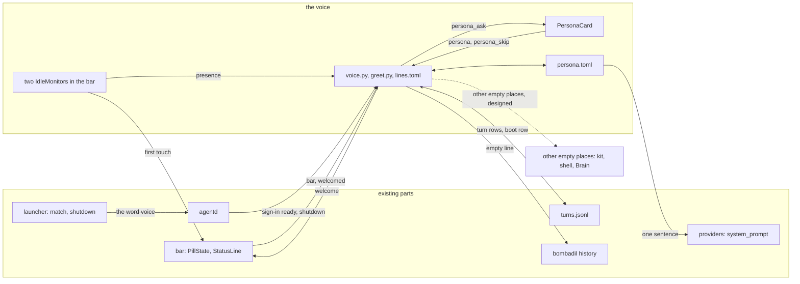

# Bombadil's voice

> **Status:** Partly shipped. On `main`: the name and voice card, `persona.toml`, the voice sentence in the system prompt, the welcome, return and boot lines, the goodbye, the word `voice`, the plain narration step for an edit of `persona.toml`, the boot row and the empty words of `bombadil history`. Not built: the kit's `EmptyState` ask chip and the other empty places, the "Set my time zone" chip, fact sources for the jobs registry, promises and put-back records, a writer of `/var/lib/bombadil/updates.json`, progress counts for the goodbye, the Away card raised on a return, and the installer's zone link and `systemd-timesyncd` (in the installed OS piece's unmerged first build, [installed OS](installed-os.md))  
> **Code:** `src/bombadil/persona.py`, `src/bombadil/greet.py`, `src/bombadil/greet_sources.py`, `src/bombadil/voice.py`, `share/voice/lines.toml`, `shell/PersonaCard.qml`, and the voice parts of `src/bombadil/agentd.py`, `src/bombadil/providers.py`, `src/bombadil/launcher.py`, `src/bombadil/narrate.py`, `src/bombadil/watch.py`, `src/bombadil/paths.py`, `shell/PillState.qml`, `shell/StatusLine.qml`, `shell/shell.qml` and `iso/airootfs/usr/local/bin/bombadil-smoke`  
> **Design:** [Bombadil's voice, the brief](../design/voice-brief.md), [the page](../design/pages/bombadils-voice.html)  
> **Verified:** 2026-11-09 against `main` at `f0485c2`, with the file:line anchors re-read there. `persona.py`, `greet.py`, `greet_sources.py`, `voice.py`, `share/voice/lines.toml` and `shell/PersonaCard.qml` were read in full; the voice parts of `agentd.py`, `providers.py`, `launcher.py`, `narrate.py`, `watch.py`, `paths.py`, `dev.py`, `PillState.qml`, `StatusLine.qml`, `shell.qml`, `bombadil-install` and `bombadil-smoke` were read where the page cites them. The three-voices table was produced by running `greet.build` and `greet.goodbye` for the name `alex`, and `launcher.match("voice")` and the word counts of `persona.sentence` and `persona.note` were run. The Python voice tests were run: 774 in the eight files that need no Qt and 29 in `tests/test_agentd_signin.py`. The two QML test files hold 68 tests, of which 6 pass and 62 skip without PySide6, so the card and the welcome mode were not run offscreen. The smoke checks and the desktop driver were read and not run, and nothing was run on a real Hyprland.

The voice is how Bombadil writes to the person: the words of its greetings, its goodbyes and the closing sentence of a reply. It gives Bombadil a name for the person and one of three voices, Merry, Plain or Quiet, chosen once on a small card after the first sign-in, and it puts one true line above the pill when the person arrives or leaves, and nothing at rest. It exists to give Bombadil a one-time setup that asks what to call the person and sets a voice, and a format for what the desktop says at boot or in an empty place. The [passenger brief](../design/passenger-brief.md) hands the words of the welcome line and of empty states to this piece. Speaking aloud is not part of it. The agentd side of the same messages is in [agentd](agentd.md#the-voice) and the shell side in [the shell](shell.md#the-welcome-line-and-the-name-card); this page is the piece as a whole.

## What is built and what is designed

What is on `main` is written in the present tense and has code, and tests or a smoke check, there. What is only designed is written in the future tense and labelled `(designed)`, and it is never mixed into a table that describes `main`.

| Part | On `main` |
|---|---|
| The card: a name field and three voice rows, asked once after the first sign-in | `shell/PersonaCard.qml`, asked by `Voice` ([from sign-in to the first hello](#from-sign-in-to-the-first-hello)) |
| `persona.toml`: `name`, `voice`, `greet` | `src/bombadil/persona.py`, read field by field and written atomically |
| The voice sentence in the agent's system prompt, and where to change it | `providers.system_prompt()` for both providers; an edit of the file is narrated as "Changing how I talk to you" |
| The word `voice` | a local launcher word that reopens the card with the saved name and voice |
| The welcome line: the first hello, a boot line, a return line and the first boot of an installed system | `src/bombadil/voice.py`, `src/bombadil/greet.py`, the `welcome` mode of `shell/PillState.qml` |
| The facts, the ledger and the boot row | `src/bombadil/greet_sources.py` reads turns, apps made, coding sessions and an updates file; `said.json` and a `local` row with `action: "boot"` record what was said |
| The goodbye | the start text of a shutdown, with the coding sessions it will stop |
| The away signal | a Quickshell `IdleMonitor` in `shell/shell.qml` sends `presence` |
| The clock check | `greet.tz_set()`: no time-of-day word until a zone is set |
| The empty words | the `[empty]` and `[empty_chip]` tables of `share/voice/lines.toml`; only `[empty]` is read, and only by `bombadil history` (`greet.empty`, `src/bombadil/watch.py:287`); no code reads `[empty_chip]` |

| Part (designed) | What it will do |
|---|---|
| The "Set my time zone" chip | The first hello will carry a chip that fills the pill with "set my time zone to ". The voice brief shows it on a machine still on UTC; the build will show it only while the installed-OS record has `timezone_source` unset ([D-924](../decisions/voice-and-words.md#d-924)). The installer's zone link, `systemd-timesyncd` and the record are in the installed OS piece's unmerged first build, and the zone is to be detected and never asked ([D-1220](../decisions/installed-os-and-updates.md#d-1220)) |
| The other empty places | An `ask` chip on the kit's `EmptyState`, one sentence in the apps skill, the shell's other empty places ("what's running?", "what are you watching?", "what do you know about me?") and the Brain's Focus, Map and Time will take their words from the table, with no name and no voice variants |
| More facts | The jobs registry, promises that came true and the machine's put-back records will become sources, and the update count will have a writer (the passenger brief's update piece). Coding sessions will report `progress` so a goodbye can say "at 14 of 20" |
| The Away card on a return | The brief's Away card will hold the list of what happened and the return line will shrink to an opener and a count beside it. The card is built and `show away` raises it ([desk](desk.md#the-away-card)); nothing raises it on a return |

## How it works



Solid lines are on `main`. The dotted line is the only part that is designed and not built: `bombadil history` already takes its empty words from the table (`src/bombadil/watch.py:287`), and the other empty places do not. The bar says `bar` on its first `status` line after it connects, not in the socket's connected handler (`shell/PillState.qml:216-218` says why: the shell's `write()` drops a message sent there). agentd cannot tell the bar from `bombadil ask`, so a connection takes part in the voice only after it has sent `bar`; a client that never sends the voice messages is never greeted, and every message is optional.

### The parts

| File | Job |
|---|---|
| `src/bombadil/persona.py` | `persona.toml`: validated, read per field so a broken file falls back to the defaults and never stops agentd. Also the one sentence added to the agent's system prompt (`sentence`, `note`) and the rows of the card (`templates`) |
| `src/bombadil/greet.py` | `build(moment, persona, now, ...)` is pure: the same inputs give the same line, with no I/O, clock or randomness of its own. It holds the grammar `OPENER[, NAME]. BODY`, the ranking of facts, the ledger rule and the 100-character budget, and no wording. `goodbye()`, `empty()`, `empty_chip()`, `invitation()`, the ledger (`Ledger`, `commit`, `load_ledger`, `save_ledger`), `tz_set()` and `is_live()` sit beside it |
| `src/bombadil/greet_sources.py` | Readers that turn state into `Fact`s: finished and failed turns, apps made, updates and coding sessions. Each takes its source (a path, or the rows that `read_rows` read from `turns.jsonl`) and its clock where it needs one, never raises and returns `[]` for a source that is missing or odd |
| `src/bombadil/voice.py` | agentd's side: which bar gets what and when (the card, the welcomes, the return, the goodbye, the restart note) |
| `share/voice/lines.toml` | Nearly every word. Per voice the key `installed` and the sections `first`, `boot`, `night`, `long`, `back`, `away` and `bye`; shared `voices`, `card`, `opener`, `join`, `clause`, `invite`, `fact`, `empty`, `empty_chip` and `reply`. A section or key left out means silence for that moment, so a voice, an invitation or an empty place is a table edit. The goodbye's session clause, the card's questions, the answers to the word `voice` and the model's voice sentences stay in Python (`voice.py`, `persona.py`) |
| `shell/PersonaCard.qml` | The card |
| `shell/PillState.qml`, `shell/StatusLine.qml`, `shell/shell.qml` | Message handling, the `welcome` line mode (it waits for the first touch, fades, and hover holds it), the two idle monitors and the keyboard hand-off between the card and the pill |

### From sign-in to the first hello

When sign-in turns `ready`, `AgentD._set_access` asks `Voice.due()`: there is no `persona.toml`, an AI is chosen, setup is ready and its CLI is installed. If so, `_set_access` blanks the setup line, so the pill's own "Ask me for anything" stays quiet, and `Voice.on_ready()` asks the card, whose line carries the "Signed in" words after a fresh sign-in. Otherwise `on_ready()` says the boot line a bar was waiting for.

Asking the card for the first time (`Voice._begin`) writes the defaults to `persona.toml` (Merry, no name, greeting on), writes the day setup began to the ledger and marks this login as greeted, because the first hello takes the place of the boot line. So any way out of the card (Esc, a closed bar, a crash) leaves a valid setting, and the card is never asked twice. `persona_ask` goes to every bar that said `bar`; a bar that connects after the ask, or reconnects while the card is pending, gets it as soon as it says hello (`src/bombadil/voice.py:138-143`). The card's line is "Signed in to Claude. What should I call you?" after a fresh sign-in (the chosen AI's name in place of Claude) and "What should I call you?" otherwise.

The person types a name and picks a row. Up, Down and Tab move the highlight, a click picks a row, Enter accepts and Esc skips. An answer (`persona {name, voice}`) is checked again by agentd: a bad name or voice changes nothing, the sender gets an `error` event and the card is sent again, and a disk that cannot save says so the same way. A good answer is saved, every bar and the sender are told with `persona` so the cards fold, and a conversation that is already open is told through the notes prefix ("The user now goes by alex and wants the plain voice.", `Voice._note`, `src/bombadil/voice.py:280`). When the card was the first one, the first hello follows, in the voice just chosen. A prompt sent from the pill while the card is up runs as usual and folds the card with the defaults.

The word `voice` reopens the card with the saved name and voice (`Voice.ask(current=True)`) under the line "What should I call you, and how should I sound?". It is exact, local and offline (`UTILITY_COMMANDS`, `src/bombadil/launcher.py:90`); `open voice` and `Voice` work too, `voice card` goes to the agent, and an app or panel of that name wins over it. It ends as "Opened the voice card.", or as "No bar is open to show the voice card." with a failed row when no bar has said hello. Either way it writes a `local` row (`action: "voice"`) to `turns.jsonl`, which `bombadil history` shows and the smoke check `voice-word-answered` reads (`src/bombadil/voice.py:300`). `bombadil ask voice` gets the same answer.

"Call me Lex" and "be less chatty" are ordinary requests with no tool of their own: the agent edits `persona.toml` with its own tools, using the pointer that `persona.note()` appends to the system prompt. `narrate` reads an edit that touches only that file as "Changing how I talk to you", a plain step with no Undo and no summary entry, whether it is a Write, an Edit or MultiEdit, a Codex file change or a shell command that writes only that file (`narrate.PERSONA_STEP`, `src/bombadil/narrate.py:975`). An agent's edit adds no note, because nothing watches the file, but `system_prompt()` reads the file again each time a command is built. Whether a resumed Claude conversation honours a changed appended prompt is not checked ([Known gaps](#known-gaps)); a turn after a restart of agentd resumes the same conversation, because agentd keeps its conversation id across one (`src/bombadil/agentd.py:451-477`).

### The moments

| Moment | Said when | What it reads |
|---|---|---|
| `first` | Right after the card is answered or skipped, in the voice just chosen | no facts |
| `boot` | About a second after a bar says `bar` (`BOMBADIL_GREET_DELAY`), once per login and only within 15 minutes of agentd starting (`BOMBADIL_GREET_WINDOW`) | `updates.json`; the coding sessions a restart cut off, since the previous boot row; the apps made since the previous boot row, which the line says only after three days or more since the last boot day |
| `installed` | In place of `boot` on the first boot of an installed system (not a live USB), where snapshots work and the ledger has no `installed` entry. A first hello after the card on a system that is not a live USB also writes the `installed` entry (`Voice._commit`, `src/bombadil/voice.py:470-472`), so "Welcome home" is not said a day late | nothing: the log is not read |
| `return` | When the bar reports the person active again after 30 minutes or more away, at most once per half hour | the turns that finished or failed since the person left; the coding sessions that finished or failed since; the updates only after three days or more away |
| goodbye | A shutdown | the coding sessions that are working, from the registry |

A line is sent to one bar only when it said `bar`, nothing runs and no prompt waits (`Voice._busy`), sign-in is ready, the card is not up and a `persona.toml` exists. It is dropped, not queued, when it cannot be said, and nothing here waits for a turn or stops one. Two bars get one boot line and one return, whichever shows it.

**A greeting counts only when the bar says it showed it.** The `greeted` marker of this login, the boot row in `turns.jsonl` and the ledger are written when `welcomed {id}` arrives, not when the line is sent (`Voice._welcomed`, `src/bombadil/voice.py:169`). A line the bar dropped is tried again at the next hello or return, a boot line only within the 15 minutes; the first hello after the card is not, because the card marked the login as greeted. A welcome the bar never answers counts as dropped after 10 seconds (`ACK_WAIT`), and a late answer still counts; at most 16 are remembered (`KEEP_SENT`). Restarting agentd never replays a boot line, because the marker is in the runtime directory, which a restart of the daemon keeps. A boot that has nothing to say is still a boot: the marker, the row (with `greeted: false`) and the ledger's day are written, so nothing speaks up later in its place. If the words table is missing, nothing is written and the boot is tried again.

**A restart the person asked for is no arrival.** The word `restart` writes the wall-clock time to `restarting` in the state directory before the reboot (`Voice.note_restart`) and a restart that fails removes it again (`forget_restart`). The boot after it, within 15 minutes (`RESTART_WINDOW`), is committed without a hello, and the note is used up either way. It is in the state directory because the reboot empties the runtime directory.

**A bar that starts while the person is away waits.** `bar {idle: true}` skips the boot line; a boot line that did not land is said when the first return comes.

**Clocks.** The boot window, the one-second delay and the ten-second answer wait use the monotonic clock (`Voice.mono`), so a wall clock that steps (a time sync, a resumed VM) cannot move a window. The time away, the half-hour return limit, the restart note with its 15-minute window and the ledger use the wall clock on purpose, because they have to survive a reboot or span days.

### What the voices say

What each voice says, run through `greet.build` and `greet.goodbye` for the name `alex`, at 09:00 on the first boot of a day with a time zone set, and with a fixed fact for the news rows. A blank means silence. The last row is what each voice asks of the model's own closing sentence (`persona._STYLE`).

| Moment | Merry | Plain | Quiet |
|---|---|---|---|
| First hello, right after the card | "Welcome, alex. Let's go for a walk!" (day 0) | "Welcome, alex." | "Welcome, alex." |
| Ordinary boot, nothing to report | "Good morning, alex. Where to today?" (day 1) | "Good morning, alex." | |
| Boot with news | "Good morning, alex. 214 updates are waiting, 4 of them security fixes." | the same | "214 updates are waiting, 4 of them security fixes." |
| Boot from 00:00 to 04:59 with a zone set | "Late one, alex." | "Welcome, alex." | |
| Boot after three days or more | "Welcome back, alex." and an invitation | "Welcome back, alex." | "Welcome back, alex." |
| Return after 30 minutes to four hours | the news alone: "While you were away: the ISO download finished." | the same | the same |
| Return after four hours, or two hours or more across midnight | "Welcome back, alex. While you were away: the ISO download finished." | the same | the news alone |
| Shutdown | "See you, alex." by day, "Good night, alex." from 20:00 to 04:59 with a zone set | "Shutting down." | "Shutting down." |
| First boot of an installed system | "Welcome home, alex. Undo works from here." | "Installed. Undo works from here." | "Installed. Undo works from here." |
| The model's closing sentence | brisk and friendly; at most one reply in four may end with a short aside from the turn's facts, never after an error or a system change | one or two sentences, no asides, no sign-off | one sentence, no aside, no question at the end |

The time-of-day word needs a zone and the first boot of a day; otherwise the opener is "Welcome". A return line needs at least one fact and is silence without it. With `greet = false` only what failed (or was put back) is still said, and the goodbye uses Plain's words. Merry's invitations follow the days since setup, never chance: "Let's go for a walk!" on day 0 and every fourth day, and the other seven in table order on the days between, so none comes back within nine days.

On the card each row shows how that voice would welcome the typed name (its `card` string, with `{n}` filled as ", alex") and, in italics, the closing sentence of one fixed sample answer (its `reply`). Quiet's `card` is a description, "Nothing on an ordinary morning, only news.", not a welcome, so it does not change with the name.

### The goodbye

agentd renders the goodbye and sends it as the start text of the shutdown, because the launcher's done text, "Shutting down.", is returned after `systemctl poweroff` has run and may never be drawn (`AgentD._local`, `src/bombadil/agentd.py:1538`). When the call succeeds the done text is the goodbye too; a failed shutdown keeps the launcher's failure text. Restart keeps "Restarting.", because a restart is how a pending undo is applied ([restore points](restore-points.md)), and only records that it was asked for. Both wait up to a second (`voice.DRAIN`, `Voice.flush`, `agentd.py:1545`) for what the clients were sent to go out, and a client that does not read is not waited for. `Voice.goodbye()` is empty until `persona.toml` exists, so the launcher's own words stay until a voice is chosen. Without a zone Merry's word is "See you" at any hour.

The clause for coding sessions comes from `sessions.json` in the coding-session registry, only for sessions whose state is `working` and that are not marked dead (`Voice._stopping`, `src/bombadil/voice.py:504`). A title is cut to 40 characters and flattened to one line. With one session Merry says "See you, alex. batch stops and waits for you.", with two "See you, alex. batch stops and tests stops. They wait for you.", and with more the first two are named and the rest counted, "a stops, b stops and 2 more. They wait for you.". Plain says "Shutting down. batch stops." and names them the same way without the tail; Quiet drops the clause. A session that has a `progress` of `done` and `total` would read "batch stops at 14 of 20"; no code writes that key ([Known gaps](#known-gaps)).

### Facts, the ledger and the line budget

A `Fact` has a `key`, a `kind`, a clause (`text`), a `value` and a `standing` flag. The ranking is `greet.KINDS` (`src/bombadil/greet.py:33`): `putback`, `failed`, `waiting`, `finished`, `stopped`, `made`, `updates`, `promise`. The `ALONE` kinds (`putback`, `failed`) lead the line with no hello and no name, and are said even with greeting off; the `AWAY` kinds (`waiting`, `finished`, `stopped`) read as "While you were away: ..." on a return line only, with up to two sharing the prefix (`greet._body`, `src/bombadil/greet.py:288`). On a boot line a `stopped` fact is a plain clause, "Good morning, alex. batch was stopped by the restart." for Merry and Plain and "batch was stopped by the restart." for Quiet. In practice `stopped` is said at boot only: `Voice._back` keeps just the `finished` and `failed` facts of the coding sessions, and the `dev` reader never makes a `waiting` fact. A line holds at most two facts.

The ledger (`said.json`) keeps a fact from being said twice: a fact is said once per key and value, a changed value is said again, and a `standing` fact (the update count) is said again after seven days even when unchanged. Entries older than 120 days are dropped, except `installed`, which stays so that the first-boot line is said once.

The readers word their clauses from `[fact]` in the table, the same in every voice. More than two finished requests are said as one count ("3 requests finished"), failures as "A request failed" or "N requests failed", and the apps made are named up to three and then "N more". "Since last time you built ..." is said only after three days or more. A turn that was stopped says nothing, and neither does one that the provider's limit cut off and queued again, because it logs its own row when it runs. A boot after a restart that cut a coding session off says "batch was stopped by the restart", with "at 14 of 20" when the registry has a `progress`.

If a line is over 100 characters, `greet.build` tries two facts with the name, one fact with the name and one fact without it, then the bare fact; what is still too long loses a trailing "and N more" and is cut after a whole word with an ellipsis. A line that cannot be made is `None`, and `None` is silence.

### Away and return

The bar's first `IdleMonitor` (`shell/shell.qml:52`) has a timeout of `BOMBADIL_IDLE_SECONDS`, 300 by default, and honours inhibitors, so a video being watched counts as present. It sends `presence {idle}` through `PillState.presence`. The bar says idle only after the timeout, so agentd adds the same variable to the time since the report to work out how long the person was away (`Voice._presence`, `src/bombadil/voice.py:148`); the two must agree. After 30 minutes or more away, at most one line per half hour says what happened meanwhile (`Voice._back`, `_returned_lately`, with `last_return_at` in the ledger). A clock that stepped back does not silence the return lines.

The second `IdleMonitor` (`shell/shell.qml:59`) has a one-second timeout and `respectInhibitors: false`, and is enabled only while a welcome waits for its first touch. The bar cannot see keys typed into other windows, so it notes the first activity after a pause of a second. No test shows that Hyprland delivers idle events to either monitor ([Known gaps](#known-gaps)).

### On screen

The welcome is the pill's line in the `welcome` mode (`PillState._welcome`, `shell/PillState.qml:358`). It is dropped, not queued, when it has no words, the mode is not `idle`, a turn runs, a flash is up, the card is up, a full-screen window is in front or an error notice holds the line; a notice that is no error waits until the welcome has gone. It waits for the first key or pointer movement and fades 8 seconds after it, 15 for the first hello (`PillState.welcomeDone`, 377), and an untouched or late-touched welcome ends 30 seconds after it appeared (`welcomeMax`, 106). A hover on the line holds it and counts as the first touch; typing, Enter or Esc in the pill ends it (`dismissWelcome`, 383; `shell/shell.qml:668-694`). It shows on the one screen that had the focus when it appeared, and the card on the one that had it when it asked. Each shows on every screen until the first of its kind has come, and again when its screen is unplugged. The card and the line fade and grow with `Kit.Theme.normal` and `fast`, which are 0 under reduced motion ([motion](../MOTION.md)); `PersonaCard.qml:85-86` and `StatusLine.qml:43-44` set no duration of their own. The rest of the shell side is in [the shell](shell.md#the-welcome-line-and-the-name-card).

The card takes the keys through `summonKeep()` (`shell/shell.qml:228`), which sets `cardKeys`, the screen that had the focus and the summoned screen. It works on every compositor and never toggles the keyboard away, as `summon()` (195) does. Super and a click on the pill (`focusPill`, 370) give the keys to the pill while the card stays; a click on the card or on a row takes them back (`onWantKeys`, 450). The release timer does not run while the card shows (390), because typing a name is slow. When the card folds for any reason, the pill's field takes the focus again (`onPersonaAskChanged`, 359).

### The name is untrusted text

The name reaches the system prompt and a TOML file, so it is checked and never escaped (`persona.clean_name`, `src/bombadil/persona.py:48`). It is one to three words of 24 characters at most, made of letters, combining marks, hyphens, apostrophes and dots, and it starts with a letter. Only plain spaces separate words, so no control character or line break gets through. What would draw nothing or a glitch is no name either: the Hangul and Khitan fillers, the grapheme joiner, the Khmer inherent vowels and the variation selectors; a combining mark with no letter under it; or more than three marks on one letter. The card's field takes the same characters and at most 24 of them, and refuses more than three words on Enter. Session titles in a goodbye are cut to 40 characters and flattened to one line the same way, and the whole line is held to 100.

### The words

Only `bombadil history` calls `greet.empty`. The `[empty]` table holds one line for each empty place, with no name and no voice variant, and `[empty_chip]` its one doorway when the doorway is a chip. A `<key>_live` line replaces it on a live USB. The convention in a comment of the table, that a label ending in an ellipsis fills the pill and does not send a turn, belongs to the designed `EmptyState.ask` chip ([interfaces it adds](#interfaces-it-adds)): no code reads a label's ending, and the kit's `EmptyState` has no chip that sends a turn.

| Key | Place | Slots | Doorway chip | Wired |
|---|---|---|---|---|
| `history`, `history_live` | `bombadil history` with no rows; the `_live` line on a live USB | none | none | yes (`src/bombadil/watch.py:287`) |
| `focus_folder` | Focus on an empty folder | `place` | "Find what belongs here" | no |
| `focus_moved` | Focus on a folder that had one file | `place`, `file`, `target`, `when` | none | no |
| `focus_links` | Focus on a thing with no links | `since` | "What is this?" | no |
| `focus_match` | Focus search with no match | `query`, `since` | "Find {query} for me" | no |
| `map_small` | the Map with few areas | `areas`, `days` | "files" | no |
| `needs_you` | Tab on an empty pill, nothing waiting | none | none | no: `Dev.next` says the same words itself (`src/bombadil/dev.py:741`) |
| `running` | "what's running?" | none | "claude {project}" | no: `Dev.listing` says other words itself (`src/bombadil/dev.py:778`) |
| `watching` | "what are you watching?" | none | "Tell me if my disk gets nearly full" | no |
| `know` | "what do you know about me?" | none | "Remember that…" | no |
| `app` | an app with no data | `things` | none | no |
| `apps` | "what apps do I have?" | none | "Make me a password manager" | no |

Two of these places already exist on `main` and say their words themselves, with their own copy of the text and no read of the table. Tab on an empty pill goes to `Dev.next` (`src/bombadil/dev.py:741`), which says "Nothing needs you.", the same words as `needs_you`. "What's running?" opens `bombadil dev list` (`Launcher._sessions`, `bin/bombadil:162`), whose `Dev.listing` (`src/bombadil/dev.py:778`) says "No coding sessions. Say “claude <project>” to start one.", which is not the `running` line and has no chip.

### Where the piece joins the existing code

Line numbers are at `main` `f0485c2`.

| Existing piece | How the voice joins it |
|---|---|
| `src/bombadil/agentd.py`: `_client` (518), `_greet` (558), `handle` (576) | `handle` passes every type in `voice.TYPES` to `Voice.handle` (656-657). What a client hears on connecting is `_greet`; the voice speaks only after the bar says `bar` |
| `AgentD._set_access` (1828) | Asks `voice.due()` and `voice.on_ready()` (1832-1844) and blanks the setup line in favour of the card. A fresh sign-in says "Signed in to {title}. Ask me for anything." (`_run_signin`, 1941; `_watch_external`, 2070), and the card's line then reads "Signed in to {title}. What should I call you?"; the other lines ("is ready", 1869; "already signed in", 1877) are blanked and the card says only "What should I call you?". The ways to `ready` go through `_settle` (2105), which sets `ready` or, at a provider's limit, `resting` (`_enter`, 2114); the end of a rest sets `ready` itself (2133) |
| `AgentD.local` (1475), `_local` (1535); `Launcher.doing` (`src/bombadil/launcher.py`, 484), `_restart` (997), `_shutdown` (1001) | The `voice` case is at 1515; the goodbye is rendered at 1538, `flush()` at 1545, `note_restart()` at 1547 and `forget_restart()` at 1550. `_shutdown` runs `systemctl poweroff` and only then returns "Shutting down."; `doing` says "Shutting down" (501) |
| `AgentD.turn` (2484), the notes prefix (2551-2555) | `self.notes` go in front of the next prompt as `[Done by the user without you since your last turn: ...]`; `Voice._note` adds one for a name or voice changed through the card |
| `AgentD._log` (2846), `_log_line` (2872) | A turn row also has `changed` and `made` (2853). A boot row is written by `Voice._commit` (`src/bombadil/voice.py:477`). `paths.is_turn_row` (`src/bombadil/paths.py:87`) keeps it out of the turn count (`agentd.py:3071`) and out of the brain (`src/bombadil/brain/witnesses.py:207`) |
| `src/bombadil/providers.py`: `system_prompt` (67), `Claude.command` (264), `Codex.command` (575) | `system_prompt()` is `base_prompt()` (33) plus `persona.note()`. Claude takes it with `--append-system-prompt` (272) and Codex with `-c developer_instructions` (581, `ensure_ascii=False`), on fresh and resumed turns. The fixed prompt asks for a closing reply of at most four lines (57), which the voice may not lengthen, and tells the agent to set a zone the person names with `sudo timedatectl set-timezone <Area/City>` (48-49) |
| `src/bombadil/launcher.py`: `UTILITY_COMMANDS` (81), `match` (325), `NO_COMPLETE` (139) | `voice` is one of the utility words (90), checked after app and panel names; it is not in `NO_COMPLETE`, so Tab completes it |
| `src/bombadil/paths.py` | `persona_file` (30), `ledger_file` (34), `greeted_marker` (38), `updates_file` (42), `voice_lines` (46), `localtime_link` (52) |
| `src/bombadil/narrate.py`: `PERSONA_STEP` (975), `_is_persona` (982), `shell_step` (783), `tool_step` (1043), `file_change_step` (1119), `partial_step` (1148) | A path that is the user's `persona.toml` (or its scratch file beside it) gets the plain step. `Narrator._note_made` (1664) records an app a turn creates for the first time into the turn row's `made` |
| `src/bombadil/watch.py`: `history_lines` (260) | Skips boot rows (263) and falls back to `greet.empty("history")` (287) |
| `shell/PillState.qml` | `mode` (66) includes `welcome`; `handle` (204) sends `bar` (218) and takes `welcome`, `persona_ask` and `persona`; `_welcome` (358), `touched` (372), `welcomeDone` (377), `dismissWelcome` (383), `_ask` (387), `personaAnswer` (400), `personaSkip` (406), `presence` (413), `submit` (620) folds the card, `lost` drops welcome and card (660) |
| `shell/StatusLine.qml` | One timer (56-77) fades a finished line and calls `welcomeDone` (75); it sleeps while a picture the person asked for holds the line (`pictureStays`, 63-64) |
| `shell/shell.qml` | The two `IdleMonitor` blocks (52, 59); `summon` (195), `release` (212), `summonKeep` (228); the input mask (313) with the card's `Region` (317); the `PersonaCard` item (442) beside `SetupChips` (474); `import Quickshell.Wayland` (13) |
| `iso/airootfs/usr/local/bin/bombadil-install` | `cp -ax /. /mnt/` (32) copies the live home and `rm -rf /mnt/home/*` (33) clears it, so nothing carries over by itself. The loop at 85-90 copies `.claude`, `.claude.json`, `.codex`, `.config/bombadil` (and so `persona.toml`), `.local/state/bombadil/desk.toml` and `.local/state/bombadil/tips.json` from the live home. It does not copy `said.json`, which is why an installed system says "Welcome home" once. The chroot links `/etc/localtime` to UTC (56) and creates `user` with no full name (58) |
| Tips ([Tips](tips.md)) | The tips in `share/tips/tips.toml` are written in the voice brief's teaching register: one line, no name ([TIPS.md](../TIPS.md#the-table)). No client draws the Tips card; it is designed to yield to the persona card and the welcome line |
| `share/qml/Bombadil/EmptyState.qml`, `ItemList.qml` (19), `DataTable.qml` (16) | `EmptyState` has `icon`, `title`, `text`, `actionText` and an `action()` signal, and no chip that sends a turn. `ItemList` and `DataTable` default `emptyText` to "Nothing here yet" and "Nothing to show", which stay as fallbacks |

Two things outside the piece matter to it. `bombadil-agentd` and `bombadil-shell` are systemd user services with `Restart=always`, and Hyprland's start hook restarts them at login ([the session stays alive](session-services.md)). What a restart of agentd loses is held in memory: the card that was up (it is not asked again, because the defaults were already written), the welcomes not yet answered and the `notes` told to the next turn.

## Interfaces other pieces depend on

| Name | What it is |
|---|---|
| `bar {idle}`, `presence {idle}`, `persona {name, voice}`, `persona_skip`, `welcomed {id}` | Bar to agentd (`voice.TYPES`, `src/bombadil/voice.py:40`). `bar` is sent once per connection, on the first `status` line; `idle` is true only when the person is idle at that moment |
| `persona_ask {line, name, voice, current, voices}`, `persona {name, voice, greet}`, `welcome {id, text, first}` | agentd to the bar: put the card up, fold it, show a line. `persona_ask` goes to every bar that said `bar` and `welcome` to one. Each entry of `voices` has `id`, `name`, `card` and `reply`; `current` is true for a reopen with the saved values |
| The word `voice` | A local, offline launcher word that reopens the card; see [from sign-in to the first hello](#from-sign-in-to-the-first-hello) |
| `narrate.PERSONA_STEP` | "Changing how I talk to you": a plain step with no Undo and no summary entry |
| `persona.note()`, `persona.templates()`, `greet.build`, `greet.goodbye`, `greet.empty`, `greet.empty_chip`, `greet.tz_set`; `PersonaCard.qml`, the `welcome` line mode, two `IdleMonitor` blocks | The text added to the system prompt (a sentence of 13 to 27 words for the voice without a name and 25 to 41 with one, the name clause included, and a pointer of 103 words) and the pure functions of the engine; the card, the line mode in `PillState` and `StatusLine`, and the presence and touch monitors in `shell.qml` |
| `share/voice/lines.toml` | The sections and keys listed under [the parts](#the-parts) |
| `BOMBADIL_VOICE_LINES`, `BOMBADIL_GREET_WINDOW`, `BOMBADIL_GREET_DELAY`, `BOMBADIL_IDLE_SECONDS`, `BOMBADIL_UPDATES`, `BOMBADIL_LOCALTIME`, `BOMBADIL_LIVE` | Environment variables: another words table, the boot window in seconds (default 900), the boot delay (1), the idle timeout (300, read by the bar and by agentd), another updates file, another local-time link, and `1` or `0` to say whether this is a live USB. The tests set them. `greet.tz_set` also reads `TZ`: with it set, no zone counts as chosen. The full list of variables is in [the reference](../reference.md) |

Every key, timing and launcher word is listed in [keys and timings](../ux/keys-and-timings.md).

### Interfaces it adds

| Name | What it is | Status |
|---|---|---|
| A "Set my time zone" chip | The clock fix on the voice side: a chip on the first hello that fills the pill with "set my time zone to ". The installer side is built in the [installed OS](installed-os.md) piece's unmerged first build | Designed |
| `EmptyState.ask`; one sentence in `share/skills/bombadil-apps/SKILL.md` | A chip whose click sends its label as a turn (a label ending in an ellipsis only fills the pill); the rule that an empty state names what is empty and gives one way to fill it | Designed |

## Where state lives

| Path | What it holds |
|---|---|
| `~/.config/bombadil/persona.toml` (`paths.persona_file()`) | Keys `name`, `voice` (`merry`, `plain`, `quiet`) and `greet`. Written whole and atomically by `persona.save` (a temp file beside it, then a rename; a link to the file stays a link); the agent edits it with its own tools. It is its own file because `config.save_user` rewrites all of `config.toml` (`src/bombadil/config.py:62`) and because `memory.md` is the instructions file both CLIs read, so a voice kept there would reach every coding session's code reviews |
| `~/.local/state/bombadil/said.json` (`paths.ledger_file()`) | The ledger: each fact with its value and day, `setup_day`, `last_boot_day` and `last_return_at`. The key `installed` is written when the first-boot moment is committed, and also by the first hello after the card on a system that is not a live USB, so the first-boot line is not said afterwards |
| `$XDG_RUNTIME_DIR/bombadil/greeted` (`paths.greeted_marker()`) | The marker that this login was greeted. The runtime dir survives a restart of agentd and is empty after a reboot or at a later login, like `agentd-state.json` beside it |
| `~/.local/state/bombadil/restarting` (`voice._restart_marker()`) | Written before a restart the person asked for and removed at the next boot, which then gets no hello |
| `~/.local/state/bombadil/turns.jsonl` | Turn rows gain `made` (the apps the turn created) and `changed` (whether it left a summary). A boot row, `kind: "local"`, `action: "boot"`, `prompt: ""` and `greeted`, is written when a boot moment (`boot`, `installed` or `first`) is committed: `greeted` is true once the bar answered `welcomed`, false for a silent boot. The word `voice` writes a `local` row too. The brief names the boot row `{kind: "boot"}`; the code writes `local` |
| `share/voice/lines.toml` (`paths.voice_lines()`) | Nearly every word of a greeting, a goodbye and an empty place. Shipped with the tree at `/usr/share/bombadil/share/voice/`, read once and cached; a read that fails is tried again at the next line |
| The `Voice` object in agentd | The card while it is up (`asking`), the bars that said `bar`, and the welcomes sent and not yet answered. Lost when agentd restarts |
| `/var/lib/bombadil/updates.json` (`paths.updates_file()`) | `{count, security}`, read by `greet_sources.updates`. Nothing writes it: the producer is the passenger brief's update piece. Planned |
| `~/.local/state/bombadil/dev/sessions.json` | The coding-session registry, written by `Dev` (`src/bombadil/dev.py:211`) and read by `greet_sources.dev` and `Voice._stopping`. It holds no `progress` key, so a goodbye says "{title} stops" with no count |

## Principles it keeps

- [Quiet at rest](../principles.md#quiet-at-rest): the line is an arrival or a departure that fades by itself, and a screen at rest stays wallpaper and a pill. It says what happened while the person was away and what waits on them, and does not decorate. A greeting is never drawn over the card, a running turn, an error notice or a full-screen window, and a card never takes the keyboard from the pill on a Super tap or a click on the pill. The trap is a nudge, an hourly check-in, a standing welcome, or a greeting that takes over the placeholder.
- [Records before models](../principles.md#records-before-models): every line is built on the machine from the clock, the turn log and the registries, says each fact once and is silence when nothing is true. No model call says hello. The trap is a model-written hello, or a reassurance no receipt backs ("nothing else changed").
- [Degrade and recover](../principles.md#degrade-and-recover): lines are local templates that work offline at boot, each source is optional, and a broken `persona.toml` falls back to defaults. The trap is a reader that raises, or a missing lines table, stopping agentd, a turn or a shutdown.
- [One design language](../principles.md#one-design-language) and [Original](../principles.md#original): the voice changes words and never facts, so "On it", the working line, Undo, Details, errors, limits and put-back lines read the same in every voice, and empty places have no voice variants. Merry keeps the name's spirit and none of its text: no rhymes, no verse, no song lines. The trap is a cheerful aside after an error, a voice that lengthens the decided limits of one line while working and at most four lines after (`tests/test_providers.py:491` pins the four-line rule), or the same line every morning.
- [Plain files stay the truth](../principles.md#plain-files-stay-the-truth) and [Stupidly simple](../principles.md#stupidly-simple): name and voice live in one small plain file that the agent edits and agentd validates on load, every word of a greeting, a goodbye and an empty place lives in one plain table, `share/voice/lines.toml`, with only the grammar and the ranking in code, and there is one card, asked once, with every default already valid, so skipping it is fine. The trap is a second copy of the name in `config.toml` or `memory.md`, a tool that sets the voice (the brief cut it), a question that comes back every boot, or a sentence written into `greet.py` (`test_no_english_in_the_code_beyond_what_the_table_holds` fails for it; the few words that stay in `voice.py` and `persona.py` are named under [the parts](#the-parts) and [known gaps](#known-gaps)).

## Extending it

The steps are taken from how the code registers things on the Verified date.

**Add a voice**

1. Add its id to `VOICES` (`src/bombadil/persona.py`, 20) and a sentence for the model to `_STYLE` (33).
2. In `share/voice/lines.toml`, add its table (`installed` and the sections `first`, `boot`, `night`, `long`, `back`, `away` and `bye`; copy `[plain]` and edit it) and a row under `[voices]`, `[card]` and `[reply]`. A section or key left out means silence for that moment.
3. The card lists its rows from `persona.templates()`, which walks `VOICES`, so it needs no change. Two strings name the three voices in words and need the same edit: the pointer in `persona.note()` (`persona.py`, 147) and `BAD_VOICE` (`src/bombadil/voice.py`, 59).
4. `tests/test_greet.py` checks every voice against the 100-character limit, the rule that the table has no dash and a `!` only in Merry, and that every cell of the table exists (`test_the_shipped_table_has_every_cell` names the keys of a voice's `bye` section: `night`, `day`, `none`, `stop`, and `stops` for Merry only). `tests/test_persona.py` pins the list of three ids (298, 319). Extend both for the voice.

**Add words for an empty place**

1. Put the sentence in `[empty]`, with slots in braces (`{place}`, or `{n:one/many}` with `#` for the number). If the place has one doorway as a chip, put its label in `[empty_chip]`. A `<key>_live` sentence replaces it on a live USB.
2. Ask for it where the place is drawn, and do not copy the sentence into QML: a surface in QML gets the line through whatever message it already receives.

   ```python
   from bombadil import greet
   greet.empty("running")                    # "Nothing is running."
   greet.empty("app", things="reminders")    # "No reminders yet. Add one and it stays on this computer."
   ```

   `greet.empty` returns `None` when the table has no such key or a slot is missing: draw nothing, or the surface's own fallback, rather than invent a line.
3. Add the key to `EMPTIES` (97) and its chip to `CHIPS` (115) in `tests/test_greet.py`. `test_empty_places_follow_the_format` (183) fails for a key that is not listed, a line over 100 characters, a dash or `!`, a line that opens with "Nothing here yet", or a line of more than two sentences.

**Add a source of facts**

1. Write a reader in `src/bombadil/greet_sources.py` that takes its source (a path, or the rows from `read_rows`) and its clock where it needs one, returns `Fact`s and never raises: `[]` for a source that is missing or odd.
2. Give its `kind` a place in `greet.KINDS` (the ranking order; `ALONE` kinds lead the line with no hello, `AWAY` kinds read as "While you were away: ..." on a return line only) and a clause in `[fact]` of the lines table, read through `greet.phrase`.
3. Call it from `Voice._boot_facts` (405) for a boot or `Voice._back` (413) for a return (`src/bombadil/voice.py`), through `_safe`, which turns a reader that raises into no facts.
4. Give each fact a `key`, and a `value` when a count can change: the ledger says a key and value once, and a `standing` fact again after seven days.
5. Test the reader in `tests/test_greet_sources.py` and the line in `tests/test_greet.py`.

**Change what the agent sounds like**

1. Edit `_STYLE`, `_CALLED` (the name clause) or `note()` in `src/bombadil/persona.py`. `providers.system_prompt()` appends `persona.note()` to the fixed prompt for both providers.
2. Keep the voice to one sentence and the name clause conditional ("use it only when greeting or asking"), and leave the fixed prompt's four-line closing rule alone. `tests/test_persona.py` pins the sentence at 22 to 42 words with a name, starting "The user goes by {name};", and that the clause drops without a name (`test_the_sentence_is_22_to_42_words_with_a_name`, `test_the_name_clause_drops_without_a_name`), and the key phrases of each voice's style; `tests/test_voice_providers.py` pins that both providers carry the sentence, with the name when there is one. No test pins the wording "use it only when greeting or asking". `tests/test_providers.py` (491) pins the four-line closing rule of the fixed prompt.

## Tests

Run them from the repository, one file at a time: `python3 -m pytest tests/<file>`. pytest and pytest-asyncio, which the async tests need, come with the `dev` extra in `pyproject.toml`.

| File | Tests | What it covers |
|---|---|---|
| `tests/test_persona.py` | 176 | the name check, defaults on a broken file, the atomic save, the voice sentence and the pointer, the rows of the card |
| `tests/test_greet.py` | 200 | the engine against a golden table of every moment and voice, the budget, the ledger rule, the invitations, the goodbyes, the empty places |
| `tests/test_greet_sources.py` | 94 | the readers for turns, what was made, updates and the coding-session registry, and files that are odd |
| `tests/test_voice.py` | 97 | the agentd side with fake bars, clocks and logs: timing, dropped lines, restarts, the card exchange, the goodbye (about 30 seconds) |
| `tests/test_voice_launcher.py` | 29 | the word `voice` and `bombadil ask voice` |
| `tests/test_voice_narrate.py` | 123 | the plain step for an edit of `persona.toml`, and the apps a turn made |
| `tests/test_voice_providers.py` | 49 | the system prompt in both providers, on a fresh and a resumed turn |
| `tests/test_voice_watch.py` | 6 | `bombadil history` with the empty words and with a boot row |
| `tests/test_persona_card_qml.py` | 29 | the card, offscreen |
| `tests/test_welcome_qml.py` | 39 | the welcome mode and the presence and touch plumbing, offscreen |

The two QML files need PySide6; without it 62 of their 68 tests skip and the rest only read the QML source. `tests/test_agentd_signin.py` (29 tests) saves a persona first, so that the sign-in lines are read as before and not replaced by the card. Two more checks sit outside these files:

- `tests/desktop/run.sh` drives the real bar, agentd and the Claude CLI in a headless sway session against a scripted API (it needs docker and a self-contained `claude` binary): the card on the first sign-in, the defaults written, a typed name saved with Enter, the first hello logged as a boot row, the word `voice`, Down then Enter picking Plain, and the name and voice in the next turn's system prompt.
- `iso/airootfs/usr/local/bin/bombadil-smoke` has eight checks run by `scripts/test-vm.sh` ([VM testing](../contributing/vm-testing.md), [the smoke test](iso-and-install.md#the-smoke-test)): `no-persona-before-voice`, `voice-signin`, `voice-card-asked` (the card writes the defaults), `voice-panel-away` and `voice-name-saved` (the card has the keyboard after the browser panel leaves, and a typed name and Enter save it), `voice-default-merry`, `voice-word-answered` and `voice-agentd-restored`. They sit in the script's sign-in block, which runs only when `~/.config/bombadil/config.toml` does not exist (it prints `SKIP signin` otherwise) and never in the `undo` boot (`bombadil-smoke:451-454`). So they run in the live-ISO pass on a machine with no provider chosen, and not on the installed system booted by `MODE=install` or `MODE=installed`. `tests/test_iso_profile.py` pins the gate (`test_the_smokes_sign_in_block_never_runs_where_a_provider_is_already_chosen`, `test_the_gate_skips_with_a_config_and_runs_without_one`) and the installer's carry loop for the `.config/bombadil` folder. The smoke checks do not drive the return greeting after an idle spell or the goodbye after `systemctl poweroff`: `tests/test_welcome_qml.py` covers the wiring of the idle monitors in `shell.qml`, and `tests/test_voice.py` covers the return line and the goodbye.

## Known gaps

Each is verified in code on `main` at `f0485c2`.

- Nothing produces the kinds `putback` and `promise`, which `greet.KINDS` ranks (`src/bombadil/greet.py`, 33), and the `dev` reader leaves out `waiting` on purpose, because the placeholder already says who waits. Nothing reads the jobs registry: `src/bombadil/greet_sources.py` has readers for turns, what was made, updates and the coding-session registry only.
- Only `bombadil history` calls `greet.empty` (`src/bombadil/watch.py`, 287), and nothing calls `greet.empty_chip` (`greet.py`, 163). The other empty places keep their own text: `share/qml/Bombadil/ItemList.qml` (19) and `DataTable.qml` (16) as fallbacks, and the two shell places that exist, `Dev.next` ("Nothing needs you.", `src/bombadil/dev.py`, 741) and `Dev.listing` ("No coding sessions. Say “claude <project>” to start one.", 778, not the table's `running` words). The kit's `EmptyState` has no chip that sends a turn (`share/qml/Bombadil/EmptyState.qml`), and no code holds the text "Set my time zone".
- `/var/lib/bombadil/updates.json` has no writer (read in `greet_sources.updates`, path in `paths.updates_file`), so the updates fact is never said.
- No code writes a `progress` key to the coding-session registry, so the goodbye says "{title} stops" with no count (`src/bombadil/voice.py`, `_stopping`; `greet_sources.dev`). The `bombadil-dev` tool that would write it is designed in [coding sessions](coding-sessions.md).
- The Away card is built, but nothing calls `Away.back` (`src/bombadil/away.py`, 237; no caller in `src/`), so a return from a break does not raise it. The voice's `presence` signal is not connected to it, and the return line does not shrink to an opener and a count beside it ([desk](desk.md#the-away-card)).
- `bombadil-install` links `/etc/localtime` to UTC (56) and no file under `iso/` enables time sync, so on an installed machine `greet.tz_set()` is false until the agent sets a zone, and greetings say "Welcome" with no time of day.
- A few words are in Python, not in the table: the card's two questions and the replies to a bad answer (`src/bombadil/voice.py`, 51-59) and the stop clause (60-62, where a comment says it belongs in `[fact]`).
- No test or smoke check shows that Hyprland delivers idle events to either `IdleMonitor` (`tests/test_welcome_qml.py`, 515, only reads `shell.qml`), or that the compositor lives long enough to draw the goodbye after `systemctl poweroff`. No test shows that a resumed Claude conversation honours a changed appended prompt, or that the pill's clock follows a zone set with `timedatectl`.
- No VM check covers the first-boot line of an installed system, "Welcome home" in Merry's words: `bombadil-smoke` has none. The `installed` moment is covered by unit tests only: `tests/test_greet.py` for the line and the ledger rule (`test_installed_has_a_line_in_every_voice_and_none_with_greeting_off`, 523; `test_installed_is_said_once_because_the_ledger_remembers_it`, 1098), and `tests/test_voice.py` for when agentd says it (`test_the_first_boot_of_an_installed_system_says_so_once`, 799; `test_an_installed_system_without_snapshots_is_not_told_that_undo_works`, 817; `test_the_card_on_an_installed_system_is_its_welcome`, 839). The voice smoke checks sit in the script's sign-in block, which does not run on the installed system or where a provider is already chosen.
- A welcome shown over a picture the person asked for does not fade until the picture goes: `StatusLine.qml` puts its timer to sleep while `pictureStays` holds (`shell/StatusLine.qml`, 63-64), `welcomeDone` runs inside that timer (75), and `PillState._welcome` does not look at the picture. This is read from the code, and no test covers it.

## Open questions and differences from the brief

Open in the brief: whether the explain level belongs in `persona.toml`, whether the word `voice` sits badly beside push-to-talk, and which screen shows the greeting on several monitors (the code picks the screen that had the focus; [D-516](../decisions/shell-desk-and-widgets.md#d-516) is open). The brief also lists "who sets the time zone on a live USB with no network" as open; the installed-OS brief answers it as a default, designed only: the zone is detected and never asked, from one geo-IP request when the network first comes up ([D-1220](../decisions/installed-os-and-updates.md#d-1220)). Which service answers ([D-1241](../decisions/installed-os-and-updates.md#d-1241)) and what the clock does when the person travels ([D-1243](../decisions/installed-os-and-updates.md#d-1243)) are open.

The code differs from the brief in five places. The boot row is `kind: "local"` with `action: "boot"`, not `{kind: "boot"}`. The step reads "Changing how I talk to you", not "Changed how I talk to you". The card takes the keyboard through its own `summonKeep()` in `shell.qml`, not `summonHere()`. A name must start with a letter, which is stricter than the brief's bar on `!` and `/`. The appended text is the voice sentence plus the pointer, where the brief counts one sentence.

Do not break: the fixed text of `providers.system_prompt()`, which the voice only appends to; "Ask anything" as the resting placeholder, and the plain wording of the working line, receipts, errors, limits, sign-out, offline and put-back lines in every voice; the installer's copy of `.config/bombadil`, without which `persona.toml` is lost at install; a restart's plain "Restarting.", because a restart is how a pending undo is applied; and `paths.is_turn_row`, which the boot row relies on.

## When the rest ships

The status becomes Shipped when the parts under "designed" above are on `main`, and the Verified line is renewed. The [roadmap](../roadmap.md) row, the Status columns that repeat it, the brief's status block and the Built column of its rows in the decision log change with it, and a dated line goes into the [history](../history.md). Until then the designed parts stay listed as designed.
