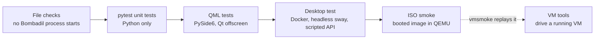
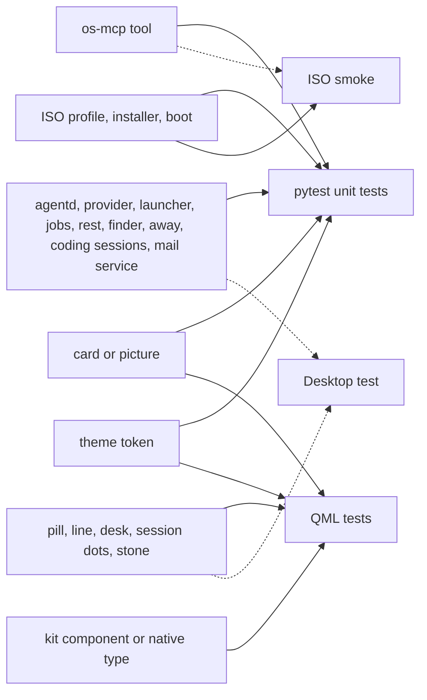

# Developing and testing Bombadil

> **Status:** Shipped
> **Code:** `pyproject.toml`, `tests/`, `docs/tools/check_docs.py`, `scripts/dev-session.sh`, `scripts/run-vm.sh`, `scripts/test-vm.sh`, `scripts/wsl-vm.sh`, `scripts/vm-tools/`, `iso/airootfs/usr/local/bin/bombadil-smoke`, `src/bombadil/providers.py`, `src/bombadil/config.py`
> **Design:** the commands under [Try it](../../README.md#try-it) in the README are the intent; there is no brief for the test layers. `scripts/test-vm.sh` has three modes on `main`, `live`, `install` and `installed`. The modes `install-encrypted` and `refresh` are in progress on an unmerged branch, and a planned `update` mode is designed with no code, all three in [the installed-OS brief](../design/installed-os-brief.md) (see also [the installed OS](../architecture/installed-os.md)); running the VM smoke test from a coding session is designed, not built, in [the developer brief](../design/dev-brief.md)
> **Verified:** 2026-11-09 against `main` at `ca7f80a`, for the test counts and lists, the ruff figures, the desktop test, the smoke, the repository map, the variables, the state folders and everything about coding sessions and the Away card. The sections on the VM tools, the btrfs kernel VM and the tests of Mail are as checked on 2026-11-08 at `7176e55`. The paragraphs under the title say what was run and what was only read.

This page is for someone who has cloned the repository and wants to run Bombadil from the checkout,
change it, and prove the change. It covers setting up, the six layers of testing from a file check that
takes seconds to a booted image, the tests of Mail (a Python suite, a JavaScript suite for the
Thunderbird add-on, and tests that need a real Thunderbird), a development session against a checkout
with the fake provider, the tools that drive an installed VM without a window (how to get that disk, and
how to measure the screen from outside), the btrfs kernel VM, a map of the repository, the conventions
the code and configuration show, and where the test for each kind of change goes. The VM smoke test in
detail, with its host side and its serial protocol, is in [vm-testing.md](vm-testing.md). How to write the
documentation for a change is in [documenting.md](documenting.md). How each piece works is in
[ARCHITECTURE.md](../ARCHITECTURE.md) and the pages it links.

On 2026-11-08 the Python and JavaScript layers were run, one file at a time, in a plain Linux container
(Ubuntu 24.04 userland, Python 3.13.18, pytest 9.2.0, pytest-asyncio 1.4.1, Node 22.23.4, 4 CPUs, no
display, no systemd, no `/dev/kvm`, no QEMU, no Dovecot, no Thunderbird, no PySide6, and a Docker client
with no daemon). The QML layers need PySide6, which that container lacked, so their tests were read and
not run. The desktop test, the ISO smoke, the VM tools, the measuring tools, the btrfs kernel VM and the
tests that need a real Thunderbird need software the container did not have, so their scripts were
parsed (`bash -n`, a Python parse) but not run. The page says which is which.

The change between `7176e55` and `9d5c729` (the smoke's picture checks, a picture beside a window, and
`BOMBADIL_BUDGET_SCALE`) was added on 2026-11-09, and so were the three pieces of work that `main` gained
after it, up to `ca7f80a`: coding sessions, the Away card and the limit-code fix. The tests were counted
again on 2026-11-09 in the same kind of container (Python 3.13.18, pytest 9.2.0, pytest-asyncio 1.4.1, no
PySide6). These files need no PySide6, were run one at a time and passed: `tests/test_dev.py` (25 tests),
`tests/test_away.py` (75), `tests/test_agentd_away.py` (11), `tests/test_limit.py` (51) and, for the earlier
change, `tests/test_iso_profile.py`, `tests/test_sysmap.py`, `tests/test_mcp_server.py` and
`tests/test_rest.py`. Read and not run, because
they need PySide6, Docker or a VM: `tests/test_sessions_qml.py`, the tests added to `tests/test_desk_qml.py`,
the desktop test and the smoke, with its coding-sessions block. The parts of the page that none of this
touches are as they were checked on 2026-11-08.

## Set up

Python 3.11 or newer is required (`requires-python`, and the code uses `tomllib`). The package has no
runtime dependencies: `dependencies = []`. Use a virtual environment kept outside the checkout
(`.gitignore` lists `__pycache__/`, `*.egg-info/` and `out/`, not `.venv`).

```sh
python3 -m pip install -e '.[dev,apps]'
python3 -m pip install cryptography                # the Vault tests
python3 -m pip install pillow numpy cairosvg       # the two wallpaper tests that draw the picture again
pytest
```

| Extra | Packages | What needs it |
|---|---|---|
| none | `dependencies = []` | `agentd`, `bombadil`, `bombadil-os-mcp`, the launcher, the card and picture code and the brain (`src/bombadil/brain/`): standard library only |
| `dev` | `pytest`, `pytest-asyncio`, `ruff` | the tests and the linter |
| `apps` | `PySide6` | the app kit and its runtime (`bombadil-app`), the Focus window's app (`share/apps/brain/`), the Mail window's app (`share/apps/mail/`), the 16 test modules that skip as a whole without it (listed under [Run the tests](#run-the-tests)), 32 tests in `tests/test_appkit_reload.py` and `tests/test_appkit_runtime.py` that skip one by one, and five pixel tests in `tests/test_wallpaper.py` |
| not declared | `cryptography` | `Vault` (`src/bombadil/appkit/native/vault.py`); 27 tests failed without it on 2026-10-01 (see below) |
| not declared | `pillow`, `numpy`, `cairosvg` | `scripts/make-wallpaper.py`, and the two tests in `tests/test_wallpaper.py` that draw the picture again; they skip without them |

In `src/`, third-party imports exist only under `src/bombadil/appkit/`: `PySide6`, `shiboken6`
(installed with PySide6) and `cryptography`. The apps the kit runs import `PySide6` as well
(`share/app-template/app.py`, `share/apps/brain/app.py`, `share/apps/mail/app.py`). `scripts/make-wallpaper.py` is the one script
that imports packages of its own (`pillow`, `numpy`, `cairosvg`). The ISO installs `pyside6` and
`python-cryptography` as packages (`iso/packages.x86_64`). The editable install adds `src/` to the
import path through a `.pth` file; it is optional, because `pythonpath = ["src"]` in the pytest
configuration and a `sys.path.insert` at the top of nine of the ten Python entry points in `bin/` do the same
for the tests and the commands (`bin/bombadil-signal` uses the standard library only and needs no path).

Other layers need more than Python:

| Layer | Needs |
|---|---|
| Mail add-on tests (JavaScript) | `node` 22 or later on `PATH`, nothing else: no package install, no Thunderbird. `tests/test_mail_addon.py` skips without it |
| Mail tests on a real Thunderbird | an unpacked Thunderbird (`BOMBADIL_TEST_THUNDERBIRD`, else `~/.cache/bombadil-lab/thunderbird-157.0/thunderbird`, which `tests/mail/lab/fetch-thunderbird.sh` downloads) and `dovecot` on `PATH`; one test in `tests/test_mail_engine.py` needs `Xvfb` and `xwininfo` instead of `dovecot`. They skip without them (see [The tests of Mail](#the-tests-of-mail)) |
| dev session | a Hyprland desktop with `quickshell` (panels, drawers and app placement need Hyprland; the bar alone also ran under sway in the desktop test); `pyside6` only to create or open apps, the Mail window included; `zellij` and `foot` only for coding sessions. Mail runs on its fake engine, so no Thunderbird is needed |
| desktop test | Docker, and a self-contained `claude` binary (`CLAUDE_BIN`) |
| ISO build | an Arch host with `archiso` and `npm`, or Docker or Podman (`scripts/build-in-container.sh`) |
| ISO smoke | `qemu-system-x86_64`, OVMF firmware (`edk2-ovmf` or `ovmf`), a built ISO, and `qemu-img` for the install mode; KVM is optional |
| installed disk | `scripts/wsl-vm.sh` as root on an Arch host or under WSL, with KVM; or the ISO and `scripts/run-vm.sh` by hand |
| VM tools | an installed disk at `out/bombadil.qcow2`, a VM started by `scripts/run-vm.sh` (KVM and a display), Python 3 on the host, and `BOMBADIL_TREE` set to the checkout |
| btrfs kernel VM | Docker or Podman, and `qemu-system-x86_64`; KVM is optional |

## Run the tests

```sh
pytest                          # everything; the QML files skip without PySide6
pytest -q -x -k pill            # a few, stop at the first failure
pytest tests/test_agentd.py     # one file
BOMBADIL_SCREENS=/tmp/shots pytest tests/test_stone_qml.py    # also save pictures of each state
ruff check src tests bin scripts share iso
python3 docs/tools/check_docs.py --mermaid    # the file checks of the docs: links, anchors, leaks, diagrams
```

The configuration defines no markers. Selection is by file or `-k`. Async tests carry
`@pytest.mark.asyncio` (strict mode: `asyncio_mode` is not set), on the test or, in
`tests/test_mail_bridge.py`, `tests/test_mail_service.py` and `tests/test_mail_e2e_real.py`, once for the
module in its `pytestmark` (see Conventions). Three
tests need root and skip without it: `test_real_kernel_events_parse` in `tests/test_brain_fanotify.py`,
`test_real_fork_events` in `tests/test_brain_forks.py` and
`tests/test_brain_watch.py::test_the_service_end_to_end` (which also needs `setpriv` and a working
fanotify filesystem mark). The container ran as root, and the last of them passed there on 2026-11-08.

Run `pytest` in the foreground, or with SIGINT reset to its default. A parent that ignores SIGINT (a
background job started with `&` in a script, some job runners and CI) hands that on, and Python keeps
it ignored. Stop's SIGINT then does nothing to the child that
`tests/test_agentd.py::test_a_stopped_turn_sends_no_more_plan` starts, so that test fails every time
(checked on 2026-10-01 with SIGINT ignored). It can also fail with SIGINT at its default: see the next
table.

What collects, and what skips, depends on what is installed. On 2026-11-09, without PySide6, `pytest
--collect-only -q` collected 3636 tests in 68 of the 84 `test_*.py` files (at `ca7f80a`; at `7176e55` it was
3484 in 65 of 80). Of the four test files added since `7176e55` (`tests/test_dev.py`, `tests/test_away.py`,
`tests/test_agentd_away.py` and `tests/test_sessions_qml.py`), three collect tests: `tests/test_dev.py` has 25,
`tests/test_away.py` 75 and `tests/test_agentd_away.py` 11. The fourth, `test_sessions_qml`, is one of the 16 files
that skip as a whole without PySide6: `test_appkit_agent`, `test_appkit_kit`, `test_appkit_native`, `test_brain_app`,
`test_desk_cards_qml`, `test_desk_drag_qml`, `test_desk_qml`, `test_diagram_qml`, `test_found_qml`,
`test_mail_app_backend`, `test_mail_app_qml`, `test_notice_qml`, `test_pill_qml`, `test_rest_qml`,
`test_sessions_qml` and `test_stone_qml` (`test_found_qml` and `test_rest_qml` import the modules that
skip). Two more files skip one test at a time: 18 tests in `test_appkit_reload.py` and 14 in `test_appkit_runtime.py` call
`pytest.importorskip("PySide6")` inside the test, and `tests/test_wallpaper.py` skips five tests that need
`PySide6.QtGui` and two that draw the picture again and need `pillow`, `numpy` and `cairosvg`, which no
extra installs, so those two stay skipped with `.[dev,apps]`. The mail tests that need a real
Thunderbird skip on their own (see [The tests of Mail](#the-tests-of-mail)). Counts move with every
change; `pytest --collect-only -q | tail -1` gives the count for your checkout. The whole suite was not run on
2026-11-08 or 2026-11-09, so no pass count or time is given for it. The slowest single tests are the waits in
`tests/test_launcher.py` (two of 10 s and two of 5 s, 33 s for the file on 2026-11-08) and
`tests/test_brain_watch.py::test_the_service_end_to_end` (3 s). `tests/test_mail_service.py` and
`tests/test_mail_engine.py` together took 69 s on that date.

On 2026-10-01 (Python 3.11.15, pytest 9.1.1, pytest-asyncio 1.4.1, PySide6 6.11.2) a whole run with
`.[dev,apps]` and `cryptography` had no failure, and these were the failures that other setups gave:

| Failure | Count | Cause | Environment-only? |
|---|---|---|---|
| `test_vault_*` and `test_lists_from_native_types_are_real_arrays` in `tests/test_appkit_native.py` | 27 | `cryptography` is not installed, so `Vault.create` returns false | Yes. With the package installed that file passed (70 of 70), and no extra declares it. Neither that file nor `vault.py` has changed since |
| `test_a_stopped_turn_sends_no_more_plan` in `tests/test_agentd.py` | 1, in a `.[dev]` run | the assertion that the child wrote its last step on its way out (`u3`, line 1621 on 2026-11-09) failed. SIGINT was at its default. The test passed in the run with `cryptography` and in 18 runs of it alone (six on an idle machine, twelve with eight busy loops running) | Not established |

With `cryptography` installed and SIGINT at its default, nothing failed in the run with `.[dev,apps]`. The
table is not a complete list of what can fail: `tests/test_appkit_native.py::test_agent_talks_to_agentd`
can (see Known gaps).

A run also reports pytest warnings, each a stray thread exception in a test stand-in. One
appears in every run: a `BrokenPipeError` in the `serve` function of the `_agentd` stand-in
(`tests/test_mcp_server.py`, line 146, the greeting's `conn.sendall`). It writes its greeting after the
client has hung up, and pytest reports it against
`test_without_a_turn_the_job_tool_says_so_and_asks_nobody` (seen again on 2026-11-08: 32 passed, 1
warning). The other appears sometimes: a `PytestUnhandledThreadExceptionWarning` from the `_browse` thread
of the `FakePanel` stand-in (`tests/test_signin.py`, line 62, an `http.client.IncompleteRead` that the
`except OSError` does not catch), reported against
`tests/test_agentd_signin.py::test_hidden_panel_and_show`; it did not appear in the runs of 2026-10-01. No
test fails because the container has no Hyprland, no systemd or no snapper: the tests fake each of them
(see Conventions).

`ruff check` has one setting, `line-length = 110`, and otherwise uses ruff's default rules; nothing pins
the version. With ruff 0.15.20 it reported 63 findings on `src tests bin scripts share iso` on 2026-11-09,
none under `src/`, `share/` or `iso/`: 22 in `scripts/vm-tools/` (`agentprobe.py` and `scratch_api.py`:
13 `E701` and 9 `E702`, several statements on one line), 32 in `tests/mail/lab/` (the lab's question
scripts) and nine in the rest of `tests/` (five lambda assignments, two unused imports, two imports
below code). On 2026-11-08 it was 62: `_run_picture` in `tests/test_iso_profile.py` has since added the
fifth lambda assignment (`E731`). Ruff 0.16.9, the version that `pip install '.[dev]'` fetched on
2026-10-01, applies more default rules and reported 541 on the same command on 2026-11-09. The command
does not cover Python scripts without a `.py` extension, because ruff scans a folder for `*.py` only: the
ten Python entry points in `bin/` and the eight VM tools `serialpump`, `vmsh`, `vmpy`, `vmin`, `vmlink`,
`vmlogin`, `stonecrop` and `lifttrace`. Named on the command line, the ten in `bin/` (`bombadil-signal`
among them) are clean and the eight VM tools report 47 (0.15.20). `ruff check .` also reaches
`docs/tools/check_docs.py` and reported 64. `ruff format --check` would reformat 187 of the 197 Python files in
those folders, and 188 of 198 with `docs/tools/check_docs.py` (`ruff format --check .`; 0.15.20), so the formatter
is not applied.

## How it works

Six layers. Each of the second to the fifth adds a real part that the one before fakes or leaves out
(the Python code, then Qt Quick, then a compositor and the real CLI, then the booted image). The sixth
drives the image of the fifth while you keep it running. The solid arrows run from the cheapest layer to
the booted image. The dashed arrow shows that `vmsmoke` replays the smoke test in a VM you keep running.



| Layer | Real | Faked | Proves | Run it |
|---|---|---|---|---|
| file checks | the files of the checkout, read as text | everything they describe: no Bombadil process starts; a few tests run short bash or Python scripts on copies of the files, and `--mermaid` starts a renderer | every relative link and anchor in the docs resolves, no name or token has leaked, every Mermaid diagram renders (`docs/tools/check_docs.py`, see [documenting.md](documenting.md#checking-your-docs)); the ISO profile, the units, the tokens, the brand files and the boot parameters hold what the code relies on (`tests/test_iso_profile.py`, `test_theme.py`, `test_brand.py`, `test_boot_console.py`); the smoke's picture checks ask a capture that gave up again with more time (its `picture()` function, run in bash in `tests/test_iso_profile.py`) | `python3 docs/tools/check_docs.py --mermaid`; `pytest tests/test_theme.py tests/test_iso_profile.py tests/test_brand.py tests/test_boot_console.py` |
| pytest unit tests | the Python code, sockets in a temp folder, plain files, SQLite files (the brain, the mail service); as root, a real fanotify mark and process-event socket in three brain files (`test_brain_fanotify.py`, `test_brain_forks.py`, `test_brain_watch.py`) | Hyprland, snapper, systemd, btrfs (a recorded mount table), zellij and foot (`FakeZellij` in `tests/test_dev.py` records the commands and keeps the sessions it was asked to start), `/proc` and the cgroup tree (recorded text), the provider CLIs (`providers.Fake`, a `Scripted` adapter, a scripted CLI that refuses with a 429), Thunderbird (the service's `FakeEngine`, a stand-in program), `bombadil-app check` | the socket protocol and turn lifecycle, provider stream parsing from recorded output, the resting state and the finder, the machine's readings, notices, tool results, plain-word narration, the launcher, jobs, the desk model (with a card folded by hand), card checking, picture parsers, the brain's store, watcher stream, writer attribution and search, the mail service and its press, `bombadil watch` and `history` (a command that Stop ended reads stopped, not failed), coding sessions (`dev.py`: the registry, the states a tool's hooks move a session through, the launcher's words for them, the hook program `bin/bombadil-signal` run as a program, and the three managed hook files parsed as JSON and TOML, with `share/zellij/config.kdl` only checked to exist), the Away card's rows (`away.py`), a restarted daemon keeping the conversation and the session's model | `pytest` |
| QML tests | the QML files, Qt Quick, the kit's native types, pixels | agentd in the shell tests, which send the events it would (the `Agent` type's tests run a real `AgentD` on a Unix socket: with the fake provider in `test_appkit_native.py`, with a scripted CLI in `test_appkit_agent.py`); the brain in the Focus window's tests (`test_brain_app.py`); the mail service on its fake engine, in a thread, in the Mail window's tests; the compositor | a component loads with no warnings, binds to the events, draws the right face, reacts to clicks and keys, a card or a strip dragged by its title is grabbed across the desk's three windows (`tests/test_desk_drag_qml.py`), and a picture asked for beside a window takes about 560 px, wider than the 360 px pill, or what the rails leave of a smaller screen and never under 360 (`tests/test_desk_qml.py`), the dots, chips and peek of coding sessions follow agentd's `dev` message (`tests/test_sessions_qml.py`), and the Away card is drawn from its `away` message (`tests/test_desk_qml.py`) | `pytest` with `.[apps]` |
| desktop test | Quickshell, agentd, the real Claude Code CLI (also inside zellij and a `foot` window, as a coding session, with the ISO's managed hook file installed), `bombadil` commands, a Wayland compositor (sway), a virtual pointer (`pointer.py`), the mail service (`bin/bombadil-mail`) | the model (a scripted Anthropic API, which can also refuse as a used-up plan does), the mail engine (`BOMBADIL_MAIL_ENGINE=fake`), the machine's readings (injected), Hyprland, systemd, snapper | the pieces work together: timings, a key press to the screen, Stop ends everything a turn started, pictures streamed into the bar (one beside a window drawn wider than the pill), the desk and its cards (also dragged with a real pointer), the Away card, the model words, the AI at rest and the finder, a mail notice from the service to the line, the wallpaper, a real Claude Code started by name from the pill in zellij with a viewer window, its dot moving with its hooks | `tests/desktop/run.sh` |
| ISO smoke | the built image, Hyprland, greetd, systemd and the three user services (`bombadil-agentd`, `bombadil-shell`, `mako`), zellij and `foot` for a coding session, the installer, snapper on btrfs, the brain's watcher on the installed btrfs layout, the mail user unit and Hyprland's window rule for Thunderbird's windows | the model (the coding-sessions block starts a shell session, so no tool and no model is involved); sign-in uses a stand-in login, plus the real Codex and Claude pages when the VM has internet; the mail service runs on the fake engine (the image has no mail account), and `foot` windows with Thunderbird's class stand in for its windows | a booted machine does what the product promises: session, bar, panels, apps, a shell coding session in its own scope and slice with a floating viewer window that needs no provider login, pictures (after a wait for a calm guest, and asked again with more time when a capture runs out of it), the pill keys, the user services coming back after a kill, mail, sign-in, install, the brain, restore points filed so snapper may prune them (the installed config keeps 30; no cleanup is run), undo over a reboot | `scripts/test-vm.sh` in three modes: `live`, `MODE=install` and `MODE=installed` (boots the disk the last install run left, the undo's second boot; it exits 2 when there is no `out/test/disk.qcow2`); a planned `MODE=update` is designed, not in the script ([the installed-OS brief](../design/installed-os-brief.md)). See [vm-testing.md](vm-testing.md) |
| VM tools | a running VM you keep | the model, when agentd is pointed at `scratch_api.py` | a shell, keys, clicks and screenshots on a VM without a window; `vmsmoke` runs the smoke inside it; `stonecrop` and `lifttrace` measure what the screen shows | `scripts/vm-tools/` |

Beside the layers, `tests/vm/btrfs-kernel.sh` boots Arch's own kernel on the installed disk layout for
a test folder you provide. It is a harness for facts a container cannot give, not a stage between the
layers (see [the btrfs kernel VM](#the-btrfs-kernel-vm)).

### Which layer covers a change

Solid arrows are where the test goes. Dashed arrows are a second layer to run when the change
crosses a process or the compositor.



Where to add a test for each kind of change:

| Change | Add the test to | Pattern to copy |
|---|---|---|
| agentd: a message, a turn step, the queue, setup | `tests/test_agentd.py`; the sign-in flow in `tests/test_agentd_signin.py`; the AI at rest in `tests/test_agentd_rest.py`; what the finder offers in `tests/test_agentd_found.py`; the Away card's messages and ops in `tests/test_agentd_away.py` (11 tests) | `agentd.AgentD(providers.Fake("x"), agentd._NoSnapshots())` with `_start`, `_ask`, `_read_until` (the sign-in file has its own `_start`, `_send` and `_until`; the rest and found files import `Scripted`, `_start` and `_ask` from `test_agentd` and add the `Cli` class, a scripted CLI that refuses with a 429 until its mode is flipped) |
| a provider adapter, or what a CLI prints | `tests/test_providers.py`, with a recorded line file in `tests/fixtures/`; the one-shot command the brain uses (`describe_command`) in `tests/test_brain_describe.py`; whether a failed turn is the account's limit (`limit`, `waiting`) in `tests/test_limit.py` (Claude's `limit` takes the CLI's own `api_error` code: `usage_limit_reached` is a used-up plan, `model_requires_usage_credits` and `long_context_credits_required` are not); which model a turn asks for (Claude defaults to Sonnet, `use opus` and `use sonnet` switch the session without writing `config.toml`) in `tests/test_config.py` (`model_for`), `tests/test_launcher.py` (the words), `tests/test_agentd.py` and `tests/test_agentd_signin.py` (the switch) | `_kinds(p, "claude-plan.jsonl")` |
| the plain words of a step or a risk | `tests/test_narrate.py`, which has several parametrized tables: a shell command is a row of the `(command, text, risk)` table, an os-mcp tool a row of the `(name, args, text, done)` table of `test_tools_in_plain_words`, named `mcp__bombadil-os__<tool>` | a row of the table that matches |
| a launcher word | `tests/test_launcher.py`; the words for coding sessions (`claude acme`, `end reviewer`, `sessions`) in `tests/test_dev.py` | `launcher.match(text, app_list=[])`; `launcher.match(text, [], d)` with the `Dev` of `_dev()` for the session words |
| an os-mcp tool | `tests/test_mcp_server.py`; picture tools `tests/test_cardtools.py`; app tools `tests/test_appkit_tools.py` | `make()` and `call(server, "tool", **args)` in the first and last; the `tools` fixture and `call(tools, name, args)` in `test_cardtools.py`; the `fake_check` fixture in `test_appkit_tools.py` |
| a card or a `system_map` subject | `tests/test_cards.py` (checking, layout, text twin), `tests/test_sysmap.py` (parsers fed recorded command output, the before and after receipts, and the time each capture is given with `BOMBADIL_BUDGET_SCALE` set or not), `tests/test_diagram_qml.py` (drawn) | `fake({...})` from `tests/test_sysmap.py` (`import test_sysmap as fixtures` in the QML tests) |
| a job or a desk widget | `tests/test_jobs.py`, `tests/test_desk.py` (the desk model: rails, places, put-away widgets and a widget folded by hand, which `desk.toml` keeps and a move or `show` gives back); their cards and the desk's rules, including where a drop lands, how wide a picture is beside a window, where the rails stop above a row of session chips and the Away card, in `tests/test_desk_qml.py` and `tests/test_desk_cards_qml.py` (`ASKABLE`, the widgets "show" is also a question to, is tested in `tests/test_desk.py`); dragging a card by its title or a chip (the handles, the grab across the three windows, what is drawn) in `tests/test_desk_drag_qml.py` | the `Systemd` stand-in in `test_jobs.py`; the `Desk` helper and `desk_msg` of `test_desk_qml.py`, which `test_desk_drag_qml.py` imports |
| the machine's readings and the Machine card (`vitals.py`) | `tests/test_vitals.py`: the parsers on recorded `/proc` and cgroup text served by a stand-in file tree, and `Vitals` against a scripted sampler and a clock for the lines it crosses; the card in `tests/test_desk_qml.py` and `tests/test_desk_cards_qml.py`; the injected message in the desktop test | `rig()` and `run(v, fake, clock, n, **now)` in `test_vitals.py`. agentd samples the real machine unless `BOMBADIL_VITALS=0`: the autouse `no_vitals` fixture in `tests/conftest.py` sets it, and a test that wants the card passes `vitals=` to `AgentD` |
| the AI at rest (`rest.py`, `Provider.limit`, `Provider.waiting`) | `tests/test_rest.py` (the state file `rest.json`, a provider's reset time, the words; the tests of a limit's lapse pass the time in, `rest.limit(provider, at)` and `rest.due(provider, at)`, so they do not read the real clock), `tests/test_limit.py` (51 tests: Claude's and Codex's refusals as recorded lines, including the CLI's `api_error` code that tells a used-up plan from a model that needs credits), `tests/test_agentd_rest.py`, `tests/test_launcher_rest.py` (the words that pause and resume by hand), `tests/test_bombadil_ask.py` (`bombadil ask` ends with exit 75 instead of waiting), the pill's line, chips and the AI card in `tests/test_rest_qml.py`, the stone's grey face in `tests/test_stone_qml.py` | `Cli(home, mode="refuse")` in `test_agentd_rest.py`; the `LIMIT` and `PAUSED` messages in `test_rest_qml.py` |
| the finder (`finder.py`) | `tests/test_finder.py` (pure), the `found` message and the press in `tests/test_agentd_found.py`, the chips in `tests/test_found_qml.py` | `_find(text)` with `APPS` and `ASKS` in `test_finder.py` |
| notices and the press log (`notices.py`, `outbox.py`) | `tests/test_notices.py`, `tests/test_outbox.py`, and the chips above the pill in `tests/test_notice_qml.py` | `make()` in `test_notices.py` |
| coding sessions (`dev.py`, `bin/bombadil-signal`, the managed hooks) | `tests/test_dev.py` (25 tests: names and the launcher's words, the registry, a session's states as a tool's hooks move it, the one line in the pill and Tab, the hook program run as a program, and the three managed hook files parsed as JSON and TOML, with `share/zellij/config.kdl` only checked to exist); the dots, chips and peek in `tests/test_sessions_qml.py`; agentd's side in `tests/test_agentd.py`; the real thing in the desktop test's coding-sessions section and the smoke's `dev-*` checks | `_dev()` and the `projects` fixture of `test_dev.py`, which run a `Dev` on a `FakeZellij` in a temp `~/Projects`; `Bar` and `_s(key, state)` in `test_sessions_qml.py` |
| the Away card (`away.py`) | `tests/test_away.py` (75 tests: what is worth a row since the person left, and the message, with the rows, the sessions and the clock handed in), `tests/test_agentd_away.py` (11: agentd builds the card, tells every bar once, remembers what was seen in `away.json` and puts the card away at the person's next ask), the card in `tests/test_desk_qml.py` and the desktop test | `turn(...)`, `job(...)` and `items([...], since=LEFT, now=NOW)` in `test_away.py`; `_seed(...)`, `_card(r)` and `_daemon()` in `test_agentd_away.py`; `away_msg(...)` in `test_desk_qml.py` |
| Mail (`src/bombadil/mail/`, `share/apps/mail/`, `share/mail/extension/`, `bin/bombadil-mail*`) | see [The tests of Mail](#the-tests-of-mail) | the fixtures named there |
| restore points and undo (`snapshots.py`) | `tests/test_snapshots.py` (a turn's restore point is made with `--cleanup-algorithm number`, so snapper may prune it); the per-turn restore point and undo in `tests/test_agentd.py`, the launcher's undo in `tests/test_launcher.py`, the OS tools in `tests/test_mcp_server.py`. The other snapper command lines (`list`, the rollback) and the installed config that keeps 30 run only in the ISO smoke's undo mode (`snapshot-is-prunable`, `snapshots-are-pruned`, `undo`); `tests/test_iso_profile.py` reads the installer's settings as text | subclass `snapshots.Snapshots` and override `available`, `create`, `list` and `rollback`: `Snaps` (`test_launcher.py`), `FakeSnaps` (`test_mcp_server.py`), or `RecordingSnaps` and `SlowSnaps` over `agentd._NoSnapshots` (`test_agentd.py`) |
| `config.toml` and its keys (`config.py`) | `tests/test_config.py` (defaults, per-provider `[models]`, what `save_user` keeps) | `config.save_user("codex", model="o4-mini")` with the `home` fixture |
| the brain (`src/bombadil/brain/`, `bombadil brain`) | `tests/test_brain_*.py` by part: `core` (store, ingest, rules, actors), `index`, `witnesses` (turns, Chromium history, `pacman.log`, `memory.md`), `watch`, `fanotify` and `forks` (the root watcher), `service` and `client`, `focus` and `this`, `describe`; the Focus window's backend in `test_brain_app.py` | `FakeWatcher` and `make_brain(home, ...)` in `test_brain_service.py`; the `brain` fixture in `test_brain_focus.py` |
| a kit component | `tests/test_appkit_kit.py`; add the component to a gallery in `tests/qml/` | `run(home, qml, body)` |
| a native type (`App`, `System`, `Processes`, `Command`, `Vault`, `TextFile`, `Clipboard`, `Agent`, `Highlighter`, `KitFiles`), or the `Store` component | `tests/test_appkit_native.py` (`Store` is the QML component `share/qml/Bombadil/Store.qml` over `KitFiles`, and its tests are here too); `Agent` against agentd's events in `tests/test_appkit_agent.py` | the `kit` fixture and `make(kit, source)` |
| the app runtime: hot reload, placement, status | `tests/test_appkit_runtime.py`, `tests/test_appkit_reload.py`, `tests/test_appkit_placement.py` | `drive(name, body)` (defined in `test_appkit_runtime.py`, also used by `test_appkit_reload.py`) for hot reload and status; `FakeHypr` and `ScriptedHypr` for placement |
| a shell component | the line, chips and card host: `tests/test_pill_qml.py`; the AI card and the resting pill: `tests/test_rest_qml.py`; the found chips: `tests/test_found_qml.py`; the notice chips: `tests/test_notice_qml.py`; the dots, chips and peek of coding sessions (`DevState.qml`, `SessionChips.qml`, `SessionPeek.qml`): `tests/test_sessions_qml.py`; the desk: `tests/test_desk_qml.py` and `tests/test_desk_cards_qml.py`; dragging on the desk (`DeskDrag.qml`, with `DeskRail.qml` and `DeskStrips.qml`): `tests/test_desk_drag_qml.py`; the stone: `tests/test_stone_qml.py` | the `Bar`, `Desk` or `Cards` helper class with a `HARNESS` string (`test_rest_qml` and `test_found_qml` reuse `test_pill_qml`'s `Bar`) |
| a shell file that imports `Quickshell` (`shell.qml`, `DeskRails.qml`, `HyprCover.qml`, `Wallpaper.qml`) | the desktop test: no offscreen test loads them (`tests/test_wallpaper.py`, `test_rest_qml.py`, `test_found_qml.py`, `test_notice_qml.py` and `test_desk_drag_qml.py` read `shell.qml` or `Wallpaper.qml` as text, and the desktop test checks the wallpaper's pixels and drags a card with a real pointer) | a check in `tests/desktop/driver.py` |
| a token or the look | edit `share/qml/Bombadil/Theme.qml`; `tests/test_theme.py` keeps `shell/DeskTheme.js` equal and `shell/*.qml` free of hex colours and `"white"` and `"black"`; `tests/test_brand.py` for brand files. A changed `bg`, `sunken`, `panel`, `raised` or `border`, or a changed mark, means running `scripts/make-wallpaper.py` again, or `tests/test_wallpaper.py` fails; its tests also read `overlay` and `muted`, which the script does not draw with, as limits | the `THEME` dict from `tests/qml_theme.py` |
| the wallpaper (`share/wallpaper/bombadil.png`, `shell/Wallpaper.qml`) | `tests/test_wallpaper.py`: the picture's pixels against the tokens (PySide6) and `Wallpaper.qml` read as text; the picture is drawn again and compared (`pillow`, `numpy`, `cairosvg`) | `_mean(img, cx, cy)` and `rgb(token)` |
| the ISO profile or installer | static facts in `tests/test_iso_profile.py` (packages, mirror list, the agent's system-prompt rules for installing with `pacman -Syu` and for a replaced kernel, the installer's GRUB edit, the binds and the `layers` animation in the skeleton Hyprland config; the three user units `bombadil-agentd`, `bombadil-shell` and the `mako` drop-in restarting on death, the Hyprland start hook importing the environment before it restarts them, `bombadil-setup` and `bin/bombadil` restarting the daemon through systemd; the installer pruning restore points (`NUMBER_LIMIT=30`, no hourly ones, `snapper-cleanup.timer`) and taking the kernel from the copied system before the disk is erased; the smoke's numbered key requests, its sign-in gate and its unit-based agentd replacement; its picture checks (the `picture()` function run in bash against a stand-in for os-mcp: three tries at 1, 4 and 12 times the time with a wait for calm between, no second try for a reply in the wrong shape, and the wait for calm placed before the pictures with `calm` defined once); and Mail's: the `thunderbird` package and its policy file, the mail unit and its link, Thunderbird's window rule, the session handing the unit its screen, the mail skill's links, the dev session's scratch mail folder); the brain's unit and link, and the `for b in ...; do` loop of `scripts/build-iso.sh` that links the commands, in `tests/test_brain_service.py` (its section "the ISO"), which also runs `bash -n` on `bombadil-smoke` and matches the text `bombadil-brain bombadil-brain-watch; do command -v`; booted behaviour as a check in `bombadil-smoke` | `_packages()`, `_installer_grub_lines()` |
| the quiet console between the boot loader and the desk | `tests/test_boot_console.py` keeps the kernel parameters in `iso/efiboot/loader/entries/01-bombadil.conf` and `iso/airootfs/etc/default/grub.d/zz-bombadil-console.cfg` equal to the output of `scripts/console-palette.py` (paste that output again when a token it maps changes), the serial smoke entries loud, the installer copying the live `/etc` so the drop-in arrives, greetd keeping Hyprland's start-up text off the console, and `hyprland.lua`'s background opaque | `kernel_options(text)`, `colour_params(options)` |
| anything that needs the real Hyprland: the Super binds, drawers, focus | a check in `bombadil-smoke` | `has_client`, `special_shown`, `active_is` |
| a fact about the kernel or the btrfs layout | a test folder for `tests/vm/btrfs-kernel.sh` | `tests/vm/samples/` |
| generated apps on disk: names, files, running one (`apps.py`) | `tests/test_apps.py` | `test_create_and_list(home)` |
| the browser panel's DevTools client (`browser.py`) | `tests/test_browser.py` | the `Chromium` handler and the `devtools` fixture: a stand-in for Chromium's debugging port |
| app window slots and the rules that place them (`hypr.py`) | `tests/test_hypr.py` | the `Ipc` stand-in, which records the requests and answers `j/monitors` and `j/clients`; its autouse fixture takes the `home` fixture |
| the details drawer's viewer (`pager.py`, `bombadil view`) | `tests/test_pager.py` | `run_page(text, keys)`, which runs the viewer in-process with a key iterator and a size function and returns what it wrote (one separate test uses a pseudo-terminal) |
| Stop and the turn's process scope (`procs.py`) | `tests/test_procs.py` | the tests that start real child processes and check them with `_alive` or `_pids_running` |
| signing in (`signin.py`, `fake_signin.py`) | `tests/test_signin.py`; agentd's side in `tests/test_agentd_signin.py` | the `FakePanel` stand-in browser and the `fake(mode)` fixture |
| `bombadil watch` and `bombadil history` (`watch.py`) | `tests/test_watch.py` | `watch.Renderer().lines(events)` fed event dictionaries; `watch.history_lines()` over a turn log written into the `home` folder |

## The tests of Mail

[Mail](../architecture/mail.md) has the most test files of any piece: 17 `tests/test_mail_*.py` files,
the JavaScript tests of the Thunderbird add-on in `tests/mail/addon/`, and three helpers. They split by
what they need. [The Tests section of the Mail page](../architecture/mail.md#tests) lists them by layer;
this is how to run them from a checkout. Run one file at a time on a busy machine.

| Group | Files | Needs |
|---|---|---|
| Python only | `tests/test_mail_protocol.py`, `test_mail_accounts.py`, `test_mail_text.py`, `test_mail_drafts.py`, `test_mail_store.py`, `test_mail_client.py`, `test_mail_bridge.py`, `test_mail_host.py`, `test_mail_tools.py`, `test_mail_agentd.py`, `test_mail_service.py`, `test_mail_engine.py`, and `test_outbox.py` and `test_notices.py` beside them | nothing but the standard library, `pytest` and `pytest-asyncio`; no Thunderbird, no network, no mail account |
| the add-on's JavaScript | `tests/test_mail_addon.py`, which runs each `tests/mail/addon/*.test.js` with `node --test` (one pytest case per file) | Node 22 or later on `PATH`; the file skips without it. No package install |
| the Mail window | `tests/test_mail_app_backend.py`, `tests/test_mail_app_qml.py`, with `tests/mail_app_lab.py` | PySide6 (`pytest.importorskip("PySide6")` at the top of each) |
| a real Thunderbird | `tests/test_mail_addon_real.py`, `tests/test_mail_e2e_real.py`, and the two tests at the end of `tests/test_mail_engine.py` whose names start `test_a_real_thunderbird` | an unpacked Thunderbird and `dovecot` (the engine's second one needs `Xvfb` and `xwininfo` instead of Dovecot); they skip without them |

What stands in for the real thing in each group:

- The service, `bombadil.mail.service.Service`, runs on the fake engine (`FakeEngine` in
  `src/bombadil/mail/fake.py`: sample mailboxes in memory, a hostile mail among them) over a real Unix
  socket in a temp home. `test_mail_service.py` talks to it with its `Client` and starts it with `Mail`;
  `test_mail_app_backend.py` and `test_mail_app_qml.py` run it with a fake agentd in threads of their own
  (`Lab` in `tests/mail_app_lab.py`).
- Everything that talks to `mail.sock` but is not the service (agentd, the launcher, the CLI, the mail
  tools) is tested against `tests/mail_stub.py`: `StubMail`, the `mail` fixture and `msg()`.
  `test_mail_agentd.py` also has tests against the real service on the fake engine.
- The engine (`src/bombadil/mail/engine.py`) is tested against `tests/mail/fake_thunderbird.py`, a program
  that records how it was started, holds the profile's lock and quits on SIGTERM, with the `make` fixture
  of `tests/test_mail_engine.py`. `BOMBADIL_FAKE_TB` picks its misbehaviour (`crash`, `deaf`, `slow`, `child`,
  `noisy:N`, `quick`, `die:N`).
- The native-messaging host `bin/bombadil-mail-host` is run as the real program in `test_mail_host.py`,
  between a fake service socket and pipes.
- The add-on's modules run in Node against a fake `messenger` and a fake clock (`tests/mail/addon/fake.js`),
  which behave as the lab saw the real Thunderbird behave; `tests/mail/addon/static.test.js` reads the
  add-on's files as text for what they may ask for.

The real-Thunderbird tests start a real Thunderbird 157 hidden, on a profile of their own, with the
shipped add-on installed, the real host, and the lab's mail server (`tests/mail/lab/mailserver.py`: a
local Dovecot and an SMTP sink on 127.0.0.1, seeded from `tests/mail/lab/seed`). Everything lives in a
temp directory with its own `HOME`, and the process group is killed at the end of every test. To run
them:

```sh
tests/mail/lab/fetch-thunderbird.sh          # once: unpacks Thunderbird 157 under ~/.cache/bombadil-lab
pytest tests/test_mail_addon_real.py         # the add-on against the real Thunderbird
BOMBADIL_TEST_THUNDERBIRD=/path/to/thunderbird pytest tests/test_mail_e2e_real.py    # the whole chain
```

The tests look for the binary in `BOMBADIL_TEST_THUNDERBIRD`, else in
`~/.cache/bombadil-lab/thunderbird-157.0/thunderbird`. `BOMBADIL_LAB_CACHE` moves the cache that
`fetch-thunderbird.sh` fills (and `TB_VERSION` picks another release), but the tests do not read it: set
`BOMBADIL_TEST_THUNDERBIRD` when you move it. The two tests in `test_mail_engine.py` call the real
Thunderbird with every HTTP and HTTPS request going to a proxy on the same computer that refuses it.

`tests/mail/lab/` is not a test suite: it holds the question scripts (`q1_*.py` to `q5_*.py`), the lab's
helpers and `FINDINGS.md`, the record of what a real Thunderbird 157 did, which the design of Mail rests on.
Pytest does not collect it. The mail checks of the desktop test and the ISO smoke run on the fake engine
(see [How it works](#how-it-works)); the contract all of this holds the code to is
[docs/MAIL.md](../MAIL.md).

## Run a dev session against a checkout

`scripts/dev-session.sh` runs agentd, the mail service and the bar from the checkout on an existing
Hyprland desktop:

1. puts `bin/` first on `PATH`, so `bombadil` and `bombadil-shell` resolve to the checkout;
2. sets `BOMBADIL_PROVIDER` to `fake` unless it is already set, and `BOMBADIL_SHARE` to `share/`;
3. unless `BOMBADIL_MAIL_ENGINE` is set to something other than `fake`, runs Mail on its fake engine
   (sample mailboxes, no Thunderbird, no account) in a scratch folder from `mktemp -d`: it sets
   `BOMBADIL_MAIL_ENGINE=fake` and points `BOMBADIL_MAIL_DB`, `BOMBADIL_MAIL_FILES`, `BOMBADIL_PRESS_LOG`
   and `BOMBADIL_MAIL_SOCKET` into it, so nothing lands in the mail of a Bombadil you also use, and agentd,
   the launcher and `bombadil mail` talk to the fake service and not to a real one in the runtime folder;
4. starts `bin/agentd` and `bin/bombadil-mail` in the background, waits half a second, and runs
   `bombadil-shell` in the foreground; leaving it kills both and removes the scratch folder.

```sh
scripts/dev-session.sh                          # fake provider: the bar echoes what you type
BOMBADIL_PROVIDER=claude scripts/dev-session.sh # the real CLI, which must be signed in
BOMBADIL_MAIL_ENGINE=thunderbird scripts/dev-session.sh   # the real mail service, on the real state
```

Mail is the one thing the script isolates (`test_a_dev_session_keeps_all_of_its_mail_in_its_scratch_folder_the_socket_too`
in `tests/test_iso_profile.py` pins the four paths). Without overrides a dev session uses the real state
folder (`$XDG_STATE_HOME/bombadil`, else `~/.local/state/bombadil`: the turn log, desk file and `brain.db`),
the real config folder (`$XDG_CONFIG_HOME/bombadil`, else `~/.config/bombadil`), `~/Apps` and
`$XDG_RUNTIME_DIR/bombadil/agentd.sock`.
Point those elsewhere with the variables in `src/bombadil/paths.py`:

```sh
t=$(mktemp -d /tmp/bd.XXXX)       # keep it short: a Unix socket path holds about 108 bytes
BOMBADIL_RUNTIME=$t/run BOMBADIL_SOCKET=$t/run/agentd.sock \
BOMBADIL_STATE=$t/state BOMBADIL_CONFIG=$t/config BOMBADIL_APPS=$t/Apps \
  scripts/dev-session.sh
```

`BOMBADIL_SOCKET` is needed as well as `BOMBADIL_RUNTIME`. Only the Python side reads
`BOMBADIL_RUNTIME` (`paths.runtime_dir`); the bar reads `BOMBADIL_SOCKET` and, without it,
`$XDG_RUNTIME_DIR/bombadil/agentd.sock` (`shell/shell.qml`). With the runtime folder alone, agentd
listens in `$t/run` while the bar looks at the real socket path, and stays offline or attaches to a real
agentd. `BOMBADIL_SOCKET` alone moves the socket but leaves `app-placements.json` and its lock
(`hypr.py`), which also live in the runtime folder, in the real one.

A deep scratch path fails with `OSError: AF_UNIX path too long`. The header of the script says "no
snapshots", but that is true only on a machine without a snapper `root` configuration:
`Snapshots.available` is true when `snapper` is on `PATH` and `/etc/snapper/configs/root` exists
(`src/bombadil/snapshots.py`), and then every turn takes a restore point through `sudo snapper`. To
rule that out, put `snapshots = false` in `$BOMBADIL_CONFIG/config.toml`.

The script starts neither of the brain's two processes. `bin/bombadil-brain` is the user service that
keeps `brain.db`, and `bin/bombadil-brain-watch` is the root watcher, which wants a btrfs mount (or
`--path DIR` to watch the filesystem holding a directory, for development). `bombadil brain status`
answers "The brain is not running yet." without the service. How the brain works is in
[brain](../architecture/brain.md).

Coding sessions start from the pill in a dev session (`claude <project>`, `codex <project>` or `shell
<project>`, in the subfolders of `$BOMBADIL_PROJECTS`, default `~/Projects`) when `zellij` and `foot` are
installed; `bin/` first on `PATH` is what lets the tools find `bombadil-signal`. Their dots move only on a
machine that has the managed hook files (`/etc/claude-code/managed-settings.d/50-bombadil.json`,
`/etc/codex/requirements.toml` and `/etc/codex/config.toml`), which a checkout does not install: without
them the tool runs, but nothing tells agentd when a turn starts, when a question waits or when a turn is done; only
the wrapper's report of how the tool ended gets through. How they work is in
[coding sessions](../architecture/coding-sessions.md).

### Without a display

The Python parts need no desktop. This was run on 2026-11-08 in the container with the paths pointed
at a scratch folder as above (agentd created its runtime folder itself):

```sh
BOMBADIL_PROVIDER=fake bin/agentd &      # prints "agentd: fake on <socket>"
bin/bombadil ask "hello"                 # echo: hello
bin/bombadil status                      # {"type": "status", ..., "provider": "fake", "snapshots": false, ...}
bin/bombadil stop                        # ends a running turn and what it started; agentd keeps running
kill %1                                  # stops agentd (in an interactive shell; otherwise kill its pid)
```

Other `bin/bombadil` commands help in a dev session (the docstring of `bin/bombadil` lists them all):
`watch [--file F] [--follow]` shows every step, command and output of the last or a given turn, `history`
lists recent turns and launcher actions, `undo` rolls back the last turn through snapper (it prints
"nothing to undo" without a snapper `root` configuration), `pill` gives the pill the keyboard (what the
Super tap runs), `brain [status|why|find|focus|rebuild]` asks the brain, `mail [status|accounts|add|remove|views|list|show]`
asks the mail service (nothing sends from the command line), and `dev [list|next|why KEY|run KEY]` lists the
coding sessions and what each is doing, brings the next one waiting for you to the front, shows the last screen
of one that stopped and, inside a session's pane, runs its tool. `ask` exits 75 instead of waiting when the
AI rests (out of plan, or paused).

`bombadil-os-mcp` speaks JSON-RPC on standard input and output, so its catalogue can be listed the way
the smoke test's `os-mcp-lists-tools` check does:

```sh
printf '%s\n' '{"jsonrpc":"2.0","id":1,"method":"initialize","params":{}}' \
              '{"jsonrpc":"2.0","id":2,"method":"tools/list"}' | bin/bombadil-os-mcp
```

On 2026-11-09 it listed 26 tools: `show_panel`, `hide_panel`, `screenshot`, `snapshot`,
`list_snapshots`, `rollback`, `notify`, `desk`, `job`, `show_card`, `system_map`, `mail_search`,
`mail_read`, `mail_mark`, `mail_draft`, `mail_show`, `app_guide`, `create_app`, `check_app`, `open_app`,
`show_app`, `hide_app`, `close_app`, `app_status`, `list_apps` and `app_template`. The tools themselves
are described in [os-mcp](../architecture/os-mcp.md).

### The fake provider

`providers.Fake` (`src/bombadil/providers.py`, registered as `PROVIDERS["fake"]`) is for tests and
for running the shell without any provider.

| Behaviour | Detail |
|---|---|
| command | runs `cat`; agentd writes the prompt to its standard input. `BOMBADIL_FAKE_PROVIDER` names another program, but it is read once, when `providers` is imported (`Fake.binary` is a class attribute), so a test that sets the variable changes nothing: it sets `providers.Fake.binary` |
| events | each output line becomes a `text` event `echo: <line>`; the final `result` is `echo: <all lines joined by a space>` |
| installed | always true |
| signing in | by default it is always signed in. With `BOMBADIL_FAKE_SIGNIN` set to `auto`, `manual`, `never` or `fail`, it needs signing in through `src/bombadil/fake_signin.py`, a stand-in login on localhost; signed in means `$HOME/.fake-signin` exists |
| `FAKE_SIGNIN_DELAY` | seconds the fake sign-in page shows before it moves on (default 2) |
| `BOMBADIL_FAKE_SIGNIN_HOST` | a `host:port` the reachability check tries; an unreachable one plays "no internet" |
| `BOMBADIL_SIGNIN_TIMEOUT` | seconds agentd waits on a sign-in page (default 600, `src/bombadil/signin.py`) |
| the brain's descriptions | `Fake` has no `describe_command`, so the brain's one-line descriptions need `claude` or `codex` |

A running agentd reaches `fake` only through the `BOMBADIL_PROVIDER` environment variable.
`config.load()` accepts only `claude` and `codex` from `config.toml` (`PROVIDERS` in
`src/bombadil/config.py`) and raises `ValueError` for anything else (`test_unknown_provider_rejected`
pins this for `gemini`). `BOMBADIL_PROVIDER` also counts as "the user chose", so the first-run
provider picker does not appear.

## The desktop test

`tests/desktop/run.sh` runs the real bar, agentd and Claude Code CLI in a headless sway session
inside Docker, drives them with key presses, and checks timings, events and pixels. It covers what
runs without Hyprland; the Super binds and how Hyprland focuses the drawer need a real session, which
is the ISO smoke.

```sh
CLAUDE_BIN=/path/to/claude tests/desktop/run.sh     # defaults to `command -v claude`
```

| Part | What it does |
|---|---|
| `tests/desktop/run.sh` | builds the image `bombadil-desktop-test` if it is missing (`docker rmi` it to rebuild: an image built before `zellij` and `git` joined the Dockerfile lacks them, and the coding-sessions section needs both); mounts the checkout at `/repo` and `tests/desktop` at `/e2e` (both read-only), the output folder at `/out` and the `claude` binary at `/opt/claude` (read-only); passes if `driver.log` contains `DONE pass=N fail=0`. `OUT` (default `out/desktop`) is deleted first |
| `tests/desktop/Dockerfile` | Arch with `quickshell`, `sway`, `hyprland`, `foot`, `zellij`, `git`, `grim`, `wtype`, `pyside6`, `inter-font` and the Qt 6 modules the shell imports (the coding-sessions section needs `zellij` and `git`) |
| `tests/desktop/inside.sh` | in the container, creates an ordinary user with passwordless sudo (as Bombadil's), installs the ISO's managed Claude Code settings (`50-bombadil.json`, the hooks) in `/etc/claude-code/managed-settings.d`, copies sway so it drops its file capability, runs the driver as that user |
| `tests/desktop/driver.py` | starts the scripted API, sway, agentd and `bin/bombadil-shell` (and, for their sections, `bin/bombadil-mail` on the fake engine, the virtual pointer, and a project folder with one commit for the coding sessions); types with `wtype`, summons the pill with `bombadil pill`, screenshots with `grim`, reads pixels with PySide6's `QImage`, listens on the agentd socket; prints `PASS` or `FAIL` for each `check(...)` and ends with `DONE pass=N fail=M`, and writes a screenshot for each `shot(...)` (the first, `00-resting`, is taken again until the wallpaper has loaded). It sets `BOMBADIL_BAR_INJECT=1` and `BOMBADIL_VITALS=0` for the bar and agentd |
| `tests/desktop/fake_api.py` | a scripted Anthropic Messages API, started by the driver on port 18555, that answers by keyword in the newest prompt (below) |
| `tests/desktop/pointer.py` | a wlroots virtual pointer (`zwlr_virtual_pointer_v1`, spoken on the Wayland wire with the standard library only), because the test session has no pointer. It reads one word per line on standard input, `move X Y`, `press`, `release` or `quit`, and answers `ok` when the compositor has taken it. `EXTENT` is the output's size (default `1280x800`) |
| `tests/desktop/bin/claude` | first on `PATH`: runs the real binary with `ANTHROPIC_BASE_URL` pointing at the scripted API, a fake key (a fake claude.ai token while the driver keeps `~/.e2e-claude-ai`, which the out-of-plan section needs) and telemetry off |

The scripted API answers by keyword. The branches are tried in this order and the first keyword found
in the last paragraph of the newest user prompt wins, so a prompt for another branch must not contain an
earlier branch's keyword. The `ask me` branch is not a keyword test: it matches only when that whole
paragraph is exactly `ask me`.

| Prompt contains | Script |
|---|---|
| `route` | a two-step plan (`TaskCreate` twice, `TaskUpdate`) with a six-second `Bash` step each, so the desk can be looked at |
| `ffmpeg` | thinking, then `sudo pacman -S --noconfirm --print ffmpeg; sleep 4` |
| `password` | a streamed `create_app` call for a Passwords app |
| `docker` | `sudo sh -c 'echo installing docker; sleep 120'`, for Stop to end |
| `ask me` (the whole prompt, exactly; tried after `docker` and before `vpn`) | an `AskUserQuestion` call ("Run the migration on the local database?", with the options Yes and No), for a coding session's question; after its result, the text "Migrated the local database." |
| `vpn` | a slowly streamed `show_card` call (a four-box chain) |
| `joke` | text only |
| `haiku` | text only; while the driver has set a limit (`POST /__control` with `{"limit": {"reset": <epoch>}}`) the API refuses it with the 429 that a used-up claude.ai plan gets |
| anything else | `OK.` |

What the checks cover, grouped by area, not in the order the driver runs them (the wallpaper's ground
is checked first, the Away section comes after dragging, and the sections on a picture of the user's own
and on coding sessions come last, in that order, after the QML check; the launcher
timing runs after the app turn, `!uname -sr` after Stop, and the picture word after the pictures):

| Area | Examples |
|---|---|
| connection and stone | the bar connects to agentd; the stone is green at rest and not green while a turn runs; it is amber while one or two sessions wait for you, and still once they are answered or nothing waits |
| wallpaper, standard | at rest the desk's corners are the wallpaper's ground and not sway's colour, the middle is lit, the stone lies faintly in it and nothing is orange |
| wallpaper, a picture of your own | the shell is started again with the file that fresh installs ship (comments only), which shows the standard picture; then a first path in `~/.config/bombadil/wallpaper` is noticed with no restart and the picture is dimmed toward the ground; adding a line changes it (the last line that is not a comment wins); a white picture is no brighter than 115 on any channel; a file replaced by renaming another over it is noticed; a picture that will not load, or an image written into the file, falls back to the standard one; taking the file away brings it back; the log says once that the file holds a path, and the second shell logs no QML error but the one for the missing file |
| speed | `turn_start` within 200 ms of Enter; a launcher word answered in under 0.5 s |
| a turn | the step reads "Installing ffmpeg", marked system, with the exact command; the turn ends changed, with a summary |
| an app | the line counts lines while a `create_app` call streams; the Passwords window opens |
| no model | `quit passwords`, a name typed and opened with Tab, `!uname -sr`, a picture word, and a question about the machine cause no API request |
| the model | the turns so far asked for `claude-sonnet-5-5`; `use opus` and `use sonnet` answer at once with no API request, and the next turn asks for `claude-opus-5-5` and `claude-sonnet-5-5` (the `model` field of `api-requests.jsonl`) |
| Stop and queue | a second prompt waits as a chip; Esc stops the turn and says what it stopped; no `sleep 120` is left, the root one included; the queued prompt then runs |
| undo and details | undo answers plainly without restore points; the details drawer opens, takes the keyboard, and closes by Esc, by Details again and by Esc in the pill; a clicked file opens in the viewer |
| pictures | a `show_card` call streams into the bar as `partial` cards that the finished card replaces under the same id; Esc puts it away; with a window sharing the stage, a picture asked for is drawn about 560 px wide, wider than the 360 px pill (the driver counts the bar's pixels just inside and just outside its two edges on the 1280 px screen) |
| the desk | Now lists a two-step plan in a 300 px slot; a window over it folds it to a strip and the pill narrows to 360 px; the `desk` word folds and unfolds every card; Needs you cannot be hidden; Watching and Needs you show injected jobs and coding sessions; one waiting session gets no card, and the stone is amber with the face `needs`; with nothing counting or waiting both cards leave |
| the Machine card | agentd's `machine` message, injected: the card is up on the right rail with memory (in three parts), the disk, the processor and the network, draws amber for the lines crossed, and leaves when the machine says all is back |
| out of plan (the AI at rest) | the scripted API refuses the haiku ask with a 429 and the real CLI says its own limit notice: the machine rests, the ask waits as a chip that says when, launcher words and `!` commands still run, nothing more is sent to the API, the stone is a grey hollow, and the AI card says when Claude is back. Then the same ask runs again once the plan is back, by `resume the ai`, by the clock, and for a CLI in retry mode that agentd ends and puts away; `pause claude` rests the same way with no time |
| the finder | while the AI rests, a sentence that names an app, a launcher word or a past ask is kept as a chip and agentd sends one `found` message with up to three matches, with no model; a press opens one (an app, or the steps of a past turn in the Details drawer) and lets the kept ask go; a launcher word, a `!` command and an app's own ask are not looked for |
| dragging | a card dragged by its title with the virtual pointer moves to the other rail's first place, and `desk.toml` keeps it; held over the row it would fold alone, and dropped there it is a strip; a chip dragged back into a rail is a card again; a card let go where nothing can be dropped stays; the shell puts the pointer where it is on the screen from each window's own coordinates |
| the Away card | `show away` answers "Here is what happened while you were away." with no model; the card is up in full on the right rail; its rows run what failed first, then what went well, with a reason line; a failure is drawn red and what went well green; a tap on the card puts it away and nothing reaches the model; asked again, it says nothing happened; the person's next ask puts it away; an injected card of five rows draws three colours, buttons on the rows that have one and a chip that says "back · 7 things"; an empty one takes the card away |
| coding sessions | `claude spike` starts the unchanged Claude Code ("Started claude on Spike.") in its own window, of class `bombadil-session-spike-claude`, with no zellij bars; its hooks move its dot (working, then done) and the project's chip shows above the pill's left end (`dev chips`); Shift+Enter makes a newline and sends nothing; closing the window leaves the session running, and its name brings it back mid-sentence; a second session gets its own copy under `~/Projects/.work`, and its question lights its dot, becomes the pill's line and makes the stone knock; Tab from the empty pill goes to it; sessions outlive an agentd restart; `end reviewer` ends it and keeps its copy |
| Mail notices | an injected notice takes the idle line with its Reply and Open chips, a warning stays ahead of newer news, agentd ending them clears the line; new mail from the fake mail service (`bin/bombadil-mail`) reaches the bar as a notice, and a dismissal reaches agentd; a bar not started with `BOMBADIL_BAR_INJECT=1` takes no injected notice and still takes the other kinds |
| QML errors | the shell logged no QML error (Quickshell logs one as a warning and carries on, so no other check would notice); the wallpaper section does the same for the shell it starts again |

Outputs land in `out/desktop/`: `driver.log`, `results.json` (checks and timings), `events.jsonl`
(every event agentd sent), `api-requests.jsonl` (one line per model request, with `n`, `model`, `first`,
`after_tool`, `prompts`, `refused` and `shape`), a log per process (`quickshell.log`,
`quickshell-wallpaper.log` for the shell that the wallpaper section starts again, and
`quickshell-plain.log` for the bar that the Mail section starts without `BOMBADIL_BAR_INJECT`) and the
screenshots. The shell exposes five hooks for the driver through Quickshell IPC, in `shell/shell.qml`:
`quickshell ipc -p shell/shell.qml call desk state` (what the desk is showing), `... desk cover
'{"windows": [...]}'` for stand-in windows, `... desk inject '<message>'` to feed the shell a message as
agentd would (the `away` message among them), `... line state` (what the line above the pill is saying,
notices included, which the ISO smoke reads too) and `... dev chips` (where the project chip sits: `visible`,
`x`, `y`, `width`, `height`, `pillX`, `pillY` and `pillWidth`). `desk inject` refuses a notice message, or the end of one, unless the bar was
started with `BOMBADIL_BAR_INJECT=1`, which no session of the image sets; the other kinds go in as
before.

Not run on 2026-11-08 or 2026-11-09: the container has no Docker daemon. The scripts pass `bash -n`, the
Python files parse, and `fake_api.py` was started on its own on 2026-11-09 and answered a streamed request
for the prompt `ask me` with the `AskUserQuestion` call, `Migrated the local database.` after its result, and
`OK.` for a longer prompt that only contains those words. On 2026-11-08 it had answered a streamed request
for "tell me a joke" and a `count_tokens` call, and logged the request with its `model`.

## The ISO smoke

`iso/airootfs/usr/local/bin/bombadil-smoke` is a shell script that checks a booted machine and
prints one `BOMBADIL-SMOKE:` line per event to `/dev/console`. `bombadil-smoke.service` runs it
after `greetd` when the kernel command line contains `bombadil.smoke`
(`ConditionKernelCommandLine`). The word, or its value, picks the mode. This page keeps the layer's
place among the others, what it needs and how to run it, and the recipe for [adding a
check](#add-a-smoke-check). [Testing the whole system in a VM](vm-testing.md) holds the host side
(`scripts/test-vm.sh`), the serial protocol between the guest and the host, the traps and what to do when
a check fails, and [the smoke test](../architecture/iso-and-install.md#the-smoke-test) holds the catalogue
of checks, with their names and what each proves. They are not repeated here.

| Kernel argument | Mode | What runs | Boot entry (`iso/efiboot/loader/entries/`) |
|---|---|---|---|
| `bombadil.smoke` | live | the common checks (among them a shell coding session and the mail unit checks), then the mail checks on the fake engine, then the sign-in checks, then power off | `02-bombadil-serial.conf` |
| `bombadil.smoke=install` | install | the same, then `bombadil-install /dev/vda --yes` with the next boot's kernel argument set to `bombadil.smoke=undo` through `BOMBADIL_INSTALL_CMDLINE` | `03-bombadil-install-test.conf` (erases `/dev/vda` without asking) |
| `bombadil.smoke=undo` | undo, on the installed disk | the common checks, then the brain checks, a restore point filed for pruning, a change, `bombadil undo` and a reboot; after the reboot the common checks run again and `undo-applied` checks the change is gone | set by the install mode; `MODE=installed scripts/test-vm.sh` boots that disk again |

The mail and sign-in checks do not run in the undo mode. The sign-in checks also skip themselves, with a
`SKIP signin` line, on a machine that already has a `~/.config/bombadil/config.toml`, because they pick
other providers and cancel their logins. A fresh ISO has no such file, so `test-vm.sh` treats that line in
the first log as a failure.

```sh
scripts/test-vm.sh                   # live: checks, then power off
MODE=install scripts/test-vm.sh      # live checks, install to a scratch disk, boot it, test undo
MODE=installed scripts/test-vm.sh    # boot the disk the last install run left (the undo's second boot)
TIMEOUT=2400 scripts/test-vm.sh      # seconds per boot (the default); KVM is used if /dev/kvm is writable
```

`MODE=installed` exits 2 when there is no `out/test/disk.qcow2`. Any other value of `MODE`, a planned
`update` included, runs as `live`. The script boots the newest ISO in `out/*.iso` (or `ISO`) headless
with a serial console, and judges the serial log: it exits 0 only when every log has `DONE pass=N fail=0`,
there is no `FAIL` line and the first log has no `SKIP signin` line. Without KVM it uses software emulation with a CPU
that has no AVX (`QEMU_CPU`, default `Nehalem`), because Mesa's JIT crashed on the emulated AVX2. The
display is on VNC `127.0.0.1:99` (`VNC`). Without KVM a picture capture can run out of its time, so the
smoke waits for a calm guest before its picture checks and asks a capture that gave up again with more
time (see [the traps](vm-testing.md#traps)). Logs, screenshots and, in install mode, a scratch
`disk.qcow2` land in `out/test/`. A failed check's output is in the guest at `/tmp/smoke.<name>.log`, and its last 300
characters are in the `FAIL` line. After each of the first four `FAIL` lines the smoke also prints two `DIAG`
lines, `DIAG <name> windows:` (the class, workspace and pid of every window Hyprland has) and `DIAG <name>
programs:` (the pids of Hyprland, quickshell, foot, footclient, zellij and agentd, and how many chromium
processes run). `tests/test_iso_profile.py` catches a dropped package or bind, a unit
that does not restart, and a change to the smoke's own protocol sooner.

Not run on 2026-11-08: the container has no QEMU and no `/dev/kvm`. `bombadil-smoke` and `test-vm.sh`
pass `bash -n`, `scripts/qmp.py` parses, and the unit tests that read the smoke as text passed
(`tests/test_iso_profile.py`, `tests/test_boot_console.py`).

## The VM tools

`scripts/vm-tools/` drives an installed VM without a window. The tools assume the layout
`scripts/run-vm.sh` creates: QEMU named `Bombadil`, a QMP socket `out/vm/qmp.sock`, a serial socket
`out/vm/serial.sock` and QEMU's serial log `out/vm/serial.log`. They talk to the guest by QMP (keys,
clicks, screenshots) and by the serial console (a shell). Run them on the host as root, because the
default FIFO is in `/run`, or set `VMFIFO`.

Set `BOMBADIL_TREE` to your checkout first. The tools that find the VM's files (`serialpump`,
`vmlogin`, `vmsh`, `vmpy`, `vmin`, `vmlink`, `vmsmoke`, `vmwatch`, `update-in-place`, `scratch-up`,
`with-scratch`, `probe` through `vmpy`, and `scripts/wsl-vm.sh`) read it, and its default is the literal
`/root/Bombadil`. `run-vm.sh` puts its sockets in `out/vm` of its own checkout, so from any other path
the tools look in `/root/Bombadil/out/vm` and do not find that VM. `stonecrop` and `lifttrace` are the
exception: they take the socket from their own checkout, or from `QMP`.

| Variable | Default | Meaning |
|---|---|---|
| `BOMBADIL_TREE` | `/root/Bombadil` (the literal path) | where `out/` lives, and the clone `update-in-place` resolves its `REF` in |
| `VMDIR` | `$BOMBADIL_TREE/out/vm` | the VM's files |
| `VMFIFO` | `/run/vmserial.in` | the pipe `serialpump` types from |
| `QMP` | `$VMDIR/qmp.sock` | the QMP socket |
| `T` | 60 | seconds `vmsh` and `vmpy` wait for output |
| `EVERY` | 10 | `vmwatch` only: seconds between screenshots |
| `BASE` | `$BOMBADIL_TREE/out/bombadil.qcow2` | `scratch-up` only: the disk it copies to `out/scratch/scratch.qcow2` on `fresh` or the first run |
| `MEM`, `SMP` | `3G`, `4` | `scratch-up` only: memory and CPUs of the scratch VM (`run-vm.sh` has its own `MEM`, default 6G) |

| Tool | What it does |
|---|---|
| `serialpump` | run once per boot, in the background: keeps the serial log flowing (QEMU's log stalls with no client) and types what the other tools write to the FIFO; it sends XON after every idle second so the guest's output resumes |
| `vmlogin` | logs in on the serial console as `user` with an empty password, whatever prompt it is at; needed again after the guest reboots |
| `vmsh CMD` | types a command and prints what it printed (`RAW=1` types as is) |
| `vmpy < script.py` | runs a Python script in the guest, sent as base64 in 1200-character chunks; arguments are single words |
| `vmin` | `keys meta_l+ret`, `type TEXT`, `click X Y [W H]`, `hover X Y [W H]`, `shot out.png`, over QMP |
| `vmsmoke` | runs `bombadil-smoke` inside the running VM with `BOMBADIL_SMOKE_NO_POWEROFF=1`, pressing the keys and taking the screenshots it asks for; results in `$VMDIR/smoke/` |
| `vmlink up\|down` | sets the network link of netdev `n0`, to see what a person sees offline |
| `vmwatch` | a screenshot every `EVERY` seconds when the screen changed, in `$VMDIR/shots/`; it exits when no QEMU named `Bombadil` is running, which is the usual case with only the scratch VM up (`BombadilScratch` does not match) |
| `probe PROMPT SECS [STOP_AT]` | sends a prompt to agentd's socket in the guest and prints the `status`, `card`, `local`, `turn_start`, `snapshot`, `queued`, `tool`, `text`, `result`, `error` and `turn_end` events, each with its time (other messages, such as `jobs`, `desk`, `setup` and `entries`, and the other event kinds, `plan`, `tool_result`, `file_change` and `unqueued`, are skipped); it ends at `turn_end` or after `SECS`; `_` stands for a space, `@` for `;` and `BANG` for `!` |
| `update-in-place [--reboot] [--no-system] [--from URL] REF` | moves the installed VM to a git ref without reinstalling, so the login on its disk stays: packs `bin`, `src`, `shell`, `share`, `bombadil-smoke` and the ISO files the profile owns from that ref (committed work only: it runs `git archive`), serves the tarball to the guest, takes a snapper restore point, keeps the old tree in `/usr/share/bombadil.bak`, copies and diffs |
| `scratch-up [fresh]`, `with-scratch TOOL` | a headless copy of the disk under `out/scratch/`, and any tool above pointed at it |
| `scratch_api.py PORT LOG` | a scripted Anthropic API for the real `claude` CLI, no model, no quota and no login, bound to all addresses. Keywords, tried in this order after `silent` (accepted and never answered): `ffmpeg`, `password`, `docker`, `vpn`, `tsync`, `volup`, `sysslow`, `sysfile`, `thinkslow`, `slowtool`, `story`, `joke`; `ffmpeg`, `password`, `docker`, `vpn` and `joke` as in `tests/desktop/fake_api.py`. See [the scenarios](#the-scripted-api-scenarios) |
| `stonecrop OUT.png N INTERVAL [X Y W H] [SCALE]` | N frames of the stone in the pill from the VM's own screen, in a row, scaled up: see [Measuring from outside a VM](#measuring-from-outside-a-vm) |
| `lifttrace OUT SECS INTERVAL` | the stone's and the card's top edge about ten times a second, to see whether the pill moves when a card changes size |

`stonecrop` and `lifttrace` are not executable in Git (mode 100644): run them as `python3
scripts/vm-tools/stonecrop ...`. `with-scratch stonecrop` fails the same way; point them at the scratch
VM with `QMP=out/scratch/qmp.sock` instead.

A session on the running VM:

```sh
export BOMBADIL_TREE=$PWD
scripts/run-vm.sh --installed &            # a window; scripts/wsl-vm.sh starts it too
python3 scripts/vm-tools/serialpump &      # once per boot of the VM
scripts/vm-tools/vmlogin
scripts/vm-tools/vmsh 'uname -r'
scripts/vm-tools/vmin shot /tmp/screen.png
```

### Get an installed disk

Every tool above, and the smoke recipe in Extending it, assume an installed disk at
`$BOMBADIL_TREE/out/bombadil.qcow2`. `scripts/wsl-vm.sh` is the one script that produces it without a
window: it builds the ISO, installs it headless onto a 40G qcow2 disk and boots it. Run it as root, on
an Arch host or under WSL (the Windows entry point and the subcommands are in [the Windows
launcher](../architecture/iso-and-install.md#the-windows-launcher)):

```sh
export BOMBADIL_TREE=$PWD
sudo -E scripts/wsl-vm.sh          # the first run builds and installs; later runs boot the disk
sudo -E scripts/wsl-vm.sh reinstall    # wipe the disk (asks first) and install again
```

- It installs `archiso qemu-desktop edk2-ovmf git nodejs npm python` with `pacman -Syu` when one is
  missing and loads the KVM module, so it needs an Arch userland and KVM. It builds the commit the
  checkout is on, so uncommitted changes are not in the ISO. When `BOMBADIL_TREE` is not the checkout, it
  clones the checkout there first.
- The build takes 15 to 30 minutes by the script's own message and is skipped when the git trees of
  `bin`, `src`, `shell`, `share`, `iso` and `scripts/build-iso.sh` match `out/.iso-key`. The install
  boots the ISO's serial entry with ` bombadil.smoke` taken off its kernel line, runs `bombadil-install
  /dev/vda --yes` over the serial console with `console=ttyS0,115200` added to the installed system's
  kernel arguments, pins the screen to `RES` (default 1600x900) in the installed `hyprland.lua`, and
  powers off. It leaves `out/bombadil.qcow2`, `out/.installed` and `out/vm/install.log`.
- The last step opens the VM's window with `run-vm.sh --installed`, which needs a display. The disk is
  complete before that step; no subcommand installs without then booting.
- By hand, the same disk comes from `scripts/build-in-container.sh` or `scripts/build-iso.sh`, then
  `scripts/run-vm.sh --disk` and `bombadil-install /dev/vda` in the guest (see [running it in
  QEMU](../architecture/iso-and-install.md#running-it-in-qemu)). The tools log in through the serial
  console, which an installed system has only when the install added `console=ttyS0,115200` through
  `BOMBADIL_INSTALL_CMDLINE`, as `wsl-vm.sh` and the smoke's install mode do; a disk installed without it
  has no serial login for them.

`wsl-vm.sh refresh` stops the VM, takes a `qemu-img` restore point of the disk and runs
`update-in-place --reboot HEAD`, so the login, apps and files stay. `run-vm.sh --disk` refuses to attach
a disk that already holds a system to the ISO (larger than 100 MB, unless `FORCE=1`), because the ISO's
third boot entry erases `/dev/vda` without asking.

### Rules that the scripts' own comments give

- **Never run a model turn on a copy of a disk that holds a real login.** `scratch-up` warns that
  the copy's CLI refreshes the OAuth token, tokens rotate, and the original can be left with a dead
  refresh token. On a copy use launcher words and `!` commands, or point agentd at `scratch_api.py`
  with `ANTHROPIC_BASE_URL=http://10.0.2.2:18555` and a fake key (the guest reaches the host at
  `10.0.2.2` through QEMU user networking). A phrase the launcher does not know goes to the model:
  `volume up`, `volume down`, `mute` and `unmute` are launcher words that run without one, and `set the
  volume to 65` is not (checked on 2026-11-08 with `launcher.match`, which returns an action for the
  first four and `None` for the last).
- **`probe` on a real VM runs a real turn**, which spends the account's quota and moves its
  conversation on.
- **`vmsmoke` refuses on a VM that has `~/.config/bombadil/config.toml`**, because the sign-in checks
  restart agentd with stand-ins and pick providers, and `codex login` revokes a stored Codex login.
  `FORCE=1` overrides it, for a scratch copy. The smoke skips its whole sign-in block on a machine
  that has a provider chosen and prints `SKIP signin: a provider is already chosen here, and these checks would change it`
  (`bombadil-smoke`), so a forced run on a copy that has a `config.toml` runs every other check and none
  of the sign-in ones: it does not test sign-in. The refusal stays as a first guard.
- **`update-in-place` does not move** packages, the GRUB defaults, the pacman mirror list, the systemd
  user units under `/etc/systemd/user` (`bombadil-agentd.service`, `bombadil-shell.service`, the `mako`
  drop-in, `bombadil-brain.service` and `bombadil-mail.service`, with their links), or the files in the
  user's home (`~/.config/hypr/hyprland.lua`, `~/.config/chromium-flags.conf`). Apply those by hand:
  packages with `sudo pacman -Syu --noconfirm --needed ...`, GRUB defaults in `/etc/default/grub` and then
  `sudo grub-mkconfig -o /boot/grub/grub.cfg`, units and the start hook as [the session
  services](../architecture/session-services.md#updating-a-running-system) says. It does copy the system
  files the ISO profile owns (`SYSTEM` in the script) unless `--no-system`. It does copy the
  `bombadil-smoke` of the ref, so on a VM installed before the services became units the smoke's
  `agentd-comes-back`, `bar-comes-back`, `notifications-come-back` and `services-are-units` checks fail
  until the units are in place.
- **Restart agentd in the guest** with `systemctl --user restart bombadil-agentd`, as `bombadil-setup`
  does. agentd is a user service with `Restart=always` ([the session
  services](../architecture/session-services.md)), so systemd starts it again about a second after a kill
  (`RestartSec=1`).
- **The serial pump's XON stops GRUB's menu countdown** on an install that shows the menu; press
  Enter with `vmin keys ret`. The installer hides the menu, so a normal install boots by itself.
- **A pinned screen passes `virtual-display-size`.** `wsl-vm.sh` pins the installed `hyprland.lua` to `RES`
  (1600x900 by default), and the check fails a `Virtual-` display only when it is narrower than 1280 px,
  so only a pin below that width fails it.
- **Two VMs need memory for both.** `run-vm.sh` defaults to 6G and `scratch-up` to 3G; on a small host
  give the scratch VM less (`MEM=2G scratch-up`).

Not run on 2026-11-08: the container has no QEMU. The Python tools parse and the shell tools pass `bash -n`.

## Measuring from outside a VM

Some faults exist only on the real screen. The bar's own state can be right while the picture is wrong,
and a test that reads QML cannot see what a compositor does with a window. Two such faults are fixed on
`main`:

- A stone left orange at rest after the bar started. The scene graph dropped a colour change made in
  the first frames, so a face that went from starting to rest 39 ms later kept the starting orange. The
  stone is painted the resting green for its first `settle` milliseconds (400, `shell/Stone.qml`),
  and `tests/test_stone_qml.py` keeps that.
- A pill that dipped and swung back for half a second whenever a card changed size, because Hyprland
  animates a layer surface when it resizes. The skeleton `hyprland.lua` turns the `layers` animation off, and
  `tests/test_iso_profile.py` keeps that.

`stonecrop` and `lifttrace` read the VM's screen through QEMU (the QMP `screendump` command), so they
need nothing inside the guest and nothing on the host except Python 3: they parse the PPM themselves
and `stonecrop` writes its PNG with `zlib`. They press nothing and read nothing from a window the VM
does not own. The rest of the folder is in the table under [The VM tools](#the-vm-tools) and in
[`scripts/vm-tools/README.md`](../../scripts/vm-tools/README.md).

What you need:

- A VM with a QMP socket. `scripts/run-vm.sh --installed` makes one at `out/vm/qmp.sock`; `QMP=/path`
  points a tool at another.
- A 1600x900 screen, the default. The coordinates below are for it, with the pill at its 900 px
  maximum width (nothing on the rails and no window sharing the screen); the pill is centred and
  narrows to 360 px beside a window, and the stone moves with it (about 270 px further right).
- For the scenarios, a guest whose agentd talks to the scripted API (below).

### `stonecrop`: the stone at real size, as frames

```sh
python3 scripts/vm-tools/stonecrop out.png 8 0.4                       # 8 frames, 0.4 s apart, at 8x
python3 scripts/vm-tools/stonecrop out.png 12 0.2 358 846 32 32 6      # the 900 px pill's stone, with its glow
```

It takes N screendumps INTERVAL seconds apart, crops each to `X Y W H` (default `628 850 24 24`, the
24 px stone slot of the narrow pill), scales it up without smoothing (`SCALE`, default 8) and writes one
PNG with the frames in a row. The times of the frames are printed, not drawn. The faces have fixed
colours (the tokens in `share/qml/Bombadil/Theme.qml`):

| Face | What the stone shows | Token |
|---|---|---|
| rest, listening | green (95, 179, 107), still (listening leans toward what you type) | `good` |
| working, starting | orange (217, 119, 87), rolling | `accent` |
| needs | amber (224, 169, 59), knocking twice, with a glow | `warn` |
| done | green, one hop with a squash on landing, then still | `good` |
| resting (the AI is out of plan or paused) | the outline whole in grey over a faint fill, still | `muted` |
| offline | the outline alone, broken, red | `bad` |
| stopped | the Stop button's own square, grey | `muted` |

A frame in the wrong colour for the state the pill shows is the fault; a stone that never changes
between frames while the line above says it works is another. To check the stone after the bar starts,
restart the bar in the guest with `systemctl --user restart bombadil-shell` (the command the
Super+Ctrl+Esc bind runs; the bar is a user service with `Restart=always`, so a `pkill -x quickshell`
brings it back within about a second, and a second bar started by hand would clash with it), wait longer
than `settle` (400 ms), and run `stonecrop`. It should be green and still.

### `lifttrace`: does the pill move when a card changes size?

```sh
python3 scripts/vm-tools/lifttrace trace.txt 85 0.1 &
scripts/vm-tools/probe vpn 50            # a card that streams in a box at a time (scripted API only)
wait; cat trace.txt
```

About ten times a second it records the stone's top row and the first grey row at x 352 (the top of the
card, or of the pill when there is none). Each line is `seconds stone_top card_top`, and `None` where
nothing was found. At rest the stone's top is constant (about 853 on 1600x900). Read it for how far and
how long it leaves that value. In the measurement that led to turning the `layers` animation off, the
stone dipped by up to 50 px at every box added, at the final re-layout and when the card went away, and
came back with an overshoot over about half a second; with it off (the skeleton's setting), the same card
left the stone at rest in nearly every sample, except for single samples (0.1 s) at the resize.
`lifttrace` finds the stone by two colours only (green at rest, orange while a turn runs), so an
amber stone is not found, and a wallpaper or a window in those colours at x 368 to 384 confuses it.

### The scripted-API scenarios

`scripts/vm-tools/scratch_api.py` is a scripted Anthropic API for the real `claude` CLI: no model, no
quota, no login. Two of its scenarios make the CLI run a command whose result the pictures should
answer:

| Word in the prompt | What the CLI runs | What should happen |
|---|---|---|
| `tsync` | `sudo systemctl restart systemd-timesyncd` | the turn ends with a card titled `systemd-timesyncd, before and after` whose only difference is the service's "up since" time (`sysmap.receipt` keeps that fact only when nothing else changed); no card if the start time did not change |
| `volup` | `wpctl set-volume @DEFAULT_AUDIO_SINK@ 0.65` | the sound picture reads 65% and the turn ends with a sound receipt, a before and after card; none if the volume was already 65% |

Run it on the host and point agentd in the guest at it:

```sh
python3 scripts/vm-tools/scratch_api.py 18555 requests.log     # on the host
# in the guest: stop the unit's agentd, then start one by hand that talks to it
systemctl --user stop bombadil-agentd
pkill -u user -f 'bin/agentd'
ANTHROPIC_BASE_URL=http://10.0.2.2:18555 ANTHROPIC_API_KEY=sk-ant-fake setsid -f agentd </dev/null >/tmp/agentd.log 2>&1
scripts/vm-tools/probe tsync 25      # on the host: prints every event of the turn with its time
# when done, in the guest: systemctl --user restart bombadil-agentd
```

The unit has to be stopped first because it has `Restart=always`: systemd would start a killed agentd
again in a second, in the normal environment, and two daemons would then race for the socket. This is
what `restart_agentd` and `agentd_unit_again` in `bombadil-smoke` do.

`tsync` needs systemd-timesyncd in the guest and `volup` a sound output (PipeWire). Both run
`sudo`, which the installed `user` has without a password. Run these on a scratch copy or a VM with
no login that matters (see the rules above); the real `probe` on the real VM is a real turn unless
agentd points at the scripted API.

## The btrfs kernel VM

`tests/vm/btrfs-kernel.sh TEST_DIR [-- extra kernel args]` boots Arch's own `linux` kernel in QEMU on a
btrfs disk laid out the way `bombadil-install` lays it out (`@` on `/`, `@home` on `/home`,
`@snapshots` on `/.snapshots`, and a nested subvolume `@home/user/Projects`), runs `TEST_DIR/run.sh` as
root, prints what it printed and exits with its status. It is for kernel behaviour that a container
cannot give, such as fanotify on a subvolume. There is no systemd in it: the kernel's init is
`tests/vm/btrfs-init.sh`, which mounts what a test needs and the rest of `fstab`, runs `run.sh` with
its output between `BTRFS-VM: BEGIN` and `BTRFS-VM: END rc=N` on the serial console, and powers off.

| Variable | Default | Meaning |
|---|---|---|
| `TIMEOUT` | 900 | seconds before QEMU is killed (exit 124) |
| `REBUILD` | unset | rebuild the cached rootfs and kernel, for a newer kernel |
| `VERBOSE` | unset | stream the whole serial console, not just the test's output |
| `DISK_SIZE` | `8G` | size of the sparse disk image |
| `QEMU_CPU` | `Nehalem` | the emulated CPU when there is no KVM |
| `CONTAINER_RUNTIME`, `BOMBADIL_BUILD_IMAGE`, `BOMBADIL_HOST_NET` | `docker` or `podman`, `archlinux:base`, unset | as for `scripts/build-in-container.sh`; the proxy and `SSL_CERT_FILE` variables are passed on |

The first run builds an Arch root filesystem, kernel and initramfs into `out/btrfs-vm/` with the
network; later runs make a fresh disk image from that cache and boot offline (exit 125 when the VM
stopped before the test finished). It uses KVM when `/dev/kvm` is writable and software emulation
otherwise. Two sample test folders show the shape: `tests/vm/samples/layout/` prints the kernel and
the layout, and `tests/vm/samples/brain-watch/` runs the brain's watcher on that layout. Its
`check.py` has ten numbered checks and prints a `PASS` or `FAIL` line for each: marks on a subvolume
fail with errno 18 as the brain brief expects, the watcher's read-only `subvolid=5` mount in its own
mount namespace works, a rename arrives as one event, a writer is named from its cgroup, throughput,
an offline catch-up and system paths. Start it with `tests/vm/samples/brain-watch/vm.sh`, which stages
`src/bombadil` beside it. Not run on 2026-11-08: the container has no Docker daemon and no QEMU. The scripts pass
`bash -n` and `check.py` parses.

## Map of the repository

| Path | What lives there |
|---|---|
| `bin/` | entry points: `agentd`, `bombadil`, `bombadil-app`, `bombadil-brain`, `bombadil-brain-watch`, `bombadil-browser`, `bombadil-mail`, `bombadil-mail-host`, `bombadil-os-mcp` and `bombadil-signal` (Python; all but the last insert `src/` on the path, and `bombadil-signal` uses the standard library only) and `bombadil-shell` (shell script: Quickshell on `shell/shell.qml` with `share/qml` on the import path). `bombadil-mail` starts the mail service from a checkout; `bombadil-mail-host` is the program Thunderbird starts for Mail's add-on; `bombadil-signal` is what the coding tools' hooks run |
| `src/bombadil/` | the Python package: `agentd.py` (session daemon), `providers.py`, `signin.py`, `fake_signin.py`, `snapshots.py`, `procs.py`, `narrate.py`, `launcher.py`, `rest.py` (the AI at rest), `finder.py` (what the pill finds while the AI rests), `notices.py`, `outbox.py` (a press becomes one act), `vitals.py` (the Machine widget's numbers), `jobs.py`, `desk.py`, `away.py` (the Away card's rows and message), `dev.py` (coding sessions: the registry, the states, the launcher's words for them), `cards.py`, `cardtools.py`, `sysmap.py`, `mcp_server.py`, `hypr.py`, `browser.py`, `apps.py`, `pager.py`, `watch.py`, `config.py`, `paths.py`, and `app_runtime.py`, a seven-line shim over `appkit.runtime` kept for callers of the first milestone (nothing in the tree imports it) |
| `src/bombadil/brain/` | the brain: `store.py`, `ingest.py`, `witnesses.py`, `watch.py` (the root watcher), `fanotify.py`, `forks.py`, `service.py`, `client.py`, `focus.py`, `this.py`, `describe.py`, `index.py`, `rules.py`, `actors.py`, `words.py` |
| `src/bombadil/mail/` | Mail: `service.py` (the user service that owns `mail.sock` and `mail.db`), `engine.py` (Thunderbird as a child of the service), `bridge.py` (the link to the add-on), `store.py`, `protocol.py`, `client.py` (the blocking client of `mail.sock`), `watch.py` (agentd's side), `tools.py` (the five mail tools), `drafts.py`, `accounts.py`, `text.py`, `fake.py` (the engine that is not Thunderbird). The contract is [docs/MAIL.md](../MAIL.md); the page is [mail.md](../architecture/mail.md) |
| `src/bombadil/appkit/` | the app runtime: `runtime.py`, `check.py`, `placement.py`, `engine.py`, `context.py`, `cli.py`, `tools.py`; `native/` holds the Python types registered into the QML module (`App`, `System`, `Processes`, `Command`, `Vault`, `TextFile`, `Clipboard`, `Agent`, `Highlighter`, and `KitFiles`, the helper behind the kit's `Store`) |
| `shell/` | the Quickshell bar: `shell.qml`, the pill and line (`PillState.qml`, `StatusLine.qml`, `QueueChips.qml`, `SetupChips.qml`, `FoundChips.qml`, `NoticeChips.qml`, `LineButton.qml`, `CardHost.qml`, `AiCard.qml`, `Stone.qml`), coding sessions (`DevState.qml`, `SessionChips.qml`, `SessionPeek.qml`: the dots beside the pill and their peek), the desk (`DeskState.qml`, `DeskRails.qml`, `DeskRail.qml`, `DeskStrips.qml`, `DeskStrip.qml`, `DeskCard.qml`, `DeskDrag.qml`, `NowCard.qml`, `RowsCard.qml`, `HyprCover.qml`, `DeskTheme.js`) and `Wallpaper.qml`, the picture on the Background layer under the desk |
| `share/qml/Bombadil/` | the app kit (`import Bombadil`): `Theme.qml`, components, `Style/` (the look of every Qt Quick control), `icons/`, `qmldir` |
| `share/app-template/` | the starter `main.qml` and `app.py` that the `app_template` tool returns |
| `share/apps/brain/` | the Focus window, an app of the kit that the image ships (`main.qml`, `app.py` and its parts) |
| `share/apps/mail/` | the Mail window, the other app of the kit that the image ships (`main.qml`, `app.py`, `app.toml` and its parts) |
| `share/mail/extension/` | Mail's Thunderbird add-on (`manifest.json` and the JavaScript modules around `background.js`) |
| `share/skills/` | the skills both CLIs load: `bombadil-apps/` (`SKILL.md`, `references/`, `examples/` with `memory` and `password-manager`) and `bombadil-mail/` (`SKILL.md`) |
| `share/zellij/` | `config.kdl`, the zellij configuration of a coding session's pane (no bars, no keys of its own), used with `zellij --config` |
| `share/grub/bombadil/` | the GRUB theme |
| `share/wallpaper/` | `bombadil.png`, the standard wallpaper that `shell/Wallpaper.qml` shows (drawn by `scripts/make-wallpaper.py`), and a README on using a picture of your own; the design is in [boot and the wallpaper](../design/boot-and-wallpaper.md) |
| `iso/` | the archiso profile: `profiledef.sh`, `packages.x86_64`, `pacman.conf`, `airootfs/` (an overlay of `etc/` and `usr/`, including `usr/local/bin/bombadil-setup`, `-install`, `-rollback` and `-smoke`, the coding tools' managed settings (`etc/claude-code/managed-settings.d/50-bombadil.json`, `etc/codex/config.toml` and `etc/codex/requirements.toml`: the hooks that run `bombadil-signal`), and the units under `etc/systemd/`: in `user/`, `bombadil-agentd.service`, `bombadil-shell.service`, `bombadil-brain.service` and `bombadil-mail.service` with the links that start the brain and Mail at login, and the `mako.service.d/restart.conf` drop-in that makes mako restart when it dies (Hyprland's start hook restarts agentd, the bar and mako once it has handed them the session's environment, and starts `foot --server` for the coding sessions' windows); in `system/`, among others the live user's unit (which also turns on lingering for the user, so the coding sessions outlive the compositor), the brain's root watcher and the smoke) and `efiboot/loader/entries/` (three boot entries) |
| `scripts/` | `dev-session.sh`, `build-iso.sh`, `build-in-container.sh`, `run-vm.sh`, `test-vm.sh`, `qmp.py` (a small QMP client), `make-wallpaper.py` (draws `share/wallpaper/bombadil.png` from the tokens; needs `pillow`, `numpy` and `cairosvg`), `console-palette.py` (prints the kernel console's colour parameters from the tokens), `wsl-vm.sh` (builds the ISO, installs it headless and boots it; under WSL or on an Arch host) with `bombadil-vm.cmd` (its Windows entry point, see [the Windows launcher](../architecture/iso-and-install.md#the-windows-launcher)), and `vm-tools/` |
| `tests/` | `conftest.py`, `qml_theme.py`, `mail_stub.py` and `mail_app_lab.py` (stand-ins that the mail tests share), `test_*.py`, `fixtures/` (recorded CLI output), `qml/` (four example windows for `bombadil-app check`), `mail/` (the JavaScript tests of the add-on, `fake_thunderbird.py` and the lab, see [The tests of Mail](#the-tests-of-mail)), `desktop/` (the Docker test), `vm/` (the btrfs kernel VM and its samples) |
| `docs/` | this documentation (start at [docs/README.md](../README.md)), `docs/tools/check_docs.py` (checks links, anchors, Mermaid diagrams and leaks; see [documenting.md](documenting.md)), and `docs/brand/`, the logos that `tests/test_brand.py` and the README read |
| `pyproject.toml` | package metadata, the extras, the pytest and ruff settings |
| `README.md`, `CONTRIBUTING.md`, `AGENTS.md`, `LICENSE` | the front page (`tests/test_brand.py` reads its lockup), [how to contribute](../../CONTRIBUTING.md), the guide for coding agents, and the licence text |
| `.gitattributes` | LF line endings everywhere, CRLF for `*.cmd`, and `*.eml` files left as they are (`-text`) |
| `.claude/settings.json` | a tracked allow-list of commands that Claude Code may run without asking in this repository |
| `out/` | build and test output (ISO, VM disk, logs, `out/btrfs-vm/`); ignored by Git, created by the scripts |

`tests/qml/*.qml` are not run by pytest. Each is a window that loads with `bombadil-app check`, which
reports errors as JSON and saves a screenshot, for example
`bin/bombadil-app check tests/qml/style_gallery.qml --screenshot gallery.png` (add `--wait 2500` for
`charts_gallery.qml`). It needs PySide6, so the four were not run on 2026-11-08.

## Conventions

These are visible in the code and the configuration; none is written down elsewhere in the repository.

| Area | Convention |
|---|---|
| Python | 3.11 syntax (`X \| None`, built-in generics), a docstring at the top of every module in `src/bombadil/`, comments that say why. Standard library only outside `appkit/` |
| Format and lint | `line-length = 110` is the only ruff setting; ruff's default rules apply. The formatter is not applied, nothing pins the ruff version, there is no type-checker configuration, and the repository has no CI workflow or pre-commit file |
| Test files | `tests/test_<surface>.py`; the eleven tests of the bar and the pictures it draws, and of the Mail window, end in `_qml` (`test_pill_qml`, `test_stone_qml`, `test_diagram_qml`, `test_desk_qml`, `test_desk_cards_qml`, `test_desk_drag_qml`, `test_found_qml`, `test_notice_qml`, `test_rest_qml`, `test_mail_app_qml` and `test_sessions_qml`), while the six other files that load QML or run an app of the kit (`test_appkit_kit`, `test_appkit_native`, `test_appkit_runtime`, `test_appkit_reload`, `test_appkit_agent`, `test_brain_app`) and the Mail window's backend (`test_mail_app_backend`) have no suffix. There is no `tests/__init__.py`, so test file names must be unique across the folder and modules import each other by bare name (`from test_jobs import Systemd`, `from qml_theme import THEME`, `import test_pill_qml as base`) |
| Test names | a snake-case sentence that states the behaviour (`test_a_dead_session_is_dropped`, `test_the_pill_opens_from_super_and_from_alt_space`); a comment or docstring gives the reason where it is not obvious. A few early tests are short (`test_defaults`) |
| Isolation | the `home` fixture (`tests/conftest.py`) points `HOME`, `BOMBADIL_RUNTIME`, `BOMBADIL_STATE`, `BOMBADIL_CONFIG`, `BOMBADIL_APPS` and `XDG_DATA_HOME` at a temp folder and clears `HYPRLAND_INSTANCE_SIGNATURE`; the brain's and Mail's sockets, databases and folders follow, because `paths` defaults them into the runtime, state and data folders, and so do the coding sessions' registry (`dev/` in the state folder) and the Away card's `away.json`; the projects folder defaults to `Projects` in the temp home. An autouse fixture, `no_vitals`, sets `BOMBADIL_VITALS=0` for every test, so agentd does not sample the machine for the Machine card unless a test passes `vitals=`. Neither resets `BOMBADIL_SOCKET`, `BOMBADIL_PROVIDER`, `BOMBADIL_SHARE`, `BOMBADIL_DATA`, `BOMBADIL_BRAIN_SOCKET`, `BOMBADIL_BRAIN_DB`, `BOMBADIL_WATCH_SOCKET`, `BOMBADIL_PROJECTS` or the `BOMBADIL_MAIL_*` and `BOMBADIL_PRESS_LOG` overrides, so run pytest in a shell that has none of a dev session's `BOMBADIL_*` variables exported: with `BOMBADIL_SOCKET` set, an agentd test serves on that path, and `AgentD.serve` deletes a socket that is already there; with `BOMBADIL_PROJECTS` set, 21 of the 25 tests of `tests/test_dev.py` failed on 2026-11-09, because they make their projects in `Projects` of the temp home. Use the fixture in any test that touches a path or a socket |
| Fakes | mostly defined in the test module that needs them, not in a shared mock library: `FakeHypr`, `FakeSnaps`, `FakeAgentd`, `FakePanel`, `FakeWatcher`, `FakeVitals`, `FakeBrain`, `FakeZellij`, `Systemd`, `Scripted`. Shared ones are imported from the module that owns them. Mail has three that are shared on purpose: `FakeEngine` and `FakeProcess` in `src/bombadil/mail/fake.py` (the service also runs on them with `BOMBADIL_MAIL_ENGINE=fake`), `StubMail` in `tests/mail_stub.py` (the client side of `mail.sock`) and `Lab` in `tests/mail_app_lab.py` (the service on the fake engine with a fake agentd, for the Mail window's tests). Tests give agentd `agentd._NoSnapshots()`, the class `main` also uses when `config.toml` sets `snapshots = false` |
| Async | `@pytest.mark.asyncio` on every `async def test_`, or once for the module as `pytestmark` in `test_mail_bridge.py`, `test_mail_service.py` and `test_mail_e2e_real.py`; agentd is served on a Unix socket in the temp runtime folder and read with `asyncio.open_unix_connection` |
| Recorded data | `tests/fixtures/*.jsonl` are lines a provider CLI printed; `tests/test_sysmap.py` holds recorded command output; a parser is fed text, never the live tool; the brain's watcher tests hold a recorded mount table. The narration tests build their sample passwords at run time (`"not" + "-a-" + "real-one"` in `tests/test_narrate.py`) so no secret scanner mistakes them for real ones; the desktop test's `claude` wrapper uses a literal fake API key |
| Qt tests | `QT_QPA_PLATFORM=offscreen` and `QT_QUICK_BACKEND=software`, which `test_pill_qml`, `test_stone_qml`, `test_diagram_qml`, `test_desk_qml`, `test_desk_cards_qml`, `test_desk_drag_qml`, `test_notice_qml`, `test_sessions_qml` and `test_appkit_native` put in `os.environ` (`setdefault`, except the platform in `test_appkit_native`), and which the kit, runtime, reload and `test_mail_app_qml` tests pass to the processes they start. `test_appkit_agent`, `test_brain_app` and `test_mail_app_backend` set only `QT_QPA_PLATFORM`; `test_found_qml` and `test_rest_qml` import `test_pill_qml` and take its settings. `tests/conftest.py` puts `share/qml` on `QML2_IMPORT_PATH` for every test. Two forms of skipping without PySide6: `pytest.importorskip("PySide6")` at module level in `test_appkit_agent`, `test_appkit_kit`, `test_appkit_native`, `test_brain_app`, `test_mail_app_backend` and `test_mail_app_qml`, and inside the tests that need Qt in `test_appkit_runtime` (14 of its 27 tests) and `test_appkit_reload` (18 of its 23), so the rest of those files still runs; and `pytest.importorskip("PySide6.QtCore", exc_type=ImportError)` (with the other Qt modules) at module level in `test_pill_qml`, `test_stone_qml`, `test_diagram_qml`, `test_desk_qml`, `test_desk_cards_qml`, `test_desk_drag_qml`, `test_notice_qml` and `test_sessions_qml`, which `test_found_qml` and `test_rest_qml` inherit by importing them. QML warnings and binding errors are collected (`engine.warnings`, `qInstallMessageHandler`) and asserted empty; `BOMBADIL_SCREENS=<dir>` saves a PNG of each state |
| Shell QML | colours come from `Theme` tokens through `import Bombadil as Kit`, and `DeskTheme.js` mirrors them for the desk; every `Text` and `TextField` sets a font family; every launcher runs `bin/bombadil-shell` and none starts `quickshell -p` directly. `tests/test_theme.py` checks exactly this much: `Theme.qml` carries the tokens the shell and the design system name (and that the accent is `#d97757`); in `shell/*.qml`, no hex colour of 6 to 8 digits and no `"white"` or `"black"` (other named colours and 3-digit hex are not checked), a `font.family` or whole `font` in every `Text` and `TextField` block, and `import Bombadil as Kit` as the only import that names the kit; `DeskTheme.js` equal to `Theme.qml` for the tokens it maps; and no `quickshell -p ...shell.qml` in the ISO's `hyprland.lua`, `scripts/dev-session.sh` and `tests/desktop/driver.py` (another launcher is not checked) |
| Scripts | mostly `bash` with `set -euo pipefail` (`bombadil-smoke`, `vmsmoke` and `vmwatch` use `set -u`, so one failed command does not end the run, `tests/desktop/inside.sh` uses `set -e`, and `tests/vm/btrfs-init.sh`, the VM's PID 1, sets nothing); `bin/bombadil-shell` and `tests/desktop/bin/claude` are `sh`, and `scripts/qmp.py`, `scripts/make-wallpaper.py`, `scripts/console-palette.py` and eight of the VM tools (`serialpump`, `vmsh`, `vmpy`, `vmin`, `vmlink`, `vmlogin`, `stonecrop`, `lifttrace`) are Python. A header comment gives the usage and the variables. Options are mostly variables with defaults; `run-vm.sh` (`--disk`, `--installed`) and `update-in-place` (`--reboot`, `--no-system`, `--from`) also take flags, and `wsl-vm.sh` takes subcommands |
| Smoke lines | `BOMBADIL-SMOKE: PASS <name>`, `FAIL <name>: <tail>`, `SHOT <name>`, `KEYS <bootid>-<n> <qcode>...`, `DONE pass=N fail=M`, and lines for a reader that the host does not act on, except `SKIP signin`: `START`, `REBOOT`, `DIAG`, `NOTE`, `AGENTD-LOG` and `MAIL-LOG`. Each has its meaning and the host's action in [the serial protocol](vm-testing.md#the-serial-protocol) |

The protected files: `tests/test_brand.py` reads `README.md` (it must open with the lockup for dark
and light pages) and checks the sizes of two PNGs in `docs/brand/` and of the GRUB background, and that
the brand SVGs parse, so do not move or rename those files.

## Interfaces other pieces depend on

Variables a developer sets. The paths come from `src/bombadil/paths.py`.

| Variable | Read by | Effect |
|---|---|---|
| `BOMBADIL_PROVIDER` | `agentd.py` (`main`), `cardtools.py` | `fake`, `claude` or `codex`; wins over `config.toml` and counts as chosen |
| `BOMBADIL_RUNTIME` | `paths.runtime_dir` (Python only; `shell.qml` does not read it) | the runtime folder: the agentd socket by default, `brain.sock`, `mail.sock`, `agentd-state.json` and `app-placements.json` with its lock (`hypr.py`); default `$XDG_RUNTIME_DIR/bombadil`, else `/run/user/<uid>/bombadil` |
| `BOMBADIL_SOCKET` | `paths.socket_path`, `shell.qml` | the agentd socket; default `<runtime>/agentd.sock` for Python, and `$XDG_RUNTIME_DIR/bombadil/agentd.sock` for the bar, which reads only this variable. To move a session, set both |
| `BOMBADIL_STATE` | `paths.state_dir` | `turns.jsonl`, `turns/`, `desk.toml`, `jobs/`, `brain.db`, `rest.json`, `mail.db`, `presses.jsonl` and more (see Where state lives); default `$XDG_STATE_HOME/bombadil`, else `~/.local/state/bombadil` |
| `BOMBADIL_CONFIG` | `paths.config_dir`, `shell/Wallpaper.qml` | `config.toml`, and the optional `wallpaper` file; default `$XDG_CONFIG_HOME/bombadil`, else `~/.config/bombadil`. The bar reads the same folder for `wallpaper`: one path (`~/`, `/` or `file://`) on the last line that is not a `#` comment names a picture, and a picture that fails to load falls back to `share/wallpaper/bombadil.png` (`tests/test_wallpaper.py`) |
| `BOMBADIL_DATA`, `BOMBADIL_APPS` | `paths` | data (default `$XDG_DATA_HOME/bombadil`, else `~/.local/share/bombadil`; it holds `browser/`, the browser's profile, and `mail/`, Thunderbird's profile for Mail) and generated apps (default `~/Apps`) |
| `BOMBADIL_PROJECTS` | `paths.projects_dir` | the folder whose subfolders are the projects that coding sessions start in; default `~/Projects`. A session's own copy of a repository goes in `<it>/.work/<project>/<role>` |
| `BOMBADIL_BRAIN_SOCKET`, `BOMBADIL_BRAIN_DB` | `paths.brain_socket`, `paths.brain_db` | the brain service's socket (default `<runtime>/brain.sock`) and database (default `<state>/brain.db`) |
| `BOMBADIL_MAIL_SOCKET`, `BOMBADIL_MAIL_DB`, `BOMBADIL_MAIL_FILES`, `BOMBADIL_MAIL_PROFILE`, `BOMBADIL_PRESS_LOG` | `paths.mail_socket`, `mail_db`, `mail_files`, `mail_profile`, `press_log` (and `share/apps/mail/app.py`, for the socket) | Mail's socket (default `<runtime>/mail.sock`), its database (`<state>/mail.db`), the copies of draft attachments and of attachments being fetched (`<state>/mail`), Thunderbird's profile (`<data>/mail`) and the log of presses (`<state>/presses.jsonl`) |
| `BOMBADIL_MAIL_ENGINE`, `BOMBADIL_MAIL_FAKE_DRIP` | `mail/service.py` (`main`) | `fake` runs the service on `FakeEngine`, with sample accounts and no Thunderbird; any other value, or none, starts the real engine. `BOMBADIL_MAIL_FAKE_DRIP=<seconds>` makes the fake engine deliver a canned new mail on that interval |
| `BOMBADIL_MAIL_THUNDERBIRD` | `mail/engine.py` | the Thunderbird executable the engine starts; unset, it uses `thunderbird` on `PATH`. The real-Thunderbird tests read `BOMBADIL_TEST_THUNDERBIRD` instead (see [The tests of Mail](#the-tests-of-mail)) |
| `BOMBADIL_MAIL_SAMPLE` | `share/apps/mail/app.py` | with `BOMBADIL_CHECK=1` (`bombadil-app check mail`), `first-run` or `reply` picks another sample for the window to show |
| `BOMBADIL_VITALS` | `AgentD.__init__` | `0` turns off the sampling for the Machine card; the autouse fixture `no_vitals` and the desktop test set it |
| `BOMBADIL_BUDGET_SCALE` | `sysmap._slow` (read at each capture); `providers.MCP_ENV` hands it to Codex's MCP server | a number from 1 to 20 (anything below 1 reads as 1, anything unreadable as 1) that multiplies the time every `system_map` capture is given, for a machine that is slow all the time, such as a guest without KVM. A time a caller asks for (`budget`, as a receipt's snapshot does) is not scaled. `bombadil-smoke` sets it to 1, 4 and 12 on its three tries at a picture. A machine sets it in the environment agentd starts in |
| `BOMBADIL_BAR_INJECT` | `shell/shell.qml` | `1` lets `desk inject` feed the bar a `notice` or `notice_end` message; no session of the image sets it, and the desktop test does |
| `BOMBADIL_FAKE_PROVIDER` | `providers.Fake.binary` | the program the fake provider runs, default `cat`; read once at import |
| `BOMBADIL_FAKE_SIGNIN`, `BOMBADIL_FAKE_SIGNIN_HOST`, `FAKE_SIGNIN_DELAY`, `BOMBADIL_SIGNIN_TIMEOUT` | `providers.Fake`, `fake_signin.py`, `signin.py` | with `BOMBADIL_FAKE_SIGNIN` set to `auto`, `manual`, `never` or `fail`, the fake provider needs signing in through `fake_signin.py`, which plays a login on localhost (the smoke uses it); `BOMBADIL_FAKE_SIGNIN_HOST=127.0.0.1:9` plays a sign-in server out of reach; `FAKE_SIGNIN_DELAY` is how many seconds its page shows (default 2); `BOMBADIL_SIGNIN_TIMEOUT` is how many seconds a sign-in may wait on its page (default 600) |
| `BOMBADIL_WATCH_SOCKET`, `BOMBADIL_WATCH_STATE`, `BOMBADIL_WATCH_PATH` | `brain/watch.py`, `brain/service.py` (the socket only) | the watcher's socket (default `/run/bombadil-brain/watch.sock`), its state folder (default `/var/lib/bombadil-brain`), and a directory whose filesystem it watches directly for development |
| `BOMBADIL_CHROMIUM_DIRS` | `brain/witnesses.py` | colon-separated Chromium folders the history witness reads instead of the defaults |
| `BOMBADIL_SHARE` | `paths.share_dir` | the installed tree, default `/usr/share/bombadil`, whose `share/` is a subfolder. Code run from a checkout finds `share/` beside `src/` first. The readers differ: `appkit/engine.py` and `appkit/tools.py` append `share/`, `providers.kit_paths` tries `<value>/share` and then `<value>`, and `skill_dir` and `mcp_server.py` also take `<value>` as the `share/` folder itself, which is how `dev-session.sh` sets it |
| `BOMBADIL_NO_SCOPE=1` | `procs.py` (`scope_supported`, which `dev.py` asks too) | do not run a turn, or a coding session, in a systemd user scope. It is read once and kept, so a test that sets it also resets `procs._scope_ok` (the `projects` fixture of `tests/test_dev.py` does) |
| `BOMBADIL_REDUCE_MOTION=1` | `shell.qml` | the stone pulses instead of rolling, and the wallpaper's picture appears without fading in |
| `BOMBADIL_CHECK=1` | set by `bombadil-app check` | tells `app.py` and the programs `Command` runs that it is a check |
| `BOMBADIL_SMOKE_NO_POWEROFF` | `bombadil-smoke` | do not power off or reboot at the end |
| `SHOT_WAIT`, `KEYS_WAIT` | `bombadil-smoke` | seconds (default 8) it waits after asking the host for a screenshot or key presses |
| `BOMBADIL_INSTALL_CMDLINE` | `bombadil-install` | kernel arguments added to the installed system's GRUB |
| `BOMBADIL_SCREENS` | the QML tests | a folder to save a PNG of each state into |
| `BOMBADIL_WATCHER_CMD` | `tests/test_brain_watch.py` | another program the end-to-end test starts instead of `python -m bombadil.brain.watch` |

Set by agentd, not by a developer. agentd adds these to the environment of each turn's process
(`src/bombadil/agentd.py`), and the OS tools and providers depend on them.

| Variable | Set | Read by | Effect |
|---|---|---|---|
| `BOMBADIL_TURN` | for each turn: the turn number | `mcp_server.py` (the `desk` and `job` tools), `mail/tools.py` (the mail tools) | says which turn the tool speaks for; without a number these tools refuse |
| `BOMBADIL_TURN_SNAPSHOT` | for a turn that took a restore point: its number | `snapshots.py` (`undo_last_turn`) | "undo that" inside a turn skips that restore point and newer ones |
| `BOMBADIL_SOCKET` | for each turn: agentd's own socket path | `paths.socket_path`, so the OS tools reach this agentd | |
| `BROWSER` | for each turn and for a sign-in login: `bin/bombadil-browser` of the checkout when it exists, else `bombadil-browser` | the CLIs | a link the agent opens goes to agentd, which slides the browser panel in |
| `BOMBADIL_SIGNIN` | by `signin.py`, for the login process it runs | `bin/bombadil-browser` | the sign-in's id, sent with the link so agentd knows which sign-in the page belongs to |
| `BOMBADIL_OS=1` | for each turn (`agentd.py`), and for the one-shot command of the brain's descriptions (`brain/describe.py`) | `bin/bombadil-signal` | marks a process as the machine's own agent: the coding tools' managed hooks fire inside its runs too, and `bombadil-signal` does nothing when it sees the mark. `dev.py` takes it out of a coding session's environment |

A coding session's own processes get four more from `dev.session_env`: `BOMBADIL_SESSION=1`,
`BOMBADIL_DEV_ID` (the session's key, `<project>/<role>`), `BOMBADIL_DEV_RUN` (the id of this run of it) and
`BOMBADIL_PROJECT`. `bin/bombadil-signal` reads the two ids and sends them with every event; `dev.run` reads
the run, and no program in the tree reads `BOMBADIL_SESSION` or `BOMBADIL_PROJECT` (`tests/test_dev.py` pins the
first).

`providers.MCP_ENV` is the list of variable names that `Codex.command` hands to its MCP server
(`-c mcp_servers.bombadil-os.env_vars=...`), because Codex starts MCP servers with a short environment.
An OS tool that reads another variable needs the name added to that list to see it under Codex;
`BOMBADIL_BUDGET_SCALE` is on it, because `system_map` captures inside the os-mcp process
(`test_codex_hands_a_slow_machines_capture_scale_to_the_tool_too` in `tests/test_mcp_server.py`).

What a developer puts in `config.toml` (`src/bombadil/config.py`). `/etc/bombadil/config.toml` is read first and
`$BOMBADIL_CONFIG/config.toml` (default `$XDG_CONFIG_HOME/bombadil/config.toml`, else
`~/.config/bombadil/config.toml`) over it, key by key. The existence of
the user file counts as "the user chose", like `BOMBADIL_PROVIDER`.

| Key | Values | Default | Effect |
|---|---|---|---|
| `provider` | `claude` or `codex` | `claude` | which CLI runs the turns; `BOMBADIL_PROVIDER` wins over it; any other value raises `ValueError` |
| `model` | a model name the CLI accepts | unset | the model for `provider`, as older config files wrote it; passed to the CLI as `--model` unless `[models]` names one for that provider |
| `[models]` | a table: `claude = "..."`, `codex = "..."` | `claude = "claude-sonnet-5-5"`, none for `codex` | the model each provider's CLI is asked for. `Config.model_for` takes the table's entry, else a bare `model` for the configured provider, else `DEFAULT_MODELS`, else nothing, and the CLI uses its own default |
| `snapshots` | `true` or `false` | `true` | `false` makes agentd use `_NoSnapshots`: no restore point per turn |
| `explain` | `brief`, `normal` or `teach` | `normal` | how much the machine shows without being asked (at `brief` agentd adds no receipts); another value falls back to `normal` |

Choosing a provider in the pill or with `bombadil provider` rewrites the user file with `provider`, a
`model` when one is given, the `explain` it had and the `[models]` table (`config.save_user`), so a
`snapshots = false` line does not survive it. The words `use opus` and `use sonnet` switch the model for
one session of the Claude provider between `config.CLAUDE_MODELS`; agentd keeps that choice in `$BOMBADIL_RUNTIME/agentd-state.json`
and never writes it to `config.toml`.

Script variables are given beside each script above. The commands: `pytest`, `ruff check src tests bin
scripts share iso`, `scripts/dev-session.sh`, `tests/desktop/run.sh`, `scripts/build-iso.sh` (`WORK`,
`OUT`, `BOMBADIL_NO_CLIS`), `scripts/build-in-container.sh` (`CONTAINER_RUNTIME`,
`BOMBADIL_BUILD_IMAGE`, `PACMAN_CACHE`, `BOMBADIL_HOST_NET`, and the proxy variables),
`scripts/run-vm.sh [--disk|--installed]` (`MEM`, `SMP`, `RES`, `GL`, `SSH_PORT`, `FORCE`),
`scripts/wsl-vm.sh [live|reinstall|refresh|build|stop]` (`MEM`, `SMP`, `RES`, `GL`, `BOMBADIL_TREE`,
`BOMBADIL_YES`), `scripts/test-vm.sh` (`ISO`, `MODE` as `live`, `install` or `installed`, `TIMEOUT`, `VNC`, `QEMU_CPU`),
`scripts/vm-tools/scratch-up [fresh]` (`BASE`, `MEM`, `SMP`), `tests/vm/btrfs-kernel.sh` (above) and
`scripts/qmp.py SOCK send-keys|screenshot|powerdown`.

## Where state lives

| What | Where |
|---|---|
| a running agentd | the socket `$BOMBADIL_SOCKET` (default `$BOMBADIL_RUNTIME/agentd.sock`); the turn log `$BOMBADIL_STATE/turns.jsonl` and `turns/`; the conversation and the session's model in `$BOMBADIL_RUNTIME/agentd-state.json`; a limit or a pause of the AI in `$BOMBADIL_STATE/rest.json`; when the Away card was last seen in `$BOMBADIL_STATE/away.json`; app slots in `$BOMBADIL_RUNTIME/app-placements.json` |
| coding sessions | the registry `$BOMBADIL_STATE/dev/sessions.json` (written by agentd alone), `$BOMBADIL_STATE/dev/signals.jsonl` (what the hooks said while agentd was away) and the last screen of a session that stopped (`$BOMBADIL_STATE/dev/<slug of the key>.last`), all in `paths.dev_dir`; the projects in `$BOMBADIL_PROJECTS` (default `~/Projects`), with each further session's own copy in `$BOMBADIL_PROJECTS/.work/<project>/<role>`; the sessions themselves are zellij sessions in systemd user scopes, which are not files |
| Mail | the socket `$BOMBADIL_MAIL_SOCKET` (default `$BOMBADIL_RUNTIME/mail.sock`); the database `$BOMBADIL_MAIL_DB` (`$BOMBADIL_STATE/mail.db`); copies of draft attachments in `$BOMBADIL_MAIL_FILES` (`$BOMBADIL_STATE/mail/`); the log of presses `$BOMBADIL_PRESS_LOG` (`$BOMBADIL_STATE/presses.jsonl`); Thunderbird's profile `$BOMBADIL_MAIL_PROFILE` (`$BOMBADIL_DATA/mail`); the logs `mail-engine.log` and `mail-host.log` in `$BOMBADIL_STATE`. A dev session keeps the first four in a scratch folder |
| the brain | `$BOMBADIL_STATE/brain.db` and `$BOMBADIL_RUNTIME/brain.sock` (the service); `/run/bombadil-brain/watch.sock` and `/var/lib/bombadil-brain` (the root watcher) |
| the user's choice of provider | `$BOMBADIL_CONFIG/config.toml`, over `/etc/bombadil/config.toml` |
| the user's own wallpaper | `$BOMBADIL_CONFIG/wallpaper`, one path in a file of `#` comments |
| a test's world | a temp folder from the `home` fixture, gone with the test |
| the ISO build | `out/*.iso`; the work folder `WORK` (default `/tmp/bombadil-work`; `wsl-vm.sh` uses `/var/tmp/bombadil-work`) |
| the VM | `out/bombadil.qcow2` (installed disk); `out/.installed` and `out/.iso-key` (what `wsl-vm.sh` built and installed); `out/vm/` (sockets, `serial.log`, `install.log`, `shots/`, `smoke/`); `out/scratch/` (the copy) |
| a smoke run on the host | `out/test/` (`<boot>.serial.log`, `<boot>.qmp.sock`, key markers, screenshots, `disk.qcow2`; the files are listed in [vm-testing.md](vm-testing.md#running-it)) |
| a smoke run in the guest | `/tmp/smoke.<check>.log` per check, `/tmp/smoke.agentd.log`, `/tmp/smoke.mail.log` with the mail service's scratch folder `/tmp/smoke-mail/`, and `~/.bombadil-smoke-phase` while an undo run reboots |
| the desktop test | `out/desktop/` |
| the btrfs kernel VM | `out/btrfs-vm/` (the cached root filesystem, kernel and initramfs, and `runs/<time>-<pid>/serial.log`) |
| the measuring tools | the screendumps `stonecrop` and `lifttrace` ask QEMU to write: `/tmp/stone<N>.ppm` and `/tmp/lt.ppm` |
| an in-place update | `/tmp/bombadil-update/` on the host; `/usr/share/bombadil.bak` in the guest |

## Principles it keeps

- [Something true in 200 ms](../principles.md#something-true-in-200-ms): the desktop test fails if
  `turn_start` is later than 200 ms after Enter (`driver.py`), and `tests/test_pill_qml.py` checks that
  "On it" shows before agentd answers. The trap: the scripted API is slow on purpose, so a number
  measured against it is the bar's and agentd's, never a model's. Do not put a model call before the
  first event, and do not loosen a number to quiet a slow run.
- [Records before models](../principles.md#records-before-models): the desktop test counts API
  requests before and after a launcher word, `!uname -sr` and a picture word and expects none. The
  trap: a fixed command that quietly goes through the model; every such command needs a test that
  asserts zero requests.
- [Degrade and recover](../principles.md#degrade-and-recover): the suite runs with parts missing, on
  purpose: no snapper (`_NoSnapshots`), no Hyprland (`home` clears the signature), no PySide6 (the QML
  modules skip), no root or no btrfs (the watcher tests skip or read recorded tables), no Thunderbird
  (the mail tests run on `FakeEngine`, and the ones that need a real Thunderbird skip), no network
  (`BOMBADIL_FAKE_SIGNIN_HOST`, the smoke's `signin-offline`). The trap: another dependency with no test
  for the day it is missing.
- [One design language](../principles.md#one-design-language): `tests/test_theme.py` fails on a 6 to 8 digit hex
  colour or a `"white"` or `"black"` string literal in `shell/*.qml`, a `Text` without a font family, or a `DeskTheme.js`
  value that differs from `Theme.qml`. The trap: a quick hex colour in a shell file; add the token to `Theme.qml` instead.
- [Quiet at rest, and every movement means one thing](../principles.md#quiet-at-rest): the stone rests
  green and still and the pill does not move when a card changes size. `tests/test_stone_qml.py` keeps
  the first 400 ms resting green, `tests/test_iso_profile.py` keeps Hyprland's layer animation off, and
  `stonecrop` and `lifttrace` show what the screen does. The trap: a motion that no QML test can see
  because the compositor adds it; measure it on a VM.
- [Nothing runs unseen](../principles.md#nothing-runs-unseen): the desktop test asserts that no
  `sleep 120` survives Stop, root one included, and the smoke asserts that Super+Esc ends a `!` turn.
  The trap: a background process that Stop cannot reach; add a check that it is gone after Stop.
- [The person's press reaches people](../principles.md#the-persons-press-reaches-people): the mail tools
  give the agent no way to send (`test_the_five_mail_tools_are_there_and_none_of_them_sends` in
  `tests/test_mail_tools.py`), and `tests/test_outbox.py` checks that a press does one act, once, and that a
  press from inside an agent's turn is refused. The trap: a tool or message added later that sends on the agent's
  word; any act that leaves the machine needs a test that the agent cannot cause it.
- [Full access with undo](../principles.md#full-access-with-undo): only the smoke's `undo` mode proves that
  undo survives a reboot. The trap: treating the unit tests, which use a fake snapshot object, as proof
  of a change to the installer or `bombadil-rollback`; run `MODE=install scripts/test-vm.sh`.

## Extending it

### Add a unit test

1. Pick the file from the table above and copy the nearest test. Add no module unless the surface is
   one of its own.
2. Take the `home` fixture for anything that touches a path or a socket (`tests/conftest.py`). It does not
   reset every `BOMBADIL_*` variable: see Isolation under Conventions.
3. For agentd, mark the test `@pytest.mark.asyncio`, build `agentd.AgentD(providers.Fake("x"),
   agentd._NoSnapshots())`, serve it with `_start(d)`, send with `_ask(w, "text")` and read with
   `_read_until(r, "turn_end")`; end with `w.close()` and `server.cancel()`. `_start` reads the four
   greeting messages (status, entries, setup and the coding sessions' `dev` message) for you; a notice that has not
   ended comes before the `dev` message, and the Away card, when it is up, after it. The autouse `no_machine_captures` fixture in
   `tests/test_agentd.py` stubs the machine pictures. To script what a CLI prints, use `Scripted` (defined
   in `tests/test_agentd.py`) with a Python one-liner that prints stream-json lines. Two traps. These
   helpers are `tests/test_agentd.py`'s, where `_start` returns `(server, r, w)`; `tests/test_agentd_signin.py`
   has its own `_start(d)` that reads only the first three greeting messages and returns `(server, r, w, setup)`,
   and `_send` and `_until` instead of `_ask` and `_read_until`. And `providers.Fake` runs `cat` through `Fake.binary`, which is read from
   `BOMBADIL_FAKE_PROVIDER` once, at import: a test that needs another program sets `providers.Fake.binary`
   (for example with `monkeypatch.setattr`), because setting the variable then has no effect.
   `tests/test_agentd_rest.py`, `tests/test_agentd_found.py`, `tests/test_agentd_away.py` and
   `tests/test_mail_agentd.py` import their helpers from `tests/test_agentd.py` (the mail one adds `StubMail` from
   `tests/mail_stub.py`).
4. For an os-mcp tool, find where it is registered, because there are four places
   (`src/bombadil/mcp_server.py`). `@t(name, description, properties, required)` inside `OsTools._register`
   defines most of them. At its end it calls `cardtools.register(self)` (`show_card` and `system_map`),
   `mail_tools.register(self)` (`bombadil.mail.tools`: the five mail tools, whose own steps are in
   [Mail](../architecture/mail.md#extending-it)) and `app_tools.register(self)` (`bombadil.appkit.tools`),
   whose app tools replace the `create_app`, `open_app`, `list_apps` and `app_template` that `_register`
   defined earlier. Register a tool before the `app_tools.register` call: `test_app_tools_are_listed_together_and_point_at_the_guide` (`tests/test_appkit_tools.py`) expects
   the last ten tools to be the app tools. The model learns of a tool from its description in
   `tools/list`, from `providers.system_prompt()` for the few it names, and for app tools from
   `share/skills/bombadil-apps/SKILL.md`; edit the last two only when the tool changes how the agent
   should behave. Add the tool's line to `_os_tool` in `src/bombadil/narrate.py` and a row to the
   `test_tools_in_plain_words` table in `tests/test_narrate.py` (rows are `(name, args, text, done)`, and
   the name is `mcp__bombadil-os__<tool>`; the `(command, text, risk)` table is for shell commands)
   before the test below: `tool_step` falls back to "Working on it" for an unknown `bombadil-os` tool,
   which tells the person nothing (see [Nothing runs unseen](../principles.md#nothing-runs-unseen)).
   `tools/list` returns all of them, so a test can also check a schema. The helpers go with the file:
   `tests/test_mcp_server.py` builds `mcp_server.OsTools(FakeHypr(), FakeSnaps())` (both stand-ins are
   defined in that file) and calls `call(server, "tool_name", arg=...)`; `tests/test_appkit_tools.py` has
   its own `FakeHypr`, `make()` and `call(server, tool, **args)`; `tests/test_cardtools.py` uses the
   `tools` fixture and `call(tools, "tool_name", {...})`, which takes the arguments as a dictionary. A
   test in another file needs its own copy of the stand-ins or an import from the module that defines
   them.
5. For a provider adapter, save the lines the CLI printed as `tests/fixtures/<provider>-<case>.jsonl` and
   assert on `[e for line in lines for e in provider.parse(line)]`. `parse` must read a line of the wrong
   shape as nothing and not raise (`ODD_LINES` in `tests/test_providers.py` feeds both adapters such lines),
   and agentd skips a line the parser still cannot read (`_safely` in `src/bombadil/agentd.py`, pinned by
   `test_a_line_the_parser_chokes_on_is_skipped_and_the_answer_still_arrives`). A provider is a subclass of
   `Provider` in `src/bombadil/providers.py` that sets `name`, `title` and `binary` and defines `command`
   and `parse`. `command` must hand the CLI the `bombadil-os` MCP server (`providers.mcp_config`, or
   Codex's `-c mcp_servers.bombadil-os.*` overrides with `providers.MCP_ENV`) and `providers.system_prompt()`,
   or the agent has no OS tools. `describe_command(model=None)` is the one-shot command the brain uses for
   its one-line descriptions (the prompt on standard input, the answer on standard output, no tools, no
   MCP servers, nothing saved); the base class raises `NotImplementedError`, so a provider without it
   gets no descriptions, and `tests/test_brain_describe.py` pins the two that exist. For signing in,
   `Claude` and `Codex` override `login_command` (the base `signin_command` returns it; only `Fake`
   overrides `signin_command`), `signin_url_kind` and `signed_in`; `code_from_url` is overridden by `Claude`
   and `Fake` only, because Codex's sign-in page returns to the CLI by itself and has no code to paste. Between
   them the two also set or override `signin_host`, `credentials`, `SIGNED_OUT`, `SIGNIN_ERRORS`,
   `ends_when_signed_out`, `login_replaces`, `quiet_factor`, `is_progress` and `env()` as the CLI needs (the comments in `Provider` say what each is for). It is registered in four places:
   `providers.PROVIDERS`; `config.PROVIDERS`, which `config.toml`, the first-run picker and `bombadil provider` and `bombadil signin`
   accept; `launcher.PROVIDER_WORDS`, the words that follow a verb such as "use" or "switch to"; and
   `sysmap.PROVIDER_HOSTS`, the host the network picture probes. `providers.PROVIDERS` alone makes the name
   reachable only through `BOMBADIL_PROVIDER`, which is how `fake` is registered, and `fake` shows how a
   stand-in is made. The ISO knows only `claude` and `codex` by name: `bombadil-setup` (`select provider in
   claude codex`, the `npm install` and login lines), `scripts/build-iso.sh` (which installs the two CLIs),
   the usage text in `bin/bombadil` (`claude|codex`), `bombadil-install` (which copies `.claude`,
   `.claude.json` and `.codex`) and the smoke's `claude-cli` and `codex-cli` checks. A provider for the
   installed system needs each of them.
6. Run `pytest -q -x -k <your test name>`, then the whole file.

### Add a QML test

For a shell component that does not import `Quickshell`:

1. Copy the head of `tests/test_pill_qml.py`: `os.environ.setdefault` for `QT_QPA_PLATFORM` and
   `QT_QUICK_BACKEND`, the `pytest.importorskip("PySide6.QtCore", exc_type=ImportError)` lines, and a
   module-scoped `app` fixture that returns the `QGuiApplication`.
2. Write a `HARNESS` string: a `Window` that imports the `shell/` folder by URL and instantiates the
   component beside a real `PillState` or `DeskState`, with signals recorded into a property.
3. Write a helper class that loads it with `QQmlApplicationEngine`, collects `engine.warnings` and Qt
   messages into a list, and pumps events with `processEvents`. Expose `send(**event)` (the same
   dictionary agentd would send, through `QMetaObject.invokeMethod(pill, "handle", ...)`), `item(objectName)`
   and `click`.
4. Give every item you assert on an `objectName` in the QML. Assert on properties, visibility, text and
   `grabWindow()` pixels, and finish with `assert helper.warnings == []`.
5. Add `snap(name)` that saves a PNG when `BOMBADIL_SCREENS` is set.

For a kit component, add a test to `tests/test_appkit_kit.py` with `run(home, qml, body)`: the snippet becomes
`root` in a child process with its own offscreen engine, `body` is Python run there (`spin`, `wait_until`,
`click`, `swipe` and `hexa` are predefined), and whatever it puts in `out` comes back as a dict to assert on.
A native type goes in `tests/test_appkit_native.py` through the shared `kit` fixture and `make(kit, source)`.
Then add the component to a gallery in `tests/qml/` and run `bin/bombadil-app check <gallery> --screenshot
out.png`.

### Add a desktop-test scenario

1. If the scenario needs the model to act, add a branch to `do_POST` in `tests/desktop/fake_api.py`:
   `elif "<keyword>" in first:`. Use `text(...)`, `thinking(...)` and `tool(id, name, input)`; set
   `stop = "tool_use"` after a tool call and branch on `after_tool` (or `rounds`) for the next request.
   Put the branch where no earlier keyword matches the prompt.
2. In `tests/desktop/driver.py`, mark the event list (`n = mark()`), summon the pill (`summon()`), type
   (`typ("...")`), press Enter (`key("Return")`), then wait for an event with `wait(ev("kind", field=value),
   timeout, n)`.
3. Record the result with `check("what must be true", ok, detail)` and take a picture with `shot("NN-name")`.
   Use `send({...})` for a raw agentd message, `desk_ipc(...)` and `inject(...)` for the shell, and
   `api_requests()` to assert that no model call happened. `desk_ipc` and `desk_state` are defined just
   before the desk section of the driver (the one commented `# 8.`) and `inject` at the start of the next
   (`# 9.`), so a check placed earlier in the file cannot call them. The section numbers in the comments
   do not follow the file's order, so go by where a helper is defined. To read a pixel of a picture use `mean_pixel(name, x, y)`
   (the mean of a small square, for a dithered picture) or `pixel(name, x, y)`.
4. Put the checks before the "the shell logged no QML errors" check, which reads the whole Quickshell log.
   The wallpaper section after it stops Quickshell and starts it again with its own log
   (`quickshell-wallpaper.log`), so a check that needs the first shell comes before that check. Run
   `tests/desktop/run.sh` and read `out/desktop/driver.log`; a failing check prints `FAIL` with its detail.

### Add a smoke check

1. Open `iso/airootfs/usr/local/bin/bombadil-smoke` and put the line in the block that matches the mode.
   A check that runs in every mode goes in the first part of the file, before any block that tests
   `$mode`, with the coding-sessions block (a shell session on `~/Projects/smoke`, which needs no provider
   login) and the mail unit checks (the `undo` mode runs these before and after the reboot). Then
   come four blocks: `if [[ "$mode" != "undo" ]]`, the mail checks on the fake engine, for live and
   install only; `if [[ "$mode" != "undo" && ! -e "$signin_config" ]]`, the sign-in checks, which run only
   on a machine with no provider chosen (when there is one the smoke prints `SKIP signin` instead);
   `if [[ "$mode" == "install" ]]`, the installer's own check; and `if [[ "$mode" == "undo" ]]`, before the
   reboot, for the brain checks, the restore-point checks and the reboot test (a brain check needs a btrfs
   root, which only the installed system has).
2. A check is `check NAME command args...`. It passes when the command exits 0, and its output goes to
   `/tmp/smoke.NAME.log`, so `NAME` must be unique. Poll with `wait_for SECONDS command args...`. `calm`
   is true when the guest's one-minute load average is under 1.5: `wait_for 240 calm` before a step that
   a busy guest makes slow, as the smoke does before its pictures and its key presses. It is defined once,
   ahead of the first of them, and `tests/test_iso_profile.py` keeps it so.
3. Use the helpers: `as_user` runs a command in the user's session; `mcp_call TOOL 'JSON'` calls an os-mcp tool;
   `hypr_json WHAT` is `hyprctl -j` retried; `has_client 'python expression on c'`, `special_shown NAME`,
   `active_is CLASS` and `drawer_gone` read Hyprland; `agentd_send 'JSON'` writes to the agentd socket.
4. If a person would press keys or look at the result, ask the host: `keys meta_l+esc` (qcodes, `+` for a chord)
   and `shot NAME`. `test-vm.sh` and `vmsmoke` both answer these lines.
5. If the check needs a package or a file, put it in the image (`iso/packages.x86_64`, `iso/airootfs/`) and,
   for an executable, in `file_permissions` in `iso/profiledef.sh`.
6. Try it on a running VM without rebuilding. It needs an installed disk (see [Get an installed
   disk](#get-an-installed-disk)), `BOMBADIL_TREE` set to your checkout, and KVM (`scratch-up` always
   passes `-enable-kvm`). Commit the change first: `update-in-place` packs a git ref (`git archive`, so
   committed work only; `--from <path to your checkout>` fetches the ref into `$BOMBADIL_TREE` first) and
   copies `bombadil-smoke` into the guest. On a scratch copy, which is the usual choice:

   ```sh
   export BOMBADIL_TREE=$PWD
   scripts/vm-tools/scratch-up                       # also starts serialpump for the scratch VM
   scripts/vm-tools/with-scratch vmlogin
   scripts/vm-tools/with-scratch update-in-place [--from PATH] REF
   FORCE=1 scripts/vm-tools/with-scratch vmsmoke     # FORCE=1 when the copy has a config.toml
   ```

   `update-in-place` without `with-scratch` updates the real VM, not the copy, and `vmsmoke` refuses on a VM
   that has a `~/.config/bombadil/config.toml`. On a VM with no provider chosen, start `serialpump` once,
   then run `vmlogin`, `update-in-place REF` and `vmsmoke`. The final proof is `scripts/test-vm.sh`, and
   `MODE=install scripts/test-vm.sh` if you changed the install or undo blocks.

### Add a kernel-level test

Put a `run.sh` in a folder, run `tests/vm/btrfs-kernel.sh <folder>`, and read the `BTRFS-VM` lines. The
folder is copied to `/test` in the guest and `run.sh` runs there as root with `/test` as its directory;
copy `tests/vm/samples/brain-watch/vm.sh` when the test also needs the repository's `src/bombadil`.
Exit non-zero for a failure; the harness returns that status.

## Tests

The tests that guard this page's subject, the development setup itself:

| File | Guards |
|---|---|
| `tests/test_theme.py` | `Theme.qml` carries the tokens the shell and the design system name, and `DeskTheme.js` equals it; the ISO's `hyprland.lua`, `scripts/dev-session.sh` and `tests/desktop/driver.py` never start `quickshell -p` bare; `bin/bombadil-shell` puts `share/qml` on the import path; `scripts/build-iso.sh` links `bombadil-shell`; `shell/*.qml` has no 6 to 8 digit hex colour, `"white"` or `"black"`, and every `Text` sets a font family |
| `tests/test_brand.py` | the README banner, the installed icons, the sizes of two PNGs in `docs/brand/` and of the GRUB background, and the GRUB theme naming its files and the ground; the brand SVGs are parsed, not rendered |
| `tests/test_iso_profile.py` | the image's packages (sound, Thunderbird), the mirror list and the agent's system-prompt rules for installing and for a replaced kernel, the installer's GRUB edit (run on a copy of `/etc/default/grub`) and its kernel copy, the Super and Alt+Space binds and the `layers` animation being off in the skeleton Hyprland config, the user units for agentd, the bar, the notifications and Mail (their restart rules, the start hook and its hand-over of the session's environment), the restore-point pruning settings, the smoke's numbered key requests, its sign-in gate and its use of the units, its picture checks (a wait for a calm guest and up to three tries with more time), the mail skill, Thunderbird's windows going to a workspace nobody opens, and that a dev session keeps its mail in a scratch folder |
| `tests/test_boot_console.py` | the kernel console's colour parameters in the boot entries and the GRUB drop-in, equal to `scripts/console-palette.py`; that greetd keeps Hyprland's start-up text off the console and that Hyprland's own background is the opaque ground |
| `tests/test_config.py` | provider names accepted from `config.toml`, the default model of each provider, the `[models]` table and a bare `model`, and that switching provider keeps the models |
| `tests/test_snapshots.py` | a turn's restore point is made with snapper's `number` cleanup algorithm, so snapper may prune it |

The tests of Mail are listed under [The tests of Mail](#the-tests-of-mail), those of the desktop test and the ISO smoke
under their own headings above.

## Known gaps

Each of these was verified in the files named. Defects of the product are in
[known-issues](../known-issues.md).

- `cryptography` is imported by `src/bombadil/appkit/native/vault.py` but declared in no extra
  (`pyproject.toml`); 27 tests failed without it on 2026-10-01.
- `tests/test_agentd.py::test_a_stopped_turn_sends_no_more_plan` fails when the parent ignores SIGINT,
  and failed once, on 2026-10-01, in a full run with SIGINT at its default; the second cause was not isolated.
- `tests/test_appkit_native.py::test_agent_talks_to_agentd` can fail: it asserts `provider` as soon as
  `connected` is true, but `Agent` sets `connected` when the socket connects and `provider` only from the
  first `status` message (`src/bombadil/appkit/native/agent.py`). It did not fail in the runs on 2026-10-01.
- `pillow`, `numpy` and `cairosvg` are imported by `scripts/make-wallpaper.py` and used by two tests in
  `tests/test_wallpaper.py`, but no extra declares them; the tests skip without them.
- `tests/test_mcp_server.py` leaves a stand-in server that raises `BrokenPipeError` after its test, which
  pytest reports as a warning in every run. The stand-in browser in `tests/test_signin.py` sometimes leaves
  an `http.client.IncompleteRead` in its `_browse` thread, which pytest reports as a second warning.
- agentd's handling of a coding tool's hook line has no unit test. No test sends `dev-signal` to a running
  `AgentD` (`src/bombadil/agentd.py:587`), and none reads the `kind: "dev"` row that `_dev_signals` writes to the
  turn log when a session ends on its own (`agentd.py:775`) or the line `bombadil history` prints for it
  (`src/bombadil/watch.py:277`). `Dev.signal` is tested on its own in `tests/test_dev.py`, and the desktop test
  sends real hooks through `bin/bombadil-signal`.
- The repository has no CI workflow and no pre-commit file, so nothing in it runs the suite for you; the
  desktop test, the ISO smoke and the btrfs kernel VM are started by hand. A fork that wants checks on
  every push has to add them. Nothing pins the ruff version either, and the count of findings depends on it.
- No test loads `shell/shell.qml`, `shell/DeskRails.qml`, `shell/HyprCover.qml` or `shell/Wallpaper.qml`
  offscreen. `test_desk_drag_qml.py`, `test_found_qml.py`, `test_notice_qml.py` and `test_rest_qml.py` read
  `shell.qml` as text for the few lines they depend on, `tests/test_wallpaper.py` reads `Wallpaper.qml` as text
  (the desktop test checks its pixels), and the smoke has no desk check: its `shot desktop` is a picture that
  nothing asserts on. `HyprCover.qml` does nothing without Hyprland, so the desktop test stands in for the
  windows with `desk cover`, and the part that asks Hyprland where windows are has no automated test.
- The header of `scripts/dev-session.sh` says "no snapshots", which holds only on a machine without a snapper
  `root` configuration.
- The VM tools and `scripts/wsl-vm.sh` default `BOMBADIL_TREE` to the literal `/root/Bombadil`, not to the
  checkout they sit in; only `stonecrop` and `lifttrace` use their own checkout.
- `scripts/vm-tools/README.md` says to restart agentd with `hyprctl dispatch 'hl.dsp.exec_cmd("agentd")'`,
  which starts an agentd outside the `bombadil-agentd` unit; the rule on this page is
  `systemctl --user restart bombadil-agentd`.
- The header of `scripts/vm-tools/vmsmoke` says `virtual-display-size` fails on an installed VM that is pinned
  to `RES`. That is out of date: `bombadil-smoke` fails the check only for a `Virtual-` display narrower than
  1280 px, so a 1600x900 pin passes.
- `scripts/run-vm.sh` always passes `-enable-kvm`, and `scripts/vm-tools/scratch-up` does too, so neither runs
  without KVM; `scripts/test-vm.sh` falls back to software emulation.
- `scripts/wsl-vm.sh` has no subcommand that installs without then opening the VM window, so on a host
  without a display the disk is made and the last step fails.
- `scripts/vm-tools/stonecrop` and `lifttrace` are mode 100644, so they do not run directly; the
  docstring of `stonecrop` says a time is drawn under each frame, but the code only prints the times;
  and `lifttrace` lists amber in `COL` but never searches for it, so it does not find a stone that
  needs you.
- `scripts/vm-tools/agentprobe.py` connects to `/run/user/1000/bombadil/agentd.sock`, so `probe` assumes the
  session user has uid 1000, and it replaces every `BANG` in a prompt, not only a leading one.
- `vmwatch` loops while a QEMU named `Bombadil` (its `pgrep` pattern ends in a space) runs, so
  `with-scratch vmwatch` (the scratch VM is named `BombadilScratch`) exits at once when no real VM is
  running, which is the usual case with only the scratch VM up. With the real VM up it keeps taking
  screenshots of the scratch VM until the real one stops.
