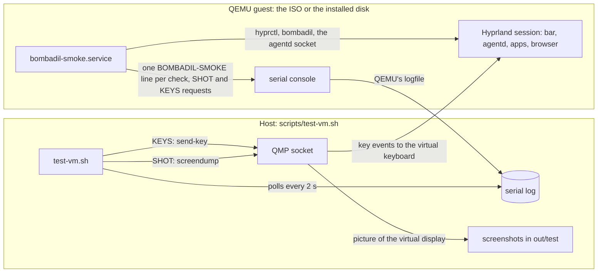
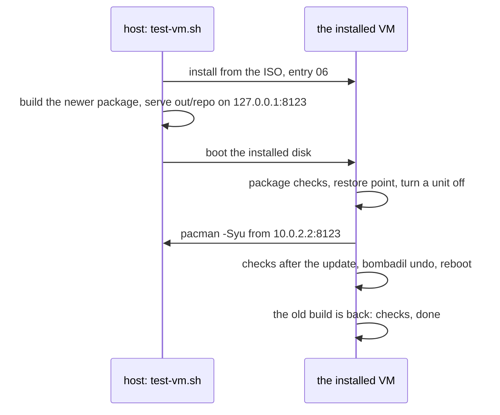

# Testing the whole system in a VM

> **Status:** Shipped
> **Code:** `scripts/test-vm.sh`, `scripts/qmp.py`, `scripts/build-iso.sh`, `scripts/build-package.sh`, `scripts/build-in-container.sh`, `scripts/wsl-vm.sh`, `packaging/bombadil/root/usr/bin/bombadil-smoke`, `packaging/bombadil/root/usr/bin/bombadil-install`, `packaging/bombadil/root/usr/bin/bombadil-rollback`, `packaging/bombadil/root/usr/lib/systemd/system/bombadil-smoke.service`, `iso/efiboot/loader/entries/02-bombadil-serial.conf`, `iso/efiboot/loader/entries/03-bombadil-install-test.conf`, `iso/efiboot/loader/entries/04-bombadil-install-encrypted-test.conf`, `iso/efiboot/loader/entries/05-bombadil-refresh-test.conf`, `iso/efiboot/loader/entries/06-bombadil-install-update-test.conf`, `src/bombadil/fake_signin.py`, `scripts/vm-tools/vmsmoke`, `tests/desktop/idle.py`, `tests/test_iso_profile.py`, `tests/test_installer.py`, `tests/test_boot_console.py`, `tests/test_brain_service.py`, `tests/test_vm_harness.py`
> **Design:** there is no brief for the test layers; [developing and testing](development.md) places this layer among the others
> **Verified:** 2026-11-13 against the merge of `main` (`dbad5ec`) into the installed-OS branch (`ff02c26`), for the modes and host logic of `scripts/test-vm.sh` and `scripts/wsl-vm.sh`, the six boot entries and the build flags that add them, `scripts/build-package.sh`, `scripts/build-in-container.sh`, and the smoke's checks of the package, the update, the layout, the refresh and the homefix steps. All of it was read from the scripts and from the tests that pin them. Run for this check: `tests/test_iso_profile.py` (52 passed), `tests/test_packaging.py` (42) and `tests/test_vm_harness.py` (62 passed and 1 failed, `test_no_file_in_the_repo_names_the_retired_updater`, because other pages still name the deleted updater), and `bash -n` on `scripts/test-vm.sh`, `scripts/wsl-vm.sh`, `scripts/build-package.sh`, `scripts/build-iso.sh`, `scripts/build-in-container.sh`, `bombadil-smoke`, `bombadil-install` and `bombadil-rollback`. No VM was booted and no ISO or package was built, so what a mode does on a disk is what its code and tests say. The page's other claims (the pill shortcuts, Super+Return, the sign-in cancel, the idle cost, the stone's knock and the mail and notification blocks) are `main`'s check of 2026-11-12 at `7d37bc5`: their anchors were moved through the diff and the claims were not read again. The rest was checked on 2026-11-09 against `main` at `ca7f80a` and on 2026-11-08 at `7176e55`.

Unit tests cover the Python and the QML that load without a compositor, and a headless desktop test
(`tests/desktop/run.sh`) drives the bar and the daemon in a sway session against a scripted model
API. Neither can say whether Hyprland focuses the pill, whether the units come back, whether an
install boots. That is the VM smoke test: it boots the real ISO, runs the real session and, in the
install modes, installs it to a scratch disk (with a password, as a refresh of an older system, or to be updated with
a package the host serves) and boots that too, judging each boot from the serial log.

This page covers the host side (`scripts/test-vm.sh`), the protocol between the host and the guest,
what the run covers, the traps and what to do when a check fails. The catalogue of checks is in
[ISO and install](../architecture/iso-and-install.md#the-smoke-test), and the recipe for adding one is
in [Developing and testing](development.md#add-a-smoke-check).

No boot was observed for this page. Every statement comes from reading the scripts and the code they
call, and, for the parts that run in bash without a VM, from the tests that run them. What QEMU, systemd,
systemd-boot and GRUB do with their inputs (QMP's `send-key` and `screendump`, the unit condition matching
`bombadil.smoke=install`, the `Boot in` countdown, the password prompt GRUB prints) is taken from how the
scripts rely on it. The smoke's picture checks (a wait for a calm guest, and a capture asked again with
more time) were checked on 2026-11-09 by running the five tests that exercise the script's `picture()`
function in bash. The coding-sessions checks, the checks of the name and voice card and the 23 checks of the
connection service, the browser service and the notifications were read from the script, which passes `bash
-n`. The modes added on 2026-11-12 (the encrypted install, the refresh, the layout checks, the idle cost) were
read, not run.

## How it fits together



The `bombadil` package carries `bombadil-smoke.service` and `bombadil-smoke`, so the ISO and an installed system both
have them. The unit runs only when the kernel command line has
`bombadil.smoke` (`ConditionKernelCommandLine`, after `greetd.service`; systemd matches the bare word as the
left side of `bombadil.smoke=<mode>` too, which is its behaviour and not shown by a file here). The argument
and its value pick the mode. A plain build has the boot entry `01` only: `scripts/build-iso.sh` deletes
`entries/0[2-9]-*.conf` unless `BOMBADIL_TEST_ENTRIES` is set (`build-iso.sh:13-27`), and its comment says the
test entries (a serial console with the smoke test, and ones that install to `/dev/vda` without asking) are only in
builds made for the VM tests and never in a release. A build made with
`BOMBADIL_TEST_ENTRIES=1` adds `02` to `06`, and it builds the image's package with `BOMBADIL_DEV_SERVER=1`, so the
image's `/etc/pacman.d/bombadil.conf` lists the VM's host as its first server, which `MODE=update` needs; a release
image does not ([the installed OS](../architecture/installed-os.md#repositories)). The modes that run on a disk are set by
the installer into that disk's GRUB defaults.

| Boot | Kernel argument | Mode and what runs |
|---|---|---|
| ISO entry `01-bombadil.conf`, in every build | none | The plain boot. The service does not run. |
| ISO entry `02-bombadil-serial.conf` | `bombadil.smoke` | `live`: the checks, then power off. |
| ISO entry `03-bombadil-install-test.conf` | `bombadil.smoke=install` | `install`: the live checks, then `bombadil-install /dev/vda --yes`, then power off. When the ISO is attached as a USB disk, it first checks that the installer refuses the stick it runs from (`install-refuses-the-stick`). |
| ISO entry `04-bombadil-install-encrypted-test.conf` | `bombadil.smoke=install-encrypted` | `install-encrypted`: the live checks, then it puts a sign-in and two folders in the stick's home folder and runs `bombadil-install --plan` with a name, a time zone, a keyboard and a short carry list, and the password `correct-horse-battery-staple` on file descriptor 3. GRUB is shown on the serial line (`BOMBADIL_INSTALL_GRUB_SERIAL=1`) so that the host can type the password. Then power off. |
| ISO entry `05-bombadil-refresh-test.conf` | `bombadil.smoke=refresh` | `refresh`: on a disk an older Bombadil installed, the live checks, then it plants a marker, a sign-in and a project in the disk's home folder, a hostname and a marker in its system, and runs `bombadil-install --refresh /dev/vda --yes`. Then power off. |
| ISO entry `06-bombadil-install-update-test.conf` | `bombadil.smoke=install-update` | `install-update`: the same as `install`, the live checks, then `bombadil-install /dev/vda --yes`, then power off, except that the system it installs starts as `update` where entry 03's starts as `undo` (`test_entry_06_is_entry_03_with_another_mode_word` keeps the two entries equal in all but that word). |
| the installed disk, after entry 03 or 04 | `bombadil.smoke=undo` | `undo`: the common checks, then the brain checks, the layout checks, a restore point, a change, `bombadil undo` and a reboot; after the reboot the common checks run again and `undo-applied` checks that the change is gone, with two checks of the kernel and the root. The install check writes the argument into the installed disk's GRUB defaults through `BOMBADIL_INSTALL_CMDLINE`. |
| the installed disk, after entry 06 | `bombadil.smoke=update` | `update`: the common checks and the package checks, then a restore point, the update, its checks, `bombadil undo` and a reboot; after the reboot the common checks run again and the second pass checks that the old build is back ([What `update` does](#what-update-does)). The install check writes the argument the same way. |
| the refreshed disk, after entry 05 | `bombadil.smoke=refreshed` | `refreshed`: the common checks, the layout checks and the refresh checks, then `bombadil-rollback refresh` and a reboot, which starts the old system from the same GRUB. The refresh check writes the argument the same way. |

An empty value is printed as `mode=live`. [The boot menu](../architecture/iso-and-install.md#the-boot-menu)
holds the entries and [the smoke test](../architecture/iso-and-install.md#the-smoke-test) the whole
install path as a sequence diagram.

A virtual machine cannot press keys itself, so the guest asks. It prints `KEYS <bootid>-<n> meta_l` (a
tap of Super; `meta_l+esc` is a chord; `b r o w s e r ret` types a word) and the host sends them over
QMP (`scripts/qmp.py`), then the guest checks what happened. The boot id is the first eight characters
of the kernel's boot id. It keeps the numbers of one boot apart from the next, which restarts the count
(the undo round trip reboots). The same holds for pictures: the guest prints `SHOT <name>` and the host
takes a screenshot with QMP `screendump`.

## Running it

```sh
BOMBADIL_TEST_ENTRIES=1 scripts/build-in-container.sh   # an ISO with the test entries, in out/
scripts/test-vm.sh                         # live checks
MODE=install scripts/test-vm.sh            # live checks, install to a scratch disk, boot it, undo
MODE=install-encrypted scripts/test-vm.sh  # the same with a password: typed at GRUB, never asked again after it
MODE=update scripts/test-vm.sh             # install, build a newer package, serve it to the VM, update it there, undo
REUSE_DISK=1 MODE=update scripts/test-vm.sh   # the same on the disk the last MODE=update run left, with no install
MODE=installed scripts/test-vm.sh          # boot the disk the last install run left
OLD_ISO=old.iso MODE=refresh scripts/test-vm.sh   # install with an older ISO, refresh with this one, put the old system back
TIMEOUT=5400 MODE=install scripts/test-vm.sh
```

A plain `scripts/build-in-container.sh` build has no test entries. `test-vm.sh` looks for the text of the entry
its mode needs in the ISO file (`need_entries`) and, when it is not there, prints how to build the ISO and
exits 2, before it boots anything. `live` needs `console=ttyS0,115200 bombadil.smoke`, `install`
`bombadil.smoke=install`, `install-encrypted` `bombadil.smoke=install-encrypted`, and `refresh` needs
`bombadil.smoke=refresh` in the new ISO and `bombadil.smoke=install` in `OLD_ISO`, and `update` needs `bombadil.smoke=install-update`.

| `MODE` | The disk | What boots |
|---|---|---|
| `live` (the default) | none | entry 02 of the ISO, attached as a CD |
| `install` | a new 40 GiB qcow2, `out/test/disk.qcow2`, replaced at each run | entry 03 of the ISO, attached as a USB stick; then the installed disk, which runs the `undo` mode |
| `install-encrypted` | the same | entry 04; then the installed disk, where the host types the password at GRUB's prompt each time it shows |
| `refresh` | the same | entry 03 of `OLD_ISO` as a CD, which installs the older system; entry 05 of the ISO as a USB stick, which refreshes the disk; then the disk, which checks the refreshed system, puts the old one back and restarts into it |
| `update` | the same, replaced at each run unless `REUSE_DISK=1` | entry 06 of the ISO as a USB stick, which installs; then the host builds a newer package and serves it, and the installed disk boots, updates from it, undoes the update and restarts. `REUSE_DISK=1` skips the install and the stick and boots the disk an earlier update run left |
| `installed` | the disk the last install run left | the installed disk |
| anything else | none | the run stops with exit 2 and `unknown MODE=<value>` |

`MODE=installed` boots `out/test/disk.qcow2` again without installing; it exits 2 when there is none
(`no <repo>/out/test/disk.qcow2: run MODE=install or MODE=install-encrypted first`, where `<repo>` is the
absolute path of the checkout: the script builds it from its own location). It reads the log the previous
boot left (`installed-first.serial.log`) to see whether GRUB asked for a password, and types it again if it
did. After an undo round trip that was cut short (the emulator died as the guest rebooted) it is the second
boot: the guest keeps `~/.bombadil-smoke-phase`, the second boot checks `undo-applied` and removes the file.
After a round trip that finished there is no phase file, so the boot runs the whole first pass again (the
checks, a restore point, the undo, the reboot) and then the second.

What the host needs:

| Need | Notes |
|---|---|
| `qemu-system-x86_64` | KVM is used when `/dev/kvm` is writable; otherwise software emulation. |
| `qemu-img` | The install modes only: it creates the 40 GiB qcow2 disk. |
| 8 GiB of memory to give the guest | The guest gets 8 GiB in every mode but `live` (4 GiB). |
| an OVMF firmware file | One of `/usr/share/edk2/x64/OVMF_CODE.4m.fd`, `/usr/share/edk2/x64/OVMF.4m.fd`, `/usr/share/OVMF/OVMF_CODE_4M.fd` or `/usr/share/OVMF/OVMF_CODE.fd` (`edk2-ovmf` on Arch, `ovmf` on Debian and Ubuntu). When the matching variables file is beside it (`OVMF_VARS...`), it is used too. |
| `python3` | For `scripts/qmp.py`. |
| an ISO | The newest `out/*.iso`, or `ISO`. The lookup runs in every mode, so `MODE=installed` with no ISO in `out/` and no `ISO` stops before it boots anything. |
| a second, older ISO | `MODE=refresh` only: `OLD_ISO`, an ISO built before this disk layout, with its install test entry. |
| Docker or Podman, and port 8123 on the host | `MODE=update` only (`REUSE_DISK=1` skips only the install): the newer package is built every run in the same kind of container as the ISO (`scripts/build-in-container.sh package`, into `out/repo`), and `python3 -m http.server` serves it on `127.0.0.1:8123` while the VM runs. The host stops the run before the VM starts when the server does not answer there, so a port that is taken fails here and not as a guest that talks to something else |

| Variable | Default | Meaning |
|---|---|---|
| `MODE` | `live` | `live`, `install`, `install-encrypted`, `refresh`, `update` or `installed`. Any other value exits 2. |
| `ISO` | newest `out/*.iso` | The image to boot. |
| `REUSE_DISK` | unset | `MODE=update` only: any non-empty value skips the install and boots `out/test/disk.qcow2` as an earlier `MODE=update` run left it (exit 2 when there is none). |
| `OLD_ISO` | none | `MODE=refresh` only, and required there: the ISO that installs the older system. The run stops with `MODE=refresh needs OLD_ISO` (exit 1) without it. |
| `TIMEOUT` | `2400` | Seconds per boot, not per run: the install modes boot more than once. |
| `QEMU_CPU` | `Nehalem` | The CPU under software emulation; ignored with KVM. |
| `VNC` | `127.0.0.1:99` | The VNC display QEMU offers, to watch a run. |
| `RAM` | `4G` for `live`, `8G` otherwise | The guest's memory. The script sets `4G` itself for the CD that boots `OLD_ISO`. |

The guest gets one virtual CPU per host CPU, a virtio GPU, a virtio mouse, an Intel HDA sound card with no host
audio behind it, user-mode networking (so whether it has internet depends on the host) and, by default, a
virtio keyboard. The firmware is a read-only code image. Where the host has the matching variables file, the
script copies it to `out/test/OVMF_VARS.fd` once per run and attaches it writable, so that the boot entry GRUB
makes stays for the later boots of that run. In the install modes the 40 GiB disk is a virtio disk, seen as
`/dev/vda`.

The ISO reaches the guest in one of two ways. In `live`, and for `OLD_ISO`, it is a CD. Otherwise it is a USB
disk behind an xHCI controller (`stick_for`), booted first, and with 8 GiB the script's comment says the image is
copied into RAM and the stick is no longer mounted, which is how the installer meets a real stick. The older
installer took its kernel from the stick's own mount, which copying to RAM removes, so `OLD_ISO` is given as a CD
with 4 GiB. On the encrypted disk the keyboard is a USB one (`-device qemu-xhci -device usb-kbd`), because the
firmware does not see a virtio keyboard and GRUB's password prompt is typed on it.

The host picks the boot entry itself. It waits up to 120 seconds for systemd-boot's countdown (`Boot in`) on the
serial log, then presses Down over QMP `MENU_DOWN` times and Enter: once for the live mode (entry 02), twice for
install (entry 03, and for `OLD_ISO`), three times for the encrypted install (entry 04), four times for the
refresh (entry 05) and five times for the install that is updated (entry 06). The order is the entries' `sort-key`. For a disk it presses nothing, because GRUB's menu is
hidden there. On the encrypted disk it types the password, `correct-horse-battery-staple` and Enter, three seconds
after `Enter passphrase` shows on the serial log, once for every time the prompt has shown: the installed system
restarts itself once (the undo applies on boot), and GRUB asks again (`TYPE_WHEN`, `seen > typed`). After
that, nothing may ask again: a second prompt, `Please enter passphrase` or `Enter passphrase for /dev`, fails the
run.

Files in `out/test/`, where `<boot>` is `live`, `live-install`, `installed`, or for a refresh `old-install`,
`refresh` and `refreshed`:

| File | Holds |
|---|---|
| `<boot>.serial.log` | The whole serial console of the boot. For the installed disk it holds both passes of the undo round trip, because the reboot happens inside one QEMU process; for `refreshed` it holds the refreshed system and then the old one it put back. |
| `<boot>-<name>.png` | The screenshot for `SHOT <name>`, with the raw `<boot>-<name>.png.ppm` beside it. |
| `<boot>-last.png` | The screen when the boot ended. It is not taken when QEMU has already exited (the call's errors are ignored). |
| `<boot>.keys.<bootid>-<n>` | An empty marker for each key request already sent. |
| `<boot>.qmp.sock`, `<boot>.serial.sock` | QEMU's QMP and serial sockets. |
| `disk.qcow2` | The scratch disk. `install`, `install-encrypted`, `refresh` and `update` delete it and create it again (`update` with `REUSE_DISK=1` keeps it). |
| `update-server.log` | The log of the small web server that serves `out/repo` to an update run. |
| `OVMF_VARS.fd` | The firmware's variables for the run, when the host has the file to copy. |
| `installed-first.serial.log` | The log the previous `installed` boot left, copied by `MODE=installed` before it starts the next boot. |

A boot empties its own serial log and removes its earlier key markers, screenshots and QMP socket when
it starts. It removes screenshots by the pattern `<boot>-*.png`, which for `live` also matches the
`live-install-*.png` pictures, so a live run deletes the pictures of the last install run's first boot.

The exit status:

| Exit | When |
|---|---|
| 0 | Each log has a `DONE pass=<n> fail=0` line, no log has a `FAIL` line, the first log has no `SKIP signin` line, and in an install mode the first log has `PASS install` (or `PASS install-encrypted`), anchored at the end of the line because a serial console ends its lines with a carriage return. The encrypted run also needs GRUB to have asked for the password and nothing to have asked again. |
| 0, for `update` | The install log has `PASS install` (not read with `REUSE_DISK=1`), the first boot of the installed system ended in `REBOOT pass=<n> fail=0`, and each log read has `DONE pass=<n> fail=0` and no `FAIL` line. The only boot that has a `DONE` is the second one, so a failure in the first shows through the `REBOOT` line. The `SKIP signin` rule is the same as for `install`. |
| 0, for `refresh` | The old install and the refresh logs have `DONE` with `fail=0`, the refreshed log has `REBOOT pass=<n> fail=0`, none of the three has a `FAIL`, and the old system started again (`PASS hyprland-running` after the `REBOOT` line, with none of the refreshed system's `layout-` or `refresh-` checks in it). This mode does not look for `SKIP signin`. |
| 1 | Any of those is not met, including a boot that ran to the timeout without a `DONE` line. In an install mode a first boot without its `PASS` line ends the run before the installed disk boots (in `update` this is also true of a first boot of the installed system that did not end in `REBOOT pass=<n> fail=0`); in `refresh`, so does an `OLD_ISO` that did not install and a refresh without `PASS refresh-runs`. `MODE=refresh` with no `OLD_ISO` also exits 1. |
| 2 | No OVMF file is found, `MODE` is not one of the six, `MODE=installed` finds no `out/test/disk.qcow2` (so does `REUSE_DISK=1`), there is no ISO to boot, or the ISO has no boot entry for the mode (`need_entries`). In `update` also: the build of the newer package left no repository, or the server did not come up on `127.0.0.1:8123`. |

## What each mode proves

Every VM start runs the live checks below (`live` and `install` add the sign-in block to them) and the
`package-*` checks, so the stick and an installed system are both held to the same facts about the package.

| mode | what runs | what it proves | VM boots |
| --- | --- | --- | --- |
| *(none)* | live checks | the session, the bar, the apps, the pill and the package on the stick | one |
| `install` | live checks, `bombadil-install`, then the installed disk with `undo` | the install boots, has the layout, and an undo takes a change back across a reboot | two, and the second one starts twice |
| `install-encrypted` | the installer with a password, then the disk | GRUB asks for the password once and nothing asks again | two |
| `refresh` | an older ISO installs, this ISO refreshes the disk, the disk starts | the refresh keeps the home folder, the sign-in and the computer's name, keeps the old system aside, and puts it back; the home folder's old `hyprland.lua` is split (below) | three, and the last one starts twice |
| `update` | the install of `install-update`, a newer package served by the host, then the disk with `update` | pacman updates Bombadil, nothing it should keep is lost, and an undo brings the old build back | two, and the second one starts twice |
| `installed` | the disk an earlier run left | its second boot again, at the password prompt too | one |

Each boot is held to `TIMEOUT` seconds (2400 unless set; 5400 in the install example above), not the whole run. Without
KVM every start is slow, and a mode that boots more than once takes the sum of its boots: no duration is promised here.

### The config split in `refresh`

The old system's home folder holds the old `hyprland.lua`, with Bombadil's part and the person's lines together. Before
the refresh the smoke adds a line of the person's own to it (`hl.bind("SUPER + F9", ...)`), and changes
`rounding = 12,` to `rounding = 5,` inside the old file's `hl.config` call. The refreshed system's agentd then runs its
home fix (a moment after login), and the smoke waits up to 90 s for the result: `hyprland.lua` starts with the stub that
`/etc/skel` has, `hyprland.lua.before-split` holds the old file with the planted line, the planted line is still in
`hyprland.lua`, `~/.local/state/bombadil/home.json` records step 1, Hyprland reports no config errors and the sign-in
marker is as it was. Three more checks are about the changed value:

- `refresh-homefix-carried-the-persons-config-value`: the new file has `hl.config({` and `rounding = 5,` as code, not as
  a comment.
- `refresh-homefix-hypr-reloads`: the smoke runs `hyprctl reload` itself, because the old file already had the 5 when
  Hyprland first started, before the rewrite.
- `refresh-homefix-hypr-has-the-persons-config-value`: `decoration:rounding` is 5 and `decoration:blur:size` is still
  Bombadil's 6, which shows that a second `hl.config` call merges with the first and does not replace it.

When the old system comes back after the undo, `test-vm.sh` waits for its bar and requires its config check to pass: that
system has no Bombadil part, so the home's stub has to fall back to the old file, and this shows it does on a real
Hyprland. When the branch that made the package was last written up, the three checks above had passed in a real VM run
with the old image from before the package, and the fallback check was added after that run and had not run yet.

### What `update` does

The first boot of the installed system runs the live checks and the `package-*` checks, writes down the version, takes a
restore point, turns one user unit off (`bombadil-mail`), and runs `pacman -Syu` against a pacman.conf of its own that has
the real `[options]` and only `[bombadil]` (the VM has no route to the Arch mirrors). The host serves the newer build on
`127.0.0.1:8123`, which the guest sees as `10.0.2.2:8123`, the first server in `/etc/pacman.d/bombadil.conf` on a test
build. That line is in the file of a package built with `BOMBADIL_DEV_SERVER=1` only: the test ISO has it because
`build-iso.sh` implies the switch from `BOMBADIL_TEST_ENTRIES`, and `test-vm.sh` sets it for the newer package, so pacman
does not replace the unmodified file on the disk with one that lacks the line. A release image has no such line.
Afterwards the smoke checks that the version changed to the served build (its commit ends in `+update`), that pacman still
owns the package's files and finds none missing, that `/usr/bin/agentd` is still a link, that the migrate log has no
`FAILED` line from this update, that Hyprland runs without config errors and the bar answers, that the package's units are
still enabled, that the ledger of enabled units is unchanged and that the unit it turned off is still off. Then
`bombadil undo` and a reboot. The second boot checks that the old version, the old package, the stub in the home folder
and the bar are back.



`MODE=update` is tested here only against stand-ins for QEMU, the container runtime and the guest's commands
(`tests/test_vm_harness.py`); when the page was written, a run in a real VM had not been done.

**`REUSE_DISK=1`** skips the install and the live run and boots the disk an earlier `MODE=update` run left: the undo at
the end of a run puts the installed system back as it was, so the disk is ready for the next update (the host builds a
fresh package every time). A disk left halfway (the VM was stopped between the update and the reboot) is a system that
has the update: put it right with `MODE=installed`, or install again.

## The serial protocol

The guest prints lines that start with `BOMBADIL-SMOKE: ` to `/dev/console`, which is the serial port
when the kernel has one. The host reads the log every two seconds, answers a `SHOT` name once and a
`KEYS` number once, and stops when a `DONE` line shows.

| Line | Meaning | Host action |
|---|---|---|
| `START mode=<mode>` | A run begins. The mode is the value of `bombadil.smoke` (`install`, `install-encrypted`, `refresh`, `install-update`, `undo`, `update`, `refreshed`), or `live` when it is empty. | none |
| `PASS <name>` | A check passed. | none |
| `FAIL <name>: <tail>` | A check failed. The tail is the last 300 bytes of its output, with newlines turned into spaces. | none |
| `SHOT <name>` | The guest wants a picture, then sleeps `SHOT_WAIT` seconds (8 by default). | A screenshot to `out/test/<boot>-<name>.png`, once per name, so the second pass of the undo round trip takes none of the shots whose names the first pass used. The name matches `[a-z0-9-]*`. Nothing reads the picture; it is for the person who opens it. |
| `KEYS <bootid>-<n> <qcode>...` | The guest wants these keys pressed, then sleeps `KEYS_WAIT` seconds (8 by default). | One QMP `send-key` per word, once per `<bootid>-<n>`. A `+` joins keys pressed together. |
| `NOTE <text>` | The machine was still busy when the keys went in, when the pictures were taken or when the idle cost was measured. After the `idle-cpu` check, passing or failing, one `NOTE` line also holds that check's whole output with its newlines turned into spaces: the three slices, `middle slice <n> (limit <n>)` and, when one did not run, `not running: <names>`. | none |
| `DIAG <text>` | What the machine looked like when something went wrong: after each of the first four `FAIL` lines, two lines `DIAG <name> windows:` and `DIAG <name> programs:`, and the cases under [When a check fails](#when-a-check-fails). | none |
| `AGENTD-LOG: <line>`, `MAIL-LOG: <line>` | The last 60 lines of `/tmp/smoke.agentd.log`, printed at the end of the sign-in block, and the last 30 of `/tmp/smoke.mail.log`, printed at the end of the mail block. Each appears in a passing run of the modes that run its block: `MAIL-LOG:` in every mode but `undo`, `AGENTD-LOG:` in `live` and `install`. `AGENTD-LOG:` is printed again when `signin-page-again` fails. | none |
| `SKIP signin: <reason>` | The sign-in checks did not run. It is printed in the `live` and `install` modes only, the ones that run those checks. | The run exits 1 when this is in the first log, except in `refresh`, which does not look. |
| `REBOOT pass=<n> fail=<m>` | The first pass of the `undo` mode ends and the guest reboots; so does the `update` mode, after its `bombadil undo`, and the `refreshed` mode, after `bombadil-rollback refresh`. There is no `DONE` yet. | none, except in `refresh`: the host stops the VM when `PASS hyprland-running` shows after this line (`STOP=1`), and does not wait for it to power off. |
| `DONE pass=<n> fail=<m>` | The run ends and the guest powers off. | The host stops polling, takes `<boot>-last.png` and waits for QEMU to exit. |

Without a host that answers, `shot` and `keys` only sleep, and the checks that depend on key presses
fail. `BOMBADIL_SMOKE_NO_POWEROFF`, set to any non-empty value in the guest, stops the final power off
and the reboot. `test-vm.sh` does not set it; `scripts/vm-tools/vmsmoke` does, to run the smoke in a VM
that stays up.

## What it covers

Every mode runs the common checks. The catalogue, with every check name, is in
[ISO and install](../architecture/iso-and-install.md#the-smoke-test); this is what the groups prove.

- **The image.** The user exists, the programs are on `PATH` (`tools-installed` passes when any one of
  its names is found, so the brain's two programs, Mail's three and the connection service's four are looked for
  one by one), PySide6
  imports, the mirror list has a `Server =` line, both provider CLIs answer `--version`, and the
  os-mcp tool list names `show_panel` and `system_map`.
- **The session.** `greetd`, Hyprland, the bar's `bombadil-bar` layer and `agentd` run, Hyprland
  reports no config errors, a `Virtual-` display is not narrower than 1280 px (it fails below that),
  and the sound output is a real sink, not PipeWire's dummy.
- **The two user services.** `bombadil-agentd` and `bombadil-shell` each come back as a
  different process after `kill -9`, and both are active units ([the session
  services](../architecture/session-services.md)). The image has no notification daemon: the notifications
  checks below look for one.
- **Panels and apps.** The browser panel slides in (`browser-window` and `browser-shown` read
  Hyprland). The hide steps (`browser-hide`, `browser-hide-again`, `browser-hide-third` and
  `mail-engine-browser-hide`) prove only that `hide_panel` returns without `"isError": true`; no check
  reads Hyprland to see the panel go. `create_app` opens apps each in its own drawer, `app-hide` is
  read back from Hyprland, the skills are installed for both CLIs, and the example apps open.
- **Pictures.** `system_map` captures network, boot, disks, sound, screens and one service from this
  machine, and agentd answers that a client besides the caller was there to draw each (the reply says
  `shown above the bar`). The boot picture must hold at least three timed lines. On a guest without KVM
  the smoke waits for the guest to be calm first and asks a capture that gave up again with more time
  (see [Traps](#traps)).
- **The pill.** Hyprland lists the bar's two global shortcuts (`pill-shortcuts-registered`, waited for up to 60
  seconds: Hyprland does nothing, and says nothing, for a shortcut nobody registered), then a Super tap and
  Alt+Space give the pill the keyboard, a launcher word runs without a model, a `!` turn runs and Super+Esc stops
  it and says so in the history. When the tap does nothing, the log says whether the bind or the pill failed
  (see [When a check fails](#when-a-check-fails)).
- **The terminal key.** With the browser's drawer showing, Super+Return opens a `foot` window that is not on a
  special workspace (`super-return-terminal`) and puts the drawer away (`super-return-puts-the-drawer-away`): a
  window that opens while a drawer shows lands inside it and leaves with it.
- **The details drawer.** It takes the keyboard and every way out closes it. The message a click on
  a service in a picture sends (`open-unit`) opens the unit in the same drawer.
- **Coding sessions**, in every mode, `undo` included. `zellij`, `foot`, `footclient` and `bombadil-signal` are
  looked for on `PATH` (`dev-tools`, which like `tools-installed` passes when any one of them is found), Claude
  Code's managed hook file and Codex's `requirements.toml` parse (`dev-hooks-parse`; `/etc/codex/config.toml` is not
  read) and lingering is on for the user
  (`dev-linger`: `bombadil-live.service` turns it on for the live image and the package's `tmpfiles.d` line for the
  installed one). The smoke makes `~/Projects/smoke`, a folder with one commit (`dev-project`), and the word
  `shell smoke` starts a shell session on it (`dev-start`) in a zellij session, a systemd scope and a slice of
  its own (`dev-zellij`, `dev-scope`, `dev-slice`). Its viewer window, of class `bombadil-session-smoke-shell`,
  floats and is at least 70% as wide as the screen (`dev-window`, `dev-window-size`, and a `SHOT session`).
  Closing the window leaves the session running, and its name brings it back in a new window
  (`dev-close-window` to `dev-window-again`). `end shell smoke` ends the session and its scope, and the
  history says so (`dev-end`, `dev-ended`, `dev-scope-gone`, `dev-in-history`). The session is a shell, so no
  provider login and no model are involved, and the hooks of Claude Code and Codex run nothing here: only the two
  files named above are parsed.
- **Mail.** In every mode, `undo` and `update` included, Thunderbird answers `--version`, the unit is enabled and
  active, and its service answers on its socket. In every mode but `undo` and `update`, windows that carry
  Thunderbird's class stay on `special:mail-engine` without taking the keyboard, the service runs on
  its fake engine, a mail that arrives becomes a notice on the line, the word `mail` opens the Mail
  window, and the unit is put back (`mail-unit-restored`). The setup line owns the pill's line until an AI is
  signed in, and a notice waits behind it, so `agentd` is first started on the stand-in provider
  (`mail-agentd-signed-in`) and the unit's own `agentd` is put back at the end (`mail-agentd-unit-again`).
- **Connections and notifications**, 23 checks that [Connect](../architecture/connect.md) owns and [ISO and
  install](../architecture/iso-and-install.md#the-smoke-test) lists. In every mode, `undo` and `update` included: the
  commands, the Python libraries and the skill are on the image and `mako` is not; the connection service's account
  exists with no login, its system unit is enabled and active, the loaded unit has the sandbox its file asks for,
  and the service answers the person's own process on its socket; the state directory is its account's, mode 0700,
  and the person's own `ls` of it fails (the directory's mode, not a wall: the person has `sudo`); the browser
  service's user unit is enabled and active and answers on its socket. In every mode but `undo` and `update`: no `mako` runs, the
  owner of the session bus's notification name is the shell, and a `notify-send` notification, standing in for a web
  page's, becomes a notice on the line with actions (as with mail, `agentd` runs on the stand-in provider for
  that, `notification-agentd-signed-in`, and the unit's own is put back, `notification-agentd-unit-again`). The
  live image has no connection and no account, so the
  service is then put on its fake engine through a drop-in, answers `status`, `connections` and `messages`, and the
  unit is put back (`connect-unit-restored`). No real Slack or work tool is reached, and no key is held.
- **Sign-in**, in the `live` and `install` modes only, when no provider is chosen. The modes that plant a
  sign-in of their own (`install-encrypted`, `refresh`) and the ones that run on a disk do not run it. The real
  Codex and Claude pages are opened in the browser panel (or the offline line shows when the VM has no internet)
  and cancelled, with a check that cancelling Codex frees port 1455. Cancelling a login puts its page away: no tab is
  left on the login address, another tab takes its place, the browser window stays, and the login program has
  ended (`signin-page-put-away`, `signin-a-tab-stays`, `signin-browser-stays`, `signin-cli-ended`). The browser's
  last tab is never closed, because that would quit it and leave the panel waiting for a window. The stand-in login
  (`src/bombadil/fake_signin.py`, chosen with `BOMBADIL_PROVIDER=fake`) then covers the round trip, a
  pasted code, a slid-out panel, a closed browser, a timeout, and no internet followed by internet.
  The block deletes the provider choice at its end and starts and cancels real logins (a Codex login
  revokes the stored one), so it is gated on `~/.config/bombadil/config.toml`, which is what
  `config.Config.configured` reads. When the file exists the smoke prints `SKIP signin`, and the host
  fails a run whose first log has it (not in `refresh`).
- **The name and voice card**, inside the sign-in block and so under the same gate, before the first real
  login. With no `~/.config/bombadil/persona.toml` yet (`no-persona-before-voice`; the smoke removes the file
  just before the sign-in block, see [Traps](#traps)), a stand-in sign-in that
  turns ready makes the first-run card appear in place of the "Signed in" line (`voice-signin`,
  `voice-card-asked`: the daemon writes `voice = "merry"` into `persona.toml` when it asks, and
  `voice-panel-away` waits for the browser panel to go). The card is photographed twice, a few seconds apart
  (`SHOT voice-card` and `SHOT voice-card-settled`), so a person can see that it is whole and no longer
  growing. The smoke types a name and Enter over QMP and reads the name back from `persona.toml`
  (`voice-name-saved`, `voice-default-merry`), asks for the pill, and types the word `voice`: the history
  must hold `voice: Opened the voice card` (`voice-word-answered`, with `SHOT voice-saved` and `SHOT
  voice-word` around them). It then deletes the stand-in's marker and `config.toml` and restarts the daemon
  with no stand-in environment (`voice-agentd-restored`), so the real logins that follow start from a system
  with no provider chosen. Eight checks and four pictures.
- **What it costs left alone**, in every mode, after the checks above and before the installer or the installed
  disk's own checks. `idle-cpu` waits up to 240 seconds for a calm guest and then 30 seconds more, and samples
  Hyprland, the bar (`quickshell`), the daemon and the brain in three slices of `IDLE_CPU_SECONDS` (10) seconds,
  as a share of one core. The check adds the four up for each slice, sorts the three totals and takes the median
  (the script's own name for it is "the middle slice"); the median must be under `IDLE_CPU_LIMIT` (30 percent), and
  Hyprland and the bar must be running. The median is what counts: a need that stands for the person
  plays the stone's knock for 9.6 seconds when it appears and then one beat every five minutes (`cueMs` and
  `remindMs` in `share/qml/Bombadil/Stone.qml`), which a software compositor pays for in a slice of its own,
  where a loop that never ends is in every slice. The check's output, all three slices and the median, is printed
  as one `NOTE` line, passing or failing. The limit is for this VM, where Hyprland draws in software under TCG; the
  headless desktop test (`tests/desktop/idle.py`) holds the bar, the daemon and the brain together to 10 percent of
  a core and the bar to a rate of committed frames (the `commit` requests on its Wayland connection),
  and [the idle cost](../IDLE-COST.md) has what each regression looked like. A bar that redraws without end
  makes Hyprland draw without end too, so this is where the whole of it shows.
- **The package**, in every mode (the `package-*` checks, which `update` runs again after the update as `update-*`). `pacman -Qo` says `bombadil`
  owns the commands, the user unit, the sudoers file and the skeleton's `hyprland.lua`, `pacman -Qk` finds no missing
  file, `/usr/bin/agentd` is a link, nothing named `bombadil*` is loose in the local bin directory, `bombadil version`
  prints its line, `[bombadil]` is above `[core]` in `pacman.conf` and lists the image's repository copy as a server, that copy is
  readable by everyone, and no file under `/etc` names the build directory. The six units the
  package turns on are in the ledger and enabled (the two that Hyprland starts read `static`), greetd runs the config the
  package owns, os-release has `LOGO=bombadil`, `/etc/environment` points `BROWSER` at `/usr/bin`, the sudoers file is mode
  0440, and the home's `hyprland.lua` loads Bombadil's part, Hyprland has its binds and reports no config errors.
- **The installer**, in the install modes. In `install`, `bombadil-install /dev/vda --yes` finishes, after
  `install-refuses-the-stick` when the ISO is a USB disk: the installer must refuse the stick it runs from. In
  `install-encrypted` the guest first checks that it booted in UEFI (`booted-in-uefi`), then the installer takes a
  plan and a password: GRUB asks for the password once at every start, and nothing asks again. In `refresh`, an
  older Bombadil installs first, `refresh-plant` puts the marker, the sign-in and the project in its home folder,
  and then `bombadil-install --refresh
  /dev/vda --yes` replaces its system under the home folder that is there, with a stick sign-in that must not
  replace the home's. `refresh-runs` passes, and the refreshed system then checks, in `refreshed`, that the home
  folder, the sign-in, the computer's name and the home's ownership were kept (`refresh-kept-the-home-folder`,
  `refresh-kept-the-sign-in`, `refresh-home-is-the-users`, `refresh-kept-the-computer-name`), that it is the new
  system (`refresh-is-the-new-system`), that the old one is aside (`refresh-old-system-kept`) and named in the
  record (`refresh-record`), and that `snapper -c home list` works (`refresh-home-restore-points`). The home fix that agentd runs on the refreshed system is checked too
  ([The config split in `refresh`](#the-config-split-in-refresh)).
- **The layout of an installed disk**, in the first pass of the `undo` boot (after `install` and after
  `install-encrypted`) and in `refreshed` (`layout_checks`): layout 1 in `/var/lib/bombadil/install.json`; `@`, `@home`, `@snapshots`, `@log` and `@pkg` mounted by subvolume
  name, the EFI partition at `/efi`, the kernel and the initramfs in the root's own `/boot` with no `/boot` mount,
  GRUB on the EFI partition reading `/@/boot/vmlinuz-linux`, the snapper configs `root` and `home` and the limit
  of 30 on `root`, five of the nested subvolumes in the home folder, time sync enabled and the linger file (`layout-linger`). With a password it also checks LUKS2, three
  ways to open the disk, the key file in the initramfs, the recovery key waiting with mode 0600, the record, the
  chosen name and what the plan carried over and left behind. [Restore points](../architecture/restore-points.md)
  has what the layout is for.
- **The installed disk**, in the `undo` mode: the brain (the watcher and the service, a file a turn writes is
  named as the machine's and one the person writes as theirs, a rename keeps the thing, the Brain window opens),
  the hidden GRUB menu, snapper available, a restore point created that holds a kernel of its own
  (`restore-point-has-a-kernel`) and is filed under snapper's `number` cleanup class so it may be pruned, the
  installed snapper config keeping 30 and taking no hourly ones with `snapper-cleanup.timer` enabled, an undo
  across a reboot, and after it `undo-applied`, `undo-kernel-matches-modules` (the kernel that started has a
  module folder, and `modinfo` finds btrfs in it) and `undo-layout-kept` (the root is still `subvol=/@` and `/boot`
  still has the kernel). It never runs a cleanup or sees a restore point removed, so pruning itself is not exercised.
- **Updating the package**, in the `update` mode: the checks in [What `update` does](#what-update-does).
- **Undoing a refresh**, in the `refreshed` mode: `bombadil-rollback refresh` puts the old system and its restore
  points back (`refresh-undo`), the guest reboots, and the host waits for the old system's own session to come
  up. The refreshed system's checks must not show again, or the undo did not take.

## Traps

- **Software emulation is slower, and load shows.** Without KVM the guest runs under QEMU's software
  emulation, and it shares the host's CPUs (one virtual CPU per host CPU), so anything else running
  on the host (a unit-test run, a second VM, a build) slows it. An app that is still starting can make
  the handover from a Super tap to the pill take longer than the check waits. Before the Super tap, the
  Alt+Space tap and the Super+Return key the smoke waits up to 240 seconds for the guest's one-minute load
  average to fall below 1.5, and prints `NOTE the machine was still busy when the keys went in` if it did not.
  It waits the same way before it measures the idle cost (`NOTE the machine was still busy when the idle cost
  was measured`). The other key requests have no such wait. A picture capture can run out of its time too: it
  is given half a second (`BUDGET` in `src/bombadil/sysmap.py`), and the smoke's own comment gives 6 to 10 seconds
  for `ip` or `systemd-analyze` while the guest is still starting things. So the smoke waits up to 240
  seconds for calm once before its first picture check (`NOTE the machine was still busy when the
  pictures were taken` if it did not come), and a reply that says `Could not read` is asked again, up to
  three tries in all, after a wait of up to 90 seconds for calm. The tries ask for 1, 4 and 12 times the
  usual time: the smoke sets `BOMBADIL_BUDGET_SCALE` for each one and the capture code reads it. A reply
  in any other wrong shape fails at once, with no second try. The log line of each try carries its number
  and scale (`try 2, 4x the time`) and how long it took, so a slow capture on real hardware is still
  visible. Run nothing else while a VM run is in progress.
- **The CPU depends on KVM.** With `/dev/kvm` writable the script uses `-enable-kvm -cpu host`. Without
  it, it emulates `Nehalem` (override with `QEMU_CPU`), because Mesa's software GL (llvmpipe) crashed
  on the AVX2 that QEMU emulates, in Hyprland and in Quickshell's renderer.
- **The pill is a layer surface.** It sits in the `bombadil-bar` layer (`shell/shell.qml`), so
  `hyprctl activewindow` cannot say whether it holds the keyboard. The smoke types a launcher word over
  QMP and reads `bombadil history` for its line (`launcher_ran`); the details drawer, which is a window,
  is judged with `active_is`.
- **`bombadil history` waits for a key when its input is a terminal** (`watch.wait_for_key`, and
  `bombadil watch` does the same). The smoke runs `history` from a service that has no terminal, and
  `launcher_ran` also closes the input (`</dev/null`) when it prints the history for a failure. A
  check you add that runs either command needs the same care.
- **Replacing the daemon means replacing its unit.** The daemon is a user service that systemd starts
  again when it is killed, so the smoke stops the unit first, starts its own daemon with the
  environment a check needs, and starts the unit again afterwards (`agentd-restored`). Mail's unit
  gets the same treatment (`fake_mail` and `restore_mail`). So does the connection service's, through a drop-in
  instead: `fake_connect` writes `/run/systemd/system/bombadil-connect.service.d/fake.conf` (the fake engine and a
  scratch state folder, `/var/lib/bombadil-connect/smoke-fake`), reloads systemd and restarts the unit, and
  `restore_connect` removes both and restarts it (`connect-unit-restored`). A run that stops between the two leaves
  the unit on the fake engine until the drop-in is removed or the guest restarts, and in a VM kept up with `vmsmoke`
  that is a service that answers with sample messages.
- **Keys are QMP `send-key`.** `scripts/qmp.py` sends one `send-key` command per word, with one
  `qcode` per part of a `+` chord, so a chord is pressed together. The words are QEMU's key names
  (`meta_l`, `alt+spc`, `ret`, `esc`).
- **A timeout does not stop QEMU.** When a boot reaches `TIMEOUT` the host prints `<boot>: timed out
  after <n>s`, stops answering `SHOT` and `KEYS`, takes the last screenshot and then waits for QEMU to
  exit by itself (`scripts/test-vm.sh`, `wait $pid`). A guest that never powers off keeps the script
  waiting; stop QEMU by hand. The same wait follows `DONE`, so a guest that does not power off after
  it (one with `BOMBADIL_SMOKE_NO_POWEROFF` set, for example) leaves the script waiting too.
- **The voice checks leave `persona.toml` behind, and the smoke clears it before them.** The voice block
  removes the stand-in's marker and `config.toml` but not `~/.config/bombadil/persona.toml`, which holds the
  name the smoke typed. A sign-in that turns ready with no `persona.toml` puts the first-run card up and writes
  the file, and the mail and notification blocks sign in on the stand-in before the voice block does. So the
  smoke removes the file itself: `forget_persona` (`bombadil-smoke:359`) runs in every mode but `undo` and `update`, after
  the notification checks and before the sign-in block (`bombadil-smoke:562`), and `no-persona-before-voice`
  does not fail on a second run in a VM that stays up (`vmsmoke`). What stays: in `install` the installer
  carries `~/.config/bombadil` to the disk (it is on `install/carry.list`, and on the encrypted plan's own
  list), so the installed system starts with the name the smoke typed and the voice card does not ask again
  there. Read from the scripts, not seen in a VM.
- **The installed disk is a smoke disk.** The install checks (`install` and `install-encrypted`) put `bombadil.smoke=undo`, and the one
  that entry 06 runs `bombadil.smoke=update`, into the GRUB
  defaults of the disk they install, `out/test/disk.qcow2`, so every boot of that disk runs the smoke's
  undo mode: a first pass that reboots, or a second pass that powers off. The refresh check puts
  `bombadil.smoke=refreshed` there, so a refreshed disk runs the `refreshed` mode on every boot, and, after the
  undo, the old system starts with that argument on the same GRUB. Use the disk for the test
  only. `scripts/run-vm.sh --installed` boots a different file, `out/bombadil.qcow2`, and
  `scripts/wsl-vm.sh` installs that one with `BOMBADIL_INSTALL_CMDLINE` set to the console arguments
  alone (and `BOMBADIL_INSTALL_LEAVE_MOUNTED=1`, so that the new system stays mounted for the script to add its
  monitor line before it unmounts). It would run the undo mode only if it was installed through entry 03 or 04
  or is a copy of the test disk. `wsl-vm.sh` builds its ISO with `BOMBADIL_TEST_ENTRIES=1` and boots entry 02 with the
  smoke argument edited out.
- **A plain build cannot run the modes.** Entries 02 to 06 exist only in a build made with
  `BOMBADIL_TEST_ENTRIES=1`. `test-vm.sh` finds that out from the ISO file and stops with exit 2 before it
  boots, but a person who boots a plain ISO by hand sees one entry. `test_a_release_build_drops_every_test_entry_and_keeps_the_first`
  reads the glob that `build-iso.sh` deletes and checks that only `01` stays.
- **The encrypted disk is typed to, not opened from the host.** The password is in the script
  (`correct-horse-battery-staple`), and the host sends it over QMP when `Enter passphrase` shows on the serial log.
  The prompt reaches the serial log only because the install check sets `BOMBADIL_INSTALL_GRUB_SERIAL=1`, which adds
  the serial console to GRUB (`grub_defaults`, `bombadil-install:554-557`); without it the host has nothing on the
  log to type to. The firmware does not see a virtio keyboard, so the USB keyboard is attached on that disk's boots.
- **A refresh test is three boots of two ISOs.** The older ISO has to be one whose installer made the older layout
  (`OLD_ISO`), and it is attached as a CD with 4 GiB, where this ISO is a USB stick with 8 GiB. The three boots share
  one disk and one set of firmware variables. A run that stops between them leaves a disk in a state the next
  `MODE=refresh` throws away: it deletes the disk first.
- **The update test needs port 8123 on the host.** The host script starts a small web server there and stops the run
  before the VM starts when the server does not answer. The package is built in the same kind of container as the ISO
  (`scripts/build-in-container.sh package`, into `out/repo`), so Docker or Podman is needed, and it is built every run:
  its version day is the ISO's own and its release number is the time, which is always above the image's. It is built
  with `BOMBADIL_DEV_SERVER=1`, so it carries the same repository file as the image.
- **A user unit that is enabled for everyone is turned off with `systemctl --global disable`.** `systemctl --user disable`
  leaves the link in `/etc/systemd/user` where it is and says so, so it would not test that an update leaves a turned-off
  unit off.
- **The restore point comes before the turn-off.** The undo then brings the unit back on, and the second boot's
  `package-*` checks find all six units enabled again.

> **Warning: entries 03, 04 and 06 erase a disk without asking, and entry 05 replaces a system.** Entries 03 and 06 run
> `bombadil-install /dev/vda --yes` and entry 04 `bombadil-install --plan` on `/dev/vda`: each wipes and formats the
> first virtio disk with no prompt. Entry 05 replaces the system on `/dev/vda` and keeps its home folder. Never pick
> one by hand in a VM that has a disk you want to keep; `scripts/run-vm.sh --disk` refuses to attach
> `out/bombadil.qcow2` when it is larger than 100 MB (the script takes that to mean it holds a system) unless
> `FORCE=1` is set. `MODE=install`, `MODE=install-encrypted`, `MODE=refresh` and `MODE=update` (without `REUSE_DISK=1`)
> also delete the previous `out/test/disk.qcow2`.
> [The boot menu](../architecture/iso-and-install.md#the-boot-menu) holds the warning in full.

## When a check fails

1. Read the output of the run. `test-vm.sh` prints every `BOMBADIL-SMOKE` line of each boot under
   `--- <boot> ---`, or `no smoke output; see <log>` when there are none. The same lines, with the
   kernel and console output around them, are in `out/test/<boot>.serial.log`. Start with the first
   `FAIL`, because later ones often follow from it. Its tail is the last 300 bytes of the check's
   output; a failed `launcher_ran` check ends with the last three lines of `bombadil history`.
2. Read the `DIAG` lines near it. The smoke prints them in four cases. After each of the first four failed
   checks it lists Hyprland's windows (class, workspace and pid) and the pids of Hyprland, quickshell, foot,
   footclient, zellij and agentd, with the count of chromium processes (`DIAG <name> windows:` and `DIAG <name>
   programs:`). The other three: when the first Super tap did
   nothing, it names the active window, the release binds and the global shortcuts Hyprland lists, asks for the
   pill by hand, types the word again and says whether the pill took it (the Super bind did not fire) or not. When the word
   did not reach the pill during the mail window test, it names the active window. When
   `signin-page-again` fails, it prints the browser's whole command lines, the windows, every target
   the debugging port lists, the profile's singleton files and the last lines of the daemon's log
   (`AGENTD-LOG:`). The `AGENTD-LOG:` and `MAIL-LOG:` lines are not a sign of failure: a run prints
   them at the end of the sign-in block and the mail block whether or not the checks passed. Read
   them for the daemon's and the service's own words around a failure in that block.
3. Open the screenshots. `<boot>-<name>.png` for the `SHOT` just before the failing check (the order is
   the order in the script) and `<boot>-last.png` for the screen at the end. The shot
   `signin-page-again` is taken after that check whether it passed or failed.
4. Rule out the host. A `NOTE the machine was still busy` line, a `timed out after` line and a run
   without KVM say more about the machine than about the code. Run again with nothing else running.
5. Run the one boot again. `scripts/test-vm.sh` repeats the live boot, `MODE=install` the whole path,
   and `MODE=installed` the installed disk without installing again, at the password prompt too. There is no
   shorter run for the encrypted install or the refresh: each makes a new disk, and the refresh installs the older
   system first.
6. Read the check's whole output. It is in the guest at `/tmp/smoke.<name>.log` and is lost at power
   off, so the host sees only its last 300 bytes. To keep the guest, run the smoke in a VM that stays
   up: `scripts/vm-tools/vmsmoke` runs it with `BOMBADIL_SMOKE_NO_POWEROFF=1` and says how to read a
   check's log in the guest ([the VM tools](development.md#the-vm-tools)). While a `test-vm.sh` run is
   going, a VNC viewer on the `VNC` display shows the screen, and
   `python3 scripts/qmp.py out/test/<boot>.qmp.sock screenshot /absolute/path.png` takes a picture of
   it.

For a check you add that waits on something visual, take the habit of `browser_diag`: print what the
machine looked like, not only that it did not match, and ask for a `shot`. The steps are in
[Add a smoke check](development.md#add-a-smoke-check).

## Tests that need no VM

Some tests pin the text of the smoke and of `scripts/test-vm.sh`, so a change that would break the
protocol fails in the unit tests before a VM run. `tests/test_iso_profile.py` checks that key requests
carry the boot id and that the host's pattern matches the requests of two boots, that the sign-in block
sits behind the `config.toml` gate (it runs the gate's lines in bash against a home with and without
the file) and that `SKIP signin` is in both scripts, that the smoke stops the `bombadil-agentd` unit
before it starts its own daemon and starts the unit again, that the mail checks are present, and that
the script parses. No test reads the voice checks themselves: the parse test is their only guard. It also
runs the smoke's own `picture()` function in bash, with a stand-in for `bombadil-os-mcp` that answers from a list: a capture that says `Could not read` is asked again with 1, 4
and 12 times the time and the guest is let settle before each further try, a capture that works the first
time is asked once, one that never answers fails after three tries, and a reply in the wrong shape fails
at once and is not asked again (the boot picture must still hold three timed lines). Another test reads
the script for the wait: it comes before the picture checks, and `calm` is defined once, before the wait
for the pictures and the wait for the keys. A third reads the script for the connection and notification checks: it
holds 21 of the 23 names (not `notification-agentd-signed-in` and `notification-agentd-unit-again`), the fake engine, its scratch folder and `restore_connect`, and what the smoke asks of the loaded
unit equal to what `bombadil-connect.service` says. `tests/test_brain_service.py` runs `bash -n` on it and matches the loop that looks
for the brain's two programs one by one. `tests/test_iso_profile.py` also holds that the smoke asks Hyprland for the bar's shortcuts before the
first Super tap (`pill-shortcuts-registered` comes before the first `keys meta_l`), and that the binds name the
shortcuts the bar registers. `tests/test_installer.py` runs the installer and the rollback script as sourced
functions against folders, with shims for the disk tools: what needs a disk (partitioning, btrfs, LUKS, GRUB)
is left to the VM. Its carry-over tests run the installer's `carry` function in bash on two folders: `tips.json`,
`desk.toml` and `config.toml` arrive on the disk and the log of turns stays on the live side
(`test_the_installed_system_keeps_the_desks_places_and_what_tips_has_taught`), a live home with nothing to carry
still installs (`test_a_live_system_with_nothing_to_carry_over_installs_all_the_same`), and a fresh install brings
what the carry list names and nothing else
(`test_a_fresh_install_brings_what_the_carry_list_names_and_nothing_else`). It also pins three things in the scripts of this page: that the host's `PASS install` patterns
end in `[[:space:]]*$`, because a serial console ends lines with a carriage return; that the host types the password
once for every time GRUB asks (`seen > typed`), because the installed system restarts itself once; and that the
smoke and the installer name the stick refusal in the same words. `tests/test_boot_console.py` keeps the serial
entries 02 and 03 loud (no `quiet`, no colour parameters), because the host reads them on the serial console; it
does not look at 04 and 05. `tests/test_vm_harness.py` reads the rest of this page's scripts: it runs `scripts/test-vm.sh` against stand-ins for QEMU, `qemu-img` and the container runtime (which entry the host picks for each mode, what `MODE=update` does when the entry or the disk is missing, that it builds and serves the newer package and stops the server, and that it fails when the first boot did not end clean), keeps the entries numbered without gaps with `06` equal to `03` but for its mode word, and runs the smoke's package, version, ledger, migrate-log and stub checks in bash on small fake roots. Nothing there boots a guest: the encrypted and refresh modes of `test-vm.sh` are read only through the two text pins above and these stand-ins. No test reads the `idle-cpu` check either: the smoke is parsed with `bash -n`, and the headless desktop
test (`tests/desktop/run.sh`) runs `idle.py` for the same cost on a compositor that draws in memory. Run one file with `pytest tests/test_iso_profile.py`; they do not
boot anything.
