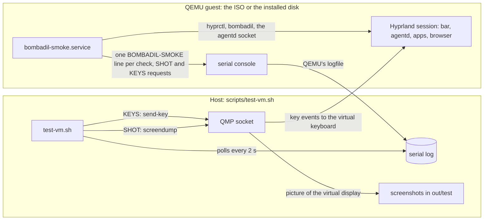

# Testing the whole system in a VM

> **Status:** Shipped
> **Code:** `scripts/test-vm.sh`, `scripts/qmp.py`, `iso/airootfs/usr/local/bin/bombadil-smoke`, `iso/airootfs/etc/systemd/system/bombadil-smoke.service`, `iso/efiboot/loader/entries/02-bombadil-serial.conf`, `iso/efiboot/loader/entries/03-bombadil-install-test.conf`, `src/bombadil/fake_signin.py`, `scripts/vm-tools/vmsmoke`, `tests/test_iso_profile.py`, `tests/test_boot_console.py`, `tests/test_brain_service.py`
> **Design:** there is no brief for the test layers; [developing and testing](development.md) places this layer among the others
> **Verified:** 2026-11-08 against `main` at `7176e55`

Unit tests cover the Python and the QML that load without a compositor, and a headless desktop test
(`tests/desktop/run.sh`) drives the bar and the daemon in a sway session against a scripted model
API. Neither can say whether Hyprland focuses the pill, whether the units come back, whether an
install boots. That is the VM smoke test: it boots the real ISO, runs the real session and, in
install mode, installs it to a scratch disk and boots that too, judging each boot from the serial log.

This page covers the host side (`scripts/test-vm.sh`), the protocol between the host and the guest,
what the run covers, the traps and what to do when a check fails. The catalogue of checks is in
[ISO and install](../architecture/iso-and-install.md#the-smoke-test), and the recipe for adding one is
in [Developing and testing](development.md#the-iso-smoke).

No boot was observed for this page on 2026-11-08. Every statement comes from reading the scripts and
the code they call. What QEMU, systemd and systemd-boot do with their inputs (QMP's `send-key` and
`screendump`, the unit condition matching `bombadil.smoke=install`, the `Boot in` countdown) is taken
from how the scripts rely on it.

## How it fits together



The ISO carries `bombadil-smoke.service`, which runs only when the kernel command line has
`bombadil.smoke` (`ConditionKernelCommandLine`, after `greetd.service`). The argument and its value
pick the mode. Two of the ISO's three boot entries set it; the third mode is set on the installed disk.

| Boot | Kernel argument | Mode and what runs |
|---|---|---|
| ISO entry `01-bombadil.conf` | none | The plain boot. The service does not run. |
| ISO entry `02-bombadil-serial.conf` | `bombadil.smoke` | `live`: the checks, then power off. |
| ISO entry `03-bombadil-install-test.conf` | `bombadil.smoke=install` | `install`: the live checks, then `bombadil-install /dev/vda --yes`, then power off. |
| the installed disk | `bombadil.smoke=undo` | `undo`: the common checks, then the brain checks, a restore point, a change, `bombadil undo` and a reboot; after the reboot the common checks run again and `undo-applied` checks that the change is gone. The install check writes the argument into the installed disk's GRUB defaults through `BOMBADIL_INSTALL_CMDLINE`. |

An empty value is printed as `mode=live`. [The boot menu](../architecture/iso-and-install.md#the-boot-menu)
holds the entries and [the smoke test](../architecture/iso-and-install.md#the-smoke-test) the whole
install path as a sequence diagram.

A virtual machine cannot press keys itself, so the guest asks. It prints `KEYS <bootid>-<n> meta_l` (a
tap of Super; `meta_l+esc` is a chord; `b r o w s e r ret` types a word) and the host sends them over
QMP (`scripts/qmp.py`), then the guest checks what happened. The boot id is the first eight characters
of the kernel's boot id. It keeps the numbers of one boot apart from the next, which restarts the count
(the undo round trip reboots). The same holds for pictures: the guest prints `SHOT <name>` and the host
takes a screenshot with QMP `screendump`.

## Running it

```sh
scripts/build-in-container.sh              # the ISO, in out/
scripts/test-vm.sh                         # live checks
MODE=install scripts/test-vm.sh            # live checks, install to a scratch disk, boot it, undo
MODE=installed scripts/test-vm.sh          # boot the disk the last install run left
TIMEOUT=5400 MODE=install scripts/test-vm.sh
```

`MODE=installed` boots `out/test/disk.qcow2` again without installing. After an undo round trip that
was cut short (the emulator died as the guest rebooted) it is the second boot: the guest keeps
`~/.bombadil-smoke-phase`, the second boot checks `undo-applied` and removes the file. After a round
trip that finished there is no phase file, so the boot runs the whole first pass again (the checks, a
restore point, the undo, the reboot) and then the second.

What the host needs:

| Need | Notes |
|---|---|
| `qemu-system-x86_64` | KVM is used when `/dev/kvm` is writable; otherwise software emulation. |
| `qemu-img` | Install mode only: it creates the 40 GiB qcow2 disk. |
| an OVMF firmware file | One of `/usr/share/edk2/x64/OVMF_CODE.4m.fd`, `/usr/share/edk2/x64/OVMF.4m.fd`, `/usr/share/OVMF/OVMF_CODE_4M.fd` or `/usr/share/OVMF/OVMF_CODE.fd` (`edk2-ovmf` on Arch, `ovmf` on Debian and Ubuntu). |
| `python3` | For `scripts/qmp.py`. |
| an ISO | The newest `out/*.iso`, or `ISO`. The lookup runs in every mode, so `MODE=installed` with no ISO in `out/` and no `ISO` stops before it boots anything. |

| Variable | Default | Meaning |
|---|---|---|
| `MODE` | `live` | `live`, `install` or `installed`. Any other value runs as `live`. |
| `ISO` | newest `out/*.iso` | The image to boot. |
| `TIMEOUT` | `2400` | Seconds per boot, not per run: install mode boots twice. |
| `QEMU_CPU` | `Nehalem` | The CPU under software emulation; ignored with KVM. |
| `VNC` | `127.0.0.1:99` | The VNC display QEMU offers, to watch a run. |

The guest gets 4 GiB of memory, one virtual CPU per host CPU, a virtio GPU, keyboard and mouse, an
Intel HDA sound card with no host audio behind it, and user-mode networking, so whether it has
internet depends on the host. The firmware is a read-only code image with no variable store. In install
mode the 40 GiB disk is a virtio disk, seen as `/dev/vda`.

The host picks the boot entry itself. It waits up to 120 seconds for systemd-boot's countdown (`Boot
in`) on the serial log, then presses Down over QMP once for the live mode (entry 02) or twice for the
install mode (entry 03), then Enter. The order is the entries' `sort-key`. For the installed disk it
presses nothing, because GRUB's menu is hidden there.

Files in `out/test/`, where `<boot>` is `live`, `live-install` or `installed`:

| File | Holds |
|---|---|
| `<boot>.serial.log` | The whole serial console of the boot. For the installed disk it holds both passes of the undo round trip, because the reboot happens inside one QEMU process. |
| `<boot>-<name>.png` | The screenshot for `SHOT <name>`, with the raw `<boot>-<name>.png.ppm` beside it. |
| `<boot>-last.png` | The screen when the boot ended. It is not taken when QEMU has already exited (the call's errors are ignored). |
| `<boot>.keys.<bootid>-<n>` | An empty marker for each key request already sent. |
| `<boot>.qmp.sock`, `<boot>.serial.sock` | QEMU's QMP and serial sockets. |
| `disk.qcow2` | The scratch disk. `MODE=install` deletes and creates it again. |
| `installed-first.serial.log` | The log the previous `installed` boot left, copied by `MODE=installed` before it starts the next boot. |

A boot empties its own serial log and removes its earlier key markers, screenshots and QMP socket when
it starts. It removes screenshots by the pattern `<boot>-*.png`, which for `live` also matches the
`live-install-*.png` pictures, so a live run deletes the pictures of the last install run's first boot.

The exit status:

| Exit | When |
|---|---|
| 0 | Each log has a `DONE pass=<n> fail=0` line, no log has a `FAIL` line, the first log has no `SKIP signin` line, and in install mode the first log has `PASS install`. |
| 1 | Any of those is not met, including a boot that ran to the timeout without a `DONE` line. In install mode a first boot without `PASS install` ends the run before the installed disk boots. |
| 2 | No OVMF file is found, `MODE=installed` finds no `out/test/disk.qcow2`, or there is no ISO to boot. |

## The serial protocol

The guest prints lines that start with `BOMBADIL-SMOKE: ` to `/dev/console`, which is the serial port
when the kernel has one. The host reads the log every two seconds, answers a `SHOT` name once and a
`KEYS` number once, and stops when a `DONE` line shows.

| Line | Meaning | Host action |
|---|---|---|
| `START mode=<mode>` | A run begins. | none |
| `PASS <name>` | A check passed. | none |
| `FAIL <name>: <tail>` | A check failed. The tail is the last 300 bytes of its output, with newlines turned into spaces. | none |
| `SHOT <name>` | The guest wants a picture, then sleeps `SHOT_WAIT` seconds (8 by default). | A screenshot to `out/test/<boot>-<name>.png`, once per name, so the second pass of the undo round trip takes none of the shots whose names the first pass used. The name matches `[a-z0-9-]*`. Nothing reads the picture; it is for the person who opens it. |
| `KEYS <bootid>-<n> <qcode>...` | The guest wants these keys pressed, then sleeps `KEYS_WAIT` seconds (8 by default). | One QMP `send-key` per word, once per `<bootid>-<n>`. A `+` joins keys pressed together. |
| `NOTE <text>` | The machine was still busy when the keys went in. | none |
| `DIAG <text>` | What the machine looked like when something went wrong. | none |
| `AGENTD-LOG: <line>`, `MAIL-LOG: <line>` | The last 60 lines of `/tmp/smoke.agentd.log`, printed at the end of the sign-in block, and the last 30 of `/tmp/smoke.mail.log`, printed at the end of the mail block. Both appear in a passing run. `AGENTD-LOG:` is printed again when `signin-page-again` fails. | none |
| `SKIP signin: <reason>` | The sign-in checks did not run. | The run exits 1 when this is in the first log. |
| `REBOOT pass=<n> fail=<m>` | The first pass of the undo mode ends and the guest reboots. There is no `DONE` yet. | none |
| `DONE pass=<n> fail=<m>` | The run ends and the guest powers off. | The host stops polling, takes `<boot>-last.png` and waits for QEMU to exit. |

Without a host that answers, `shot` and `keys` only sleep, and the checks that depend on key presses
fail. `BOMBADIL_SMOKE_NO_POWEROFF`, set to any non-empty value in the guest, stops the final power off
and the reboot. `test-vm.sh` does not set it; `scripts/vm-tools/vmsmoke` does, to run the smoke in a VM
that stays up.

## What it covers

Every mode runs the common checks. The catalogue, with every check name, is in
[ISO and install](../architecture/iso-and-install.md#the-smoke-test); this is what the groups prove.

- **The image.** The user exists, the programs are on `PATH` (`tools-installed` passes when any one of
  its names is found, so the brain's two programs and Mail's three are looked for one by one), PySide6
  imports, the mirror list has a `Server =` line, both provider CLIs answer `--version`, and the
  os-mcp tool list names `show_panel` and `system_map`.
- **The session.** `greetd`, Hyprland, the bar's `bombadil-bar` layer and `agentd` run, Hyprland
  reports no config errors, a `Virtual-` display is not narrower than 1280 px (it fails below that),
  and the sound output is a real sink, not PipeWire's dummy.
- **The three user services.** `bombadil-agentd`, `bombadil-shell` and `mako` each come back as a
  different process after `kill -9`, and all three are active units ([the session
  services](../architecture/session-services.md)).
- **Panels and apps.** The browser panel slides in (`browser-window` and `browser-shown` read
  Hyprland). The hide steps (`browser-hide`, `browser-hide-again`, `browser-hide-third` and
  `mail-engine-browser-hide`) prove only that `hide_panel` returns without `"isError": true`; no check
  reads Hyprland to see the panel go. `create_app` opens apps each in its own drawer, `app-hide` is
  read back from Hyprland, the skills are installed for both CLIs, and the example apps open.
- **Pictures.** `system_map` captures network, boot, disks, sound, screens and one service from this
  machine, and agentd answers that a client besides the caller was there to draw each (the reply says
  `shown above the bar`). The boot picture must hold at least three timed lines.
- **The pill.** A Super tap and Alt+Space give it the keyboard, a launcher word runs without a model, a
  `!` turn runs and Super+Esc stops it and says so in the history.
- **The details drawer.** It takes the keyboard and every way out closes it. The message a click on
  a service in a picture sends (`open-unit`) opens the unit in the same drawer.
- **Mail.** In every mode, `undo` included, Thunderbird answers `--version`, the unit is enabled and
  active, and its service answers on its socket. In every mode but `undo`, windows that carry
  Thunderbird's class stay on `special:mail-engine` without taking the keyboard, the service runs on
  its fake engine, a mail that arrives becomes a notice on the line, the word `mail` opens the Mail
  window, and the unit is put back (`mail-unit-restored`).
- **Sign-in**, in every mode but `undo`, when no provider is chosen. The real Codex and Claude pages
  are opened in the browser panel (or the offline line shows when the VM has no internet) and
  cancelled, with a check that cancelling Codex frees port 1455. The stand-in login
  (`src/bombadil/fake_signin.py`, chosen with `BOMBADIL_PROVIDER=fake`) then covers the round trip, a
  pasted code, a slid-out panel, a closed browser, a timeout, and no internet followed by internet.
  The block deletes the provider choice at its end and starts and cancels real logins (a Codex login
  revokes the stored one), so it is gated on `~/.config/bombadil/config.toml`, which is what
  `config.Config.configured` reads. When the file exists the smoke prints `SKIP signin`, and the host
  fails a run whose first log has it.
- **The installer**, in install mode: `bombadil-install /dev/vda --yes` finishes.
- **The installed disk**, in the undo mode: the brain (the watcher and the service, a file a turn
  writes is named as the machine's and one the person writes as theirs, a rename keeps the thing, the
  Brain window opens), the hidden GRUB menu, snapper available, a restore point created and filed under snapper's `number`
  cleanup class so it may be pruned, the installed snapper config keeping 30 and taking no hourly ones
  with `snapper-cleanup.timer` enabled, an undo across a reboot, and `undo-applied` after it. It never
  runs a cleanup or sees a restore point removed, so pruning itself is not exercised.

## Traps

- **Software emulation is slower, and load shows.** Without KVM the guest runs under QEMU's software
  emulation, and it shares the host's CPUs (one virtual CPU per host CPU), so anything else running
  on the host (a unit-test run, a second VM, a build) slows it. An app that is still starting can make
  the handover from a Super tap to the pill take longer than the check waits. Before the Super tap and
  before the Alt+Space tap the smoke waits up to 240 seconds for the guest's one-minute load average to
  fall below 1.5, and prints `NOTE the machine was still busy when the keys went in` if it did not.
  The other key requests have no such wait. Run nothing else while a VM run is in progress.
- **The CPU depends on KVM.** With `/dev/kvm` writable the script uses `-enable-kvm -cpu host`. Without
  it, it emulates `Nehalem` (override with `QEMU_CPU`), because Mesa's software GL (llvmpipe) crashed
  on the AVX2 that QEMU emulates, in Hyprland and in Quickshell's renderer.
- **The pill is a layer surface.** It sits in the `bombadil-bar` layer (`shell/shell.qml`), so
  `hyprctl activewindow` cannot say whether it holds the keyboard. The smoke types a launcher word over
  QMP and reads `bombadil history` for its line (`launcher_ran`); the details drawer, which is a window,
  is judged with `active_is`.
- **`bombadil history` waits for a key when its input is a terminal** (`watch.wait_for_key`, and
  `bombadil watch` does the same). The smoke runs `history` from a service that has no terminal, and
  `launcher_ran` also closes the input (`</dev/null`) when it prints the history for a failure. A
  check you add that runs either command needs the same care.
- **Replacing the daemon means replacing its unit.** The daemon is a user service that systemd starts
  again when it is killed, so the smoke stops the unit first, starts its own daemon with the
  environment a check needs, and starts the unit again afterwards (`agentd-restored`). Mail's unit
  gets the same treatment (`fake_mail` and `restore_mail`).
- **Keys are QMP `send-key`.** `scripts/qmp.py` sends one `send-key` command per word, with one
  `qcode` per part of a `+` chord, so a chord is pressed together. The words are QEMU's key names
  (`meta_l`, `alt+spc`, `ret`, `esc`).
- **A timeout does not stop QEMU.** When a boot reaches `TIMEOUT` the host prints `<boot>: timed out
  after <n>s`, stops answering `SHOT` and `KEYS`, takes the last screenshot and then waits for QEMU to
  exit by itself (`scripts/test-vm.sh`, `wait $pid`). A guest that never powers off keeps the script
  waiting; stop QEMU by hand. The same wait follows `DONE`, so a guest that does not power off after
  it (one with `BOMBADIL_SMOKE_NO_POWEROFF` set, for example) leaves the script waiting too.
- **The installed disk is a smoke disk.** The install check puts `bombadil.smoke=undo` into the GRUB
  defaults of the disk it installs, `out/test/disk.qcow2`, so every boot of that disk runs the smoke's
  undo mode: a first pass that reboots, or a second pass that powers off. Use the disk for the test
  only. `scripts/run-vm.sh --installed` boots a different file, `out/bombadil.qcow2`, and
  `scripts/wsl-vm.sh` installs that one with `BOMBADIL_INSTALL_CMDLINE` set to the console arguments
  alone. It would run the undo mode only if it was installed through entry 03 or is a copy of the test
  disk.

> **Warning: entry 03 erases a disk without asking.** It runs `bombadil-install /dev/vda --yes`, which
> wipes and formats the first virtio disk with no prompt. Never pick it by hand in a VM that has a disk
> you want to keep; `scripts/run-vm.sh --disk` refuses to attach `out/bombadil.qcow2` when it is larger
> than 100 MB (the script takes that to mean it holds a system) unless `FORCE=1` is set. `MODE=install`
> also deletes the previous `out/test/disk.qcow2`.
> [The boot menu](../architecture/iso-and-install.md#the-boot-menu) holds the warning in full.

## When a check fails

1. Read the output of the run. `test-vm.sh` prints every `BOMBADIL-SMOKE` line of each boot under
   `--- <boot> ---`, or `no smoke output; see <log>` when there are none. The same lines, with the
   kernel and console output around them, are in `out/test/<boot>.serial.log`. Start with the first
   `FAIL`, because later ones often follow from it. Its tail is the last 300 bytes of the check's
   output; a failed `launcher_ran` check ends with the last three lines of `bombadil history`.
2. Read the `DIAG` lines near it. The smoke prints them in three cases. When the first Super tap did
   nothing, it names the active window and the release binds, asks for the pill by hand, types the
   word again and says whether the pill took it (the Super bind did not fire) or not. When the word
   did not reach the pill during the mail window test, it names the active window. When
   `signin-page-again` fails, it prints the browser's whole command lines, the windows, every target
   the debugging port lists, the profile's singleton files and the last lines of the daemon's log
   (`AGENTD-LOG:`). The `AGENTD-LOG:` and `MAIL-LOG:` lines are not a sign of failure: a run prints
   them at the end of the sign-in block and the mail block whether or not the checks passed. Read
   them for the daemon's and the service's own words around a failure in that block.
3. Open the screenshots. `<boot>-<name>.png` for the `SHOT` just before the failing check (the order is
   the order in the script) and `<boot>-last.png` for the screen at the end. The shot
   `signin-page-again` is taken after that check whether it passed or failed.
4. Rule out the host. A `NOTE the machine was still busy` line, a `timed out after` line and a run
   without KVM say more about the machine than about the code. Run again with nothing else running.
5. Run the one boot again. `scripts/test-vm.sh` repeats the live boot, `MODE=install` the whole path,
   and `MODE=installed` the installed disk without installing again.
6. Read the check's whole output. It is in the guest at `/tmp/smoke.<name>.log` and is lost at power
   off, so the host sees only its last 300 bytes. To keep the guest, run the smoke in a VM that stays
   up: `scripts/vm-tools/vmsmoke` runs it with `BOMBADIL_SMOKE_NO_POWEROFF=1` and says how to read a
   check's log in the guest ([the VM tools](development.md#the-vm-tools)). While a `test-vm.sh` run is
   going, a VNC viewer on the `VNC` display shows the screen, and
   `python3 scripts/qmp.py out/test/<boot>.qmp.sock screenshot /absolute/path.png` takes a picture of
   it.

For a check you add that waits on something visual, take the habit of `browser_diag`: print what the
machine looked like, not only that it did not match, and ask for a `shot`. The steps are in
[Add a smoke check](development.md#add-a-smoke-check).

## Tests that need no VM

Some tests pin the text of the smoke and of `scripts/test-vm.sh`, so a change that would break the
protocol fails in the unit tests before a VM run. `tests/test_iso_profile.py` checks that key requests
carry the boot id and that the host's pattern matches the requests of two boots, that the sign-in block
sits behind the `config.toml` gate (it runs the gate's lines in bash against a home with and without
the file) and that `SKIP signin` is in both scripts, that the smoke stops the `bombadil-agentd` unit
before it starts its own daemon and starts the unit again, that the mail checks are present, and that
the script parses. `tests/test_brain_service.py` runs `bash -n` on it and matches the loop that looks
for the brain's two programs one by one. `tests/test_boot_console.py` keeps the two serial entries
loud (no `quiet`, no colour parameters), because the host reads them on the serial console. Run one
file with `pytest tests/test_iso_profile.py`; they do not boot anything.
