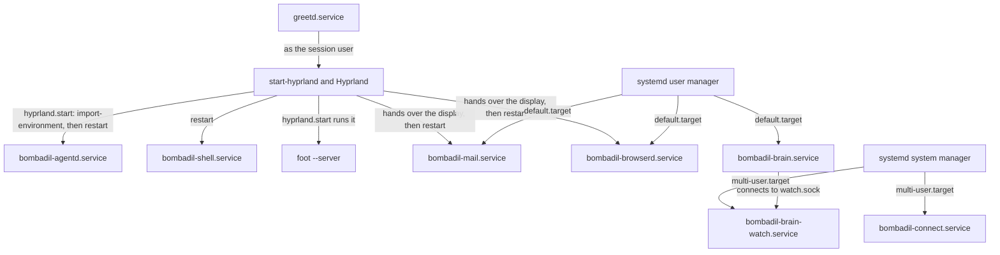
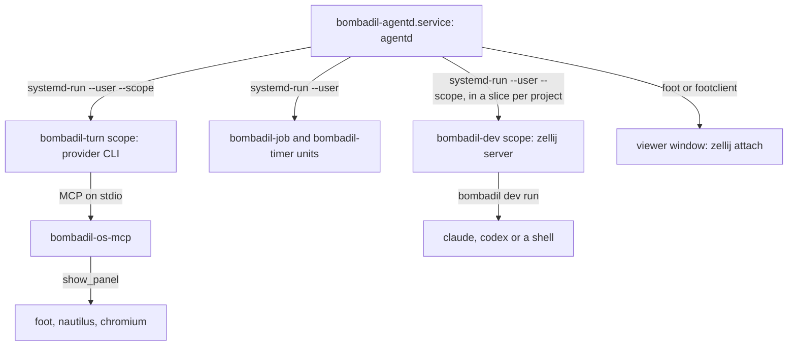

# Reference

> **Status:** Shipped
> **Code:** `bin/`, `iso/`, `scripts/`, `src/bombadil/`, `shell/`, `share/`, `tests/`, `docs/tools/check_docs.py`, `pyproject.toml`
> **Verified:** 2026-11-09 against `main` at `ca7f80a`. The change from `ca7f80a` to `f0485c2` (the voice, Tips, the installer's copy of `tips.json` and `desk.toml`, and the reduced-motion switch in the app runtime) was added to this page and checked against the code at `f0485c2` on 2026-11-09; the other rows were not read again. The change from `f0485c2` to `24c836c` (the connection service and the browser service, proposals and the press, the cards for messages, tasks and lists, the bar's notification server and the five connection tools) was added to this page and checked against the code at `24c836c` on 2026-11-09; the other rows were not read again. The change from `24c836c` to `7d17600` (keeping a widget, the Widgets card and the word `widgets`, the `keep` words, the `keep`, `set`, `reset` and `widgets` ops of the desk and its tool, and the Machine card at rest) was added to this page and checked against the code at `7d17600` on 2026-11-11; the other rows were not read again. The change from `7d17600` to `7d37bc5` (layout 1 and the installer's four ways to run, the refresh, `bombadil-rollback --device`, the GRUB screen, `bombadil remote`, `bombadil snapshot` and `bombadil terminal`, the bar's own shortcuts for the pill, boot entries 04 and 05 and the VM test modes; the stone's knock as a cue, the frame-answer timeout and the idle watch; and the Tips card, the Tips app, `Kit.Stone`, `Kit.TipScene` and `Agent.draft`) was added to this page and checked against the code at `7d37bc5` on 2026-11-12, with the counts of variables, scripts, test files and packages taken again; the other rows were not read again. Re-read against the same commit on 2026-11-13, and read only, not run (`pytest` and PySide6 are not installed on the machine, so no test ran and every Qt test would skip): which files read each variable the Tips app adds to (`BOMBADIL_CHECK`, `BOMBADIL_RUNTIME`, `BOMBADIL_SOCKET`, `BOMBADIL_STATE`, `XDG_RUNTIME_DIR` and `XDG_STATE_HOME`, in `share/apps/*/app.py`, `bin/bombadil-signal` and `shell/shell.qml`); every `BOMBADIL_` name in the tree against the table (95 found, 94 listed, the 95th a prefix in a test); the files the installer writes or uses (`new_keyfile`, `write_initramfs_config`, `cleanup`, the guided plan file and the work folder in `bombadil-install`); the rows of `bombadil snapshot`, `bombadil terminal` and `bombadil remote` against `bin/bombadil`, `snapshots.py`, `hypr.py` and `remote.py`; the guards and keys of the installer and the plan (`probe`, `refresh_open`, `read_password`, `installplan.py`); the smoke modes and boot entries `02` to `05`; the knock's `cueMs` and `remindMs`, the limits of Tips, tip scenes and `Agent.draft`; and the two test rows that name `hyprland.lua` and `PillKeys.qml` against `tests/test_pill_keys_qml.py` and `tests/test_iso_profile.py`.

This page lists the names Bombadil's code uses: commands, environment variables, files, sockets, units, configuration keys, tools, events, the limits of coding sessions and the Away card, the limits of the voice, Tips and tip scenes, the limits of messages and connections, the limits of the Machine card at rest and of the Widgets card, the limits of the installer, remote control and the desktop at rest, scripts and packages. Each name gets one line and a link to the page that owns the detail, so a name met in a log, a diff or a shell can be found here and followed. Names are spelled as the code spells them, and paths are relative to the repository root unless they start with `~`, `/` or `$`.

## Commands

Executables in `bin/` and in `iso/airootfs/usr/local/bin/`, then every subcommand of `bombadil`, `bombadil mail` and `bombadil-app`. On the ISO the thirteen commands in `bin/` are linked into `/usr/local/bin` by `scripts/build-iso.sh`; the five scripts in `iso/airootfs/usr/local/bin/` are files there.

| Command | What it does | Detail in |
|---|---|---|
| `bin/agentd` | Starts the session daemon: reads the config, listens on the agentd socket and runs turns. On the ISO the user unit `bombadil-agentd.service` runs it, and Hyprland's start hook restarts that unit at login. | [starting agentd](architecture/agentd.md#starting-it), [session services](architecture/session-services.md#who-starts-them) |
| `bin/bombadil` | The terminal client and manager (subcommands below). With no subcommand, or one it does not know, it prints its usage and exits 2. | [the terminal client](architecture/agentd.md#the-terminal-client) |
| `bin/bombadil-app` | Runs, checks and manages generated apps (subcommands below). | [app kit](architecture/app-kit.md) |
| `bin/bombadil-brain` | The user service that keeps `brain.db` and answers on `brain.sock`. It takes no arguments. | [brain](architecture/brain.md) |
| `bin/bombadil-brain-watch` | The root watcher: one fanotify mark on the btrfs filesystem, streamed to each user's brain on `watch.sock`. Needs root. Options: `--path`, `--socket`, `--state`, `--top`, `--spool-cap`, `--home UID:DIR`. | [brain](architecture/brain.md) |
| `bin/bombadil-browser URL...` | The system browser. Asks agentd to open each URL in the browser panel, and opens the panel itself when agentd does not answer. It is `$BROWSER` and the https handler. | [browser and sign-in](architecture/browser-and-signin.md) |
| `bin/bombadil-browserd` | The user service that holds one connection to the browser panel's Chromium and answers on `browserd.sock`: open a page, read it, point at a button, take a value off it. It has no hands, and it takes no arguments (`--help` prints one line). On the ISO the user unit `bombadil-browserd.service` runs it. | [Messages and connections](CONNECT.md), [connections](architecture/connect.md) |
| `bin/bombadil-connect` | The connection service: keeps the keys to Slack and the work tools, runs their drivers, answers on `connect.sock` and does what a press asks. It takes no arguments (`--help` prints one line); `BOMBADIL_CONNECT_ENGINE=fake` runs it on sample messages and tasks. On the ISO the system unit `bombadil-connect.service` runs it as the user `bombadil-connect`. | [Messages and connections](CONNECT.md), [connections](architecture/connect.md) |
| `bin/bombadil-mail` | The user service that keeps `mail.db`, answers on `mail.sock` and keeps Thunderbird unseen as the mail engine (`bombadil.mail.service.main`). It takes no arguments; `BOMBADIL_MAIL_ENGINE=fake` runs it on sample mailboxes. | [mail](architecture/mail.md) |
| `bin/bombadil-mail-host` | The native-messaging host Thunderbird starts for Mail's add-on. It relays frames (a 4-byte length, then a JSON object) on standard input and output to the lines of `mail.sock`. Exits 0 when Thunderbird or the service goes, 1 on a frame that cannot be one, 2 when no service answered in 5 seconds. | [mail](architecture/mail.md#the-processes), [the engine protocol](architecture/mail.md#the-engine-protocol-service-and-add-on) |
| `bin/bombadil-os-mcp` | The `bombadil-os` MCP server on standard input and output. Both provider CLIs start it. | [os-mcp](architecture/os-mcp.md) |
| `bin/bombadil-shell` | Starts Quickshell on `shell/shell.qml` with `share/qml` on `QML2_IMPORT_PATH` and `QT_WAYLAND_FRAME_CALLBACK_TIMEOUT` at 2000 unless it is already set. On the ISO the user unit `bombadil-shell.service` runs it, after `bombadil-agentd.service`, and the same start hook restarts it. | [the shell](architecture/shell.md#commands-keys-and-surfaces), [session services](architecture/session-services.md#who-starts-them), [idle cost](architecture/idle-cost.md#the-three-loops-and-how-each-was-stopped) |
| `bin/bombadil-signal` | What the coding tools' hooks run: `bombadil-signal claude` or `bombadil-signal codex` (the hook's JSON on standard input), or `bombadil-signal codex-notify JSON` (the JSON as the last argument). It trims the event (its text to 600 characters, six keys of the tool's input and the first question to 300) into a `dev-signal` message and sends it to agentd's socket (`$BOMBADIL_SOCKET`, else `$BOMBADIL_RUNTIME/agentd.sock`, else `$XDG_RUNTIME_DIR/bombadil/agentd.sock`) with a 1 second limit; when it cannot reach agentd, it appends the line to `<state dir>/dev/signals.jsonl`. It prints nothing, always exits 0, does nothing when `BOMBADIL_OS=1`, and uses only the standard library. | [coding sessions](architecture/coding-sessions.md) |
| `bombadil-grub-config` | Writes GRUB's menu file, `/efi/grub/grub.cfg`, the way Bombadil wants it: `grub-mkconfig` in the C locale, then the two `Loading ...` lines before each kernel cut out, so that nothing is printed between the firmware logo and the desk. Run it, not `grub-mkconfig`, whenever the file is written again. `BOMBADIL_GRUB_CFG` moves the file. | [what GRUB shows](architecture/installed-os.md#what-grub-shows) |
| `bombadil-install` | At a terminal with no arguments it asks which disk and what password, then installs: the guided install. A password encrypts the disk (LUKS2) and is also the account's, and the recovery key is shown once on the terminal. At the end it waits for Enter and restarts. Every form of the command writes layout 1 (see [files and folders](#files-and-folders)), takes the kernel from the system it copies, carries what `install/carry.list` names from the live home, and refuses the disk the stick started from, a disk under 16 GiB, a disk with something mounted and a computer that did not start in UEFI mode. | [what the installer does](architecture/iso-and-install.md#what-bombadil-install-does), [the three operations](architecture/installed-os.md#the-three-operations) |
| `bombadil-install --plan FILE [--password-fd N]` | What an install card would run: `FILE` is a JSON plan with the keys `disk`, `mode`, `timezone`, `timezone_source`, `keymap`, `hostname`, `carry`, `encrypt` and `kind`, which `src/bombadil/installplan.py` checks against strict patterns before anything is touched. The password comes on file descriptor `N` and is never in an argument, a file or the log; a plan that asks for encryption with no password is refused. The install card that would write the plan is not built. | [the plan and what comes along](architecture/installed-os.md#the-plan-and-what-comes-along) |
| `bombadil-install DISK [--yes]` | Erases the whole disk `DISK` and installs the running live system on it, with no password and no encryption (the tests and the VM launchers). Without `--yes` it asks for the disk name. | [what the installer does](architecture/iso-and-install.md#what-bombadil-install-does) |
| `bombadil-install --refresh DISK [--yes] [--password-fd N]` | Puts a fresh system on a disk that already holds Bombadil and keeps the home folder: the old root is set aside as `@.before-refresh-<stamp>` with its restore points, the computer's own files (Wi-Fi networks, host name, time zone, machine id, SSH host keys, lingering) and the account's password are kept, and the programs the old system had that the image lacks are listed in `/var/lib/bombadil/refresh-<stamp>.txt`. It refuses a disk with Windows on it, one that is not a Bombadil disk, one with under 10 GB free and an encrypted one without its password. | [the three operations](architecture/installed-os.md#the-three-operations) |
| `python3 -m bombadil.installplan` | What `bombadil-install` runs first: `--plan FILE`, or `--disk DISK` with `--mode fresh` or `refresh`, checks the plan against the carry list (`--carry-list`) and the time zones and prints the shell assignments the installer evals. `--disks [--stick DISK]` lists the whole disks a person can pick from, each with the reason it is not offered (the stick, an install image, in use, under 16 GiB). | [the plan and what comes along](architecture/installed-os.md#the-plan-and-what-comes-along) |
| `bombadil-rollback N` | Makes snapper snapshot `N` the root `@` from the next boot and keeps the old root as `@.undone-<time>`. It refuses a restore point that has no kernel of its own. Run through `sudo`. | [restore points](architecture/restore-points.md) |
| `bombadil-rollback --device DEV N` or `--device DEV refresh` | The same from another system, the USB stick: `DEV` is the btrfs device, already unlocked when the disk is encrypted. `refresh` puts back the newest whole system a refresh set aside (`@.before-refresh-<stamp>`) and keeps the refreshed one as `@.after-refresh-<stamp>`. | [the three operations](architecture/installed-os.md#the-three-operations) |
| `bombadil-setup [--first-run]` | Terminal fallback to pick a provider and sign in. With `--first-run` it exits at once when `~/.config/bombadil/config.toml` exists. | [browser and sign-in](architecture/browser-and-signin.md#first-boot) |
| `bombadil-smoke` | The boot-time smoke test. `bombadil-smoke.service` runs it when the kernel command line has `bombadil.smoke`, alone or as `bombadil.smoke=install`, `install-encrypted`, `refresh`, `undo` or `refreshed`. It prints `BOMBADIL-SMOKE:` lines and powers off. Its `idle-cpu` check measures the session at rest. | [the smoke test](architecture/iso-and-install.md#the-smoke-test) |
| `bombadil ask TEXT` | Sends a prompt and prints the reply until `turn_end`. A launcher word prints its answer and exits, with 1 when the word failed. When the AI rests (out of plan or paused), or the limit sent the turn back to the queue, it says so on standard error and exits 75 (`EX_TEMPFAIL`) instead of waiting; the ask stays queued and runs at the reset. | [the terminal client](architecture/agentd.md#the-terminal-client), [resting](architecture/poor-man-switch.md#the-queue-and-the-apps) |
| `bombadil status` | Prints agentd's `status` message. | [the terminal client](architecture/agentd.md#the-terminal-client) |
| `bombadil stop` | Ends the running turn and everything it started. Returns at once, for key binds. | [the terminal client](architecture/agentd.md#the-terminal-client) |
| `bombadil pill` | Gives the pill the keyboard (sends `summon`). A tap of Super and Alt+Space do not run it: the bar answers them itself, as Hyprland global shortcuts (`bombadil:pill-release` and `bombadil:pill-press`, `shell/PillKeys.qml`), so this command is for scripts and for a session without Hyprland. | [the shell](architecture/shell.md#commands-keys-and-surfaces) |
| `bombadil terminal` | Opens a terminal (`foot`) on the desktop and prints `terminal opened`, with the drawer it put away. Plain `foot` opens inside a drawer that is showing and leaves with it, so it puts any drawer but the terminal's own away first and starts `foot` without Hyprland's `HL_INITIAL_WORKSPACE_TOKEN`. Super+Return runs it. | [the shell](architecture/shell.md#commands-keys-and-surfaces) |
| `bombadil watch [--file F] [--follow]` | Every step, command and output of the last turn, or of the turn log `F`. `--follow` stays with a running turn. A command that Stop ended shows as `stopped`, not `failed`. | [the details drawer](architecture/agentd.md#the-details-drawer) |
| `bombadil history` | Recent turns, launcher actions and the end of a coding session, newest last. | [the details drawer](architecture/agentd.md#the-details-drawer) |
| `bombadil view --file F` or `bombadil view -- CMD...` | Shows a file, or the output of a command, in a scrolling viewer. Esc closes it. | [the details drawer](architecture/agentd.md#the-details-drawer) |
| `bombadil undo` | Rolls the system back to the newest `turn:` restore point. Applies at the next boot. | [restore points](architecture/restore-points.md) |
| `bombadil provider claude` or `bombadil provider codex` | Switches provider and signs in. Writes the user config instead when agentd is not running. | [the terminal client](architecture/agentd.md#the-terminal-client) |
| `bombadil signin [claude or codex]` | Signs in again. The page opens in the browser panel. | [browser and sign-in](architecture/browser-and-signin.md) |
| `bombadil open URL` | Opens a link in the browser panel through `bombadil-browser`. | [browser and sign-in](architecture/browser-and-signin.md) |
| `bombadil dev` or `bombadil dev list` | Prints the coding sessions and what each is doing, then waits for a key. The details drawer runs it, for the launcher words `sessions` and `what's running`. | [coding sessions](architecture/coding-sessions.md) |
| `bombadil dev next` | Sends `{"type": "dev", "action": "next"}`: the next session waiting for you comes to the front. Tab in the empty pill does the same. | [coding sessions](architecture/coding-sessions.md) |
| `bombadil dev why KEY` | Prints the last screen kept for a session that stopped (or `No last screen was kept for that session.`), then waits for a key. | [coding sessions](architecture/coding-sessions.md) |
| `bombadil dev run KEY [--resume]` | Runs the session's tool inside its zellij pane, then reports how it ended and ends the zellij session. Exits with the tool's code (0 when something ended it from outside) and with 2 when `KEY` is not in the registry. Started by agentd, not by hand. Any other form of `bombadil dev` prints the usage and exits 2. | [coding sessions](architecture/coding-sessions.md) |
| `bombadil brain [status]` | What the brain knows and whether it sees every save. | [brain](architecture/brain.md) |
| `bombadil brain why PATH` | Who made a file, and when. | [brain](architecture/brain.md) |
| `bombadil brain find WORDS` | Things whose names match. | [brain](architecture/brain.md) |
| `bombadil brain focus PATH` | Everything around one thing. The argument can also be a link or a key such as `turn:41` or `system`. | [brain](architecture/brain.md) |
| `bombadil brain rebuild` | Forgets the index and makes it again from the files and logs. `--json` on any `brain` command prints the whole answer. | [brain](architecture/brain.md) |
| `bombadil mail [status]` | Whether Mail runs and how each account is. | [mail](architecture/mail.md#words-commands-and-environment) |
| `bombadil mail accounts` | Every mail account: id, address, state, unread count. | [mail](architecture/mail.md#words-commands-and-environment) |
| `bombadil mail add EMAIL` | Adds an account; the sign-in is finished in the Mail window. | [mail](architecture/mail.md#words-commands-and-environment) |
| `bombadil mail remove ID` | Takes an account out of Bombadil; the mail stays with its provider. | [mail](architecture/mail.md#words-commands-and-environment) |
| `bombadil mail views` | The views the Mail window has. | [mail](architecture/mail.md#words-commands-and-environment) |
| `bombadil mail list [VIEW]` | The newest mail in a view: `all` (the default), `needs_reply`, `drafts` or `acct:ID`. One row each, never the text. | [mail](architecture/mail.md#words-commands-and-environment) |
| `bombadil mail show [VIEW]` | Opens the Mail window on a view. Nothing sends from the terminal: Send is a button in the Mail window. | [mail](architecture/mail.md#words-commands-and-environment) |
| `bombadil remote [start [FOLDER]]` | Starts remote control, or says it is already on: `claude remote-control` in a detached tmux session named `bombadil-remote` (in a systemd scope where there is one), so that claude.ai/code or the Claude app can steer a Claude Code session on this computer. `FOLDER` defaults to `~/Projects/remote`, which it makes with settings that turn permission questions off and take a restore point before every prompt. It needs `claude`, `tmux` and a claude.ai sign-in. The words `remote` and `remote control` start it from the pill. Exits 0 when it is on or starting, 1 when it could not start. | [remote control and the restore point by hand](architecture/installed-os.md#remote-control-and-the-restore-point-by-hand) |
| `bombadil remote status`, `bombadil remote url` | Whether it is on, with the link to open; or only the link (`No link yet. Run `bombadil remote`.` when there is none). Exit 0 when it is on. | [remote control and the restore point by hand](architecture/installed-os.md#remote-control-and-the-restore-point-by-hand) |
| `bombadil remote show`, `bombadil remote stop` | `show` attaches this terminal to the tmux session (Ctrl-b then d leaves it running) and exits 1 when it is off; `stop` ends the session, or says it was already off. | [remote control and the restore point by hand](architecture/installed-os.md#remote-control-and-the-restore-point-by-hand) |
| `bombadil snapshot [--hook]` | Takes a restore point by hand, described `turn: by hand` (or `turn: ` and the words after `snapshot`) and printed as `restore point N` (nothing is printed where restore points are not available). With `--hook` it reads a Claude Code `UserPromptSubmit` hook's JSON on standard input, describes the point `turn: remote: ` and the first 60 characters of the prompt, and prints nothing. It first clears the undo marker, as a turn from the pill does, so that the pill's `undo` takes this turn back, and it always exits 0, because a hook that failed would stop the prompt it was taken for. | [remote control and the restore point by hand](architecture/installed-os.md#remote-control-and-the-restore-point-by-hand) |
| `bombadil-app run NAME` | Opens an app as a native window that hot reloads on edit. | [app kit](architecture/app-kit.md) |
| `bombadil-app check TARGET [--screenshot PNG] [--wait MS] [--size WxH]` | Loads an app offscreen and reports errors as JSON, among them each use of the kit's internal components `Stone` and `TipScene` in an app of the person's, with its file and line. `TARGET` is an app name, an app folder or a `.qml` file. | [`bombadil-app check`](architecture/app-kit.md#bombadil-app-check) |
| `bombadil-app list` | Lists generated apps with `shown` or `running` where it applies. | [app kit](architecture/app-kit.md) |
| `bombadil-app create TITLE QML [--python F] [--description TEXT] [--icon NAME]` | Creates an app in the apps folder (`~/Apps`) from a QML file. | [app kit](architecture/app-kit.md#the-app-folder) |
| `bombadil-app show NAME`, `hide NAME`, `toggle NAME`, `close NAME` | Slides an app's window in or out, or quits it. `show` starts the app when it is not running. | [app kit](architecture/app-kit.md) |
| `bombadil-app status NAME` | Prints an app's last load result and log as JSON. | [app kit](architecture/app-kit.md) |
| `quickshell ipc -p shell/shell.qml call desk state` | Prints what the desk is showing, as JSON. For the tests and the VM smoke test. | [the shell](architecture/shell.md#commands-keys-and-surfaces) |
| `quickshell ipc -p shell/shell.qml call desk cover WINDOWS` | Stand-in windows (`{"windows": [{x, y, w, h, fullscreen}]}`) for a session without Hyprland. | [the shell](architecture/shell.md#commands-keys-and-surfaces) |
| `quickshell ipc -p shell/shell.qml call desk inject MESSAGE` | Feeds the bar a message as agentd would send it. A `notice` or `notice_end` only on a bar started with `BOMBADIL_BAR_INJECT=1`. | [the shell](architecture/shell.md#commands-keys-and-surfaces) |
| `quickshell ipc -p shell/shell.qml call line state` | Prints what the line above the pill says, notices included, as JSON. | [the shell](architecture/shell.md#commands-keys-and-surfaces) |
| `quickshell ipc -p shell/shell.qml call dev chips` | Prints where the first screen's session chips sit against the pill, as JSON (`visible`, `x`, `y`, `width`, `height`, `pillX`, `pillY`, `pillWidth`). For the desktop test. | [the shell](architecture/shell.md#commands-keys-and-surfaces) |
| launcher words | Words typed in the pill that agentd answers without the model. They are not executables. The groups: `stop`; `undo`, `history`; `hide`; `desk`; `widgets` (and eight longer ways to say it, such as `my widgets` and `open the widgets`: the card where each widget is kept, shown when needed or put away); `lock`, `restart`, `shut down`; `sign in`; `use claude` and `use codex`; `pause <AI>` and `resume <AI>`; `use opus` and `use sonnet`; `brain` and `why is this here`; `tips` (and eight longer ways to say it, such as `show tips`, `what can you do`, `what can I ask` and `help`: the Tips app); `mail` and `send`; `slack`, `messages`, `unread`, `what did i miss` and `what did i miss on slack` (the list of unread messages), `connections`, `connected`, `whats connected` and `what is connected` (the card Connected here) and `connect <service>` for `slack`, `linear`, `notion`, `jira`, `todoist` and `clickup` (the service's setup); an app's name; the panels `browser`, `terminal` and `files`; `wifi`, `sound`, `volume up`, `volume down`, `mute`, `unmute`, `brightness`, `battery`, `remote` (it starts remote control; also `remote control`, `start remote control`, `remote session` and `start a remote session`), `install` (on the USB stick it opens the installer in the details drawer, as `sudo bombadil-install`, and on an installed computer it says Bombadil is already installed; also `install bombadil`, `install on this computer`, `install to disk` and `install this`) and `voice` (it opens the name and voice card); the desk's widgets (`show machine`, `hide now`, and `keep machine` or `keep machine on the desk`, which only the widgets on the Widgets card take; `show tips` and `open tips` are the Tips app's words and not the desk's, so only `hide tips`, `put tips away` and `keep tips` reach the desk); the picture questions; `why`, a launcher word only while a turn runs; the coding-session words, listed next; and `!` for a shell line. The coding-session words are `claude PROJECT [ROLE]`, `codex PROJECT [ROLE]` and `shell PROJECT [ROLE]` (start a session in a folder of `~/Projects`, bring it back or resume it); a project's name alone; a session's role (`reviewer`, `reviewer myapp`, `reviewer on myapp`); `end NAME` (`end reviewer`, `end claude myapp`, `end myapp`); and `what's running`, `what is running`, `sessions`, `coding sessions` and `list sessions`, which open the list in the details drawer. They are checked after the core commands and never take a word that is a model, brain, Tips, mail or panel word (`launcher._fixed_word`). The words about messages and connections are matched before an app of the person's with the same name, and `apps.create` refuses an app named with one of them (`apps.CLAIMED`). The Tips words are matched before an app of the person's with the same name too, and `apps.create` refuses an app named `mail` or `tips` (`apps.RESERVED`). | [launcher words](architecture/agentd.md#launcher-words), [the words and their order](ux/keys-and-timings.md#the-launcher-words), [keeping a widget](ux/flows.md#22-keeping-a-widget-on-the-desk-and-the-widgets-card), [voice](architecture/voice.md), [messages and connections](CONNECT.md) |

## Environment variables

Every `BOMBADIL_*` name found by searching `src/`, `bin/`, `shell/`, `share/`, `iso/`, `scripts/`, `tests/`, `pyproject.toml` and `.claude/` is in the first group, 94 names. The second group is the other variables the code and the scripts read, or set for a child process. A row marked "tests only" is used only by the test suite, the test containers or the VM smoke test, and one marked "tooling" only by the build and VM scripts.

| Variable | Default | Effect | Detail in |
|---|---|---|---|
| `BOMBADIL_APPS` | `~/Apps` | The folder of generated apps (`paths.apps_dir`). | [agentd](architecture/agentd.md#environment-variables) |
| `BOMBADIL_BAR_INJECT` | unset | `1` lets `quickshell ipc call desk inject` feed the bar a `notice` or `notice_end`. No session of the image sets it; `tests/desktop/driver.py` does. Tests only. | [the shell](architecture/shell.md#environment-variables) |
| `BOMBADIL_BRAIN_DB` | `<state dir>/brain.db` | The brain's database file (`paths.brain_db`). | [brain](architecture/brain.md) |
| `BOMBADIL_BRAIN_SOCKET` | `<runtime dir>/brain.sock` | The brain's socket (`paths.brain_socket`). `share/apps/brain/app.py` reads it too. | [brain](architecture/brain.md) |
| `BOMBADIL_BROWSERD_SOCKET` | `<runtime dir>/browserd.sock` | The browser service's socket (`paths.browserd_socket`). | [Messages and connections](CONNECT.md) |
| `BOMBADIL_BUDGET_SCALE` | unset, which counts as `1` | How many times longer than usual a `system_map` capture may wait for its commands, read at each capture (`sysmap._slow`), for a machine that is slow all the time such as a guest without KVM. A number from 1 to 20: a value outside that range is held to it, and one that is not a number counts as `1`. A capture whose caller passes its own time is not scaled. `MCP_ENV` in `providers.py` lets it through to the MCP server Codex starts, and `bombadil-smoke` sets it to `1`, `4` and `12` on the three tries of a picture check. | [what `system_map` captures](architecture/cards-and-pictures.md#what-system_map-captures) |
| `BOMBADIL_BUILD_IMAGE` | `archlinux:base` | The container image of `scripts/build-in-container.sh` and `tests/vm/btrfs-kernel.sh`. Tooling. | [the build](architecture/iso-and-install.md#the-build) |
| `BOMBADIL_CARRY_LIST` | `/usr/share/bombadil/install/carry.list` | The file that names what `bombadil-install` carries from the live home folder. `tests/test_installer.py` points it at the checkout's `install/carry.list`. | [the plan and what comes along](architecture/installed-os.md#the-plan-and-what-comes-along) |
| `BOMBADIL_CHECK` | unset | Set to `1` by `bombadil-app check` and removed by `run`, so `app.py` and the programs an app's commands start can tell a check from a run. `share/apps/brain/app.py`, `share/apps/mail/app.py` and `share/apps/tips/app.py` read it. | [`bombadil-app check`](architecture/app-kit.md#bombadil-app-check) |
| `BOMBADIL_CHROMIUM_DIRS` | `$XDG_CONFIG_HOME/chromium` and `<config dir>/chromium` | Colon-separated Chromium profile folders whose `History` the brain reads. Tests set it too. | [brain](architecture/brain.md) |
| `BOMBADIL_CLIENT_METADATA_URL` | unset | The https address of a client metadata document, which a work tool's server that takes one uses as Bombadil's client id instead of registering it; the recipe's `client_metadata_url` is the other place it can come from. No address is published, so every sign-in registers (`connect/mcpconn.py`). | [Messages and connections](CONNECT.md) |
| `BOMBADIL_CMDLINE_FILE` | `/proc/cmdline` | The file `bombadil-install` reads the kernel command line from, to find the USB stick it started from (`archisosearchuuid=`). Tests only. | [what the installer does](architecture/iso-and-install.md#what-bombadil-install-does) |
| `BOMBADIL_COMMIT` | the short hash of `HEAD`, else `unknown` | The commit `scripts/build-iso.sh` writes, with the date, into `/usr/share/bombadil/VERSION`. `scripts/build-in-container.sh` reads it outside the container and passes it in, because inside the container git refuses to read the checkout. Tooling. | [the build](architecture/iso-and-install.md#the-build) |
| `BOMBADIL_CONFIG` | `$XDG_CONFIG_HOME/bombadil`, else `~/.config/bombadil` | The config folder (`paths.config_dir`). `shell/Wallpaper.qml` reads it for the `wallpaper` file. | [agentd](architecture/agentd.md#environment-variables) |
| `BOMBADIL_CONNECT_CALLBACK_PORT` | unset, which counts as any free port | The port of the listener on `127.0.0.1` that a work tool's sign-in comes back to, for a service whose consent page accepts only one address. A value that is not a port from 1 to 65535 counts as unset. | [Messages and connections](CONNECT.md) |
| `BOMBADIL_CONNECT_ENGINE` | unset | `fake` runs the connection service on the sample engine (`src/bombadil/connect/fake.py`): a workspace and a task list in memory, no account and no key. Anything else runs the real drivers. `scripts/dev-session.sh` defaults it to `fake`; the smoke test and the desktop test set it. | [Messages and connections](CONNECT.md) |
| `BOMBADIL_CONNECT_FAKE_SIGNIN_S` | `2` | Seconds the fake engine waits before it lets a new connection through its sign-in. A value that is not a number counts as the default. Tests and the sample engine. | [Messages and connections](CONNECT.md) |
| `BOMBADIL_CONNECT_SOCKET` | `/run/bombadil-connect/connect.sock` | The connection service's socket (`paths.connect_socket`). `scripts/dev-session.sh` points it at a scratch folder. | [Messages and connections](CONNECT.md) |
| `BOMBADIL_CONNECT_STATE` | `/var/lib/bombadil-connect` | The connection service's own folder, which holds `connect.db` with the keys (`paths.connect_state`). | [Messages and connections](CONNECT.md) |
| `BOMBADIL_CONNECT_UIDS` | `1000-59999` | The users the connection service takes on its socket, as `min-max`; a peer outside the range is refused. A value that is not like that counts as the default, and the service says so on its error output. `scripts/dev-session.sh` sets it to the user that runs the session; the desktop test sets `0-65535`. | [Messages and connections](CONNECT.md) |
| `BOMBADIL_DATA` | `$XDG_DATA_HOME/bombadil`, else `~/.local/share/bombadil` | The data folder (`paths.data_dir`), which holds the browser profile. | [agentd](architecture/agentd.md#environment-variables) |
| `BOMBADIL_DEV_ID` | unset | The key of a coding session (`myapp/claude`). Set in the session's environment by `dev.session_env` and read by `bin/bombadil-signal`, which puts it in each `dev-signal` message. | [coding sessions](architecture/coding-sessions.md) |
| `BOMBADIL_DEV_RUN` | unset | The id of this run of a coding session, so that a late word from an earlier run of the same name is told apart. Set by `dev.session_env`; read by `bin/bombadil-signal` and by `dev.run`. | [coding sessions](architecture/coding-sessions.md) |
| `BOMBADIL_DEVTOOLS_PORT` | `9222` | The port of Chromium's debugging protocol that the browser service connects to (`browser.DEBUG_PORT`). A value that is not a port from 1 to 65535 counts as the default. Tests set it. | [Messages and connections](CONNECT.md) |
| `BOMBADIL_EFI_SYSFS` | `/sys/firmware/efi` | The folder whose presence tells `bombadil-install` that the computer started in UEFI mode, which it needs. Tests only. | [what the installer does](architecture/iso-and-install.md#what-bombadil-install-does) |
| `BOMBADIL_FAKE_PROVIDER` | `cat` | The program the `fake` provider runs. Read when `providers.py` is imported. Nothing in the tree sets it. | [agentd](architecture/agentd.md#environment-variables) |
| `BOMBADIL_FAKE_SIGNIN` | unset | `auto`, `manual`, `never` or `fail` makes the `fake` provider need a sign-in played by `src/bombadil/fake_signin.py`. Unset means signed in. Tests and the smoke test. | [browser and sign-in](architecture/browser-and-signin.md) |
| `BOMBADIL_FAKE_SIGNIN_HOST` | unset | `host:port` that the `fake` provider's reachability check uses, to play a sign-in server that cannot be reached. Tests and the smoke test. | [browser and sign-in](architecture/browser-and-signin.md) |
| `BOMBADIL_FAKE_TB` | unset | A comma-separated list of modes that `tests/mail/fake_thunderbird.py` plays: `crash`, `deaf`, `slow`, `child`, `noisy:N`, `quick`, `die:N`. Tests only. | [the tests of Mail](contributing/development.md#the-tests-of-mail) |
| `BOMBADIL_GREET_DELAY` | `1` | Seconds the boot line waits after the bar says hello, so that it comes beside the bar's reader (`voice.DELAY`). A value that is not a finite number of zero or more counts as the default. | [voice](architecture/voice.md) |
| `BOMBADIL_GREET_WINDOW` | `900` | Seconds after agentd starts during which a boot greeting is still this login's (`voice.WINDOW`), with the same rule for a bad value. | [voice](architecture/voice.md) |
| `BOMBADIL_GRUB_CFG` | `/efi/grub/grub.cfg` | The menu file `bombadil-grub-config` writes. `scripts/vm-tools/README.md` uses it for a disk installed before layout 1, whose ESP is at `/boot`. | [what GRUB shows](architecture/installed-os.md#what-grub-shows) |
| `BOMBADIL_HOST_NET` | unset | Any value runs the build or test container with `--network host`. Tooling. | [development](contributing/development.md) |
| `BOMBADIL_IDLE_SECONDS` | `300` | The bar's idle timeout, in seconds, as `shell/shell.qml` gives it to its `IdleMonitor`. `voice.py` reads it too, to add it to the time since the bar said the person was idle when it works out how long they were away. | [voice](architecture/voice.md) |
| `BOMBADIL_INSTALL_CMDLINE` | unset | Extra kernel arguments that `bombadil-install` puts in front of the value of `GRUB_CMDLINE_LINUX_DEFAULT` on the installed system. `bombadil-smoke` and `scripts/wsl-vm.sh` set it. | [what the installer does](architecture/iso-and-install.md#what-bombadil-install-does) |
| `BOMBADIL_INSTALL_GRUB_SERIAL` | unset | Any value makes `bombadil-install` send GRUB's output to the serial console as well, so that a test host sees the password prompt. `bombadil-smoke` sets it for the encrypted install. Tests only. | [what the installer does](architecture/iso-and-install.md#what-bombadil-install-does) |
| `BOMBADIL_INSTALL_LEAVE_MOUNTED` | unset | Any value leaves the system being installed mounted at `/mnt` after a successful install, for a test host that adds to it before shutting down; the caller unmounts. `scripts/wsl-vm.sh` sets it. Tooling. | [the Windows launcher](architecture/iso-and-install.md#the-windows-launcher) |
| `BOMBADIL_INSTALL_LOG` | `/tmp/bombadil-install.log` | The installer's log, mode 600: the password is in none. Tests point it elsewhere. | [what the installer does](architecture/iso-and-install.md#what-bombadil-install-does) |
| `BOMBADIL_LAB_CACHE` | `~/.cache/bombadil-lab` | Where `tests/mail/lab/fetch-thunderbird.sh` unpacks a Thunderbird release. Tests only. | [the tests of Mail](contributing/development.md#the-tests-of-mail) |
| `BOMBADIL_LAB_DIR` | `/tmp/bombadil-lab` | The mail lab's working folder (`tests/mail/lab/labtest.py`). Tests only. | [mail](architecture/mail.md#tests) |
| `BOMBADIL_LIVE` | unset | `1` says this is the live USB and `0` that it is not; anything else asks whether `/run/archiso` exists (`greet.is_live`). The greeting's `_live` lines apply on a live system, and the "installed" welcome only on an installed one. | [voice](architecture/voice.md) |
| `BOMBADIL_LOCALTIME` | `/etc/localtime` | The link `greet.tz_set` reads to know that a time zone was chosen; until one is, no line says "morning" or "night" (`paths.localtime_link`). | [voice](architecture/voice.md) |
| `BOMBADIL_LUKS_ITER_TIME` | `1000` | Milliseconds of work that `cryptsetup` is told to spend on the password's keyslot when `bombadil-install` encrypts a disk, measured on the machine it runs on. | [how the disk is opened](architecture/installed-os.md#how-the-disk-is-opened) |
| `BOMBADIL_LUKS_MEMORY` | `262144` | Kibibytes of memory for the same keyslot (argon2id, no parallelism). GRUB has to open the disk with this password, and at `cryptsetup`'s own cost, a gibibyte, firmware that fragments memory below 4 GiB makes it reject the right one. | [how the disk is opened](architecture/installed-os.md#how-the-disk-is-opened) |
| `BOMBADIL_MAIL_DB` | `<state dir>/mail.db` | The mail service's database file (`paths.mail_db`). | [mail](architecture/mail.md#words-commands-and-environment) |
| `BOMBADIL_MAIL_ENGINE` | unset | `fake` runs the mail service on the sample engine (`src/bombadil/mail/fake.py`): sample mailboxes and no Thunderbird. Anything else runs the real engine. `scripts/dev-session.sh` defaults it to `fake`; the smoke test and the desktop test set it. | [mail](architecture/mail.md#words-commands-and-environment) |
| `BOMBADIL_MAIL_FAKE_DRIP` | unset | Seconds between the sample mails of the fake engine. Unset, `0` or a value that is not a number means none. The smoke test sets `4`, the desktop test `2`. | [mail](architecture/mail.md#words-commands-and-environment) |
| `BOMBADIL_MAIL_FILES` | `<state dir>/mail` | Copies of a draft's attachments (`drafts/`) and the attachments being fetched (`inflight/`) (`paths.mail_files`). | [mail](architecture/mail.md#words-commands-and-environment) |
| `BOMBADIL_MAIL_HELLO_FILE`, `BOMBADIL_MAIL_HOST_LOG`, `BOMBADIL_MAIL_SOCK` | unset | The environment forms of the options `--hello-file`, `--log` and `--sock` of the lab's own host, `tests/mail/lab/host/bombadil_mail_host.py`. `bin/bombadil-mail-host` reads none of them. Tests only. | [mail](architecture/mail.md#tests) |
| `BOMBADIL_MAIL_PROFILE` | `<data dir>/mail` | Thunderbird's profile, the engine's own copy of the mail (`paths.mail_profile`). | [mail](architecture/mail.md#words-commands-and-environment) |
| `BOMBADIL_MAIL_SAMPLE` | unset | With `BOMBADIL_CHECK=1`, which sample mailbox the Mail window shows: `first-run` or `reply`; anything else is the default sample. Tests only. | [mail](architecture/mail.md#words-commands-and-environment) |
| `BOMBADIL_MAIL_SOCKET` | `<runtime dir>/mail.sock` | The mail service's socket (`paths.mail_socket`). `share/apps/mail/app.py` reads it too, and `scripts/dev-session.sh` points it at a scratch folder. | [mail](architecture/mail.md#words-commands-and-environment) |
| `BOMBADIL_MAIL_THUNDERBIRD` | unset | The Thunderbird binary the engine runs instead of the one on `PATH`; it must be an executable file (`mail/engine.py`). | [mail](architecture/mail.md#words-commands-and-environment) |
| `BOMBADIL_MODULES` | `/usr/lib/modules` | Where `bombadil-install` looks for the kernel of the system it copies (the newest `vmlinuz`). Tests only. | [what the installer does](architecture/iso-and-install.md#what-bombadil-install-does) |
| `BOMBADIL_NM_CONNECTIONS` | `/etc/NetworkManager/system-connections` | The Wi-Fi networks joined on the stick, which `bombadil-install` copies to a fresh install. Tests only. | [the plan and what comes along](architecture/installed-os.md#the-plan-and-what-comes-along) |
| `BOMBADIL_NO_CLIS` | unset | Any value makes `scripts/build-iso.sh` skip installing the provider CLIs into the image. Tooling. | [the build](architecture/iso-and-install.md#the-build) |
| `BOMBADIL_NO_SCOPE` | unset | `1` runs turns and coding sessions without a systemd scope (`procs.scope_supported`). | [agentd](architecture/agentd.md#environment-variables) |
| `BOMBADIL_OS` | unset | `1`, set by agentd for every turn's process (where the turn's environment is built in `agentd.py`) and for the provider run of the brain's describer (`brain/describe.py`): the machine's own agent, not a coding session. `bin/bombadil-signal` does nothing when it is set, because the coding tools' managed hooks fire in those runs too; `dev._clean_env` removes it, with `BOMBADIL_TURN_SNAPSHOT`, from a coding session's environment. | [coding sessions](architecture/coding-sessions.md) |
| `BOMBADIL_PRESS_LOG` | `<state dir>/presses.jsonl` | The press log: one row per press of a Send, Create or Comment button, written by agentd and by the mail service (`paths.press_log`). | [mail](architecture/mail.md#words-commands-and-environment) |
| `BOMBADIL_PROJECT` | unset | The project's folder name (`myapp`). Set in a coding session's environment by `dev.session_env`; nothing in the tree reads it. | [coding sessions](architecture/coding-sessions.md) |
| `BOMBADIL_PROJECTS` | `~/Projects` | The folder of coding-session projects, one folder each (`paths.projects_dir`). | [coding sessions](architecture/coding-sessions.md) |
| `BOMBADIL_PROPOSALS` | `<state dir>/proposals.json` | The file of what waits for a press: the replies, new tasks and comments on cards (`paths.proposals_file`). | [Messages and connections](CONNECT.md) |
| `BOMBADIL_PROVIDER` | the `provider` key, then `claude` | `claude`, `codex` or `fake`. Beats the config and counts as a chosen provider. `scripts/dev-session.sh` defaults it to `fake`. | [agentd](architecture/agentd.md#environment-variables) |
| `BOMBADIL_REDUCE_MOTION` | unset | `1` turns reduced motion on. The shell binds `Theme.reducedMotion` to it (`shell/shell.qml`) and the app runtime sets it on each engine's `Theme` (`appkit/engine.py`: `reduced_motion`, `set_reduced_motion`), so the stone pulses instead of rolling and every kit animation and every app that times itself with `Theme.fast`, `normal` or `slow` is instant. | [the shell](architecture/shell.md#environment-variables), [motion](MOTION.md) |
| `BOMBADIL_RUNTIME` | `$XDG_RUNTIME_DIR/bombadil` | The runtime folder (`paths.runtime_dir`). `share/apps/brain/app.py`, `share/apps/mail/app.py`, `share/apps/tips/app.py` and `bin/bombadil-signal` read it too. | [agentd](architecture/agentd.md#environment-variables) |
| `BOMBADIL_SCREENS` | unset | Tests only. A folder where the QML tests save a picture of each state. | [development](contributing/development.md#run-the-tests) |
| `BOMBADIL_SESSION` | unset | `1` in the environment of a coding session's processes (`dev.session_env`). No product code reads it; `tests/test_dev.py` checks that it is set. | [coding sessions](architecture/coding-sessions.md) |
| `BOMBADIL_SHARE` | `/usr/share/bombadil` | The installed tree, which holds `share/qml` and `share/skills`. `scripts/dev-session.sh` sets it to the checkout's `share` folder. `bombadil-install` reads it too, as the folder that holds `grub/bombadil/` (default `/usr/share/bombadil/share`). | [agentd](architecture/agentd.md#environment-variables) |
| `BOMBADIL_SIGNIN` | unset | Set by agentd on the provider CLI it runs for a sign-in, to the sign-in's id. `bin/bombadil-browser` sends it with the URL. Not set by hand. | [browser and sign-in](architecture/browser-and-signin.md) |
| `BOMBADIL_SIGNIN_TIMEOUT` | `600` | Seconds a sign-in page may wait (`signin.py`). The smoke test sets `20`. | [agentd](architecture/agentd.md#environment-variables) |
| `BOMBADIL_SLACK_API` | `https://slack.com/api` | The address of Slack's Web API that the Slack driver calls. Tests point it at a fake. | [Messages and connections](CONNECT.md) |
| `BOMBADIL_SMOKE_NO_POWEROFF` | unset | Any value stops `bombadil-smoke` powering off or rebooting at the end. `scripts/vm-tools/vmsmoke` sets it. | [the smoke test](architecture/iso-and-install.md#the-smoke-test) |
| `BOMBADIL_SOCKET` | `<runtime dir>/agentd.sock` | The agentd socket (`paths.socket_path`). The shell, the three built-in apps (Brain, Mail and Tips) and `bin/bombadil-signal` read it. agentd sets it for each turn's process. | [the socket](architecture/agentd.md#the-socket) |
| `BOMBADIL_SRC` | `/usr/share/bombadil/src` | The Python that `bombadil-install` runs `bombadil.installplan` from. Tests only. | [the plan and what comes along](architecture/installed-os.md#the-plan-and-what-comes-along) |
| `BOMBADIL_STATE` | `$XDG_STATE_HOME/bombadil`, else `~/.local/state/bombadil` | The state folder (`paths.state_dir`). `bin/bombadil-signal` reads it too, to find `dev/signals.jsonl`, and `share/apps/tips/app.py`, to find `tips.json`. | [agentd](architecture/agentd.md#environment-variables) |
| `BOMBADIL_STICK_CACHE` | `/var/cache/pacman/pkg` | The stick's package cache, from which `bombadil-install` replays the programs installed on the stick as restore point 2. Tests only. | [the three operations](architecture/installed-os.md#the-three-operations) |
| `BOMBADIL_TARGET` | `/mnt` | Where `bombadil-install` mounts the system being installed. Nothing in the tree sets it. | [what the installer does](architecture/iso-and-install.md#what-bombadil-install-does) |
| `BOMBADIL_TEST_ENTRIES` | unset | Any value keeps the boot entries `02` to `05` (the smoke test, and the three that install on `/dev/vda`, or refresh it, without asking) in the image; without it `scripts/build-iso.sh` removes them, so a release has only `01`. `scripts/build-in-container.sh` passes it in and `scripts/wsl-vm.sh` sets it. Tooling. | [the boot menu](architecture/iso-and-install.md#the-boot-menu) |
| `BOMBADIL_TEST_THUNDERBIRD` | unset | The Thunderbird binary the real-Thunderbird mail tests use; else the lab's unpacked copy under `~/.cache/bombadil-lab`. Tests only. | [mail](architecture/mail.md#tests) |
| `BOMBADIL_TIPS` | unset | `0` turns Tips off: `AgentD.tips` is `None`, no client is sent a `tips` message and a `list` from the Tips app is answered with an empty list. `tests/conftest.py` sets it. | [Tips](architecture/tips.md) |
| `BOMBADIL_TREE` | `/root/Bombadil` | The checkout the VM tools and `scripts/wsl-vm.sh` work from. Tooling. | [the VM tools](contributing/development.md#the-vm-tools) |
| `BOMBADIL_TURN` | unset | Set by agentd for each turn to the turn number. The `desk`, `job`, `mail_*` and connection tools read it and refuse without it; `bombadil mail show` reads it to tell that it runs inside a turn. | [os-mcp](architecture/os-mcp.md#environment) |
| `BOMBADIL_TURN_SNAPSHOT` | unset | Set by agentd when a turn took a restore point. `rollback` and `bombadil undo` skip that restore point and newer ones. | [os-mcp](architecture/os-mcp.md#environment) |
| `BOMBADIL_UPDATES` | `/var/lib/bombadil/updates.json` | The file `{"count": N, "security": M}` that the welcome line reads for the updates waiting (`paths.updates_file`). Nothing in the tree writes it. | [voice](architecture/voice.md) |
| `BOMBADIL_VITALS` | unset | `0` turns the Machine card's sampling off, so nothing reads `/proc` (`AgentD.vitals` is `None`). `tests/conftest.py` and `tests/desktop/driver.py` set it. | [agentd](architecture/agentd.md#environment-variables), [the Machine card](architecture/desk.md#the-machine-card) |
| `BOMBADIL_VOICE_LINES` | `share/voice/lines.toml` beside the package | The table of the greeting's words (`paths.voice_lines`). | [voice](architecture/voice.md) |
| `BOMBADIL_WATCHER_CMD` | `python -m bombadil.brain.watch` | Tests only. The command the brain's end-to-end test starts as the watcher. | [brain](architecture/brain.md) |
| `BOMBADIL_WATCH_PATH` | unset | Default of the watcher's `--path`: watch the filesystem that holds this folder and treat it as the home root. Development without btrfs. | [brain](architecture/brain.md) |
| `BOMBADIL_WATCH_SOCKET` | `/run/bombadil-brain/watch.sock` | The watcher's socket: its `--socket` default, and where the brain connects. | [brain](architecture/brain.md) |
| `BOMBADIL_WATCH_STATE` | `/var/lib/bombadil-brain` | Default of the watcher's `--state`. | [brain](architecture/brain.md) |
| `BOMBADIL_YES` | unset | `1` lets `scripts/wsl-vm.sh reinstall` skip its question. `--yes` sets it. Tooling. | [the Windows launcher](architecture/iso-and-install.md#the-windows-launcher) |
| `BOMBADIL_ZONEINFO` | `/usr/share/zoneinfo` | Where `bombadil-install` checks that a time zone name is a file. Tests only. | [the plan and what comes along](architecture/installed-os.md#the-plan-and-what-comes-along) |
| `XDG_RUNTIME_DIR` | `/run/user/<uid>` | Base of the runtime folder, of Hyprland's socket paths and of the foot server's socket (`dev.foot_server`). `bin/bombadil-signal` and the three built-in apps (`share/apps/*/app.py`) read it too, to find the sockets. | [os-mcp](architecture/os-mcp.md#environment) |
| `XDG_STATE_HOME` | `~/.local/state` | Base of the state folder. `bin/bombadil-signal` reads it too, and `share/apps/tips/app.py`, to find `tips.json`. | [os-mcp](architecture/os-mcp.md#environment) |
| `XDG_CONFIG_HOME` | `~/.config` | Base of the config folder. Also read by the brain's Chromium reader and by `shell/Wallpaper.qml`. | [os-mcp](architecture/os-mcp.md#environment) |
| `XDG_DATA_HOME` | `~/.local/share` | Base of the data folder. `apps.create` also writes launcher entries under it, without looking at `BOMBADIL_DATA`. | [app kit](architecture/app-kit.md#where-state-lives) |
| `XDG_CACHE_HOME` | `~/.cache` | Base of the Brain app's PDF preview cache. | [brain](architecture/brain.md) |
| `HOME` | the account's home | Where `~` points. The `home` test fixture sets it. | [development](contributing/development.md#run-the-tests) |
| `HYPRLAND_INSTANCE_SIGNATURE` | set by Hyprland | Names Hyprland's socket folder (`hypr.py`). The shell reads it to know it runs under Hyprland. | [the shell](architecture/shell.md#environment-variables) |
| `WAYLAND_DISPLAY`, `DISPLAY`, `DBUS_SESSION_BUS_ADDRESS`, `XDG_SESSION_TYPE` | set by the session | Forwarded to the provider's MCP server through `MCP_ENV` in `providers.py`. `dev.foot_server` reads `WAYLAND_DISPLAY` (default `wayland-0`) to find the foot server's socket. | [os-mcp](architecture/os-mcp.md#environment) |
| `CLAUDE_PID` | unset | Read by `bin/bombadil-signal claude` to find Claude Code's own process, so that agentd can tell whether the tool is alive. No product code sets it (the hook's own comment says Claude names it; `tests/test_dev.py` sets it for the hook); without it the hook walks up its parent processes, at most eight, to one whose name starts with `claude`. | [coding sessions](architecture/coding-sessions.md) |
| `SHELL` | `/bin/bash` | The program of a `shell` coding session (`dev.command_for`); `/bin/bash` when it is unset or empty. | [coding sessions](architecture/coding-sessions.md) |
| `ZELLIJ`, `ZELLIJ_SESSION_NAME`, `ZELLIJ_PANE_ID` | set by zellij in its panes | Removed by `dev._clean_env` from the environment a coding session and its viewer window start with, in case agentd itself runs inside a zellij. `dev.run`, which runs in a session's pane, reads the last two: the session's name, to end it when the tool exits, and the pane's id (default `0`), to dump the last screen of a tool that failed. | [coding sessions](architecture/coding-sessions.md) |
| `CLAUDE_CONFIG_DIR` | `~/.claude` | The folder of Claude Code's `.credentials.json`. | [agentd](architecture/agentd.md#environment-variables) |
| `CODEX_HOME` | `~/.codex` | The folder of Codex's `auth.json`. | [agentd](architecture/agentd.md#environment-variables) |
| `BROWSER` | `bin/bombadil-browser` | Set by agentd for each turn's process, and by `/etc/environment` on the ISO as `/usr/local/bin/bombadil-browser`. `fake_signin.py` runs it unless its mode is `manual`. | [browser and sign-in](architecture/browser-and-signin.md) |
| `CLAUDE_CODE_ENABLE_TODO_TOOLS` | unset | Set to `1` by the Claude adapter (`Claude.env`) for the CLI it runs, so the plan on the desk has a task list to follow. | [agentd](architecture/agentd.md) |
| `FAKE_SIGNIN_DELAY` | `2` | Seconds the fake sign-in page shows before it moves on. Tests and the smoke test. | [browser and sign-in](architecture/browser-and-signin.md) |
| `MOZ_CRASHREPORTER_DISABLE`, `MOZ_CRASHREPORTER_NO_REPORT`, `NO_AT_BRIDGE`, `MOZ_ENABLE_WAYLAND` | `1`; `MOZ_ENABLE_WAYLAND` only on a Wayland display | Set by the mail engine (`mail/engine.py`) for the Thunderbird it starts. It removes every other `MOZ_*` variable, `DESKTOP_STARTUP_ID` and `XDG_ACTIVATION_TOKEN` from that environment, and keeps `BOMBADIL_*`. | [mail](architecture/mail.md#words-commands-and-environment) |
| `QT_QPA_PLATFORM`, `QT_QUICK_BACKEND` | `offscreen`, `software` | Set by `bombadil-app check` before Qt starts. The second is a default and is not overwritten. | [`bombadil-app check`](architecture/app-kit.md#bombadil-app-check) |
| `QT_QUICK_CONTROLS_STYLE` | `Bombadil.Style` | Default set by the app runtime before Qt starts. | [app kit](architecture/app-kit.md) |
| `QT_WAYLAND_FRAME_CALLBACK_TIMEOUT` | `2000` | Milliseconds Qt waits for the compositor to answer a frame before it draws the window again (Qt's own wait is 100). A compositor that draws in software answers a full-screen frame later than that, so the wallpaper redrew itself without end and kept Hyprland drawing too. `bin/bombadil-shell` and the app runtime (`appkit/engine.py`, `configure`) set it unless it is already set. | [the three loops](architecture/idle-cost.md#the-three-loops-and-how-each-was-stopped) |
| `QML2_IMPORT_PATH` | `share/qml` first | Set by `bin/bombadil-shell` and by `tests/conftest.py` so `import Bombadil` finds the kit. | [the shell](architecture/shell.md#environment-variables) |
| `TERM`, `COLUMNS`, `LINES` | `xterm-256color`, `1000`, `50` | Set by `signin.py` for the provider CLI's sign-in terminal, wide enough that the CLI does not wrap a sign-in URL. | [one sign-in](architecture/browser-and-signin.md#one-sign-in) |
| `LC_ALL`, `LANG`, `SYSTEMD_COLORS`, `NO_COLOR`, `TERM` | `C`, `C`, `0`, `1`, `dumb` | Set by `sysmap.py` for the commands it runs to draw a picture, so their output is plain text. | [what `system_map` captures](architecture/cards-and-pictures.md#what-system_map-captures) |
| `ANTHROPIC_BASE_URL`, `ANTHROPIC_API_KEY` | unset | Read by the Claude CLI, not by Bombadil. `tests/desktop/bin/claude` points them at the scripted API on `127.0.0.1:18555`. Tests only. | [the desktop test](contributing/development.md#the-desktop-test) |
| `DISABLE_TELEMETRY`, `CLAUDE_CODE_DISABLE_NONESSENTIAL_TRAFFIC`, `DISABLE_AUTOUPDATER` | unset | Set to `1` by `tests/desktop/bin/claude` for the Claude CLI under test. Tests only. | [the desktop test](contributing/development.md#the-desktop-test) |
| `CLAUDE_CODE_OAUTH_TOKEN`, `CLAUDE_CODE_RETRY_WATCHDOG` | unset | Set by `tests/desktop/bin/claude` for the Claude CLI under test: a made-up claude.ai login token while the driver keeps `~/.e2e-claude-ai` (without that file it sets `ANTHROPIC_API_KEY`), and `1` while it keeps `~/.e2e-retry-watchdog`, which puts the CLI in its unattended retry mode that waits a limit out. Tests only. | [the desktop test](contributing/development.md#the-desktop-test) |
| `WLR_BACKENDS`, `WLR_RENDERER`, `WLR_LIBINPUT_NO_DEVICES`, `WLR_HEADLESS_OUTPUTS`, `LANG` | `headless`, `pixman`, `1`, `1`, `C.UTF-8` | Set by `tests/desktop/driver.py` for headless sway. It also sets `XDG_RUNTIME_DIR`, `BOMBADIL_PROVIDER`, `BOMBADIL_SHARE`, `BOMBADIL_BAR_INJECT=1`, `BOMBADIL_VITALS=0`, `QT_QUICK_BACKEND` and `PATH`. Tests only. | [the desktop test](contributing/development.md#the-desktop-test) |
| `EXTENT` | `1280x800` | The output size in pixels, as `WxH`, that `tests/desktop/pointer.py` moves its virtual pointer over. Tests only. | [the desktop test](contributing/development.md#the-desktop-test) |
| `IDLE_SETTLE`, `IDLE_WINDOW`, `IDLE_CORE_PERCENT`, `IDLE_COMMITS_PER_SECOND` | `30`, `20`, `10`, `0.25` | The idle watch's seconds from starting the bar to the first sample, seconds each sample covers, share of one core that the bar, agentd and the brain may use together, and commits a second that the busiest window of the bar may make, in each quiet scene of `tests/desktop/idle.py`. Tests only. | [the watch](architecture/idle-cost.md#the-watch) |
| `SHOT_WAIT`, `KEYS_WAIT` | `8`, `8` | Seconds `bombadil-smoke` waits after asking the host for a screenshot or key presses. | [the smoke test](architecture/iso-and-install.md#the-smoke-test) |
| `IDLE_CPU_LIMIT`, `IDLE_CPU_SECONDS` | `30`, `10` | The share of one core that Hyprland, the bar, agentd and the brain may use together, taken as the middle of three slices of `IDLE_CPU_SECONDS` seconds, in the smoke test's `idle-cpu` check. Higher than the desktop test's limit because Hyprland draws in software in the VM. | [the watch](architecture/idle-cost.md#the-watch) |
| `SOURCE_DATE_EPOCH` | the last commit time in `scripts/build-in-container.sh`, else the current time | Time stamp of the image: `iso/profiledef.sh` builds the label and version from it. Tooling. | [the build](architecture/iso-and-install.md#the-build) |
| `WORK`, `OUT` | `/tmp/bombadil-work`, `out/` | Work folder and output folder of `scripts/build-iso.sh`. `tests/desktop/run.sh` also reads `OUT`, with the default `out/desktop`. Tooling. | [the build](architecture/iso-and-install.md#the-build) |
| `CONTAINER_RUNTIME`, `PACMAN_CACHE`, `SSL_CERT_FILE`, `HTTP_PROXY`, `HTTPS_PROXY`, `NO_PROXY` and their lower-case forms | unset | Container runtime, package cache and proxy settings, read by `scripts/build-in-container.sh` and in part by `tests/desktop/run.sh` and `tests/vm/btrfs-kernel.sh`. The build script also sets `SSL_CERT_FILE`, `CURL_CA_BUNDLE` and `NODE_EXTRA_CA_CERTS` inside the container. Tooling. | [the build](architecture/iso-and-install.md#the-build), [its variables](architecture/iso-and-install.md#interfaces-other-pieces-depend-on) |
| `MEM`, `SMP`, `RES`, `GL`, `SSH_PORT`, `FORCE` | `6G`, `4`, `1600x900`, `1`, `2222`, unset | Size, display, SSH port and the disk guard of `scripts/run-vm.sh`. `scripts/wsl-vm.sh` defaults `MEM` to `5G` and `GL` to `0`; `scripts/vm-tools/scratch-up` reads `MEM` (`3G`) and `SMP`, and `vmsmoke` reads `FORCE`. Tooling. | [running it in QEMU](architecture/iso-and-install.md#running-it-in-qemu), [the VM tools](contributing/development.md#the-vm-tools) |
| `ISO`, `MODE`, `TIMEOUT`, `VNC`, `QEMU_CPU`, `MENU_DOWN` | newest ISO, `live`, `2400`, `127.0.0.1:99`, `Nehalem`, unset | Image, mode (`live`, `install`, `install-encrypted`, `refresh` or `installed`), time limit, VNC display, emulated CPU and boot-menu choice of `scripts/test-vm.sh`. `tests/vm/btrfs-kernel.sh` reads `TIMEOUT` (`900`) and `QEMU_CPU` too. Tooling. | [running it in QEMU](architecture/iso-and-install.md#running-it-in-qemu), [adding a boot entry](architecture/iso-and-install.md#extending-it) |
| `OLD_ISO`, `RAM`, `PCRE`, `STOP`, `TYPE_WHEN`, `TYPE_TEXT` | required for `MODE=refresh`, `4G` for `live` and `8G` for the other modes, unset, unset, unset, unset | The older ISO that `MODE=refresh` installs with before it refreshes the disk with the ISO under test, the guest's memory, a Perl pattern that can span lines for the end of a run, ending the VM at the pattern, and the text typed once a pattern shows on the serial log (GRUB's password prompt). `scripts/test-vm.sh` only. Tooling. | [running it in QEMU](architecture/iso-and-install.md#running-it-in-qemu) |
| `VMDIR`, `VMFIFO`, `QMP`, `T`, `RAW`, `BASE`, `EVERY` | `$BOMBADIL_TREE/out/vm`, `/run/vmserial.in`, `$VMDIR/qmp.sock`, `60`, unset, `$BOMBADIL_TREE/out/bombadil.qcow2`, `10` | The VM files, the serial input pipe, the QMP socket, seconds to wait for output, raw typing, the disk `scratch-up` copies, and seconds between `vmwatch` screenshots. `scripts/vm-tools/*` only. | [the VM tools](contributing/development.md#the-vm-tools) |
| `CLAUDE_BIN`, `REBUILD`, `VERBOSE`, `DISK_SIZE` | `claude` on `PATH`, unset, unset, `8G` | The CLI `tests/desktop/run.sh` mounts, and the cache, output and disk size of `tests/vm/btrfs-kernel.sh`. Tests only. | [the desktop test](contributing/development.md#the-desktop-test), [the btrfs kernel VM](contributing/development.md#the-btrfs-kernel-vm) |
| `LAB_*` (`LAB_IMAP_PORT` `1143`, `LAB_SMTP_PORT` `1025`, `LAB_WAIT` `60`, `LAB_LOAD` `profile-xpi`, `LAB_WM` `none`, and others), `TB_DIR`, `TB_VERSION` `157.0`, `TB_LOCALE` `en-US`, `TB_URL` | mostly unset | The knobs of the mail lab: `tests/mail/lab/run-thunderbird.sh` lists the `LAB_*` ones and `TB_DIR` in its header, and `fetch-thunderbird.sh` reads `TB_VERSION`, `TB_LOCALE` and `TB_URL`. Tests only. | [mail](architecture/mail.md#tests), [the tests of Mail](contributing/development.md#the-tests-of-mail) |
| `MAILT_W`, `MAILT_H`, `MAILT_SAMPLE`, `MAILT_SAMPLES`, `MAILT_SERVICE`, `MAILT_SHOT` | set by the test | The window size, the sample mailbox, the lab and the service state that `tests/test_mail_app_qml.py` hands to the child process it drives the Mail window in (`MAILT_SHOT` is read there and set by nothing in the tree). Tests only. | [mail](architecture/mail.md#tests) |
| `MMDC`, `MMDC_CONFIG` | `mmdc` on `PATH`, unset | Mermaid's command line tool and the JSON file of its browser arguments, read by `docs/tools/check_docs.py --mermaid`. Tooling. | [checking your docs](contributing/documenting.md#checking-your-docs) |

## Files and folders

Folders are named by the function that finds them. `<config dir>`, `<state dir>`, `<runtime dir>` and `<data dir>` are `paths.config_dir()`, `paths.state_dir()`, `paths.runtime_dir()` and `paths.data_dir()`; `<projects dir>` is `paths.projects_dir()`. Their defaults and overrides are in the environment variables table.

| Path | What it holds | Owner | Detail in |
|---|---|---|---|
| `/etc/bombadil/config.toml` | System defaults: `provider = "claude"` and `snapshots = true`. | Shipped by `iso/airootfs/etc/bombadil/config.toml`, read by `config.load` | [configuration](architecture/agentd.md#configuration) |
| `<config dir>/config.toml` | The user's choice. Its existence means a provider was chosen. | Written by `config.save_user` (agentd's `choose`, and `bombadil provider` without agentd) | [configuration](architecture/agentd.md#configuration) |
| `<config dir>/wallpaper` | Optional: the path of an image for the desk's ground. | The user. Seeded as a comment-only file from `/etc/skel`. Read by `shell/Wallpaper.qml`. | [the shell](architecture/shell.md) |
| `<config dir>/persona.toml` | What Bombadil calls the person and how it talks: `name`, `voice` and `greet`. | agentd writes the defaults when the name card is first asked and the card's answer (`voice.py`, `persona.save`, through a temporary file and a rename); the agent edits it when asked | [voice](architecture/voice.md) |
| `<config dir>/chromium` | A Chromium profile folder the brain reads for `History`. | Nothing in the tree writes it | [brain](architecture/brain.md) |
| `~/.config/hypr/hyprland.lua` | The session's Hyprland config. | Copied from `/etc/skel` | [the shell](architecture/shell.md#the-hyprland-config-the-iso-ships) |
| `~/.config/chromium-flags.conf` | Flags for a Chromium started outside the panel. | Copied from `/etc/skel` | [browser and sign-in](architecture/browser-and-signin.md#the-panel) |
| `<state dir>/turns.jsonl` | One row per turn, launcher action, sign-in and end of a coding session, and one `boot` row (`action: boot`, `greeted`) for each login's greeting. A turn's row has `changed` and `made`. | agentd (`_log_line`; the coding-session rows come from `_dev_signals`, the boot row from `voice.py`). The brain, the Away card (`away.read_tail`) and the greeting (`greet_sources.read_rows`) read it. | [the turn log](architecture/agentd.md#the-turn-log) |
| `<state dir>/turns/<unix ms>-<turn>.jsonl` | The events of one turn. | agentd. `bombadil watch` replays it. | [the turn log](architecture/agentd.md#the-turn-log) |
| `<state dir>/turn` | The number of the last turn begun. | agentd | [the turn log](architecture/agentd.md#the-turn-log) |
| `<state dir>/claude-mcp.json` | The MCP declaration passed to the Claude CLI with `--mcp-config`. | `providers.mcp_config`, at each Claude turn | [os-mcp](architecture/os-mcp.md) |
| `<state dir>/rest.json` | Which AI rests and why: `hand` (paused by hand) and `providers` (`why`, `kind`, `until`, `since`), per provider, so a weekly limit survives a restart. Other processes read it. | agentd (`rest.py`), the only writer | [the poor man switch](architecture/poor-man-switch.md#where-state-lives) |
| `<state dir>/told.json`, `<state dir>/presses.jsonl`, `presses.jsonl.1` | `told.json` keeps the sentences said once ever. `presses.jsonl` has one row per press of a Send, Create or Comment button and no mail text, and rotates at 1 MiB into `presses.jsonl.1`. `BOMBADIL_PRESS_LOG` moves the second. | `outbox.py`; agentd and the mail service write the rows | [mail](architecture/mail.md#where-state-lives), [Messages and connections](CONNECT.md) |
| `<state dir>/undo.json` | Marks an undo that a restart has not applied yet: `snapshot`, `what`, `boot`, `t`. | `launcher.py` | [restore points](architecture/restore-points.md#where-state-lives) |
| `<state dir>/desk.toml` | Which widget sits in which rail, which are put away (`hidden`), which are kept on the desk at rest (`kept`) and which are folded to a strip by hand (`stripped`). | agentd (`desk.py`) | [the desk](architecture/desk.md#where-state-lives) |
| `<state dir>/away.json` | `{"seen_at": <epoch seconds>}`: when the Away card was last seen. A card reaches back to the person's previous typed ask when agentd has seen one since it started, else to `seen_at`, else a day (`LOOKBACK`), and never more than 7 days (`MAX_LOOKBACK`). | agentd (`away.Away._save`, through a temporary file and a rename) | [the desk](architecture/desk.md#where-state-lives) |
| `<state dir>/said.json` | The greeting's ledger: `said` (for each fact key, its `value` and `day`), `setup_day`, `last_boot_day` and `last_return_at`. A fact older than 120 days is dropped. | agentd (`greet.save_ledger`, through a temporary file and a rename) | [voice](architecture/voice.md) |
| `<state dir>/tips.json` | What Tips has counted: `first_ready`, `days` (at most 30), `tried`, `known`, `open_on` and `desk_seen`. | agentd (`tips.py`), the only writer; carried to an installed system by `install/carry.list` | [Tips](architecture/tips.md) |
| `<state dir>/restarting` | The time of a restart the person asked for with the word `restart`, so that the boot after it gets no hello. It is in the state folder because the reboot empties the runtime folder, and the next boot uses it up. | agentd (`voice.note_restart`) | [voice](architecture/voice.md) |
| `<state dir>/jobs/<id>.json`, `.log`, `.exit` | A job's record, its output and its exit status. | `jobs.py`; the job's own wrapper writes `.log` and `.exit` | [the jobs registry](architecture/desk.md#the-jobs-registry) |
| `<state dir>/apps/<name>.log`, `.log.1` | An app's log. | The running app, or `apps.run` | [app kit](architecture/app-kit.md#where-state-lives) |
| `<state dir>/apps/<name>.status.json` | An app's last load result. | The running app | [app kit](architecture/app-kit.md#where-state-lives) |
| `<state dir>/apps/<name>.window.json` | An app's saved window size. | The running app | [app kit](architecture/app-kit.md#where-state-lives) |
| `<state dir>/apps/<name>.lock` | Keeps a second `bombadil-app run` of the same app out. | The running app | [app kit](architecture/app-kit.md#where-state-lives) |
| `<state dir>/apps/<name>.check.png` | The picture from the last `check_app` or `create_app`. | `appkit/tools.py` | [app kit](architecture/app-kit.md#where-state-lives) |
| `<state dir>/apps/<name>/data/` | Where the kit keeps the saved state of a built-in app, whose own folder is read-only (`AppContext.data_dir`). None of the three built-in apps, Brain, Mail and Tips, writes there on `main`: the Brain's PDF previews go to the cache folder below, Mail keeps no files and Tips only reads `tips.json`. | `Store`, `Vault`, `TextFile` | [app kit](architecture/app-kit.md#where-state-lives) |
| `<state dir>/brain.db`, `brain.db.broken`, `brain.db.lock` | The brain's SQLite index, a damaged one set aside, and the `flock` (mode 0600) that keeps one brain per database. | `bombadil-brain` | [brain](architecture/brain.md) |
| `<state dir>/mail.db`, `mail.db.lock`, `mail.db.broken` | The mail service's SQLite notes (marks, drafts, receipts, the addresses sent to), the lock beside it, and a damaged one set aside. No received mail's text. | `bombadil-mail` | [mail](architecture/mail.md#where-state-lives) |
| `<state dir>/mail/` | Copies of a draft's attachments in `drafts/<id>/` and attachments being fetched in `inflight/`. Swept at every start of the service. | `bombadil-mail` | [mail](architecture/mail.md#where-state-lives) |
| `<state dir>/mail-host.log`, `<state dir>/mail-engine.log` | What the native-messaging host and Thunderbird said, each with one older file kept. No mail text. | `bin/bombadil-mail-host`; `mail/engine.py` | [mail](architecture/mail.md#where-state-lives) |
| `<state dir>/proposals.json` | What waits for a press: each reply, new task or comment on a card, with its target, its words, its warnings and its state (`open`, `sending`, `sent`, `unknown` or `discarded`). Mode 0600. A closed one is forgotten after 30 days and at most 100 are kept. `BOMBADIL_PROPOSALS` moves it. | agentd (`proposals.py`, through `.proposals.json.tmp` and a rename) | [Messages and connections](CONNECT.md), [connections](architecture/connect.md) |
| `<state dir>/dev/sessions.json` | The coding sessions' registry, `{"sessions": [...]}`. | agentd (`dev.py`, `Dev._save`, through a temporary file and a rename), the only writer. Read by `bombadil dev run`, `list` and `why`, and by the brain (`brain/actors.py`). | [coding sessions](architecture/coding-sessions.md) |
| `<state dir>/dev/signals.jsonl` | The hook events that arrived while agentd was not answering, one JSON line each. | Written by `bin/bombadil-signal` and `dev.send_signal`; agentd reads and deletes it at start (`dev.take_spool`) | [coding sessions](architecture/coding-sessions.md) |
| `<state dir>/dev/<slug of key>.last` | The last screen of a session whose tool exited with an error (`myapp-claude.last` for `myapp/claude`; never for a `shell` session), from `zellij dump-screen`. | `bombadil dev run`; `bombadil dev why` reads it | [coding sessions](architecture/coding-sessions.md) |
| `<projects dir>/<project>/` | One folder for each project a coding session can start in (`~/Projects` unless `BOMBADIL_PROJECTS` says otherwise). A name that starts with a dot, or that is not ASCII letters, digits, spaces, dashes and underscores, is not a project. | The person | [coding sessions](architecture/coding-sessions.md) |
| `<projects dir>/.work/<repo>/<role>` | A git worktree on the branch `bombadil/<role>`, for a session (never a `shell` one) started while another holds the checkout of a git repository. Kept when the session ends. | `dev.Dev._make_copy` (`git worktree add`) | [coding sessions](architecture/coding-sessions.md) |
| `<runtime dir>/agentd.sock` | The agentd socket. | agentd | [the socket](architecture/agentd.md#the-socket) |
| `<runtime dir>/brain.sock` | The brain's socket. | `bombadil-brain` | [brain](architecture/brain.md) |
| `<runtime dir>/mail.sock`, `mail.sock.lock` | The mail service's socket, mode 0600, and its lock. | `bombadil-mail` | [mail](architecture/mail.md#where-state-lives) |
| `<runtime dir>/browserd.sock`, `browserd.sock.lock` | The browser service's socket, mode 0600, and its lock. | `bombadil-browserd` | [Messages and connections](CONNECT.md) |
| `<runtime dir>/agentd-state.json` | The provider, the conversation id and the model the session switched to with `use opus` or `use sonnet`, kept across a restart of agentd and gone at the next boot. | agentd (`_save_state`) | [the poor man switch](architecture/poor-man-switch.md#where-state-lives) |
| `<runtime dir>/greeted` | The time this login was greeted, or was left unspoken on purpose, so that a restart of agentd never says a boot line twice. | agentd (`voice._mark`) | [voice](architecture/voice.md) |
| `<runtime dir>/app-placements.json`, `app-placements.lock` | The cascade positions just handed out to apps whose window has not appeared yet (kept 10 seconds), and the lock around choosing one. Written only by `Hyprland.place_app`, which the launcher calls only when `appkit.placement` cannot be imported: the kit's own placement uses the special workspaces and writes no such file. | `hypr.py` | [os-mcp](architecture/os-mcp.md#known-gaps) |
| `<runtime dir>/brain-tmp/` | Copies of Chromium's `History` and of PDFs, on a memory-backed folder. | The brain | [brain](architecture/brain.md) |
| `<data dir>/browser/` | The browser panel's Chromium profile. | Chromium, started by `browser.command()` | [browser and sign-in](architecture/browser-and-signin.md#where-state-lives) |
| `<data dir>/mail` | Thunderbird's profile, the mail engine's own copy of the mail and its login store; mode 0700. `BOMBADIL_MAIL_PROFILE` moves it. | Thunderbird, set up by `mail/engine.py` | [mail](architecture/mail.md#where-state-lives) |
| `~/.mozilla/native-messaging-hosts/bombadil_mail.json` | Names `bin/bombadil-mail-host` for Thunderbird and allows only the add-on's id. | `mail/engine.py` | [mail](architecture/mail.md#where-state-lives) |
| `~/Apps/<name>/` | An app: `main.qml`, extra `.qml`, `.js`, `.mjs`, `.json`, `.txt` and `.svg` files, `app.py`, `app.toml`. | `apps.create`, or by hand | [the app folder](architecture/app-kit.md#the-app-folder) |
| `~/Apps/<name>/data/` | An app's saved state: `<store>.json` (default `state.json`), `<vault>.vault` (mode `0600`) and files a `TextFile` writes. | `Store`, `Vault`, `TextFile`; never `create` | [app kit](architecture/app-kit.md#where-state-lives) |
| `$XDG_DATA_HOME/applications/bombadil-app-<name>.desktop` | A launcher entry for an app. | `apps.create` | [app kit](architecture/app-kit.md#where-state-lives) |
| `$XDG_CACHE_HOME/bombadil/brain/<hash>.png` | First-page pictures of PDFs for the Brain app. | `share/apps/brain/app.py` | [brain](architecture/brain.md) |
| `$CLAUDE_CONFIG_DIR/.credentials.json`, `$CODEX_HOME/auth.json` | The providers' own logins. agentd looks only at when each last changed. | The provider CLIs | [browser and sign-in](architecture/browser-and-signin.md#where-state-lives) |
| `~/.bombadil/memory.md`, `~/.claude/CLAUDE.md`, `~/.codex/AGENTS.md` | Notes files the brain reads for facts. | Nothing in the tree writes them | [brain](architecture/brain.md) |
| `/var/log/pacman.log` | What was installed, upgraded and removed. The brain and the watcher read it. | pacman | [brain](architecture/brain.md) |
| `/var/lib/bombadil/updates.json` | `{"count": N, "security": M}`: the updates waiting, which the welcome line reads. `BOMBADIL_UPDATES` moves it. | Nothing in the tree writes it | [voice](architecture/voice.md) |
| `/run/bombadil-brain/watch.sock`, `/run/bombadil-brain/top` | The watcher's socket, and the private mount of the top-level btrfs subvolume. | `bombadil-brain-watch` | [brain](architecture/brain.md) |
| `/var/lib/bombadil-brain/spool/<uid>.jsonl`, `generations.json` | Events spooled for a user whose brain is not connected, and the remembered btrfs generations. | `bombadil-brain-watch` | [brain](architecture/brain.md) |
| `/run/bombadil-connect/connect.sock`, `connect.sock.lock` | The connection service's socket, mode 0666 in a folder of mode 0755 (the service checks each peer's user itself), and its lock. | `bombadil-connect` | [Messages and connections](CONNECT.md), [security model](security-model.md#the-connection-service) |
| `/var/lib/bombadil-connect/connect.db`, `connect.db.lock` | The connection service's SQLite store (WAL): the connections, their keys in the clear, a time for each conversation, the ids of the presses performed and counters. The file is mode 0600 in a folder of mode 0700 that belongs to the service's user. `BOMBADIL_CONNECT_STATE` moves the folder. It is in `@`, so an undo rolls it back. | `bombadil-connect` | [Messages and connections](CONNECT.md), [security model](security-model.md#the-connection-service) |
| `/usr/lib/sysusers.d/bombadil-connect.conf` | Makes the system user `bombadil-connect`, which cannot log in and has no home. | Shipped in the image (`iso/airootfs/usr/lib/sysusers.d/`) | [Messages and connections](CONNECT.md) |
| `/usr/share/bombadil/` | The tree on the image: `bin`, `src`, `shell`, `share`, `install`, `packages.x86_64` and `VERSION` (the image's date and commit, which the installer records). | `scripts/build-iso.sh` | [what the image contains](architecture/iso-and-install.md#what-the-image-contains) |
| `/usr/local/bin/<command>` | Links to the thirteen commands in `bin/`, beside the five ISO scripts, which are files. | `scripts/build-iso.sh` for the links, `iso/profiledef.sh` for the scripts' modes | [what the image contains](architecture/iso-and-install.md#what-the-image-contains) |
| `share/qml/Bombadil/` | The app kit, imported as `Bombadil`. `Stone` (the pill's mark) and `TipScene` (the Tips app's scenes) in it are internal: the shell and the built-in apps use them, `bombadil-app check` refuses them in an app of the person's and the apps skill does not list them. | Shipped in the tree | [app kit](architecture/app-kit.md) |
| `share/skills/bombadil-apps/` | The skill `app_guide` returns: `SKILL.md`, `references/`, `examples/`. | Shipped in the tree | [app kit](architecture/app-kit.md) |
| `share/app-template/` | The starter `main.qml` and `app.py` `app_template` returns. | Shipped in the tree | [app kit](architecture/app-kit.md) |
| `share/apps/brain/` | The built-in Brain app. | Shipped in the tree | [brain](architecture/brain.md) |
| `share/apps/mail/` | The built-in Mail window. | Shipped in the tree | [mail](architecture/mail.md) |
| `share/apps/tips/` | The built-in Tips app: `main.qml`, `app.py`, `app.toml` and the parts `Marks.qml`, `PillButton.qml`, `TipList.qml` and `TipRow.qml`. It lists the tips agentd says the machine can back and plays each on a small copy of the screen; a button puts a tip's words in the pill and sends nothing. | Shipped in the tree | [Tips](architecture/tips.md#the-tips-app) |
| `share/connect/recipes/` | One TOML file for each work tool (`linear`, `notion`, `jira`, `todoist`, `clickup`): where its MCP server is, the scopes to ask for, the tool that lists what waits on the person and the tools that create an item and add a comment. | Shipped in the tree | [Messages and connections](CONNECT.md) |
| `share/connect/client-metadata.json` | How Bombadil describes itself to a work tool's server as an OAuth client: its name, its loopback redirect addresses, its grants and no client secret. | Shipped in the tree | [Messages and connections](CONNECT.md) |
| `share/mail/extension/` | The Thunderbird add-on the mail engine loads: the engine's hands, with no network. | Shipped in the tree | [mail](architecture/mail.md#the-engine-protocol-service-and-add-on) |
| `share/voice/lines.toml` | Every word of the greetings, the goodbyes, the name card's samples, the clauses of the facts and the empty places, in three voices. | Shipped in the tree | [voice](architecture/voice.md) |
| `share/tips/tips.toml` | The twenty tips, one `[[tip]]` row each, with the beats of its scene. | Shipped in the tree | [Tips](architecture/tips.md) |
| `share/zellij/config.kdl` | zellij's configuration for coding sessions only, passed with `--config`: no bars, no frames, no keys of its own. The person's own zellij config is untouched. | Shipped in the tree | [coding sessions](architecture/coding-sessions.md) |
| `share/skills/bombadil-mail/` | The mail skill, `SKILL.md`: the rules for the five mail tools. | Shipped in the tree | [mail](architecture/mail.md#the-agents-tools) |
| `share/skills/bombadil-connect/` | The connection skill, `SKILL.md`: the rules for the five connection tools. | Shipped in the tree | [connections](architecture/connect.md) |
| `~/.claude/skills/bombadil-apps`, `~/.claude/skills/bombadil-mail`, `~/.claude/skills/bombadil-connect`, `~/.agents/skills/bombadil-apps`, `~/.agents/skills/bombadil-mail`, `~/.agents/skills/bombadil-connect` | Links to the three skill folders in `/usr/share/bombadil/share/skills`, for Claude and for Codex. | Copied from `/etc/skel` | [what is in `/etc/skel`](architecture/iso-and-install.md#what-is-in-etcskel) |
| `share/wallpaper/bombadil.png` | The standard wallpaper. | `scripts/make-wallpaper.py` | [the shell](architecture/shell.md) |
| `share/grub/bombadil/` | The GRUB screen's picture, `background.png` (the ground with the mark, 1920 by 1080), and `theme.txt`, a gfxterm theme that is not wired. `bombadil-install` copies the picture to `/efi/grub/themes/bombadil/` and makes the font `inter-16.pf2` beside it; `/etc/grub.d/000_bombadil_screen` loads both. | Shipped in the tree | [what GRUB shows](architecture/installed-os.md#what-grub-shows) |
| `install/carry.list` | What `bombadil-install` carries from the live home to the installed one, one path per line relative to the home folder (blank lines and `#` comments are skipped): `.claude`, `.claude.json`, `.codex`, `.config/bombadil`, `.local/state/bombadil/desk.toml`, `.local/state/bombadil/tips.json`, `Apps` and `.config/chromium`. A refresh keeps what the home folder already has. `BOMBADIL_CARRY_LIST` moves it; `/usr/share/bombadil/install/carry.list` on the image. | Shipped in the tree; read by `installplan.read_carry_list` | [the plan and what comes along](architecture/installed-os.md#the-plan-and-what-comes-along) |
| `/efi`, `/efi/grub/`, `/efi/EFI/BOOT/BOOTX64.EFI` | Layout 1's EFI system partition (1 GiB, FAT32, label `BOMBADIL`): GRUB, its modules, `grub.cfg`, `grubenv` and `grub/themes/bombadil/`. Never rolled back; a refresh empties it and does not format it. The kernel and the initramfs images are not here but in `/boot` of `@`, so a restore point carries them. | `bombadil-install` | [the layout](architecture/installed-os.md#the-layout) |
| `@`, `@home`, `@snapshots`, `@log`, `@pkg` | The btrfs subvolumes of layout 1, at the top level of one volume (inside LUKS2 when the disk has a password), mounted at `/`, `/home`, `/.snapshots`, `/var/log` and `/var/cache/pacman/pkg`. Undo swaps `@`; the log and the package cache sit beside it so that an undo does not take them back. `@home` holds nested subvolumes for what a restore point of the home skips: `.cache`, `.local/state/bombadil`, `.claude`, `.codex`, `.local/share/claude`, `.config/chromium`, `.local/share/bombadil/browser` and `Projects`. | `bombadil-install` | [the layout](architecture/installed-os.md#the-layout) |
| `/etc/snapper/configs/root` | Its existence is what makes restore points available. The installer also sets `TIMELINE_CREATE=no`, `NUMBER_CLEANUP=yes` and `NUMBER_LIMIT=30` in it, and enables `snapper-cleanup.timer`, so no hourly restore points are made and the newest 30 of the turns' are kept (`snapshots.create` passes `--cleanup-algorithm number`). | `bombadil-install` (`snapper create-config /`, then `set-config`) | [restore points](architecture/restore-points.md#where-state-lives), [retention](architecture/restore-points.md#retention-and-pruning) |
| `/.snapshots`, `@snapshots`, `@.undone-<time>`, `@.before-refresh-<stamp>`, `@.after-refresh-<stamp>` | The snapshot mount, its subvolume, the root kept aside by an undo, and the system that a refresh, and an undo of a refresh, keep aside (each with a copy of its restore points). Nothing prunes the three kept roots. | `bombadil-install`, snapper, `bombadil-rollback` | [restore points](architecture/restore-points.md#where-state-lives), [the three operations](architecture/installed-os.md#the-three-operations) |
| `/etc/snapper/configs/home`, `/etc/conf.d/snapper` | The home folder's snapper config, with the same `TIMELINE_CREATE=no`, `NUMBER_CLEANUP=yes` and `NUMBER_LIMIT=30`, and `SNAPPER_CONFIGS="root home"`. `snapshots.create` takes restore points of `root` only, so none is taken of the home folder yet. | `bombadil-install` | [restore points, retention and the units that restart](architecture/installed-os.md#restore-points-retention-and-the-units-that-restart) |
| `/var/lib/bombadil/install.json` | What the installer recorded: `layout`, `date`, `image_version`, `mode`, `encrypted`, `target_kind`, `timezone`, `timezone_source`, `packages_brought`, `recovery_key_pending` and `kept_aside`. Mode 0644. | `bombadil-install` (`record`) | [the account and the records](architecture/installed-os.md#the-account-and-the-records) |
| `/var/lib/bombadil/recovery-key`, `/var/lib/bombadil/install-incomplete`, `/var/lib/bombadil/refresh-<stamp>.txt` | The recovery key of an encrypted disk (mode 0600), kept until a first start shows it, which nothing in the tree does yet; the marker of a system the installer has not finished making; and the programs the old system had that the image lacks, after a refresh. | `bombadil-install` | [the account and the records](architecture/installed-os.md#the-account-and-the-records) |
| `/etc/default/grub.d/bombadil.cfg`, `/etc/grub.d/000_bombadil_screen` | GRUB's graphical screen for the disk's password: the picture as the background and Inter as the font, set before `00_header` asks. The drop-in is written by the installer only once the font exists and does not override a `GRUB_TERMINAL_OUTPUT` that was set to something else; the script says nothing unless the terminal is the graphical one. | The installer (the drop-in); shipped in the image (`iso/airootfs/etc/grub.d/`, the script) | [what GRUB shows](architecture/installed-os.md#what-grub-shows) |
| `/etc/crypttab`, `/etc/cryptsetup-keys.d/root.key` | The unlock of an encrypted disk: `crypttab` names the volume (`x-initrd.attach`) and the key file, which the initramfs holds, so that the password is typed once, at GRUB. The disk has three keyslots: the password, the key file and a recovery key. Absent on a disk with no password. | `bombadil-install` | [how the disk is opened](architecture/installed-os.md#how-the-disk-is-opened) |
| `/tmp/bombadil-install.log` | The installer's log, on the stick and mode 600; the password is in none. A copy goes to `/var/log/bombadil-install.log` on the installed disk (next row). | `bombadil-install` | [what the installer does](architecture/iso-and-install.md#what-bombadil-install-does) |
| `/var/log/bombadil-install.log` | The copy of the installer's log that `cleanup` makes on the installed disk when the run ends with the target mounted, a failed run too, mode 600 (`umask 077`). | `bombadil-install` (`cleanup`) | [the account and the records](architecture/installed-os.md#the-account-and-the-records), [what the installer does](architecture/iso-and-install.md#what-bombadil-install-does) |
| `/etc/mkinitcpio.conf.d/bombadil.conf`, `/etc/mkinitcpio.d/linux.preset` | The initramfs the installer writes: the systemd hooks (`sd-encrypt` before `filesystems` on an encrypted disk), `COMPRESSION="zstd"` and, with a password, `FILES=(/etc/cryptsetup-keys.d/root.key)`; and a preset that puts the kernel and both images in `/boot` and has no `ALL_config`, which would make `mkinitcpio` skip the drop-in. | `bombadil-install` (`write_initramfs_config`) | [how the disk is opened](architecture/installed-os.md#how-the-disk-is-opened), [what the installer does](architecture/iso-and-install.md#what-bombadil-install-does) |
| `/run/bombadil-install/` | The installer's work folder on the stick, made at the start of every run: `top/` (the btrfs top level while the subvolumes are made or a refresh sets the old root aside), `esp-old/` (the old EFI partition of a refresh) and, for an encrypted disk, the key file `root.key` (mode 400 in a folder of mode 700, removed when the run ends). | `bombadil-install` (`work`, `new_keyfile`, `cleanup`) | [how the disk is opened](architecture/installed-os.md#how-the-disk-is-opened), [what the installer does](architecture/iso-and-install.md#what-bombadil-install-does) |
| `/tmp/bombadil-plan.XXXXXX` | The plan the guided install writes from the person's answers and then loads as it would a `--plan` file: `disk`, `mode` and, when set, `timezone`, `timezone_source`, `hostname` and `encrypt`. The password is not in it. Left on the stick's `/tmp`, which is gone at power-off. | `bombadil-install` (`guided`, `mktemp`) | [the plan and what comes along](architecture/installed-os.md#the-plan-and-what-comes-along), [what the installer does](architecture/iso-and-install.md#what-bombadil-install-does) |
| `~/Projects/remote/`, `~/Projects/remote/.claude/settings.json` | The folder `bombadil remote` works in by default, and its settings, written only when the file is not there (the keys are under Configuration keys). | `remote.prepare_folder` | [remote control and the restore point by hand](architecture/installed-os.md#remote-control-and-the-restore-point-by-hand) |
| `/etc/sudoers.d/bombadil` | Passwordless `sudo` for `user`. | Shipped in the image | [ISO and install](architecture/iso-and-install.md) |
| `/etc/claude-code/managed-settings.d/50-bombadil.json`, `/etc/codex/config.toml`, `/etc/codex/requirements.toml` | The hooks and the `notify` setting that run `bombadil-signal` in Claude Code and in Codex (their keys are under Configuration keys). | Shipped in the image (`iso/airootfs/etc/`) | [coding sessions](architecture/coding-sessions.md) |
| `/var/lib/systemd/linger/user` | Marks lingering for `user`, so the user's systemd, and with it the scopes of the coding sessions, outlives a compositor crash or a logout. | `loginctl enable-linger user` in `bombadil-live.service` on the live image; touched by `bombadil-install` on the installed disk | [coding sessions](architecture/coding-sessions.md) |
| `/etc/greetd/config.toml`, `/etc/chromium/policies/managed/bombadil.json`, `/etc/thunderbird/policies/policies.json`, `/etc/xdg/mimeapps.list`, `/usr/share/applications/bombadil-browser.desktop`, `/etc/environment` | Login session, Chromium policy, Thunderbird policy, link handlers (the list, and the desktop entry it names, whose `Exec` is `bombadil-browser %u`) and `BROWSER`. | Shipped in the image | [ISO and install](architecture/iso-and-install.md) |
| `/etc/default/grub.d/zz-bombadil-console.cfg` | The quiet console and its palette, appended to the kernel command line. | Shipped in the image; its numbers come from `scripts/console-palette.py` | [boot and wallpaper](design/boot-and-wallpaper.md) |
| `~/.fake-signin` | Marks the fake provider as signed in. Tests and the smoke test. | `src/bombadil/fake_signin.py` | [browser and sign-in](architecture/browser-and-signin.md) |
| `~/.bombadil-smoke-phase` | Which phase of the undo smoke run a reboot interrupted. Smoke test only. | `bombadil-smoke` | [the smoke test](architecture/iso-and-install.md#the-smoke-test) |
| `/tmp/smoke.<check>.log`, `/tmp/smoke.agentd.log`, `/tmp/smoke.mail.log`, `/tmp/smoke.png`, `/tmp/smoke-mail/`, `/tmp/smoke-plan.json` | The output of each smoke check, of the restarted agentd and of the mail service the checks run on its fake engine, the last screenshot, that service's scratch database and files, and the plan the encrypted install check hands the installer. | `bombadil-smoke` | [the smoke test](architecture/iso-and-install.md#the-smoke-test), [where state lives](architecture/iso-and-install.md#where-state-lives) |
| `/tmp/smoke.notify.log`, `/run/systemd/system/bombadil-connect.service.d/fake.conf`, `/var/lib/bombadil-connect/smoke-fake/` | The output of the notification check, the drop-in that runs the connection service on its fake engine for the checks that need a connection, and that engine's scratch state. The checks take the drop-in and the folder away afterwards. | `bombadil-smoke` | [the smoke test](architecture/iso-and-install.md#the-smoke-test) |
| `journalctl -t hyprland` | Hyprland's start-up output, kept off the console. | `iso/airootfs/etc/greetd/config.toml` (`systemd-cat -t hyprland`) | [boot flow](architecture/iso-and-install.md#boot-flow) |
| `out/` | Build and test outputs: `out/*.iso`, `out/vm`, `out/test`, `out/desktop`, `out/btrfs-vm`, `out/scratch`, `out/bombadil.qcow2`. | `scripts/*`, `tests/desktop/run.sh`, `tests/vm/btrfs-kernel.sh` | [development](contributing/development.md#map-of-the-repository) |

## Sockets, ports and units

Who starts the session's services at login:

What agentd starts while it works:

| Name | Kind | Where or how it starts | Detail in |
|---|---|---|---|
| agentd socket | Unix socket, one JSON object per line | `$BOMBADIL_SOCKET`, else `<runtime dir>/agentd.sock`, which is `/run/user/<uid>/bombadil/agentd.sock` by default. agentd removes and recreates it at each start. | [the socket](architecture/agentd.md#the-socket) |
| brain socket | Unix socket, JSON lines of `{"id", "op", ...}` | `$BOMBADIL_BRAIN_SOCKET`, else `<runtime dir>/brain.sock`. Served by `bombadil-brain`. | [brain](architecture/brain.md) |
| watcher socket | Unix socket, JSON lines | `/run/bombadil-brain/watch.sock`. Served by `bombadil-brain-watch`; each user's brain connects. | [brain](architecture/brain.md) |
| mail socket | Unix socket, JSON lines of `{"id", "op", ...}`, mode 0600 | `$BOMBADIL_MAIL_SOCKET`, else `<runtime dir>/mail.sock`. Served by `bombadil-mail`; agentd, the Mail window, `bombadil mail` and `bin/bombadil-mail-host` connect to it. | [the socket](architecture/mail.md#the-socket-mailsock) |
| connection socket | Unix socket, JSON lines of `{"id", "op", ...}`, mode 0666 | `$BOMBADIL_CONNECT_SOCKET`, else `/run/bombadil-connect/connect.sock`. Served by `bombadil-connect`; agentd and the browser service connect to it. The service checks each peer's user and scope itself. | [Messages and connections](CONNECT.md), [security model](security-model.md#the-connection-service) |
| browser service socket | Unix socket, JSON lines of `{"id", "op", ...}`, mode 0600 | `$BOMBADIL_BROWSERD_SOCKET`, else `<runtime dir>/browserd.sock`. Served by `bombadil-browserd`; agentd's Slack setup connects to it. | [Messages and connections](CONNECT.md) |
| notification name | D-Bus name `org.freedesktop.Notifications` on the session bus | Owned by the bar (`shell/Notifications.qml`, Quickshell's `NotificationServer`); no other notification daemon runs on the image. A notification reaches agentd as a `notification` message and comes back as a notice. | [Messages and connections](CONNECT.md), [connections](architecture/connect.md) |
| Hyprland sockets | Unix sockets | `$XDG_RUNTIME_DIR/hypr/<signature>/.socket.sock` for requests, used by `src/bombadil/hypr.py`, and `.socket2.sock` beside it for events (`hypr.events_path()`), which agentd's `_follow_focus` reads for `activewindow` to know which window is in front | [os-mcp](architecture/os-mcp.md#environment), [coding sessions](architecture/coding-sessions.md) |
| global shortcuts `bombadil:pill-release` and `bombadil:pill-press` | Hyprland global shortcuts, appid `bombadil` | Registered by the bar (`shell/PillKeys.qml`, one `GlobalShortcut` each) and bound in `hyprland.lua`: `SUPER + SUPER_L` and `SUPER + SUPER_R` on release for `pill-release`, `ALT + space` for `pill-press`. Each gives the pill the keyboard, and a second one gives it back. Hyprland does nothing, silently, for a name the bar has not registered, so the names in the Lua and in the QML change together. | [the shell](architecture/shell.md#commands-keys-and-surfaces) |
| foot server socket | Unix socket | `$XDG_RUNTIME_DIR/foot-$WAYLAND_DISPLAY.sock`, made by the `foot --server` that Hyprland's `hyprland.start` hook runs. `dev.foot_server()` looks for it, and when it is there and `footclient` is installed a session's viewer window is opened with `footclient`, else with a plain `foot`. | [coding sessions](architecture/coding-sessions.md) |
| zellij sessions, viewer windows | zellij sessions, Hyprland windows | One zellij session `bombadil-<project>-<role>` for each coding session (the project cut at 24 characters), started by agentd with `zellij --config share/zellij/config.kdl attach --create-background`. Its viewer is a `foot` window of class `bombadil-session-<slug of key>`, which the `bombadil-sessions` rule of `hyprland.lua` makes floating, centred and 86% by 80% of the monitor. | [coding sessions](architecture/coding-sessions.md) |
| tmux session `bombadil-remote` | tmux session | Started by `bombadil remote` (the words `remote` and `remote control` do the same), inside `systemd-run --user --scope` where there is a user session, running `claude remote-control --name "Bombadil on <host>"` in `~/Projects/remote`; `remain-on-exit` keeps what it said if it stops. Nothing in `iso/` starts it at boot. | [remote control and the restore point by hand](architecture/installed-os.md#remote-control-and-the-restore-point-by-hand) |
| browser debug port | TCP `127.0.0.1:9222`, the HTTP side of the DevTools protocol | Chromium, started by `browser.command()` with `--remote-debugging-port=9222`. The Chromium policy allows it (`RemoteDebuggingAllowed`). `bombadil-browserd` connects to it too, on the port `BOMBADIL_DEVTOOLS_PORT` names. | [the panel](architecture/browser-and-signin.md#the-panel) |
| sign-in callback | TCP on `127.0.0.1`, a port the provider CLI picks | Opened by the provider CLI while it signs in. `fake_signin.py` binds port 0. | [browser and sign-in](architecture/browser-and-signin.md#one-sign-in) |
| work tool sign-in callback | TCP on `127.0.0.1`, any free port or `BOMBADIL_CONNECT_CALLBACK_PORT` | Opened by the connection service for the length of one sign-in to a work tool, where the tool's page sends the person back with a code. | [Messages and connections](CONNECT.md) |
| Slack and the work tools | outbound HTTPS and one websocket | `bombadil-connect` calls Slack's Web API (`BOMBADIL_SLACK_API`), listens to Slack over Socket Mode and calls each work tool's MCP server at the address in its recipe. Nothing in Bombadil listens for them. | [Messages and connections](CONNECT.md) |
| `127.0.0.1:47811` | TCP, a stand-in server | Started by the smoke test's offline sign-in check. Tests only. | [the smoke test](architecture/iso-and-install.md#the-smoke-test) |
| `127.0.0.1:18555` | TCP, a scripted Anthropic API | Started by `tests/desktop/driver.py` (`fake_api.py`); the Claude CLI under test reaches it through `ANTHROPIC_BASE_URL`. `scripts/vm-tools/scratch_api.py` is a scripted API of the same kind, on a port it is given. Tests only. | [the desktop test](contributing/development.md#the-desktop-test) |
| `127.0.0.1:1143`, `127.0.0.1:1025` | TCP, the mail lab's IMAP and SMTP servers | `tests/mail/lab/mailserver.py`, started by `tests/mail/lab/run-thunderbird.sh`; `LAB_IMAP_PORT` and `LAB_SMTP_PORT` move them. Tests only. | [the tests of Mail](contributing/development.md#the-tests-of-mail) |
| QEMU window VM | Host `127.0.0.1:2222` to guest port 22; `out/vm/qmp.sock`, `out/vm/serial.sock`, `out/vm/serial.log` | `scripts/run-vm.sh` | [running it in QEMU](architecture/iso-and-install.md#running-it-in-qemu) |
| QEMU smoke VM | VNC display `127.0.0.1:99`; `out/test/<name>.qmp.sock`, `out/test/<name>.serial.sock` | `scripts/test-vm.sh` | [running it in QEMU](architecture/iso-and-install.md#running-it-in-qemu) |
| VM tool ports | `127.0.0.1:8765` serves the tarball of `update-in-place`; `scratch_api.py` takes its port as an argument (`18555` in its notes); a guest reaches the host as `10.0.2.2` | `scripts/vm-tools/*` | [the VM tools](contributing/development.md#the-vm-tools) |
| `greetd.service` | system unit | Boot. `display-manager.service` links to it on the image, and `bombadil-install` runs `systemctl enable greetd`. Runs `start-hyprland` as `user` on VT 1 through `systemd-cat -t hyprland`. | [boot flow](architecture/iso-and-install.md#boot-flow) |
| `NetworkManager.service` | system unit | `multi-user.target` on the image; `bombadil-install` enables it. | [boot flow](architecture/iso-and-install.md#boot-flow) |
| `systemd-timesyncd.service` | system unit | `sysinit.target`, by a link in `iso/airootfs/etc/systemd/system/sysinit.target.wants/`; `bombadil-install` enables it too. Keeps the clock right from the network. | [boot flow](architecture/iso-and-install.md#boot-flow) |
| `bombadil-live.service` | system unit, image only | `multi-user.target`, before greetd and after `systemd-logind.service`. Creates the account `user` with no password and enables lingering for it (`loginctl enable-linger user`), so the coding sessions in the user's systemd outlive a compositor crash. `bombadil-install` removes the unit and sets lingering itself. | [boot flow](architecture/iso-and-install.md#boot-flow) |
| `pacman-init.service` | system unit, image only | `multi-user.target`, before `bombadil-live.service`. Runs `pacman-key --init` and `--populate`. `bombadil-install` removes it. | [boot flow](architecture/iso-and-install.md#boot-flow) |
| `bombadil-smoke.service` | system unit | `graphical.target`, after greetd, and only when the kernel command line has `bombadil.smoke`. Runs `bombadil-smoke`. | [boot flow](architecture/iso-and-install.md#boot-flow), [the smoke test](architecture/iso-and-install.md#the-smoke-test) |
| `bombadil-brain-watch.service` | system unit | `multi-user.target`, after `local-fs.target`. Runs `bombadil-brain-watch` as root with `PrivateMounts`, `RuntimeDirectory=bombadil-brain`, `StateDirectory=bombadil-brain` and `LimitNOFILE=65536`. Restarts on failure. | [brain](architecture/brain.md) |
| `bombadil-connect.service` | system unit | `multi-user.target`. Runs `bombadil-connect` as the system user `bombadil-connect` with `StateDirectory=bombadil-connect` (mode 0700), `RuntimeDirectory=bombadil-connect` (mode 0755), `NoNewPrivileges`, `ProtectSystem=strict`, `ProtectHome`, `PrivateTmp`, an empty capability set, `MemoryMax=300M`, `Restart=on-failure`, `RestartSec=2` and no start limit. | [Messages and connections](CONNECT.md), [session services](architecture/session-services.md), [security model](security-model.md#the-connection-service) |
| serial getty drop-in for `ttyS0` | system unit drop-in, image only | `autologin.conf` gives a root shell on the serial console. `bombadil-install` removes the drop-in folder. | [the smoke test](architecture/iso-and-install.md#the-smoke-test) |
| `systemd-firstboot.service` | system unit | Masked by a link to `/dev/null`. | [boot flow](architecture/iso-and-install.md#boot-flow) |
| `fstrim.timer` | system timer, installed system only | Enabled by `bombadil-install`, with `greetd`, `NetworkManager`, `systemd-timesyncd` and `snapper-cleanup.timer`. systemd's own timer: it trims the disk's unused blocks. | [restore points, retention and the units that restart](architecture/installed-os.md#restore-points-retention-and-the-units-that-restart) |
| `snapper-cleanup.timer` | system timer, installed system only | Enabled by `bombadil-install`. Runs snapper's cleanup, which keeps the newest 30 restore points (`NUMBER_LIMIT=30`). | [restore points](architecture/restore-points.md#retention-and-pruning) |
| `bombadil-agentd.service` | user unit | No `[Install]` section: Hyprland's `hyprland.start` hook runs `systemctl --user import-environment` and then `restart bombadil-agentd bombadil-shell`. Runs `/usr/local/bin/agentd` with `Restart=always`, `RestartSec=1`, `KillMode=process` (apps it started outlive a restart) and `StartLimitIntervalSec=0`. | [session services](architecture/session-services.md#the-five-units) |
| `bombadil-shell.service` | user unit | The same hook restarts it. Runs `/usr/local/bin/bombadil-shell` after `bombadil-agentd.service`, with `Restart=always`, `RestartSec=1` and `StartLimitIntervalSec=0`. `SUPER + CTRL + Escape` restarts it. | [session services](architecture/session-services.md#the-five-units) |
| `bombadil-mail.service` | user unit | The user manager's `default.target`; the start hook then imports `WAYLAND_DISPLAY`, `HYPRLAND_INSTANCE_SIGNATURE` and `XDG_CURRENT_DESKTOP` and restarts it, because it starts before the session has a screen. Runs `bombadil-mail` with `Nice=5`, `Restart=on-failure`, `RestartSec=2` and no start limit. Thunderbird runs in its cgroup. | [mail](architecture/mail.md#words-commands-and-environment) |
| `bombadil-browserd.service` | user unit | The user manager's `default.target`; the start hook then imports `WAYLAND_DISPLAY`, `HYPRLAND_INSTANCE_SIGNATURE` and `XDG_CURRENT_DESKTOP` and restarts it, because it starts before the session has a screen. Runs `bombadil-browserd` with `Restart=on-failure`, `RestartSec=2`, `KillMode=process` (a browser it opened keeps running) and no start limit. | [Messages and connections](CONNECT.md) |
| `bombadil-brain.service` | user unit | The user manager's `default.target`. Runs `bombadil-brain` with `Nice=5`, restarts on failure and has no start limit. | [brain](architecture/brain.md) |
| `bombadil-turn-<agentd pid>-<turn>-<unix seconds>` | transient scope | agentd runs each turn's CLI through `systemd-run --user --scope` when `procs.scope_supported()` is true. | [agentd](architecture/agentd.md) |
| `bombadil-job-<id>` | transient user unit | The `job` tool, for a `job` or a `watch`, through `systemd-run --user`. | [the jobs registry](architecture/desk.md#the-jobs-registry) |
| `bombadil-timer-<id>` | transient user timer and service | The `job` tool with `seconds`. | [the jobs registry](architecture/desk.md#the-jobs-registry) |
| `bombadil-dev-<project>-<role>-<run>` | transient scope | agentd runs each coding session as `systemd-run --user --scope --unit=...` when `procs.scope_supported()` is true: the project is cut at 24 characters, the run is 12 hex characters. The scope holds the session's zellij server, `bombadil dev run` and the tool, so agentd, the bar and the compositor can all go without taking it down. Without scope support (`BOMBADIL_NO_SCOPE`) there is no scope. | [coding sessions](architecture/coding-sessions.md) |
| `bombadil-dev-<project>.slice` | slice | Created by `systemd-run --slice` for each project's sessions (the project cut at 24 characters, its dashes written as underscores in the slice name); none without scope support. The brain names a coding session by it, and the Machine card reads it. | [coding sessions](architecture/coding-sessions.md) |
| `special:browser`, `special:terminal`, `special:files`, `special:details`, `special:app-<name>`, `special:mail-engine` | Hyprland special workspaces | The panels, the details drawer, one drawer per app, and the unseen workspace of Thunderbird. Window classes `bombadil-browser`, `bombadil-terminal`, `org.gnome.Nautilus`, `bombadil-details` and `bombadil-app-<name>` are matched by rules in `hyprland.lua` and `appkit/placement.py`; the `mail-engine` rule sends every `thunderbird` window to its workspace, silently. The viewer windows of coding sessions are on no special workspace: see the `bombadil-sessions` rule above. | [the shell](architecture/shell.md#commands-keys-and-surfaces) |

## Configuration keys

| File | Key | Values and default | Effect | Detail in |
|---|---|---|---|---|
| `config.toml` | `provider` | `claude` or `codex`; default `claude`. Any other value stops agentd at start. | Which provider CLI runs turns. | [configuration](architecture/agentd.md#configuration) |
| `config.toml` | `model` | a model name; the older single-model key. Default for Claude `claude-sonnet-5-5` (`config.DEFAULT_MODELS`), for Codex none | The model of the configured `provider`, passed to the CLI as `--model`; a `[models]` entry beats it. | [configuration](architecture/agentd.md#configuration) |
| `config.toml` | `[models]` `claude`, `codex` | a string each; default none, so Claude runs `claude-sonnet-5-5` and Codex its CLI's own | The model for that provider, passed as `--model` (`Config.model_for`). `use opus` and `use sonnet` switch a Claude session between `claude-opus-5-5` and `claude-sonnet-5-5` without writing the file. | [models](architecture/agentd.md#models) |
| `config.toml` | `snapshots` | `true` or `false`; default `true` | `false` turns restore points off. | [configuration](architecture/agentd.md#configuration) |
| `config.toml` | `explain` | `brief`, `normal` or `teach`; default `normal` | How much the pill shows without being asked. Any other value becomes `normal`. | [configuration](architecture/agentd.md#configuration) |
| `persona.toml` | `name` | one to three words of at most 24 characters, made of letters, combining marks, hyphens, apostrophes and dots, the first a letter; default `""` | What the agent and the greetings call the person. A value that is not valid reads as `""`. | [voice](architecture/voice.md) |
| `persona.toml` | `voice` | `merry`, `plain` or `quiet`; default `merry` | The words of the greetings and the closing sentence of a reply. Any other value reads as `merry`. | [voice](architecture/voice.md) |
| `persona.toml` | `greet` | `true` or `false`; default `true` | `false` leaves a greeting with only what failed or was put back, and the goodbye in Plain's words. | [voice](architecture/voice.md) |
| `lines.toml` | `[voices]`, `[card]`, `[reply]`, `[opener]`, `[join]`, `[clause]`, `[invite]`, `[fact]`, `[empty]`, `[empty_chip]`, and `[merry]`, `[plain]` and `[quiet]` with `first`, `boot`, `night`, `long`, `back`, `away`, `installed` and `bye` | the words, in `share/voice/lines.toml` | A line is at most 100 characters; a missing section or key means silence. `tests/test_greet.py` checks that every voice has every cell. | [voice](architecture/voice.md) |
| `tips.toml` | `[[tip]]` keys `id`, `section`, `order`, `line`, `words`, `marks`, `needs`, `card`, `tried_when`, `captions` and `beats` | `section` is `start`, `work`, `code` or `machine`; `needs` holds `model`, `installed`, `app`, `project`, `sessions`, `mail`, `noticed`, `keep` or `desk-seen`; `captions` are exactly three; `words` defaults to `""`, `card` to `true` | What a tip says, what it needs and how it counts as tried. `beats` is the tip's scene, checked by `src/bombadil/tip_scene.py`. A row with another key, or one that is not valid, is left out. | [Tips](architecture/tips.md), [Tip scenes](TIP-SCENES.md) |
| `recipes/<service>.toml` (`share/connect/recipes/`) | `[server]` `service`, `name`, `url`, `scopes`, `write_scopes`, `grants`, `reads`, `verified`, `client_metadata_url`; `[list]`, `[create]`, `[comment]` and `[context]` | one file for each of `linear`, `notion`, `jira`, `todoist` and `clickup`; `verified` must be written down as `true` or `false` | Where a work tool's MCP server is, the scopes to ask for, and which tools list what waits on the person, create an item and add a comment. A recipe that does not check is not used, and its connection says why. | [Messages and connections](CONNECT.md) |
| `desk.toml` | `folded` | `true` or `false`; default `false` | Whether the desk is folded to strips. | [the desk](architecture/desk.md#where-state-lives) |
| `desk.toml` | `hidden` | a list of widget ids; default `["alive"]` | Widgets that are put away (the Widgets card's Off). `needs` cannot be. | [the desk](architecture/desk.md#where-state-lives) |
| `desk.toml` | `kept` | a list of widget ids; default `[]` | Widgets kept on the desk at rest, after every boot (the Widgets card's Keep). Only a widget with a calm face can be kept, which are `machine` and `tips`; any other id is dropped on load, and a widget that is in `hidden` too is put away. A widget in neither list is shown only when it has something to say (When needed). | [the desk](architecture/desk.md#your-desk-keep-when-needed-off) |
| `desk.toml` | `stripped` | a list of widget ids; default `[]` | Widgets folded to a strip by hand. A hand-folded widget shows as a strip whatever the room, and `show`, `move` or `unfold` with that widget gives its card back. | [the desk](architecture/desk.md#where-state-lives) |
| `desk.toml` | `screen` | a string of up to 40 characters; default `""` | The output the desk sits on; empty is the shell's first screen. | [the desk](architecture/desk.md#where-state-lives) |
| `desk.toml` | `[rails]` | one key per widget id (`now`, `watching`, `alive`, `needs`, `away`, `machine`, `tips`); `left` or `right` | Which rail each widget sits in. | [the desk](architecture/desk.md#where-state-lives) |
| `desk.toml` | `[order]` | `left` and `right`, each a list of widget ids | Each rail's order, nearest the pill first. | [the desk](architecture/desk.md#where-state-lives) |
| `app.toml` | `title` | a string; default the app's name | The app's title. | [the app folder](architecture/app-kit.md#the-app-folder) |
| `app.toml` | `description` | a string; default `""` | One line about the app. | [the app folder](architecture/app-kit.md#the-app-folder) |
| `app.toml` | `icon` | a kit icon name from `share/qml/Bombadil/icons`; default `""` | The icon of the app's chip and launcher entry. | [the app folder](architecture/app-kit.md#the-app-folder) |
| `wallpaper` | the last line that is not a comment | an absolute path, `~/` path or `file://` URL of an image | The desk's picture, dimmed. No such line means the standard picture. | [the shell](architecture/shell.md) |
| kernel command line | `bombadil.smoke` | absent, empty, `install`, `install-encrypted`, `refresh`, `undo` or `refreshed` | Runs the smoke test at boot in that mode. | [the smoke test](architecture/iso-and-install.md#the-smoke-test) |
| `iso/airootfs/etc/greetd/config.toml` | `[terminal] vt`; `[default_session]` and `[initial_session]` `command`, `user` | `1`; `start-hyprland` through `systemd-cat`, as `user` | Boots straight into the agent session. | [boot flow](architecture/iso-and-install.md#boot-flow) |
| `policies.json` (Thunderbird policy) | `DisableAppUpdate`, `DisableTelemetry`, `DontCheckDefaultClient` | all `true`, in `iso/airootfs/etc/thunderbird/policies/policies.json` | Keeps the unseen mail engine from updating itself, reporting or asking to be the default mail program. | [mail](architecture/mail.md#words-commands-and-environment) |
| `bombadil.json` (Chromium policy) | `DefaultBrowserSettingEnabled`, `PromotionsEnabled`, `DefaultSearchProviderEnabled`, `DefaultSearchProviderName`, `DefaultSearchProviderKeyword`, `DefaultSearchProviderSearchURL`, `DefaultSearchProviderSuggestURL`, `PasswordManagerEnabled`, `PasswordLeakDetectionEnabled`, `SigninInterceptionEnabled`, `ProfilePickerOnStartupAvailability`, `MetricsReportingEnabled`, `FeedbackSurveysEnabled`, `RemoteDebuggingAllowed` | the 14 values in `iso/airootfs/etc/chromium/policies/managed/bombadil.json` | Keeps the panel to the page, and allows the debugging port. | [the panel](architecture/browser-and-signin.md#the-panel) |
| `50-bombadil.json` (Claude Code managed settings) | `hooks`: `SessionStart`, `UserPromptSubmit`, `PreToolUse`, `PermissionRequest`, `PostToolUse`, `Notification`, `Stop`, `StopFailure`, `SessionEnd` | nine hooks in `iso/airootfs/etc/claude-code/managed-settings.d/50-bombadil.json`, each a command `bombadil-signal claude` with `async` true; `PreToolUse` has the matcher `AskUserQuestion` and no other hook has one | Tells the dots beside the pill how each Claude Code session is doing. Managed hooks run in the machine's own agent too, where `bombadil-signal` skips them (`BOMBADIL_OS=1`). | [coding sessions](architecture/coding-sessions.md) |
| `requirements.toml` (Codex) | `check_for_update_on_startup`; `[[hooks.SessionStart]]`, `UserPromptSubmit`, `PermissionRequest`, `PostToolUse`, `Stop`, `Interrupt`, `SessionEnd` | `false`; seven hooks in `iso/airootfs/etc/codex/requirements.toml`, each a command `bombadil-signal codex`: `async = true` on the first five, `timeout = 2` on `Interrupt` and `SessionEnd` | The same for Codex, without a trust prompt, and without Codex checking for an update at start. | [coding sessions](architecture/coding-sessions.md) |
| `config.toml` (Codex's system layer, `/etc/codex/`) | `notify`; `check_for_update_on_startup`; `[tui]` `notification_method` | `["bombadil-signal", "codex-notify"]`; `false`; `"osc9"` | `notify` reports a finished turn to the dots (it also reaches Codex versions whose hooks do not), and the terminal notification goes out as OSC 9, which zellij passes on to foot. The person's own `~/.codex/config.toml` sits above this file. | [coding sessions](architecture/coding-sessions.md) |
| `config.kdl` (zellij, `share/zellij/config.kdl`) | `keybinds clear-defaults=true`, `default_mode`, `pane_frames`, `show_startup_tips`, `show_release_notes`, `on_force_close`, `session_serialization`, `support_kitty_keyboard_protocol`, `host_notification_protocol`, `scroll_buffer_size`, `mouse_hover_effects`, `advanced_mouse_actions`, `mouse_scroll_resize` | `locked`, `false`, `false`, `false`, `detach`, `false`, `true`, `osc99`, `50000`, `false`, `false`, `false` | An invisible host for a coding session: one pane, no bars or frames, no keys of its own (every key goes to the tool), closing the window detaches, and nothing is resurrected by zellij itself. Used with `--config` for coding sessions only. | [coding sessions](architecture/coding-sessions.md) |
| `chromium-flags.conf` | `--no-first-run`, `--no-default-browser-check`, `--password-store=basic` | one flag per line | Flags for a Chromium started outside the panel. | [the panel](architecture/browser-and-signin.md#the-panel) |
| `mimeapps.list` | `x-scheme-handler/http`, `x-scheme-handler/https`, `text/html`, `application/xhtml+xml` | all `bombadil-browser.desktop` | Every link opens in the browser panel. | [browser and sign-in](architecture/browser-and-signin.md) |
| `/etc/environment` | `BROWSER` | `/usr/local/bin/bombadil-browser` | The link opener for every program. | [browser and sign-in](architecture/browser-and-signin.md) |
| `/etc/sudoers.d/bombadil` | one rule | `user ALL=(ALL) NOPASSWD: ALL` | Passwordless `sudo` for the agent's commands. | [ISO and install](architecture/iso-and-install.md) |
| `zz-bombadil-console.cfg` | `GRUB_CMDLINE_LINUX_DEFAULT` | the existing value plus `quiet loglevel=3 ... vt.default_red`, `vt.default_grn`, `vt.default_blu` | A quiet console in the desk's ground colour. | [boot and wallpaper](design/boot-and-wallpaper.md) |
| `bombadil.cfg` (`/etc/default/grub.d/`) | `GRUB_TERMINAL_OUTPUT`, `GRUB_GFXMODE` | `gfxterm`, `auto`; set only when `GRUB_TERMINAL_OUTPUT` is `console` | GRUB's graphical screen for the disk's password. Written by `bombadil-install` once the font exists. | [what GRUB shows](architecture/installed-os.md#what-grub-shows) |
| install plan (`--plan FILE`) | `disk`, `mode`, `timezone`, `timezone_source`, `keymap`, `hostname`, `carry`, `encrypt`, `kind` | `mode` is `fresh` or `refresh`; `timezone_source` is `detected`, `chosen` or `unset`; `kind` is `internal` or `usb`; no other key | What `bombadil-install` is told to do, checked by `src/bombadil/installplan.py` before anything is touched. The password is never in it. | [the plan and what comes along](architecture/installed-os.md#the-plan-and-what-comes-along) |
| `.claude/settings.json` of `~/Projects/remote` | `permissions.defaultMode`, `hooks.UserPromptSubmit` | `bypassPermissions`; one command hook, `bombadil snapshot --hook` | No permission questions for a session steered from another device, and a restore point before each prompt, so that `undo` in the pill takes back what it did. Written by `bombadil remote` only when the file is not there. | [remote control and the restore point by hand](architecture/installed-os.md#remote-control-and-the-restore-point-by-hand) |
| `iso/profiledef.sh` | `iso_name`, `iso_label`, `iso_publisher`, `iso_application`, `iso_version`, `install_dir`, `buildmodes`, `bootmodes`, `arch`, `pacman_conf`, `airootfs_image_type`, `airootfs_image_tool_options`, `file_permissions` | archiso profile values | What `mkarchiso` builds, and which files are executable. | [the build](architecture/iso-and-install.md#the-build) |
| `iso/pacman.conf` | `[options]` `HoldPkg`, `Architecture`, `CheckSpace`, `SigLevel`, `LocalFileSigLevel`; repositories `[core]` and `[extra]` | the values in the file | Packages for the image build. | [the build](architecture/iso-and-install.md#the-build) |
| `iso/efiboot/loader/` | `loader.conf` (`timeout`, `default`, `beep`) and `entries/01-bombadil.conf`, `02-bombadil-serial.conf`, `03-bombadil-install-test.conf`, `04-bombadil-install-encrypted-test.conf`, `05-bombadil-refresh-test.conf` | `timeout 3`, `default 01-bombadil.conf`, `beep off` | The live image's boot menu. Entries `02` to `05` are only in an image built with `BOMBADIL_TEST_ENTRIES=1`; `03` and `04` install to `/dev/vda` without asking, and `05` refreshes it without asking. | [the boot menu](architecture/iso-and-install.md#the-boot-menu) |
| `pyproject.toml` | `[project]` `name`, `version`, `requires-python`, `dependencies`; `[project.optional-dependencies]` `apps`, `dev`; `[tool.pytest.ini_options]` `testpaths`, `pythonpath`; `[tool.ruff]` `line-length` | `bombadil`, `0.1.0`, `>=3.11`, none; `PySide6`; `pytest`, `pytest-asyncio`, `ruff`; `tests`, `src`; `110` | Python metadata, test discovery and the linter. | [development](contributing/development.md#run-the-tests), [map of the repository](contributing/development.md#map-of-the-repository) |
| `.claude/settings.json` | `permissions.allow` | a list of tool permission patterns | What Claude Code may run in this repository without asking. | [development](contributing/development.md) |

## Tools and events

| Name | Kind | One line | Detail in |
|---|---|---|---|
| `show_panel`, `hide_panel`, `screenshot`, `snapshot`, `list_snapshots`, `rollback`, `notify`, `desk`, `job`, `show_card`, `system_map`, `app_guide`, `create_app`, `check_app`, `open_app`, `show_app`, `hide_app`, `close_app`, `app_status`, `list_apps`, `app_template` | os-mcp tools (21 of 31), seen by the CLIs as `mcp__bombadil-os__<name>` | What the agent can do on the machine. The server's name is `bombadil-os`. | [the tool catalogue](architecture/os-mcp.md#the-tool-catalogue) |
| `mail_search`, `mail_read`, `mail_mark`, `mail_draft`, `mail_show` | os-mcp tools (5 of the 31) | Search, read, mark and draft mail, and show the Mail window. There is no tool that sends. Each is one `mail-tool` message to agentd. | [the agent's tools](architecture/mail.md#the-agents-tools) |
| `messages_unread`, `message_thread`, `tasks_waiting`, `connections`, `propose` | os-mcp tools (the other 5 of the 31) | Read the person's unread Slack messages and one thread, read what waits on them in a work tool, say what is connected and which boxes a task takes, and put a reply, a new task or a comment on a card as a draft. There is no tool that sends and none returns a key. Each is one `connect-tool` message to agentd. | [Messages and connections](CONNECT.md), [connections](architecture/connect.md) |
| `status`, `thing`, `focus`, `children`, `why`, `search`, `recent`, `show`, `requested`, `describe`, `note`, `subscribe`, `rebuild` | brain socket ops (13) | The requests `brain.sock` answers. | [brain](architecture/brain.md) |
| `ping`, `status`, `accounts`, `add_account`, `remove_account`, `views`, `list`, `search`, `read`, `set_flags`, `archive`, `trash`, `mark_reply`, `save_attachment`, `draft`, `draft_edit`, `draft_get`, `draft_discard`, `draft_shown`, `send`, `known`, `subscribe`, `show`, `requested`, `recent`, `engine_window` | mail socket ops (26, `OPS` in `src/bombadil/mail/service.py`) | The requests `mail.sock` answers. Some are refused to a process inside an agent's scope (a turn's or a coding session's). | [the socket](architecture/mail.md#the-socket-mailsock) |
| `changed`, `new_mail`, `show`, `sent`, `status` | mail socket pushes | What the service sends to a client that has sent `subscribe`. | [the socket](architecture/mail.md#the-socket-mailsock) |
| `search`, `read`, `mark`, `draft`, `show` | `mail-tool` ops | The `op` of a `mail-tool` message, one for each `mail_*` tool; answered with `mail-result`. | [the agent's tools](architecture/mail.md#the-agents-tools) |
| `unread`, `thread`, `tasks`, `connections`, `propose` | `connect-tool` ops | The `op` of a `connect-tool` message, one for each connection tool; answered with `connect-result`. | [Messages and connections](CONNECT.md) |
| `status`, `connections`, `add_connection`, `remove_connection`, `store_secret`, `messages`, `thread`, `seen`, `tasks`, `perform`, `subscribe`, `fake_inject` | connection socket ops (12, `OPS` in `src/bombadil/connect/service.py`) | The requests `connect.sock` answers. `add_connection`, `remove_connection`, `store_secret` and `seen` are refused to a process inside an agent's scope, `perform` is refused to it with the code `agent`, and `fake_inject` is answered only by the fake engine. | [Messages and connections](CONNECT.md), [security model](security-model.md#the-connection-service) |
| `message`, `task`, `connection` | connection socket pushes | What the service sends, as `{"push": name, ...}`, to a client that has sent `subscribe`. | [Messages and connections](CONNECT.md) |
| `status`, `open`, `tabs`, `read`, `find`, `point`, `unpoint`, `wait`, `take` | browser socket ops (9, `OPS` in `src/bombadil/browserd/service.py`) | The requests `browserd.sock` answers. None of them clicks, types or runs a script a caller sends, and every one is refused to a process inside an agent's scope. | [Messages and connections](CONNECT.md), [security model](security-model.md#the-connection-service) |
| `info`, `accounts`, `list`, `find`, `get`, `mark`, `move`, `attachment`, `blob`, `known`, `send` | engine ops (11) | The requests the mail service sends the Thunderbird add-on, through `bin/bombadil-mail-host`. | [the engine protocol](architecture/mail.md#the-engine-protocol-service-and-add-on) |
| `prompt` | client message | `text`; optional `asked_by` (a helper's name, `[a-z][a-z0-9_-]{0,23}`, for a turn a coding session asked for, so that its words are not taken as the person's typing). A turn, or a launcher word. agentd sets `asked_by` to `agent` itself when the sender is a process inside an agent's scope. | [messages a client sends](architecture/agentd.md#messages-a-client-sends) |
| `stop`, `cancel` | client message | End the running turn and everything it started. | [messages a client sends](architecture/agentd.md#messages-a-client-sends) |
| `unqueue` | client message | Drop a waiting prompt by `turn`. | [messages a client sends](architecture/agentd.md#messages-a-client-sends) |
| `local` | client message | Run a launcher action by name, as the Undo button does. | [messages a client sends](architecture/agentd.md#messages-a-client-sends) |
| `details` | client message | Open a turn's log in the details drawer; again closes it. | [messages a client sends](architecture/agentd.md#messages-a-client-sends) |
| `close_details` | client message | Put the drawer away. | [messages a client sends](architecture/agentd.md#messages-a-client-sends) |
| `summon` | client message | Ask the bar to take the keyboard, with optional words for the pill, and `tip: true` with the tip's `id` when a tip's button sends them. | [messages a client sends](architecture/agentd.md#messages-a-client-sends) |
| `open` | client message | Open what a picture's box names: `kind` is `path`, `unit`, `package`, `url` or `turn`. | [messages a client sends](architecture/agentd.md#messages-a-client-sends) |
| `card` | client message | A picture to draw, a diagram only (a message, task or list card is refused from a client); answered with `card_ack`. | [messages a client sends](architecture/agentd.md#messages-a-client-sends) |
| `desk` | client message | `op` is `get`, `fold`, `unfold`, `hide`, `show`, `move`, `keep`, `set` or `reset`; `fold` or `unfold` with a `widget` acts on that card only. `set` takes a `state` of `keep`, `needed` or `off`, which are the three parts of a row of the Widgets card. `set`, `keep` and `reset` say what they did on the line above the pill. | [messages a client sends](architecture/agentd.md#messages-a-client-sends) |
| `desk-tool` | client message | The os-mcp `desk` tool's request, with an `op` of `show`, `hide`, `keep`, `set`, `move`, `fold`, `unfold`, `reset`, `widgets` or `state` and, for `set`, a `state`; answered with `desk-result`. | [messages a client sends](architecture/agentd.md#messages-a-client-sends) |
| `jobs` | client message | `op` is `get`, `stop`, `dismiss` or `why`. | [messages a client sends](architecture/agentd.md#messages-a-client-sends) |
| `job-tool` | client message | The os-mcp `job` tool's request; answered with `job-result`. | [messages a client sends](architecture/agentd.md#messages-a-client-sends) |
| `status` | client message | Read agentd's status. | [messages a client sends](architecture/agentd.md#messages-a-client-sends) |
| `setup_action` | client message | A setup chip: `id` is `provider:<name>`, `signin`, `show`, `cancel`, `wifi`, or `resume`, `raise` or `retry` under the resting line. | [messages a client sends](architecture/agentd.md#messages-a-client-sends) |
| `signin` | client message | Sign in, with an optional `provider`. | [messages a client sends](architecture/agentd.md#messages-a-client-sends) |
| `open_url` | client message | A link for the browser panel, with an optional sign-in `signin` id. | [messages a client sends](architecture/agentd.md#messages-a-client-sends) |
| `found_open` | client message | `turn`, `id`: open a thing the finder offered for an ask that waits while the AI rests, and drop the kept ask. | [messages a client sends](architecture/agentd.md#messages-a-client-sends) |
| `vitals` | client message | The Machine card: `op` is `get`, or `open` with a `row` (only `disk` opens something). | [messages a client sends](architecture/agentd.md#messages-a-client-sends) |
| `ai` | client message | The AI card: `op` is `get`, `pause` or `resume`; `pause` and `resume` take a `provider`. | [messages a client sends](architecture/agentd.md#messages-a-client-sends) |
| `dev` | client message | `action` is `next`, `open`, `end` or `why`, and `key` names the session (`next` takes none): a dot's click, Tab from the empty pill, a session's Why? Answered with a `local` event, `action` `session`, except a `why` for a session with no last screen kept. | [messages a client sends](architecture/agentd.md#messages-a-client-sends) |
| `dev-signal` | client message | One event from a coding tool's hook (from `bombadil-signal`) or from a session's wrapper (`bombadil dev run`, with `event` `exit`, `code` and in `text` the path of the last screen). No answer: the daemon queues it and plays the events in order. | [messages a client sends](architecture/agentd.md#messages-a-client-sends) |
| `away` | client message | `op` is `get`, answered with `away`, or `seen`, which says the person has seen the card (a click on it). | [messages a client sends](architecture/agentd.md#messages-a-client-sends) |
| `mail-tool` | client message | The os-mcp mail tools' request, with an `op`; answered with `mail-result`. | [messages a client sends](architecture/agentd.md#messages-a-client-sends) |
| `connect-tool` | client message | The os-mcp connection tools' request, with an `op` and the number of the turn; answered with `connect-result`. | [messages a client sends](architecture/agentd.md#messages-a-client-sends) |
| `press` | client message | The person's press on a Send, Create or Comment button: `kind` (`mail`, `slack_reply`, `task_create` or `task_comment`), `id`, `fingerprint`, and `again` only on a second press made on purpose; answered with `press_result`. | [messages a client sends](architecture/agentd.md#messages-a-client-sends) |
| `proposal` | client message | `op` is `open`, `edit`, `shown` or `discard`: the box of a reply, a new task or a comment on a card. Ignored from a process inside an agent's scope. | [Messages and connections](CONNECT.md) |
| `card_action` | client message | A button on a card or on one of its rows: `card`, an optional `row` and `action` (`open`, `disconnect`, `connect`, `copy_open` or `dismiss`). Ignored from a process inside an agent's scope. | [Messages and connections](CONNECT.md) |
| `notification` | client message | A notification the bar's server received: `id`, `app`, `summary`, `body`, `urgency`, `icon` and `actions`. Ignored from a process inside an agent's scope. | [Messages and connections](CONNECT.md) |
| `notice_action`, `notice_dismiss` | client message | A chip on a notice, by `id` and `action`, or putting a notice away. Ignored from a process inside an agent's scope. | [messages a client sends](architecture/agentd.md#messages-a-client-sends) |
| `bar`, `presence` | client message | The bar says hello once per connection (`idle`), then whether the person went away or came back (`idle` true or false, from the shell's `IdleMonitor`). Only a connection that said `bar` is greeted. | [messages a client sends](architecture/agentd.md#messages-a-client-sends), [voice](architecture/voice.md) |
| `persona`, `persona_skip` | client message | The name card answered (`name`, `voice`) or skipped (Esc, or a prompt sent while it was up). An answer that is not valid is an `error` event and the card stays up. | [messages a client sends](architecture/agentd.md#messages-a-client-sends), [voice](architecture/voice.md) |
| `welcomed` | client message | `id`: the bar showed that welcome. agentd records what it said only then. | [messages a client sends](architecture/agentd.md#messages-a-client-sends), [voice](architecture/voice.md) |
| `tips` | client message | `op` is `turn` (with `dir` 1 or -1: the card's arrows and wheel), `open` (with `id` and `play`: store the tip and slide the Tips app in on it), `opened` (with `id`: the app read that request, so the next press on the same tip is a request again) or `list` (the app's one-shot). | [messages a client sends](architecture/agentd.md#messages-a-client-sends), [Tips](architecture/tips.md) |
| `status` | agentd message | Busy, provider, setup, queue and turn counts. On connect and on every change. | [messages agentd sends](architecture/agentd.md#messages-agentd-sends) |
| `entries` | agentd message | The names the pill can complete and open: apps, projects and sessions, panels, widgets and commands. | [messages agentd sends](architecture/agentd.md#messages-agentd-sends) |
| `setup` | agentd message | Whether the machine can talk to its AI, with the line and chips for the pill. | [messages agentd sends](architecture/agentd.md#messages-agentd-sends) |
| `queued` | agentd message | The turn id given to the sender of a prompt. | [messages agentd sends](architecture/agentd.md#messages-agentd-sends) |
| `local` | agentd message | The sender's prompt was a launcher word. | [messages agentd sends](architecture/agentd.md#messages-agentd-sends) |
| `event` | agentd message | A turn event, with a `kind` (below). | [messages agentd sends](architecture/agentd.md#messages-agentd-sends) |
| `summon` | agentd message | Broadcast after a `summon`, with `tip: true` when the `summon` had it. | [messages agentd sends](architecture/agentd.md#messages-agentd-sends) |
| `desk` | agentd message | The desk's state: `folded`, `hidden`, `stripped`, `kept`, `rails`, `order`, `screen`, and `widgets`, the rows of the Widgets card (`id`, `title`, `question` and `can`, the states the widget takes). | [messages agentd sends](architecture/agentd.md#messages-agentd-sends) |
| `widgets` | agentd message | `op` is `open`: broadcast when the person says `widgets` or the agent's `desk` tool opens the card; the bar that holds the keyboard draws it. | [messages agentd sends](architecture/agentd.md#messages-agentd-sends) |
| `desk-result` | agentd message | The answer to a `desk-tool`, to its sender. | [messages agentd sends](architecture/agentd.md#messages-agentd-sends) |
| `job-result` | agentd message | The answer to a `job-tool`, to its sender. | [messages agentd sends](architecture/agentd.md#messages-agentd-sends) |
| `jobs` | agentd message | The jobs table, on request and on change. | [messages agentd sends](architecture/agentd.md#messages-agentd-sends) |
| `card_ack` | agentd message | The answer to a `card`: `shown`, and `errors` when it was refused. | [messages agentd sends](architecture/agentd.md#messages-agentd-sends) |
| `mail-result` | agentd message | The answer to a `mail-tool`, to its sender. | [messages agentd sends](architecture/agentd.md#messages-agentd-sends) |
| `connect-result` | agentd message | The answer to a `connect-tool`, to its sender: `id`, `ok`, `text`. | [Messages and connections](CONNECT.md) |
| `press_result` | agentd message | The answer to a `press`, to its sender: `kind`, `id`, `ok`, `line`, `code`, `receipt`. | [messages agentd sends](architecture/agentd.md#messages-agentd-sends) |
| `card` | agentd message | A message, task or list card the connections made, or `{"id", "gone": true}`; one that is open is sent again to a bar that connects later. Not the `card` event, which carries a diagram. | [Messages and connections](CONNECT.md) |
| `proposal` | agentd message | A reply, a new task or a comment on a card that changed, to every client. | [Messages and connections](CONNECT.md) |
| `notification_invoke`, `notification_close` | agentd message | `id`, and for the first an optional `action`: the bar invokes that notification, or lets it go. | [Messages and connections](CONNECT.md) |
| `ai` | agentd message | The AI card: one row for each AI (`name`, `title`, `state`, `text`, `on`, `enabled`, `current`). | [messages agentd sends](architecture/agentd.md#messages-agentd-sends) |
| `found` | agentd message | What the finder found on this computer for an ask that waits while the AI rests: `turn`, `prompt`, `line`, `matches`. | [messages agentd sends](architecture/agentd.md#messages-agentd-sends) |
| `machine` | agentd message | The Machine card: `present`, `asked`, `calm`, `why`, `strip`, `rows`. `calm: true` is a kept Machine at rest, saying the machine is fine. | [messages agentd sends](architecture/agentd.md#messages-agentd-sends) |
| `dev` | agentd message | The coding sessions: `sessions` (a view of each, with `key`, `project`, `projectTitle`, `role`, `tool`, `toolTitle`, `title`, `state`, `alive`, `unseen`, `yours`, `copy`, `since`, `last`, `lines`), `front`, `attention` and `line`. Sent to every client on connect and, after a 30 ms window that gathers a burst, whenever it differs from the last one sent. | [messages agentd sends](architecture/agentd.md#messages-agentd-sends) |
| `away` | agentd message | The Away card: `since`, `count`, `why`, `rows`; `rows: []` means no card. Sent on connect and on `desk get` only while a card is up, to everyone when it changes, and to the sender of `away get`. | [messages agentd sends](architecture/agentd.md#messages-agentd-sends) |
| `notice`, `notice_end` | agentd message | A line another service says above the pill, with its chips, and its end. | [messages agentd sends](architecture/agentd.md#messages-agentd-sends) |
| `persona_ask` | agentd message | `line`, `name`, `voice`, `current` and `voices` (`id`, `name`, `card` for each): put the name card up on every bar that said hello, and again on one that reconnects while it is pending. | [messages agentd sends](architecture/agentd.md#messages-agentd-sends), [voice](architecture/voice.md) |
| `persona` | agentd message | `name`, `voice`, `greet`: the card was answered or skipped; to every bar. | [messages agentd sends](architecture/agentd.md#messages-agentd-sends), [voice](architecture/voice.md) |
| `welcome` | agentd message | `id`, `text`, `first`: one greeting, to one bar. | [messages agentd sends](architecture/agentd.md#messages-agentd-sends), [voice](architecture/voice.md) |
| `tips` | agentd message | `present` and `card` (or `null`): the Tips card, once to each client that connects and to all of them when it changes; and `list`, the answer to a `list`, to its sender only (an empty list when Tips is off). | [messages agentd sends](architecture/agentd.md#messages-agentd-sends), [Tips](architecture/tips.md) |
| `queued` | event | A prompt waits behind a turn, another prompt or a sign-in. | [events](architecture/agentd.md#events-the-shell-can-receive) |
| `unqueued` | event | A waiting prompt was removed. | [events](architecture/agentd.md#events-the-shell-can-receive) |
| `turn_start` | event | A turn begins. | [events](architecture/agentd.md#events-the-shell-can-receive) |
| `status` | event | The live line above the pill. | [events](architecture/agentd.md#events-the-shell-can-receive) |
| `snapshot` | event | The restore point was saved. | [events](architecture/agentd.md#events-the-shell-can-receive) |
| `text` | event | A complete message from the model. | [events](architecture/agentd.md#events-the-shell-can-receive) |
| `tool` | event | A tool call, as the CLI names it. | [events](architecture/agentd.md#events-the-shell-can-receive) |
| `tool_result` | event | A tool finished; `output` is cut at 16,000 characters. | [events](architecture/agentd.md#events-the-shell-can-receive) |
| `file_change` | event | Codex edited files. | [events](architecture/agentd.md#events-the-shell-can-receive) |
| `output` | event | One line of a `!` command's output. | [events](architecture/agentd.md#events-the-shell-can-receive) |
| `plan` | event | The agent's step list, the whole table on every change. | [events](architecture/agentd.md#events-the-shell-can-receive) |
| `card` | event | A picture to draw, partial or whole, or `{id, gone}` to take one back. | [events](architecture/agentd.md#events-the-shell-can-receive) |
| `result` | event | The provider finished. | [events](architecture/agentd.md#events-the-shell-can-receive) |
| `error` | event | A failure in plain words. | [events](architecture/agentd.md#events-the-shell-can-receive) |
| `rest` | event | The account refused the turn for its limit: `provider`, `why`, `window`, `until`, `text`. It is in the turn's log; the turn is not an error. | [events](architecture/agentd.md#events-the-shell-can-receive) |
| `turn_end` | event | The turn is over, with its summary and what it read. | [events](architecture/agentd.md#events-the-shell-can-receive) |
| `local` | event | A launcher word, a picture word, an ended job or an action on a coding session, answered without the model. | [events](architecture/agentd.md#events-the-shell-can-receive) |
| `usage_limit_reached`; `model_requires_usage_credits`, `long_context_credits_required` | Claude CLI `api_error` codes | The first is the CLI's own word that the plan or the spend cap ran out, so a refusal that carries it rests the AI (`Claude.LIMIT_CODES`). The other two are entitlement checks, a model or a context size that needs paid credits, and never rest it (`Claude.ENTITLEMENT_CODES`). A refusal with any other code rests the AI only when its words say the quota ran out. | [what counts as running out](architecture/poor-man-switch.md#what-counts-as-running-out) |

## Limits of coding sessions and the Away card

The constants that bound these two pieces. Every other key, duration, size and limit is in [keys and timings](ux/keys-and-timings.md).

| Name | Value | What it limits | Defined in |
|---|---|---|---|
| `ROLE_RE` | `[a-z0-9][a-z0-9-]{0,23}` | The shape of a session's role, the second word of `claude myapp reviewer`. A longer or odder word is refused with a sentence. | `src/bombadil/dev.py` |
| zellij session name | project cut at 24 characters | The project part of `bombadil-<project>-<role>`, of the scope's name and of the slice's name. | `src/bombadil/dev.py` (`Dev._start`, `Dev._launch`, `Dev._launch_now`) |
| `PENDING_SECONDS` | 20 s | How long a session may be missing from zellij's list, counted from its last change of state, before it is marked stopped. | `src/bombadil/dev.py` (`Dev.check`) |
| the session check | every 3 s | How often agentd looks for sessions that went away without saying so. | `src/bombadil/agentd.py` (`_dev_watch`) |
| the `dev` message's window | 30 ms | A burst of hook events goes out as one `dev` message. | `src/bombadil/agentd.py` (`_dev_broadcast`) |
| `LINES_KEPT` | 6 lines | What a session said, kept for the peek; the `dev` message carries the last 4. A kept line is cut at 140 characters, or at 100 for the person's prompt. | `src/bombadil/dev.py` (`Session.view`, `_first_line`) |
| `ENDED_KEPT` | 30 days | An ended session's row is dropped when agentd reads the registry at its start. | `src/bombadil/dev.py` (`Dev._load`) |
| the hook program | 1 s; 600 and 300 characters | How long `bombadil-signal` waits for agentd, and how far it cuts the event's text and each kept key of the tool's input. | `bin/bombadil-signal` |
| the viewer window | 86% by 80% of the monitor | The size of a session's window, floating and centred. | `iso/airootfs/etc/skel/.config/hypr/hyprland.lua` (`bombadil-sessions`) |
| `LOOKBACK`, `MAX_LOOKBACK` | 24 h, 7 days | How far back the Away card looks when the person has no earlier ask in this run of agentd and the card was never seen (no `seen_at`), and the farthest it ever looks. | `src/bombadil/away.py` |
| `TAIL` | 400,000 bytes | How much of the end of `turns.jsonl` the Away card reads. | `src/bombadil/away.py` (`read_tail`) |
| `ROWS`, `TITLE` | 4 rows, 44 characters | The rows of the card (a fifth, `and N more`, counts the rest) and where a row's title and second line are cut. The bar shows at most 6 rows (`awayMaxRows`). | `src/bombadil/away.py`, `shell/DeskState.qml` |

## Limits of the voice and Tips

The constants that bound the greeting and Tips, in the same shape. Every other key, duration, size and limit is in [keys and timings](ux/keys-and-timings.md).

| Name | Value | What it limits | Defined in |
|---|---|---|---|
| `LIMIT` | 100 characters | The whole greeting line. A longer one first loses a trailing "and N more" and is then cut after a whole word, with an ellipsis. | `src/bombadil/greet.py` |
| `SHORT_AWAY`, `LONG_AWAY`, `NIGHT_AWAY`, `WEEK_AWAY` | 30 minutes, 4 hours, 2 hours, 3 days | The shortest break that gets a return line; the break that is said as "welcome back" and not "while you were away"; the shortest break across midnight that counts as overnight; the break after which a line says what the person made and, for a return, the updates waiting. | `src/bombadil/greet.py` |
| `STANDING_DAYS`, `KEEP_DAYS` | 7, 120 | Days before the updates waiting are said again unchanged; days the ledger keeps a fact. | `src/bombadil/greet.py` |
| `NIGHT_END`, `BYE_NIGHT` | 5, 20 | A boot before 05:00, with a time zone set, is said as night; a goodbye from 20:00 is a good night. | `src/bombadil/greet.py` |
| `MAX_NAME`, `MAX_WORDS`, `MAX_MARKS` | 24, 3, 3 | Characters in a name, words in it, and combining marks on one letter. | `src/bombadil/persona.py` |
| `WINDOW`, `RESTART_WINDOW` | 15 minutes, 15 minutes | How long after agentd starts a boot greeting is still this login's, and how long after the person's `restart` the boot is no arrival. | `src/bombadil/voice.py` |
| `DELAY`, `ACK_WAIT`, `DRAIN` | 1 s, 10 s, 1 s | The wait after a bar's hello before the boot line; the time after which a welcome the bar never answered counts as dropped; how long a shutdown waits for what the clients were sent. | `src/bombadil/voice.py` |
| `IDLE_SECONDS` | 300 s | The bar's idle timeout, as voice.py assumes it when `BOMBADIL_IDLE_SECONDS` is not set. | `src/bombadil/voice.py` |
| `KEEP_SENT` | 16 | Welcomes kept while they wait for the bar's `welcomed`. | `src/bombadil/voice.py` |
| `MANY`, `NAMES`, `TITLE` | 2, 3, 40 | More finished requests than this are said as one count; app names in "Since last time you built ..."; where a session's name is cut in a line. | `src/bombadil/greet_sources.py` |
| `welcomeMax`, `fadeAfter` | 30 s; 8 s, or 15 s for the hello after the card | The longest a welcome stays; how long after the first key or pointer movement it fades. | `shell/PillState.qml` |
| `WEEK_DAYS` | 7 | Days on which the person typed in the pill; after this many Tips steps aside. | `src/bombadil/tips.py` |
| `MAX_APP`, `MAX_PROJECT` | 18, 24 | Characters of an app's or a project's name put in a tip's button; a longer one is left out, not cut. | `src/bombadil/tips.py` |
| `MAX_TRIED`, `MAX_DAYS`, `MAX_SUMMONED` | 400, 30, 24 | The tip ids `tips.json` keeps, the days it keeps, and the button presses remembered while they wait for Enter. | `src/bombadil/tips.py` |
| `TIPS_TURN_AFTER`, `APPS_POLL` | 12 s, 3 s | How long after a turn that tried a tip ends the card turns to the next; how often agentd looks at the apps folder and the names of projects and sessions, to tell the bar, and Tips, that one came or went. | `src/bombadil/agentd.py` |
| `MAX_SECONDS`, `TARGET_SECONDS` | 10 s; 6 to 8 s | How long a tip's scene may run, and what a scene aims for (`validate(tip, strict=True)` holds it to that). | `src/bombadil/tip_scene.py` |
| `CAPTIONS`, `CAPTION_WORDS`, `MAX_WINDOW_ROWS`, `MAX_QUEUE` | 3, 3, 3, 2 | The captions of a scene, the words in a caption, the rows a window holds on the card's poster (the stage holds four) and the waiting asks the small screen holds as chips. | `src/bombadil/tip_scene.py` |
| `RETRY_MS`, `QUIET_MS`, `ANSWER_MS` | 2 s, 30 s, 5 s | How often the Tips app asks agentd again while nothing listens, how often while something listens and says nothing, and how long a request may wait for its answer. | `share/apps/tips/app.py` |
| `SHOT_SECONDS` | 2 s | How long a one-shot line to agentd from `Agent.draft` is tried before it is given up on. | `src/bombadil/appkit/native/agent.py` |

## Limits of messages and connections

The constants that bound the connection service, proposals, the cards and notifications, in the same shape. The wire contract and the rules behind each number are in [Messages and connections](CONNECT.md); every other key, duration, size and limit is in [keys and timings](ux/keys-and-timings.md).

| Name | Value | What it limits | Defined in |
|---|---|---|---|
| `UID_RANGE` | 1000 to 59999 | The users the connection service takes on its socket; any other is refused. `BOMBADIL_CONNECT_UIDS` moves it. | `src/bombadil/connect/service.py` |
| `MAX_CLIENTS`, `MAX_SCOPED_CLIENTS`, `MAX_CONNECTIONS` | 64, 8, 20 | Clients of `connect.sock` at once, how many of them may be in an agent's scope, and the connections (workspaces and tools) the service keeps. A client past either of the first two is closed; `add_connection` past the third is refused. | `src/bombadil/connect/service.py` |
| `IDLE_S`, `DRAIN_S`, `QUEUE_MAX` | 600 s, 10 s, 1000 | A client that is not waiting for pushes and says nothing this long is closed; a subscriber that does not take what it was sent in this long, or falls this many pushes behind, is dropped. | `src/bombadil/connect/service.py` |
| `RING_MAX`, `RING_AGE_S` | 500, 14 days | The messages the service keeps in memory, and the oldest it keeps. | `src/bombadil/connect/service.py` |
| `PERFORMED_KEEP_S` | 90 days | How long the id of a press that was performed is kept in `connect.db`. | `src/bombadil/connect/service.py` |
| `PERFORM_S`, `START_WAIT_S`, `DRIVER_S` | 60 s, 20 s, 10 s | How long a driver has to do a press (past it the outcome is unknown), how long `add_connection` waits for a driver to say what state it is in, and how long a read waits on a driver. | `src/bombadil/connect/service.py` |
| `MAX_SECRET`, `MAX_CONTENT` | 2000, 100,000 | The characters of a key that `store_secret` takes, and of the content of a `perform` as JSON. | `src/bombadil/connect/service.py` |
| `MAX_LINE`, `MAX_TEXT` | 1 MiB, 4000 characters | One request or push on `connect.sock`, and a message's text. | `src/bombadil/connect/protocol.py` |
| `CONNECT_SECONDS` | 25 s | How long agentd waits for the service to say what became of a press. | `src/bombadil/outbox.py` |
| `TIMEOUTS`, `CONNECT_TIMEOUT`, `ANSWER_CHARS` | 8, 6, 8 and 4 s; 30 s; 60,000 characters | How long agentd takes for `messages_unread`, `message_thread`, `tasks_waiting` and `connections`; how long os-mcp waits for agentd; the most one tool answers with, marks included. | `src/bombadil/connect/tools.py` |
| `MESSAGE_CUT`, `THREAD_LIMIT`, `TASK_LIMIT` | 4,000 characters, 20, 30 | One message as the model is given it, the messages of a thread, and the items `tasks_waiting` asks for. | `src/bombadil/connect/tools.py` |
| `FORGET_AFTER`, `MAX_KEPT`, `TYPED_KEPT` | 30 days, 100, 4,000 characters | When a closed proposal is forgotten, how many proposals are kept, and how much of the person's own typed words is kept with one. | `src/bombadil/proposals.py` |
| `MAX_CONTENT`, `MAX_FIELDS`, `MAX_FIELD`, `LONG` | 20,000, 12, 5,000, 3,000 | The characters of a reply, the boxes of a task, the characters of a box, and the length past which a card warns that a reply is long. | `src/bombadil/proposals.py` |
| `MAX_CARD_TITLE`, `MAX_THREAD`, `MAX_ROWS`, `MAX_ROW_ACTIONS`, `MAX_WARNINGS` | 80, 6, 12, 2, 4 | A card's title in characters, the thread rows of a message card, the rows of a list card, the buttons on a row and the warnings on a card. | `src/bombadil/cards.py` |
| `MESSAGE_TTL`, `TASK_TTL`, `RECEIPT_TTL`, `WARNING_TTL`, `LINE_TEXT` | 60 s, 120 s, 120 s, 600 s, 100 characters | How long the notice of a message, a task, a receipt and a connection that stopped working stays above the pill, and where a message is cut in its notice. | `src/bombadil/connect/watch.py` |
| `RATE_SECONDS`, `SUMMARY`, `BODY`, `TRACKED` | 2 s, 60, 100, 64 | One line for each app in this long, the characters of a notification's summary and body that are shown, and the notifications the bar holds for agentd. | `src/bombadil/notifications.py` |
| `MAX_CLIENTS`, `LINE_LIMIT`, `WAIT_MAX_S`, `MAX_SECRET` | 16, 1 MiB, 900 s, 1000 | The browser service: clients of `browserd.sock`, one request, the longest a `wait` may be asked to wait, and the longest match `take` treats as a key. | `src/bombadil/browserd/service.py` |

## Limits of the Machine card at rest and of the Widgets card

The constants that bound a kept Machine and the Widgets card, in the same shape. The rules behind them are in [the desk](architecture/desk.md#a-kept-machine-at-rest); every other key, duration, size and limit is in [keys and timings](ux/keys-and-timings.md).

| Name | Value | What it limits | Defined in |
|---|---|---|---|
| `STATES` | `keep`, `needed`, `off` | The states a widget takes. A widget with a calm face takes all three, one without takes `needed` and `off`, and Needs you takes only `needed` (`desk.can`). | `src/bombadil/desk.py` |
| `DESK_SAID` | `set`, `keep`, `reset` | The `desk` messages that say a sentence on the line above the pill, a refusal as an error. A gesture (fold, move, a drop) does not. | `src/bombadil/agentd.py` |
| `KEEP_TAILS` | ` on the desk`, ` on my desk` | The words after a widget's name that `keep` takes: `keep machine on the desk` is `keep machine`. | `src/bombadil/launcher.py` |
| `CALM_STEP`, `CALM_CPU_STEP`, `CALM_DEGREES`, `CALM_HOLD` | 0.05, 0.20, 5, 0.75 | What a kept Machine's figures are rounded to (a meter, the processor's share, heat), and how many steps from the figure shown a reading must be before the figure moves. | `src/bombadil/vitals.py` |
| `CALM_QUIET`, `CALM_RATE_HOLD` | 10,000 bytes a second, 1.5 | A network rate under the first reads `0 B/s`, and a rate moves only when it is 1.5 times more or less than the one shown. | `src/bombadil/vitals.py` |
| `MIN_GAP` | 0.5 s | A wake (a bar came, the desk changed) within this of the last sample reads nothing more. | `src/bombadil/vitals.py` (`Vitals.tick`) |
| the second sample | `FAST_EVERY` (1 s) after the first, once | A kept Machine needs two samples for the processor's share and the rates, so it is drawn only after the second and never as 0% and dashes. | `src/bombadil/vitals.py` (`Vitals.next_delay`, `Vitals._build`) |
| the Widgets card | 360 px wide, 56 px a row | The card's width and the height of one widget's row; the row's control is 24 px high and each of its three parts 22 px. | `shell/WidgetsCard.qml` |

## Limits of the installer, remote control and the desktop at rest

The constants that bound these three pieces, in the same shape. The rules behind them are in [the installed OS](architecture/installed-os.md) and [idle cost](architecture/idle-cost.md); every other key, duration, size and limit is in [keys and timings](ux/keys-and-timings.md).

| Name | Value | What it limits | Defined in |
|---|---|---|---|
| `LAYOUT` | 1 | The disk layout the installer writes, recorded in `install.json`. The layout is the one thing no update can change later. | `iso/airootfs/usr/local/bin/bombadil-install` |
| the EFI partition | 1 GiB | The size of partition 1, mounted at `/efi`. | `iso/airootfs/usr/local/bin/bombadil-install` (`partition`) |
| `MIN_DISK` | 16 GiB | The smallest disk the installer takes and the disk list offers. | `src/bombadil/installplan.py`, `iso/airootfs/usr/local/bin/bombadil-install` (`probe`) |
| `MAX_PASSWORD` | 254 characters | The longest password, and it must be letters, numbers and ordinary symbols: GRUB reads a typed password into a 256-byte buffer, keeps two bytes back and cannot type an accented letter or a tab. | `iso/airootfs/usr/local/bin/bombadil-install` |
| `REFRESH_FREE_GIB` | 10 | The free space btrfs needs to keep the old system beside the fresh one while a refresh copies it. | `iso/airootfs/usr/local/bin/bombadil-install` |
| `LUKS_MEMORY`, `LUKS_ITER_TIME` | 262144 KiB, 1000 ms | The cost of the password's keyslot (argon2id, no parallelism), kept low because GRUB has to open the disk with it. `BOMBADIL_LUKS_MEMORY` and `BOMBADIL_LUKS_ITER_TIME` move them. | `iso/airootfs/usr/local/bin/bombadil-install` |
| `ANSWER_AFTER`, `ANSWER_TRIES`, `ANSWER_WAIT_POLLS` | 0.4 s, 5, 2 | `bombadil remote`: the wait after Claude Code's question about trusting a folder is first seen (a key sent as it is drawn is thrown away), the answers sent to one question before it is left to the person, and the polls it waits for the screen to redraw between answers. `start` waits up to 25 seconds for the link. | `src/bombadil/remote.py` |
| `cueMs`, `remindMs` | 9600 ms, 300000 ms | The needs stone's knock plays for 9.6 s when the stone starts to need the person, then holds still (amber, glow 0.45), and one 1.6 s beat plays every five minutes. Under reduced motion it never knocks. | `share/qml/Bombadil/Stone.qml` |

## Scripts and tests

| Name | What it does | Detail in |
|---|---|---|
| `scripts/build-iso.sh` | Builds the ISO with `mkarchiso`: ships the tree at `/usr/share/bombadil` (with `install/` and a `VERSION` of the build's date and commit), links the commands, removes the boot entries `02` to `09` unless `BOMBADIL_TEST_ENTRIES` is set, installs the provider CLIs with npm unless `BOMBADIL_NO_CLIS` is set, and, when it runs as root with `xorriso`, reads the image back and compares it with the tree it was made from. | [the build](architecture/iso-and-install.md#the-build) |
| `scripts/build-in-container.sh` | Runs `build-iso.sh` in an `archlinux` container with Docker or Podman, passing `BOMBADIL_COMMIT` (read outside, where git can read the checkout) and `BOMBADIL_TEST_ENTRIES` in. | [the build](architecture/iso-and-install.md#the-build) |
| `scripts/run-vm.sh` | Boots the newest ISO, or with `--disk` an ISO and a blank disk, or with `--installed` the installed disk, in a QEMU window. | [running it in QEMU](architecture/iso-and-install.md#running-it-in-qemu) |
| `scripts/test-vm.sh` | Boots the newest ISO headless with a smoke entry and exits 0 when the smoke test reports no failure. Five modes: `live` (the default), `MODE=install` (adds an install to a scratch disk and an undo round trip), `MODE=install-encrypted` (the installer with a password: GRUB is asked for it once and nothing asks again), `MODE=refresh OLD_ISO=old.iso` (installs with `OLD_ISO`, refreshes the disk with this ISO, boots it and puts the old system back) and `MODE=installed` (boots the disk the last install run left, the second boot of an undo round trip, typing the password at GRUB where one was set). The install modes need an ISO built with `BOMBADIL_TEST_ENTRIES=1`. | [the ISO smoke](contributing/development.md#the-iso-smoke) |
| `scripts/wsl-vm.sh`, `scripts/bombadil-vm.cmd` | A VM window on Windows through WSL: no argument, `live`, `refresh`, `reinstall`, `build`, `stop`. | [the Windows launcher](architecture/iso-and-install.md#the-windows-launcher) |
| `scripts/dev-session.sh` | Runs agentd, `bin/bombadil-mail`, `bin/bombadil-connect` and the bar on an existing Hyprland desktop with `BOMBADIL_SHARE` at the checkout. Mail runs on its fake engine, with `BOMBADIL_MAIL_ENGINE`, `BOMBADIL_MAIL_DB`, `BOMBADIL_MAIL_FILES`, `BOMBADIL_PRESS_LOG` and `BOMBADIL_MAIL_SOCKET` pointing into a scratch folder, and so does `bin/bombadil-connect`, with `BOMBADIL_CONNECT_ENGINE`, `BOMBADIL_CONNECT_SOCKET`, `BOMBADIL_CONNECT_STATE` and `BOMBADIL_CONNECT_UIDS` (`BOMBADIL_CONNECT_ENGINE=real` uses the system unit instead). | [a dev session](contributing/development.md#run-a-dev-session-against-a-checkout) |
| `scripts/console-palette.py [--table]` | Prints the console palette as the `vt.default_*` kernel parameters. | [boot and wallpaper](design/boot-and-wallpaper.md) |
| `scripts/make-wallpaper.py` | Draws `share/wallpaper/bombadil.png` from the design system's own tones. | [boot and wallpaper](design/boot-and-wallpaper.md) |
| `scripts/qmp.py` | A QMP client: `send-keys`, `screenshot`, `powerdown`. | [running it in QEMU](architecture/iso-and-install.md#running-it-in-qemu), [the VM tools](contributing/development.md#the-vm-tools) |
| `docs/tools/check_docs.py [--root DIR] [--mermaid] [--private-terms FILE] [--soft-terms FILE] [--no-links] [--no-leaks] [PATH...]` | Checks that every relative link and anchor in the docs resolves and scans for leaked personal details; with `--mermaid` it also renders every diagram. Exits 1 on an error and 2 when it could not run (a missing file, or `--mermaid` with no `mmdc`). With no `PATH` it takes `docs`, `README.md`, `CONTRIBUTING.md` and `AGENTS.md`. | [checking your docs](contributing/documenting.md#checking-your-docs) |
| `scripts/vm-tools/serialpump`, `vmlogin`, `vmsh`, `vmpy` | Keep the serial console flowing, log in on it, run a command or a Python script in the guest. | [the VM tools](contributing/development.md#the-vm-tools) |
| `scripts/vm-tools/vmin`, `vmlink`, `vmwatch`, `stonecrop`, `lifttrace` | Keys, clicks and screenshots over QMP; the network link; screenshots on change; frames of the stone; the card's edge over time. | [the VM tools](contributing/development.md#the-vm-tools) |
| `scripts/vm-tools/vmsmoke`, `probe`, `agentprobe.py` | Run the smoke test inside a running VM; send a prompt to agentd in the guest and print every event with its time; the script `probe` copies into the guest for that. | [the VM tools](contributing/development.md#the-vm-tools) |
| `scripts/vm-tools/update-in-place`, `scratch-up`, `with-scratch`, `scratch_api.py` | Move an installed VM to a git ref; boot a scratch copy of its disk; point any tool at it; a scripted Anthropic API for it. | [the VM tools](contributing/development.md#the-vm-tools) |
| `tests/test_agentd.py`, `test_agentd_signin.py`, `test_launcher.py`, `test_launcher_keep.py`, `test_agentd_desk_keep.py`, `test_providers.py`, `test_procs.py`, `test_watch.py`, `test_config.py`, `test_snapshots.py`, `test_bombadil_ask.py` | agentd, its sign-in, the launcher words, the provider adapters, process stopping, `bombadil watch`, the config, the restore points and `bombadil ask` against a fake agentd. | [agentd tests](architecture/agentd.md#tests) |
| `tests/test_cards.py`, `test_cardtools.py`, `test_sysmap.py`, `test_narrate.py`, `test_pager.py` | The picture model and its tools, `system_map`, the plain line for each tool and the scrolling viewer `bombadil view` opens. | [cards and pictures tests](architecture/cards-and-pictures.md#tests), [os-mcp tests](architecture/os-mcp.md#tests) |
| `tests/test_rest.py`, `test_limit.py`, `test_agentd_rest.py`, `test_agentd_found.py`, `test_finder.py`, `test_launcher_rest.py` | The AI at rest: the state file and the reading of a reset time, whether a refusal is the account's limit (by the CLI's own `api_error` code, its window or its words), agentd while it rests, the finder and its press, and the words that pause an AI by hand. | [the poor man switch](architecture/poor-man-switch.md#tests) |
| `tests/test_dev.py`, `test_away.py`, `test_agentd_away.py` | Coding sessions: their names, the registry, the states the hooks move a session through and the pill's one line, with `bin/bombadil-signal` run as a program (`test_dev.py`); the Away card's rows and message (`test_away.py`); and the daemon around the card (`test_agentd_away.py`). | [coding sessions](architecture/coding-sessions.md#tests), [desk tests](architecture/desk.md#tests) |
| `tests/test_notices.py`, `test_outbox.py` | The notice stack, and the outbox: a press of a Send, Create or Comment button, which counts once. | [mail](architecture/mail.md#tests) |
| `tests/test_mcp_server.py`, `test_hypr.py` | The os-mcp server with fakes, and the Hyprland client (app slots, the browser panel's command line, the terminal that opens on the desktop). | [os-mcp tests](architecture/os-mcp.md#tests) |
| `tests/test_desk.py`, `test_desk_keep.py`, `test_jobs.py`, `test_vitals.py`, `test_vitals_calm.py` | The desk and its `desk.toml`, keeping a widget (the states, the ops, the file), the jobs registry, the Machine card's readings, and the Machine card at rest: the calm message, its rounding and its cost. | [desk tests](architecture/desk.md#tests) |
| `tests/test_appkit_agent.py`, `test_appkit_kit.py`, `test_appkit_native.py`, `test_appkit_placement.py`, `test_appkit_reload.py`, `test_appkit_runtime.py`, `test_appkit_tools.py`, `test_apps.py` | The app kit, its native bindings, drawer placement, hot reload, the runtime, the app tools and the app folder. | [app kit](architecture/app-kit.md) |
| `tests/test_brain_app.py`, `test_brain_client.py`, `test_brain_core.py`, `test_brain_describe.py`, `test_brain_fanotify.py`, `test_brain_focus.py`, `test_brain_forks.py`, `test_brain_index.py`, `test_brain_service.py`, `test_brain_this.py`, `test_brain_watch.py`, `test_brain_witnesses.py` | The brain: its app, client, store and ingest, descriptions, the fanotify layer, focus, the fork tracker, the index, the service, "this", the watcher and the witnesses. | [brain](architecture/brain.md) |
| `tests/test_mail_protocol.py`, `test_mail_accounts.py`, `test_mail_text.py`, `test_mail_drafts.py`, `test_mail_store.py`, `test_mail_client.py`, `test_mail_bridge.py`, `test_mail_host.py`, `test_mail_tools.py` | Mail's units: the wire protocol, accounts, the turning of HTML into text, drafts, the database, the client, the engine bridge, `bin/bombadil-mail-host` and the agent's tools. | [mail](architecture/mail.md#tests) |
| `tests/test_mail_service.py`, `test_mail_agentd.py`, `test_mail_engine.py` | The mail service on its fake engine, agentd's side of mail (tools, press, notices), and the engine process against `tests/mail/fake_thunderbird.py`. `tests/mail_stub.py` stands in for `mail.sock`. | [mail](architecture/mail.md#tests) |
| `tests/test_mail_addon.py`, `tests/mail/addon/*.test.js` | The Thunderbird add-on on a fake `messenger`, run with Node 22 or later. `static.test.js` holds the add-on's permission list. | [mail](architecture/mail.md#tests) |
| `tests/test_mail_app_backend.py`, `test_mail_app_qml.py`, `test_notice_qml.py` | The Mail window's backend and QML, with `tests/mail_app_lab.py` (the service on the fake engine and a fake agentd), and the notices on the line above the pill. | [mail](architecture/mail.md#tests) |
| `tests/test_mail_addon_real.py`, `test_mail_e2e_real.py`, `tests/mail/lab/` | A real Thunderbird against a local mail server, skipped without one; and the lab: scripts `q1` to `q5` and `FINDINGS.md` with what Thunderbird 157 did. | [mail](architecture/mail.md#tests) |
| `tests/test_connect_service.py`, `test_connect_store.py`, `test_connect_client.py`, `test_connect_watch.py`, `test_connect_tools.py`, `test_cardmake.py`, `test_proposals.py` | The connection service on its fake engine (the socket, the checks on a press, the peers), its store, its client, agentd's watch of the service (notices and cards from pushes), the five tools, the cards agentd builds, and proposals. | [connections](architecture/connect.md), [Messages and connections](CONNECT.md) |
| `tests/test_connect_slack.py`, `test_connect_mcp.py`, `test_ws.py` | The Slack driver and the driver every work tool shares, against `tests/connect_fakes/` (a fake Slack and a fake MCP server), and the websocket client both use (`src/bombadil/ws.py`). | [connections](architecture/connect.md), [Messages and connections](CONNECT.md) |
| `tests/test_agentd_connect.py`, `tests/test_connect_e2e.py`, `tests/connect_agentd_stub.py` | agentd's side of connections (the watch, the press, the tools, the launcher words) against `tests/connect_agentd_stub.py`, which stands in for `connect.sock`; and the real service on its fake engine behind a real agentd. | [connections](architecture/connect.md) |
| `tests/test_browserd.py`, `tests/test_slack_setup.py`, `tests/browserd_fakes/` | The browser service on a real socket, against a stand-in for Chromium's debugging port and, where one can be started, a real headless Chromium; and the Slack setup recipe walked through it on pages that imitate Slack's. | [connections](architecture/connect.md) |
| `tests/test_notifications.py`, `test_plaintext.py`, `test_connect_cards_qml.py` | The bar's notification server on agentd's side, the plain-text rules for other people's words, and the message, task and list cards in the shell's QML, with the stand-in `Quickshell.Services.Notifications` in `tests/qml/quickshell_stub/`. | [connections](architecture/connect.md) |
| `tests/test_browser.py`, `test_signin.py` | The browser panel and the sign-in. | [browser and sign-in](architecture/browser-and-signin.md) |
| `tests/test_pill_qml.py`, `test_pill_keys_qml.py`, `test_stone_qml.py`, `test_desk_qml.py`, `test_widgets_card_qml.py`, `test_desk_cards_qml.py`, `test_desk_drag_qml.py`, `test_diagram_qml.py`, `test_found_qml.py`, `test_rest_qml.py`, `test_sessions_qml.py` | The shell's QML, loaded without a compositor: the pill, the pill's keys (the two global shortcuts the bar registers, a tap that summons the pill when Super is let go, Alt+Space when it goes down, and no shortcut without Hyprland), the stone (`Kit.Stone`: its faces, the knock as a cue, the 16 px drawing), the desk and its cards (the Away card among them), the Widgets card, dragging a card (real pointer events across the three windows the shell gives the desk), the pictures, the found chips, the resting line, and the dots beside the pill with their peek (`DevState`, `SessionChips`, `SessionPeek`). `BOMBADIL_SCREENS` saves a picture of each state. | [the shell](architecture/shell.md#tests), [desk tests](architecture/desk.md#tests), [cards and pictures tests](architecture/cards-and-pictures.md#tests), [coding sessions](architecture/coding-sessions.md#tests) |
| `tests/test_voice.py`, `test_greet.py`, `test_greet_sources.py`, `test_persona.py`, `test_voice_launcher.py`, `test_voice_narrate.py`, `test_voice_providers.py`, `test_voice_watch.py` | The voice: agentd's side of the name card and the welcome, the words and rules of a greeting, the readers of its facts, the persona file, the `voice` word, the narration of a persona edit, the system prompt's voice sentence and the empty line of `bombadil history`. | [voice](architecture/voice.md) |
| `tests/test_tips.py`, `test_tip_scene.py`, `test_tip_truth.py`, `test_agentd_tips.py`, `test_tips_card_qml.py`, `test_tips_app_backend.py`, `test_tips_app_qml.py`, `test_tip_scene_qml.py`, `test_appkit_internal.py` and `tests/tip_fixtures.py`, `tip_truth.py`, `tips_app_lab.py`, `qml_running.py` | Tips: the table, its gates and the state file; the scenes' vocabulary and timing; the truth test (every string of every scene held to what the real code says); agentd's side of them; the card in the shell's rail with the real `DeskState`; the app's backend and its window; the renderer against fixture tips; and that `bombadil-app check` refuses `Stone` and `TipScene` in an app of the person's. Without PySide6 the `_qml` files, `test_tips_app_backend.py` and `test_tip_truth.py` skip as a whole, and so do the cases of `test_tips.py` and `test_appkit_internal.py` that load QML. | [Tips](architecture/tips.md#tests) |
| `tests/test_persona_card_qml.py`, `test_welcome_qml.py`, `test_motion.py` | The name card and the welcome line in the shell's QML, and reduced motion: the switch, the desk and the kit going still, and a scan of the QML for an animation that forgets it. | [voice](architecture/voice.md), [motion](MOTION.md) |
| `tests/test_installer.py`, `test_installplan.py`, `test_remote.py` | The installer's functions sourced into bash with the disk tools replaced by shims (the password rules, the guards, the guided flow, LUKS and the initramfs, GRUB and its screen, the carry list, the nested subvolumes, the refresh, the restore points, the record, `bombadil-rollback` and `bombadil-grub-config`; the `shellcheck` cases skip where it is not installed), the plan and the disk list, and remote control: the tmux session's states, the questions it answers, the folder it makes, the problems it names, `bombadil snapshot` and the pill words `remote` and `install`. | [installed OS tests](architecture/installed-os.md#tests) |
| `tests/test_theme.py`, `test_brand.py`, `test_wallpaper.py`, `test_boot_console.py`, `test_iso_profile.py` | The design tokens, the brand files, the wallpaper, the console palette and the ISO profile, among it that the three pill binds in `hyprland.lua` fire the global shortcuts `shell/PillKeys.qml` registers, each on the edge it listens to (`test_iso_profile.py` reads both files and needs no PySide6). | [ISO and install](architecture/iso-and-install.md) |
| `tests/conftest.py`, `tests/qml_theme.py`, `tests/fixtures/` | The `home` fixture, which points every path at a temporary folder, automatic fixtures that set `BOMBADIL_VITALS=0` and `BOMBADIL_TIPS=0`, a reader for the kit's `Theme.qml`, and recorded provider output (`*.jsonl`) for the provider and narration tests. | [development](contributing/development.md#run-the-tests) |
| `tests/qml/` | Four gallery files for `bombadil-app check`: `appwindow_demo.qml`, `charts_gallery.qml`, `components_gallery.qml`, `style_gallery.qml`. | [development](contributing/development.md#map-of-the-repository) |
| `tests/desktop/` | The end-to-end test: the bar, agentd and the real Claude CLI in headless sway in a container, against `fake_api.py`. Run with `tests/desktop/run.sh`, which names its image after its Dockerfile's hash and needs `DONE pass=N fail=0` in `driver.log` and `IDLE-DONE pass=N fail=0` in `idle.log`. `idle.py` runs after the driver and leaves the stack alone in three quiet scenes: it fails when the bar, agentd and the brain use 10% of a core or more, or the busiest window of the bar commits a frame 0.25 times a second or more. `pointer.py` is a virtual pointer for the headless session, which has none: the card-drag checks send it `move`, `press` and `release`. The container has zellij, foot and git (`Dockerfile`), `inside.sh` copies the managed Claude Code hooks into it, and the driver's Coding sessions section runs the real Claude Code in a session, and its connections section runs the real connection service on its fake engine and checks the bar's notification name, the cards and a press. | [the desktop test](contributing/development.md#the-desktop-test) |
| `tests/vm/` | `btrfs-kernel.sh` boots Arch's kernel on the installed btrfs layout and runs a test folder; `btrfs-init.sh` is its init; `samples/brain-watch` and `samples/layout` are test folders. | [development](contributing/development.md#map-of-the-repository) |
| `pytest` | Runs `tests/` with `src` on the path: 130 files named `tests/test_*.py`. | [run the tests](contributing/development.md#run-the-tests) |

## Package lists

The list is `iso/packages.x86_64`: 57 packages. `scripts/build-iso.sh` copies it to `/usr/share/bombadil/packages.x86_64`. The provider CLIs `claude` and `codex` are not in it; the build installs them with npm.

| Purpose | Packages | Detail in |
|---|---|---|
| Kernel and base | `base`, `linux`, `linux-firmware`, `amd-ucode`, `intel-ucode`, `sudo`, `git`, `openssh` | [what the image contains](architecture/iso-and-install.md#what-the-image-contains) |
| Disks, snapshots and boot loader | `btrfs-progs`, `cryptsetup`, `gptfdisk`, `parted`, `dosfstools`, `snapper`, `grub`, `efibootmgr` | [what the image contains](architecture/iso-and-install.md#what-the-image-contains) |
| Network | `networkmanager` | [what the image contains](architecture/iso-and-install.md#what-the-image-contains) |
| Session and compositor | `hyprland`, `xdg-desktop-portal-hyprland`, `greetd`, `quickshell` | [what the image contains](architecture/iso-and-install.md#what-the-image-contains) |
| Qt and Python runtime | `qt6-wayland`, `qt6-declarative`, `qt6-5compat`, `pyside6`, `python-cryptography`, `python`, `python-pip` | [what the image contains](architecture/iso-and-install.md#what-the-image-contains) |
| Screen, clipboard and notifications | `grim`, `slurp`, `wl-clipboard`, `libnotify` | [what the image contains](architecture/iso-and-install.md#what-the-image-contains) |
| Terminal, files and browser | `foot`, `tmux` (it holds the remote-control session), `zellij`, `nautilus`, `chromium` | [what the image contains](architecture/iso-and-install.md#what-the-image-contains), [coding sessions](architecture/coding-sessions.md) |
| Documents | `poppler` | [brain](architecture/brain.md) |
| Mail | `thunderbird` (the mail engine, run unseen) | [mail](architecture/mail.md), [what the image adds for mail](architecture/iso-and-install.md#what-the-image-adds-for-mail) |
| Connections | `python-mcp`, `python-httpx` (the connection service speaks to the work tools with the official MCP client and to Slack with httpx; there is no `mako`, because the bar owns the notifications) | [connections](architecture/connect.md), [Messages and connections](CONNECT.md) |
| Audio | `pipewire`, `pipewire-audio`, `pipewire-alsa`, `pipewire-pulse`, `wireplumber`, `alsa-utils`, `sof-firmware` | [what the image contains](architecture/iso-and-install.md#what-the-image-contains) |
| Fonts | `inter-font`, `noto-fonts`, `noto-fonts-emoji` | [what the image contains](architecture/iso-and-install.md#what-the-image-contains) |
| Agent CLI runtime | `nodejs`, `npm` | [what the image contains](architecture/iso-and-install.md#what-the-image-contains) |
| Live image and install tools | `arch-install-scripts`, `archinstall`, `mkinitcpio`, `mkinitcpio-archiso` | [what the image contains](architecture/iso-and-install.md#what-the-image-contains) |
