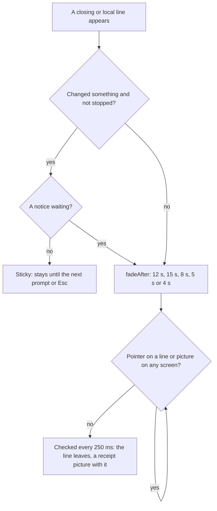

# Keys, timings and limits

> **Status:** Shipped
> **Code:** `iso/airootfs/etc/skel/.config/hypr/hyprland.lua`, `iso/airootfs/etc/systemd/user/`, `iso/airootfs/usr/local/bin/bombadil-install`, `iso/airootfs/usr/local/bin/bombadil-smoke`, `bin/bombadil`, `shell/shell.qml`, `shell/PillState.qml`, `shell/StatusLine.qml`, `shell/LineButton.qml`, `shell/QueueChips.qml`, `shell/SetupChips.qml`, `shell/FoundChips.qml`, `shell/NoticeChips.qml`, `shell/AiCard.qml`, `shell/CardHost.qml`, `shell/Stone.qml`, `shell/Wallpaper.qml`, `shell/DeskState.qml`, `shell/DeskRails.qml`, `shell/DeskRail.qml`, `shell/DeskStrips.qml`, `shell/DeskStrip.qml`, `shell/DeskDrag.qml`, `shell/DeskCard.qml`, `shell/NowCard.qml`, `shell/RowsCard.qml`, `shell/DeskTheme.js`, `shell/HyprCover.qml`, `share/qml/Bombadil/`, `src/bombadil/launcher.py`, `src/bombadil/agentd.py`, `src/bombadil/config.py`, `src/bombadil/providers.py`, `src/bombadil/cards.py`, `src/bombadil/desk.py`, `src/bombadil/narrate.py`, `src/bombadil/jobs.py`, `src/bombadil/hypr.py`, `src/bombadil/pager.py`, `src/bombadil/watch.py`, `src/bombadil/rest.py`, `src/bombadil/signin.py`, `src/bombadil/sysmap.py`, `src/bombadil/vitals.py`, `src/bombadil/notices.py`, `src/bombadil/finder.py`, `src/bombadil/snapshots.py`, `src/bombadil/mail/watch.py`, `src/bombadil/appkit/`, `share/apps/mail/`, `share/apps/brain/`
> **Design:** [Principles](../principles.md), [How Bombadil should feel](../design/ux-brief.md#the-rules), [Design system](../design-system/README.md#motion)
> **Verified:** 2026-11-08 against `main` at `7176e55`

This page lists the keys the image binds or handles (Hyprland, the pill, the details drawer, the app kit, and the Mail and Brain windows), the durations and polling intervals and the sizes and limits that the bar, agentd and the launcher set, and the words the launcher answers without a model. It does not list the constants inside the Mail and Brain windows and services: `share/apps/mail/app.py`, `share/apps/brain/app.py` and `src/bombadil/mail/` hold those, and [the Mail page](../architecture/mail.md) and [the Brain page](../architecture/brain.md) describe the pieces. Each row names the file and line that define it, as of the commit in the Verified line, and that file is the authority when a value here has drifted. Durations are milliseconds unless a unit is written. The page is Shipped because every row is code on `main`; the rules in [What the rules say](#what-the-rules-say) are only partly met, and [Where the code does not yet meet a rule](#where-the-code-does-not-yet-meet-a-rule) says where. The interaction model is in [the UX page](README.md), colours and the motion tokens in the [design system](../design-system/README.md#motion).

## Keys

The only bind file on `main` is `iso/airootfs/etc/skel/.config/hypr/hyprland.lua`, and it has no `hl.bind` other than the ones below. It also sets `input = { kb_layout = "us", follow_mouse = 1 }` (line 41). Keys that reach the pill's field (`Enter`, `Esc`, `Tab`) work only while the pill holds the keyboard. On Hyprland that is while it is summoned (`WlrKeyboardFocus.OnDemand`, else `None`); on other compositors the layer is `Exclusive` while summoned and `OnDemand` otherwise (`shell/shell.qml:219-221`). Under a full-screen window the field is disabled (`enabled: !win.capsule`, `shell/shell.qml:478`), so nothing can be typed there.

### Hyprland binds

| Key | Where | What it does | Defined in |
|---|---|---|---|
| `Super`, tapped alone (left or right) | Any window. Fires when the key is released | Runs `bombadil pill`, which sends `summon` to agentd. agentd tells every bar, and the pill on the focused screen takes the keyboard. A second tap gives it back. The file's comment says Hyprland drops the tap when another key, a click or a drag happened while `Super` was down | `iso/airootfs/etc/skel/.config/hypr/hyprland.lua:59-62`, `bin/bombadil:391-392`, `src/bombadil/agentd.py:545-547`, `shell/shell.qml:141-153` |
| `Alt+Space` | Any window. Fires on press | The same `bombadil pill`, for hosts where `Super` never arrives: a VM window on Windows keeps the Windows key for its Start menu | `iso/airootfs/etc/skel/.config/hypr/hyprland.lua:63-65` |
| `Super+Escape` | Any window | Runs `bombadil stop`, which sends `stop` to agentd: the running turn ends, and everything it started | `iso/airootfs/etc/skel/.config/hypr/hyprland.lua:66-67`, `bin/bombadil:389-390`, `src/bombadil/agentd.py:529-530` |
| `Super+Ctrl+Escape` | Any window | Runs `systemctl --user restart bombadil-shell`: starts the bar again when it hangs. agentd is not touched: the bar's unit only says `After=bombadil-agentd.service`, which is ordering and not a dependency | `iso/airootfs/etc/skel/.config/hypr/hyprland.lua:68-69`, `iso/airootfs/etc/systemd/user/bombadil-shell.service:3` |
| `Super+B` | Any window | Toggles the special workspace `browser` | `iso/airootfs/etc/skel/.config/hypr/hyprland.lua:54` |
| `Super+T` | Any window | Toggles the special workspace `terminal` | `iso/airootfs/etc/skel/.config/hypr/hyprland.lua:55` |
| `Super+F` | Any window | Toggles the special workspace `files` | `iso/airootfs/etc/skel/.config/hypr/hyprland.lua:56` |
| `Super+Q` | Any window | Closes the active window | `iso/airootfs/etc/skel/.config/hypr/hyprland.lua:57` |
| `Super+Return` | Any window | Runs `foot`, a terminal | `iso/airootfs/etc/skel/.config/hypr/hyprland.lua:58` |

### In the pill

| Key | Where | What it does | Defined in |
|---|---|---|---|
| `Enter` | The pill's field | `pillState.submit(text)`. When it returns true the field is cleared and the keyboard goes back. A blank line, or one typed while the bar is not connected, sends nothing: the field and the keyboard stay, and the second case says `Not connected to the agent yet.` | `shell/shell.qml:488-493`, `shell/PillState.qml:522-557` |
| `Esc` while a turn runs, from the moment `Enter` shows `On it`, or while a sign-in is under way | The pill's field | `pillState.stop()` sends `stop`; the line reads `Stopping` and the pill keeps the keyboard | `shell/shell.qml:506-507`, `shell/PillState.qml:94, 582-586` |
| `Esc` with nothing to stop and the AI card open | The pill's field | `closeAi()` puts the card away and `release()` gives the keyboard back. Typing in the field puts the card away too | `shell/shell.qml:496, 508`, `shell/PillState.qml:628` |
| `Esc` with text typed, nothing to stop and no AI card | The pill's field | Clears the text | `shell/shell.qml:509` |
| `Esc` with an empty field, nothing to stop and no AI card | The pill's field | `dismiss()` puts the line and the picture away, `closeDetails()` sends `close_details` so the drawer closes, and `release()` gives the keyboard back | `shell/shell.qml:510`, `shell/PillState.qml:650, 669-672` |
| `Tab` | The pill's field | Types the rest of the suggested launcher name (`pass` then `Tab` gives `passwords`). It does nothing unless at least two characters follow an optional verb and a name is longer than that | `shell/shell.qml:499-502`, `shell/PillState.qml:704-715` |

### Pointer actions that stand in for keys

| Action | Where | What it does | Defined in |
|---|---|---|---|
| Click on the pill or its field | Hyprland only | The same as tapping `Super`: this screen's pill takes the keyboard. Elsewhere the layer takes clicks on demand by itself | `shell/shell.qml:254-256, 431, 487` |
| Click anywhere else | While the pill is summoned | The focus grab clears and `release()` gives the keyboard back, so typing meant for another window never lands in the pill | `shell/shell.qml:258-264` |
| Pointer over the stone, then a click | While a turn can be stopped | The stone becomes `Stop`; the click sends `stop`. The capsule never shows `Stop`, but a tap on its stone still stops a turn that can be stopped, because the tap handler has no capsule test | `shell/shell.qml:440-467` |
| Click on the stone | While no turn can be stopped | `pillState.toggleAi()` asks agentd for fresh rows (`ai` with `op: get`) and opens the AI card: 360 px wide, one row per AI. Not connected, it says `Not connected to the agent yet.` instead. A second click puts the card away, and so do typing, a turn starting and a lost socket | `shell/shell.qml:466`, `shell/PillState.qml:95, 566, 620-628`, `shell/AiCard.qml:14-17` |
| Switch on the AI card | A switch that can be flipped (not signed in or not installed is dimmed to `0.4`) | `pillState.setAi` sends `ai` with `pause` or `resume`. The switch follows what agentd sends back, not the tap | `shell/AiCard.qml:64-93`, `shell/PillState.qml:630-635` |
| Click on a finished line | Line in mode `closing`, with no notice on it | Opens the turn's details in the drawer | `shell/StatusLine.qml:97-101` |
| `×` on a `next` chip | Queue chips | Sends `unqueue` for that turn | `shell/QueueChips.qml:46-53`, `shell/PillState.qml:588-593` |
| `Undo` button | A finished line that is `sticky` | Sends the same `undo` the word does, so it is answered without a model | `shell/StatusLine.qml:223-228`, `shell/PillState.qml:637-640`, `src/bombadil/agentd.py:535-538` |
| `Details` button | A finished line that changed something or cannot be undone | Opens the turn's details in the drawer, or closes it when it already shows that turn | `shell/StatusLine.qml:229-233`, `shell/PillState.qml:642-647` |
| A chip of a notice, and its `×` | The line, while a notice has it | The chip sends `notice_action` for its own notice and hands the keyboard over, so the window it opens can take it. The `×` sends `notice_dismiss` for the notice that was on the line when the press began and drops it from the bar at once | `shell/NoticeChips.qml:48-52, 74-81`, `shell/PillState.qml:501-515` |
| A chip under the found line | While the AI rests and the found line shows | `openFound` sends `found_open` and hands the keyboard over. agentd opens the thing and lets go of the kept ask it came from | `shell/FoundChips.qml:77-81`, `shell/PillState.qml:597-604` |
| A setup chip | Under the setup line or the resting line | `setupAction` sends `setup_action` with the chip's id, and hands the keyboard over unless the chip is `cancel`, `resume` or `retry` | `shell/SetupChips.qml:42-46`, `shell/PillState.qml:426-433` |
| `×` on a picture | The picture above the line | `dismissCard()`: puts the picture away | `shell/CardHost.qml:87-103`, `shell/PillState.qml:155` |
| A box in a picture that names a thing | The picture above the line | `openThing`: a turn opens its details in the drawer, anything else sends `open` with its kind and value | `shell/CardHost.qml:122`, `shell/PillState.qml:173-183` |
| Click on an app chip, and its `×` | The chips of running apps | The click slides that app's drawer in or out. The `×` runs `bombadil-app close NAME`, which quits the app | `shell/shell.qml:374-378, 397-404` |
| Click on the title of `Now`; `Why?` and `×` on a `Watching` row; a `Machine` row that opens something | The desk's cards | `Now` opens the turn's details. `Why?` sends `jobs` with `op: why`, the `×` stops a running job or drops a finished one, and a `Machine` row sends `vitals` with `op: open` (the disk row draws the disks picture) | `shell/DeskCard.qml:117`, `shell/DeskState.qml:25-33, 639-648, 864-866`, `shell/RowsCard.qml:114-124, 273-301` |
| Drag a card by its grip, or a strip, with the left button | The desk, past Qt's own drag threshold (`DragHandler` sets none) | Moves the card to a rail, to another place in its rail, or onto the pill's row, where it folds to a strip; a strip dropped on a rail gets its card back. The zones, the refusals and the dimming are in [The desk](#the-desk-1) | `shell/DeskDrag.qml:10-53`, `shell/DeskRail.qml:95-105`, `shell/DeskStrips.qml:66-73`, `shell/DeskState.qml:868-973` |

### In the details drawer

The drawer is a `foot` window with the app id `bombadil-details` on the special workspace `special:details` (`src/bombadil/launcher.py:142, 681, 718`, window rule `iso/airootfs/etc/skel/.config/hypr/hyprland.lua:84-85`). The keyboard is moved into it when it opens (`src/bombadil/launcher.py:689-719`).

| Key | Where | What it does | Defined in |
|---|---|---|---|
| Any key | A turn's details and `history` (`bombadil watch`, `bombadil history`) | Closes the drawer. It does so while a running turn is still being followed, too. The text printed under the output says `Press Esc to close.` | `src/bombadil/watch.py:194-236, 239-257, 285-298`, `bin/bombadil:393-400` |
| `Esc`, `q`, `Q`, `Ctrl+C` or `Ctrl+D` | A service's status, a package, a folder or a text file (`bombadil view`) | Closes the drawer. A text that fits the screen closes on any key | `src/bombadil/pager.py:27-32, 71-95`, `bin/bombadil:401-402` |
| `Up`, `Down`, `j`, `k`, `Enter` (down) | `bombadil view` with a longer text | Scrolls one row | `src/bombadil/pager.py:27-32, 53-59` |
| `PageUp`, `PageDown`, `b`, `f`, `Space` | `bombadil view` | Scrolls a page less one row | `src/bombadil/pager.py:27-32, 53-59` |
| `Home`, `g`, `End`, `G` | `bombadil view` | Jumps to the start or the end | `src/bombadil/pager.py:27-32, 53-59` |
| `Esc` in the pill | The pill's field, empty, nothing to stop and no AI card | Closes the drawer (`close_details`) | `shell/shell.qml:510`, `src/bombadil/launcher.py:725-731` |

A command that Stop ended prints `stopped` in the drawer instead of `failed (exit N)`. Its exit code is `-2`, `-15` or `-9`, the signals Stop sends (SIGINT, SIGTERM, SIGKILL; `src/bombadil/watch.py:23-24, 88-93`). So does the note that Claude Code leaves for a tool call that was cut short (`src/bombadil/watch.py:22, 80-83`).

### In apps built from the kit

These belong to the kit's components in `share/qml/Bombadil/`, so every generated app has them. [The app kit page](../architecture/app-kit.md) owns the catalogue.

| Key | Where | What it does | Defined in |
|---|---|---|---|
| `Esc` | An `AppWindow`, as a window shortcut | `App.hide()`: the app slides out and keeps running | `share/qml/Bombadil/AppWindow.qml:336-340`, `src/bombadil/appkit/runtime.py:202` |
| `Ctrl+W` | An `AppWindow`, as a window shortcut | `App.close()`: the app quits | `share/qml/Bombadil/AppWindow.qml:341-345`, `src/bombadil/appkit/runtime.py:204` |
| `Ctrl+F` | A window with a `SearchField` | Focuses the field and selects its text | `share/qml/Bombadil/SearchField.qml:44-51` |
| `Esc` | A `SearchField` that has text | Clears it and keeps the window's `Esc` from hiding the app. With no text the key goes on to the window | `share/qml/Bombadil/SearchField.qml:35-42` |
| `Ctrl+S` | An `Editor` with a `path`, not read-only | Saves the file | `share/qml/Bombadil/Editor.qml:78-83` |
| `Enter`, `Return` | An `ItemList` or a `DataTable` | Activates the current row | `share/qml/Bombadil/ItemList.qml:182-183`, `share/qml/Bombadil/DataTable.qml:402-403` |
| `Home`, `End` | An `ItemList` or a `DataTable` | First or last row | `share/qml/Bombadil/ItemList.qml:184-192`, `share/qml/Bombadil/DataTable.qml:404-413` |
| `PageUp`, `PageDown` | A `DataTable` | Moves a page of rows | `share/qml/Bombadil/DataTable.qml:410-413` |

### In the Mail and Brain windows

Mail and Brain are kit apps that ship in `share/apps/`. They have the kit's keys above, and the ones below. [The Mail page](../architecture/mail.md) and [the Brain page](../architecture/brain.md) describe the windows.

| Key | Where | What it does | Defined in |
|---|---|---|---|
| `Esc` | Mail, while a reply box is open, the account setup is open and an account exists, or (in a window narrower than `640` px) a mail is open | Leaves that view: the reply box first, then the setup, then the open mail, and puts the keyboard back on the list. With none of these open the key goes on to the kit and hides the app | `share/apps/mail/main.qml:20-27, 46-54, 61-70` |
| `R`, `A`, `#` | Mail, with a mail open in the main view and no reply box | Replies, archives, or deletes it. A key held down acts once. Nothing happens with `Ctrl`, `Alt` or `Meta` held, or while the main view is not shown (the setup, or the service not ready). Typing in a field never reaches this | `share/apps/mail/main.qml:71-94`, `share/apps/mail/app.py:1268-1274, 1412-1415` |
| Any other single printable key | Mail, on the list or an open mail, with no field focused and no `Ctrl`, `Alt` or `Meta` | Starts a search with that character in the search field. A held key does it once | `share/apps/mail/main.qml:72-93`, `share/apps/mail/MailList.qml:22-27` |
| `Ctrl+F` | Mail | Focuses the search field and selects its text | `share/apps/mail/main.qml:96-100`, `share/apps/mail/MailList.qml:17-20` |
| `Ctrl+R` | Mail and Brain | Refreshes: Mail asks the service for its status and fetches the list again, the Brain fetches its current view again | `share/apps/mail/main.qml:101-105`, `share/apps/mail/app.py:1023-1025`, `share/apps/brain/main.qml:62`, `share/apps/brain/app.py:454-459` |
| `Enter`, `Return` | Mail, on the list | Opens the row the keyboard is on | `share/apps/mail/MailList.qml:156-161` |
| `Down` | Mail's search field | Puts the keyboard on the list | `share/apps/mail/MailList.qml:114`, `share/apps/mail/QuietInput.qml:71` |
| `Esc` | Mail's search field, with text in it | Clears it. With no text the key goes on to the window | `share/apps/mail/QuietInput.qml:72-79` |
| `Enter`, `Return`, `Space` | Mail's `Send` button, when it has the keyboard | The press, the only one in the window (`activate()` is the only line that calls `press()`). Send takes it `350` ms after it could first be pressed (`ARM_MS`), and `1800` ms after somebody else changed the draft (`ARM_CHANGED_MS`) | `share/apps/mail/SendBar.qml:129-132, 140-144, 192-194`, `share/apps/mail/app.py:60-61` |
| `Alt+Left` | Brain | Goes back one step in the trail | `share/apps/brain/main.qml:61`, `share/apps/brain/app.py:450-452` |
| `Enter` | Brain's search field | Opens the first match once the matches are for the text in the field; before that it asks for them and opens the first when they arrive | `share/apps/brain/main.qml:22-30, 54-59` |
| `Down` | Brain's search field, while the matches show | Moves the keyboard into the matches, onto the first | `share/apps/brain/main.qml:31` |
| `Enter`, `Return` | A row of a Brain list or of the matches | Activates the row | `share/apps/brain/BrainList.qml:27-32` |
| `Esc` | Brain's matches | Clears the search and puts the keyboard back in the field. The list claims the key so that the kit does not hide the window | `share/apps/brain/main.qml:169-171` |

## Timings

### The bar

| Value | What it times | Defined in |
|---|---|---|
| `15000` | The "Starting" window. Until agentd first answers, the stone's face is `starting` and the placeholder reads `Starting`. If nothing has answered when the timer ends, the face is `offline` | `shell/shell.qml:36`, `shell/PillState.qml:107-120` |
| `1500`, repeating | How often the bar tries agentd's socket while it is not connected (once at start too). A Quickshell `Socket` that failed does not retry, so each try makes a fresh `Socket` | `shell/shell.qml:101-126` |
| `20000` with an empty field, `60000` with text typed | How long a summoned pill is left alone before it gives the keyboard back. Typing restarts the wait. Text already typed stays in the pill | `shell/shell.qml:266-273, 494-497` |
| `30000`, repeating | The clock text in the pill | `shell/shell.qml:538` |
| `150` | The border colour of an app chip. It is neither `Theme.fast` nor `Theme.normal` | `shell/shell.qml:373` |
| `300` (`Theme.slow`) | The pill's border colour change | `shell/shell.qml:430`, `share/qml/Bombadil/Theme.qml:93` |
| `120` (`Theme.fast`) | The width of the stone's box when `Stop` appears under the pointer | `shell/shell.qml:447`, `share/qml/Bombadil/Theme.qml:91` |
| `200` (`Theme.normal`) | The border colour of a setup chip and of a found chip | `shell/SetupChips.qml:29`, `shell/FoundChips.qml:33`, `share/qml/Bombadil/Theme.qml:92` |
| `120` (`Theme.fast`) | The border colour of a notice chip | `shell/NoticeChips.qml:36` |
| `300` (`Theme.slow`) or `0` | The wallpaper picture settling in over the ground, and the dimming over a picture of the person's own. `0` with `BOMBADIL_REDUCE_MOTION=1` | `shell/Wallpaper.qml:93-97, 107-109` |

### The line and the picture

| Value | What it times | Defined in |
|---|---|---|
| `250`, repeating while the line is shown | The seconds counter, the end of a flash, and the check that fades a finished line | `shell/StatusLine.qml:53-73` |
| `1000` | The seconds counter shows from the first full second of a turn | `shell/StatusLine.qml:28, 134` |
| `200` (`Theme.normal`) | The line's opacity in and out. The picture's opacity and its 14 px rise take the same time | `shell/StatusLine.qml:40`, `shell/CardHost.qml:38-45` |
| `120` (`Theme.fast`) | The line's height changing, `OutCubic` | `shell/StatusLine.qml:41` |
| `200` (`Theme.normal`), `120` (`Theme.fast`) | The AI card's opacity and its height (`OutCubic`), and the switch's colour and its knob's slide | `shell/AiCard.qml:25-26, 77, 84` |
| `12000` | How long a closing line stays after `turn_end` (`fadeAfter`), unless it is sticky. The resting line and the line of what was found stay `12000` too | `shell/PillState.qml:75, 299, 338, 346` |
| `15000` or more | A closing line when a receipt picture arrives: both start their time again and `fadeAfter` is raised to at least this | `shell/PillState.qml:151` |
| `15000` | The answer to a finished `undo` | `shell/PillState.qml:317` |
| `8000` | The answer to a finished picture word, the `Signed in` news line, and `Lost touch with the agent. Reconnecting.` | `shell/PillState.qml:318, 419, 571` |
| `5000` | Any other launcher or local answer (a `local` event) | `shell/PillState.qml:318` |
| `4000` | `Not connected to the agent yet.`, after `Enter` while disconnected | `shell/PillState.qml:525-529` |
| unchanged | A local error with no turn keeps the `fadeAfter` the line had before | `shell/PillState.qml:264` |
| until the next prompt or `Esc`, and it fades like any other line (`fadeAfter` `12000`) while a notice waits | A closing line of a turn that changed something and was not stopped (`sticky`): it keeps `Undo` | `shell/StatusLine.qml:65-71`, `shell/PillState.qml:298` |
| `3500` (`flashFor`) | A message shown over a running turn: a launcher answer, an error with no turn, the line of a stop, `Not connected to the agent yet.` | `shell/PillState.qml:78, 263, 287, 311, 578` |
| `8000` | The same flash when it answers `why` | `shell/PillState.qml:311` |
| `2500` (`windowGrace`), `5000` (`clickGrace`) | A window that opens on the stage puts a picture away, unless the picture is younger than `windowGrace` or a box in it was clicked less than `clickGrace` ago. A picture still being drawn stays | `shell/PillState.qml:157-170` |

A pointer resting on the line or on a picture, on any screen, holds a closing line (`hovers`), and a receipt picture goes when its line goes (`PillState.fade`). A picture that was asked for (not a receipt, not still being drawn: `pictureStays`) keeps its line from fading at all until `Esc` or the next turn (`shell/PillState.qml:86`, `shell/StatusLine.qml:61, 69`).

### The stone

Every looping motion has a `running` condition, so nothing loops at rest. The lean is a `Behavior`, which moves only when the face changes.

| Value | What it times | Defined in |
|---|---|---|
| `400` (`settle`), once | For this long after the bar starts the stone is painted resting green whatever its face says, then follows its face. The scene graph drops a colour change made in the first frames | `shell/Stone.qml:39-41` |
| `240`, curve (0.16, 1, 0.3, 1) | The lean toward what is typed (`listening`). It has no reduced-motion version | `shell/Stone.qml:60` |
| `1000`, repeating | `working` and `starting`: hold `300`, turn 120 degrees in `550` on (0.55, 0, 0.3, 1), hold `150`. A third of a turn looks the same, so the loop is unseen | `shell/Stone.qml:197-209` |
| `500` and `500`, repeating | Reduced motion for `working`: opacity to `Theme.pulseLow` (0.3) and back | `shell/Stone.qml:210-217`, `share/qml/Bombadil/Theme.qml:94` |
| `1600`, repeating | `needs`: knocks tip 8 degrees for `192`, `160`, `160` and `160`, then wait `928` | `shell/Stone.qml:219-230` |
| `560` and `1040`, repeating | `needs`: the glow breathes from 0.25 to 0.6 and back, on the same 1600 beat. Reduced motion holds it at 0.45 | `shell/Stone.qml:58, 72, 231-237` |
| `700`, once | `done`: the hop, in steps of `70`, `196`, `168`, `112` and `154` | `shell/Stone.qml:239-266` |
| `600`, once | Reduced motion for `done`: a fade in from 0.3 | `shell/Stone.qml:267-271` |

### The desk

| Value | What it times | Defined in |
|---|---|---|
| `150` (`foldMs`) | A card fading out and shrinking to 0.6 toward its outer bottom corner, and back; a strip fading in | `shell/DeskTheme.js:51`, `shell/DeskState.qml:47`, `shell/DeskRail.qml:85-86`, `shell/DeskStrips.qml:63` |
| `400` (`unfoldDelayMs`) | How long after the last window leaves a card's place the card unfolds. A window back over it in that time keeps it folded | `shell/DeskTheme.js:52`, `shell/DeskState.qml:48, 252-264, 264-270` |
| `600` (`washMs`) | The colour of a row that has just arrived, washing over a card's left edge | `shell/DeskTheme.js:53`, `shell/DeskCard.qml:82-89` |
| `150` (`pillAnimMs`) | The pill's width changing between the desk's modes, `OutCubic` | `shell/DeskState.qml:167-169` |
| `230` (`foldMs` plus `80`) | A rail's window stays up this long after its last full card has gone, and after a drag ends. It is up for as long as a drag lasts, an empty rail's too: it draws the drop mark | `shell/DeskRail.qml:25-41` |
| `500` (`settleMs`) | After a drop, the card or strip it came from stays dimmed until agentd answers with the desk or this long | `shell/DeskState.qml:877-878, 272-277, 582` |
| `2000`, repeating | The ring that breathes round a dot: the machine's turn, a session working, a live row | `shell/DeskCard.qml:43-59` |
| `1000` (`tickMs`), repeating | The clock the Watching rows read. It runs only while agentd lists a job that has not failed, so a desk with nothing counting wakes nothing | `shell/DeskState.qml:102, 106, 285-293` |
| `12000` (`doneStaysMs`) | A finished job's row leaves this long after it ended | `shell/DeskState.qml:103, 705` |
| `5000` (`goneMs`) | A row the person removed stays gone this long and comes back if agentd still lists the job | `shell/DeskState.qml:105, 278-284` |
| `300` (`pollMs`), repeating | `HyprCover` asks Hyprland where the windows are, while any window is on the stage. Nothing reports a drag | `shell/HyprCover.qml:14, 87-93` |
| `40` | `HyprCover` reads Hyprland's answer this long after it asked. A burst of events settles every `40` rather than waiting for the burst to end | `shell/HyprCover.qml:71-75` |
| `250` | `HyprCover` reads again once a slow answer has surely come | `shell/HyprCover.qml:76-80` |
| `100`, at most 20 times | `HyprCover` asks again when the monitor's own answer has not arrived, for example when the bar starts with windows open | `shell/HyprCover.qml:49, 81-85` |

### The compositor

| Value | What it times | Defined in |
|---|---|---|
| `speed = 4`, curve `ease` (0.16, 1) (0.3, 1), style `slide` | Windows opening and closing. The unit of `speed` is Hyprland's, not defined here | `iso/airootfs/etc/skel/.config/hypr/hyprland.lua:44-45` |
| `speed = 5`, curve `ease`, style `slidevert` | A special workspace sliding in or out: panels, app drawers and the details drawer | `iso/airootfs/etc/skel/.config/hypr/hyprland.lua:46` |
| `speed = 4`, curve `ease` | Fades | `iso/airootfs/etc/skel/.config/hypr/hyprland.lua:47` |
| `enabled = false` | The `layers` animation is off. The bar is a layer, and Hyprland slid it to the place its changed size gave it whenever a picture resized it, so the pill dipped and swung back. The pill and the picture host take their size at once | `iso/airootfs/etc/skel/.config/hypr/hyprland.lua:48-51` |

### The session services

agentd, the bar and `mako` run as systemd user services, so systemd starts one again when it dies. [The session services page](../architecture/session-services.md) owns the units; these are the times and limits they set.

| Value | What it times | Defined in |
|---|---|---|
| The `hyprland.start` hook | Runs `systemctl --user import-environment && systemctl --user restart bombadil-agentd bombadil-shell mako`, then hands Mail's unit the session's display variables and restarts it | `iso/airootfs/etc/skel/.config/hypr/hyprland.lua:7-14` |
| `Restart=always`, `RestartSec=1`, `StartLimitIntervalSec=0`, `TimeoutStopSec=5`, `KillMode=process` | `bombadil-agentd.service`: starts again 1 s after it dies and never gives up. systemd gives it 5 s to stop and then kills it. `KillMode=process` leaves the apps it started running | `iso/airootfs/etc/systemd/user/bombadil-agentd.service:4, 8-12` |
| `After=bombadil-agentd.service`, `Restart=always`, `RestartSec=1`, `StartLimitIntervalSec=0`, `TimeoutStopSec=5` | `bombadil-shell.service`, the bar: ordered after agentd (an ordering, not a dependency), starts again 1 s after it dies and never gives up, and systemd gives it 5 s to stop and then kills it | `iso/airootfs/etc/systemd/user/bombadil-shell.service:3-4, 8-10` |
| `Restart=always`, `RestartSec=1`, `StartLimitIntervalSec=0` | The `mako` drop-in: the notifications come back 1 s after `mako` dies | `iso/airootfs/etc/systemd/user/mako.service.d/restart.conf:3-4, 7` |
| `Restart=on-failure`, `RestartSec=2`, `StartLimitIntervalSec=0` | `bombadil-mail.service` and `bombadil-brain.service`, which start at login | `iso/airootfs/etc/systemd/user/bombadil-mail.service:6, 14-15`, `iso/airootfs/etc/systemd/user/bombadil-brain.service:6, 13-14` |

### In apps built from the kit

The fades, slides and colour changes of the kit's components in `share/qml/Bombadil/` take `Theme.fast` (120) or `Theme.normal` (200). These are the values they set as literals, and the timers they run.

| Value | What it times | Defined in |
|---|---|---|
| `900`, repeating | A `BusyIndicator` turn | `share/qml/Bombadil/Style/BusyIndicator.qml:49` |
| `1400`, repeating | The sweep of an indeterminate `ProgressBar` | `share/qml/Bombadil/Style/ProgressBar.qml:51` |
| `600` | How long a `ScrollBar` or `ScrollIndicator` holds before it fades out over `Theme.normal` | `share/qml/Bombadil/Style/ScrollBar.qml:40-41`, `share/qml/Bombadil/Style/ScrollIndicator.qml:37-38` |
| `500`, `600` | The tooltip delay on the error banner of an `AppWindow`, and on an `IconButton` | `share/qml/Bombadil/AppWindow.qml:284`, `share/qml/Bombadil/IconButton.qml:40` |
| `2500` | A toast stays this long | `share/qml/Bombadil/AppWindow.qml:329-333` |
| `1500` | A `DetailGrid` cell says `Copied` this long | `share/qml/Bombadil/DetailGrid.qml:74-78` |
| `30` s | A copied secret is cleared from the clipboard after this long | `share/qml/Bombadil/DetailGrid.qml:7, 70` |
| `300` | A `Store` writes its file this long after the last change | `share/qml/Bombadil/Store.qml:47-50` |
| `1000`, at least `50` | A `Series` takes a sample every `interval` ms. `0` samples on each change. `capacity` is `120` points | `share/qml/Bombadil/Series.qml:11-12, 38-43` |
| `140` | A box in a `Diagram` moving or resizing, `OutCubic` | `share/qml/Bombadil/Diagram.qml:400-402` |

### agentd and the launcher

| Value | What it times | Defined in |
|---|---|---|
| `0.03` s (`DESK_DEBOUNCE`, `JOBS_DEBOUNCE`) | Changes to the desk, or to the jobs table, that come close together go out as the state they end in | `src/bombadil/agentd.py:245, 247, 709-716, 867-874` |
| `2.0` s (`JOBS_POLL`) | How often agentd looks at the jobs table while it has anything in it | `src/bombadil/agentd.py:248, 841-860` |
| `3` s | How often agentd looks for an app that appeared or went, to tell the bar which names it can complete | `src/bombadil/agentd.py:632-643` |
| `5.0` s (`SEND_TIMEOUT`) | How long one write to a client may take before agentd drops that client | `src/bombadil/agentd.py:211, 646-653` |
| `2` s | How long a client that hung up has to receive what was already queued for it | `src/bombadil/agentd.py:472-478` |
| `1.0` s (`OUTPUT_GRACE`) | How long a turn's output may take to drain after its process exits. Longer means a job left in the background holds the pipe, and the turn ends without it | `src/bombadil/agentd.py:214, 2225-2240` |
| `30.0` s (`NO_PROGRESS_SECS`), times `quiet_factor` | With no tool running and no event for this long, the line says `<Provider> is not answering; check the connection`, or `<Provider> is busy, trying again` when the CLI reported a retry of a busy API. `quiet_factor` is `1.0` for Claude and `6.0` for Codex, so 30 s and 180 s | `src/bombadil/agentd.py:227, 2196, 2206-2214`, `src/bombadil/providers.py:96, 543` |
| `5.0` s (`WATCHDOG_TICK`) | How often that check runs | `src/bombadil/agentd.py:228, 2208` |
| `5.0` s (`OFFLINE_POLL`) | While there is no way to the sign-in page, how often agentd looks again | `src/bombadil/agentd.py:239, 1495-1500` |
| `120.0` s (`READY_LINE_SECONDS`) | How long `Signed in to Claude` is worth saying to a bar that connects after it | `src/bombadil/agentd.py:243, 1359-1362` |
| `600` s, from the environment `BOMBADIL_SIGNIN_TIMEOUT` | How long a sign-in may wait on its page. agentd watches a sign-in that was started in a terminal every `2` s for this long | `src/bombadil/signin.py:38`, `src/bombadil/agentd.py:1630-1642` |
| `10` s | How long `_end_signin` waits for a cancelled sign-in's page to be put away | `src/bombadil/agentd.py:1553-1563` |
| `1.5` s (`BUDGET` plus `1.0`) | How long a turn's receipt waits for the picture of the machine taken before the turn. `sysmap.BUDGET` is `0.5` | `src/bombadil/agentd.py:1269`, `src/bombadil/sysmap.py:36` |
| `2.0` s (`POKE_TIMEOUT`) | However the brain's client misbehaves, the note about a turn that agentd sends it is not held up longer than this, and nothing it does fails a turn | `src/bombadil/agentd.py:219, 2441-2451` |
| `0.05` s | Polls while an undo, a restart or a shutdown waits for the running turn to end, and while `_exited` waits for a process | `src/bombadil/agentd.py:1148, 2689` |
| `60.0` s (`REST_POLL`) | While a limit lasts, how often agentd compares the wall clock with the time the provider gave | `src/bombadil/agentd.py:240, 1729` |
| `60.0` s (`RESET_GRACE`), `300.0` s (`RETRY_AFTER_REFUSAL`) | The reset time a provider gives is trusted only `60.0` s after it, so the first ask is never sent at the edge of the window (`REST_POLL` counts to that moment). A refusal that names a time already past, from a clock that is off or a window that rolled over, is not kept: the next try is `300.0` s later | `src/bombadil/rest.py:34-38, 130-138`, `src/bombadil/agentd.py:1727` |
| `30.0` s (`AI_SIGNED_TTL`) | How long the AI card trusts that the other AI is signed in (asking its CLI costs a call) | `src/bombadil/agentd.py:241, 1933-1935` |
| `1.0` s (`NOTICE_POLL`) | How often a notice with a time to live is looked at, only while one exists | `src/bombadil/agentd.py:250, 977` |
| `30` s, `20` s | The time to live of the two errors that agentd puts on a notice in place of what it said: `Could not do that: ...` when a notice's chip failed, and the error of a Mail notice whose reply could not be made. `NOTICE_POLL` is how often they are looked at | `src/bombadil/agentd.py:1008-1016`, `src/bombadil/mail/watch.py:212-216` |
| `2.0` s (`MAIL_WINDOW_DEBOUNCE`) | The Mail service's `show` push that follows agentd's own request for the Mail window must not open it twice | `src/bombadil/agentd.py:252, 1090` |
| `1.0` s (`DRAFT_CHECK_SECONDS`), `1.0` s (`MAIL_SHOW_SECONDS`) | How long `send it` waits to learn whether a draft is waiting, and the longest the launcher waits for the Mail service to show a view | `src/bombadil/agentd.py:253, 1075`, `src/bombadil/launcher.py:94, 903` |
| `5.0` s, `2.0` s, `1.0` s, `30.0` s | The Machine card's samples: every `5.0` s (`CALM_EVERY`) while nothing is up and nothing is close, `2.0` s (`NEAR_EVERY`) near a line, `1.0` s (`FAST_EVERY`) while the card is up, asked for or a line is one sample from being crossed, and the lists of mounts and sensors every `30.0` s (`SLOW_EVERY`) | `src/bombadil/vitals.py:25-28` |
| `30.0` s (`ASK_FOR`), `3`, `10`, `10.0` s | How long `how's the machine` keeps the Machine card up; the samples in a row over a line to cross it (`ENTER_SAMPLES`) and under its lower mark to leave (`LEAVE_SAMPLES`); the seconds a line stays up once it crossed (`MIN_UP`) | `src/bombadil/vitals.py:29-32` |
| `5.0` s (`wait`), polled every `0.05` s | How long the launcher waits for the details drawer's window to map before it shows the drawer anyway | `src/bombadil/launcher.py:689-719` |
| `3` s, `10` s | The `wpctl` call behind `sound`, `volume up`, `volume down`, `mute` and `unmute`, and the `systemctl` call behind `restart` and `shutdown` | `src/bombadil/launcher.py:807, 818, 845, 849` |
| `20.0` s (`wait`), polled every `0.2` s | How long opening a panel waits for its app's window before the line says `, it is still starting.` | `src/bombadil/hypr.py:193, 207-212`, `src/bombadil/launcher.py:435` |
| `10` s, `15` s | One request on Hyprland's socket, and one `hyprctl dispatch`. A dispatch that misses the compositor's deadline is tried up to three times, with a wait of `1` s, `2` s and `3` s after each miss | `src/bombadil/hypr.py:126, 143-149` |
| `2` s | How long `bombadil pill` and `bombadil stop` wait on agentd's socket, so a key bind never hangs | `bin/bombadil:133` |
| `0.05` s, `15` s | The pager waits this long after `Esc` to tell it from an arrow key, and `bombadil view -- COMMAND` kills a command after `15` s | `src/bombadil/pager.py:25, 109, 136` |
| `15.0` s (`DONE_STAYS`), `1800` s (`FAILED_STAYS`), `86400` s (`KEEP`), `15.0` s (`CALL_TIMEOUT`) | The jobs table. A finished job's row stays `15.0` s. A failed one stays `1800` s or until dismissed. A record and its log are deleted `86400` s after the job ended. One systemd call may take `15.0` s | `src/bombadil/jobs.py:40-42, 49, 271, 448` |

The shell hides a finished row after `12000` ms (`doneStaysMs`) and the table drops it after `15.0` s, so a done row is listed for three seconds without being shown.

## Sizes and limits

### The pill, the line and the chips

| Value | What it limits | Defined in |
|---|---|---|
| `52` px high, radius `26`, border `1.5` px | The pill (`pillHeight`, `radiusPill`, `pillBorder`) | `share/qml/Bombadil/Theme.qml:66-67, 73` |
| `900` px | The widest the pill, the line and the chips grow (`pillMaxWidth`). On the screen the desk lives on, the pill is `deskState.pillWidth` instead | `share/qml/Bombadil/Theme.qml:71`, `shell/shell.qml:203, 423` |
| `360` px | The floor of the width limit on the line, the picture, the found chips and the queue chips (`Math.max(360, win.pillMax)`, and `Math.max(360, win.pictureMax)` for the picture), and the pill's width while any window shares the stage (`shared`) | `shell/shell.qml:306, 318, 331, 350`, `shell/DeskState.qml:161` |
| `560` px | The widest a picture grows beside a window (`Math.min(560, stageRoom)`, less on a screen whose rails and strips leave less room); with no window it is as wide as the pill, and the pill is 360 while a window shares the stage | `shell/DeskState.qml:166, 170`, `shell/shell.qml:205, 306` |
| `100` px | The pill's width under a full-screen window (`immersive`): the capsule holds the stone and the clock only | `shell/DeskState.qml:142-146, 160` |
| `900` px at most and `360` at least, less what strips and a full card take on each side | The pill's width on a screen with nothing on the stage (`open`) | `shell/DeskState.qml:158-162` |
| `64` px, plus the app chips and `8` px when they show | The bar's exclusive zone: windows never cover the pill row | `shell/shell.qml:223` |
| `12` px margins, `8` px between rows | The column that holds the picture, the line, the chips and the pill | `shell/shell.qml:294-295` |
| `24` by `24` px, the stone `18` px wide | The stone and its slot | `shell/Stone.qml:5, 27-28` |
| `28` px high | A queued chip, a notice chip, an app chip and a desk strip (`chipHeight`, `stripHeight`) | `share/qml/Bombadil/Theme.qml:70`, `shell/QueueChips.qml:21`, `shell/NoticeChips.qml:31`, `shell/shell.qml:368`, `shell/DeskTheme.js:45` |
| `260` px | The widest prompt text in a `next` chip; it elides past it | `shell/QueueChips.qml:39` |
| `180` px | The widest app title in an app chip | `shell/shell.qml:385` |
| `46` px high, at least `132` px wide, and `30` px high | A `big` setup chip, and every other setup chip | `shell/SetupChips.qml:23-24` |
| `30` px high, `96` to `520` px wide, label at most `420` px | A found chip. A row too wide for the bar shrinks its chips and cuts their labels short | `shell/FoundChips.qml:25-28, 44` |
| `3` chips | The most found chips the bar shows (agentd's finder sends at most `3` too: `LIMIT`) | `shell/PillState.qml:379`, `src/bombadil/finder.py:30` |
| `60` characters, `400` asks | A found chip's label (`LABEL`), and how many of the latest past asks the finder looks through (`PAST_ASKS`) | `src/bombadil/finder.py:32-33, 202-207` |
| `8` notices, `3` chips each, `400` and `40` characters | What the bar keeps of agentd's notices (`maxNotices`), the chips on one, the cut of a notice's text and of a chip's label. agentd keeps `4` notices of `3` actions, lines of `200` characters and labels of `40` | `shell/PillState.qml:54, 461, 466, 468`, `src/bombadil/notices.py:28-31` |
| `360` px wide, `36` by `20` px switch | The AI card, and a switch on it | `shell/AiCard.qml:16, 69-70` |
| `24` px high | The `Undo` and `Details` buttons | `shell/LineButton.qml:11` |
| `1` line while a turn runs, `2` for a flash, up to `4` once it ended | The line above the pill (`maximumLineCount`) | `shell/StatusLine.qml:127` |
| `1` line each, `2` for the reason | The exact command, the `after reading` note and the reason (`because`) under a marked step | `shell/StatusLine.qml:172, 206, 189` |
| `400` characters | How much of the agent's own words `StatusLine.newest` looks through to find the newest words that fit | `shell/StatusLine.qml:79-90` |
| `200` characters | The tail of the agent's own words the narrator sends as the line | `src/bombadil/narrate.py:1757, 1765, 1772` |
| `1` line, `2` lines | An error with no turn: shown over a running turn as its first line, else as the line, up to two lines | `shell/PillState.qml:263-264` |
| none | The `next` chips. `AgentD.pending` has no cap in code, and the chips are one `RowLayout` as wide as the pill | `src/bombadil/agentd.py:285, 523`, `shell/QueueChips.qml:7-12`, `shell/shell.qml:343-351` |
| `540` by `660` px | The static window rule for every `bombadil-app-*` window: floating and centred. `hypr.APP_CARD` is the same size, and the card that `place_app` cascades: `3` slots (`APP_SLOTS`), each `48` px down and to the right of the last (`APP_STEP`), a slot held `10.0` s for an app whose window has not appeared (`PENDING_SECS`) | `iso/airootfs/etc/skel/.config/hypr/hyprland.lua:71-78`, `src/bombadil/hypr.py:31-33, 56` |
| `560` by `680` px | The size a kit app asks for when it declares none (`AppWindow` `width` and `height`, and `DEFAULT_SIZE`). The runtime clamps a declared size to between `240` by `160` and `3840` by `2160`, `placement.fit` shrinks it to the room, keeping `24` px of margin and `56` px for the line, and a window rule for that size is added for the app | `share/qml/Bombadil/AppWindow.qml:36-37`, `src/bombadil/appkit/runtime.py:33, 497-505, 559-560`, `src/bombadil/appkit/placement.py:22-24, 53-57, 168-172` |
| `12` px rounding, gaps `6` and `12`, border `1`, blur size `6` and `2` passes | Windows (`rounding` matches `Theme.radius`), the gaps between them and their blur | `iso/airootfs/etc/skel/.config/hypr/hyprland.lua:18-31` |

### Pictures

A picture that breaks a limit is refused, with an error that names the limit (`validate_diagram`). Only `note`, `time` and `key` are cut without an error.

| Value | What it limits | Defined in |
|---|---|---|
| `12` boxes (`MAX_NODES`) | Nodes in one picture | `src/bombadil/cards.py:23, 89-91` |
| `16` links (`MAX_LINKS`) | Links in one picture | `src/bombadil/cards.py:24, 185-187` |
| `60` characters (`MAX_TITLE`) | A picture's title | `src/bombadil/cards.py:25, 189-193` |
| `32` characters (`MAX_LABEL`) | A box's label | `src/bombadil/cards.py:26, 100-105` |
| `60` characters (`MAX_SUB`) | A box's `sub`, and its `note`, which is cut | `src/bombadil/cards.py:27, 113-117, 142-144` |
| `160` characters (`MAX_SAY`) | The one sentence under a picture (`say`) | `src/bombadil/cards.py:28, 194-196` |
| `24` characters (`MAX_LINK_LABEL`) | A link's label. A box's `time` is cut at `24` too | `src/bombadil/cards.py:29, 177-181, 135-136` |
| `40` characters | A box's `id` (and `key`, which is cut) | `src/bombadil/cards.py:31, 145-146` |
| `120`, `80`, `9` | A unit name, a package name, and the digits of a turn number in `opens` | `src/bombadil/cards.py:32-33, 53-71` |
| `3` lines | The `say` sentence in the picture host | `shell/CardHost.qml:136` |
| `60` percent of the screen's height | The tallest picture host (`maxHeight`). The scroll area is `maxHeight - 120` | `shell/shell.qml:308-309`, `shell/CardHost.qml:16, 110` |
| `1` picture | One at a time: a newer one replaces it, `Esc` and its `×` put it away, the next turn clears it | `shell/PillState.qml:80-82, 141-155, 240` |

### The desk

| Value | What it limits | Defined in |
|---|---|---|
| `300` px | A card's width (`cardWidth`, equal to `Theme.railWidth`) | `shell/DeskTheme.js:39`, `share/qml/Bombadil/Theme.qml:72` |
| `16`, `40`, `16`, `12` px | A rail's margin from the screen edge, its top, its bottom above the pill's row, and the gap between cards | `shell/DeskTheme.js:41-44` |
| `300` px wide, `40` px top margin, `16` px side margins, layer `Bottom`, exclusive zone `0` | A rail's window: one on each side of a screen, under the app windows and over the wallpaper. Its input mask is the box around the cards in full, so a click beside a card goes through. On a screen the desk does not live on, or under a full-screen window, there is no window | `shell/DeskRails.qml:17-39`, `shell/DeskRail.qml:13-23, 43-59` |
| `28` px high, `12` px apart, text at most `220` px | A strip, the gap between strips and from the pill, and the strip's text | `shell/DeskTheme.js:45-46`, `shell/DeskStrip.qml:17, 24` |
| `3` per side | Strips beside the pill; more merge into one `+N` | `shell/DeskState.qml:352-369` |
| `screenHeight - 120` px | A rail's height: from `40` below the top to `64 + 16` above the bottom | `shell/DeskState.qml:175-177` |
| `1016` px | The narrowest screen that keeps its cards in full: `2 * (300 + 16 + 12) + 360`. A narrower one keeps them as strips | `shell/DeskState.qml:149-150` |
| `68 + 26 * steps`, plus `20` for a command and `18` for a caption | The height of `Now` | `shell/DeskState.qml:118, 187-190`, `shell/NowCard.qml:22-23, 49` |
| `68` plus `34` per meter or stack row and `44` per other row | The height of `Watching`, `Needs you` and `Machine` | `shell/DeskState.qml:193-196`, `shell/RowsCard.qml:109` |
| `6` rows | The most rows `Machine` keeps; a row past the sixth is dropped | `shell/DeskState.qml:780, 808-822` |
| `168` | The height of `Alive`. Nothing fills the `alive` or `away` models, and `DeskRail` draws a face only for `Now`, `Watching`, `Needs you` and `Machine`, so this height is never used | `shell/DeskState.qml:71, 73, 192`, `shell/DeskRail.qml:90-92` |
| `12` rows | Steps shown on `Now`: a longer plan shows the steps around the current one, and `Step 7 of 20` still counts all | `shell/DeskState.qml:563-573` |
| `36`, `44` characters | About what a card's title and its why line hold | `shell/DeskState.qml:566-567` |
| `60` characters | The prompt shown as `Now`'s title (`36` less `asked by` when a session asked) | `shell/DeskState.qml:557` |
| `70` characters | A `Needs you` row's second line | `shell/DeskState.qml:766` |
| `2` rows | `Needs you` is a card only from two waiting sessions; one is the line. The stone knocks for one (`needsYou`), card or no card | `shell/DeskState.qml:129, 133` |
| `2` steps, or a step that touches the system | `Now` shows for a plan of two steps or more, or a turn that touched the system | `shell/DeskState.qml:114` |
| `50` px high, left button only | A card's grip: the title and the line under it. The rows start below it, so a button or an `×` never starts a drag | `shell/DeskRail.qml:95-105`, `shell/DeskDrag.qml:23` |
| `screenHeight - 64` px and below | A drop on the pill's row. A card taken from a rail folds to its strip (`fold` with its widget); a strip dropped there does nothing | `shell/DeskState.qml:175, 893, 953` |
| `railX(left) + 300 + 40` px and left, `railX(right) - 40` px and right | A drop beside a rail: a `move` to that rail, at the place under the pointer. Between the two is the stage, where nothing happens; so is any point over a window | `shell/DeskState.qml:179, 892, 894-895, 954` |
| `3` px high | The drop mark across a rail | `shell/DeskRail.qml:145-153` |
| `0.55` | The opacity of the dim over the card or strip in hand, and over the one a drop was sent for until `settleMs` | `shell/DeskRail.qml:107-117`, `shell/DeskStrips.qml:74-83` |
| `0.6` | The ghost chip: an outlined strip at the outer end of the strips on the side a card was taken from, while the card is held over the pill's row. It sits outside the row, so it moves nothing | `shell/DeskStrips.qml:19-20, 88-101` |
| Over a window, in the middle, a strip on the row, or a card put back where it was | A drop that sends nothing. Cards in the order they are, among the cards on show, are not a move; a strip is never in its place, so its drop always counts | `shell/DeskState.qml:892-895, 913-920` |
| Connected, no other drag, the widget in the face it is taken from | A drag is refused otherwise. A `desk` message that arrives during a drag waits for the drop. A move also gives a hand-folded card its card back | `shell/DeskState.qml:422-423, 924-931`, `src/bombadil/desk.py:221-226, 245` |
| `6` widgets, `1` always, `1` opt in | `now`, `watching`, `alive`, `needs`, `away`, `machine`. `needs` cannot be hidden, and `alive` is on the desk only after `show alive`. `Desk.stripped` holds the cards folded by hand, kept in `desk.toml`, and `fold` and `unfold` take a widget | `src/bombadil/desk.py:42-53, 125, 154-159, 194-195, 200-205, 310` |
| `1` to `40` characters | A screen name in `desk.toml` (`[A-Za-z0-9 ._:/-]`) | `src/bombadil/desk.py:281` |
| `20` jobs | Running jobs at once (`MAX_RUNNING`) | `src/bombadil/jobs.py:43, 319-320` |
| `80`, `120`, `20000` characters | A job's title, the last line of its output, and its command | `src/bombadil/jobs.py:44, 46-47` |
| `1` second to `7` days | A timer's length (`MAX_SECONDS`) | `src/bombadil/jobs.py:48, 177-178` |

### Words, records and history

| Value | What it limits | Defined in |
|---|---|---|
| `140` characters (`MAX_BECAUSE`) | The reason for a step: the agent's last sentence before it acted | `src/bombadil/narrate.py:1239, 1271-1273` |
| `90` characters | A step's words from a description, a plan step's text (`MAX_TASK_TEXT`), and a thinking line | `src/bombadil/narrate.py:82, 1004, 1013, 1427, 1776` |
| `24` steps (`MAX_PLAN`) | The plan the narrator keeps for the desk | `src/bombadil/narrate.py:1426, 1623, 1661, 1684` |
| `50` reads (`MAX_READS`), `60` characters a label | What the turn read, in order, for the `after reading` note. A command that prints files counts the first `3` | `src/bombadil/narrate.py:1305, 1318, 1365, 1536` |
| `300`, `280` characters | The exact command shown under a marked step; the `edit` command of a file change | `src/bombadil/narrate.py:859, 1047` |
| `40` characters | An app's title, a job's title and a quoted name in a step | `src/bombadil/narrate.py:90, 114, 118` |
| `3` changes named | The closing sentence names the first three changes and then `and N more` | `src/bombadil/narrate.py:1787-1789` |
| `16000` characters (`MAX_OUTPUT`) | One command's output kept in events and the turn's log | `src/bombadil/agentd.py:207, 2382-2383` |
| `10000` messages (`CLIENT_BACKLOG`) | What may wait for one client that stops reading. A full queue drops the client | `src/bombadil/agentd.py:210, 445, 659-667` |
| `4` MiB (`LINE_LIMIT`) | The longest line a client may send agentd | `src/bombadil/agentd.py:257, 429` |
| `64` MiB | One line of a provider's output: a stream line can carry a whole screenshot | `src/bombadil/agentd.py:2149` |
| `50` turns | Turn logs agentd remembers for Details. An older turn answers `The details of turn N are not kept.` | `src/bombadil/agentd.py:2067-2068, 1221-1223` |
| `10` notes | What happened without the model that agentd tells the next prompt | `src/bombadil/agentd.py:743, 883, 912, 1054, 1107, 1170, 1208, 1677, 1785` |
| `200` paths (`MAX_TURN_FILES`), `60000` characters (`MAIL_ANSWER_CHARS`) | The paths kept in a turn's row for each of wrote and read (a turn that touched more is a build or a bulk edit, and the brain's watcher sees those writes anyway), and the most text one mail tool answers with | `src/bombadil/agentd.py:215-217, 254, 1038, 2488-2496` |
| `60` characters | The prompt in a restore point's name (`turn:N: prompt`) | `src/bombadil/agentd.py:2099` |
| `30` restore points kept, no hourly ones | On an installed system snapper keeps the newest `30` numbered restore points (`NUMBER_LIMIT=30`, `NUMBER_CLEANUP=yes`), takes none on a timeline (`TIMELINE_CREATE=no`), and `snapper-cleanup.timer` is enabled. A turn's restore point is created with `--cleanup-algorithm number`, so the limit applies to it. The cleanup runs when the timer fires, so more than `30` can exist between runs | `iso/airootfs/usr/local/bin/bombadil-install:67-69`, `src/bombadil/snapshots.py:43-46`, `iso/airootfs/usr/local/bin/bombadil-smoke:495` |
| `200` restore points | What `undo` reads to find the turn to go back to. Only the newest `30` are kept on an installed system | `src/bombadil/launcher.py:640` |
| `40` entries | What `bombadil history` shows | `src/bombadil/watch.py:260-262` |
| `24` characters | A coding session's name in `asked_by` (`[a-z][a-z0-9_-]{0,23}`) | `src/bombadil/agentd.py:206` |
| `2000`, `200` characters | The end of a provider's stderr kept for an error, and the first line of a limit message | `src/bombadil/agentd.py:2243, 2523` |
| `3` services, `2` services | Services whose facts are taken before a step, and services a receipt considers | `src/bombadil/agentd.py:2343, 1265` |
| `200`, `4096` | The reason of a failed action in characters, and the bytes the launcher reads to tell a text file | `src/bombadil/launcher.py:913, 916, 880` |
| `2000000` bytes | A file shown by `bombadil view`; a larger one shows its start and says so | `src/bombadil/pager.py:24` |

## The launcher words

agentd answers these without a model. A typed line is lowercased, its whitespace is collapsed and the signs ` .!?,;:` are trimmed from both ends (`normalize`). Then only spaces, hyphens and underscores fold away (`_key`), so `wi-fi`, `wi fi` and `wifi` are one word. A line that has any other sign, or a letter outside `a-z`, matches no word in the tables. Four things get past that: an app's own title (so `Café` opens), a picture phrase and a widget question, which hold their own apostrophes, and the unit name in `what does <unit> need`. A line that starts with `!` is never a word: `match` returns nothing for it (`src/bombadil/launcher.py:235-236`), and agentd runs it as a shell command turn, with no model, signed in or not (`src/bombadil/agentd.py:1995-1997, 2056`). The list is exact on purpose: a parser that guessed would give the machine two brains that sometimes disagree. The code is `src/bombadil/launcher.py`, called from `AgentD._match` (`src/bombadil/agentd.py:624-630`).

`match` tries these in order, and the first that fits wins (`src/bombadil/launcher.py:231-298`):

1. A line that is empty or starts with `!`: not a word (235-236).
2. `why`, only while a turn runs (244).
3. A picture phrase, or `what does <unit> need`, unless an app has exactly that title (246-249).
4. A widget question, such as `how's the machine`, unless an app has exactly that title (250-252).
5. A sign-in word (253-254).
6. A provider verb and a provider name (255-260).
7. `pause` or `resume` and a provider name or `the ai` (261-266).
8. A core command (267-271).
9. A model word (272-274).
10. A brain word (275-277).
11. Each of the open, close and hide verbs, then no verb (278-297). For each, the Mail words come first, then an app, then a panel, then (open only) a utility command.
12. A widget with a verb. A line that ends in `?` skips this step (298).

Core commands, checked before app names:

| Words | What it does | Defined in |
|---|---|---|
| `stop`, `cancel`, `stop it`, `stop that` | Ends the running turn and what it started. The line says `Stopping.` or `Nothing is running.` | `src/bombadil/launcher.py:46`, `src/bombadil/agentd.py:1134-1137` |
| `undo`, `undo that`, `undo it`, `undo the last change` | Rolls the system back one turn; each further `undo` goes one turn further back until another turn runs. It ends a running turn first and holds the queue | `src/bombadil/launcher.py:47, 633-665`, `src/bombadil/agentd.py:1139-1152` |
| `history`, `rewind` | Opens the history in the details drawer | `src/bombadil/launcher.py:48, 773-775` |
| `hide`, `hide it`, `hide that`, `hide everything`, `put it away`, `put that away` | Slides away every special workspace shown on any screen: panels, app drawers and the details drawer | `src/bombadil/launcher.py:49, 523-534` |
| `desk` | Folds every desk card to its strip, and back. `desk?` goes to the agent | `src/bombadil/launcher.py:50, 269-270, 517-518` |
| `lock`, `lock screen`, `lock the screen` | Runs `hyprlock`, or says it is not installed | `src/bombadil/launcher.py:51, 837-842` |
| `restart`, `reboot`, `restart the computer` | `systemctl reboot`, after ending the running turn and holding the queue. `restart?` goes to the agent | `src/bombadil/launcher.py:52, 269-270, 844-846` |
| `shut down`, `shutdown`, `power off`, `poweroff` | `systemctl poweroff`, handled as `restart` is. `shutdown?` goes to the agent | `src/bombadil/launcher.py:53, 269-270, 848-850` |

Other words, in the order they are tried:

| Words | What it does | Defined in |
|---|---|---|
| `why`, bare, while a turn runs | Answers from the reason the agent gave just before the step, with no model. Outside a turn it goes to the agent | `src/bombadil/launcher.py:129, 244`, `src/bombadil/agentd.py:1111-1115`, `src/bombadil/narrate.py:1545` |
| A picture phrase: `how am i connected`, `am i connected`, `am i online`, `how is my internet connected`, `network map`, `connection map` | Draws the network from the machine | `src/bombadil/launcher.py:106-107` |
| `what starts when i boot`, `what starts at boot`, `what starts on boot`, `what runs at boot`, `what runs when i boot`, `boot map` | Draws the boot | `src/bombadil/launcher.py:108-109` |
| `where did my disk go`, `where did my space go`, `where did my disk space go`, `my disks`, `disk map`, `what disks do i have` | Draws the disks | `src/bombadil/launcher.py:110-111` |
| `what's playing where` (also `whats playing where`, `what is playing where`), `sound map`, `where is my sound going` | Draws the sound | `src/bombadil/launcher.py:112-113` |
| `my screens`, `my monitors`, `screen map`, `what screens do i have` | Draws the screens | `src/bombadil/launcher.py:114` |
| `what does <unit> need`, `depend on` or `require`, with an optional `the` and `service` | Draws what that service needs, when `sysmap.find_unit` knows it | `src/bombadil/launcher.py:126, 217-229` |
| `how's the machine`, `how is the machine`, `how's the machine doing`, `how is the machine doing`, `how's my machine`, `how is my machine`, `how's my computer`, `how is my computer`, `how's my computer doing`, `how is my computer doing`, `hows the machine`, `hows my computer` | Puts the Machine card on the desk, as `show machine` does, and keeps it up for 30 s | `src/bombadil/launcher.py:120-124, 250-252`, `src/bombadil/vitals.py:29` |
| `sign in`, `log in`, `login`, `signin`, `sign in again`, `log in again`, `sign me in`, `log me in` | Starts the sign-in to the AI in the browser panel | `src/bombadil/launcher.py:70-71, 253-254` |
| `use`, `switch to`, `change to`, `sign in to`, `log in to`, `sign into`, `log into`, `sign in with` or `log in with`, then `claude`, `claude code`, `anthropic`, `codex`, `openai codex` or `chatgpt` | Switches the AI that runs the machine, saves the choice and signs in if needed. At first boot, when the pill asks which AI, a bare provider name answers too | `src/bombadil/launcher.py:72-74, 255-260`, `src/bombadil/agentd.py:496-498` |
| `pause` or `resume`, then a provider name as above, or `the ai`, or `ai` | Rests the AI by hand, or ends the rest. `use claude` ends a pause too | `src/bombadil/launcher.py:75-79, 261-266`, `src/bombadil/agentd.py:1128-1133` |
| `use opus`, `switch to opus`, `use claude opus`, `opus please` | The next turns of the session run Opus; the running turn finishes on the model it started with. Only when the provider is Claude, else the line says Opus is a Claude model. The line says `Using Opus from the next message.` and how to go back | `src/bombadil/launcher.py:56-60, 272-274`, `src/bombadil/agentd.py:408-417` |
| `use sonnet`, `switch to sonnet`, `use claude sonnet`, `sonnet please`, `back to sonnet` | The next turns run Sonnet. `use opus` and `use sonnet` each pin the session to the fixed model id in `config.CLAUDE_MODELS`, over the config's `[models]` entry or bare `model` key, so `use sonnet` does not hand the choice back to the config. The pin lasts until the provider is switched, which clears it. It survives an agentd restart, through `agentd-state.json` under the runtime dir, but not a reboot or another login. Without either word a Claude turn runs `config.model_for`: the `[models]` entry, else a bare `model` key, else Sonnet | `src/bombadil/launcher.py:56-60, 272-274`, `src/bombadil/agentd.py:380-417, 1589-1590, 2716`, `src/bombadil/config.py:14-16, 28-32` |
| `brain`, `the brain`, `open the brain`, `show the brain`, `open brain`, `show brain` | Opens the Brain on what is in front of the person | `src/bombadil/launcher.py:64-65, 275-277, 538-550` |
| `why is this here`, `where did this come from`, `where is this from`, `who made this`, `what made this` | Answers in the line from the brain's index, never from a model; says so when the brain is not running | `src/bombadil/launcher.py:66-67, 563-573` |
| `open`, `show`, `launch`, `start`, `run`, `bring up`, `go to` or `switch to`, then an app's name or title | Opens the app, or slides its drawer in. A bare name opens it too | `src/bombadil/launcher.py:130, 278-297, 438-466` |
| `close`, `quit`, `exit` or `kill`, then an app | Quits the app | `src/bombadil/launcher.py:131, 438-466` |
| `hide` or `put away`, then an app | Slides the app out and keeps it running | `src/bombadil/launcher.py:132, 438-466` |
| `mail`, `email`, `e-mail`, `inbox`, `my mail`, `my email`, `my inbox`, bare or after an open, close or hide verb | Opens the Mail window on every inbox, or puts it away. The service is asked first, and never waited for longer than 1.0 s. The words are matched before the person's own apps, but opening Mail is refused, and the line says `an app of yours called mail stands in front of Mail; rename it to open Mail`, when the person has an app folder `mail` with a `main.qml`: that copy would run in place of the real window | `src/bombadil/launcher.py:91-94, 101, 282-285, 470-474, 485-501` |
| `send`, `send it`, `send that`, `send this`, with the little words people put around them (`yes`, `ok`, `please`, `go ahead and` before; `now`, `please` after) | Only while a draft waits: opens Mail on the drafts view and says `Sending is yours. It's under the pointer.` The send itself is the person's press. Without a draft the words go to the agent | `src/bombadil/launcher.py:95-100, 301-315, 476-483`, `src/bombadil/agentd.py:491-494` |
| `browser`, `web browser`, `web`, `chrome`, `chromium`, `google`, `internet` | Opens the browser panel (`close` and `hide` put it away) | `src/bombadil/launcher.py:34-35, 291-293, 430-436` |
| `terminal`, `console`, `shell` | Opens the terminal panel | `src/bombadil/launcher.py:36, 291-293` |
| `files`, `file manager`, `folders`, `my files` | Opens the Files panel | `src/bombadil/launcher.py:37, 291-293` |
| `wifi`, `wi-fi`, `wi fi`, `network`, `networks` | Opens `nmtui connect` in the drawer, when NetworkManager is installed | `src/bombadil/launcher.py:82, 777-782` |
| `sound`, `volume`, `audio` | Says the volume of the default output and whether it is muted, when `wpctl` is there | `src/bombadil/launcher.py:83, 803-812` |
| `volume up`, `louder`, `turn it up`, `turn the volume up`, `turn up the volume` | Raises the default output by `5%` (`VOLUME_STEP`), never past 100%, then says the volume | `src/bombadil/launcher.py:84, 140, 814-824` |
| `volume down`, `quieter`, `turn it down`, `turn the volume down`, `turn down the volume` | Lowers the default output by `5%`, then says the volume | `src/bombadil/launcher.py:85, 140, 814-827` |
| `mute`, `mute the sound`, `mute the volume`; `unmute`, `unmute the sound`, `unmute the volume` | Mutes or unmutes the default output, then says the volume | `src/bombadil/launcher.py:86-87, 814-833` |
| `brightness` | Says the screen's brightness in percent | `src/bombadil/launcher.py:88, 794-801` |
| `battery` | Says the charge and whether it is charging | `src/bombadil/launcher.py:89, 785-792` |
| `open`, `show` or `bring up`, then a widget: `now` or `route`, `watching`, `alive`, `needs` or `needs you`, `away` or `while you were away`, `machine` | Puts the widget on the desk. A bare widget word is a word for the agent | `src/bombadil/launcher.py:41, 135, 318-325`, `src/bombadil/desk.py:42-49` |
| `close` or `hide` or `put away`, then a widget; or `put <widget> away` | Puts the widget away. `needs` says `Needs you cannot be hidden.` | `src/bombadil/launcher.py:135, 321-330`, `src/bombadil/desk.py:194-195` |

Apps beat panels and panels beat utility words, so an app called `Sound` opens as itself. Mail is the one exception: its words come before apps. A picture phrase and a widget question lose to an app with exactly that title. A widget name loses to an app with that name. Core commands beat apps. A utility word matches bare or after an open verb, so `the sound` alone goes to the agent while `the browser` opens the panel (`src/bombadil/launcher.py:294-297`).

What the pill itself offers is narrower, and only a hint: agentd decides. `launcher.entries` lists apps (Mail as its own entry, with its words), then panels, then widgets, then the first word of each core, brain and utility command, leaving out `restart`, `shutdown`, `lock`, `stop`, `volume_up`, `volume_down`, `mute`, `unmute` and `whyhere`, then `Sign in` (`src/bombadil/launcher.py:138-139, 334-348`). `Tab` completes from that list once two characters follow an optional verb, and a widget's name completes only after `open`, `show`, `close` or `hide`. The grey `↵ Passwords` appears when the text is exactly one of those words (`shell/shell.qml:524-532`, `shell/PillState.qml:704-737`). `PillState` knows seven of the launcher's verbs (`open`, `show`, `launch`, `start`, `close`, `quit`, `hide`) and not `run`, `bring up`, `go to`, `switch to`, `exit`, `kill` or `put away`, so those open the app without the hint (`shell/PillState.qml:683-685, 687-737`).

## What the rules say

The rules are in [principles](../principles.md). Each row gives the number a rule states, or the behaviour it asks for, and the constants that carry it out.

| Rule | What it states | The constants that implement it |
|---|---|---|
| [One pill, three things to learn](../principles.md#stupidly-simple) | `Super` (or `Alt+Space`) to talk, `Esc` to stop, `undo` to go back | The two `Super` taps and `Alt+Space` (`iso/airootfs/etc/skel/.config/hypr/hyprland.lua:59-65`), `Keys.onEscapePressed` (`shell/shell.qml:506-511`) and the word `undo` (`src/bombadil/launcher.py:47`). The image also binds six keys the rule does not name: `Super+B`, `T`, `F`, `Q`, `Return` and `Super+Ctrl+Escape` (`iso/airootfs/etc/skel/.config/hypr/hyprland.lua:54-58, 69`) |
| [Something true in 200 ms](../principles.md#something-true-in-200-ms) | Something true on screen within `200` ms of `Enter`. Open, stop and undo never wait for the model | `PillState.submit` sets `optimistic`, `mode = "working"` and the line `On it` in the same handler as `Enter`, before agentd answers (`shell/PillState.qml:547-552`). agentd says `turn_start` before it takes the restore point (`src/bombadil/agentd.py:2072, 2097-2099`) and answers a launcher word with a `local` event at once (`src/bombadil/agentd.py:500`). The line's fade-in is `Theme.normal`, `200` ms (`shell/StatusLine.qml:40`). A headless run measured `turn_start` `0.006` s after `Enter` (`docs/screens/pill/checks.log:2`), and the check fails above `0.2` s (`tests/desktop/driver.py:260-269`) |
| [The answer is the thing itself](../principles.md#the-answer-is-the-thing) | One or two lines while the agent works, at most four afterwards | `maximumLineCount` `1`, `2` for a flash and `4` (`shell/StatusLine.qml:127`). The system prompt asks for at most four lines of one or two plain sentences (`src/bombadil/providers.py:57-58`). A picture holds at most `12` boxes and `16` links, with the limits in [Pictures](#pictures) |
| [Quiet at rest](../principles.md#quiet-at-rest) | A screen at rest is wallpaper and one pill. Every movement means one thing and has a still version for reduced motion | Four stone movements: roll `1000`, knock and glow `1600`, hop `700`, lean `240` (see [The stone](#the-stone)). Widgets are present only with something to say: `Now` for two steps or a system step, `Watching` for a listed job, `Needs you` from two sessions, `Machine` while agentd sends rows (`shell/DeskState.qml:112-136`). With nothing on the stage, the one repeating timer in the shell is the clock (`30000`). `HyprCover`'s `300` poll runs only while a window is on the stage, the line's `250` timer only while it shows, the desk's clock only while a job counts, the reconnect timer only while disconnected and the idle timer only while the pill is summoned (`shell/shell.qml:120-121, 266-273, 538`, `shell/HyprCover.qml:88-93`, `shell/StatusLine.qml:53-61`, `shell/DeskState.qml:285-293`) |
| [Recovery never goes through the broken part](../principles.md#recovery-without-the-broken-part) | Stop, undo and rescue work without the model, the network or the shell | `Super+Escape` runs `bombadil stop`, which writes one line to agentd's socket with a `2` s limit (`bin/bombadil:133`). `Super+Ctrl+Escape` restarts the bar's unit without touching agentd (`iso/airootfs/etc/skel/.config/hypr/hyprland.lua:69`), and systemd starts agentd, the bar and `mako` again `1` s after they die (see [The session services](#the-session-services)). agentd runs local actions beside its reader so a stop sent right after is read at once (`src/bombadil/agentd.py:680-694`). A client that stops reading is dropped after `5.0` s or `10000` queued messages so one hung bar holds nobody up (`src/bombadil/agentd.py:210-211, 646-653`) |
| [Every piece degrades](../principles.md#degrade-and-recover) | A missing part costs a feature, not the machine | The bar retries agentd every `1500` ms and shows `Waiting for agentd…` meanwhile (`shell/shell.qml:120-126, 480`). The picture host is a `Loader` so a card that cannot draw costs the cards, never the bar (`shell/shell.qml:297-312`). The `15000` window decides between `Starting` and `offline` |
| [Nothing runs unseen](../principles.md#nothing-runs-unseen) | Background work is a unit the person can see and stop | Jobs are listed in `Watching`; agentd reads the table every `2.0` s while it has anything. At most `20` run at once. A `×` on a row stops or drops it through agentd, never the model (`src/bombadil/agentd.py:554-555, 887`) |
| [One design language](../principles.md#one-design-language) | Things that speak are round, things that hold have 12 px corners | The pill is `52` high with radius `26`, chips are `28` high with half of that, windows round `12` (`share/qml/Bombadil/Theme.qml:58, 66-70`, `iso/airootfs/etc/skel/.config/hypr/hyprland.lua:30`). Motion uses three tokens: `fast` `120`, `normal` `200`, `slow` `300` (`share/qml/Bombadil/Theme.qml:91-93`) |
| [Records answer before models](../principles.md#records-before-models) | A reason is the sentence the agent wrote just before it acted | At most `140` characters (`src/bombadil/narrate.py:1239`). The answer to `why` stays for `8000` ms (`shell/PillState.qml:311`) |

### Where the code does not yet meet a rule

Each is read from the file named.

- **A still version of every movement.** Reduced motion (`BOMBADIL_REDUCE_MOTION=1`) reaches the stone's roll, knock, glow and hop and the wallpaper's fade (`shell/Stone.qml:72, 197-271`, `shell/Wallpaper.qml:96, 108`), and nothing else reads it. It does not reach the lean (`shell/Stone.qml:60`), the desk's `2000` ms ring (`shell/DeskCard.qml:53-58`), the fold (`shell/DeskRail.qml:85-86`), the strips' fade (`shell/DeskStrips.qml:63`), the wash (`shell/DeskCard.qml:82-89`), or the fades and slides of the line, the picture and the AI card (`shell/StatusLine.qml:40-41`, `shell/CardHost.qml:41-45`, `shell/AiCard.qml:25-26`). Nothing in the repository sets the variable.
- **One number for one meaning.** A finished job is hidden by the shell after `12000` ms and dropped by the table after `15.0` s (`shell/DeskState.qml:103`, `src/bombadil/jobs.py:40`). The app chips' `150` ms border fade (`shell/shell.qml:373`) and a `Diagram` box's `140` ms move (`share/qml/Bombadil/Diagram.qml:400-402`) are literals that are neither `fast` nor `normal`.
- **Tokens for the desk's durations.** `foldMs`, `unfoldDelayMs` and `washMs` live in `shell/DeskTheme.js:51-53`, not in `Theme.qml`, and `tests/test_theme.py` does not compare them.
- **A key the card promises.** `Needs you` says `Tab walks these · one alone is just the line` (`shell/DeskState.qml:770`), but `Tab` in the pill only completes a launcher name (`shell/shell.qml:499-502`), and agentd has no handler for the `dev` messages that fill the card or for its `Open` button (`shell/DeskState.qml:27, 427`).
- **A hint that is narrower than the launcher.** Seven of the launcher's verbs show no `↵` hint (see [The launcher words](#the-launcher-words)).

## Which values a test pins

Most of these values are properties so that tests can shorten them: `foldMs`, `unfoldDelayMs`, `goneMs`, `tickMs`, `settleMs` and `fadeAfter` in the QML tests, and `SEND_TIMEOUT`, `JOBS_POLL`, `OFFLINE_POLL`, `READY_LINE_SECONDS` and `NO_PROGRESS_SECS` in the agentd tests. A few are asserted as they are:

| Value | Pinned by |
|---|---|
| `flashFor` `3500` and `8000`, `fadeAfter` `8000` and at least `15000` | `tests/test_pill_qml.py:612, 615, 747, 752` |
| The `Super` taps and `Alt+Space` run `bombadil pill`. `bombadil pill` reaches every bar as `summon` | `tests/test_iso_profile.py:79-85`, `tests/test_agentd.py:500, 556` |
| agentd, the bar and `mako` restart when they die (`Restart=always`, `StartLimitIntervalSec=0` under `[Unit]`, `KillMode=process` for agentd). The hook imports the environment before it restarts them, and `Super+Ctrl+Escape` restarts the bar's unit. `RestartSec` is not asserted | `tests/test_iso_profile.py:118-141` |
| The installer keeps `30` restore points and takes no hourly ones, and enables the cleanup timer | `tests/test_iso_profile.py:151-156` |
| `turn_start` within `200` ms of `Enter`. The reference time `t0` is set `0.2` s ahead because `wtype -s 200` sleeps before it types | `tests/desktop/driver.py:260-269`, `tests/desktop/driver.py:195-196` |
| `DeskTheme.js`: 18 colours, `radius`, `rowHeight`, `pillHeight`, the two font families, `cardWidth` and `stripHeight`. Not `foldMs`, `unfoldDelayMs`, `washMs` or the rail and strip margins | `tests/test_theme.py:18-25, 78-81` |
| The drag zones beside a rail (`300 + 40` from the rail's column, `40` for the right one) and the `settleMs` wait before an origin stops being dimmed, with its `0.55` dim | `tests/test_desk_qml.py:2735-2746, 2858-2866`, `tests/test_desk_drag_qml.py:487-519` |
| A real pointer drags a card from one rail's window to the other, into the pill's row and a strip back, and a drop in the middle of the screen sends nothing. The headless session has no pointer, so `pointer.py` makes a virtual one | `tests/desktop/driver.py:1354-1525`, `tests/desktop/pointer.py` |
| A picture holds at most `MAX_NODES` boxes | `tests/test_sysmap.py:365, 372, 756` |
| A job's title is cut at `MAX_TITLE` | `tests/test_jobs.py:203, 596` |
