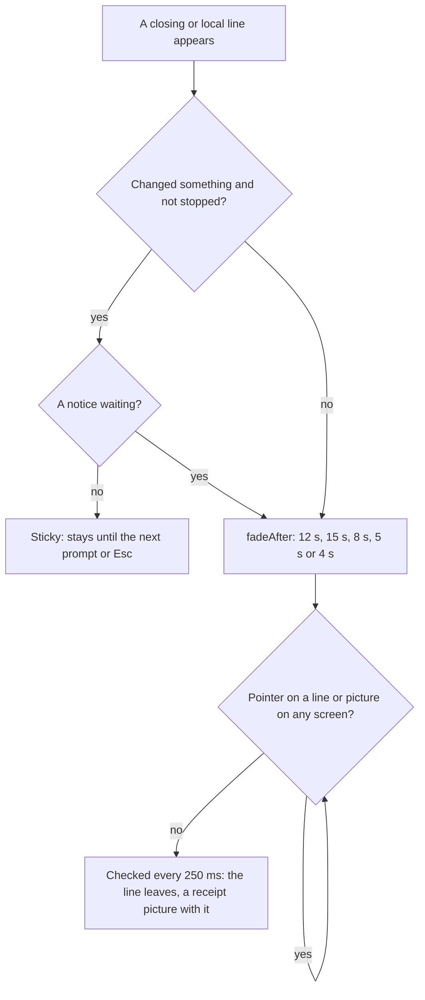

# Keys, timings and limits

> **Status:** Shipped
> **Code:** `iso/airootfs/etc/skel/.config/hypr/hyprland.lua`, `iso/airootfs/etc/systemd/user/`, `iso/airootfs/usr/local/bin/bombadil-install`, `iso/airootfs/usr/local/bin/bombadil-smoke`, `bin/bombadil`, `bin/bombadil-signal`, `shell/shell.qml`, `shell/PillState.qml`, `shell/StatusLine.qml`, `shell/LineButton.qml`, `shell/QueueChips.qml`, `shell/SetupChips.qml`, `shell/FoundChips.qml`, `shell/NoticeChips.qml`, `shell/AiCard.qml`, `shell/PersonaCard.qml`, `shell/CardHost.qml`, `shell/MessageFace.qml`, `shell/TaskFace.qml`, `shell/ListFace.qml`, `shell/CardBox.qml`, `shell/CardButton.qml`, `shell/Draft.qml`, `shell/DraftBar.qml`, `shell/CardScroll.qml`, `shell/ScrollThumb.qml`, `shell/Notifications.qml`, `shell/Stone.qml`, `shell/Wallpaper.qml`, `shell/DeskState.qml`, `shell/DeskRails.qml`, `shell/DeskRail.qml`, `shell/DeskStrips.qml`, `shell/DeskStrip.qml`, `shell/DeskDrag.qml`, `shell/DeskCard.qml`, `shell/NowCard.qml`, `shell/RowsCard.qml`, `shell/WidgetsCard.qml`, `shell/DeskTheme.js`, `shell/HyprCover.qml`, `shell/DevState.qml`, `shell/SessionChips.qml`, `shell/SessionPeek.qml`, `share/qml/Bombadil/`, `share/zellij/config.kdl`, `iso/airootfs/etc/codex/requirements.toml`, `iso/airootfs/etc/claude-code/managed-settings.d/50-bombadil.json`, `src/bombadil/launcher.py`, `src/bombadil/agentd.py`, `src/bombadil/config.py`, `src/bombadil/providers.py`, `src/bombadil/cards.py`, `src/bombadil/desk.py`, `src/bombadil/dev.py`, `src/bombadil/away.py`, `src/bombadil/voice.py`, `src/bombadil/persona.py`, `src/bombadil/greet.py`, `src/bombadil/greet_sources.py`, `src/bombadil/tips.py`, `src/bombadil/narrate.py`, `src/bombadil/jobs.py`, `src/bombadil/hypr.py`, `src/bombadil/pager.py`, `src/bombadil/watch.py`, `src/bombadil/rest.py`, `src/bombadil/signin.py`, `src/bombadil/sysmap.py`, `src/bombadil/vitals.py`, `src/bombadil/notices.py`, `src/bombadil/notifications.py`, `src/bombadil/proposals.py`, `src/bombadil/outbox.py`, `src/bombadil/apps.py`, `src/bombadil/connect/watch.py`, `src/bombadil/connect/cardmake.py`, `src/bombadil/connect/tools.py`, `src/bombadil/finder.py`, `src/bombadil/snapshots.py`, `src/bombadil/mail/watch.py`, `src/bombadil/appkit/`, `share/apps/mail/`, `share/apps/brain/`, `share/voice/lines.toml`, `share/tips/tips.toml`
> **Design:** [Principles](../principles.md), [How Bombadil should feel](../design/ux-brief.md#the-rules), [Bombadil's voice](../design/voice-brief.md#the-rules), [Messages and connections](../design/messages-and-connections.md#the-rules), [Design system](../design-system/README.md#motion)
> **Verified:** 2026-11-09 against `main` at `ca7f80a`; what changed up to `f0485c2` (the name card and the greeting, reduced motion, the Tips values, and the lines they moved) was added to the rows below and checked against that commit; what changed from `f0485c2` to `24c836c` (the cards of the person's connections and their box and press button, the notices and the notification server that come with them, and the launcher words for messages and connections) was added to the rows below and checked against `24c836c`; what changed from `24c836c` to `7d17600` (keeping a widget on the desk, the Widgets card and the words `widgets` and `keep`, the calm Machine card, and the lines they moved) was added to the rows below and checked against `7d17600`

This page lists the keys the image binds or handles (Hyprland, the pill, the Widgets card, the name card, a message or task card, a coding session's window, the details drawer, the app kit, and the Mail and Brain windows), the durations and polling intervals and the sizes and limits that the bar, agentd, the launcher and the coding sessions' hooks set, and the words the launcher answers without a model. It does not list the constants inside the Mail and Brain windows and services: `share/apps/mail/app.py`, `share/apps/brain/app.py` and `src/bombadil/mail/` hold those, and [the Mail page](../architecture/mail.md) and [the Brain page](../architecture/brain.md) describe the pieces. The connection service's own constants (`src/bombadil/connect/`) are not here either: [the connections page](../architecture/connect.md) and [the contract](../CONNECT.md) hold them, and this page has the side of the bar and agentd. Each row names the file and line that define it, as of the commit in the Verified line (the line numbers into `shell/shell.qml`, `shell/PillState.qml`, `shell/StatusLine.qml`, `src/bombadil/agentd.py` and `src/bombadil/launcher.py`, and into the other files the changes to `24c836c` and to `7d17600` touched, are as of `7d17600`), and that file is the authority when a value here has drifted. Durations are milliseconds unless a unit is written. The page is Shipped because every row is code on `main`; the rules in [What the rules say](#what-the-rules-say) are only partly met, and [Where the code does not yet meet a rule](#where-the-code-does-not-yet-meet-a-rule) says where. The interaction model is in [the UX page](README.md), colours and the motion tokens in the [design system](../design-system/README.md#motion).

## Keys

The only bind file on `main` is `iso/airootfs/etc/skel/.config/hypr/hyprland.lua`, and it has no `hl.bind` other than the ones below. It also sets `input = { kb_layout = "us", follow_mouse = 1 }` (line 43). Keys that reach the pill's field (`Enter`, `Esc`, `Tab`) work only while the pill holds the keyboard. On Hyprland that is while it is summoned (`WlrKeyboardFocus.OnDemand`, else `None`); on other compositors the layer is `Exclusive` while summoned and `OnDemand` otherwise (`shell/shell.qml:357-359`). Under a full-screen window the field is disabled (`enabled: !win.capsule`, `shell/shell.qml:744`), so nothing can be typed there.

### Hyprland binds

| Key | Where | What it does | Defined in |
|---|---|---|---|
| `Super`, tapped alone (left or right) | Any window. Fires when the key is released | Runs `bombadil pill`, which sends `summon` to agentd. agentd tells every bar, and the pill on the focused screen takes the keyboard. A second tap gives it back, except while the name card holds the keyboard on that screen: then the tap moves the keys to the pill and the card stays up. The file's comment says Hyprland drops the tap when another key, a click or a drag happened while `Super` was down | `iso/airootfs/etc/skel/.config/hypr/hyprland.lua:67-70`, `bin/bombadil:422-423`, `src/bombadil/agentd.py:737-745`, `shell/shell.qml:242-257` |
| `Alt+Space` | Any window. Fires on press | The same `bombadil pill`, for hosts where `Super` never arrives: a VM window on Windows keeps the Windows key for its Start menu | `iso/airootfs/etc/skel/.config/hypr/hyprland.lua:71-73` |
| `Super+Escape` | Any window | Runs `bombadil stop`, which sends `stop` to agentd: the running turn ends, and everything it started | `iso/airootfs/etc/skel/.config/hypr/hyprland.lua:74-75`, `bin/bombadil:420-421`, `src/bombadil/agentd.py:721-722` |
| `Super+Ctrl+Escape` | Any window | Runs `systemctl --user restart bombadil-shell`: starts the bar again when it hangs. agentd is not touched: the bar's unit only says `After=bombadil-agentd.service`, which is ordering and not a dependency | `iso/airootfs/etc/skel/.config/hypr/hyprland.lua:76-77`, `iso/airootfs/etc/systemd/user/bombadil-shell.service:3` |
| `Super+B` | Any window | Toggles the special workspace `browser` | `iso/airootfs/etc/skel/.config/hypr/hyprland.lua:62` |
| `Super+T` | Any window | Toggles the special workspace `terminal` | `iso/airootfs/etc/skel/.config/hypr/hyprland.lua:63` |
| `Super+F` | Any window | Toggles the special workspace `files` | `iso/airootfs/etc/skel/.config/hypr/hyprland.lua:64` |
| `Super+Q` | Any window | Closes the active window | `iso/airootfs/etc/skel/.config/hypr/hyprland.lua:65` |
| `Super+Return` | Any window | Runs `foot`, a terminal | `iso/airootfs/etc/skel/.config/hypr/hyprland.lua:66` |

### In the pill

| Key | Where | What it does | Defined in |
|---|---|---|---|
| `Enter` | The pill's field | `pillState.submit(text)`. When it returns true the field is cleared and the keyboard goes back. A blank line, or one typed while the bar is not connected, sends nothing: the field and the keyboard stay, and the second case says `Not connected to the agent yet.`. A blank line also puts a greeting away (`dismissWelcome`). With the name card up, a line that is sent first skips the card (`personaSkip`: agentd keeps the defaults it saved) | `shell/shell.qml:760-767`, `shell/PillState.qml:801-838` |
| `Esc` with the Widgets card up, before any other `Esc` row | The pill's field | `closeWidgets()` puts the card away and `release()` gives the keyboard back. It does not stop a turn: the words `widgets` do not wait for a turn, so the card can be up while one runs, and a second `Esc` stops it | `shell/shell.qml:791` |
| `Esc` while a turn runs, from the moment `Enter` shows `On it`, or while a sign-in is under way | The pill's field | `pillState.stop()` sends `stop`; the line reads `Stopping` and the pill keeps the keyboard | `shell/shell.qml:790-791`, `shell/PillState.qml:130, 870-874` |
| `Esc` with nothing to stop and the AI card open | The pill's field | `closeAi()` puts the card away and `release()` gives the keyboard back. Typing in the field puts the card away too | `shell/shell.qml:771, 793`, `shell/PillState.qml:916` |
| `Esc` with text typed, nothing to stop and no AI card | The pill's field | Clears the text | `shell/shell.qml:794` |
| `Esc` with an empty field, nothing to stop and no AI card | The pill's field | `dismiss()` puts the line and the picture or card away, `dismissWelcome()` puts a greeting away, `closeDetails()` sends `close_details` so the drawer closes, and `release()` gives the keyboard back | `shell/shell.qml:795`, `shell/PillState.qml:565-567, 938, 957-960` |
| Typing a character | The pill's field, while a greeting is on the line | `dismissWelcome()` puts the greeting away. A greeting is also put away by `Enter` on a blank line and by `Esc` with an empty field (the rows above) | `shell/shell.qml:768-773`, `shell/PillState.qml:565-567` |
| Typing a character, or anything that lets go of the keyboard | The pill's field, while the Widgets card is up | The card closes with it. Typing puts it away as it puts the AI card away, and the keyboard stays with the field. A tap on `Super`, an `Enter` that sends words, a `Tab` that walks to a waiting session, a click elsewhere and the drawer taking the keyboard make `summonedOn` empty, and the card goes with it. Opening the AI card closes it too, so one card sits over the pill | `shell/shell.qml:41, 49, 772` |
| `Tab` with an empty field and at least one coding session | The pill's field | Asks agentd for the next session that waits for the person (`dev` with `action: next`; `bombadil dev next` does the same from a shell) and gives the keyboard back. The order and the answers are under the table | `shell/shell.qml:776-784`, `shell/DevState.qml:104`, `src/bombadil/agentd.py:986-990`, `bin/bombadil:159-160` |
| `Tab` otherwise | The pill's field | Types the rest of the suggested launcher name (`pass` then `Tab` gives `passwords`). It does nothing unless at least two characters follow an optional verb and a name is longer than that | `shell/shell.qml:776-784`, `shell/PillState.qml:995-1007` |

Tab's walk is `Dev.attention` and `Dev.next` (`src/bombadil/dev.py:709-717, 737-753`). It visits the sessions that wait for the person, a question first (state `asked`, the session alive), then a finished turn (`done`), then a failed session, the oldest `since` first within each. The session in front, and one the person has already looked at (not `unseen`), are not in the list. The `Needs you` card lists the same sessions in the same order. Tab brings the first one to the front and agentd answers `Back to <title>.`; with none waiting it answers `Nothing needs you.`; for a failed session whose tool is gone it opens no window, marks the session seen and answers `<title> stopped: <last>. Type its name to resume it.`

The line in the empty field (`Dev.line`, `src/bombadil/dev.py:719-735`) reads `<title>: <question>`, `<title> finished: <line>` or `<title> stopped: <line>` for one session, and `api and reviewer are waiting` for several (a session named after its tool says its project, `claude on Myapp`; from five it reads `5 sessions are waiting`). The field shows it followed by three spaces and `⇥`, in the accent ink colour, ahead of the resting hint and `Ask anything` and behind `Starting` and `Waiting for agentd…` (`shell/shell.qml:745-754`).

### On the Widgets card

The card (`shell/WidgetsCard.qml`) is what the word `widgets` opens above the pill, in the AI card's shape ([flow 22](flows.md#22-keeping-a-widget-on-the-desk-and-the-widgets-card)). It has no keys of its own and takes no focus: the keyboard stays with the pill's field, so the keys that count are the pill's, in the rows above, `Esc` first, and its parts answer the pointer ([pointer actions](#pointer-actions-that-stand-in-for-keys)). Nothing on it is reached by `Tab`, which in the pill completes a name or walks to a waiting session; the words `keep machine`, `hide machine` and `show machine` do the same from the keyboard. Each `widgets` takes the keyboard for the pill again (`takeKeyboard`, which unlike a tap on `Super` never toggles it away), on the screen that was typed into, else the focused one (`shell/shell.qml:119-123, 283`). The idle wait that gives the keyboard back after a pause does not run while the card is shown (`shell/shell.qml:466`), so the card is read at the person's pace.

### On the name card

The card (`shell/PersonaCard.qml`) asks what to call the person and which voice to use. It comes up on the screen that had the focus, with the keyboard already in its name field (`summonKeep` in `shell/shell.qml`), after the first sign-in and when the person types `voice` ([flow 19](flows.md#19-the-name-card-and-the-greeting)). The keys work while the name field has the keyboard. The highlight starts on the voice agentd named: `merry` the first time, the saved voice after the word `voice`.

| Key | What it does | Defined in |
|---|---|---|
| Letters | Type the name. The field holds at most `24` characters and takes what agentd accepts in a name: a letter first, then letters, marks, spaces, hyphens, apostrophes and dots. Each voice row reads its welcome back with the name as typed so far | `shell/PersonaCard.qml:35-39, 128-131` |
| `Up`, `Down` | Move the highlight to the previous or the next voice. It stops at the first and the last row and does not wrap | `shell/PersonaCard.qml:41-43, 134-135` |
| `Tab`, `Shift+Tab` | The same as `Down` and `Up`. Left alone, `Tab` would take the focus to the pill behind the card | `shell/PersonaCard.qml:136-138` |
| `Enter` | Keeps the typed name and the highlighted voice: the bar sends `persona` with both and folds the card, and agentd checks the name once more and, if it refuses, says why in the line and asks again. A name of more than three words is refused at the card: the hint turns red and reads `A name is up to three words`, and the card stays. An empty name is allowed | `shell/PersonaCard.qml:49-54, 139-140, 241-243`, `shell/PillState.qml:582-586`, `src/bombadil/voice.py:236-258` |
| `Esc` | Skips: the bar sends `persona_skip` and folds the card. agentd saved the defaults (no name, `merry`) when it asked, so nothing is lost | `shell/PersonaCard.qml:56-60, 141`, `shell/PillState.qml:588-592` |

The hint under the voices reads `Enter keeps <Voice> · Up and Down to change · Esc skips`. `Super` or a click on the pill moves the keys to the pill and leaves the card up, and a click on the card moves them back. The card goes when it is answered or skipped, when another bar answers it, and when the bar loses agentd. The idle wait that gives the keyboard back does not run while the card is up.

### A message or task card

A message card, a task card and a list card come from the person's connections and from a program's notification ([flow 20](flows.md#20-a-message-a-reply-and-the-press)). The bar draws them (`shell/MessageFace.qml`, `shell/TaskFace.qml` and `shell/ListFace.qml`, held by `shell/CardHost.qml`), and the box and the button follow the rules in [A card with a box](#a-card-with-a-box). A card takes the keyboard only after the person's `Reply` (the card that comes of it within `8000` ms of the press) or a click in its box. A card the agent opened asks for nothing, so it never takes the keys from what is typed. The bar on the card's screen is then summoned and the box has the keyboard, with the cursor after the words already in it. Nothing on a card sends but its button, and a key never presses a button that is not lit.

| Key | Where | What it does | Defined in |
|---|---|---|---|
| Letters | The box of a reply, a task's field or a comment | Type. The first key in a box with no draft yet asks agentd for one (`proposal` with `op: open`), and what was typed meanwhile is sent once the draft has its id. The box is plain text. Characters that draw as nothing, which words pasted from a page often carry, are taken out by agentd, and the box shows what is left | `shell/Draft.qml:6-9`, `shell/CardBox.qml:101-109` |
| `Enter` | A box of several lines (a reply, a task's text field) | A new line. In a box of one line (a title, a date) it does nothing, and a pasted line break becomes a space. It never sends | `shell/CardBox.qml:102-107, 110-111` |
| `Tab`, `Shift+Tab` | A box | Moves to the next or the previous thing on the card that takes the keyboard: the box, a button that can be pressed (`Send` only while it is lit), `Open in Slack`, the tick `I looked in Slack`, a row of a list that opens something and the `×`. It is never a character of a message | `shell/CardBox.qml:113-120`, `shell/CardButton.qml:27`, `shell/ListFace.qml:82`, `shell/CardHost.qml:114` |
| `Enter`, `Return`, `Space` | A button that has the keyboard (`Send`, `Create`, `Comment`, `Copy and open`, `Open in Slack`, a row's button) | Presses it. A button that is not lit takes no key and no click | `shell/CardButton.qml:72-74`, `shell/DraftBar.qml:40-49` |
| `Space`, `Return` | The tick `I looked in Slack` | Ticks it. After a press whose outcome is not known the button stays dim until the tick is set, and then presses with `again` | `shell/DraftBar.qml:136-170` |
| `Enter`, `Return`, `Space` | A row of a list card that opens something | Opens it: a card (agentd answers with it) or a page, a file, a unit as a box of a picture opens it | `shell/ListFace.qml:94-96` |
| `Enter`, `Return`, `Space` | The `×` on the card | Puts the card away | `shell/CardHost.qml:114-116` |
| `Esc` | The box, or anywhere on a card's face | `dismissCard()` puts the card away and tells agentd. An empty draft goes with it, and one with words in it stays as a draft that agentd keeps. The keyboard goes back to the windows | `shell/CardBox.qml:112`, `shell/MessageFace.qml:39, 141`, `shell/TaskFace.qml:55, 158`, `shell/ListFace.qml:60`, `shell/PillState.qml:225-241` |
| `Super`, tapped | While a card's box has the keyboard | As in the pill: the keyboard goes back to the windows and the card stays | `shell/shell.qml:242-257` |

A click on the pill moves the keys to its field and leaves the card up. `Esc` in the pill's field puts the line and the card away. A typed ask that becomes a turn clears a card nobody is writing in, as it clears a picture.

### Pointer actions that stand in for keys

| Action | Where | What it does | Defined in |
|---|---|---|---|
| Click on the pill or its field | Hyprland only | The same as tapping `Super`: this screen's pill takes the keyboard (`focusPill`), and with the name card up the keys move from the card to the pill and the card stays. Elsewhere the layer takes clicks on demand by itself | `shell/shell.qml:440-448, 697, 759` |
| Click on the name card or on a voice row | The name card | The card takes the keyboard (`wantKeys`: this screen's pill is summoned and the focus goes to the name field). A click on a row also picks that voice | `shell/PersonaCard.qml:133, 163-169`, `shell/shell.qml:423, 537-541` |
| Click anywhere else | While the pill is summoned | The focus grab clears and `release()` gives the keyboard back, so typing meant for another window never lands in the pill, and a Widgets card that is up goes with it | `shell/shell.qml:450-456` |
| Pointer over the stone, then a click | While a turn can be stopped | The stone becomes `Stop`; the click sends `stop`. The capsule never shows `Stop`, but a tap on its stone still stops a turn that can be stopped, because the tap handler has no capsule test | `shell/shell.qml:706-733` |
| Click on the stone | While no turn can be stopped | `pillState.toggleAi()` asks agentd for fresh rows (`ai` with `op: get`) and opens the AI card: 360 px wide, one row per AI. Not connected, it says `Not connected to the agent yet.` instead. A second click puts the card away, and so do typing, a turn starting and a lost socket | `shell/shell.qml:732`, `shell/PillState.qml:131, 852, 908-916`, `shell/AiCard.qml:14-17` |
| A part of a row on the Widgets card: `Keep`, `When needed` or `Off` | A part the widget can take and is not in (a part it cannot take is dimmed, and the part it is in is raised; neither does anything) | `DeskState.setWidget` sends `desk` with `op: set`, the widget and the state, and only while agentd is connected, the widget is on the card, the state is one its `can` lists and it is not already the widget's. The raised part follows agentd's `desk` message, not the press, and the line above the pill says what happened (`Machine stays on the desk.`) | `shell/WidgetsCard.qml:117-153`, `shell/DeskState.qml:968-973` |
| `Reset the desk` | The Widgets card | `DeskState.resetDesk` sends `desk` with `op: reset` while connected: every widget, rail and place back as the desk ships. The line says `The desk is back as it came.` | `shell/WidgetsCard.qml:174-193`, `shell/DeskState.qml:976-980` |
| `×` | The Widgets card's title row | `closeWidgets()` puts the card away. The keyboard stays with the pill | `shell/WidgetsCard.qml:51-68`, `shell/DeskState.qml:963` |
| Switch on the AI card | A switch that can be flipped (not signed in or not installed is dimmed to `0.4`) | `pillState.setAi` sends `ai` with `pause` or `resume`. The switch follows what agentd sends back, not the tap | `shell/AiCard.qml:64-93`, `shell/PillState.qml:918-923` |
| Click on a finished line | Line in mode `closing`, with no notice on it | Opens the turn's details in the drawer | `shell/StatusLine.qml:104-108` |
| `×` on a `next` chip | Queue chips | Sends `unqueue` for that turn | `shell/QueueChips.qml:46-53`, `shell/PillState.qml:876-881` |
| `Undo` button | A finished line that is `sticky` | Sends the same `undo` the word does, so it is answered without a model | `shell/StatusLine.qml:230-235`, `shell/PillState.qml:925-928`, `src/bombadil/agentd.py:727-730` |
| `Details` button | A finished line that changed something or cannot be undone | Opens the turn's details in the drawer, or closes it when it already shows that turn | `shell/StatusLine.qml:236-240`, `shell/PillState.qml:930-935` |
| A chip of a notice, and its `×` | The line, while a notice has it | The chip sends `notice_action` for its own notice and hands the keyboard over, so the window it opens can take it. The `×` sends `notice_dismiss` for the notice that was on the line when the press began and drops it from the bar at once | `shell/NoticeChips.qml:48-52, 74-81`, `shell/PillState.qml:772-790` |
| A chip under the found line | While the AI rests and the found line shows | `openFound` sends `found_open` and hands the keyboard over. agentd opens the thing and lets go of the kept ask it came from | `shell/FoundChips.qml:77-81`, `shell/PillState.qml:885-892` |
| A setup chip | Under the setup line or the resting line | `setupAction` sends `setup_action` with the chip's id, and hands the keyboard over unless the chip is `cancel`, `resume` or `retry` | `shell/SetupChips.qml:42-46`, `shell/PillState.qml:697-704` |
| `×` on a picture or a card | The picture or card above the line | `dismissCard()`: puts it away. A message, task or list card also tells agentd (`card_action` with `dismiss`), and an empty draft is discarded with it | `shell/CardHost.qml:105-125`, `shell/PillState.qml:225-241` |
| A box in a picture that names a thing | The picture above the line | `openThing`: a turn opens its details in the drawer, anything else sends `open` with its kind and value | `shell/CardHost.qml:145`, `shell/PillState.qml:370-380` |
| Click in a card's box | A message or task card | The bar takes the keyboard for the box (`wantKeys`: this screen's pill is summoned and the focus goes to the box) | `shell/CardBox.qml:56`, `shell/PillState.qml:255`, `shell/shell.qml:97-103, 382-407` |
| `Reply` on a notice | The line, on a notice from a connection or from a program's notification | `notice_action` with `reply`. The bar notes when it was pressed, and the card with a box that comes of it within `8000` ms (`askGrace`) takes the keyboard | `shell/PillState.qml:123, 208-211, 772-785` |
| The button of a card | A message or task card | A draft's button sends `press` with the draft's id and the fingerprint agentd last gave, and only while it is lit. `Copy and open` sends `card_action` with `copy_open` and the words in the box. `Open in <service>` sends `card_action` with `open` | `shell/DraftBar.qml:40-49, 199-207`, `shell/MessageFace.qml:154-158`, `shell/TaskFace.qml:188-192`, `shell/PillState.qml:276-300` |
| A row of a list card, and a button on it | A list card | A row that opens a card sends `card_action` with `open` and the row's id; one that opens a page or a file opens it as a box of a picture does. A button on a row sends its own action (`open`, `connect`, `disconnect`) with the row's id | `shell/ListFace.qml:49-55, 172`, `shell/PillState.qml:289-298` |
| Click on an app chip, and its `×` | The chips of running apps | The click slides that app's drawer in or out. The `×` runs `bombadil-app close NAME`, which quits the app | `shell/shell.qml:630-634, 653-660` |
| Click on the title of `Now`; `Why?` and `×` on a `Watching` row; a `Machine` row that opens something | The desk's cards | `Now` opens the turn's details. `Why?` sends `jobs` with `op: why`, the `×` stops a running job or drops a finished one, and a `Machine` row sends `vitals` with `op: open` (the disk row draws the disks picture) | `shell/DeskCard.qml:124`, `shell/DeskState.qml:30-40, 684-693, 983-985`, `shell/RowsCard.qml:114-124, 273-301` |
| Hover on a session dot | The dots above the pill | Shows the peek: the session's name, `Tool · state` and its last lines. It takes no clicks | `shell/SessionChips.qml:103-107`, `shell/DevState.qml:113-114`, `shell/SessionPeek.qml:7-60` |
| Click on a session dot | The dots above the pill | Sends `dev` with `action: open` and the session's key: agentd brings that session's window to the front, or opens another window on it. A dim dot (the session sleeps) sends the same `open`, and agentd resumes the session and opens its window (`Resumed <title>.`); a session with no conversation to resume, a shell or a tool that never reported one, starts again (`Started <title>.`). A ring, a session the person started by hand, answers `<title> runs in a terminal of yours; Bombadil cannot bring it back.` A red dot whose tool is gone sends `action: why` instead, and the drawer shows its last screen; when none was kept agentd answers nothing, and typing the session's name resumes it | `shell/SessionChips.qml:108`, `shell/DevState.qml:106-111`, `src/bombadil/agentd.py:986-1001`, `src/bombadil/dev.py:301-320, 454`, `bin/bombadil:166-176` |
| Click on the folded chip `N projects · M waiting` | When more than `3` projects have sessions | Unfolds the chips. They fold again when the projects are `3` or fewer | `shell/SessionChips.qml:35`, `shell/DevState.qml:20-23, 35` |
| `Open` on a `Needs you` row | The desk's `Needs you` card | Sends `dev` with `action: open` and the row's key. agentd answers as it does to a click on the session's dot, so a session whose tool is gone is resumed rather than shown | `shell/DeskState.qml:32`, `shell/DeskRail.qml:139`, `src/bombadil/agentd.py:986-1001` |
| A tap on an `Away` row, on its title or on the line under it; `Open` or `Why?` on a row | The desk's `Away` card | The tap sends `away` with `op: seen`, and agentd puts the card away for every bar. `Open` on a `dev:` row sends `dev` `open` with that session's key, `Why?` on a `job:` row sends `jobs` with `op: why` and the job's id, and each then sends `seen` | `shell/DeskState.qml:33, 39, 921-931`, `shell/DeskRail.qml:139-145`, `shell/DeskCard.qml:21-22, 124, 139-144` |
| Drag a card by its grip, or a strip, with the left button | The desk, past Qt's own drag threshold (`DragHandler` sets none) | Moves the card to a rail, to another place in its rail, or onto the pill's row, where it folds to a strip; a strip dropped on a rail gets its card back. The zones, the refusals and the dimming are in [The desk](#the-desk-1) | `shell/DeskDrag.qml:10-53`, `shell/DeskRail.qml:96-106`, `shell/DeskStrips.qml:67-74`, `shell/DeskState.qml:987-1092` |

### In a coding session's window

A coding session's window is `foot` (`footclient` while the foot server runs) on a zellij session. The repository sets no key for it. zellij starts with its default keybinds cleared (`keybinds clear-defaults=true`) and in `locked` mode, so none of zellij's own keys, the ones that switch mode included, does anything, and every key reaches Claude Code, Codex or the shell. The one key-related zellij setting is `support_kitty_keyboard_protocol true`, and the headless desktop test shows `Shift+Enter` reaching Claude Code through foot and zellij as a line break, not a send. The keys of the foot window itself (scrollback, copy, paste, font size) are foot's defaults, which nothing in the repository sets, so this page does not list them. Of the Hyprland binds above, the one that acts on the window is `Super+Q`, which closes it, and because zellij detaches when its window is force-closed (`on_force_close "detach"`) the session keeps running and its window comes back by the session's name (`share/zellij/config.kdl:5-7, 11, 14`, `src/bombadil/dev.py:428, 525-532`, `iso/airootfs/etc/skel/.config/hypr/hyprland.lua:88-96`, `tests/desktop/driver.py:2452-2461`).

### In the details drawer

The drawer is a `foot` window with the app id `bombadil-details` on the special workspace `special:details` (`src/bombadil/launcher.py:163, 903, 940`, window rule `iso/airootfs/etc/skel/.config/hypr/hyprland.lua:102-103`). The keyboard is moved into it when it opens (`src/bombadil/launcher.py:911-941`).

| Key | Where | What it does | Defined in |
|---|---|---|---|
| Any key | A turn's details and `history` (`bombadil watch`, `bombadil history`), the session list and a session's last screen (`bombadil dev list`, `bombadil dev why`) | Closes the drawer. It does so while a running turn is still being followed, too. The text printed under the output says `Press Esc to close.` The list of coding sessions (`bombadil dev list`, from the words `sessions`, `what's running`, `coding sessions` and `list sessions`) and the last screen of a session whose tool stopped (`bombadil dev why KEY`) close the same way | `src/bombadil/watch.py:194-236, 239-257, 290-303`, `bin/bombadil:164, 176, 424-431` |
| `Esc`, `q`, `Q`, `Ctrl+C` or `Ctrl+D` | A service's status, a package, a folder or a text file (`bombadil view`) | Closes the drawer. A text that fits the screen closes on any key | `src/bombadil/pager.py:27-32, 71-95`, `bin/bombadil:432-433` |
| `Up`, `Down`, `j`, `k`, `Enter` (down) | `bombadil view` with a longer text | Scrolls one row | `src/bombadil/pager.py:27-32, 53-59` |
| `PageUp`, `PageDown`, `b`, `f`, `Space` | `bombadil view` | Scrolls a page less one row | `src/bombadil/pager.py:27-32, 53-59` |
| `Home`, `g`, `End`, `G` | `bombadil view` | Jumps to the start or the end | `src/bombadil/pager.py:27-32, 53-59` |
| `Esc` in the pill | The pill's field, empty, nothing to stop and no AI card | Closes the drawer (`close_details`) | `shell/shell.qml:795`, `src/bombadil/launcher.py:947-953` |

A command that Stop ended prints `stopped` in the drawer instead of `failed (exit N)`. Its exit code is `-2`, `-15` or `-9`, the signals Stop sends (SIGINT, SIGTERM, SIGKILL; `src/bombadil/watch.py:23-24, 88-93`). So does the note that Claude Code leaves for a tool call that was cut short (`src/bombadil/watch.py:22, 80-83`).

### In apps built from the kit

These belong to the kit's components in `share/qml/Bombadil/`, so every generated app has them. [The app kit page](../architecture/app-kit.md) owns the catalogue.

| Key | Where | What it does | Defined in |
|---|---|---|---|
| `Esc` | An `AppWindow`, as a window shortcut | `App.hide()`: the app slides out and keeps running | `share/qml/Bombadil/AppWindow.qml:336-340`, `src/bombadil/appkit/runtime.py:202` |
| `Ctrl+W` | An `AppWindow`, as a window shortcut | `App.close()`: the app quits | `share/qml/Bombadil/AppWindow.qml:341-345`, `src/bombadil/appkit/runtime.py:204` |
| `Ctrl+F` | A window with a `SearchField` | Focuses the field and selects its text | `share/qml/Bombadil/SearchField.qml:44-51` |
| `Esc` | A `SearchField` that has text | Clears it and keeps the window's `Esc` from hiding the app. With no text the key goes on to the window | `share/qml/Bombadil/SearchField.qml:35-42` |
| `Ctrl+S` | An `Editor` with a `path`, not read-only | Saves the file | `share/qml/Bombadil/Editor.qml:78-83` |
| `Enter`, `Return` | An `ItemList` or a `DataTable` | Activates the current row | `share/qml/Bombadil/ItemList.qml:182-183`, `share/qml/Bombadil/DataTable.qml:402-403` |
| `Home`, `End` | An `ItemList` or a `DataTable` | First or last row | `share/qml/Bombadil/ItemList.qml:184-192`, `share/qml/Bombadil/DataTable.qml:404-413` |
| `PageUp`, `PageDown` | A `DataTable` | Moves a page of rows | `share/qml/Bombadil/DataTable.qml:410-413` |

### In the Mail and Brain windows

Mail and Brain are kit apps that ship in `share/apps/`. They have the kit's keys above, and the ones below. [The Mail page](../architecture/mail.md) and [the Brain page](../architecture/brain.md) describe the windows.

| Key | Where | What it does | Defined in |
|---|---|---|---|
| `Esc` | Mail, while a reply box is open, the account setup is open and an account exists, or (in a window narrower than `640` px) a mail is open | Leaves that view: the reply box first, then the setup, then the open mail, and puts the keyboard back on the list. With none of these open the key goes on to the kit and hides the app | `share/apps/mail/main.qml:20-27, 46-54, 61-70` |
| `R`, `A`, `#` | Mail, with a mail open in the main view and no reply box | Replies, archives, or deletes it. A key held down acts once. Nothing happens with `Ctrl`, `Alt` or `Meta` held, or while the main view is not shown (the setup, or the service not ready). Typing in a field never reaches this | `share/apps/mail/main.qml:71-94`, `share/apps/mail/app.py:1268-1274, 1412-1415` |
| Any other single printable key | Mail, on the list or an open mail, with no field focused and no `Ctrl`, `Alt` or `Meta` | Starts a search with that character in the search field. A held key does it once | `share/apps/mail/main.qml:72-93`, `share/apps/mail/MailList.qml:22-27` |
| `Ctrl+F` | Mail | Focuses the search field and selects its text | `share/apps/mail/main.qml:96-100`, `share/apps/mail/MailList.qml:17-20` |
| `Ctrl+R` | Mail and Brain | Refreshes: Mail asks the service for its status and fetches the list again, the Brain fetches its current view again | `share/apps/mail/main.qml:101-105`, `share/apps/mail/app.py:1023-1025`, `share/apps/brain/main.qml:62`, `share/apps/brain/app.py:454-459` |
| `Enter`, `Return` | Mail, on the list | Opens the row the keyboard is on | `share/apps/mail/MailList.qml:156-161` |
| `Down` | Mail's search field | Puts the keyboard on the list | `share/apps/mail/MailList.qml:114`, `share/apps/mail/QuietInput.qml:71` |
| `Esc` | Mail's search field, with text in it | Clears it. With no text the key goes on to the window | `share/apps/mail/QuietInput.qml:72-79` |
| `Enter`, `Return`, `Space` | Mail's `Send` button, when it has the keyboard | The press, the only one in the window (`activate()` is the only line that calls `press()`). Send takes it `350` ms after it could first be pressed (`ARM_MS`), and `1800` ms after somebody else changed the draft (`ARM_CHANGED_MS`) | `share/apps/mail/SendBar.qml:129-132, 140-144, 192-194`, `share/apps/mail/app.py:60-61` |
| `Alt+Left` | Brain | Goes back one step in the trail | `share/apps/brain/main.qml:61`, `share/apps/brain/app.py:450-452` |
| `Enter` | Brain's search field | Opens the first match once the matches are for the text in the field; before that it asks for them and opens the first when they arrive | `share/apps/brain/main.qml:22-30, 54-59` |
| `Down` | Brain's search field, while the matches show | Moves the keyboard into the matches, onto the first | `share/apps/brain/main.qml:31` |
| `Enter`, `Return` | A row of a Brain list or of the matches | Activates the row | `share/apps/brain/BrainList.qml:27-32` |
| `Esc` | Brain's matches | Clears the search and puts the keyboard back in the field. The list claims the key so that the kit does not hide the window | `share/apps/brain/main.qml:169-171` |

## Timings

Under reduced motion (`BOMBADIL_REDUCE_MOTION=1`, read once when the shell starts) the shell sets `Theme.reducedMotion`, and `Theme.fast`, `Theme.normal` and `Theme.slow` read `0`. A row below that names one of the three, or a duration wrapped in `Theme.duration(ms)`, then takes no time; a loop is gated instead and has a still form. A wait that is not movement keeps its time (a scrollbar's `600`, a line's `12000`). The still form of each surface is in [MOTION.md](../MOTION.md); the switch and the three tokens are defined at `share/qml/Bombadil/Theme.qml:93-101` and set at `shell/shell.qml:34-37`.

### The bar

| Value | What it times | Defined in |
|---|---|---|
| `15000` | The "Starting" window. Until agentd first answers, the stone's face is `starting` and the placeholder reads `Starting`. If nothing has answered when the timer ends, the face is `offline` | `shell/shell.qml:106`, `shell/PillState.qml:155-168` |
| `1500`, repeating | How often the bar tries agentd's socket while it is not connected (once at start too). A Quickshell `Socket` that failed does not retry, so each try makes a fresh `Socket` | `shell/shell.qml:198-223` |
| `20000` with an empty field, `60000` with text typed, `120000` while the person is in a card's box | How long a summoned pill is left alone before it gives the keyboard back. Typing, in the field or in a card's box, restarts the wait. Text already typed stays in the pill. The wait does not run while the name card is up. A box counts (`composing`) while it has the keyboard or has words in it | `shell/shell.qml:458-468, 768-773`, `shell/PillState.qml:114, 249-253` |
| `30000`, repeating | The clock text in the pill | `shell/shell.qml:823` |
| `300` s, from the environment `BOMBADIL_IDLE_SECONDS` | The bar's away timer (an `IdleMonitor`): after this long without input the bar tells agentd the person is away (`presence`), and the next input tells it they are back. `respectInhibitors` stays on, so a video being watched counts as present. agentd reads the same variable to work out how long the person was away | `shell/shell.qml:56-61`, `src/bombadil/voice.py:46, 161` |
| `1` s | A second `IdleMonitor`, on only while a greeting waits for its first touch. Keys typed into other windows are invisible to the bar, so it watches for a pause of a second and the activity after it | `shell/shell.qml:63-70` |
| `150` | The border colour of an app chip. It is neither `Theme.fast` nor `Theme.normal`, so it goes through `Theme.duration` | `shell/shell.qml:629` |
| `300` (`Theme.slow`) | The pill's border colour change | `shell/shell.qml:696`, `share/qml/Bombadil/Theme.qml:95` |
| `120` (`Theme.fast`) | The width of the stone's box when `Stop` appears under the pointer | `shell/shell.qml:713`, `share/qml/Bombadil/Theme.qml:93` |
| `200` (`Theme.normal`) | The border colour of a setup chip and of a found chip | `shell/SetupChips.qml:29`, `shell/FoundChips.qml:33`, `share/qml/Bombadil/Theme.qml:94` |
| `120` (`Theme.fast`) | The border colour of a notice chip | `shell/NoticeChips.qml:36` |
| `300` (`Theme.slow`) or `0` | The wallpaper picture settling in over the ground, and the dimming over a picture of the person's own. `0` with `BOMBADIL_REDUCE_MOTION=1` | `shell/Wallpaper.qml:93-97, 107-109` |

### The line and the picture

| Value | What it times | Defined in |
|---|---|---|
| `250`, repeating while the line is shown | The seconds counter, the end of a flash, and the check that fades a finished line | `shell/StatusLine.qml:56-77` |
| `1000` | The seconds counter shows from the first full second of a turn | `shell/StatusLine.qml:31, 141` |
| `200` (`Theme.normal`) | The line's opacity in and out. The picture's opacity and its 14 px rise take the same time | `shell/StatusLine.qml:43`, `shell/CardHost.qml:54-61` |
| `120` (`Theme.fast`) | The line's height changing, `OutCubic` | `shell/StatusLine.qml:44` |
| `200` (`Theme.normal`), `120` (`Theme.fast`) | The AI card's opacity and its height (`OutCubic`), and the switch's colour and its knob's slide | `shell/AiCard.qml:25-26, 77, 84` |
| `12000` | How long a closing line stays after `turn_end` (`fadeAfter`), unless it is sticky. The resting line and the line of what was found stay `12000` too | `shell/PillState.qml:86, 506, 609, 617` |
| `15000` or more | A closing line when a receipt picture arrives: both start their time again and `fadeAfter` is raised to at least this | `shell/PillState.qml:206` |
| `15000` | The answer to a finished `undo` | `shell/PillState.qml:524` |
| `8000` | The answer to a finished picture word, the `Signed in` news line, and `Lost touch with the agent. Reconnecting.` | `shell/PillState.qml:525, 690, 859` |
| `5000` | Any other launcher or local answer (a `local` event) | `shell/PillState.qml:525` |
| `4000` | `Not connected to the agent yet.`, after `Enter` while disconnected | `shell/PillState.qml:804-808` |
| unchanged | A local error with no turn keeps the `fadeAfter` the line had before | `shell/PillState.qml:471` |
| `15000` for the first hello, `8000` for any other greeting; `30000` at most (`welcomeMax`) | A greeting (mode `welcome`) waits for the first key press or pointer move after it appeared, then fades that long after it, and is never on screen longer than `welcomeMax`. A pointer on the line holds it, and typing, `Enter` or `Esc` in the pill puts it away at once | `shell/PillState.qml:136, 548, 559-567`, `shell/StatusLine.qml:75` |
| until the next prompt or `Esc`, and it fades like any other line (`fadeAfter` `12000`) while a notice waits | A closing line of a turn that changed something and was not stopped (`sticky`): it keeps `Undo` | `shell/StatusLine.qml:68-74`, `shell/PillState.qml:505` |
| `3500` (`flashFor`) | A message shown over a running turn: a launcher answer, an error with no turn, the line of a stop, `Not connected to the agent yet.` | `shell/PillState.qml:89, 470, 494, 518, 866` |
| `8000` | The same flash when it answers `why` | `shell/PillState.qml:518` |
| `2500` (`windowGrace`), `5000` (`clickGrace`) | A window that opens on the stage puts a picture away, unless the picture is younger than `windowGrace` or a box in it was clicked less than `clickGrace` ago. A picture still being drawn stays, and so does a card with a box the person is writing in | `shell/PillState.qml:354-367` |

A pointer resting on the line or on a picture, on any screen, holds a closing line (`hovers`), and a receipt picture goes when its line goes (`PillState.fade`). A picture that was asked for (not a receipt, not still being drawn: `pictureStays`) keeps its line from fading at all until `Esc` or the next turn (`shell/PillState.qml:97`, `shell/StatusLine.qml:64, 72`).

### A card with a box

What the box and its button do together is `shell/Draft.qml`'s. The button that sends (`Send`, `Create`, `Comment`) has the orange ring and `Yours: Send` (`Yours: Create`, `Yours: Comment`) only while all of these hold: agentd says the draft is `ready` (it is open, it is not empty, and the card told agentd it drew exactly its words), the box holds exactly the draft's content, no press for it is out, and the button has been pressable for `300` ms. A press sends one `press` with the fingerprint agentd last gave for the words on the screen, and the button stays dim until agentd answers. A change of a word takes the ring away until the card has drawn the changed words and agentd has said so. The card of a program's notification has no draft: its button, `Copy and open`, is a copy and no send, with no ring and no `Yours`.

| Value | What it times | Defined in |
|---|---|---|
| `150` | After the last key in a box, the draft goes to agentd (`proposal` with `op: edit`). More typing is another edit | `shell/Draft.qml:236` |
| `200` | After the last key, and on the frame that holds the words, the card tells agentd it has drawn exactly those words (`op: shown`). Never a `shown` for words agentd has not been given | `shell/Draft.qml:237` |
| `500` | A window that draws no frames (not yet exposed) leaves a draft unreported at most this long. Then the `shown` goes anyway | `shell/Draft.qml:239` |
| `300` (`armDelay`) | The button is lit this long after it first could be pressed, so a click that was on its way to something else when the card changed does not press | `shell/Draft.qml:31, 262` |
| `1500` | `Copy and open` takes one press in this time, so a second click copies nothing twice | `shell/DraftBar.qml:51` |
| `8000` (`askGrace`) | After a press on `Reply` (a chip, a button, a row that opens a message), the card with a box that comes takes the keyboard for this long. One the agent opened, and one that comes later, takes none | `shell/PillState.qml:123, 208-211` |
| `120000` | The wait that gives the keyboard back while the person is in a box. [The bar](#the-bar) has the other two | `shell/shell.qml:463` |

### The stone

Every looping motion has a `running` condition, so nothing loops at rest. The lean is a `Behavior`, which moves only when the face changes.

| Value | What it times | Defined in |
|---|---|---|
| `400` (`settle`), once | For this long after the bar starts the stone is painted resting green whatever its face says, then follows its face. The scene graph drops a colour change made in the first frames | `shell/Stone.qml:39-41` |
| `240`, curve (0.16, 1, 0.3, 1) | The lean toward what is typed (`listening`). `0` under reduced motion | `shell/Stone.qml:60` |
| `1000`, repeating | `working` and `starting`: hold `300`, turn 120 degrees in `550` on (0.55, 0, 0.3, 1), hold `150`. A third of a turn looks the same, so the loop is unseen | `shell/Stone.qml:197-209` |
| `500` and `500`, repeating | Reduced motion for `working`: opacity to `Theme.pulseLow` (0.3) and back | `shell/Stone.qml:210-217`, `share/qml/Bombadil/Theme.qml:96` |
| `1600`, repeating | `needs`: knocks tip 8 degrees for `192`, `160`, `160` and `160`, then wait `928` | `shell/Stone.qml:219-230` |
| `560` and `1040`, repeating | `needs`: the glow breathes from 0.25 to 0.6 and back, on the same 1600 beat. Reduced motion holds it at 0.45 | `shell/Stone.qml:58, 72, 231-237` |
| `700`, once | `done`: the hop, in steps of `70`, `196`, `168`, `112` and `154` | `shell/Stone.qml:239-266` |
| `600`, once | Reduced motion for `done`: a fade in from 0.3 | `shell/Stone.qml:267-271` |

### The session dots

| Value | What it times | Defined in |
|---|---|---|
| `600` and `600`, repeating | A working session's dot: opacity to `Theme.pulseLow` (0.3) and back to 1, `InOutSine`. It runs only while the session works. Reduced motion leaves it as it is: the pulse is the still form the stone falls back to | `shell/SessionChips.qml:96-101`, `share/qml/Bombadil/Theme.qml:96` |
| `200` (`Theme.normal`) | A dot's colour changing | `shell/SessionChips.qml:95`, `share/qml/Bombadil/Theme.qml:94` |
| `300` (`Theme.slow`) | A project chip's border changing when a session in it begins or stops waiting | `shell/SessionChips.qml:50`, `share/qml/Bombadil/Theme.qml:95` |

### The desk

| Value | What it times | Defined in |
|---|---|---|
| `150` (`foldMs`) | A card fading out and shrinking to 0.6 toward its outer bottom corner, and back; a strip fading in. `0` under reduced motion (`Kit.Theme.duration(foldMs)`) | `shell/DeskTheme.js:51`, `shell/DeskState.qml:54`, `shell/DeskRail.qml:86-87`, `shell/DeskStrips.qml:64` |
| `400` (`unfoldDelayMs`) | How long after the last window leaves a card's place the card unfolds. A window back over it in that time keeps it folded | `shell/DeskTheme.js:52`, `shell/DeskState.qml:55, 269-274, 281-288` |
| `600` (`washMs`) | The colour of a row that has just arrived, washing over a card's left edge. `0` under reduced motion, so no wash shows | `shell/DeskTheme.js:53`, `shell/DeskCard.qml:89-96` |
| `150` (`pillAnimMs`) | The pill's width changing between the desk's modes, `OutCubic`. `0` under reduced motion | `shell/DeskState.qml:181-183` |
| `200` (`Theme.normal`), `120` (`Theme.fast`) | The Widgets card fading in and out, and its height easing (`OutCubic`) as it opens and closes. Both read `0` under reduced motion, so it appears and goes at once | `shell/WidgetsCard.qml:29-30` |
| `230` (`foldMs` plus `80`) | A rail's window stays up this long after its last full card has gone, and after a drag ends. It is up for as long as a drag lasts, an empty rail's too: it draws the drop mark | `shell/DeskRail.qml:26-42` |
| `500` (`settleMs`) | After a drop, the card or strip it came from stays dimmed until agentd answers with the desk or this long | `shell/DeskState.qml:996-997, 289-294, 625` |
| `2000`, repeating | The ring that breathes round a dot: the machine's turn on `Now`, a live `Watching` row (a timer, or a job with no percent), and a `Needs you` row whose session is asking. A session that is working has no row there, and its own dot pulses at `600` (see [The session dots](#the-session-dots)) | `shell/DeskCard.qml:46-66`, `shell/NowCard.qml:113`, `shell/DeskState.qml:729, 736, 812` |
| `1000` (`tickMs`), repeating | The clock the Watching rows read. It runs only while agentd lists a job that has not failed, so a desk with nothing counting wakes nothing | `shell/DeskState.qml:113, 117, 302-310` |
| `12000` (`doneStaysMs`) | A finished job's row leaves this long after it ended | `shell/DeskState.qml:114, 750` |
| `5000` (`goneMs`) | A row the person removed stays gone this long and comes back if agentd still lists the job | `shell/DeskState.qml:116, 295-301` |
| `300` (`pollMs`), repeating | `HyprCover` asks Hyprland where the windows are, while any window is on the stage. Nothing reports a drag | `shell/HyprCover.qml:14, 87-93` |
| `40` | `HyprCover` reads Hyprland's answer this long after it asked. A burst of events settles every `40` rather than waiting for the burst to end | `shell/HyprCover.qml:71-75` |
| `250` | `HyprCover` reads again once a slow answer has surely come | `shell/HyprCover.qml:76-80` |
| `100`, at most 20 times | `HyprCover` asks again when the monitor's own answer has not arrived, for example when the bar starts with windows open | `shell/HyprCover.qml:49, 81-85` |

### The compositor

| Value | What it times | Defined in |
|---|---|---|
| `speed = 4`, curve `ease` (0.16, 1) (0.3, 1), style `slide` | Windows opening and closing. The unit of `speed` is Hyprland's, not defined here | `iso/airootfs/etc/skel/.config/hypr/hyprland.lua:52-53` |
| `speed = 5`, curve `ease`, style `slidevert` | A special workspace sliding in or out: panels, app drawers and the details drawer | `iso/airootfs/etc/skel/.config/hypr/hyprland.lua:54` |
| `speed = 4`, curve `ease` | Fades | `iso/airootfs/etc/skel/.config/hypr/hyprland.lua:55` |
| `enabled = false` | The `layers` animation is off. The bar is a layer, and Hyprland slid it to the place its changed size gave it whenever a picture resized it, so the pill dipped and swung back. The pill and the picture host take their size at once | `iso/airootfs/etc/skel/.config/hypr/hyprland.lua:56-59` |

### The session services

agentd and the bar run as systemd user services, so systemd starts either again when it dies. Notifications are the bar's own (`shell/Notifications.qml`), and the image installs no notification daemon, so there is no unit for them. [The session services page](../architecture/session-services.md) owns the units; these are the times and limits they set.

| Value | What it times | Defined in |
|---|---|---|
| The `hyprland.start` hook | Runs `systemctl --user import-environment && systemctl --user restart bombadil-agentd bombadil-shell`, starts `foot --server` for the coding sessions' windows, then hands Mail's unit and the browser service's unit the session's display variables and restarts each | `iso/airootfs/etc/skel/.config/hypr/hyprland.lua:9-24` |
| `Restart=always`, `RestartSec=1`, `StartLimitIntervalSec=0`, `TimeoutStopSec=5`, `KillMode=process` | `bombadil-agentd.service`: starts again 1 s after it dies and never gives up. systemd gives it 5 s to stop and then kills it. `KillMode=process` leaves the apps it started running | `iso/airootfs/etc/systemd/user/bombadil-agentd.service:4, 8-12` |
| `After=bombadil-agentd.service`, `Restart=always`, `RestartSec=1`, `StartLimitIntervalSec=0`, `TimeoutStopSec=5` | `bombadil-shell.service`, the bar: ordered after agentd (an ordering, not a dependency), starts again 1 s after it dies and never gives up, and systemd gives it 5 s to stop and then kills it | `iso/airootfs/etc/systemd/user/bombadil-shell.service:3-4, 8-10` |
| `Restart=on-failure`, `RestartSec=2`, `StartLimitIntervalSec=0` | `bombadil-mail.service`, `bombadil-brain.service` and `bombadil-browserd.service`, which start at login | `iso/airootfs/etc/systemd/user/bombadil-mail.service:6, 14-15`, `iso/airootfs/etc/systemd/user/bombadil-brain.service:6, 13-14`, `iso/airootfs/etc/systemd/user/bombadil-browserd.service:7, 14-15` |
| `Restart=on-failure`, `RestartSec=2`, `StartLimitIntervalSec=0`, `MemoryMax=300M` | `bombadil-connect.service`, the connection service, a system unit that starts at boot as its own user. When it dies the pill, the cards and the turns carry on: agentd says `Connections are not running yet` to whoever asks until it is back | `iso/airootfs/etc/systemd/system/bombadil-connect.service:6, 40, 44-45` |

### In apps built from the kit

The fades, slides and colour changes of the kit's components in `share/qml/Bombadil/` take `Theme.fast` (120) or `Theme.normal` (200), which are `0` under reduced motion. These are the values they set as literals, and the timers they run.

| Value | What it times | Defined in |
|---|---|---|
| `900`, repeating | A `BusyIndicator` turn. Under reduced motion the arc holds still and pulses instead, `500` and `500` to `Theme.pulseLow` and back | `share/qml/Bombadil/Style/BusyIndicator.qml:49, 53-60` |
| `1400`, repeating | The sweep of an indeterminate `ProgressBar`. Under reduced motion the segment holds in the middle and pulses the same way | `share/qml/Bombadil/Style/ProgressBar.qml:54, 59-65` |
| `600` | How long a `ScrollBar` or `ScrollIndicator` holds before it fades out over `Theme.normal` | `share/qml/Bombadil/Style/ScrollBar.qml:40-41`, `share/qml/Bombadil/Style/ScrollIndicator.qml:37-38` |
| `500`, `600` | The tooltip delay on the error banner of an `AppWindow`, and on an `IconButton` | `share/qml/Bombadil/AppWindow.qml:284`, `share/qml/Bombadil/IconButton.qml:40` |
| `2500` | A toast stays this long | `share/qml/Bombadil/AppWindow.qml:329-333` |
| `1500` | A `DetailGrid` cell says `Copied` this long | `share/qml/Bombadil/DetailGrid.qml:74-78` |
| `30` s | A copied secret is cleared from the clipboard after this long | `share/qml/Bombadil/DetailGrid.qml:7, 70` |
| `300` | A `Store` writes its file this long after the last change | `share/qml/Bombadil/Store.qml:47-50` |
| `1000`, at least `50` | A `Series` takes a sample every `interval` ms. `0` samples on each change. `capacity` is `120` points | `share/qml/Bombadil/Series.qml:11-12, 38-43` |
| `140` | A box in a `Diagram` moving or resizing, `OutCubic`, through `Theme.duration`, so `0` under reduced motion | `share/qml/Bombadil/Diagram.qml:400-402` |

### agentd and the launcher

| Value | What it times | Defined in |
|---|---|---|
| `0.03` s (`DESK_DEBOUNCE`, `JOBS_DEBOUNCE`) | Changes to the desk, or to the jobs table, that come close together go out as the state they end in | `src/bombadil/agentd.py:333, 335, 1019-1026, 1361-1367` |
| `2.0` s (`JOBS_POLL`) | How often agentd looks at the jobs table while it has anything in it | `src/bombadil/agentd.py:336, 1335-1354` |
| `3` s (`APPS_POLL`) | How often agentd looks for an app, a project folder or a session name that appeared or went, to tell the bar which names it can complete and to look again at what Tips can offer | `src/bombadil/agentd.py:368, 848-861` |
| `12.0` s (`TIPS_TURN_AFTER`) | After a turn that tried a tip ends (or a word that did), agentd turns the Tips card to the next tip this long after. No bar draws the card on `main`: only the `tips` message changes | `src/bombadil/agentd.py:364, 1316-1331` |
| `1.0` s (`DELAY`), `10.0` s (`ACK_WAIT`) | The boot greeting comes this long after the bar said hello, beside the reader, so a key pressed in that second is handled at once (`BOMBADIL_GREET_DELAY` sets another). A welcome the bar has not answered with `welcomed` by then counts as dropped | `src/bombadil/voice.py:44-45, 343-345, 372-374` |
| `15` min (`WINDOW`, `RESTART_WINDOW`) | A boot greeting is this login's only within this long after agentd started (`BOMBADIL_GREET_WINDOW` sets another), and a boot that follows a `restart` the person asked for within this long of the request gets no hello | `src/bombadil/voice.py:42-43, 322-331, 347-355` |
| `1.0` s (`DRAIN`) | `restart` and `shutdown` wait at most this long for what the clients were sent to go out, so the goodbye is on screen before the power goes | `src/bombadil/voice.py:47, 524-537`, `src/bombadil/agentd.py:1828` |
| `0.03` s | A burst of events from the coding tools' hooks goes out as one `dev` message, and a message equal to the last one is not sent | `src/bombadil/agentd.py:925-931` |
| `3` s | How often agentd checks that the coding sessions it started are still in zellij (`_dev_watch`). A session counts as gone only when zellij no longer lists it and its state has not changed for `20` s (`PENDING_SECONDS`), and a zellij that cannot be asked is never taken for gone | `src/bombadil/agentd.py:952-959`, `src/bombadil/dev.py:43, 682-705` |
| `30` days (`ENDED_KEPT`) | A session that ended more than this long before agentd starts is dropped from the registry when agentd loads it (`Dev._load`). Nothing drops one while agentd runs, but an ended session is shown nowhere meanwhile, so the cut changes nothing on screen | `src/bombadil/dev.py:45, 203` |
| `1` s | The timeout on each step (connect, send, read the answer) of a coding tool's report to agentd: `bombadil-signal`, which the tools' hooks run, and the wrapper's report of how a tool exited (`send_signal`). A line that finds no agentd is appended to `signals.jsonl` and read when agentd starts. A line agentd took but answered late is not appended, because agentd has it | `bin/bombadil-signal:106-127`, `src/bombadil/dev.py:890-913` |
| `timeout = 2` | The `Interrupt` and `SessionEnd` hook entries of Codex are the two that do not run `async`, and they set this limit; the unit is Codex's, not set here. Every other Codex hook entry, and every one of Claude Code's, is `async` | `iso/airootfs/etc/codex/requirements.toml:37-47`, `iso/airootfs/etc/claude-code/managed-settings.d/50-bombadil.json:3-102` |
| `20` s | The command that starts a session's zellij (`zellij attach --create-background`, in its own scope) | `src/bombadil/dev.py:439-440` |
| `5.0` s (`_wait_listed`, polled every `0.05` s), `3.0` s (`_bare`, polled every `0.1` s) | After the start command returned: how long agentd waits for zellij to list the session (else the session is `failed` and the line says `Could not start <title>: ...`), and then for zellij's tab and status bars to appear so that it can close them (when they do not, it goes on without) | `src/bombadil/dev.py:443-447, 451, 456-481, 483-490` |
| `5` s, `10` s, `60` s | The other waits on a session's start and end: each zellij call that asks (`list-sessions`, the pane calls) and the `footclient` call that opens a viewer take `5` s; a zellij kill and the stop of the session's scope take `10` s; `git worktree add` for a second session's own copy takes `60` s, and the prune and the branch look-up before it `20` s | `src/bombadil/dev.py:346-352, 389-394, 464, 475, 496, 528` |
| `5` s, `2` s | Hyprland's event socket, which says which window is in front: looked for again after `5` s while it is not there, and after `2` s when the connection ended | `src/bombadil/agentd.py:961-984` |
| `5.0` s (`SEND_TIMEOUT`) | How long one write to a client may take before agentd drops that client | `src/bombadil/agentd.py:299, 864-871` |
| `2` s | How long a client that hung up has to receive what was already queued for it | `src/bombadil/agentd.py:629-636` |
| `1.0` s (`OUTPUT_GRACE`) | How long a turn's output may take to drain after its process exits. Longer means a job left in the background holds the pipe, and the turn ends without it | `src/bombadil/agentd.py:302, 2948-2963` |
| `30.0` s (`NO_PROGRESS_SECS`), times `quiet_factor` | With no tool running and no event for this long, the line says `<Provider> is not answering; check the connection`, or `<Provider> is busy, trying again` when the CLI reported a retry of a busy API. `quiet_factor` is `1.0` for Claude and `6.0` for Codex, so 30 s and 180 s | `src/bombadil/agentd.py:315, 2919, 2929-2937`, `src/bombadil/providers.py:102, 569` |
| `5.0` s (`WATCHDOG_TICK`) | How often that check runs | `src/bombadil/agentd.py:316, 2931` |
| `5.0` s (`OFFLINE_POLL`) | While there is no way to the sign-in page, how often agentd looks again | `src/bombadil/agentd.py:327, 2198-2203` |
| `120.0` s (`READY_LINE_SECONDS`) | How long `Signed in to Claude` is worth saying to a bar that connects after it | `src/bombadil/agentd.py:331, 2052-2055` |
| `600` s, from the environment `BOMBADIL_SIGNIN_TIMEOUT` | How long a sign-in may wait on its page. agentd watches a sign-in that was started in a terminal every `2` s for this long | `src/bombadil/signin.py:38`, `src/bombadil/agentd.py:2333-2345` |
| `10` s | How long `_end_signin` waits for a cancelled sign-in's page to be put away | `src/bombadil/agentd.py:2256-2266` |
| `1.5` s (`BUDGET` plus `1.0`) | How long a turn's receipt waits for the picture of the machine taken before the turn. `sysmap.BUDGET` is `0.5` | `src/bombadil/agentd.py:1945`, `src/bombadil/sysmap.py:36` |
| `2.0` s (`POKE_TIMEOUT`) | However the brain's client misbehaves, the note about a turn that agentd sends it is not held up longer than this, and nothing it does fails a turn | `src/bombadil/agentd.py:307, 3170-3180` |
| `0.05` s | Polls while an undo, a restart or a shutdown waits for the running turn to end, and while `_exited` waits for a process | `src/bombadil/agentd.py:1810, 3418` |
| `60.0` s (`REST_POLL`) | While a limit lasts, how often agentd compares the wall clock with the time the provider gave | `src/bombadil/agentd.py:328, 2432` |
| `60.0` s (`RESET_GRACE`), `300.0` s (`RETRY_AFTER_REFUSAL`) | The reset time a provider gives is trusted only `60.0` s after it, so the first ask is never sent at the edge of the window (`REST_POLL` counts to that moment). A refusal that names a time already past, from a clock that is off or a window that rolled over, is not kept: the next try is `300.0` s later | `src/bombadil/rest.py:34-38, 130-138`, `src/bombadil/agentd.py:2430` |
| `30.0` s (`AI_SIGNED_TTL`) | How long the AI card trusts that the other AI is signed in (asking its CLI costs a call) | `src/bombadil/agentd.py:329, 2636-2638` |
| `1.0` s (`NOTICE_POLL`) | How often a notice with a time to live is looked at, only while one exists | `src/bombadil/agentd.py:338, 1476` |
| `30` s, `20` s | The time to live of the two errors that agentd puts on a notice in place of what it said: `Could not do that: ...` when a notice's chip failed, and the error of a Mail notice whose reply could not be made. `NOTICE_POLL` is how often they are looked at | `src/bombadil/agentd.py:1507-1515`, `src/bombadil/mail/watch.py:212-216` |
| `2.0` s (`MAIL_WINDOW_DEBOUNCE`) | The Mail service's `show` push that follows agentd's own request for the Mail window must not open it twice | `src/bombadil/agentd.py:340, 1601` |
| `1.0` s (`DRAFT_CHECK_SECONDS`), `1.0` s (`MAIL_SHOW_SECONDS`) | How long `send it` waits to learn whether a draft is waiting, and the longest the launcher waits for the Mail service to show a view | `src/bombadil/agentd.py:341, 1586`, `src/bombadil/launcher.py:102, 1125` |
| `5.0` s, `2.0` s, `1.0` s, `30.0` s | The Machine card's samples: every `5.0` s (`CALM_EVERY`) while nothing is up and nothing is close, `2.0` s (`NEAR_EVERY`) near a line, `1.0` s (`FAST_EVERY`) while the card is up, asked for or a line is one sample from being crossed, and the lists of mounts and sensors every `30.0` s (`SLOW_EVERY`). A Machine the person keeps is sampled the same way at rest, and its second sample comes `1.0` s after its first, once, because the processor's share and the rates need two reads (`next_delay`) | `src/bombadil/vitals.py:35-38, 713` |
| `30.0` s (`ASK_FOR`), `3`, `10`, `10.0` s | How long `how's the machine` keeps the Machine card up; the samples in a row over a line to cross it (`ENTER_SAMPLES`) and under its lower mark to leave (`LEAVE_SAMPLES`); the seconds a line stays up once it crossed (`MIN_UP`) | `src/bombadil/vitals.py:39, 48-50` |
| `0.5` s (`MIN_GAP`) | A wake (a bar connected, the desk changed, the card was asked for) that comes this soon after the last sample reads nothing more: a rate over so short a stretch is noise, and two samples a moment apart are not two in a row. It says the card as it now is, from the last reading | `src/bombadil/vitals.py:46-47, 730-734` |
| `5.0` s (`wait`), polled every `0.05` s | How long the launcher waits for the details drawer's window to map before it shows the drawer anyway | `src/bombadil/launcher.py:911-941` |
| `3` s, `10` s | The `wpctl` call behind `sound`, `volume up`, `volume down`, `mute` and `unmute`, and the `systemctl` call behind `restart` and `shutdown` | `src/bombadil/launcher.py:1029, 1040, 1067, 1071` |
| `20.0` s (`wait`), polled every `0.2` s | How long opening a panel waits for its app's window before the line says `, it is still starting.` | `src/bombadil/hypr.py:199, 213-218`, `src/bombadil/launcher.py:612` |
| `10` s, `15` s | One request on Hyprland's socket, and one `hyprctl dispatch`. A dispatch that misses the compositor's deadline is tried up to three times, with a wait of `1` s, `2` s and `3` s after each miss | `src/bombadil/hypr.py:132, 149-155` |
| `2` s | How long `bombadil pill` and `bombadil stop` wait on agentd's socket, so a key bind never hangs | `bin/bombadil:137` |
| `0.05` s, `15` s | The pager waits this long after `Esc` to tell it from an arrow key, and `bombadil view -- COMMAND` kills a command after `15` s | `src/bombadil/pager.py:25, 109, 136` |
| `15.0` s (`DONE_STAYS`), `1800` s (`FAILED_STAYS`), `86400` s (`KEEP`), `15.0` s (`CALL_TIMEOUT`) | The jobs table. A finished job's row stays `15.0` s. A failed one stays `1800` s or until dismissed. A record and its log are deleted `86400` s after the job ended. One systemd call may take `15.0` s | `src/bombadil/jobs.py:40-42, 49, 271, 448` |

The shell hides a finished row after `12000` ms (`doneStaysMs`) and the table drops it after `15.0` s, so a done row is listed for three seconds without being shown.

### Notices from connections and notifications

| Value | What it times | Defined in |
|---|---|---|
| `2.0` s (`RATE_SECONDS`) | At most one notice for each app in this long. A notification that comes sooner takes the place of the notice, with `+N` for the ones before it (at most `+99`), and the earlier ones are closed in the bar | `src/bombadil/notifications.py:60, 67, 164-169` |
| `10.0` s, `30.0` s (`TTL`, `CRITICAL_TTL`) | How long the notice of a program's notification stays, and of a critical one | `src/bombadil/notifications.py:61-62, 155` |
| `60` s, `120` s, `120` s, `600` s | How long the notice of a message (`Reply`, `Open`), of a ticket (`Open`, `Comment`), of a receipt and of a connection in trouble (`Show`) stays. The notice that sends the person to a tool's page (`Open the page`) stays `600` s. A draft that is ready, a press nobody can be sure of and the steps of a Slack setup have no time: they stay until put away or replaced | `src/bombadil/connect/watch.py:59-62, 738-741` |
| `20` s, `30` s | The line that ends a setup: `30` s when it worked, `20` s when the person cancelled it. `<Tool> is connected.` stays `20` s | `src/bombadil/connect/watch.py:407, 806-811` |
| `120.0` s (`OLD_SECONDS`) | A message dated more than this far from the time it is pushed (a backfill after a reconnect, say) is not said as a notice and waits in the unread list | `src/bombadil/connect/watch.py:58, 305-307` |
| `14` days (`NEW_PLACE_DAYS`) | A conversation the person has not had a message from for this long and has not posted in is warned about on the card, when the service could say what the conversation holds | `src/bombadil/connect/watch.py:64, 553` |
| `5.0` s up to `30.0` s | How long agentd waits before it looks again for the connection service's socket when it is not there (each wait twice the last). `45.0` s of silence makes it ask whether the service is there, and `10.0` s is the answer's time | `src/bombadil/connect/watch.py:50-53, 136-137` |
| `900.0` s (`SETUP_SECONDS`) | How long a Slack setup walks the person through its pages before it ends | `src/bombadil/connect/watch.py:63, 750` |
| `1.5` s (`SEEN_SECONDS`) | What telling the service that the person looked at a conversation may take. A failure only leaves a message on the unread list a little longer | `src/bombadil/connect/watch.py:67, 349` |
| `90.0` s, `25.0` s | The most a press waits for a performer, and for the connection service to say a post is done (`PERFORM_SECONDS`, `CONNECT_SECONDS`) | `src/bombadil/outbox.py:56, 58` |
| `3.0` s (`COPY_SECONDS`) | How long agentd waits for `wl-copy` to take the words and go to the background. When it does not, nothing is brought forward, and the line says `I could not copy that. Your words are still in the box.` | `src/bombadil/notifications.py:42`, `src/bombadil/agentd.py:1690-1692` |

## Sizes and limits

### The pill, the line and the chips

| Value | What it limits | Defined in |
|---|---|---|
| `52` px high, radius `26`, border `1.5` px | The pill (`pillHeight`, `radiusPill`, `pillBorder`) | `share/qml/Bombadil/Theme.qml:66-67, 73` |
| `900` px | The widest the pill, the line and the chips grow (`pillMaxWidth`). On the screen the desk lives on, the pill is `deskState.pillWidth` instead | `share/qml/Bombadil/Theme.qml:71`, `shell/shell.qml:334, 689` |
| `360` px | The floor of the width limit on the line, the picture, the found chips and the queue chips (`Math.max(360, win.pillMax)`, and `Math.max(360, win.pictureMax)` for the picture), and the pill's width while any window shares the stage (`shared`) | `shell/shell.qml:502, 525, 557, 576`, `shell/DeskState.qml:175` |
| `560` px | The widest a picture grows beside a window (`Math.min(560, stageRoom)`, less on a screen whose rails and strips leave less room); with no window it is as wide as the pill, and the pill is 360 while a window shares the stage | `shell/DeskState.qml:180, 184`, `shell/shell.qml:336, 501-506` |
| `100` px | The pill's width under a full-screen window (`immersive`): the capsule holds the stone and the clock only | `shell/DeskState.qml:156-160, 174` |
| `900` px at most and `360` at least, less what strips and a full card take on each side | The pill's width on a screen with nothing on the stage (`open`) | `shell/DeskState.qml:172-176` |
| `64` px, plus the app chips row and `8` px when it shows, plus the session chips row (`28` px) and `8` px when any coding session exists | The bar's exclusive zone: windows never cover the pill row, and the desk's rails stop above it (`rowZone`) | `shell/shell.qml:361-362` |
| `12` px margins, `8` px between rows | The column that holds the picture, the line, the chips (queue, setup, found, session and app) and the pill | `shell/shell.qml:489-490` |
| `620` px at most, `38` px high, `2` lines | The name card's width (`Layout.maximumWidth`), its name box, and the lines of its question, of each voice's welcome and of each voice's sample reply, which elide past the second | `shell/shell.qml:534`, `shell/PersonaCard.qml:102, 109, 215, 230` |
| `24` by `24` px, the stone `18` px wide | The stone and its slot | `shell/Stone.qml:5, 27-28` |
| `28` px high | A queued chip, a notice chip, an app chip, a session chip and a desk strip (`chipHeight`, `stripHeight`) | `share/qml/Bombadil/Theme.qml:70`, `shell/QueueChips.qml:21`, `shell/NoticeChips.qml:31`, `shell/shell.qml:624`, `shell/SessionChips.qml:21, 45`, `shell/DeskTheme.js:45` |
| `260` px | The widest prompt text in a `next` chip; it elides past it | `shell/QueueChips.qml:39` |
| `180` px | The widest app title in an app chip | `shell/shell.qml:641` |
| `10` by `10` px; halo `16` by `16` px with a `2` px border at `0.33` alpha; ring `2` px | A session's dot; the halo of a dot that is the person's turn; the dot of a session the person started by hand (`yours`) | `shell/SessionChips.qml:75-94` |
| `28` px high (`Theme.chipHeight`), radius `Theme.radiusLine`, content plus `20` px wide; `5` px between dots, `7` px between the title and the dots, `6` px between chips | A project chip in the session chips row | `shell/SessionChips.qml:14, 44-46, 55, 66`, `share/qml/Bombadil/Theme.qml:68, 70` |
| `120` px | The widest project title in a chip; it elides past it | `shell/SessionChips.qml:62-63` |
| `4` px | The margin round a dot in which the pointer still hovers or taps it | `shell/SessionChips.qml:104, 108` |
| `3` projects (`foldAbove`); the text plus `24` px | More projects than this fold into one chip, `N projects · M waiting`; the width of that chip | `shell/DevState.qml:20-25`, `shell/SessionChips.qml:20` |
| `14` px from the pill row's left edge, at most as wide as the pill | The session chips row (`x: 14` in `sessionRow`, `Layout.maximumWidth: win.pillMax`); the peek stands above it, at the chips' left | `shell/shell.qml:580-607` |
| `220` to `420` px wide, margins `12` and `10`, text at most `392` px and `5` lines | The peek over a hovered dot: `Math.min(420, Math.max(220, body + 28))` | `shell/SessionPeek.qml:14, 23, 49, 57` |
| `3` lines, and the last question; `4` lines sent; `6` kept | What the peek shows (the last `3` lines of the session, and its last question when they do not hold it); what agentd sends in each session's view (`lines[-4:]`); what it keeps (`LINES_KEPT`) | `shell/DevState.qml:95-100`, `src/bombadil/dev.py:44, 149, 680` |
| `140` characters, `100` for a prompt, `60` for a command | The words a hook supplies for a session's `last` line (the question, the reply it finished with, the failure) are cut at `140` characters with `…`; the peek's line for a prompt the person sent is cut at `100`, and a command that stands in for the question (the tool gave no description) at `60` | `src/bombadil/dev.py:74-79, 589, 789` |
| `600` characters, `300` characters | What a tool's hook reports to agentd: the `text` (the prompt, the last reply, the notification or the reason) is cut at `600`. Of the tool's input only `description`, `command`, `file_path`, `path`, `url`, `pattern` and the first question are kept, each cut at `300`; file bodies never go | `bin/bombadil-signal:21-31, 88` |
| `50000` lines | A coding session's scrollback in zellij (`scroll_buffer_size`) | `share/zellij/config.kdl:17` |
| `46` px high, at least `132` px wide, and `30` px high | A `big` setup chip, and every other setup chip | `shell/SetupChips.qml:23-24` |
| `30` px high, `96` to `520` px wide, label at most `420` px | A found chip. A row too wide for the bar shrinks its chips and cuts their labels short | `shell/FoundChips.qml:25-28, 44` |
| `3` chips | The most found chips the bar shows (agentd's finder sends at most `3` too: `LIMIT`) | `shell/PillState.qml:650`, `src/bombadil/finder.py:30` |
| `60` characters, `400` asks | A found chip's label (`LABEL`), and how many of the latest past asks the finder looks through (`PAST_ASKS`) | `src/bombadil/finder.py:32-33, 202-207` |
| `8` notices, `3` chips each, `400` and `40` characters | What the bar keeps of agentd's notices (`maxNotices`), the chips on one, the cut of a notice's text and of a chip's label. agentd keeps `4` notices of `3` actions, lines of `200` characters and labels of `40` | `shell/PillState.qml:65, 732, 737, 739`, `src/bombadil/notices.py:30-33` |
| `360` px wide, `36` by `20` px switch | The AI card, and a switch on it | `shell/AiCard.qml:16, 69-70` |
| `24` px high | The `Undo` and `Details` buttons | `shell/LineButton.qml:11` |
| `1` line while a turn runs, `2` for a flash, up to `4` once it ended | The line above the pill (`maximumLineCount`) | `shell/StatusLine.qml:134` |
| `1` line each, `2` for the reason | The exact command, the `after reading` note and the reason (`because`) under a marked step | `shell/StatusLine.qml:179, 213, 196` |
| `400` characters | How much of the agent's own words `StatusLine.newest` looks through to find the newest words that fit | `shell/StatusLine.qml:83-94` |
| `200` characters | The tail of the agent's own words the narrator sends as the line | `src/bombadil/narrate.py:1898, 1906, 1913` |
| `1` line, `2` lines | An error with no turn: shown over a running turn as its first line, else as the line, up to two lines | `shell/PillState.qml:470-471` |
| none | The `next` chips. `AgentD.pending` has no cap in code, and the chips are one `RowLayout` as wide as the pill | `src/bombadil/agentd.py:399, 715`, `shell/QueueChips.qml:7-12`, `shell/shell.qml:569-577` |
| `(monitor_w*0.86)` by `(monitor_h*0.8)` | The window rule for every `bombadil-session-*` window, a coding session's window: floating and centred | `iso/airootfs/etc/skel/.config/hypr/hyprland.lua:88-96` |
| `540` by `660` px | The static window rule for every `bombadil-app-*` window: floating and centred. `hypr.APP_CARD` is the same size, and the card that `place_app` cascades: `3` slots (`APP_SLOTS`), each `48` px down and to the right of the last (`APP_STEP`), a slot held `10.0` s for an app whose window has not appeared (`PENDING_SECS`) | `iso/airootfs/etc/skel/.config/hypr/hyprland.lua:79-86`, `src/bombadil/hypr.py:31-33, 56` |
| `560` by `680` px | The size a kit app asks for when it declares none (`AppWindow` `width` and `height`, and `DEFAULT_SIZE`). The runtime clamps a declared size to between `240` by `160` and `3840` by `2160`, `placement.fit` shrinks it to the room, keeping `24` px of margin and `56` px for the line, and a window rule for that size is added for the app | `share/qml/Bombadil/AppWindow.qml:36-37`, `src/bombadil/appkit/runtime.py:33, 497-505, 559-560`, `src/bombadil/appkit/placement.py:22-24, 53-57, 168-172` |
| `12` px rounding, gaps `6` and `12`, border `1`, blur size `6` and `2` passes | Windows (`rounding` matches `Theme.radius`), the gaps between them and their blur | `iso/airootfs/etc/skel/.config/hypr/hyprland.lua:26-39` |

### Pictures

A picture that breaks a limit is refused, with an error that names the limit (`validate_diagram`). Only `note`, `time` and `key` are cut without an error.

| Value | What it limits | Defined in |
|---|---|---|
| `12` boxes (`MAX_NODES`) | Nodes in one picture | `src/bombadil/cards.py:40, 106-108` |
| `16` links (`MAX_LINKS`) | Links in one picture | `src/bombadil/cards.py:41, 202-204` |
| `60` characters (`MAX_TITLE`) | A picture's title | `src/bombadil/cards.py:42, 206-210` |
| `32` characters (`MAX_LABEL`) | A box's label | `src/bombadil/cards.py:43, 117-122` |
| `60` characters (`MAX_SUB`) | A box's `sub`, and its `note`, which is cut | `src/bombadil/cards.py:44, 130-134, 159-161` |
| `160` characters (`MAX_SAY`) | The one sentence under a picture (`say`) | `src/bombadil/cards.py:45, 211-213` |
| `24` characters (`MAX_LINK_LABEL`) | A link's label. A box's `time` is cut at `24` too | `src/bombadil/cards.py:46, 194-198, 152-153` |
| `40` characters | A box's `id` (and `key`, which is cut) | `src/bombadil/cards.py:48, 162-163` |
| `120`, `80`, `9` | A unit name, a package name, and the digits of a turn number in `opens` | `src/bombadil/cards.py:49-50, 70-88` |
| `3` lines | The `say` sentence in the picture host | `shell/CardHost.qml:174` |
| `60` percent of the screen's height | The tallest picture host (`maxHeight`). The scroll area is `maxHeight - 120` | `shell/shell.qml:507-508`, `shell/CardHost.qml:19, 35, 133` |
| `1` picture | One at a time: a newer one replaces it, `Esc` and its `×` put it away, the next turn clears it. A message or task card the person is writing in (`composing`) is kept through the next turn and a window opening | `shell/PillState.qml:91-93, 192-218, 225-241, 447` |

### Cards of the person's connections

A message, task or list card is checked twice, by agentd (`cards.accept`) and by the shell, and one that breaks a limit is refused with the limit named. What would be sent is refused and never cut: a box over its limit, or one with a control, invisible or direction-changing character in it, makes the whole card refused. The cards are in [the contract](../CONNECT.md#cards).

| Value | What it limits | Defined in |
|---|---|---|
| `560` px, `480` px | The widest a message or a task card grows, and a list card (`preferredWidth`). Both are held to the width a picture may take beside a window | `shell/CardHost.qml:34`, `shell/shell.qml:501-506` |
| `max(160, maxHeight - 120)` px | The tallest body of a card's face. The conversation, the rows or the fields scroll inside it and the box and the button keep their place under it. On a message or a task card the scrolling part is never shorter than two rows (`88` px) | `shell/CardHost.qml:35`, `shell/MessageFace.qml:62-63`, `shell/TaskFace.qml:104`, `shell/CardScroll.qml:11-18`, `share/qml/Bombadil/Theme.qml:64` |
| `3` to `8` lines | A reply's box: three lines while it is short, growing with the words to eight, then it scrolls. A task's long field is `2` to `6` lines, and a title or a date is one line (a date's hint is `YYYY-MM-DD`) | `shell/CardBox.qml:23-24`, `shell/TaskFace.qml:145-149` |
| `6` messages, `1200` characters | A message card shows the newest six messages of a conversation, oldest first, and agentd cuts each at `1200` characters. The check takes up to `4000` | `src/bombadil/cards.py:258, 264`, `src/bombadil/connect/cardmake.py:31-32` |
| `80`, `120` characters | A card's title and a list row's title (`MAX_CARD_TITLE`, `MAX_ROW_TITLE`), and a sender's name (`MAX_FROM`) | `src/bombadil/cards.py:257, 263, 269` |
| `160`, `240` characters | The one sentence under a card (`say`, three lines in the host), and a warning, a note, a receipt line or a task's `why` (`MAX_SENTENCE`) | `src/bombadil/cards.py:45, 267`, `shell/CardHost.qml:174` |
| `4` warnings | On one card | `src/bombadil/cards.py:262` |
| `12` rows, `2` buttons each | A list card | `src/bombadil/cards.py:259-260` |
| `12` boxes, `5000` characters | A task card's boxes and rows together, and what one box holds | `src/bombadil/cards.py:261, 266` |
| `20000` characters (`MAX_CONTENT`), `3000` (`LONG`) | What a reply's box holds. Past `3000` the card warns that it is long, and the service refuses it | `src/bombadil/cards.py:265`, `src/bombadil/proposals.py:45, 48` |
| `100` proposals, `30` days | What agentd keeps: the oldest closed ones go first, and a closed one is forgotten after `30` days | `src/bombadil/proposals.py:43-44` |
| `1` card | One message, task or list card at a time: agentd keeps the open one and sends it to a bar that connects later. A newer card replaces one being typed in, after the typed words were sent to agentd as a draft | `src/bombadil/agentd.py:1703-1725` |

### Notifications and connections

| Value | What it limits | Defined in |
|---|---|---|
| `64`, `2000` characters, `8` actions | What the bar holds of a program's notifications for agentd (the oldest is dismissed to make room), and the text and the actions it passes on | `shell/Notifications.qml:32-34` |
| `64`, `64` | agentd's own: the notifications it tracks (the oldest is closed when it needs room), and the apps whose last notice is remembered for the rate limit | `src/bombadil/notifications.py:63-64` |
| `40`, `60`, `100` characters | A notification's app, summary and body, after agentd has made them plain and cut them. The line is `summary: body`, or `app: summary` when only one of the two is there | `src/bombadil/notifications.py:65, 108-112` |
| `100` characters (`LINE_TEXT`) | A message in its notice, cut with `…` | `src/bombadil/connect/watch.py:66` |
| `4000` characters | What `Copy and open` puts on the clipboard (`wl-copy`) | `src/bombadil/notifications.py:41` |
| `20`, `50` | The unread messages `messages_unread` returns when it is not told a `limit`, and the most it will | `src/bombadil/connect/tools.py:57` |

### The desk

| Value | What it limits | Defined in |
|---|---|---|
| `300` px | A card's width (`cardWidth`, equal to `Theme.railWidth`) | `shell/DeskTheme.js:39`, `share/qml/Bombadil/Theme.qml:72` |
| `16`, `40`, `16`, `12` px | A rail's margin from the screen edge, its top, its bottom above the pill's row, and the gap between cards | `shell/DeskTheme.js:41-44` |
| `300` px wide, `40` px top margin, `16` px side margins, layer `Bottom`, exclusive zone `0` | A rail's window: one on each side of a screen, under the app windows and over the wallpaper. Its input mask is the box around the cards in full, so a click beside a card goes through. On a screen the desk does not live on, or under a full-screen window, there is no window | `shell/DeskRails.qml:17-39`, `shell/DeskRail.qml:14-24, 44-60` |
| `28` px high, `12` px apart, text at most `220` px | A strip, the gap between strips and from the pill, and the strip's text | `shell/DeskTheme.js:45-46`, `shell/DeskStrip.qml:17, 24` |
| `3` per side | Strips beside the pill; more merge into one `+N` | `shell/DeskState.qml:369-386` |
| `screenHeight - 120` px with no chips row above the pill | A rail's height: from `40` below the top to `rowZone + 16` above the bottom. `rowZone` is the bar's exclusive zone (`64`, plus the app chips row and the session chips row), which the shell hands to the desk, so a rail is shorter by every chips row above the pill | `shell/DeskState.qml:192-194`, `shell/shell.qml:139-144, 361-362` |
| `1016` px | The narrowest screen that keeps its cards in full: `2 * (300 + 16 + 12) + 360`. A narrower one keeps them as strips | `shell/DeskState.qml:163-164` |
| `68 + 26 * steps`, plus `20` for a command and `18` for a caption | The height of `Now` | `shell/DeskState.qml:129, 204-207`, `shell/NowCard.qml:22-23, 49` |
| `68` plus `34` per meter or stack row and `44` per other row | The height of `Watching`, `Needs you`, `Away` and `Machine` | `shell/DeskState.qml:210-213`, `shell/RowsCard.qml:109` |
| `6` rows | The most rows `Machine` keeps; a row past the sixth is dropped | `shell/DeskState.qml:825, 853-867` |
| `168` | The height of `Alive`. Nothing fills the `alive` model, and `DeskRail` draws a face only for `Now`, `Watching`, `Needs you`, `Away` and `Machine`, so this height is never used | `shell/DeskState.qml:84, 209`, `shell/DeskRail.qml:91-94` |
| `6` rows in the shell, `4` rows and one `and N more` row from agentd | The most rows an `Away` card keeps (`awayMaxRows`; a row without a key, of a kind other than `dot` or `plain`, or with a key already used is dropped), and the most rows agentd sends (`ROWS`) | `shell/DeskState.qml:891-904`, `src/bombadil/away.py:25, 222-225` |
| `44` characters (`TITLE`) | An `Away` row's title and its second line, cut with `…` | `src/bombadil/away.py:26, 31-33` |
| `24` h (`LOOKBACK`), `7` days (`MAX_LOOKBACK`), `400000` bytes (`TAIL`) | How far back `Away` looks: to when the person was last seen asking (the ask before this one), else to when the card was last seen, else `24` h, and never more than `7` days; and how much of the end of `turns.jsonl` it reads | `src/bombadil/away.py:22-24, 219-221, 241-247`, `src/bombadil/agentd.py:1131-1133` |
| `86400` s (`jobs.KEEP`) | `Why?` is on a failed job's row only while the job's output is kept | `src/bombadil/away.py:20, 112-113` |
| `While you were away`; `since 09:05 · a click puts this away`; `at 09:05`; `Nothing happened`; `and N more`; `back · 3 things`, `back · 1 thing`, `back · nothing new` | The words of `Away`: its title; the line under it (the weekday goes before the time when it was not today); the second line of a row that has none; the one row when asked and nothing happened; the row after the fourth; and the strip | `shell/DeskState.qml:907-917`, `src/bombadil/away.py:51-57, 166-174, 224-234` |
| `Here is what happened while you were away.` | The answer to `show away`. The card comes up on request only: nothing raises it when the person returns from a break (`Away.back` has no caller) | `src/bombadil/desk.py:74`, `src/bombadil/away.py:237-239` |
| `12` rows | Steps shown on `Now`: a longer plan shows the steps around the current one, and `Step 7 of 20` still counts all | `shell/DeskState.qml:590-600` |
| `36`, `44` characters | About what a card's title and its why line hold | `shell/DeskState.qml:593-594` |
| `60` characters | The prompt shown as `Now`'s title (`36` less `asked by` when a session asked) | `shell/DeskState.qml:584` |
| `70` characters | A `Needs you` row's second line | `shell/DeskState.qml:811` |
| `2` rows | `Needs you` is a card only from two waiting sessions; one is the line. The stone knocks for one (`needsYou`), card or no card | `shell/DeskState.qml:143, 147` |
| `2` steps, or a step that touches the system | `Now` shows for a plan of two steps or more, or a turn that touched the system | `shell/DeskState.qml:125` |
| `50` px high, left button only | A card's grip: the title and the line under it. The rows start below it, so a button or an `×` never starts a drag | `shell/DeskRail.qml:96-106`, `shell/DeskDrag.qml:23` |
| `screenHeight - rowZone` px and below (`screenHeight - 64` with no chips row above the pill) | A drop on the pill's row. A card taken from a rail folds to its strip (`fold` with its widget); a strip dropped there does nothing | `shell/DeskState.qml:192, 1012, 1072` |
| `railX(left) + 300 + 40` px and left, `railX(right) - 40` px and right | A drop beside a rail: a `move` to that rail, at the place under the pointer. Between the two is the stage, where nothing happens; so is any point over a window | `shell/DeskState.qml:196, 1011, 1013-1014, 1073` |
| `3` px high | The drop mark across a rail | `shell/DeskRail.qml:152-160` |
| `0.55` | The opacity of the dim over the card or strip in hand, and over the one a drop was sent for until `settleMs` | `shell/DeskRail.qml:108-118`, `shell/DeskStrips.qml:75-84` |
| `0.6` | The ghost chip: an outlined strip at the outer end of the strips on the side a card was taken from, while the card is held over the pill's row. It sits outside the row, so it moves nothing | `shell/DeskStrips.qml:20-21, 89-102` |
| Over a window, in the middle, a strip on the row, or a card put back where it was | A drop that sends nothing. Cards in the order they are, among the cards on show, are not a move; a strip is never in its place, so its drop always counts | `shell/DeskState.qml:1011-1014, 1032-1039` |
| Connected, no other drag, the widget in the face it is taken from | A drag is refused otherwise. A `desk` message that arrives during a drag waits for the drop. A move also gives a hand-folded card its card back | `shell/DeskState.qml:439-440, 1043-1050`, `src/bombadil/desk.py:347-352, 371` |
| `6` widgets, `1` always, `1` opt in | `now`, `watching`, `alive`, `needs`, `away`, `machine`. `needs` cannot be hidden, and `alive` is on the desk only after `show alive`. `Desk.stripped` holds the cards folded by hand, kept in `desk.toml`, and `fold` and `unfold` take a widget. `Desk.kept` holds the widgets kept on the desk at rest, also in `desk.toml` | `src/bombadil/desk.py:52-70, 155-156, 190-200, 247-248, 258-263, 442-443` |
| `1` to `40` characters | A screen name in `desk.toml` (`[A-Za-z0-9 ._:/-]`) | `src/bombadil/desk.py:412` |
| `360` px wide, `56` px a row, `24` px high control, `22` px high parts | The Widgets card: a title row with the `×`, one row for each widget on it (the name and the three-part control on the first line, the question under them at the row's full width, cut with an ellipsis, one line), and `Reset the desk` last. Margins are `12` px, `18` on the left | `shell/WidgetsCard.qml:20-22, 36, 82, 105, 126` |
| `5` rows | The widgets on the Widgets card on `main`: `now`, `watching`, `needs`, `away` and `machine`, in the order of `WIDGETS`. `alive` has no row until it has a face (`Widget.listed`) | `src/bombadil/desk.py:52-66, 168-171` |
| `3` states, `1` widget that can be kept | A widget is `keep`, `needed` or `off`. Only one with a calm face (`Widget.calm`) takes `keep`, and on `main` that is `machine`; `now`, `watching`, `away` and `alive` take `needed` and `off`, and `needs` only `needed`. `Desk.load` drops a `kept` id that is not a widget with a calm face, and one that is also in `hidden`, so a hand-edited file that says both reads as off | `src/bombadil/desk.py:66, 123-131, 407-408` |
| `0.05`, `0.20`, `5`, `0.75` (`CALM_STEP`, `CALM_CPU_STEP`, `CALM_DEGREES`, `CALM_HOLD`) | The calm card of a Machine the person keeps rounds a meter to steps of five points, the processor's share to fifths and heat to fives, and a figure moves only when the reading is `0.75` of a step away from the one it shows | `src/bombadil/vitals.py:40-43, 580-593` |
| `10000` bytes a second, `1.5` (`CALM_QUIET`, `CALM_RATE_HOLD`) | In the calm card a rate under 10 kB/s reads `0 B/s`, a rate is shown to one figure (`2 MB/s`, `40 kB/s`), and it moves only when the reading is more than `1.5` times, or less than a `1.5`th of, the one shown (a rate already shown goes back to `0 B/s` under `7.5` kB/s) | `src/bombadil/vitals.py:44-45, 548-577` |
| `20` jobs | Running jobs at once (`MAX_RUNNING`) | `src/bombadil/jobs.py:43, 319-320` |
| `80`, `120`, `20000` characters | A job's title, the last line of its output, and its command | `src/bombadil/jobs.py:44, 46-47` |
| `1` second to `7` days | A timer's length (`MAX_SECONDS`) | `src/bombadil/jobs.py:48, 177-178` |

### Words, records and history

| Value | What it limits | Defined in |
|---|---|---|
| `140` characters (`MAX_BECAUSE`) | The reason for a step: the agent's last sentence before it acted | `src/bombadil/narrate.py:1359, 1391-1393` |
| `90` characters | A step's words from a description, a plan step's text (`MAX_TASK_TEXT`), and a thinking line | `src/bombadil/narrate.py:82, 1118, 1127, 1555, 1917` |
| `24` steps (`MAX_PLAN`) | The plan the narrator keeps for the desk | `src/bombadil/narrate.py:1554, 1764, 1802, 1825` |
| `50` reads (`MAX_READS`), `60` characters a label | What the turn read, in order, for the `after reading` note. A command that prints files counts the first `3` | `src/bombadil/narrate.py:1426, 1443, 1490, 1665` |
| `300`, `280` characters | The exact command shown under a marked step; the `edit` command of a file change | `src/bombadil/narrate.py:874, 1163` |
| `40` characters | An app's title, a job's title and a quoted name in a step | `src/bombadil/narrate.py:90, 114, 118` |
| `3` changes named | The closing sentence names the first three changes and then `and N more` | `src/bombadil/narrate.py:1928-1930` |
| `16000` characters (`MAX_OUTPUT`) | One command's output kept in events and the turn's log | `src/bombadil/agentd.py:295, 3110-3111` |
| `10000` messages (`CLIENT_BACKLOG`) | What may wait for one client that stops reading. A full queue drops the client | `src/bombadil/agentd.py:298, 601, 877-885` |
| `4` MiB (`LINE_LIMIT`) | The longest line a client may send agentd | `src/bombadil/agentd.py:345, 584` |
| `64` MiB | One line of a provider's output: a stream line can carry a whole screenshot | `src/bombadil/agentd.py:2872` |
| `50` turns | Turn logs agentd remembers for Details. An older turn answers `The details of turn N are not kept.` | `src/bombadil/agentd.py:2785-2786, 1897-1899` |
| `10` notes | What happened without the model that agentd tells the next prompt | `src/bombadil/agentd.py:1061, 1379, 1408, 1559, 1748, 1761, 1843, 1884, 2380, 2488` |
| `200` paths (`MAX_TURN_FILES`), `60000` characters (`MAIL_ANSWER_CHARS`) | The paths kept in a turn's row for each of wrote and read (a turn that touched more is a build or a bulk edit, and the brain's watcher sees those writes anyway), and the most text one mail tool answers with | `src/bombadil/agentd.py:303-305, 342, 1537, 3217-3225` |
| `60` characters | The prompt in a restore point's name (`turn:N: prompt`) | `src/bombadil/agentd.py:2819` |
| `30` restore points kept, no hourly ones | On an installed system snapper keeps the newest `30` numbered restore points (`NUMBER_LIMIT=30`, `NUMBER_CLEANUP=yes`), takes none on a timeline (`TIMELINE_CREATE=no`), and `snapper-cleanup.timer` is enabled. A turn's restore point is created with `--cleanup-algorithm number`, so the limit applies to it. The cleanup runs when the timer fires, so more than `30` can exist between runs | `iso/airootfs/usr/local/bin/bombadil-install:70-72`, `src/bombadil/snapshots.py:43-46`, `iso/airootfs/usr/local/bin/bombadil-smoke:652-653` |
| `200` restore points | What `undo` reads to find the turn to go back to. Only the newest `30` are kept on an installed system | `src/bombadil/launcher.py:862` |
| `40` entries | What `bombadil history` shows. A boot row, which only anchors the greeting, is no entry. With none the drawer says `Nothing to go back to yet. Undo starts after the first change.` (`Nothing to go back to yet. Undo starts once Bombadil is installed.` on the live image) | `src/bombadil/watch.py:260-264, 287` |
| `24` characters | A coding session's name in `asked_by` (`[a-z][a-z0-9_-]{0,23}`) | `src/bombadil/agentd.py:294` |
| `1` to `24` characters, `[a-z0-9]` then `[a-z0-9-]` (`ROLE_RE`) | A coding session's role, the word after the project in `claude myapp reviewer`. Any other word answers `A session's name is a short word: letters, digits and dashes.` | `src/bombadil/dev.py:40, 286-287` |
| `2000`, `200` characters | The end of a provider's stderr kept for an error, and the first line of a limit message | `src/bombadil/agentd.py:2966, 3252` |
| `3` services, `2` services | Services whose facts are taken before a step, and services a receipt considers | `src/bombadil/agentd.py:3069, 1941` |
| `200`, `4096` | The reason of a failed action in characters, and the bytes the launcher reads to tell a text file | `src/bombadil/launcher.py:1135, 1138, 1102` |
| `2000000` bytes | A file shown by `bombadil view`; a larger one shows its start and says so | `src/bombadil/pager.py:24` |
| `24` characters, `3` words (`MAX_NAME`, `MAX_WORDS`) | A name for the person: letters, marks, spaces, hyphens, apostrophes and dots, starting with a letter. The card's field takes `24` characters and its hint refuses a fourth word; agentd refuses anything else with `Names are one to three words of letters, 24 characters at most.` | `src/bombadil/persona.py:22-23`, `src/bombadil/voice.py:58`, `shell/PersonaCard.qml:49-54, 128-131` |
| `100` characters (`LIMIT`) | One greeting or goodbye. A longer line loses its second fact, then the name, then its opener, and is last cut after a whole word and ends in `…` | `src/bombadil/greet.py:24, 256-275, 306-390` |
| `30` min, `4` h, `2` h, `3` days (`SHORT_AWAY`, `LONG_AWAY`, `NIGHT_AWAY`, `WEEK_AWAY`) | A return greeting needs a break of `30` min, and at most one is said in half an hour. A break of `4` h, or `2` h across midnight, opens with `Welcome back`. From `3` days away the updates join the facts of a return, and a boot `3` days or more after the last one says what was made since | `src/bombadil/greet.py:25-28, 306-390`, `src/bombadil/voice.py:413-445` |
| `7` days (`STANDING_DAYS`), `120` days (`KEEP_DAYS`) | A fact is said once for its value, a standing one (the updates) again after `7` days, and `said.json` forgets a fact after `120` days | `src/bombadil/greet.py:29-30, 226-236, 424-441` |
| `00:00` to `04:59` (`NIGHT_END`), from `20:00` (`BYE_NIGHT`) | With a time zone set, a boot in the small hours is `Late one` in Merry and a goodbye from `20:00` is `Good night`. Without a zone (`/etc/localtime` unset or UTC) no line says `morning` or `night` | `src/bombadil/greet.py:36-37, 199-217` |
| `7` days, `30` days, `400` tips (`WEEK_DAYS`, `MAX_DAYS`, `MAX_TRIED`) | Tips: the card is for the first week, until `7` days on which the person typed in the pill are counted. `tips.json` keeps the last `30` of those days and the last `400` tip ids tried or known. No card is drawn on `main` | `src/bombadil/tips.py:51, 55-56, 507` |
| `18` and `24` characters (`MAX_APP`, `MAX_PROJECT`) | An app's name longer than `18`, or a project folder's longer than `24`, is left out of a tip's button words, not cut | `src/bombadil/tips.py:53-54, 281, 297` |

## The launcher words

agentd answers these without a model. A typed line is lowercased, its whitespace is collapsed and the signs ` .!?,;:` are trimmed from both ends (`normalize`). Then only spaces, hyphens and underscores fold away (`_key`), so `wi-fi`, `wi fi` and `wifi` are one word. A line that has any other sign, or a letter outside `a-z`, matches no word in the tables. Five things get past that: an app's own title (so `Café` opens), a picture phrase and a widget question, which hold their own apostrophes, the unit name in `what does <unit> need`, and `what's running`. A line that starts with `!` is never a word: `match` returns nothing for it (`src/bombadil/launcher.py:350-351`), and agentd runs it as a shell command turn, with no model, signed in or not (`src/bombadil/agentd.py:2698-2700, 2774`). The list is exact on purpose: a parser that guessed would give the machine two brains that sometimes disagree. The code is `src/bombadil/launcher.py`, called from `AgentD._match` (`src/bombadil/agentd.py:840-846`).

`match` tries these in order, and the first that fits wins (`src/bombadil/launcher.py:345-420`):

1. A line that is empty or starts with `!`: not a word (349-351).
2. `why`, only while a turn runs (359-360).
3. A picture phrase, or `what does <unit> need`, unless an app has exactly that title (361-364).
4. A widget question, such as `how's the machine`, unless an app has exactly that title (365-367).
5. A sign-in word (368-369).
6. A provider verb and a provider name (370-375).
7. `pause` or `resume` and a provider name or `the ai` (376-381).
8. A core command (382-386).
9. A coding-session word: a project, a session, `claude|codex|shell <project> [role]`, `end ...`, or a phrase that lists the sessions. Tried only when agentd hands over its sessions (`dev.Dev`), and not when the text is one of Bombadil's own fixed words (a model word, a brain word, a Mail word or a panel word, with or without an open, close or hide verb: `_fixed_word`, 332-342) (387-390).
10. A model word (391-393).
11. A brain word (394-396).
12. The words of messages and connections: `connect <service>`, and the words that open the unread messages or `Connected here`, bare, with `the` before them or after an open verb (`_connect_action`, 423-436) (397-399).
13. Each of the open, close and hide verbs, then no verb (400-419). For each, the Mail words come first, then an app, then a panel, then (open only) a utility command.
14. A widget with a verb: `open`, `show` or `bring up`, `close`, `hide` or `put away`, or `keep`. A line that ends in `?` skips this step (420).

Core commands, checked before app names:

| Words | What it does | Defined in |
|---|---|---|
| `stop`, `cancel`, `stop it`, `stop that` | Ends the running turn and what it started. The line says `Stopping.` or `Nothing is running.` | `src/bombadil/launcher.py:51`, `src/bombadil/agentd.py:1792-1797` |
| `undo`, `undo that`, `undo it`, `undo the last change` | Rolls the system back one turn; each further `undo` goes one turn further back until another turn runs. It ends a running turn first and holds the queue | `src/bombadil/launcher.py:52, 855-887`, `src/bombadil/agentd.py:1801-1814` |
| `history`, `rewind` | Opens the history in the details drawer | `src/bombadil/launcher.py:53, 995-997` |
| `hide`, `hide it`, `hide that`, `hide everything`, `put it away`, `put that away` | Slides away every special workspace shown on any screen: panels, app drawers and the details drawer | `src/bombadil/launcher.py:54, 706-717` |
| `desk` | Folds every desk card to its strip, and back. `desk?` goes to the agent | `src/bombadil/launcher.py:55, 384-385, 697-698` |
| `widgets`, `my widgets`, `the widgets`, `show widgets`, `show my widgets`, `show the widgets`, `open widgets`, `open my widgets`, `open the widgets` | Opens the Widgets card above the pill and takes the keyboard for it ([On the Widgets card](#on-the-widgets-card)). The line says `Opening the widgets`, then `Here are the widgets.` `widgets?` goes to the agent | `src/bombadil/launcher.py:56-57, 384-385, 563, 593, 700-701` |
| `lock`, `lock screen`, `lock the screen` | Runs `hyprlock`, or says it is not installed | `src/bombadil/launcher.py:58, 1059-1064` |
| `restart`, `reboot`, `restart the computer` | `systemctl reboot`, after ending the running turn and holding the queue. `restart?` goes to the agent | `src/bombadil/launcher.py:59, 384-385, 1066-1068` |
| `shut down`, `shutdown`, `power off`, `poweroff` | `systemctl poweroff`, handled as `restart` is. `shutdown?` goes to the agent | `src/bombadil/launcher.py:60, 384-385, 1070-1072` |

Other words, in the order they are tried:

| Words | What it does | Defined in |
|---|---|---|
| `why`, bare, while a turn runs | Answers from the reason the agent gave just before the step, with no model. Outside a turn it goes to the agent | `src/bombadil/launcher.py:147, 359`, `src/bombadil/agentd.py:1765-1769`, `src/bombadil/narrate.py:1674` |
| A picture phrase: `how am i connected`, `am i connected`, `am i online`, `how is my internet connected`, `network map`, `connection map` | Draws the network from the machine | `src/bombadil/launcher.py:124-125` |
| `what starts when i boot`, `what starts at boot`, `what starts on boot`, `what runs at boot`, `what runs when i boot`, `boot map` | Draws the boot | `src/bombadil/launcher.py:126-127` |
| `where did my disk go`, `where did my space go`, `where did my disk space go`, `my disks`, `disk map`, `what disks do i have` | Draws the disks | `src/bombadil/launcher.py:128-129` |
| `what's playing where` (also `whats playing where`, `what is playing where`), `sound map`, `where is my sound going` | Draws the sound | `src/bombadil/launcher.py:130-131` |
| `my screens`, `my monitors`, `screen map`, `what screens do i have` | Draws the screens | `src/bombadil/launcher.py:132` |
| `what does <unit> need`, `depend on` or `require`, with an optional `the` and `service` | Draws what that service needs, when `sysmap.find_unit` knows it | `src/bombadil/launcher.py:144, 318-329` |
| `how's the machine`, `how is the machine`, `how's the machine doing`, `how is the machine doing`, `how's my machine`, `how is my machine`, `how's my computer`, `how is my computer`, `how's my computer doing`, `how is my computer doing`, `hows the machine`, `hows my computer` | Puts the Machine card on the desk, as `show machine` does, and keeps it up for 30 s | `src/bombadil/launcher.py:138-142, 365-367`, `src/bombadil/vitals.py:39` |
| `sign in`, `log in`, `login`, `signin`, `sign in again`, `log in again`, `sign me in`, `log me in` | Starts the sign-in to the AI in the browser panel | `src/bombadil/launcher.py:77-78, 368-369` |
| `use`, `switch to`, `change to`, `sign in to`, `log in to`, `sign into`, `log into`, `sign in with` or `log in with`, then `claude`, `claude code`, `anthropic`, `codex`, `openai codex` or `chatgpt` | Switches the AI that runs the machine, saves the choice and signs in if needed. At first boot, when the pill asks which AI, a bare provider name answers too | `src/bombadil/launcher.py:79-81, 370-375`, `src/bombadil/agentd.py:688-690` |
| `pause` or `resume`, then a provider name as above, or `the ai`, or `ai` | Rests the AI by hand, or ends the rest. `use claude` ends a pause too | `src/bombadil/launcher.py:82-86, 376-381`, `src/bombadil/agentd.py:1782-1788` |
| `claude`, `codex` or `shell`, then a project and an optional role: `claude myapp`, `codex myapp api` | Starts that coding session in `~/Projects/<project>` (`BOMBADIL_PROJECTS` names another folder), or brings it back when it runs, or resumes it. After the tool word the project is one word, folded like any launcher word: `claude other-app`, `claude other_app` and `claude otherapp` all name the folder `Other-App`, while `claude other app` is read as the project `other` with the role `app` and, with no folder `other`, goes to the agent. The session is named `<role> on <Project>`, the role being the tool's name when none is given, and the title keeps the folder's capitals (`claude on Myapp`, `claude on Other-App`). The role is 1 to 24 characters of `a-z`, `0-9` and `-`, else the line says `A session's name is a short word: letters, digits and dashes.` The line says `Starting <title>`, then `Started <title>.` (`Started <title> in its own copy.` when another session already has the checkout), `Resumed <title>.` or `Back to <title>.`; `Could not open <title>` when it fails. A project that is not there leaves the text to the agent (`claude what is this`), and `shell` alone is still the terminal panel | `src/bombadil/launcher.py:167-174, 180-182, 248-256, 726-733`, `src/bombadil/dev.py:240-242, 278-299` |
| A project: `myapp`, `open myapp` | Only in this bare form, with or without an open verb, do spaces fold: `other app` and `open other app` name the folder `Other-App`. `close` and `hide` do not take a project. A folder of `~/Projects` is a project when its name, with spaces, hyphens and underscores folded away and capitals lowered, is only `a-z` and `0-9` and does not start with a dot; of two folders that fold to the same word, the first in sorted order is the project. Brings back that project's most recent session. With none the line says `Nothing runs on Myapp yet. Say “claude myapp”, “codex myapp” or “shell myapp”.` The line says `Opening <Project>` | `src/bombadil/launcher.py:260, 267-269, 735-740`, `src/bombadil/dev.py:52-55, 226-238, 322-329` |
| A role the person gave: `reviewer`, `reviewer myapp`, `reviewer on myapp`, each with or without an open verb | Brings back that named session (never one named only after its tool: `claude` alone names none). Two sessions of that role on two projects answer `Reviewer is on Bombadil and Myapp: say which, as in “reviewer <project>”.` The line says `Opening <title>` | `src/bombadil/launcher.py:270-289, 750-752`, `src/bombadil/dev.py:244-253, 301-320` |
| `end`, then a role, a project, or a tool and a project: `end reviewer`, `end myapp`, `end claude myapp` | Ends that session: its zellij session and its scope stop, and the answer is `Ended <title>.`, with ` Its copy is kept.` when it worked in its own copy of the code. A project with one session ends it; with several the line says `Myapp runs api and reviewer: say which, as in “end api myapp”.` A session the person started by hand is not named by these words. The line says `Ending <title>`; `Could not end <title>` when it fails | `src/bombadil/launcher.py:260-266, 292-315, 742-748`, `src/bombadil/dev.py:331-344` |
| `sessions`, `coding sessions`, `list sessions`, `what's running`, `what is running`, `whats running` | Opens the list of coding sessions in the drawer (`bombadil dev list`: a line for each, with its tool, its state and how long, and the line it last said) and says `Opened the list of coding sessions.` With none it lists `No coding sessions. Say “claude <project>” to start one.` | `src/bombadil/launcher.py:181, 258-259, 754-756`, `bin/bombadil:161-165`, `src/bombadil/dev.py:762-778` |
| `use opus`, `switch to opus`, `use claude opus`, `opus please` | The next turns of the session run Opus; the running turn finishes on the model it started with. Only when the provider is Claude, else the line says Opus is a Claude model. The line says `Using Opus from the next message.` and how to go back | `src/bombadil/launcher.py:63-67, 391-393`, `src/bombadil/agentd.py:550-559` |
| `use sonnet`, `switch to sonnet`, `use claude sonnet`, `sonnet please`, `back to sonnet` | The next turns run Sonnet. `use opus` and `use sonnet` each pin the session to the fixed model id in `config.CLAUDE_MODELS`, over the config's `[models]` entry or bare `model` key, so `use sonnet` does not hand the choice back to the config. The pin lasts until the provider is switched, which clears it. It survives an agentd restart, through `agentd-state.json` under the runtime dir, but not a reboot or another login. Without either word a Claude turn runs `config.model_for`: the `[models]` entry, else a bare `model` key, else Sonnet | `src/bombadil/launcher.py:63-67, 391-393`, `src/bombadil/agentd.py:522-559, 2292-2293, 3449`, `src/bombadil/config.py:14-16, 28-32` |
| `brain`, `the brain`, `open the brain`, `show the brain`, `open brain`, `show brain` | Opens the Brain on what is in front of the person | `src/bombadil/launcher.py:71-72, 394-396, 760-772` |
| `why is this here`, `where did this come from`, `where is this from`, `who made this`, `what made this` | Answers in the line from the brain's index, never from a model; says so when the brain is not running | `src/bombadil/launcher.py:73-74, 785-795` |
| `open`, `show`, `launch`, `start`, `run`, `bring up`, `go to` or `switch to`, then an app's name or title | Opens the app, or slides its drawer in. A bare name opens it too | `src/bombadil/launcher.py:148, 400-419, 615-643` |
| `close`, `quit`, `exit` or `kill`, then an app | Quits the app | `src/bombadil/launcher.py:149, 615-643` |
| `hide` or `put away`, then an app | Slides the app out and keeps it running | `src/bombadil/launcher.py:150, 615-643` |
| `mail`, `email`, `e-mail`, `inbox`, `my mail`, `my email`, `my inbox`, bare or after an open, close or hide verb | Opens the Mail window on every inbox, or puts it away. The service is asked first, and never waited for longer than 1.0 s. The words are matched before the person's own apps, but opening Mail is refused, and the line says `an app of yours called mail stands in front of Mail; rename it to open Mail`, when the person has an app folder `mail` with a `main.qml`: that copy would run in place of the real window | `src/bombadil/launcher.py:99-102, 109, 404-407, 647-651, 665-681` |
| `send`, `send it`, `send that`, `send this`, with the little words people put around them (`yes`, `ok`, `please`, `go ahead and` before; `now`, `please` after) | Only while a draft waits, or a reply or a ticket waits on a card (open and not empty): for a mail draft it opens Mail on the drafts view, for a card it opens nothing, since the card is already in front of the person, and both say `Sending is yours. It's under the pointer.` The send itself is the person's press. With nothing waiting the words go to the agent | `src/bombadil/launcher.py:103-108, 439-453, 653-663`, `src/bombadil/agentd.py:674-679, 1576-1579` |
| `slack`, `messages`, `unread`, `what did i miss`, `what did i miss on slack`, bare, with `the` before or after an open verb (`show messages`, `open slack`) | Opens the list card of the unread messages to the person, one row each, and a row opens that message's card. The line says `Looking at your messages`, then `Showing your unread messages.`, or `Nothing unread right now.` when there are none. With nothing connected it says `Nothing is connected yet. Say connect slack.`, and with the service down `Connections are not running yet.`, in red. `close messages`, `hide slack`, `my messages` and longer sentences go to the agent | `src/bombadil/launcher.py:110-119, 397-399, 423-436, 551-552`, `src/bombadil/agentd.py:1734-1750`, `src/bombadil/connect/watch.py:72, 619-633, 656-661` |
| `connections`, `connected`, `whats connected`, `what is connected`, in the same forms | Opens the list card `Connected here`: each mail account, the Slack app and each work tool, with what it reads, its state and `Disconnect`, and a quiet row with `Connect` for a service that is not connected. The line says `Opening Connected here`, then `Showing what is connected.` | `src/bombadil/launcher.py:110-119, 397-399, 423-436`, `src/bombadil/connect/watch.py:634-654` |
| `connect slack`, `connect linear`, `connect notion`, `connect jira`, `connect todoist`, `connect clickup` | Starts connecting that service, and nothing more is accepted after the name (`connect to wifi` and `connect slack to the launch channel` go to the agent). The line says `Setting up Slack`. Slack's setup then says `Setting up Slack. I will say each step.` and one notice with `Cancel` says each step, replacing the last. A work tool's opens its sign-in page in the panel, says `Opening Linear's page. Allow Bombadil there.` and keeps a notice, `Allow Bombadil on Linear's page.` with `Open the page`; `Linear is already connected.` when it is. `stop` or `cancel` ends a Slack setup. Only words the person typed start it: from inside an agent's turn the answer is `Connecting a service is yours to do. It cannot be done from an agent's turn.` | `src/bombadil/launcher.py:423-436, 553-554`, `src/bombadil/agentd.py:680-686, 1734-1750, 1792-1797`, `src/bombadil/connect/watch.py:711-741, 743-795, 833` |
| `browser`, `web browser`, `web`, `chrome`, `chromium`, `google`, `internet` | Opens the browser panel (`close` and `hide` put it away) | `src/bombadil/launcher.py:39-40, 413-415, 607-613` |
| `terminal`, `console`, `shell` | Opens the terminal panel | `src/bombadil/launcher.py:41, 413-415` |
| `files`, `file manager`, `folders`, `my files` | Opens the Files panel | `src/bombadil/launcher.py:42, 413-415` |
| `wifi`, `wi-fi`, `wi fi`, `network`, `networks` | Opens `nmtui connect` in the drawer, when NetworkManager is installed | `src/bombadil/launcher.py:89, 999-1003` |
| `sound`, `volume`, `audio` | Says the volume of the default output and whether it is muted, when `wpctl` is there | `src/bombadil/launcher.py:90, 1025-1034` |
| `volume up`, `louder`, `turn it up`, `turn the volume up`, `turn up the volume` | Raises the default output by `5%` (`VOLUME_STEP`), never past 100%, then says the volume | `src/bombadil/launcher.py:91, 161, 1036-1046` |
| `volume down`, `quieter`, `turn it down`, `turn the volume down`, `turn down the volume` | Lowers the default output by `5%`, then says the volume | `src/bombadil/launcher.py:92, 161, 1036-1049` |
| `mute`, `mute the sound`, `mute the volume`; `unmute`, `unmute the sound`, `unmute the volume` | Mutes or unmutes the default output, then says the volume | `src/bombadil/launcher.py:93-94, 1036-1055` |
| `brightness` | Says the screen's brightness in percent | `src/bombadil/launcher.py:95, 1016-1023` |
| `battery` | Says the charge and whether it is charging | `src/bombadil/launcher.py:96, 1007-1014` |
| `voice`, with or without an open verb (`open voice`, `show voice`) | Opens the name and voice card with the name and voice that are saved, on every bar that has said hello. The line says `Opening the voice card`, then `Opened the voice card.`; with no bar to show it, `No bar is open to show the voice card.` See [On the name card](#on-the-name-card) | `src/bombadil/launcher.py:97`, `src/bombadil/agentd.py:1798-1800`, `src/bombadil/voice.py:293-303` |
| `open`, `show` or `bring up`, then a widget: `now` or `route`, `watching`, `alive`, `needs` or `needs you`, `away` or `while you were away`, `machine` | Puts the widget on the desk. A bare widget word is a word for the agent | `src/bombadil/launcher.py:46, 154-155, 456-469`, `src/bombadil/desk.py:52-66` |
| `close` or `hide` or `put away`, then a widget; or `put <widget> away` | Puts the widget away. `needs` says `Needs you cannot be hidden.` A widget that is kept is first only no longer kept (`Machine is no longer kept. It still comes up when something needs a look.`), and the next `hide` puts it away | `src/bombadil/launcher.py:154-155, 459-474`, `src/bombadil/desk.py:247-257` |
| `keep`, then a widget that has a row on the Widgets card (`machine`, `now` or `route`, `watching`, `needs` or `needs you`, `away` or `while you were away`), with ` on the desk` or ` on my desk` after it if the person likes | Keeps Machine on the desk at rest, brings it back when it was put away, and unfolds it when it was folded by hand: `Machine stays on the desk.`, then `Machine is already kept on the desk.` The others answer when they show and change nothing: `Watching shows only while something counts.`, or `Watching is put away. Say show watching to bring it back.` `keep alive`, which has no row, `keep machine?` and a longer sentence go to the agent. The line says `Keeping Machine on the desk` first, and `Could not keep Machine on the desk` when it fails | `src/bombadil/launcher.py:154-156, 459-469, 548-549, 578-579, 703-704`, `src/bombadil/desk.py:283-300` |

Apps beat panels and panels beat utility words, so an app called `Sound` opens as itself. Mail is the exception, and so are the words of messages and connections: they come before apps, so `apps.create` refuses an app called `slack`, `messages`, `unread`, `connections` or `connected` (`apps.CLAIMED`), and Tab never offers an app of such a name. A picture phrase and a widget question lose to an app with exactly that title. A widget name loses to an app with that name. Core commands beat apps. A project or a session name comes after the core commands, so it never shadows one. It beats an app word and a utility word of the same name (with a folder called `sound` or `battery`, those words and `open sound` or `open battery` name the project), but never a model word, a brain word, Mail's words or a panel's (the words of messages and connections are not among them: a folder called `slack`, `messages`, `unread` or `connections` takes that word): with a project folder called `mail`, `open mail` still opens Mail, and with one called `browser`, `browser` still opens the panel, while `claude mail` and `claude browser` name the project. It takes only the bare word and the open verbs, so `close passwords` and `hide passwords` still reach an app called Passwords even when a folder has that name. A utility word matches bare or after an open verb, so `the sound` alone goes to the agent while `the browser` opens the panel (`src/bombadil/launcher.py:416-419`).

What the pill itself offers is narrower, and only a hint: agentd decides. `launcher.entries` lists apps (Mail as its own entry, with its words), then the projects and sessions (each project folder, its three forms `claude myapp`, `codex myapp` and `shell myapp`, and each session the person named, by its role), then panels, then widgets, then the first word of each core, brain and utility command, leaving out `restart`, `shutdown`, `lock`, `stop`, `volume_up`, `volume_down`, `mute`, `unmute` and `whyhere`, then `Sign in`, then `Messages` and `Connections` (`src/bombadil/launcher.py:159-160, 478-499`, `src/bombadil/dev.py:261-274`). agentd sends the list again when an app, a project folder or a session name appears or goes. `Tab` completes from that list once two characters follow an optional verb, and a widget's name completes only after `open`, `show`, `close` or `hide`, or, for a widget that has a row on the Widgets card (the entry says `keep`), after `keep`, with or without ` on the desk` after it. The grey `↵ Passwords` appears when the text is exactly one of those words (`shell/shell.qml:809-817`, `shell/PillState.qml:995-1035`). `PillState` knows eight of the launcher's verbs (`open`, `show`, `launch`, `start`, `close`, `quit`, `hide`, `keep`) and not `run`, `bring up`, `go to`, `switch to`, `exit`, `kill` or `put away`, so those open the app without the hint (`shell/PillState.qml:971-976, 978-1035`).

## What the rules say

The rules are in [principles](../principles.md). Each row gives the number a rule states, or the behaviour it asks for, and the constants that carry it out.

| Rule | What it states | The constants that implement it |
|---|---|---|
| [One pill, three things to learn](../principles.md#stupidly-simple) | `Super` (or `Alt+Space`) to talk, `Esc` to stop, `undo` to go back | The two `Super` taps and `Alt+Space` (`iso/airootfs/etc/skel/.config/hypr/hyprland.lua:67-73`), `Keys.onEscapePressed` (`shell/shell.qml:790-796`) and the word `undo` (`src/bombadil/launcher.py:52`). The image also binds six keys the rule does not name: `Super+B`, `T`, `F`, `Q`, `Return` and `Super+Ctrl+Escape` (`iso/airootfs/etc/skel/.config/hypr/hyprland.lua:62-66, 77`) |
| [Something true in 200 ms](../principles.md#something-true-in-200-ms) | Something true on screen within `200` ms of `Enter`. Open, stop and undo never wait for the model | `PillState.submit` sets `optimistic`, `mode = "working"` and the line `On it` in the same handler as `Enter`, before agentd answers (`shell/PillState.qml:828-833`). agentd says `turn_start` before it takes the restore point (`src/bombadil/agentd.py:2790, 2817-2819`) and answers a launcher word with a `local` event at once (`src/bombadil/agentd.py:692`). The line's fade-in is `Theme.normal`, `200` ms (`shell/StatusLine.qml:43`). A headless run measured `turn_start` `0.006` s after `Enter` (`docs/screens/pill/checks.log:2`), and the check fails above `0.2` s (`tests/desktop/driver.py:379-389`) |
| [The answer is the thing itself](../principles.md#the-answer-is-the-thing) | One line while the agent works (two for a flash), at most four afterwards | `maximumLineCount` `1`, `2` for a flash and `4` (`shell/StatusLine.qml:134`). The system prompt asks for at most four lines of one or two plain sentences (`src/bombadil/providers.py:57-58`). A picture holds at most `12` boxes and `16` links, with the limits in [Pictures](#pictures) |
| [Quiet at rest](../principles.md#quiet-at-rest) | A screen at rest is wallpaper and one pill. Every movement means one thing and has a still version for reduced motion | Four stone movements: roll `1000`, knock and glow `1600`, hop `700`, lean `240` (see [The stone](#the-stone)). Widgets are present only with something to say: `Now` for two steps or a system step, `Watching` for a listed job, `Needs you` from two sessions, `Machine` while agentd sends rows (at rest only for a Machine the person keeps), `Away` after a long absence (`shell/DeskState.qml:123-150`). With nothing on the stage, the one repeating timer in the shell is the clock (`30000`). `HyprCover`'s `300` poll runs only while a window is on the stage, the line's `250` timer only while it shows, the desk's clock only while a job counts, the reconnect timer only while disconnected and the idle timer only while the pill is summoned and the name card is not up (`shell/shell.qml:217-218, 458-468, 823`, `shell/HyprCover.qml:88-93`, `shell/StatusLine.qml:56-64`, `shell/DeskState.qml:302-310`) |
| [Recovery never goes through the broken part](../principles.md#recovery-without-the-broken-part) | Stop, undo and rescue work without the model, the network or the shell | `Super+Escape` runs `bombadil stop`, which writes one line to agentd's socket with a `2` s limit (`bin/bombadil:137`). `Super+Ctrl+Escape` restarts the bar's unit without touching agentd (`iso/airootfs/etc/skel/.config/hypr/hyprland.lua:77`), and systemd starts agentd and the bar again `1` s after they die (see [The session services](#the-session-services)). agentd runs local actions beside its reader so a stop sent right after is read at once (`src/bombadil/agentd.py:898-910`). A client that stops reading is dropped after `5.0` s or `10000` queued messages so one hung bar holds nobody up (`src/bombadil/agentd.py:298-299, 864-871`) |
| [Every piece degrades](../principles.md#degrade-and-recover) | A missing part costs a feature, not the machine | The bar retries agentd every `1500` ms and shows `Waiting for agentd…` meanwhile (`shell/shell.qml:217-223, 748-751`). The picture host is a `Loader` so a card that cannot draw costs the cards, never the bar (`shell/shell.qml:492-518`). The `15000` window decides between `Starting` and `offline` |
| [Nothing runs unseen](../principles.md#nothing-runs-unseen) | Background work is a unit the person can see and stop | Jobs are listed in `Watching`; agentd reads the table every `2.0` s while it has anything. At most `20` run at once. A `×` on a row stops or drops it through agentd, never the model (`src/bombadil/agentd.py:758-759, 1383`) |
| [The person's press reaches people](../principles.md#the-persons-press-reaches-people) | The agent has no tool that sends, and a reply, a ticket or a comment leaves only on the person's press on a card's button | The button is lit only `300` ms after agentd, the box and the card agree on the words (`shell/Draft.qml:31, 262`), `Enter` in a box is a line break and nothing in a box sends (`shell/CardBox.qml:110-111`), and the typed words `send it` are answered `Sending is yours. It's under the pointer.` and send nothing (`src/bombadil/launcher.py:103-108, 439-453`, `src/bombadil/agentd.py:674-679`). A press waits for a performer `90.0` s at most (`src/bombadil/outbox.py:56`) |
| [One design language](../principles.md#one-design-language) | Things that speak are round, things that hold have 12 px corners | The pill is `52` high with radius `26`, chips are `28` high with half of that, windows round `12` (`share/qml/Bombadil/Theme.qml:58, 66-70`, `iso/airootfs/etc/skel/.config/hypr/hyprland.lua:38`). Motion uses three tokens: `fast` `120`, `normal` `200`, `slow` `300`, each `0` under reduced motion (`share/qml/Bombadil/Theme.qml:93-95`) |
| [Records answer before models](../principles.md#records-before-models) | A reason is the sentence the agent wrote just before it acted | At most `140` characters (`src/bombadil/narrate.py:1359`). The answer to `why` stays for `8000` ms (`shell/PillState.qml:518`) |

### Where the code does not yet meet a rule

Each is read from the file named.

- **Hyprland's own animations are not reached by reduced motion.** Under `BOMBADIL_REDUCE_MOTION=1` every animation in the bar, the desk and the kit has a still version: the three duration tokens read `0`, any other duration goes through `Theme.duration`, and a loop holds still or pulses (`share/qml/Bombadil/Theme.qml:93-101`, `shell/Stone.qml:60`, `shell/DeskCard.qml:46-66`, `share/qml/Bombadil/Style/BusyIndicator.qml:53-60`), and `tests/test_motion.py:555` fails an animation that has none. What the switch does not reach is Hyprland's slide of windows, panels and app drawers and its fades (`iso/airootfs/etc/skel/.config/hypr/hyprland.lua:52-55`), and Qt's own scrolling inertia and cursor blink. Nothing in the repository sets the variable, so reduced motion is off until someone puts it in the session's environment ([MOTION.md](../MOTION.md)).
- **One number for one meaning.** A finished job is hidden by the shell after `12000` ms and dropped by the table after `15.0` s (`shell/DeskState.qml:114`, `src/bombadil/jobs.py:40`). The app chips' `150` ms border fade (`shell/shell.qml:629`) and a `Diagram` box's `140` ms move (`share/qml/Bombadil/Diagram.qml:400-402`) are literals that are neither `fast` nor `normal`.
- **Tokens for the desk's durations.** `foldMs`, `unfoldDelayMs` and `washMs` live in `shell/DeskTheme.js:51-53`, not in `Theme.qml`, the desk wraps them in `Kit.Theme.duration` where it uses them, and `tests/test_theme.py` does not compare them.
- **A hint that is narrower than the launcher.** Seven of the launcher's open, close and hide verbs show no `↵` hint (see [The launcher words](#the-launcher-words)).

## Which values a test pins

Most of these values are properties so that tests can shorten them: `foldMs`, `unfoldDelayMs`, `goneMs`, `tickMs`, `settleMs` and `fadeAfter` in the QML tests, and `SEND_TIMEOUT`, `JOBS_POLL`, `OFFLINE_POLL`, `READY_LINE_SECONDS` and `NO_PROGRESS_SECS` in the agentd tests. A few are asserted as they are:

| Value | Pinned by |
|---|---|
| `flashFor` `3500` and `8000`, `fadeAfter` `8000` and at least `15000` | `tests/test_pill_qml.py:629, 632, 765, 770` |
| The `Super` taps and `Alt+Space` run `bombadil pill`. `bombadil pill` reaches every bar as `summon` | `tests/test_iso_profile.py:79-84`, `tests/test_agentd.py:538, 594` |
| agentd and the bar restart when they die (`Restart=always`, `StartLimitIntervalSec=0` under `[Unit]`, `KillMode=process` for agentd). The hook imports the environment before it restarts them, and `Super+Ctrl+Escape` restarts the bar's unit. `RestartSec` is not asserted. Nothing on the image starts or configures a notification daemon, and the hook hands the browser service's unit the session's display before it restarts it | `tests/test_iso_profile.py:118-140, 436-453, 531-547` |
| The installer keeps `30` restore points and takes no hourly ones, and enables the cleanup timer | `tests/test_iso_profile.py:150-155` |
| `turn_start` within `200` ms of `Enter`. The reference time `t0` is set `0.2` s ahead because `wtype -s 200` sleeps before it types | `tests/desktop/driver.py:379-389`, `tests/desktop/driver.py:214-215` |
| `DeskTheme.js`: 18 colours, `radius`, `rowHeight`, `pillHeight`, the two font families, `cardWidth` and `stripHeight`. Not `foldMs`, `unfoldDelayMs`, `washMs` or the rail and strip margins | `tests/test_theme.py:18-25, 78-81` |
| The Widgets card: the AI card's shape (`360` px, `glassLine`, `border`, `radiusLine`), one row for each listed widget in agentd's order, the part the desk says is raised, a part the widget cannot take faint and doing nothing, nothing orange, text that fits at `360` px, and a fade with an eased height | `tests/test_widgets_card_qml.py:328, 349, 406, 422-441, 570, 637-655` |
| A kept Machine's calm card: none when not kept, one meter for memory, nothing drawn until the second sample, figures rounded and held so a wobble says nothing, a wake within `0.5` s reading nothing more, and the card turning into the usual one when a line is crossed and back | `tests/test_vitals_calm.py:36-59, 81, 120-150, 162-181, 310-325, 358-381` |
| The words `keep machine` (with ` on the desk`), `widgets`, and the sentences that stay the agent's | `tests/test_launcher_keep.py:30-78` |
| The drag zones beside a rail (`300 + 40` from the rail's column, `40` for the right one) and the `settleMs` wait before an origin stops being dimmed, with its `0.55` dim | `tests/test_desk_qml.py:2811-2823, 2934-2954`, `tests/test_desk_drag_qml.py:487-519` |
| A row of chips above the pill shortens the rails by its height: `rowZone` is `64` and the rails end at `railBottomY` `640` on a `720` px high screen, and a `36` px row moves that to `604` | `tests/test_desk_qml.py:681-689` |
| More than `3` projects fold into one chip, `4 projects · 1 waiting`, and a click unfolds it. A dot shows `working`, `turn`, `failed` or `asleep` from the session's state, hovering one shows the peek, and a click sends `dev` with `open`, or `why` for a red dot whose tool is gone | `tests/test_sessions_qml.py:149-198` |
| `Tab` walks the sessions that wait, a question before a finished turn, and says `Back to reviewer on Bombadil.` and then `Nothing needs you.`. Several waiting make the line `reviewer and api are waiting` | `tests/test_dev.py:302-325` |
| A session whose zellij is gone and whose state is `60` s old turns red with `Stopped unexpectedly`; a zellij that cannot be asked never makes one gone; a launch that is still starting is not gone after three times `PENDING_SECONDS`. The value `20` itself is not asserted | `tests/test_dev.py:225-236, 249-255, 482-518` |
| The answers to `end`, including the choice between two sessions and `Its copy is kept.` | `tests/test_dev.py:125-149` |
| A project folder called `mail`, `opus`, `terminal` or `brain` never takes Bombadil's own word (`open mail`, `inbox`, `switch to opus`, `terminal`, `open the brain`), and `claude mail` still names the project. The other precedences in the launcher section (an app word, a utility word) are not asserted | `tests/test_dev.py:620-634` |
| The hook reporter cuts a command to `300` characters and keeps no file body, spools a line when agentd is away, does nothing inside the machine's own agent (`BOMBADIL_OS=1`), and does not spool a line agentd took but answered after `1.6` s, longer than its `1` s timeout. The `600` cut and Codex's `timeout = 2` are not asserted | `tests/test_dev.py:422-445, 595-617` |
| `Shift+Enter` in a session's window puts a line break in Claude Code's input, through foot and zellij, and sends nothing to the API | `tests/desktop/driver.py:2452-2461` |
| An `Away` row's title is cut at `TITLE`, a failed job offers `Why?` only while its output is kept (`JOB_KEPT`, a day, tested a minute either side), the order is failed, waiting, finished, then changed with the newest first in each, and more than `ROWS` rows become one `and N more` row | `tests/test_away.py:92-94, 114-119, 175-180, 268-274` |
| An ask looks back to the last time the card was seen, else a day, and never more than `MAX_LOOKBACK` (`7` days) | `tests/test_away.py:294-305` |
| A real pointer drags a card from one rail's window to the other, into the pill's row and a strip back, and a drop in the middle of the screen sends nothing. The headless session has no pointer, so `pointer.py` makes a virtual one | `tests/desktop/driver.py:1476-1647`, `tests/desktop/pointer.py` |
| A picture holds at most `MAX_NODES` boxes | `tests/test_sysmap.py:365, 372, 756` |
| A first hello stays `15000` ms after the first touch and any other greeting `8000`; a greeting is gone `welcomeMax` (`30000`) after it appeared, and a pointer on it holds it | `tests/test_welcome_qml.py:189-194, 213-220` |
| The name field takes `24` characters, `Enter` on more than three words is refused with `A name is up to three words` and sends nothing | `tests/test_persona_card_qml.py:233, 392-400` |
| Every greeting and goodbye the table can build is at most `100` characters, has no dash, and has a `!` only in Merry; the table itself has no dash and a `!` only in Merry | `tests/test_greet.py:242-245, 303-316` |
| A guard reads every animation of the bar, the kit and the apps and fails one with no still version under reduced motion | `tests/test_motion.py:555-567` |
| In a message card's box `Enter` is a new line and sends nothing, typing tells agentd an `edit` and then that the card drew it, and a pause in typing makes an edit of its own. The button is lit only while agentd says the draft is ready and the box holds exactly its words, and one press is one `press` with the fingerprint agentd gave. The values `150`, `200` and `300` are not asserted | `tests/test_connect_cards_qml.py:491-531, 533-555` |
| The card that comes of the person's `Reply` takes the keyboard and an agent's does not; `Tab` goes from the box to the buttons that can be pressed and back; `Esc` in the box closes the card, and an empty draft goes with it; a card the person is writing in stays through a window opening and the next turn, and one nobody is writing in does not. The `8000` of `askGrace` is not asserted | `tests/test_connect_cards_qml.py:726, 813-851, 852-880, 1166` |
| The idle wait is `120000` while the person is in a box (the test reads the source for `interval: pillState.composing ? 120000`), and a card with a box is drawn on one screen and a picture on every one. A list card keeps its limit of `12` rows | `tests/test_connect_cards_qml.py:881, 1148, 1403-1418` |
| The bar's notification server: a notification goes to agentd whole, the urgency as a word, `Open` invokes the named action else `default`, the bar holds `64` and the oldest is dismissed, and text is cut at its limit | `tests/test_connect_cards_qml.py:1276-1302, 1360-1369` |
| agentd's notices from notifications: the sender first and a colon, one notice for each app in `RATE_SECONDS` with `+N` for a burst, `CRITICAL_TTL` for a critical one, and the bounds `TRACKED` and `BURSTS`. The values `2.0`, `10.0`, `30.0` and `64` themselves are not asserted | `tests/test_notifications.py:80, 135, 179-188` |
| The notices of connections have the lifetimes `60`, `120`, `120` and `600` s, and a notice for an outcome nobody can tell stays | `tests/test_connect_watch.py:119, 332, 348, 394, 413` |
| The words of messages and connections open their cards, `connect <service>` starts a setup, sentences about messages go to the agent, no word is another word's or a built-in app's, Tab offers `Messages` and `Connections` once each, and an app made before the words existed does not stand in front of them | `tests/test_launcher.py:1153-1260`; `apps.create` refuses the `CLAIMED` names in `tests/test_apps.py:101` |
| The real chain: a notification posted on the session bus becomes the line with `Reply` and `Open`, the person's click and keys reach the box, the ring lights only when agentd has the draft, one click on `Send` is one receipt, `Copy and open` puts the typed words on the clipboard, and the words `unread` and `connections` open their cards. The pictures are not committed | `tests/desktop/driver.py:2026` |
| A job's title is cut at `MAX_TITLE` | `tests/test_jobs.py:203, 596` |
